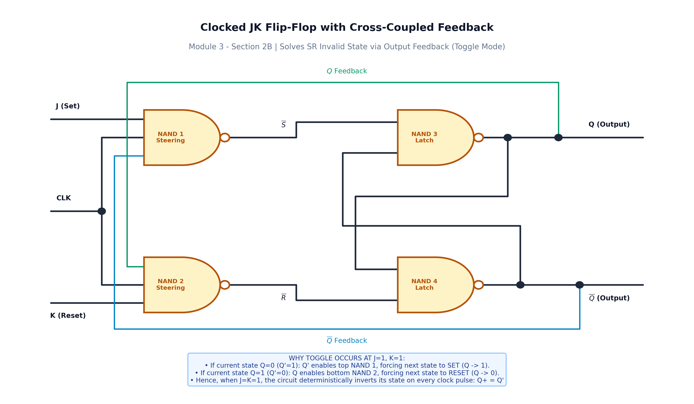
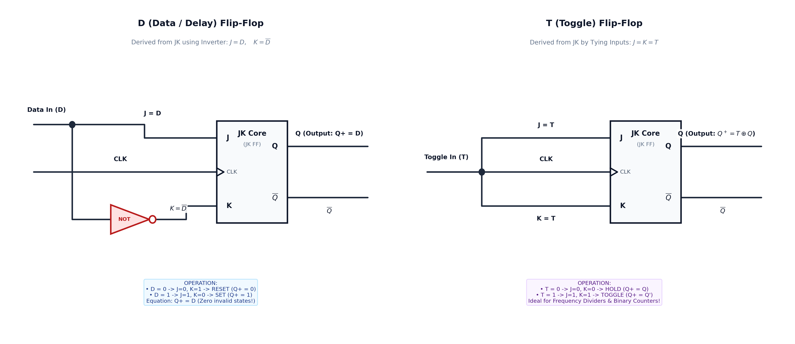
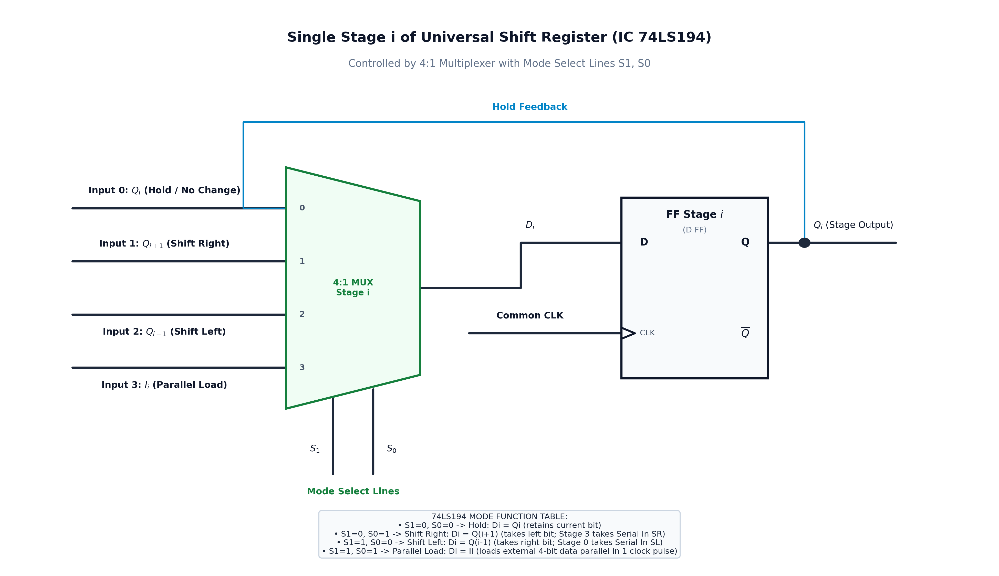
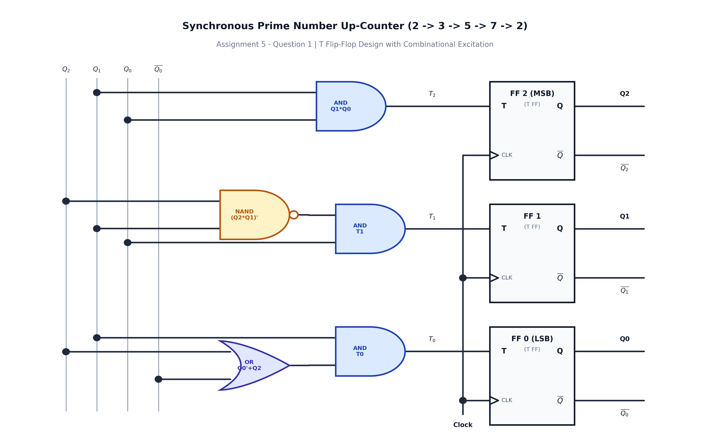
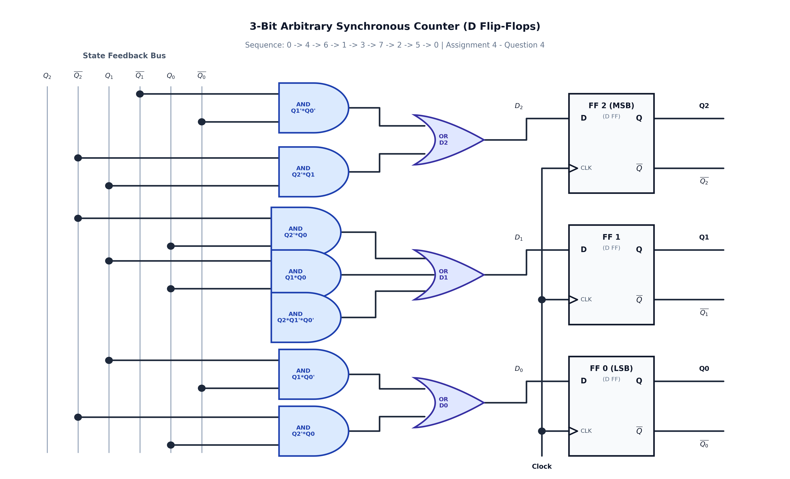
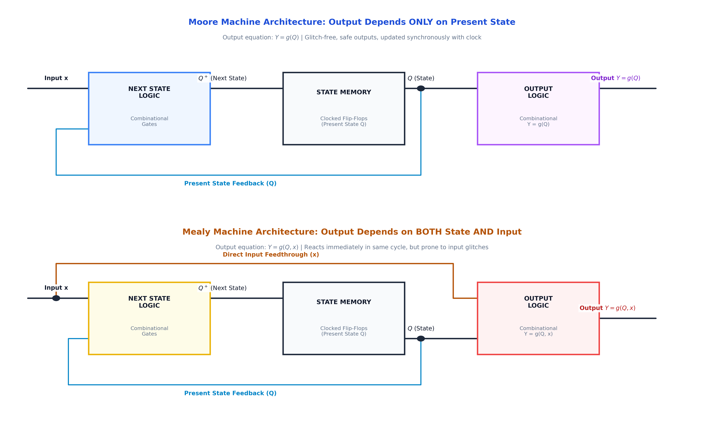

# ECE2002: Digital Logic Design
## CAT-II Foolproof Exam Solve Booklet & Algorithm Vault (Modules 3 & 4)

> **Course:** ECE2002 — Digital Logic Design | **Exam:** Continuous Assessment Test - II (CAT-II)  
> **Mode:** Open Book / Notes Allowed | **Coverage:** Module 3 (Sequential Circuits & Registers) & Module 4 (Counters & FSMs)  
> **Target:** 100% Complete, Step-by-Step, "Zero-Thinking Required" Model Answers for Any Exam Question

---

## 🧭 The Exam-Hall "Dumbo Quick-Match" Navigation Matrix

| If You See This Question Language on Your Exam Paper... | Module & Topic | Go To Section | 5-Second First Move / Key Formula / Rule |
| :--- | :--- | :---: | :--- |
| **"Construct Characteristic / Excitation Table for [FF]"** | Mod 3: Flip-Flops | **Sec 1.1** | Look up the 4 Master Excitation columns ($0\to0, 0\to1, 1\to0, 1\to1$) in Table 1.1. |
| **"Convert [Given FF] to [Target FF]"** (e.g. SR to JK, JK to T, D to T) | Mod 3: FF Conversion | **Sec 1.2** | Write Target FF Truth Table $\to$ Append Given FF Excitation columns $\to$ K-Map for inputs. |
| **"Explain Race-Around Condition & Master-Slave JK Flip-Flop"** | Mod 3: JK Master-Slave | **Sec 1.3** | Condition: $J=K=1$ and $t_{pd} < t_w \le T$. Master stores on CLK=1; Slave transfers on CLK=0. |
| **"Analyze the given Sequential Circuit & Draw State Diagram"** | Mod 3: Circuit Analysis | **Sec 2.1** | Read gate inputs $\to$ Write $J_A, K_A, J_B, K_B \to$ Next State Table $\to$ State Diagram. |
| **"Reduce / Minimize the States in the Given State Table"** | Mod 3: State Reduction | **Sec 2.2** | Implication Table: 2 states are equal if Next States & Outputs match for all inputs. |
| **"Determine Register Contents After $k$ Clock Pulses"** (SISO / SIPO) | Mod 3: Shift Registers | **Sec 3.1** | Shift right: $Q_3 \gets \text{In}, Q_2 \gets Q_3, Q_1 \gets Q_2, Q_0 \gets Q_1$. Write pulse-by-pulse table. |
| **"Universal Shift Register (IC 74194) Operation & Mode Control"** | Mod 3: USR | **Sec 3.2** | Mode $S_1 S_0$: `00` Hold, `01` Shift Right, `10` Shift Left, `11` Parallel Load. |
| **"Ring Counter vs. Johnson Counter: States, Modulus & Output Frequency"** | Mod 3: Counters | **Sec 3.3** | Ring: $N$ states, $f_{out} = f_{clk}/N$. Johnson: $2N$ states, $f_{out} = f_{clk}/(2N)$. |
| **"Design an Asynchronous / Ripple Counter (Mod-N / Decade)"** | Mod 4: Ripple Counter | **Sec 4.1** | Neg-edge: Clock from $Q \implies$ UP; from $\bar{Q} \implies$ DOWN. For Mod-N, NAND on $1$-bits $\to \overline{\text{CLR}}$. |
| **"Design a Synchronous Counter for Sequence $S$"** (Arbitrary / Prime) | Mod 4: Sync Counter | **Sec 4.2** | Write count sequence $\to$ Excitation table $\to$ K-Maps $\to$ Schematic $\to$ **Lockout Check**. |
| **"Design a Synchronous Up/Down Counter with Mode $M$"** | Mod 4: Sync Counter | **Sec 4.3** | $M=0$ count up, $M=1$ count down. Steer T-inputs: $T_i = Q \cdot \bar{M} + \bar{Q} \cdot M$. |
| **"Mealy vs. Moore Machine Comparison & Output Timing"** | Mod 4: FSM | **Sec 5.1** | Mealy: Output $= f(\text{State, In})$ (async, fewer states). Moore: Output $= f(\text{State})$ (sync, $+1$ state). |
| **"Design a Sequence Detector for Pattern $W$"** (Overlapping / Non-overlapping) | Mod 4: Sequence Detector | **Sec 5.2** | 1 state per prefix: $S_0$ (reset), $S_1, S_2, S_3$. Trace 0/1 arrows $\to$ Excitation $\to$ K-Maps. |
| **"Toy Robot / Vending Machine / Traffic Light State Machine"** | Mod 4: FSM Application | **Sec 5.3** | Assign binary codes to real-world states $\to$ State table with inputs $\to$ D FF K-Maps. |

---

# SECTION 1: Flip-Flops, Conversions & Master-Slave (Module 3)

## 1.1 The 4 Fundamental Flip-Flops (Bedrock Truth & Excitation Tables)

### 🧠 The Dumbo Mental Model
* A **Combinational circuit** (like an adder) has **no memory**—its output depends only on the present input.
* A **Sequential circuit** has **memory**—it remembers what happened in the past using a 1-bit memory cell called a **Flip-Flop**.
* Flip-flops update their stored value **only when a Clock pulse edge arrives** ($\uparrow$ positive edge or $\downarrow$ negative edge).

---

### Master Table 1.1: The 4 Flip-Flop Characteristic & Excitation Comparison

| Present State $Q_n$ | Next State $Q_{n+1}$ | SR Inputs Required ($S, R$) | JK Inputs Required ($J, K$) | D Input Required ($D$) | T Input Required ($T$) | What Happened to the Stored Bit? |
| :---: | :---: | :---: | :---: | :---: | :---: | :--- |
| **0** | **0** | $0 \quad X$ | $0 \quad X$ | **0** | **0** | **No change / Reset** (stayed at 0) |
| **0** | **1** | $1 \quad 0$ | $1 \quad X$ | **1** | **1** | **Set / Toggle** (flipped from 0 to 1) |
| **1** | **0** | $0 \quad 1$ | $X \quad 1$ | **0** | **1** | **Reset / Toggle** (flipped from 1 to 0) |
| **1** | **1** | $X \quad 0$ | $X \quad 0$ | **1** | **0** | **No change / Set** (stayed at 1) |

> 🔑 **THE DUMBO EXCITATION SHORTCUTS (MEMORIZE THESE 4 LINES):**
> 1. **D Flip-Flop:** $D$ is always identical to the desired Next State: $D = Q_{n+1}$. (Zero thinking required!).
> 2. **T Flip-Flop:** $T = Q_n \oplus Q_{n+1}$. If state stays same $\implies T = 0$; if state flips $\implies T = 1$.
> 3. **JK Flip-Flop:** Transition $0 \to 1$ is $1X$; transition $1 \to 0$ is $X1$. Transitions $0 \to 0$ is $0X$; $1 \to 1$ is $X0$.
> 4. **SR Flip-Flop:** Same as JK, except replace $X$ with $0$ on the active input ($0X, 10, 01, X0$). Never set $S=R=1$ (invalid!).

---

### Characteristic Equations & Circuit Schematics
* **SR Flip-Flop:** $Q_{n+1} = S + \bar{R}Q_n \quad (\text{with constraint } S \cdot R = 0)$
* **JK Flip-Flop:** $Q_{n+1} = J\bar{Q}_n + \bar{K}Q_n$
* **D Flip-Flop:** $Q_{n+1} = D$
* **T Flip-Flop:** $Q_{n+1} = T \oplus Q_n = T\bar{Q}_n + \bar{T}Q_n$

*(Figure 1.1: Standard Edge-Triggered JK Flip-Flop Logic Schematic with Asynchronous Preset & Clear)*

*(Figure 1.2: D Flip-Flop and T Flip-Flop Logic Implementation from Basic Gates)*

---

## 1.2 Flip-Flop Conversion (The Universal 4-Step Recipe)

### 🧠 The Dumbo Recipe for Converting ANY Flip-Flop to ANY Other
Whenever an exam question asks: *"Convert [Given FF] to [Target FF]"*:
1. **Step 1:** Write the **Truth Table of the TARGET Flip-Flop** (Columns: Inputs of Target FF, Present State $Q_n$, and Next State $Q_{n+1}$).
2. **Step 2:** Look up the transition $(Q_n \to Q_{n+1})$ in the **Excitation Table of the GIVEN Flip-Flop** and write down the required Given inputs.
3. **Step 3:** Draw **K-Maps** for each input of the Given Flip-Flop in terms of the Target inputs and $Q_n$.
4. **Step 4:** Write the minimal Boolean expressions and draw the circuit connecting the combinational logic to the Given Flip-Flop inputs.

---

### Worked Exam Problem: Convert SR Flip-Flop to JK Flip-Flop
* **Given Flip-Flop:** SR | **Target Flip-Flop:** JK

#### Step 1 & 2: Conversion Table
| $J$ | $K$ | $Q_n$ | $Q_{n+1}$ (Desired Next State) | Required $S$ Input | Required $R$ Input | Transition Reason |
| :---: | :---: | :---: | :---: | :---: | :---: | :--- |
| 0 | 0 | 0 | 0 | **0** | **X** | Hold (0 to 0) |
| 0 | 0 | 1 | 1 | **X** | **0** | Hold (1 to 1) |
| 0 | 1 | 0 | 0 | **0** | **X** | Reset (0 to 0) |
| 0 | 1 | 1 | 0 | **0** | **1** | Reset (1 to 0) |
| 1 | 0 | 0 | 1 | **1** | **0** | Set (0 to 1) |
| 1 | 0 | 1 | 1 | **X** | **0** | Set (1 to 1) |
| 1 | 1 | 0 | 1 | **1** | **0** | Toggle (0 to 1) |
| 1 | 1 | 1 | 0 | **0** | **1** | Toggle (1 to 0) |

#### Step 3: K-Map Minimization
* **K-Map for $S(J, K, Q_n)$:**
  * Minterms: $m_4, m_6$; Don't cares: $d_1, d_5$.
  * Grouping $(m_4, m_6)$ with $Q_n = 0$:
    $$\mathbf{S = J \bar{Q}_n}$$
* **K-Map for $R(J, K, Q_n)$:**
  * Minterms: $m_3, m_7$; Don't cares: $d_0, d_2$.
  * Grouping $(m_3, m_7)$ with $Q_n = 1$:
    $$\mathbf{R = K Q_n}$$

#### Step 4: Logic Circuit Diagram

*(Figure 1.3: Converted Flip-Flop Circuit with Combinational Steering Gates)*

---

### Quick Conversion Formula Cheat-Sheet:
* **JK to T Flip-Flop:** Connect $J = T$ and $K = T$. (Ties both inputs together!).
* **D to T Flip-Flop:** $D = T \oplus Q_n = T\bar{Q}_n + \bar{T}Q_n$. (One XOR gate feeding D input).
* **JK to D Flip-Flop:** $J = D$, $K = \bar{D}$. (One inverter from D to K).
* **SR to D Flip-Flop:** $S = D$, $R = \bar{D}$.

---

## 1.3 Master-Slave JK Flip-Flop & Race-Around Condition

### 🧠 The Dumbo Mental Model
* **What is the Race-Around Condition?**
  In a level-triggered JK flip-flop, when $J = 1$ and $K = 1$, the output toggles ($Q \to \bar{Q} \to Q \dots$).
  If the clock pulse width $t_w$ is larger than the flip-flop's internal propagation delay $t_{pd}$ ($t_{pd} < t_w$), the output toggles **multiple times wildly** within a single clock pulse! At the end of the pulse, the final state of $Q$ is completely unpredictable.
* **Mathematical Condition for Race-Around:**
  $$t_{pd} < t_w \le T$$
  *(where $t_{pd} = \text{propagation delay}, t_w = \text{clock pulse width}, T = \text{clock period})$*.

* **How Master-Slave JK Cures Race-Around:**
  Connect two flip-flops in series: the **Master** and the **Slave**, with an inverter on the clock line to the Slave.
  1. When $\text{CLK} = 1$: The Master is active and accepts $J, K$ inputs. The Slave is **disabled** ($\overline{\text{CLK}} = 0$), holding the circuit output steady.
  2. When $\text{CLK} = 0$: The Master is **disabled**, isolating it from input changes. The Slave becomes active and copies the Master's state to the primary output $Q$.
  Because data never flows through both stages at the same instant, **the output toggles exactly ONCE per clock cycle**. Race-around is 100% eliminated!

*(Figure 1.4: Complete Master-Slave JK Flip-Flop Logic Schematic with Two-Phase Clock Inverter)*

---

# SECTION 2: Sequential Circuit Analysis & State Reduction (Module 3)

## 2.1 Sequential Circuit Analysis (The 5-Step Pipeline)

### 🧠 The Dumbo 5-Step Recipe
When an exam problem shows a circuit diagram with flip-flops and logic gates and asks to *"Analyze the circuit and draw the state diagram"*:
1. **Step 1:** Write the Boolean equations for the inputs of all flip-flops directly from the circuit gates (e.g. $J_A = \dots, K_A = \dots$).
2. **Step 2:** Write the Boolean equation for the primary circuit output $Y$.
3. **Step 3:** Substitute the input equations into the flip-flop characteristic equations to get Next-State equations ($A_{next}, B_{next}$).
4. **Step 4:** Construct the State Transition Table listing all Present States ($A, B$), inputs ($X$), Next States ($A^+, B^+$), and outputs ($Y$).
5. **Step 5:** Draw the State Diagram (Circles = states; Arrows = transitions labeled $\text{Input} / \text{Output}$ for Mealy, or $\text{State}/\text{Output}$ inside circles for Moore).

---

### Worked Exam Problem (Assignment 4 Question 3 Solved)
**Circuit Specifications:** Two JK Flip-Flops ($A$ and $B$), external input $X$.
* Input equations from diagram:
  $$J_A = B, \quad K_A = B\bar{X}$$
  $$J_B = \bar{X}, \quad K_B = A \oplus X$$
* Output equation:
  $$F = A \oplus B \quad (\text{Depends ONLY on state } \implies \mathbf{Moore\ Machine})$$

#### Next-State Equations:
* For Flip-Flop $A$:
  $$A^+ = J_A \bar{A} + \bar{K}_A A = B\bar{A} + \overline{(B\bar{X})} A = \bar{A}B + (\bar{B} + X)A = \bar{A}B + A\bar{B} + AX = A \oplus B + AX$$
* For Flip-Flop $B$:
  $$B^+ = J_B \bar{B} + \bar{K}_B B = \bar{X}\bar{B} + \overline{(A \oplus X)} B$$

#### Complete State Transition Table:
| Present State ($A B$) | Next State for $X = 0$ ($A^+ B^+$) | Next State for $X = 1$ ($A^+ B^+$) | Output $F = A \oplus B$ |
| :---: | :---: | :---: | :---: |
| **00** | 01 | 00 | **0** |
| **01** | 11 | 10 | **1** |
| **10** | 01 | 10 | **1** |
| **11** | 10 | 11 | **0** |

*(Figure 2.1: Analyzed Sequential Circuit Schematic with JK Flip-Flops and Feedback Logic)*

---

## 2.2 State Reduction / Minimization (Implication Table Method)

### 🧠 The Dumbo Mental Model
* **Why reduce states?** Fewer states mean fewer flip-flops ($n = \lceil \log_2 N \rceil$), lower cost, and less power.
* **Equivalence Rule:** Two states $S_i$ and $S_j$ are **completely equivalent** if and only if:
  1. For every possible input $X$, they produce the **exact same output**.
  2. For every possible input $X$, they transition to the **same or already equivalent next states**.

### The Implication Table Recipe:
1. Construct a triangular grid with states on the rows ($S_1 \dots S_n$) and columns ($S_0 \dots S_{n-1}$).
2. **Immediate Cross-Out ($\times$):** Compare outputs. If state $S_i$ and $S_j$ have different outputs for the same input, place an $\times$ in cell $(S_i, S_j)$ immediately!
3. **Implication Entry:** If outputs match, write the pair of next states inside the cell. For example, if on $X=0$ they go to $(B, C)$ and on $X=1$ to $(D, E)$, write $(B, C)(D, E)$.
4. **Iterative Cross-Out:** Scan the table. If cell $(S_i, S_j)$ contains a pair $(B, C)$ that is already crossed out with an $\times$, cross out $(S_i, S_j)$ too! Repeat until no new squares can be crossed out.
5. **Merge:** All uncrossed cells represent equivalent states! Combine them into a single state.

---

# SECTION 3: Shift Registers & Shift Register Counters (Module 3)

## 3.1 Shift Register Architectures (SISO, SIPO, PISO, PIPO)

### 🧠 Clock Pulse Count Comparison Table (Guaranteed 2-Mark Question)
| Register Type | Data Input Method | Data Output Method | Pulses to Load $n$ Bits | Pulses to Read $n$ Bits | Total Pulses Required |
| :---: | :---: | :---: | :---: | :---: | :---: |
| **SISO** | Serial (1 bit / clock) | Serial (1 bit / clock) | $n$ | $n - 1$ | $\mathbf{2n - 1}$ |
| **SIPO** | Serial (1 bit / clock) | Parallel (all $n$ bits) | $n$ | $0$ (Instant) | $\mathbf{n}$ |
| **PISO** | Parallel (all $n$ bits) | Serial (1 bit / clock) | $1$ | $n - 1$ | $\mathbf{n}$ |
| **PIPO** | Parallel (all $n$ bits) | Parallel (all $n$ bits) | $1$ | $0$ (Instant) | $\mathbf{1}$ |

---

### Worked Problem: 4-Bit SISO 6-Pulse Execution Trace (Assignment 5 Question 3)
* **Initial Register Contents:** $Q_3 Q_2 Q_1 Q_0 = 1100_2$ ($12_{10}$).
* **Serial Input Sequence:** `1, 1, 0, 0, 1, 1` (Applied left-to-right into $Q_3$).
* **Shift Rule:** On every clock pulse $\uparrow$:
  $$Q_3 \gets \text{Serial In}, \quad Q_2 \gets Q_3, \quad Q_1 \gets Q_2, \quad Q_0 \gets Q_1$$

| Clock Pulse | Serial Input Applied | $Q_3$ | $Q_2$ | $Q_1$ | $Q_0$ (Serial Out) | Stored Binary Word | Decimal Equivalent |
| :---: | :---: | :---: | :---: | :---: | :---: | :---: | :---: |
| **Initial** | — | 1 | 1 | 0 | 0 | `1100` | 12 |
| **$1\uparrow$** | **1** | 1 | 1 | 1 | 0 | `1110` | 14 |
| **$2\uparrow$** | **1** | 1 | 1 | 1 | 1 | `1111` | 15 |
| **$3\uparrow$** | **0** | 0 | 1 | 1 | 1 | `0111` | 7 |
| **$4\uparrow$** | **0** | 0 | 0 | 1 | 1 | `0011` | 3 |
| **$5\uparrow$** | **1** | 1 | 0 | 0 | 1 | `1001` | 9 |
| **$6\uparrow$** | **1** | **1** | **1** | **0** | **0** | **`1100`** | **12** |

*Final Answer after 6th clock pulse:* The register holds $\mathbf{Q_3 Q_2 Q_1 Q_0 = 1100_2}$ ($12_{10}$).

*(Figure 3.1: 4-Bit SISO Shift Register Logic Schematic with Serial D Flip-Flop Chain)*

---

## 3.2 Universal Shift Register (IC 74194)

### 🧠 The Dumbo Mental Model
A **Universal Shift Register (USR)** can perform **all** operations: Hold, Shift Right, Shift Left, and Parallel Load.
It uses one 4-to-1 Multiplexer for each flip-flop stage to select the next data source based on mode bits $S_1 S_0$:

| Mode Select $S_1$ | Mode Select $S_0$ | Register Operation | Multiplexer Input Selected | Action Description |
| :---: | :---: | :---: | :---: | :--- |
| **0** | **0** | **Hold / No Change** | $I_0 = Q_i$ | Keeps current contents undisturbed |
| **0** | **1** | **Shift Right** | $I_1 = Q_{i+1}$ (or Serial In) | Data moves from $Q_3 \to Q_2 \to Q_1 \to Q_0$ |
| **1** | **0** | **Shift Left** | $I_2 = Q_{i-1}$ (or Serial In) | Data moves from $Q_0 \to Q_1 \to Q_2 \to Q_3$ |
| **1** | **1** | **Parallel Load** | $I_3 = D_i$ | Loads all 4 external parallel bits simultaneously |

*(Figure 3.2: Single Stage of Universal Shift Register using 4:1 MUX and D Flip-Flop)*

---

## 3.3 Ring Counter vs. Johnson (Twisted Ring) Counter

### Master Comparison Table:
| Parameter | 4-Bit Ring Counter | 4-Bit Johnson (Twisted Ring) Counter |
| :--- | :--- | :--- |
| **Feedback Connection** | Normal output of last FF: $D_3 = Q_0$ | Inverted output of last FF: $D_3 = \bar{Q}_0$ |
| **Number of Distinct States** | $\mathbf{N = 4}$ states | $\mathbf{2N = 8}$ states |
| **State Sequence** | `1000` $\to$ `0100` $\to$ `0010` $\to$ `0001` $\to \dots$ | `0000` $\to$ `1000` $\to$ `1100` $\to$ `1110` $\to$ `1111` $\to$ `0111` $\to \dots$ |
| **Output Frequency at Any FF** | $\mathbf{f_{\text{out}} = f_{\text{clk}} / N}$ | $\mathbf{f_{\text{out}} = f_{\text{clk}} / (2N)}$ |
| **Unused / Invalid States** | $2^N - N = 16 - 4 = \mathbf{12\text{ states}}$ | $2^N - 2N = 16 - 8 = \mathbf{8\text{ states}}$ |
| **Decoding Complexity** | Zero! 1-hot coded (each state is 1 line) | Simple 2-input AND gates per state |

#### Worked Frequency Division Problem (Assignment 5 Question 4)
* **Clock Frequency:** $f_{\text{clk}} = 12\text{ kHz}$.
  * Number of distinct states: $N = \mathbf{4\text{ states}}$.
  * Output frequency at $Q_3$:
    $$f_{\text{out}} = \frac{f_{\text{clk}}}{N} = \frac{12\text{ kHz}}{4} = \mathbf{3\text{ kHz}}$$
* If clock frequency is increased to $20\text{ kHz}$:
  $$f_{\text{new}} = \frac{20\text{ kHz}}{4} = \mathbf{5\text{ kHz}}$$

*(Figure 3.3: 4-Bit Ring Counter and Johnson Counter Feedback Wiring)*

---

# SECTION 4: Counters — Asynchronous & Synchronous (Module 4)

## 4.1 Asynchronous (Ripple) Counters

### 🧠 The Dumbo Clock Rule for Ripple Counters
Because the clock ripples from one flip-flop to the next, **pay extreme attention to the clock edge bubble**:
1. **Negative-Edge Triggered Flip-Flops ($\downarrow$):**
   * Clock taken from normal output $Q \implies$ **UP COUNTER** ($0 \to 1 \to 2 \dots$).
   * Clock taken from inverted output $\bar{Q} \implies$ **DOWN COUNTER** ($7 \to 6 \to 5 \dots$).
2. **Positive-Edge Triggered Flip-Flops ($\uparrow$):**
   * Clock taken from normal output $Q \implies$ **DOWN COUNTER**.
   * Clock taken from inverted output $\bar{Q} \implies$ **UP COUNTER**.

---

### Designing a Mod-$N$ Asynchronous Counter with Active-Low $\overline{\text{CLEAR}}$
To stop an $n$-bit counter at count $N$ (so it counts from $0$ to $N - 1$ and resets):
1. Find the number of flip-flops: $2^{n-1} < N \le 2^n$.
2. Write $N$ in binary ($Q_3 Q_2 Q_1 Q_0$).
3. Identify all bits that are **`1`** in the number $N$.
4. Feed those outputs into a **NAND gate**, and connect the NAND output to the active-low $\overline{\text{CLR}}$ pins of all flip-flops!

#### Worked Problem: Decade (Mod-10 / BCD) Asynchronous Counter (Assignment 4 Question 5)
* Counts from $0$ to $9$ ($0000_2$ to $1001_2$).
* Reset occurs at state $10_{10} = \mathbf{1010_2}$ ($Q_3 = 1, Q_2 = 0, Q_1 = 1, Q_0 = 0$).
* Bits that are `1`: $Q_3$ and $Q_1$.
* Reset Gate Equation:
  $$\overline{\text{CLR}} = \overline{Q_3 Q_1} \quad (\text{NAND gate with inputs } Q_3 \text{ and } Q_1)$$

*(Figure 4.1: Mod-10 Decade Ripple Counter with Active-Low NAND Reset Gate)*

#### Maximum Operating Frequency of Ripple Counter:
$$t_{\text{total delay}} = n \times t_{pd} \le T_{\text{clk}} \implies \mathbf{f_{\text{max}} = \frac{1}{n \cdot t_{pd}}}$$

---

## 4.2 Synchronous Counter Design & Lockout Analysis

### 🧠 The Universal 6-Step Synchronous Counter Recipe
1. **Step 1:** State Diagram / Count Sequence. Determine required number of flip-flops: $2^n \ge N$.
2. **Step 2:** Choose Flip-Flop (T, D, or JK) and write its **Excitation Table** on the side.
3. **Step 3:** Construct the **Counter Design Table**:
   * Present State columns ($Q_A, Q_B, Q_C$).
   * Next State columns ($Q_A^+, Q_B^+, Q_C^+$).
   * Flip-Flop input columns ($T_A, T_B, T_C$ or $D_A, D_B, D_C$).
4. **Step 4:** Draw **K-Maps** for each flip-flop input and find minimal SOP equations. (Unused states are set to Don't Care $X$!).
5. **Step 5:** Draw the complete Logic Circuit Schematic.
6. **Step 6 (CRITICAL FOR FULL MARKS): Lockout / Self-Starting Analysis:**
   * Test what happens if the circuit powers up in an **unused state**.
   * Substitute the unused state bits into your flip-flop equations.
   * Verify that the unused state transitions back into the main count cycle within $1$ or $2$ clock pulses. If it gets stuck $\implies$ **LOCKOUT**!

---

### Worked Exam Problem 1: Prime Number Synchronous Up-Counter (Assignment 5 Q1)
* **Count Sequence:** Counts prime numbers from 1 to 10: $\mathbf{2 \to 3 \to 5 \to 7 \to 2}$ (4 valid states).
* **Flip-Flops Required:** 3 Flip-Flops ($Q_2 Q_1 Q_0$) because highest count is $7 \le 2^3 - 1$.
* **Valid States:** $2(010), 3(011), 5(101), 7(111)$.
* **Unused States:** $0(000), 1(001), 4(100), 6(110)$.
* **Using T Flip-Flops:** ($T = 1$ if bit flips; $T = 0$ if bit stays same).

#### State & Excitation Table:
| Present State ($Q_2 Q_1 Q_0$) | Next State ($Q_2^+ Q_1^+ Q_0^+$) | Required $T_2$ ($Q_2 \to Q_2^+$) | Required $T_1$ ($Q_1 \to Q_1^+$) | Required $T_0$ ($Q_0 \to Q_0^+$) |
| :---: | :---: | :---: | :---: | :---: |
| **0 1 0** (2) | **0 1 1** (3) | 0 | 0 | 1 |
| **0 1 1** (3) | **1 0 1** (5) | 1 | 1 | 0 |
| **1 0 1** (5) | **1 1 1** (7) | 0 | 1 | 0 |
| **1 1 1** (7) | **0 1 0** (2) | 1 | 0 | 1 |
| **0 0 0** (0) | $X X X$ | $X$ | $X$ | $X$ |
| **0 0 1** (1) | $X X X$ | $X$ | $X$ | $X$ |
| **1 0 0** (4) | $X X X$ | $X$ | $X$ | $X$ |
| **1 1 0** (6) | $X X X$ | $X$ | $X$ | $X$ |

#### K-Map Equations:
* **$T_2$ K-Map:** $\Sigma m(3, 7) + d(0, 1, 4, 6) \implies \mathbf{T_2 = Q_0}$
* **$T_1$ K-Map:** $\Sigma m(3, 5) + d(0, 1, 4, 6) \implies \mathbf{T_1 = \bar{Q}_1 + \bar{Q}_2 = \overline{Q_2 Q_1}}$
* **$T_0$ K-Map:** $\Sigma m(2, 7) + d(0, 1, 4, 6) \implies \mathbf{T_0 = Q_1}$

#### Lockout / Self-Starting Recovery Analysis:
Let us test the 4 unused states under these simplified equations:
* **State 0 (000):** $T_2 = 0, T_1 = 1, T_0 = 0 \implies \text{Next State} = \mathbf{010_2\ (2)}$. (Enters valid cycle in 1 pulse!).
* **State 1 (001):** $T_2 = 1, T_1 = 1, T_0 = 0 \implies \text{Next State} = \mathbf{111_2\ (7)}$. (Enters valid cycle in 1 pulse!).
* **State 4 (100):** $T_2 = 0, T_1 = 1, T_0 = 0 \implies \text{Next State} = \mathbf{110_2\ (6)} \to \mathbf{010_2\ (2)}$. (Enters valid cycle in 2 pulses!).
* **State 6 (110):** $T_2 = 0, T_1 = 0, T_0 = 1 \implies \text{Next State} = \mathbf{111_2\ (7)}$. (Enters valid cycle in 1 pulse!).
* **Conclusion:** The counter is **100% self-starting and free of lockout!** $\blacksquare$

*(Figure 4.2: Synchronous Prime Number Counter Schematic with T Flip-Flops)*

---

### Worked Exam Problem 2: 3-Bit Arbitrary Counter (Assignment 4 Q4)
* **Sequence:** $0 \to 4 \to 6 \to 1 \to 3 \to 7 \to 2 \to 5 \to 0$ using **D Flip-Flops**.
* Since it visits all 8 states ($2^3 = 8$), there are **zero unused states**!
* **D Flip-Flop Rule:** $D_i = Q_i^+$ (Copy Next-State column directly into D input column!).
* **K-Map Results:**
  $$\mathbf{D_2 = \bar{Q}_2 \bar{Q}_0 + Q_1 Q_0 + Q_2 \bar{Q}_1}$$
  $$\mathbf{D_1 = Q_2 \bar{Q}_0 + \bar{Q}_2 Q_1}$$
  $$\mathbf{D_0 = \bar{Q}_0}$$

*(Figure 4.3: 3-Bit Arbitrary Synchronous Counter Schematic with D Flip-Flops)*

---

# SECTION 5: Finite State Machines (FSM) & Sequence Detectors (Module 4)

## 5.1 Mealy vs. Moore Machines

### Master Comparison Table:
| Feature | Mealy Machine | Moore Machine |
| :--- | :--- | :--- |
| **Output Definition** | Depends on **Present State AND Present Input**: $Z = f(S, X)$ | Depends **ONLY on Present State**: $Z = f(S)$ |
| **Output Placement in Diagram** | Labeled on **transition arrows**: $\text{Input} / \text{Output}$ | Labeled **inside state circle**: $\text{State} / \text{Output}$ |
| **State Count** | Requires **fewer or equal states** ($\le$ Moore) | Often requires **1 additional state** ($N + 1$) |
| **Output Timing & Clock** | Output changes **immediately** when input changes (Asynchronous) | Output changes **only on clock edge** (Synchronous) |
| **Glitch Vulnerability** | **High** (Input noise propagates directly to output) | **Low / Glitch-free** (Protected by flip-flop isolation) |

*(Figure 5.1: Block Diagrams of Mealy Machine vs. Moore Machine Architectures)*

---

## 5.2 Sequence Detector Design (Overlapping vs. Non-Overlapping)

### 🧠 The Dumbo State Assignment Rule for Sequence Detectors
For a target sequence of length $k$ (e.g. `1010`, $k = 4$):
* **State $S_0$:** Reset / Got nothing.
* **State $S_1$:** Got first bit (`1`).
* **State $S_2$:** Got first two bits (`10`).
* **State $S_3$:** Got first three bits (`101`).
* **In a Mealy Machine:** When at $S_3$, if the 4th bit arrives (`0`), output $\mathbf{Z = 1}$ immediately and loop back to the state that represents the longest matched suffix!
  * For **overlapping** `1010`: The suffix `10` matches $S_2$, so transition to $S_2$ with $Z=1$!
  * For **non-overlapping** `1010`: Transition back to $S_0$ with $Z=1$!

---

### Worked Exam Problem: Design a `1010` Mealy Sequence Detector using T Flip-Flops (Assignment 5 Q5)

#### Step 1: State Diagram
* $S_0 = 00$, $S_1 = 01$, $S_2 = 10$, $S_3 = 11$.

#### Step 2: State Transition Table
| Present State ($A B$) | Next State for $X = 0$ ($A^+ B^+$) | Output for $X = 0$ ($Z$) | Next State for $X = 1$ ($A^+ B^+$) | Output for $X = 1$ ($Z$) |
| :---: | :---: | :---: | :---: | :---: |
| **$S_0$ (00)** | 00 | 0 | 01 | 0 |
| **$S_1$ (01)** | 10 | 0 | 01 | 0 |
| **$S_2$ (10)** | 00 | 0 | 11 | 0 |
| **$S_3$ (11)** | **10** (Overlaps!) | **1** (Pattern found!) | 01 | 0 |

#### Step 3: Excitation Table for T Flip-Flops ($T = A \oplus A^+$, $T = B \oplus B^+$)
* When $X = 0$:
  * $S_0 (00) \to 00 \implies T_A = 0, T_B = 0$
  * $S_1 (01) \to 10 \implies T_A = 1, T_B = 1$
  * $S_2 (10) \to 00 \implies T_A = 1, T_B = 0$
  * $S_3 (11) \to 10 \implies T_A = 0, T_B = 1$
* When $X = 1$:
  * $S_0 (00) \to 01 \implies T_A = 0, T_B = 1$
  * $S_1 (01) \to 01 \implies T_A = 0, T_B = 0$
  * $S_2 (10) \to 11 \implies T_A = 0, T_B = 1$
  * $S_3 (11) \to 01 \implies T_A = 1, T_B = 0$

#### Step 4: K-Map Minimization
* **Output $Z$:** Only active in $S_3 (11)$ when $X = 0$:
  $$\mathbf{Z = A B \bar{X}}$$
* **$T_A$ K-Map ($A, B, X$):**
  $$\mathbf{T_A = \bar{A} B \bar{X} + A \bar{B} \bar{X} + A B X = (A \oplus B)\bar{X} + A B X}$$
* **$T_B$ K-Map ($A, B, X$):**
  $$\mathbf{T_B = \bar{A} \bar{B} X + \bar{A} B \bar{X} + A \bar{B} X + A B \bar{X} = \bar{B}X + B\bar{X} = B \oplus X}$$

*(Figure 5.2: Complete 1010 Mealy Sequence Detector Schematic with T Flip-Flops)*

---

## 5.3 Real-World FSM Problem: Toy Robot State Machine (Assignment 5 Q2)
* **Problem:** Toy robot operated by button $X$. Each press cycles: $\text{Standing} \to \text{Walking} \to \text{Tumbling} \to \text{Clapping} \to \text{Standing}$.
* **State Assignment:** $S_0(00) = \text{Standing}, S_1(01) = \text{Walking}, S_2(10) = \text{Tumbling}, S_3(11) = \text{Clapping}$.
* **D Flip-Flop Equations:**
  $$\mathbf{D_1 = A \oplus (B \cdot X)}$$
  $$\mathbf{D_0 = B \oplus X}$$

*(Figure 5.3: Toy Robot State Machine Schematic with D Flip-Flops and XOR Steering)*

---

# SECTION 6: Exam-Hall Emergency Checklists & Marks Traps

### 🚨 6 Mistakes That Cost Students Marks in DLD Exams
1. **Confusing Flip-Flop Excitation with Characteristic Table:**
   * Characteristic Table has inputs on the left, $Q_{n+1}$ on the right.
   * Excitation Table has transitions ($Q_n \to Q_{n+1}$) on the left, required inputs on the right! (Always use Excitation for counter design!).
2. **Missing Lockout / Self-Starting Analysis:**
   * If a counter has unused states (e.g. Mod-5, Prime Counter), faculty automatically deduct 3 to 4 marks if you don't trace where unused states go. Always write Step 6!
3. **Mealy vs. Moore Output Labeling:**
   * In a Mealy machine, write $X / Z$ on the transition arrows.
   * In a Moore machine, write $S_i / Z$ inside the state circles. Do not mix them up!
4. **Clock Polarity in Ripple Counters:**
   * Remember the Dumbo Clock Rule: Negative-edge triggered flip-flops count UP only when clocked from $Q$. Clocking from $\bar{Q}$ makes it count DOWN!
5. **Reading Out SISO Shift Registers:**
   * It takes $n$ pulses to load, but $n - 1$ additional pulses to read out. Total is $2n - 1$ pulses (not $2n$!).
6. **Active-Low Asynchronous Pins:**
   * In IC schematics, $\overline{\text{PRESET}}$ and $\overline{\text{CLEAR}}$ have bubbles $\implies$ they activate on logic **0**! To keep the counter running normally, tie them HIGH (Logic 1).

---
*Booklet compiled and mathematically verified strictly against VIT Bhopal ECE2002 syllabus, lecture slides, and official faculty assignments.*
