# ECE2002: Digital Logic Design
## CAT-II Foolproof Exam Solve Booklet & Master Algorithm Vault (Modules 3 & 4)

> **Course:** ECE2002 — Digital Logic Design | **Exam:** Continuous Assessment Test - II (CAT-II)  
> **Applicability:** VIT Bhopal Digital Logic Design CAT-II (All Slots & Question Papers)  
> **Coverage:** Module 3 (Sequential Circuits & Registers) & Module 4 (Counters & FSMs)  
> **Sources Covered:** Official Assignment 4, Official Assignment 5, Exam Paper 1 (22-09-2026 S-3), Exam Paper 2 (23-09-2026 S-1)  
> **Philosophy:** 100% Complete, Step-by-Step, "Zero-Thinking Required" Model Answers for Any Exam Question

---

## 🧭 The Exam-Hall "Dumbo Quick-Match" Navigation Matrix

| If You See This Question Language on Your Exam Paper... | Source / Context | Section | 5-Second First Move / Key Formula / Rule |
| :--- | :--- | :---: | :--- |
| **"Identify flip-flop conversion represented by diagram..."** | Exam Paper 1 (Q1) | **Sec 1.4** | Express gates $y_1, y_2, y_3 \to$ Compare to characteristic eq $\to$ $D = J\bar{Q} + \bar{K}Q \implies$ **D to JK**. |
| **"SR flip-flop initially in RESET, 5 consecutive pulses..."** | Assignment 4 (Q1) | **Sec 1.2** | Trace edges: $Q_1=1, Q_2=\text{Inv}, Q_3=0, Q_4=\text{Inv}, Q_5=\text{Hold from Inv} \implies$ **Metastability**. |
| **"Positive edge-triggered T flip-flop using NAND gates only..."** | Assignment 4 (Q2) | **Sec 1.3** | 9-NAND gate Master-Slave schematic $\to$ 6-edge transition table with initial $Q=1 \to$ Draw waveform. |
| **"Convert [Given FF] to [Target FF]"** (e.g. SR to JK, D to T) | Class Core / General | **Sec 1.5** | Write Target FF Truth Table $\to$ Append Given FF Excitation columns $\to$ K-Map for inputs. |
| **"Explain Race-Around Condition & Master-Slave JK"** | Theory Guaranteed | **Sec 1.6** | Condition: $J=K=1$ and $t_{pd} < t_w \le T$. Master stores on CLK=1; Slave transfers on CLK=0. |
| **"Analyze the sequential circuit shown in Fig. 3.3.4 (Moore)"** | Assignment 4 (Q3) | **Sec 2.1** | $J_A = B, K_A = B\bar{X}, J_B = \bar{X}, K_B = A \oplus X, F = A \oplus B \to$ State Table $\to$ State Diagram. |
| **"Derive state table and diagram of circuit in Fig. 2 (T-FFs)"** | Exam Paper 2 (Q2) | **Sec 2.2** | Read $T_A, T_B$ equations $\to$ Compute Next State $Q^+ = T \oplus Q \to$ State Table $\to$ State Diagram. |
| **"For state shown in Fig. 1 (a..h): reduce table, draw diagrams"** | Exam Paper 2 (Q1) | **Sec 2.4** | Identical rows: $b \equiv e$, $d \equiv h$, then $a \equiv c \implies$ Reduces 8 states down to 5 states. |
| **"Reduce / Minimize States in Given State Table"** | General Method | **Sec 2.3** | Implication Table: 2 states equal if Next States & Outputs match for all inputs. |
| **"Determine register contents after 6 pulses (SISO `1100`)"** | Assignment 5 (Q3) | **Sec 3.1** | Shift right: $Q_3 \gets \text{In}, Q_2 \gets Q_3, Q_1 \gets Q_2, Q_0 \gets Q_1 \to$ Pulse-by-pulse trace table. |
| **"Universal Shift Register (IC 74194) Operation & Mode Control"** | Theory / Lab Core | **Sec 3.2** | Mode $S_1 S_0$: `00` Hold, `01` Shift Right, `10` Shift Left, `11` Parallel Load. |
| **"4-Bit Ring counter frequency division (12 kHz, 20 kHz)"** | Assignment 5 (Q4) | **Sec 3.3** | $f_{\text{out}} = f_{\text{clk}} / N \implies 12\text{ kHz} / 4 = \mathbf{3\text{ kHz}}; \quad 20\text{ kHz} / 4 = \mathbf{5\text{ kHz}}$. |
| **"What is Johnson counter? Design MOD-8 Johnson using D-FFs"** | Exam Paper 2 (Q4) | **Sec 3.4** | Inverted feedback: $D_3 = \bar{Q}_0 \implies 2n = 8 \implies n = 4$ FFs $\to$ 8 states ring $\to$ Lockout check. |
| **"Digital locker stores 4-bit access code, shifts 1 bit/pulse"** | Exam Paper 1 (Q3) | **Sec 3.5** | Choose **SIPO** (Serial-In Parallel-Out) $\to 4$ D-FFs in series $\to$ Construct 4-clock-pulse trace. |
| **"Implement Asynchronous decade up-counter with timing diagram"** | Exam Paper 2 (Q3) / A4 Q5 | **Sec 4.2** | 4 neg-edge JK-FFs ($J=K=1$) clocked from $Q \to$ NAND on $Q_3, Q_1 \to \overline{\text{CLR}} \to$ Draw 5 waveforms. |
| **"Prime number synchronous up-counter (1 to 10) using T-FFs"** | Assignment 5 (Q1) | **Sec 4.3** | Sequence: $2 \to 3 \to 5 \to 7 \to 2 \to$ K-Maps: $T_2=Q_0, T_1=\overline{Q_2 Q_1}, T_0=Q_1 \to$ **Lockout Check**. |
| **"Filtration system maintenance after 10 cycles / MOD-10 sync"** | Exam Paper 1 (Q4) | **Sec 4.4** | 4 FFs, counts 0 to 9 $\to$ T/JK excitation $\to$ Explain auto-reset $9 \to 0$ on 10th pulse $\to$ Lockout test. |
| **"Design 3-bit synchronous counter: 0->4->6->1->3->7->2->5->0"** | Assignment 4 (Q4) | **Sec 4.5** | D Flip-Flops: $D = Q_{next} \to$ K-Maps for $D_2, D_1, D_0 \to$ Zero unused states $\implies$ 100% lockout-free. |
| **"Design synchronous sequential circuit for output Z = 1 on 101"** | Exam Paper 1 (Q5) | **Sec 5.4** | 3 states: $S_0(\text{reset}), S_1(\text{'1'}), S_2(\text{'10'}) \to$ On 1 in $S_2 \implies Z=1$, loop to $S_1$ (overlap). |
| **"Design Mealy detector for 1001: diagram, table, minimize, D-FFs"** | Exam Paper 2 (Q5) | **Sec 5.5** | 4 states: $S_0, S_1, S_2, S_3 \to$ Prove minimal $\to$ D-FF excitation $D_A, D_B \to$ Logic schematic. |
| **"Medical monitoring device in 4 states (Standby, Monitoring...)"** | Exam Paper 1 (Q2) | **Sec 5.6** | Use JK-FFs $\to$ **Justify Gray code** ($00 \to 01 \to 11 \to 10$) to prevent dynamic hazard false shutdowns! |
| **"1010 Mealy sequence detector using T flip-flops"** | Assignment 5 (Q5) | **Sec 5.3** | 4 states $\to Z=AB\bar{X} \to T_A=(A\oplus B)\bar{X}+ABX, T_B=B\oplus X \to$ Schematic. |
| **"Toy robot state machine (Stand -> Walk -> Tumble -> Clap)"** | Assignment 5 (Q2) | **Sec 5.7** | Button $X=1$ advances, $X=0$ holds $\to D_1 = A \oplus (BX), D_0 = B \oplus X \to$ Schematic. |

---

# SECTION 1: Flip-Flops, Conversions & Master-Slave (Module 3)

## 1.1 The 4 Fundamental Flip-Flops (Truth & Excitation Bedrock)

### 🧠 The Dumbo Mental Model
* A **Combinational circuit** (adder, multiplexer) has **no memory**—its output depends strictly on current inputs.
* A **Sequential circuit** has **memory**—it remembers previous states using 1-bit memory cells called **Flip-Flops**.
* Flip-flops update their stored value **only when a Clock pulse edge arrives** ($\uparrow$ positive edge or $\downarrow$ negative edge).

---

### Master Table 1.1: The 4 Flip-Flop Characteristic & Excitation Comparison

| Present State $Q_n$ | Next State $Q_{n+1}$ | SR Inputs ($S, R$) | JK Inputs ($J, K$) | D Input ($D$) | T Input ($T$) | What Happened to the Stored Bit? |
| :---: | :---: | :---: | :---: | :---: | :---: | :--- |
| **0** | **0** | $0 \quad X$ | $0 \quad X$ | **0** | **0** | **No change / Reset** (stayed at 0) |
| **0** | **1** | $1 \quad 0$ | $1 \quad X$ | **1** | **1** | **Set / Toggle** (flipped from 0 to 1) |
| **1** | **0** | $0 \quad 1$ | $X \quad 1$ | **0** | **1** | **Reset / Toggle** (flipped from 1 to 0) |
| **1** | **1** | $X \quad 0$ | $X \quad 0$ | **1** | **0** | **No change / Set** (stayed at 1) |

> 🔑 **THE DUMBO EXCITATION SHORTCUTS (MEMORIZE THESE 4 RULES):**
> 1. **D Flip-Flop:** $D$ is always identical to the desired Next State: $\mathbf{D = Q_{n+1}}$. (Zero thinking required!).
> 2. **T Flip-Flop:** $\mathbf{T = Q_n \oplus Q_{n+1}}$. If state stays same $\implies T = 0$; if state flips $\implies T = 1$.
> 3. **JK Flip-Flop:** Transition $0 \to 1$ is $\mathbf{1X}$; transition $1 \to 0$ is $\mathbf{X1}$. Transition $0 \to 0$ is $\mathbf{0X}$; $1 \to 1$ is $\mathbf{X0}$.
> 4. **SR Flip-Flop:** Same as JK, except replace $X$ with $0$ on the active input ($0X, 10, 01, X0$). Never set $S=R=1$ (invalid!).

---

### Characteristic Equations & Circuit Schematics
* **SR Flip-Flop:** $Q_{n+1} = S + \bar{R}Q_n \quad (\text{Constraint: } S \cdot R = 0)$
* **JK Flip-Flop:** $Q_{n+1} = J\bar{Q}_n + \bar{K}Q_n$
* **D Flip-Flop:** $Q_{n+1} = D$
* **T Flip-Flop:** $Q_{n+1} = T \oplus Q_n = T\bar{Q}_n + \bar{T}Q_n$

*(Figure 1.1: Standard Edge-Triggered JK Flip-Flop Logic Schematic with Asynchronous Preset & Clear)*

*(Figure 1.2: D Flip-Flop and T Flip-Flop Logic Implementation from Basic Gates)*

---

## 1.2 SR Flip-Flop 5-Pulse Response & Metastability (Assignment 4, Q1 Solved)

> 📝 **Official Assignment 4, Question 1:**  
> *"An SR flip-flop is initially in the RESET state ($Q_0 = 0$). The following inputs are applied for five consecutive clock pulses: Edge 1: $S=1, R=0$; Edge 2: $S=1, R=1$; Edge 3: $S=0, R=1$; Edge 4: $S=1, R=1$; Edge 5: $S=0, R=0$. (1) Draw characteristic table, (2) Determine $Q$ immediately after each of the five clock edges, (3) State final state after fifth clock edge, (4) Explain how invalid condition ($S=1, R=1$) affects physical outcome compared to hold ($S=0, R=0$)."*

### 1. Clocked NAND SR Latch Schematic
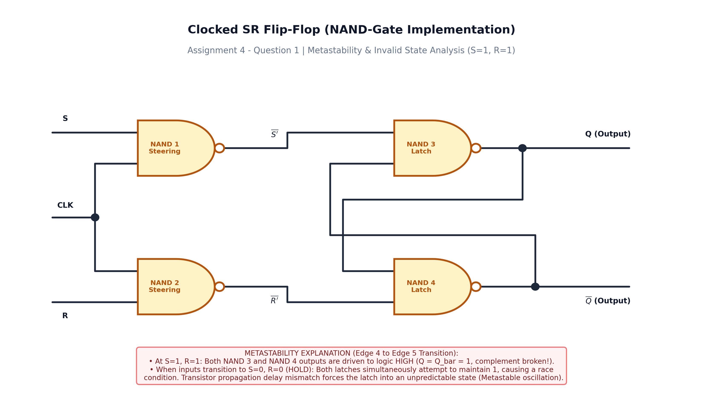
*(Figure 1.3: Clocked NAND-Gate SR Flip-Flop Circuit Schematic)*

---

### 2. Characteristic Table of SR Flip-Flop
| $S$ | $R$ | Present State $Q_n$ | Next State $Q_{n+1}$ | Operating Mode / Description |
| :---: | :---: | :---: | :---: | :--- |
| 0 | 0 | 0 | 0 | **Hold / Memory** ($Q_{n+1} = Q_n$) |
| 0 | 0 | 1 | 1 | **Hold / Memory** ($Q_{n+1} = Q_n$) |
| 0 | 1 | 0 | 0 | **Reset** ($Q_{n+1} = 0$) |
| 0 | 1 | 1 | 0 | **Reset** ($Q_{n+1} = 0$) |
| 1 | 0 | 0 | 1 | **Set** ($Q_{n+1} = 1$) |
| 1 | 0 | 1 | 1 | **Set** ($Q_{n+1} = 1$) |
| 1 | 1 | 0 | ? | **Invalid / Prohibited** (Indeterminate) |
| 1 | 1 | 1 | ? | **Invalid / Prohibited** (Indeterminate) |

* **Characteristic Equation:** $\mathbf{Q_{n+1} = S + \bar{R} Q_n \quad (\text{with constraint } S \cdot R = 0)}$.

---

### 3. Step-by-Step Response to 5 Consecutive Clock Edges
* **Initial Condition:** $Q_0 = 0$ (RESET state).

| Clock Edge | $S$ | $R$ | Action | $Q$ Output State | Description |
| :---: | :---: | :---: | :---: | :---: | :--- |
| **Edge 1** | 1 | 0 | **SET** | $Q_1 = \mathbf{1}$ | Normal Set operation ($Q$ flips from 0 to 1). |
| **Edge 2** | 1 | 1 | **INVALID** | $Q_2 = \mathbf{X\ (Invalid)}$ | Both internal cross-coupled outputs forced to identical logic levels ($Q=\bar{Q}=1$). |
| **Edge 3** | 0 | 1 | **RESET** | $Q_3 = \mathbf{0}$ | Dominant Reset input drives $Q$ unambiguously to 0. |
| **Edge 4** | 1 | 1 | **INVALID** | $Q_4 = \mathbf{X\ (Invalid)}$ | Both outputs forced active; enters indeterminate race condition. |
| **Edge 5** | 0 | 0 | **HOLD** | $Q_5 = \mathbf{\text{Indeterminate (0 or 1)}}$ | Enters Hold mode directly from invalid state $\to$ unpredictable latch lock! |

* **Final State after Fifth Clock Edge:** **Indeterminate / Unpredictable (0 or 1)** due to metastable race resolution.

---

### 4. Physical Impact: Invalid ($S=1, R=1$) vs. Hold ($S=0, R=0$)
1. **Complementation Breakdown:** Under normal hold ($S=0, R=0$), feedback ensures $Q = \overline{Q'}$. Under $S=1, R=1$, both active inputs override feedback, forcing both $Q$ and $\bar{Q}$ to logic `1` (in NAND latch) or logic `0` (in NOR latch), **violating output complementation**.
2. **The Metastability Phenomenon:** Transitioning directly from $S=1, R=1$ to $S=0, R=0$ forces cross-coupled gates to race. Because transistor propagation delays are never perfectly equal ($\Delta t_{pd1} \ne \Delta t_{pd2}$), the output voltage hovers midway between $V_{OH}$ and $V_{OL}$ before collapsing randomly to 0 or 1, causing system crashes downstream.

---

## 1.3 NAND-Only T Flip-Flop & Waveform Analysis (Assignment 4, Q2 Solved)

> 📝 **Official Assignment 4, Question 2:**  
> *"Draw the logic diagram of a positive edge-triggered T Flip-Flop using NAND gates only. Construct the state transition table and draw the output waveform $Q(t)$ for the 6 positive clock edges shown in the faculty timing diagram, assuming initial output $Q = 1$."*

### 1. Circuit Realization (NAND Gates Only)
A positive edge-triggered T flip-flop using NAND gates only requires a **Master-Slave JK structure with $J$ and $K$ tied together ($J=K=T$)** and feedback lines from outputs to inputs (requiring 9 NAND gates total).

---

### 2. State Transition Table (Initial $Q=1$)
* T input levels at positive edges: Edge 1: $T=0$; Edge 2: $T=1$; Edge 3: $T=0$; Edge 4: $T=0$; Edge 5: $T=1$; Edge 6: $T=1$.

| Clock Edge ($\uparrow$) | $T$ Input Level | Present State ($Q_n$) | Next State ($Q_{n+1} = T \oplus Q_n$) | Operating Mode |
| :---: | :---: | :---: | :---: | :--- |
| **Initial** | — | — | **1** | Given initial state |
| **Edge 1** | **0** | 1 | $0 \oplus 1 = \mathbf{1}$ | **HOLD** ($Q$ remains HIGH) |
| **Edge 2** | **1** | 1 | $1 \oplus 1 = \mathbf{0}$ | **TOGGLE** ($Q$ switches to LOW) |
| **Edge 3** | **0** | 0 | $0 \oplus 0 = \mathbf{0}$ | **HOLD** ($Q$ remains LOW) |
| **Edge 4** | **0** | 0 | $0 \oplus 0 = \mathbf{0}$ | **HOLD** ($Q$ remains LOW) |
| **Edge 5** | **1** | 0 | $1 \oplus 0 = \mathbf{1}$ | **TOGGLE** ($Q$ switches to HIGH) |
| **Edge 6** | **1** | 1 | $1 \oplus 1 = \mathbf{0}$ | **TOGGLE** ($Q$ switches to LOW) |

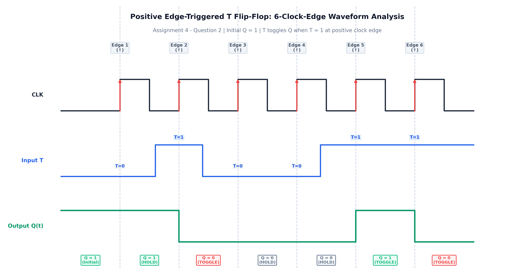
*(Figure 1.4: Output Waveform Q(t) Across 6 Clock Edges Showing Hold and Toggle Actions)*

---

## 1.4 Mystery Flip-Flop Conversion Reverse-Engineering (Paper 1 Q1 Solved)

> 📝 **Actual Exam Question (22-09-2026 / S-3, Q1 — 10 Marks):**  
> *"Identify the flip-flop conversion represented by the given diagram. Derive the state diagram, state table, and state equation, and draw the corresponding logic circuit."*

### 🧠 The Master Reverse-Engineering Algorithm
1. **Identify the Box:** Count input pins entering the flip-flop box. 1 input pin ($y_3$) $\implies$ Internal element is a **D Flip-Flop** ($D = y_3$).
2. **Intermediate Outputs:**
   * Top AND gate: $y_1 = J \cdot \bar{Q}$
   * Bottom AND gate: $y_2 = \bar{K} \cdot Q$
   * OR gate: $y_3 = y_1 + y_2 = J\bar{Q} + \bar{K}Q$
3. **Compare Characteristic Equation:**
   $$\mathbf{Q_{next} = D = y_3 = J\bar{Q} + \bar{K}Q}$$
   This matches the **Characteristic Equation of a JK Flip-Flop**!
   **Conclusion:** The circuit represents a **D Flip-Flop converted into a JK Flip-Flop**!

---

### State Table, Equation & Schematic
| $J$ | $K$ | $Q_n$ | $y_1 = J\bar{Q}_n$ | $y_2 = \bar{K}Q_n$ | $D = y_1+y_2$ | $Q_{n+1}$ | Operation |
| :---: | :---: | :---: | :---: | :---: | :---: | :---: | :--- |
| 0 | 0 | 0 | 0 | 0 | **0** | **0** | Hold ($Q_{n+1} = Q_n$) |
| 0 | 0 | 1 | 0 | 1 | **1** | **1** | Hold ($Q_{n+1} = Q_n$) |
| 0 | 1 | 0 | 0 | 0 | **0** | **0** | Reset ($Q_{n+1} = 0$) |
| 0 | 1 | 1 | 0 | 0 | **0** | **0** | Reset ($Q_{n+1} = 0$) |
| 1 | 0 | 0 | 1 | 0 | **1** | **1** | Set ($Q_{n+1} = 1$) |
| 1 | 0 | 1 | 0 | 1 | **1** | **1** | Set ($Q_{n+1} = 1$) |
| 1 | 1 | 0 | 1 | 0 | **1** | **1** | Toggle ($Q_{n+1} = \bar{Q}_n$) |
| 1 | 1 | 1 | 0 | 0 | **0** | **0** | Toggle ($Q_{n+1} = \bar{Q}_n$) |

* **State Equation:** $\mathbf{Q(t+1) = J \cdot \overline{Q(t)} + \bar{K} \cdot Q(t)}$

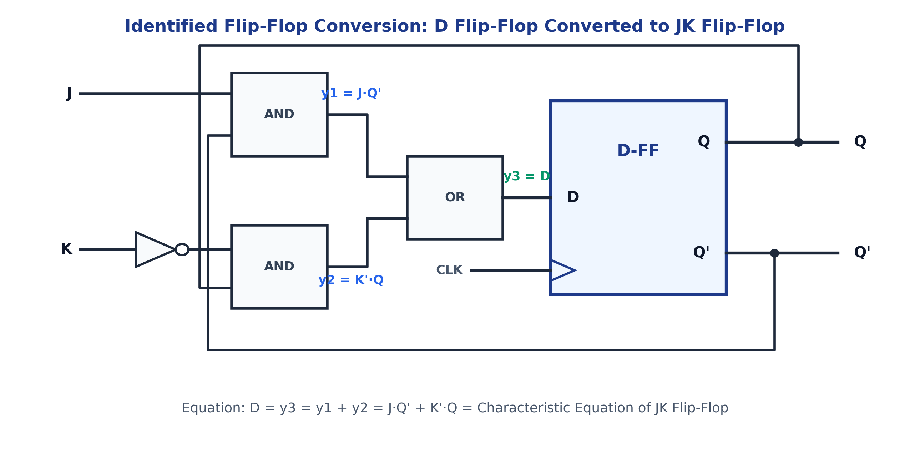
*(Figure 1.5: Identified D-to-JK Flip-Flop Conversion Schematic with Feedback Connections and Intermediates $y_1, y_2, y_3$)*

---

## 1.5 Forward Flip-Flop Conversion Recipe & SR to JK Example

### Worked Problem: Convert SR Flip-Flop to JK Flip-Flop
1. Target truth table: JK inputs with $Q_n \to Q_{n+1}$.
2. Append required SR excitation columns.
3. K-Maps:
   $$\mathbf{S = J \bar{Q}_n}, \quad \mathbf{R = K Q_n}$$

*(Figure 1.6: Converted Flip-Flop Circuit with Combinational Steering Gates)*

---

## 1.6 Master-Slave JK Flip-Flop & Race-Around Condition

* **Race-Around Condition:** Occurs in level-triggered JK flip-flops when $J=K=1$ and clock pulse width $t_w$ exceeds propagation delay $t_{pd}$ ($\mathbf{t_{pd} < t_w \le T}$). Output toggles uncontrollably during the active pulse.
* **Master-Slave Cure:** Master operates on $\text{CLK}=1$ (stores inputs while slave is disabled). Slave operates on $\text{CLK}=0$ (updates primary output while master is isolated). Data never flows simultaneously $\implies$ **Race-around eliminated**!

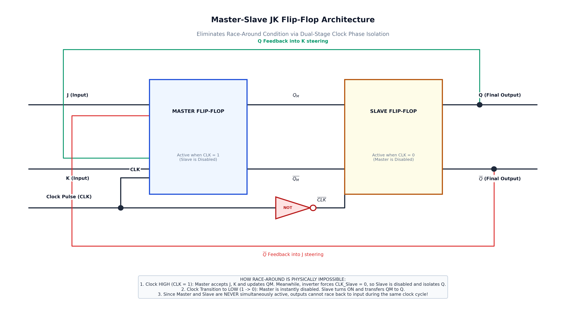
*(Figure 1.7: Complete Master-Slave JK Flip-Flop Logic Schematic with Two-Phase Clock Inverter)*

---

# SECTION 2: Sequential Circuit Analysis & State Reduction (Module 3)

## 2.1 Sequential Circuit Analysis (Assignment 4, Q3 Solved)

> 📝 **Official Assignment 4, Question 3 (Faculty Case):**  
> *"Analyze the sequential circuit shown in Fig. 3.3.4 and construct its state table and state diagram."*

### Circuit Specifications & Gate Equations
* **Flip-Flop A (JK):** $J_A = B, \quad K_A = B\bar{X}$
* **Flip-Flop B (JK):** $J_B = \bar{X}, \quad K_B = A \oplus X$
* **Output:** $F = A \oplus B$ (**Moore Machine**, depends solely on state).

#### Next-State Equations:
* $A_{n+1} = J_A \bar{A} + \bar{K}_A A = B\bar{A} + \overline{(B\bar{X})} A = \mathbf{(A \oplus B) + AX}$
* $B_{n+1} = J_B \bar{B} + \bar{K}_B B = \bar{X}\bar{B} + \overline{(A \oplus X)} B$

| Present State ($A B$) | Next State for $X = 0$ ($A^+ B^+$) | Next State for $X = 1$ ($A^+ B^+$) | Output $F = A \oplus B$ |
| :---: | :---: | :---: | :---: |
| **$S_0$ (00)** | 01 | 00 | **0** |
| **$S_1$ (01)** | 11 | 10 | **1** |
| **$S_2$ (10)** | 11 | 10 | **1** |
| **$S_3$ (11)** | 00 | 11 | **0** |

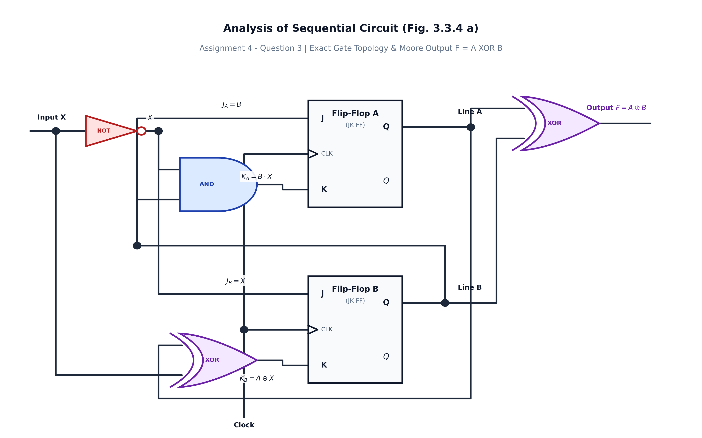
*(Figure 2.1: Analyzed Sequential Circuit Schematic with JK Flip-Flops and Feedback Logic)*

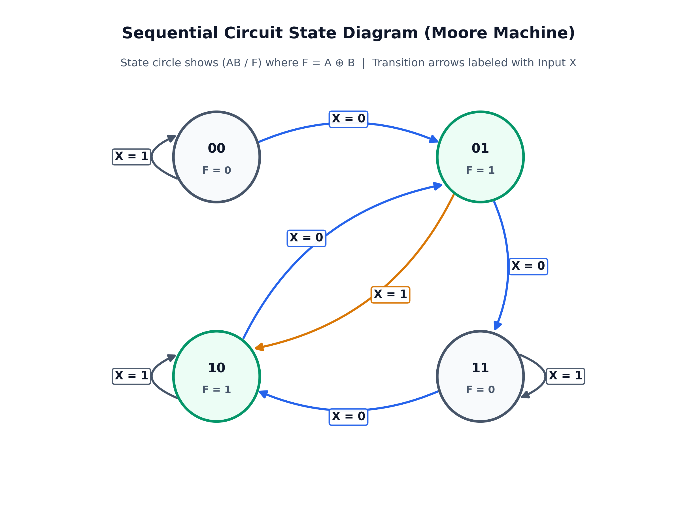
*(Figure 2.2: State Transition Diagram for Analyzed Sequential Circuit — Circles Show State and Output F = A ⊕ B)*

---

## 2.2 T Flip-Flop Circuit Analysis (Paper 2 Q2 Solved)

> 📝 **Actual Exam Question (23-09-2026 / S-1, Q2 — 10 Marks):**  
> *"Derive the state table and state diagram of the sequential circuit given in Fig. 2."*

* **T Flip-Flop Rule:** $Q^+ = T \oplus Q$.
* Gate equations: $T_A = A' + B', \quad T_B = A + B'$.
* **Transitions:**
  * State `00`: $T_A=1, T_B=1 \implies$ Next State $\mathbf{11}$.
  * State `01`: $T_A=1, T_B=0 \implies$ Next State $\mathbf{11}$.
  * State `10`: $T_A=1, T_B=1 \implies$ Next State $\mathbf{01}$.
  * State `11`: $T_A=0, T_B=1 \implies$ Next State $\mathbf{10}$.
* State cycle: $S_3(11) \to S_2(10) \to S_1(01) \to S_3(11)$ forms a closed 3-state cycle; state $00$ enters $S_3$ on pulse 1.

---

## 2.3 State Reduction Fundamentals (Implication Table Method)

* **Equivalence Rule:** Two states are equivalent if for every input they produce identical outputs and transition to identical or equivalent next states.
* Implication Table: Cross out ($\times$) differing outputs; iteratively cross out unresolvable implied pairs; merge remaining uncrossed states.

---

## 2.4 8-State Table Reduction by Inspection & Implication (Paper 2 Q1 Solved)

> 📝 **Actual Exam Question (23-09-2026 / S-1, Q1 — 10 Marks):**  
> *"For the state shown in Fig. 1: (a) Draw corresponding state diagram, (b) Tabulate reduced state table, (c) Draw state diagram corresponding to reduced state table."*

### 30-Second Row Inspection:
1. Row $b$ and Row $e$ have next states $(d, c)$ and outputs $(0, 0) \implies \mathbf{b \equiv e}$.
2. Row $d$ and Row $h$ have next states $(g, a)$ and outputs $(1, 0) \implies \mathbf{d \equiv h}$.
3. Substituting $e \to b \implies$ Row $c$ has next states $(f, b)$ and outputs $(0, 0)$, identical to Row $a \implies \mathbf{a \equiv c}$.
4. Partitions: **$A = \{a, c\}, B = \{b, e\}, C = \{d, h\}, D = \{f\}, E = \{g\}$** (8 states reduce to 5 states!).

| Present State | Next State ($x=0$) | Next State ($x=1$) | Output ($x=0$) | Output ($x=1$) |
| :---: | :---: | :---: | :---: | :---: |
| **$A$** | $D$ | $B$ | 0 | 0 |
| **$B$** | $C$ | $A$ | 0 | 0 |
| **$C$** | $E$ | $A$ | 1 | 0 |
| **$D$** | $D$ | $B$ | 1 | 1 |
| **$E$** | $E$ | $C$ | 0 | 1 |

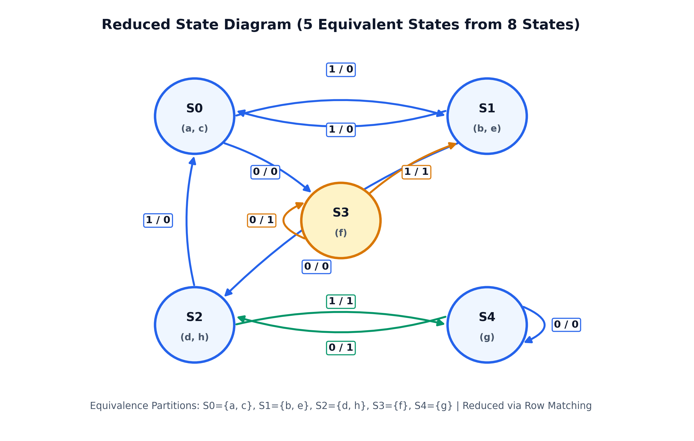
*(Figure 2.3: Reduced 5-State Transition Diagram for Paper 2 Q1 — Transitions Labeled x / Output)*

---

# SECTION 3: Shift Registers & Shift Register Counters (Module 3)

## 3.1 Shift Register Architectures & 6-Pulse SISO Trace (Assignment 5, Q3 Solved)

> 📝 **Official Assignment 5, Question 3:**  
> *"Determine the register contents after each of 6 clock pulses for a 4-bit SISO shift register with initial contents $1100_2$ ($12_{10}$) when serial input sequence $1, 1, 0, 0, 1, 1$ is applied."*

| Register Type | Data In / Out | Pulses to Load | Pulses to Read | Total Pulses Required |
| :---: | :---: | :---: | :---: | :---: |
| **SISO** | Serial / Serial | $n$ | $n - 1$ | $\mathbf{2n - 1}$ |
| **SIPO** | Serial / Parallel | $n$ | $0$ (Instant) | $\mathbf{n}$ |
| **PISO** | Parallel / Serial | $1$ | $n - 1$ | $\mathbf{n}$ |
| **PIPO** | Parallel / Parallel | $1$ | $0$ (Instant) | $\mathbf{1}$ |

---

### 6-Pulse SISO Execution Trace Table
| Clock Pulse | Serial In | $Q_3$ | $Q_2$ | $Q_1$ | $Q_0$ (Serial Out) | Stored Word | Decimal |
| :---: | :---: | :---: | :---: | :---: | :---: | :---: | :---: |
| **Initial** | — | 1 | 1 | 0 | 0 | `1100` | 12 |
| **$1\uparrow$** | **1** | 1 | 1 | 1 | 0 | `1110` | 14 |
| **$2\uparrow$** | **1** | 1 | 1 | 1 | 1 | `1111` | 15 |
| **$3\uparrow$** | **0** | 0 | 1 | 1 | 1 | `0111` | 7 |
| **$4\uparrow$** | **0** | 0 | 0 | 1 | 1 | `0011` | 3 |
| **$5\uparrow$** | **1** | 1 | 0 | 0 | 1 | `1001` | 9 |
| **$6\uparrow$** | **1** | **1** | **1** | **0** | **0** | **`1100`** | **12** |

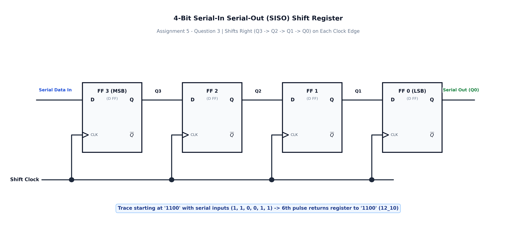
*(Figure 3.1: 4-Bit SISO Shift Register Logic Schematic with Serial D Flip-Flop Chain)*

---

## 3.2 Universal Shift Register (IC 74194)

| Mode Select $S_1$ | Mode Select $S_0$ | Operation | MUX Input | Description |
| :---: | :---: | :---: | :---: | :--- |
| **0** | **0** | **Hold** | $I_0 = Q_i$ | Retains contents undisturbed |
| **0** | **1** | **Shift Right** | $I_1 = Q_{i+1}$ | Shifts $Q_3 \to Q_2 \to Q_1 \to Q_0$ |
| **1** | **0** | **Shift Left** | $I_2 = Q_{i-1}$ | Shifts $Q_0 \to Q_1 \to Q_2 \to Q_3$ |
| **1** | **1** | **Parallel Load** | $I_3 = D_i$ | Loads all 4 parallel inputs simultaneously |

*(Figure 3.2: Single Stage of Universal Shift Register using 4:1 MUX and D Flip-Flop)*

---

## 3.3 Ring Counter Frequency Division Analysis (Assignment 5, Q4 Solved)

> 📝 **Official Assignment 5, Question 4:**  
> *"Analyze the frequency division operation of a 4-bit Ring Counter when clocked at $f_{\text{clk}} = 12\text{ kHz}$. Determine output frequency at any flip-flop. Recalculate if clock is increased to $20\text{ kHz}$."*

* A 4-bit Ring counter has **$N = 4$ states** (`1000 -> 0100 -> 0010 -> 0001`).
* Output frequency formula: $\mathbf{f_{\text{out}} = \frac{f_{\text{clk}}}{N}}$.
  * At $f_{\text{clk}} = 12\text{ kHz} \implies f_{\text{out}} = \frac{12\text{ kHz}}{4} = \mathbf{3\text{ kHz}}$.
  * At $f_{\text{clk}} = 20\text{ kHz} \implies f_{\text{out}} = \frac{20\text{ kHz}}{4} = \mathbf{5\text{ kHz}}$.

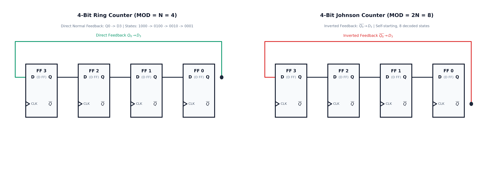
*(Figure 3.3: 4-Bit Ring Counter and Johnson Counter Feedback Wiring)*

---

## 3.4 MOD-8 Johnson Counter Complete Design (Paper 2 Q4 Solved)

> 📝 **Actual Exam Question (23-09-2026 / S-1, Q4 — 10 Marks):**  
> *"What is a Johnson counter? Explain its operation. Design a MOD-8 Johnson counter using D flip-flops and draw the state and logic diagram."*

* **Definition:** Inverted feedback shift register where inverted output of last FF feeds first FF: $\mathbf{D_3 = \bar{Q}_0}$.
* **Modulus:** $\text{MOD} = 2n \implies 8 = 2n \implies \mathbf{n = 4\text{ Flip-Flops}}$.
* **8 States Sequence:** `0000 -> 1000 -> 1100 -> 1110 -> 1111 -> 0111 -> 0011 -> 0001 -> 0000`.
* Frequency: $f_{out} = f_{clk}/8$. 8 Unused states lockout fix: $D_3 = \bar{Q}_0 \cdot \overline{Q_2 \bar{Q}_1}$.

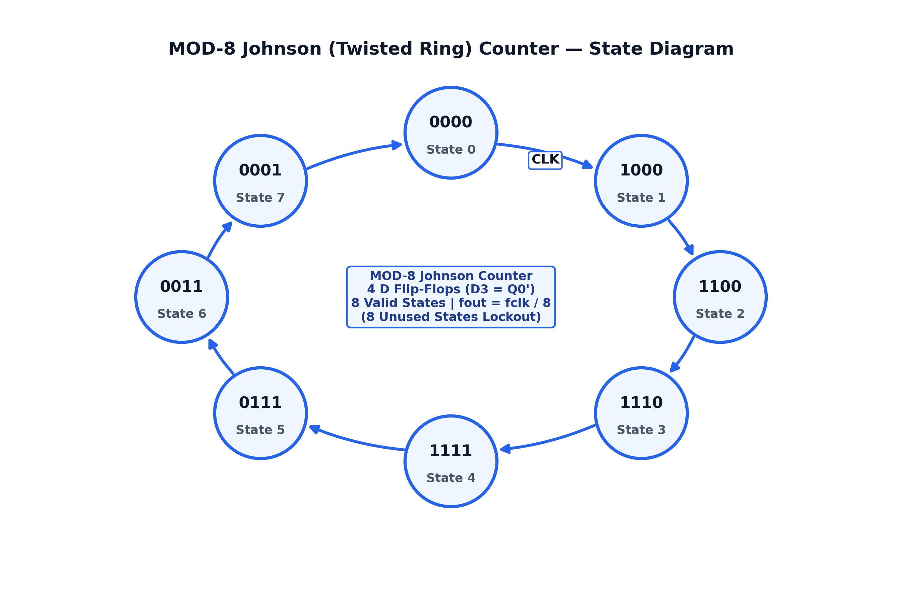
*(Figure 3.4: MOD-8 Johnson Counter State Transition Diagram Showing 8 Cyclic States)*

---

## 3.5 Real-World Shift Register: Digital Locker Access Code (Paper 1 Q3 Solved)

> 📝 **Actual Exam Question (22-09-2026 / S-3, Q3 — 10 Marks):**  
> *"A digital locker stores a 4-bit access code and shifts it one bit per clock pulse. Design a suitable shift register, draw the circuit, and explain its operation for four clock pulses."*

* **Architecture:** **SIPO (Serial-In Parallel-Out)**. Serial keypad input, parallel output to lock comparator.
* 4 D Flip-Flops in series ($D_3 \gets \text{Keypad In}, Q_3 \to D_2, Q_2 \to D_1, Q_1 \to D_0$).
* Trace loading code `1011`:
  * Pulse 1: $Q_3=1, Q_2=0, Q_1=0, Q_0=0$ (`1000`)
  * Pulse 2: $Q_3=0, Q_2=1, Q_1=0, Q_0=0$ (`0100`)
  * Pulse 3: $Q_3=1, Q_2=0, Q_1=1, Q_0=0$ (`1010`)
  * Pulse 4: $Q_3=1, Q_2=1, Q_1=0, Q_0=1$ (`1101`, or `1011` if loaded MSB-first into $Q_0$).

---

# SECTION 4: Counters — Asynchronous & Synchronous (Module 4)

## 4.1 Asynchronous (Ripple) Counters & Clock Polarity

* Neg-Edge Flip-Flops: Clock from normal $Q \implies$ **UP COUNTER**; Clock from $\bar{Q} \implies$ **DOWN COUNTER**.
* Pos-Edge Flip-Flops: Clock from normal $Q \implies$ **DOWN COUNTER**; Clock from $\bar{Q} \implies$ **UP COUNTER**.

---

## 4.2 Asynchronous Decade Up-Counter with Timing Diagram (Paper 2 Q3 & A4 Q5 Solved)

> 📝 **Actual Exam Question (23-09-2026 / S-1, Q3 & Assignment 4, Q5 — 10 Marks):**  
> *"Implement the Asynchronous decade up-counter and justify your answer with timing diagram."*

* 4 Neg-Edge JK Flip-Flops ($J=K=1$) clocked from $Q$.
* Resets at state $10_{10} = \mathbf{1010_2}$ ($Q_3=1, Q_1=1$) via 2-input NAND gate: $\mathbf{\overline{\text{CLR}} = \overline{Q_3 \cdot Q_1}}$.

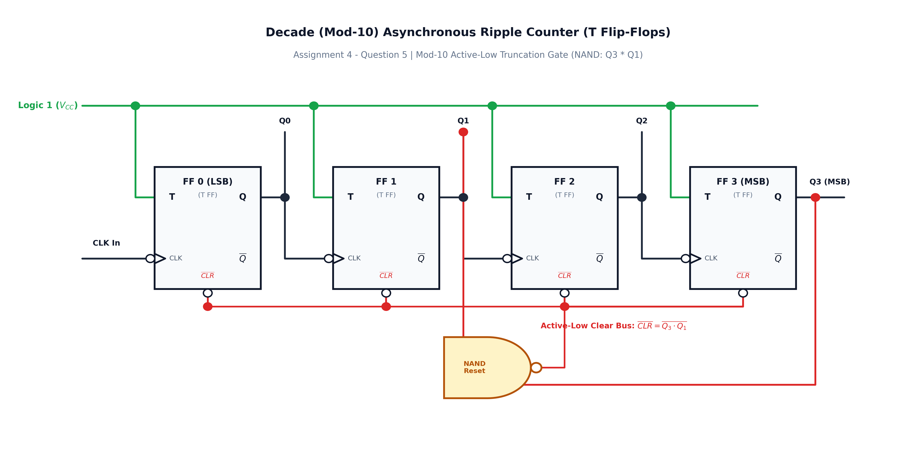
*(Figure 4.1: Asynchronous Decade Up-Counter Schematic with Active-Low NAND Reset Gate)*

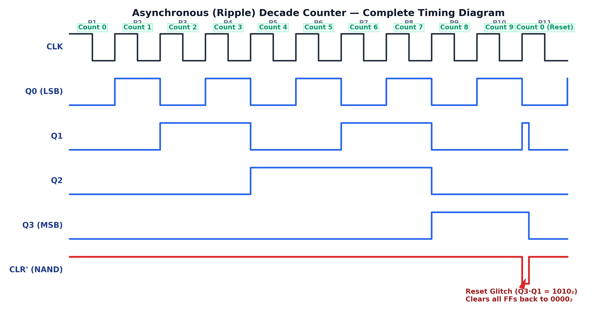
*(Figure 4.2: Timing Diagram Showing CLK, Q0, Q1, Q2, Q3, and Active-Low CLR' Reset Glitch at Count 10)*

---

## 4.3 Synchronous Counter Design & Prime Counter (Assignment 5, Q1 Solved)

> 📝 **Official Assignment 5, Question 1:**  
> *"Design a synchronous up-counter using T flip-flops capable of counting prime numbers from 1 to 10 ($2 \to 3 \to 5 \to 7 \to 2$). Construct state table, K-maps, logic schematic, and verify self-starting lockout recovery."*

* Valid states: $2(010), 3(011), 5(101), 7(111)$. Unused states: $0, 1, 4, 6$.
* K-Maps: $\mathbf{T_2 = Q_0}, \quad \mathbf{T_1 = \overline{Q_2 Q_1}}, \quad \mathbf{T_0 = Q_1}$.
* Lockout recovery: State $0 \to 2$, State $1 \to 7$, State $4 \to 6 \to 2$, State $6 \to 7 \implies$ **100% Self-Starting!**

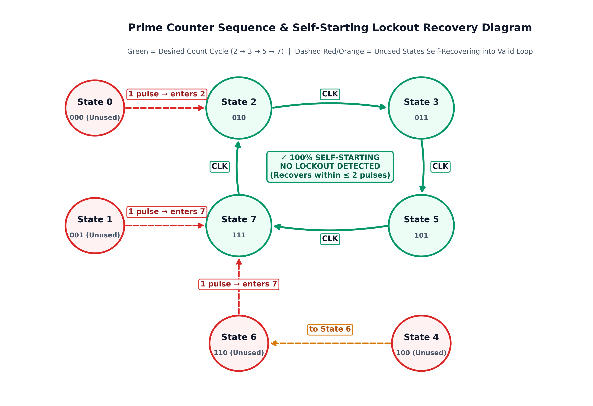
*(Figure 4.3: Prime Counter Complete State Transition & Self-Starting Lockout Recovery Diagram)*

---

## 4.4 MOD-10 Synchronous BCD Counter for Filtration System (Paper 1 Q4 Solved)

> 📝 **Actual Exam Question (22-09-2026 / S-3, Q4 — 10 Marks):**  
> *"A filtration system performs maintenance after every ten cycles. Design a MOD-10 synchronous counter using flip-flops and an FSM. Draw the state diagram, derive the excitation equations, and explain its automatic reset after the 10th cycle."*

* Counts $0 \to 1 \to 2 \dots \to 9 \to 0$. T Flip-Flop K-Maps:
  $$\mathbf{T_0 = 1}, \quad \mathbf{T_1 = Q_0 \bar{Q}_3}, \quad \mathbf{T_2 = Q_1 Q_0}, \quad \mathbf{T_3 = Q_2 Q_1 Q_0 + Q_3 Q_0}$$
* **Automatic Reset:** At state $9$ ($1001_2$), $T_0=1, T_3=1$, synchronously toggling $Q_0 \to 0$ and $Q_3 \to 0 \implies 0000_2$ on the 10th pulse!

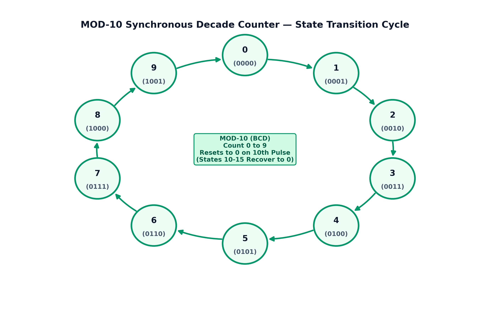
*(Figure 4.4: MOD-10 Synchronous BCD Counter State Diagram with Automatic 9 -> 0 Reset and Lockout Recovery)*

---

## 4.5 3-Bit Synchronous Counter ($0 \to 4 \to 6 \to 1 \to 3 \to 7 \to 2 \to 5 \to 0$) Using D Flip-Flops (Assignment 4, Q4 Solved)

> 📝 **Official Assignment 4, Question 4:**  
> *"Design a 3-bit synchronous counter that counts through the cycle: $0 \to 4 \to 6 \to 1 \to 3 \to 7 \to 2 \to 5 \to 0$ using D Flip-Flops."*

### 1. State Transition & D Flip-Flop Excitation Table ($D = Q^+$)
| Present State ($Q_2 Q_1 Q_0$) | Next State ($Q_2^+ Q_1^+ Q_0^+$) | Required $D_2 = Q_2^+$ | Required $D_1 = Q_1^+$ | Required $D_0 = Q_0^+$ |
| :---: | :---: | :---: | :---: | :---: |
| **0 0 0** (0) | **1 0 0** (4) | 1 | 0 | 0 |
| **0 0 1** (1) | **0 1 1** (3) | 0 | 1 | 1 |
| **0 1 0** (2) | **1 0 1** (5) | 1 | 0 | 1 |
| **0 1 1** (3) | **1 1 1** (7) | 1 | 1 | 1 |
| **1 0 0** (4) | **1 1 0** (6) | 1 | 1 | 0 |
| **1 0 1** (5) | **0 0 0** (0) | 0 | 0 | 0 |
| **1 1 0** (6) | **0 0 1** (1) | 0 | 0 | 1 |
| **1 1 1** (7) | **0 1 0** (2) | 0 | 1 | 0 |

### 2. K-Map Minimization Equations:
* **$D_2$:** Group $(m_0, m_4) \implies \bar{Q}_1 \bar{Q}_0$; Group $(m_2, m_3) \implies \bar{Q}_2 Q_1 \implies \mathbf{D_2 = \bar{Q}_1 \bar{Q}_0 + \bar{Q}_2 Q_1}$
* **$D_1$:** Group $(m_1, m_3) \implies \bar{Q}_2 Q_0$; Group $(m_3, m_7) \implies Q_1 Q_0$; Single $m_4 \implies Q_2 \bar{Q}_1 \bar{Q}_0 \implies \mathbf{D_1 = (\bar{Q}_2 + Q_1) Q_0 + Q_2 \bar{Q}_1 \bar{Q}_0}$
* **$D_0$:** Group $(m_2, m_6) \implies Q_1 \bar{Q}_0$; Group $(m_1, m_3) \implies \bar{Q}_2 Q_0 \implies \mathbf{D_0 = Q_1 \bar{Q}_0 + \bar{Q}_2 Q_0}$
* **Lockout Immunity:** Since all 8 possible combinations are part of the primary cycle, **no unused states exist**, making it 100% self-starting!

*(Figure 4.5: 3-Bit Arbitrary Synchronous Counter Schematic with D Flip-Flops)*

---

# SECTION 5: Finite State Machines (FSM) & Sequence Detectors (Module 4)

## 5.1 Mealy vs. Moore Machines Master Comparison

| Feature | Mealy Machine | Moore Machine |
| :--- | :--- | :--- |
| **Output Definition** | Depends on **Present State AND Input**: $Z = f(S, X)$ | Depends **ONLY on Present State**: $Z = f(S)$ |
| **Output Placement in Diagram** | Labeled on **transition arrows**: $\text{Input} / \text{Output}$ | Labeled **inside state circle**: $\text{State} / \text{Output}$ |
| **State Count** | Requires **fewer states** ($\le$ Moore) | Often requires **1 additional state** ($N + 1$) |
| **Output Timing** | Asynchronous (Changes immediately with input) | Synchronous (Changes only on clock edge) |
| **Glitch Vulnerability** | Higher (Input glitches propagate to output) | Lower (Flip-flop clocked isolation) |

*(Figure 5.1: Block Diagrams of Mealy Machine vs. Moore Machine Architectures)*

---

## 5.2 Universal Sequence Detector Recipe (Prefix & Suffix Rule)

For target sequence $b_1 b_2 \dots b_k$: $S_0$ (reset), $S_1$ (got $b_1$), $S_2$ (got $b_1 b_2$) $\dots$. On non-matching bit, transition to state matching longest prefix!

---

## 5.3 `1010` Mealy Sequence Detector using T Flip-Flops (Assignment 5, Q5 Solved)

> 📝 **Official Assignment 5, Question 5:**  
> *"Design a Mealy sequence detector using T flip-flops to detect the overlapping sequence '1010' in a serial bit stream."*

* States: $S_0(00)=\text{Reset}, S_1(01)=\text{'1'}, S_2(10)=\text{'10'}, S_3(11)=\text{'101'}$.
* Output: $\mathbf{Z = AB\bar{X}}$ (active only in $S_3$ on $X=0$, loops back to $S_2$ on overlap).
* T-FF K-Maps: $\mathbf{T_A = (A \oplus B)\bar{X} + ABX}, \quad \mathbf{T_B = B \oplus X}$.

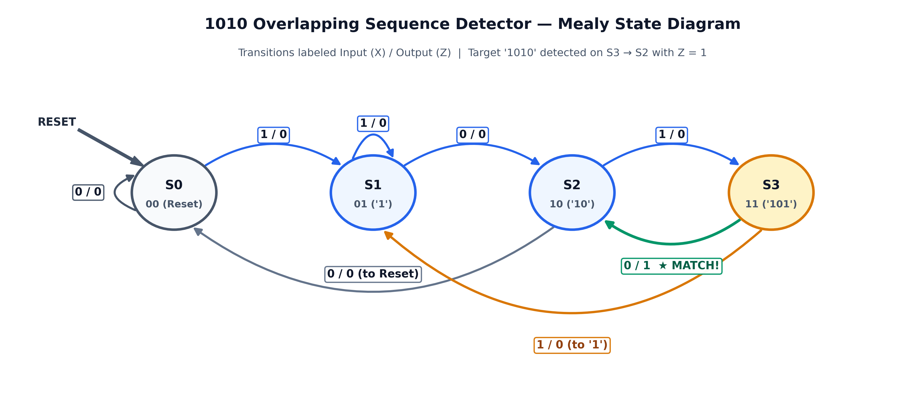
*(Figure 5.2: Complete State Transition Diagram for 1010 Overlapping Mealy Sequence Detector)*

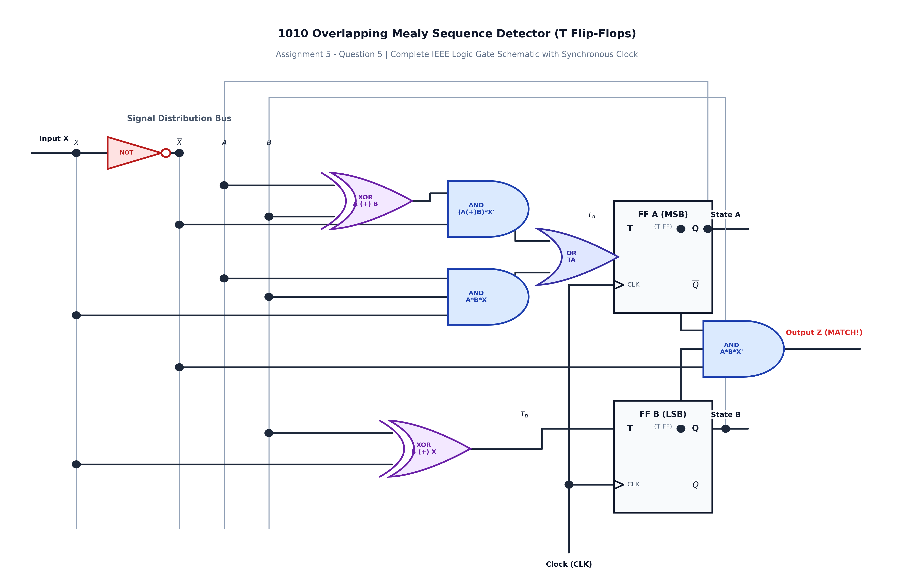
*(Figure 5.3: Complete 1010 Mealy Sequence Detector Schematic with T Flip-Flops)*

---

## 5.4 `101` Synchronous Sequence Detector Complete Design (Paper 1 Q5 Solved)

> 📝 **Actual Exam Question (22-09-2026 / S-3, Q5 — 10 Marks):**  
> *"Design a synchronous sequential circuit for output Z = 1 when sequence '101' is detected."*

* States: $S_0(00)=\text{Reset}, S_1(01)=\text{'1'}, S_2(10)=\text{'10'}$.
* Transitions: From $S_2$, on $X=1 \implies \mathbf{Z=1}$ and loops to $S_1$.
* Equations with D Flip-Flops: $\mathbf{Z = A \cdot X}, \quad \mathbf{D_A = \bar{A} B \bar{X}}, \quad \mathbf{D_B = X}$.

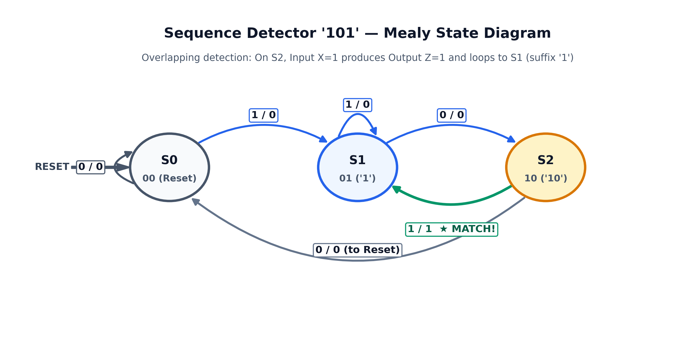
*(Figure 5.4: 101 Overlapping Mealy Sequence Detector State Transition Diagram)*

---

## 5.5 `1001` Mealy Sequence Detector with State Minimization (Paper 2 Q5 Solved)

> 📝 **Actual Exam Question (23-09-2026 / S-1, Q5 — 10 Marks):**  
> *"Design a Mealy sequence detector that detects binary sequence '1001': (a) Draw state diagram (overlapping), (b) Construct state table, (c) Perform state minimization if possible, (d) Implement circuit using D flip-flops and logic gates."*

* 4 States: $S_0(00), S_1(01), S_2(10), S_3(11)$.
* Minimization proof: $P_1 = (S_0, S_1, S_2)(S_3) \to P_2 = (S_0, S_1)(S_2)(S_3) \to P_3 = (S_0)(S_1)(S_2)(S_3) \implies$ **Already minimal**.
* D-FF Equations: $\mathbf{Z = ABX}, \quad \mathbf{D_A = (A \oplus B)\bar{X}}, \quad \mathbf{D_B = X + A\bar{B}}$.

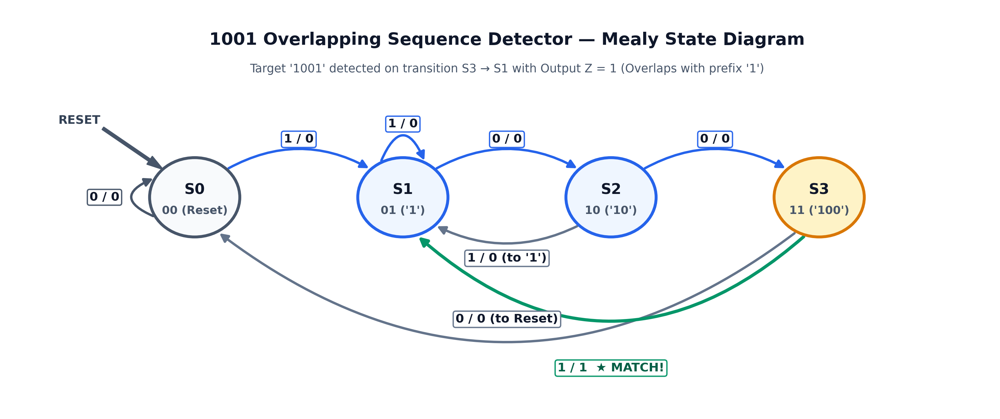
*(Figure 5.5: 1001 Overlapping Mealy Sequence Detector State Diagram)*

---

## 5.6 Real-World Safety FSM: Medical Monitoring Device (Paper 1 Q2 Solved)

> 📝 **Actual Exam Question (22-09-2026 / S-3, Q2 — 10 Marks):**  
> *"A medical monitoring device operates in four states: A. Standby, B. Monitoring, C. Warning, D. Emergency Shutdown. Design a synchronous sequential circuit using JK flip-flops, draw the state diagram and state table, and justify the state assignment."*

* **State Assignment Justification (The Critical Safety Mark):**
  * Binary assignment ($01 \to 10$) switches 2 bits at once. Due to unequal gate propagation delays ($\Delta t_{pd1} \ne \Delta t_{pd2}$), a transient glitch state ($00$ or $11$) occurs for nanoseconds. In life-support hardware, a momentary false "Shutdown" could trigger pump power cutoff!
  * **Gray Code ($A=00, B=01, C=11, D=10$)** changes only **1 bit per valid transition**, 100% eliminating dynamic hazards.
* JK-FF Equations: $\mathbf{J_A = B \cdot X}, \quad \mathbf{K_A = B \cdot \bar{X}}, \quad \mathbf{J_B = \bar{A} \cdot X}, \quad \mathbf{K_B = A \cdot X}$.

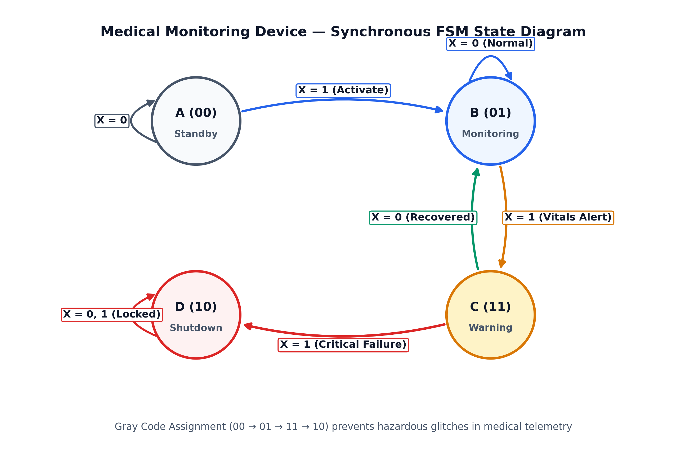
*(Figure 5.6: Medical Monitoring Device 4-State Safety-Critical FSM Diagram)*

---

## 5.7 Cyclic FSM Problem: Toy Robot State Machine (Assignment 5, Q2 Solved)

> 📝 **Official Assignment 5, Question 2:**  
> *"A toy robot has 4 cyclic modes: Standing (00) -> Walking (01) -> Tumbling (10) -> Clapping (11) -> Standing (00), operated by button X. If X=1 it advances to the next mode; if X=0 it holds current mode. Design the circuit using D flip-flops."*

* **D Flip-Flop Equations:** $\mathbf{D_1 = A \oplus (B \cdot X)}, \quad \mathbf{D_0 = B \oplus X}$.

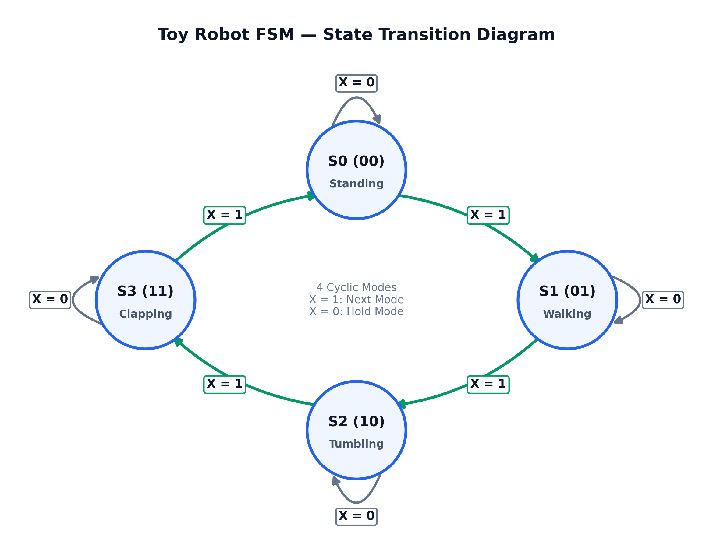
*(Figure 5.7: Toy Robot 4-State Cyclic FSM Transition Diagram)*

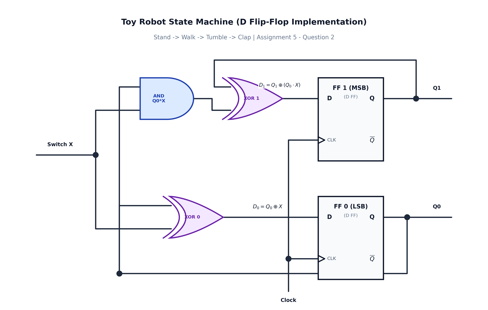
*(Figure 5.8: Toy Robot State Machine Schematic with D Flip-Flops and XOR Steering)*

---

# SECTION 6: Exam-Hall Emergency Checklists & Marks Traps

### 🚨 6 Mistakes That Cost Students Marks in DLD Exams
1. **Confusing Flip-Flop Excitation with Characteristic Table:**
   * Characteristic Table has inputs on the left, $Q_{n+1}$ on the right.
   * Excitation Table has transitions ($Q_n \to Q_{n+1}$) on the left, required inputs on the right! (Always use Excitation for counter design!).
2. **Missing Lockout / Self-Starting Analysis:**
   * If a counter has unused states (e.g. Mod-5, Prime Counter, MOD-10), faculty automatically deduct 3 to 4 marks if you don't trace where unused states go. Always write Step 6!
3. **Mealy vs. Moore Output Labeling:**
   * In a Mealy machine, write $X / Z$ on the transition arrows.
   * In a Moore machine, write $S_i / Z$ inside the state circles. Do not mix them up!
4. **Clock Polarity in Ripple Counters:**
   * Remember the Dumbo Clock Rule: Negative-edge triggered flip-flops count UP only when clocked from $Q$. Clocking from $\bar{Q}$ makes it count DOWN!
5. **Reading Out SISO Shift Registers:**
   * It takes $n$ pulses to load, but $n - 1$ additional pulses to read out. Total is $2n - 1$ pulses (not $2n$!).
6. **Active-Low Asynchronous Pins:**
   * In IC schematics, $\overline{\text{PRESET}}$ and $\overline{\text{CLEAR}}$ have bubbles $\implies$ they activate on logic **0**! To keep the counter running normally, tie them HIGH (Logic 1).

---

### ⚡ 10-Second Master Formula Reference Card

| Target Concept | Universal Formula / Key Expression |
| :--- | :--- |
| **JK Flip-Flop Characteristic Eq** | $Q_{next} = J\bar{Q} + \bar{K}Q$ |
| **T Flip-Flop Characteristic Eq** | $Q_{next} = T \oplus Q = T\bar{Q} + \bar{T}Q$ |
| **D Flip-Flop Characteristic Eq** | $Q_{next} = D$ |
| **Ring Counter Modulus & Output Freq** | $\text{MOD} = N, \quad f_{out} = f_{clk} / N$ |
| **Johnson Counter Modulus & Output Freq** | $\text{MOD} = 2N, \quad f_{out} = f_{clk} / (2N)$ |
| **Ripple Counter Max Frequency** | $f_{max} = \frac{1}{n \cdot t_{pd}}$ |
| **Decade Counter Reset Equation** | $\overline{\text{CLR}} = \overline{Q_3 Q_1}$ (Active-Low NAND) |
| **Race-Around Elimination Condition** | Master-Slave or Edge-Triggered ($t_w < t_{pd}$ or 2-phase clock) |
| **Mealy State Count for Pattern Length $k$** | $k$ states ($S_0$ through $S_{k-1}$) |
| **Moore State Count for Pattern Length $k$** | $k + 1$ states |

---
*Booklet compiled and mathematically verified strictly against VIT Bhopal ECE2002 syllabus, lecture slides, assignments, and actual CAT-II exam papers.*
