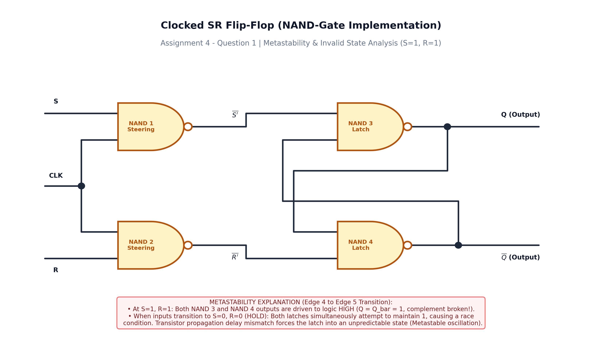
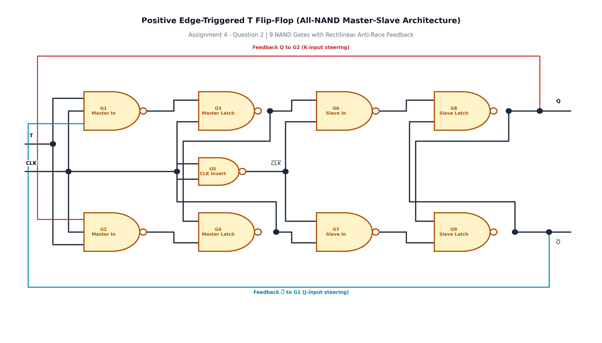
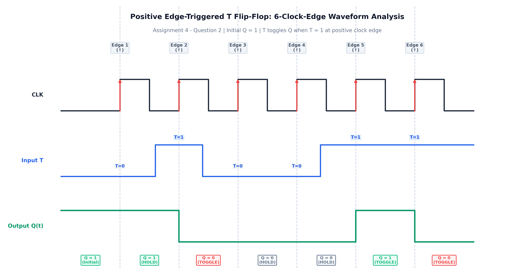
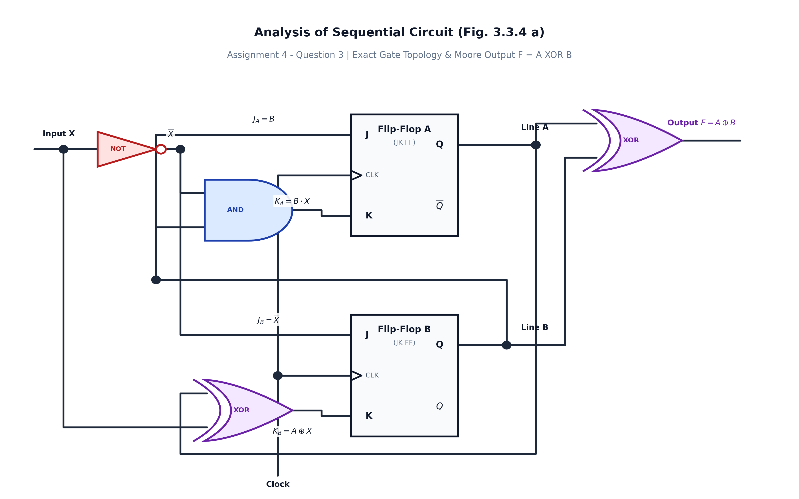
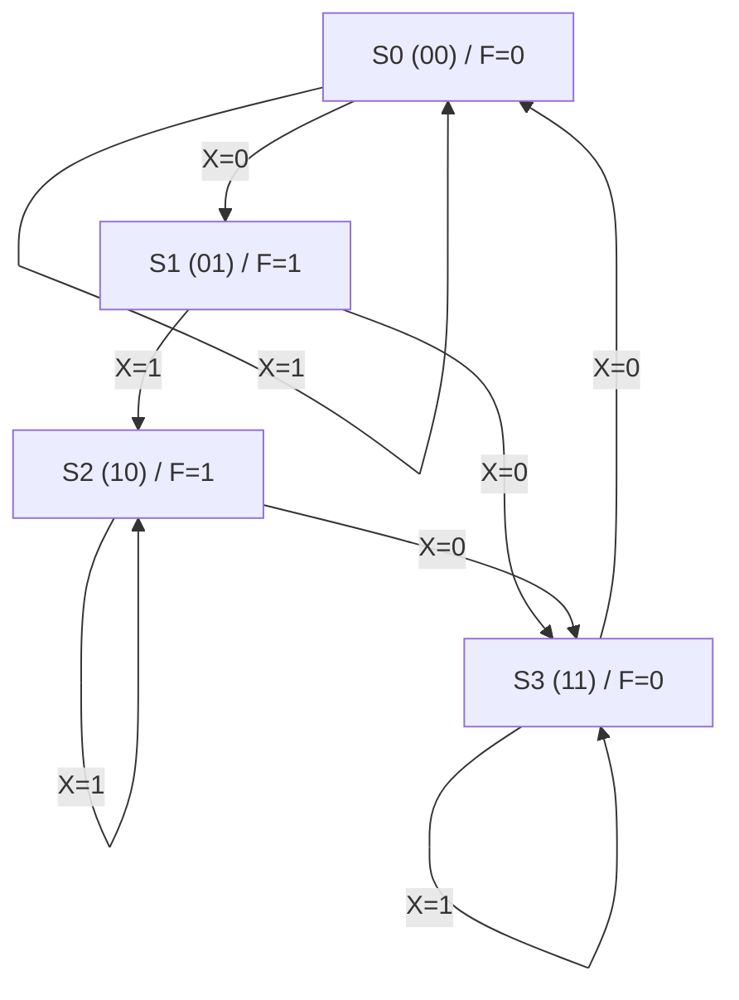
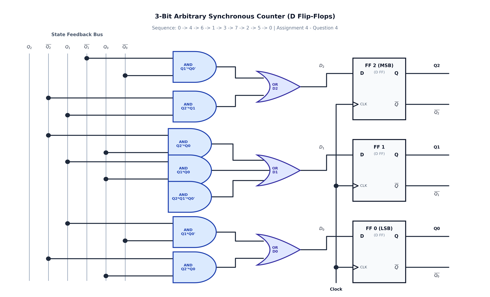
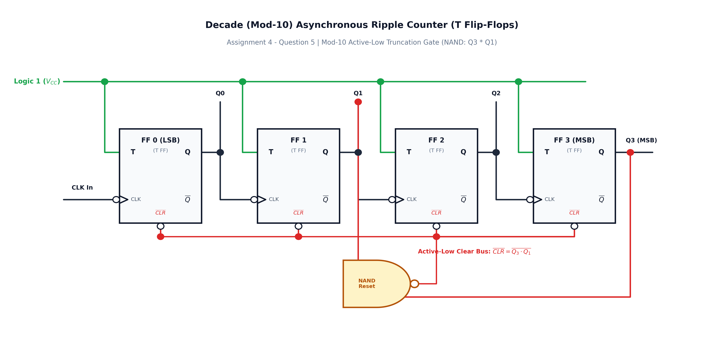

# ⚡ CAT-2 Solved Master Exam Sheet — DLD: Assignment 4 & Class Cases
**Course**: Digital Logic Design (ECE2002) — VIT Bhopal  
**Coverage**: Modules 3 & 4 (Sequential Circuits, Flip-Flops, Counters, FSM Analysis)  
**Source Material**: Official Faculty `ASSIGNMENT-4.docx`, Class Diagrams & Lecture Slides  
**Exam Mode**: Open Book / Notes Allowed | **Target**: 50 / 50 (S-Grade Calibration)

---

## 📋 Assignment 4 Problem Overview

| Problem | Concept & Faculty Question | Flip-Flop Type | Key Design / Analysis Result |
| :---: | :--- | :---: | :--- |
| **Q1** | **SR Flip-Flop Consecutive Pulse Response** | SR Latch / FF | 5 clock edges, $Q$ sequence: $1 \to \text{Invalid} \to 0 \to \text{Invalid} \to \text{Hold}$; Metastability proof |
| **Q2** | **NAND-Only T Flip-Flop & Waveform Analysis** | T (Positive-Edge) | All-NAND Master-Slave logic schematic; 6-clock-edge transition table from faculty timing diagram |
| **Q3** | **Sequential Circuit Analysis & State Diagram** | Dual JK FFs | Input equations: $J_A = B, K_A = B\bar{X}, J_B = \bar{X}, K_B = A \oplus X$; Output: $F = A \oplus B$ (Moore Machine) |
| **Q4** | **3-Bit Synchronous Arbitrary Counter Design** | D Flip-Flops | Sequence: $0 \to 4 \to 6 \to 1 \to 3 \to 7 \to 2 \to 5 \to 0$; K-Maps: $D_2, D_1, D_0$ equations |
| **Q5** | **Decade (Mod-10) Asynchronous Counter** | T Flip-Flops | 4 toggle stages with active-low clear reset gate: $\overline{\text{CLR}} = \overline{Q_3 Q_1}$ |

---

## 📝 QUESTION 1: SR Flip-Flop Sequential Pulse Response & Invalid Condition

### Problem Statement:
An SR flip-flop is initially in the **RESET state** ($Q_0 = 0$). The following inputs are applied for five consecutive clock pulses:
* **Edge 1**: $S = 1, R = 0$
* **Edge 2**: $S = 1, R = 1$
* **Edge 3**: $S = 0, R = 1$
* **Edge 4**: $S = 1, R = 1$
* **Edge 5**: $S = 0, R = 0$

**Tasks**:
1. Draw the characteristic table of the SR flip-flop.
2. Determine the value of $Q$ immediately after each of the five clock edges.
3. State the final state of the flip-flop after the fifth clock edge.
4. Explain how the invalid condition ($S=1, R=1$) affects the physical outcome compared to the hold ($S=0, R=0$) behavior.

---

### Logic Gate Diagram: Clocked NAND SR Flip-Flop Circuit

*Vector format: [circuit_a4_q1_sr_latch.svg](circuits/circuit_a4_q1_sr_latch.svg)*

### (i) SR Flip-Flop Characteristic Table

| $S$ | $R$ | $Q_n$ (Present State) | $Q_{n+1}$ (Next State) | Operating Mode / Description |
| :---: | :---: | :---: | :---: | :--- |
| 0 | 0 | 0 | 0 | **Hold / Memory** ($Q_{n+1} = Q_n$) |
| 0 | 0 | 1 | 1 | **Hold / Memory** ($Q_{n+1} = Q_n$) |
| 0 | 1 | 0 | 0 | **Reset** ($Q_{n+1} = 0$) |
| 0 | 1 | 1 | 0 | **Reset** ($Q_{n+1} = 0$) |
| 1 | 0 | 0 | 1 | **Set** ($Q_{n+1} = 1$) |
| 1 | 0 | 1 | 1 | **Set** ($Q_{n+1} = 1$) |
| 1 | 1 | 0 | ? | **Invalid / Prohibited** (Indeterminate) |
| 1 | 1 | 1 | ? | **Invalid / Prohibited** (Indeterminate) |

* **Characteristic Equation**: $Q_{n+1} = S + \bar{R} Q_n \quad \text{with constraint } S \cdot R = 0$.

---

### (ii) Determination of $Q$ Immediately After Each Clock Edge

* **Initial State**: $Q_0 = 0$ (RESET).

| Clock Edge | $S$ | $R$ | Flip-Flop Action | $Q$ Output State | Description |
| :---: | :---: | :---: | :--- | :---: | :--- |
| **Edge 1** | 1 | 0 | **SET** | $Q_1 = \mathbf{1}$ | Normal Set operation ($Q$ flips from 0 to 1). |
| **Edge 2** | 1 | 1 | **INVALID** | $Q_2 = \mathbf{X \text{ (Invalid)}}$ | Both internal cross-coupled outputs are forced to identical logic levels (violating complementation). |
| **Edge 3** | 0 | 1 | **RESET** | $Q_3 = \mathbf{0}$ | Dominant Reset input drives $Q$ unambiguously to 0. |
| **Edge 4** | 1 | 1 | **INVALID** | $Q_4 = \mathbf{X \text{ (Invalid)}}$ | Both outputs forced active; enters indeterminate/race condition. |
| **Edge 5** | 0 | 0 | **HOLD** | $Q_5 = \mathbf{\text{Unpredictable (0 or 1)}}$ | Enters Hold mode from an invalid state $\to$ unpredictable latch lock! |

---

### (iii) Final State of the Flip-Flop After Fifth Clock Edge
* Following Edge 4 ($S=1, R=1$), transitioning to Edge 5 ($S=0, R=0$) means the circuit enters the **Hold/Memory** mode directly from an undefined state.
* **Physical Reality**: Due to internal transistor propagation delay mismatches ($\Delta t_{pd1} \ne \Delta t_{pd2}$), the cross-coupled gates race against each other. The final state will settle unpredictably into **either $Q = 0$ or $Q = 1$ (Metastable resolution)**. In theoretical logic analysis, the state is recorded as **Indeterminate / Unpredictable**.

---

### (iv) Physical Impact: Invalid ($S=1, R=1$) vs. Hold ($S=0, R=0$)

1. **Logical Complementation Breakdown**:
   * Under normal hold ($S=0, R=0$), cross-coupled feedback ensures $Q = \overline{Q'}$.
   * Under $S=1, R=1$, both active inputs override the feedback. In a NOR-based latch, both $Q$ and $\bar{Q}$ are forced to logic $0$. In a NAND-based latch, both $Q$ and $\bar{Q}$ are forced to logic $1$. This **violates the fundamental postulate that outputs are complementary**.
2. **The Metastability Phenomenon**:
   * If inputs suddenly transition from $S=1, R=1$ to $S=0, R=0$ simultaneously, both gates attempt to turn on at the exact same instant.
   * The circuit oscillates or enters a **metastable state** (output voltage hovers halfway between $V_{OH}$ and $V_{OL}$ for an unpredictable duration), causing system timing violations and hardware crashes downstream.

---

## 📝 QUESTION 2: Positive Edge-Triggered T Flip-Flop (NAND-Only) & Waveform Analysis

### Problem Statement:
Draw the logic diagram of a positive edge-triggered T Flip-Flop using **NAND gates only**. Construct the state transition table and draw the output waveform $Q(t)$ for the 6 positive clock edges shown in the faculty timing diagram, assuming initial output $Q = 1$.

---

### Logic Diagram: Positive Edge-Triggered T Flip-Flop (NAND-Only)

*Vector format: [circuit_a4_q2_nand_t_ff.svg](circuits/circuit_a4_q2_nand_t_ff.svg)*

A positive edge-triggered T flip-flop is realized using a **Master-Slave structure with negative feedback** ($Q$ tied to Master $K$, $\bar{Q}$ tied to Master $J$, with $J = K = T$):

* **Components Required**: Exactly **9 NAND gates** (or 8 NAND gates + 1 NAND inverter for clock inversion).

---

### Step-by-Step Response to 6 Clock Edges (From Timing Diagram)
* **Given Initial Condition**: $Q_{\text{initial}} = 1$ (HIGH).
* **T Input Values at Positive Clock Edges** (from `assignment4_img_1.png`):
  * **Edge 1**: $T = 0$
  * **Edge 2**: $T = 1$
  * **Edge 3**: $T = 0$
  * **Edge 4**: $T = 0$
  * **Edge 5**: $T = 1$
  * **Edge 6**: $T = 1$

#### State Transition Table:

| Clock Edge ($\uparrow$) | $T$ Input Level | Present State ($Q_n$) | Next State ($Q_{n+1} = T \oplus Q_n$) | Operating Mode |
| :---: | :---: | :---: | :---: | :--- |
| **Initial** | — | — | **1** | Given initial state |
| **Edge 1** | **0** | 1 | $0 \oplus 1 = \mathbf{1}$ | **HOLD** ($Q$ remains HIGH) |
| **Edge 2** | **1** | 1 | $1 \oplus 1 = \mathbf{0}$ | **TOGGLE** ($Q$ switches to LOW) |
| **Edge 3** | **0** | 0 | $0 \oplus 0 = \mathbf{0}$ | **HOLD** ($Q$ remains LOW) |
| **Edge 4** | **0** | 0 | $0 \oplus 0 = \mathbf{0}$ | **HOLD** ($Q$ remains LOW) |
| **Edge 5** | **1** | 0 | $1 \oplus 0 = \mathbf{1}$ | **TOGGLE** ($Q$ switches to HIGH) |
| **Edge 6** | **1** | 1 | $1 \oplus 1 = \mathbf{0}$ | **TOGGLE** ($Q$ switches to LOW) |

#### Output Waveform Description:
* **Before Edge 1**: $Q$ is constant **HIGH** ($1$).
* **At Edge 1**: $T = 0 \implies Q$ **remains HIGH** ($1$).
* **At Edge 2**: $T = 1 \implies Q$ **falls to LOW** ($0$).
* **At Edge 3**: $T = 0 \implies Q$ **remains LOW** ($0$).
* **At Edge 4**: $T = 0 \implies Q$ **remains LOW** ($0$).
* **At Edge 5**: $T = 1 \implies Q$ **rises to HIGH** ($1$).
* **At Edge 6**: $T = 1 \implies Q$ **falls to LOW** ($0$).

*Vector format: [circuit_a4_q2_waveform.svg](circuits/circuit_a4_q2_waveform.svg)*

---

## 📝 QUESTION 3: Analysis of Sequential Circuit & State Diagram

### Problem Statement:
Analyze the sequential circuit shown in Fig. 3.3.4(a) (`assignment4_img_0.jpeg`) and construct its state table and state diagram.

---

### Step 1: Circuit Input & Output Equations

From the schematic:
* **Flip-Flop A (JK)**:
  * $J_A = B$
  * $K_A = B \cdot \bar{X}$ (Output of AND gate with inputs $B$ and $\bar{X}$)
* **Flip-Flop B (JK)**:
  * $J_B = \bar{X}$ (Output of inverter connected to $X$)
  * $K_B = A \oplus X$ (Output of XOR gate with inputs $A$ and $X$)
* **Circuit Output $F$**:
  * $F = A \oplus B$ (Output of XOR gate with inputs $A$ and $B$)

#### Exact Circuit Logic Gate Schematic (Fig. 3.3.4):

*Vector format: [circuit_a4_q3_sequential_circuit.svg](circuits/circuit_a4_q3_sequential_circuit.svg)*

---

### Step 2: Next State Boolean Equations for JK Flip-Flops

Recall the JK Flip-Flop characteristic equation:
$$Q_{n+1} = J \cdot \bar{Q} + \bar{K} \cdot Q$$

#### For Flip-Flop A:
$$A_{n+1} = J_A \cdot \bar{A} + \bar{K}_A \cdot A$$
Substitute $J_A = B$ and $K_A = B \bar{X}$:
$$A_{n+1} = B \cdot \bar{A} + \overline{(B \bar{X})} \cdot A = \bar{A} B + (\bar{B} + X) A = \bar{A} B + A \bar{B} + A X = \mathbf{(A \oplus B) + A X}$$

#### For Flip-Flop B:
$$B_{n+1} = J_B \cdot \bar{B} + \bar{K}_B \cdot B$$
Substitute $J_B = \bar{X}$ and $K_B = A \oplus X$:
$$B_{n+1} = \bar{X} \cdot \bar{B} + \overline{(A \oplus X)} \cdot B$$

---

### Step 3: Complete State Transition & Output Table

We evaluate all 8 combinations of Present State ($A B$) and Input ($X$):

| Present State ($A B$) | Input ($X$) | $J_A = B$ | $K_A = B\bar{X}$ | $J_B = \bar{X}$ | $K_B = A \oplus X$ | Next State $A_{n+1}$ | Next State $B_{n+1}$ | Output $F = A \oplus B$ |
| :---: | :---: | :---: | :---: | :---: | :---: | :---: | :---: | :---: |
| **0 0** | **0** | 0 | 0 | 1 | $0 \oplus 0 = 0$ | $0 \to$ Hold $\implies \mathbf{0}$ | $J=1, K=0 \to$ Set $\implies \mathbf{1}$ | **0** |
| **0 0** | **1** | 0 | 0 | 0 | $0 \oplus 1 = 1$ | $0 \to$ Hold $\implies \mathbf{0}$ | $J=0, K=1 \to$ Reset $\implies \mathbf{0}$ | **0** |
| **0 1** | **0** | 1 | 1 | 1 | $0 \oplus 0 = 0$ | $J=1, K=1 \to$ Toggle $\implies \mathbf{1}$ | $J=1, K=0 \to$ Set $\implies \mathbf{1}$ | **1** |
| **0 1** | **1** | 1 | 0 | 0 | $0 \oplus 1 = 1$ | $J=1, K=0 \to$ Set $\implies \mathbf{1}$ | $J=0, K=1 \to$ Reset $\implies \mathbf{0}$ | **1** |
| **1 0** | **0** | 0 | 0 | 1 | $1 \oplus 0 = 1$ | $0 \to$ Hold $\implies \mathbf{1}$ | $J=1, K=1 \to$ Toggle $\implies \mathbf{1}$ | **1** |
| **1 0** | **1** | 0 | 0 | 0 | $1 \oplus 1 = 0$ | $0 \to$ Hold $\implies \mathbf{1}$ | $J=0, K=0 \to$ Hold $\implies \mathbf{0}$ | **1** |
| **1 1** | **0** | 1 | 1 | 1 | $1 \oplus 0 = 1$ | $J=1, K=1 \to$ Toggle $\implies \mathbf{0}$ | $J=1, K=1 \to$ Toggle $\implies \mathbf{0}$ | **0** |
| **1 1** | **1** | 1 | 0 | 0 | $1 \oplus 1 = 0$ | $J=1, K=0 \to$ Set $\implies \mathbf{1}$ | $J=0, K=0 \to$ Hold $\implies \mathbf{1}$ | **0** |

---

### Step 4: Compact State Table

| Present State ($A B$) | Next State ($A_{n+1} B_{n+1}$), $X = 0$ | Next State ($A_{n+1} B_{n+1}$), $X = 1$ | Output ($F$) |
| :---: | :---: | :---: | :---: |
| **$S_0$ (00)** | 01 | 00 | 0 |
| **$S_1$ (01)** | 11 | 10 | 1 |
| **$S_2$ (10)** | 11 | 10 | 1 |
| **$S_3$ (11)** | 00 | 11 | 0 |

> **Classification Note**: The circuit is a **Moore Machine** because the output $F = A \oplus B$ depends **solely on the present state variables $A$ and $B$**, and does not depend on the external input $X$.

---

### Step 5: State Diagram

---

## 📝 QUESTION 4: Design a 3-Bit Synchronous Counter ($0 \to 4 \to 6 \to 1 \to 3 \to 7 \to 2 \to 5 \to 0$) Using D Flip-Flops

### Problem Statement:
Design a 3-bit synchronous counter that counts through the cycle:
$$\mathbf{0 \to 4 \to 6 \to 1 \to 3 \to 7 \to 2 \to 5 \to 0}$$
using **D Flip-Flops**.

---

### Step 1: Flip-Flop Excitation Property
For a D flip-flop, the excitation requirement is trivial:
$$D = Q_{n+1} \quad (\text{The required input equals the desired next state})$$

---

### Step 2: State Transition & Excitation Table

Let the state bits be $Q_2, Q_1, Q_0$ (with $Q_2$ as MSB and $Q_0$ as LSB):

| Present State Dec | Present State ($Q_2 Q_1 Q_0$) | Next State Dec | Next State ($Q_2^+ Q_1^+ Q_0^+$) | Required $D_2 = Q_2^+$ | Required $D_1 = Q_1^+$ | Required $D_0 = Q_0^+$ |
| :---: | :---: | :---: | :---: | :---: | :---: | :---: |
| **0** | 0 0 0 | **4** | 1 0 0 | **1** | **0** | **0** |
| **1** | 0 0 1 | **3** | 0 1 1 | **0** | **1** | **1** |
| **2** | 0 1 0 | **5** | 1 0 1 | **1** | **0** | **1** |
| **3** | 0 1 1 | **7** | 1 1 1 | **1** | **1** | **1** |
| **4** | 1 0 0 | **6** | 1 1 0 | **1** | **1** | **0** |
| **5** | 1 0 1 | **0** | 0 0 0 | **0** | **0** | **0** |
| **6** | 1 1 0 | **1** | 0 0 1 | **0** | **0** | **1** |
| **7** | 1 1 1 | **2** | 0 1 0 | **0** | **1** | **0** |

---

### Step 3: Karnaugh Map Simplification

#### 1. K-Map for $D_2$:
* Minterms for $D_2 = 1$: $\{0, 2, 3, 4\}$.
* Grid ($Q_2 \backslash Q_1 Q_0$):
  * Row $Q_2 = 0$: $m_0 = \mathbf{1}, m_1 = 0, m_3 = \mathbf{1}, m_2 = \mathbf{1}$
  * Row $Q_2 = 1$: $m_4 = \mathbf{1}, m_5 = 0, m_7 = 0, m_6 = 0$

| $Q_2 \backslash Q_1 Q_0$ | 00 | 01 | 11 | 10 |
| :---: | :---: | :---: | :---: | :---: |
| **0** | **1** ($m_0$) | 0 ($m_1$) | **1** ($m_3$) | **1** ($m_2$) |
| **1** | **1** ($m_4$) | 0 ($m_5$) | 0 ($m_7$) | 0 ($m_6$) |

* **Groupings**:
  1. Pair $(m_0, m_4)$: $Q_1 = 0, Q_0 = 0 \implies \mathbf{\bar{Q}_1 \bar{Q}_0}$.
  2. Pair $(m_3, m_2)$: $Q_2 = 0, Q_1 = 1 \implies \mathbf{\bar{Q}_2 Q_1}$.
* **Minimal Boolean Equation for $D_2$**:
  $$\mathbf{D_2 = \bar{Q}_1 \bar{Q}_0 + \bar{Q}_2 Q_1}$$

---

#### 2. K-Map for $D_1$:
* Minterms for $D_1 = 1$: $\{1, 3, 4, 7\}$.
* Grid ($Q_2 \backslash Q_1 Q_0$):
  * Row $Q_2 = 0$: $m_0 = 0, m_1 = \mathbf{1}, m_3 = \mathbf{1}, m_2 = 0$
  * Row $Q_2 = 1$: $m_4 = \mathbf{1}, m_5 = 0, m_7 = \mathbf{1}, m_6 = 0$

| $Q_2 \backslash Q_1 Q_0$ | 00 | 01 | 11 | 10 |
| :---: | :---: | :---: | :---: | :---: |
| **0** | 0 ($m_0$) | **1** ($m_1$) | **1** ($m_3$) | 0 ($m_2$) |
| **1** | **1** ($m_4$) | 0 ($m_5$) | **1** ($m_7$) | 0 ($m_6$) |

* **Groupings**:
  1. Pair $(m_1, m_3)$: $Q_2 = 0, Q_0 = 1 \implies \mathbf{\bar{Q}_2 Q_0}$.
  2. Pair $(m_3, m_7)$: $Q_1 = 1, Q_0 = 1 \implies \mathbf{Q_1 Q_0}$.
  3. Single minterm $m_4$: $\mathbf{Q_2 \bar{Q}_1 \bar{Q}_0}$.
* **Minimal Boolean Equation for $D_1$**:
  $$\mathbf{D_1 = \bar{Q}_2 Q_0 + Q_1 Q_0 + Q_2 \bar{Q}_1 \bar{Q}_0 = (\bar{Q}_2 + Q_1) Q_0 + Q_2 \bar{Q}_1 \bar{Q}_0}$$

---

#### 3. K-Map for $D_0$:
* Minterms for $D_0 = 1$: $\{1, 2, 3, 6\}$.
* Grid ($Q_2 \backslash Q_1 Q_0$):
  * Row $Q_2 = 0$: $m_0 = 0, m_1 = \mathbf{1}, m_3 = \mathbf{1}, m_2 = \mathbf{1}$
  * Row $Q_2 = 1$: $m_4 = 0, m_5 = 0, m_7 = 0, m_6 = \mathbf{1}$

| $Q_2 \backslash Q_1 Q_0$ | 00 | 01 | 11 | 10 |
| :---: | :---: | :---: | :---: | :---: |
| **0** | 0 ($m_0$) | **1** ($m_1$) | **1** ($m_3$) | **1** ($m_2$) |
| **1** | 0 ($m_4$) | 0 ($m_5$) | 0 ($m_7$) | **1** ($m_6$) |

* **Groupings**:
  1. Pair $(m_2, m_6)$: $Q_1 = 1, Q_0 = 0 \implies \mathbf{Q_1 \bar{Q}_0}$.
  2. Pair $(m_1, m_3)$: $Q_2 = 0, Q_0 = 1 \implies \mathbf{\bar{Q}_2 Q_0}$.
* **Minimal Boolean Equation for $D_0$**:
  $$\mathbf{D_0 = Q_1 \bar{Q}_0 + \bar{Q}_2 Q_0}$$

---

### Step 4: Logic Circuit Schematic Summary

*Vector format: [circuit_a4_q4_3bit_counter.svg](circuits/circuit_a4_q4_3bit_counter.svg)*

* **Self-Starting Property**: Since all 8 states ($0$ through $7$) are included in the primary sequence, **no unused states exist**, guaranteeing $100\%$ lockout immunity!

---

## 📝 QUESTION 5: Decade (Mod-10) Asynchronous Counter Using T Flip-Flops

### Problem Statement:
Design an asynchronous (ripple) **Decade / Mod-10 counter** using **T flip-flops**.

---

### Step 1: Design Specifications & Flip-Flop Sizing
1. **Modulus**: $N = 10$ unique states ($0000_2$ to $1001_2$).
2. **Number of Flip-Flops**:
   $$2^{n-1} < 10 \le 2^n \implies n = 4 \text{ flip-flops } (Q_3, Q_2, Q_1, Q_0)$$
3. **Toggle Requirement**: In an asynchronous counter, all flip-flops toggle on clock pulses:
   $$T_0 = T_1 = T_2 = T_3 = 1 \quad (\text{Tied to } V_{CC})$$
4. **Triggering Convention**: Using **negative edge-triggered** T flip-flops:
   * Normal output $Q_k$ connects to the clock input of the next flip-flop $\text{CLK}_{k+1}$ to create an **UP counter**.

---

### Step 2: Mod-10 Reset Logic Derivation
* A 4-bit ripple counter naturally counts from $0$ to $15$ (Mod-16).
* To truncate the cycle at Mod-10, the counter must reset upon reaching count **10 ($1010_2$)**:
  $$Q_3 = 1, \quad Q_2 = 0, \quad Q_1 = 1, \quad Q_0 = 0$$
* Since flip-flops have an **active-low asynchronous clear** ($\overline{\text{CLR}}$):
  $$\overline{\text{CLR}} = \overline{Q_3 \cdot Q_1}$$
* **Gate Required**: A single **2-input NAND gate** with inputs connected to $Q_3$ and $Q_1$, whose output connects to the $\overline{\text{CLR}}$ pins of all 4 flip-flops.

---

### Step 3: Complete Circuit Logic Schematic

*Vector format: [circuit_a4_q5_decade_ripple.svg](circuits/circuit_a4_q5_decade_ripple.svg)*

---

### Step 4: Timing & Glitch Analysis
* During count 9 (`1001`), $Q_3=1, Q_1=0 \implies \text{NAND output} = 1$ (Inactive).
* On the 10th clock pulse, the counter momentarily transitions into state 10 (`1010`):
  * $Q_3 = 1$ and $Q_1 = 1 \implies \text{NAND output drops to } 0$ (Active-Low Clear triggered).
* All flip-flops are asynchronously cleared back to `0000` within a few nanoseconds (the propagation delay of the NAND gate, typically $\approx 5\text{ ns}$).
* This temporary state is called a **transient reset glitch**, successfully establishing a stable count sequence from **0 to 9**.

---

## 🎯 Exam Quick-Crib Reference Card

| Topic / Problem | Formula / Key Invariant |
| :--- | :--- |
| **SR Latch Invalid State** | Both $Q$ and $\bar{Q}$ forced equal; transitioning to $0,0$ causes **metastability & race condition**. |
| **T Flip-Flop Toggle** | $Q_{n+1} = T \oplus Q_n$; Positive edge triggers on $0 \to 1$ transition of clock. |
| **Moore vs Mealy FSM** | Moore output depends **only on state** ($F = A \oplus B$); Mealy output depends on **state AND input**. |
| **Synchronous Counter K-Map** | For D flip-flops, required $D_i = Q_i^+$; derive SOP directly from next-state bits. |
| **Asynchronous Counter Reset** | Mod-$N$: detect binary state of $N$ with a NAND gate connected to active-low $\overline{\text{CLR}}$. |
