# ⚡ CAT-2 HOTS Master Crib — Module 3: Flip-Flops, Conversions & Shift Registers
**Course**: ECE2002 — Digital Logic Design  
**Level**: Self-Contained & Fully Visual (Zero-Assumption Bedrock Basics to Circuit Schematics)  
**Exam Mode**: Open Book / Handwritten Notes Allowed | **Target Score**: 45+ / 50

---

## 🧱 TIER 0: The "Explain Like I'm 5" Bedrock Basics
*(Read this first if flip-flops and sequential circuits confuse you)*

### 1. What is a Flip-Flop?
A combinational circuit (like an Adder) has **no memory** — output depends solely on current inputs.
A **sequential circuit** has **memory**: it remembers past states!
* The fundamental 1-bit memory cell is a **Flip-Flop**.
* Flip-flops change their state **only when a Clock edge arrives** (Positive Edge $\uparrow$ or Negative Edge $\downarrow$).

---

### 2. The 4 Fundamental Flip-Flops (Visual Circuit Schematics)

#### A. The SR (Set-Reset) Flip-Flop
* **Concept**: 
  * $S=1, R=0 \implies$ **SET** ($Q=1$).
  * $S=0, R=1 \implies$ **RESET** ($Q=0$).
  * $S=0, R=0 \implies$ **HOLD** (No change, $Q^+=Q$).
  * $S=1, R=1 \implies$ **INVALID / FORBIDDEN!** Both $Q$ and $Q'$ try to become 0 simultaneously, violating the rule that $Q' = \overline{Q}$.

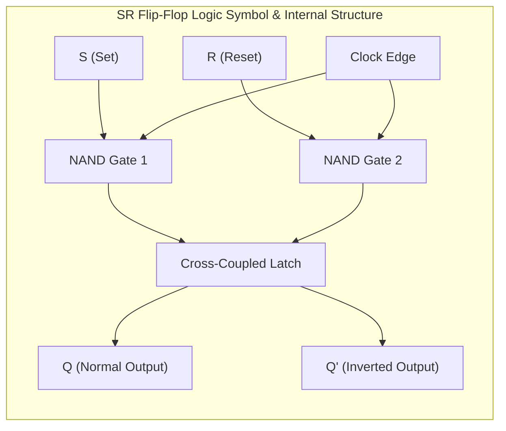

* **Characteristic Equation**: $\mathbf{Q^+ = S + R' Q}$ (with constraint $S \cdot R = 0$).
* **Excitation Table (How to force transitions)**:
  $$\begin{array}{|c|c|c|c|} \hline Q & Q^+ & S & R \\ \hline 0 & 0 & 0 & X \\ 0 & 1 & 1 & 0 \\ 1 & 0 & 0 & 1 \\ 1 & 1 & X & 0 \\ \hline \end{array}$$

---

#### B. The JK Flip-Flop (Fixing the SR Flaw)
* **The Breakthrough**: In SR, $S=1, R=1$ caused a crash. In JK, we feed $Q$ and $Q'$ back to the inputs!
* When $J=1, K=1$, the output **TOGGLES** (inverts: $0 \to 1$ and $1 \to 0$)! No invalid state exists!

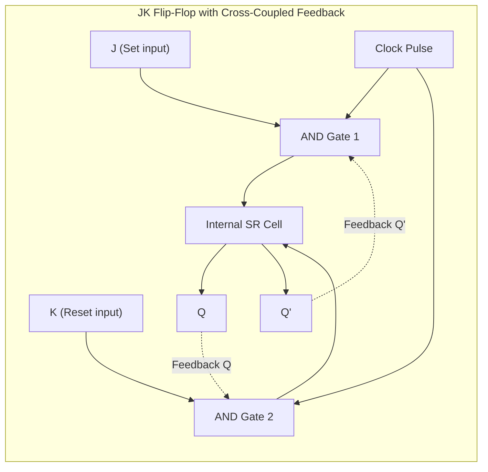

* **Characteristic Equation**: $\mathbf{Q^+ = J Q' + K' Q}$
* **JK Truth Table & Modes**:
  $$\begin{array}{|c|c|c|l|} \hline J & K & Q^+ & \textbf{Operating Mode} \\ \hline 0 & 0 & Q & \text{No Change (Hold)} \\ 0 & 1 & 0 & \text{Reset} \\ 1 & 0 & 1 & \text{Set} \\ 1 & 1 & Q' & \textbf{Toggle (Invert)} \\ \hline \end{array}$$
* **JK Excitation Table (CRITICAL FOR COUNTER DESIGN!)**:
  $$\begin{array}{|c|c|c|c|} \hline Q & Q^+ & J & K \\ \hline 0 & 0 & 0 & X \\ 0 & 1 & 1 & X \\ 1 & 0 & X & 1 \\ 1 & 1 & X & 0 \\ \hline \end{array}$$

---

#### C. The D (Data / Delay) Flip-Flop
* **Concept**: Takes whatever single bit is on input $D$ and transfers it to output $Q$ on the next clock edge.
* **Circuit**: Made from an SR or JK flip-flop by connecting an **inverter (NOT gate)** between inputs ($K = \overline{J}$).

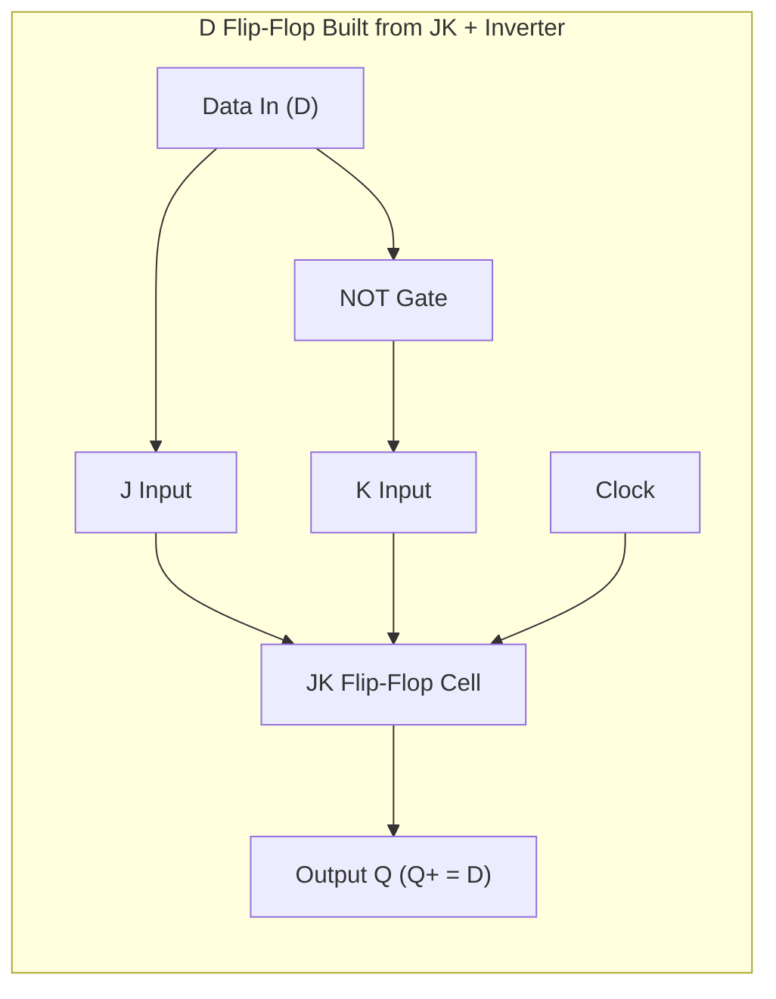

* **Characteristic Equation**: $\mathbf{Q^+ = D}$
* **Excitation Table**: $D = Q^+$ (Whatever next state you want, set $D$ to that value!).

---

#### D. The T (Toggle) Flip-Flop
* **Concept**: Has 1 control input $T$.
  * If $T = 0 \implies$ Hold state ($Q^+ = Q$).
  * If $T = 1 \implies$ Toggle state ($Q^+ = Q'$).
* **Circuit**: Made from JK by **tying inputs J and K together** ($J = K = T$).

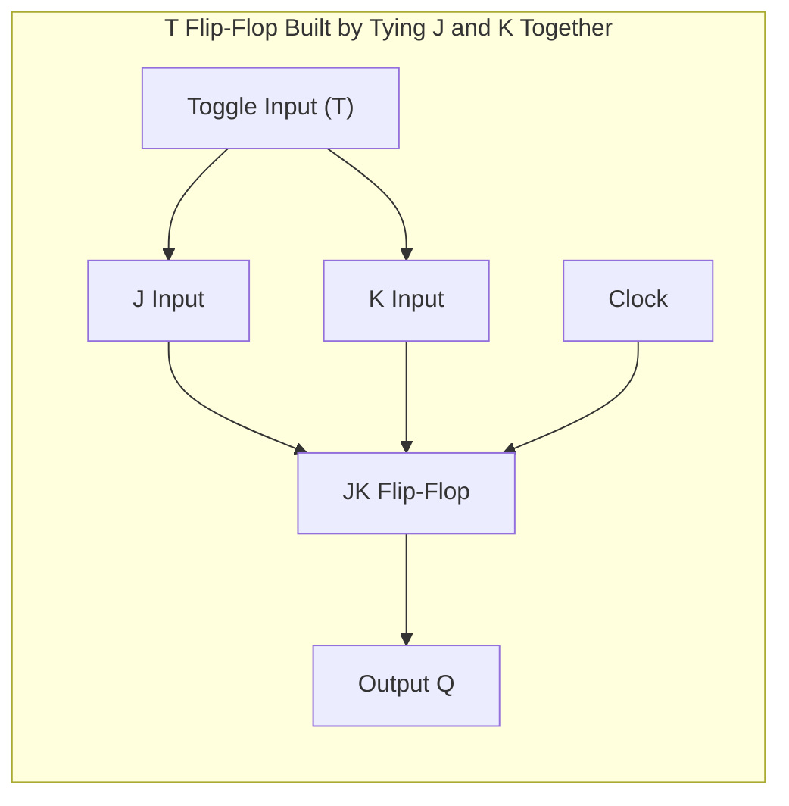

* **Characteristic Equation**: $\mathbf{Q^+ = T \oplus Q = T Q' + T' Q}$
* **Excitation Table**: $\mathbf{T = Q \oplus Q^+}$
  $$\begin{array}{|c|c|c|} \hline Q & Q^+ & T \\ \hline 0 & 0 & 0 \\ 0 & 1 & 1 \\ 1 & 0 & 1 \\ 1 & 1 & 0 \\ \hline \end{array}$$

---

### 3. Master-Slave JK Flip-Flop (Solving the Race-Around Condition)

#### What is the "Race-Around Condition"?
* When $J=1$ and $K=1$ in a level-triggered flip-flop, the output toggles.
* If the clock pulse width ($t_p$) is **longer than the propagation delay of the flip-flop ($t_{pd}$)**:
  $$t_p > t_{pd}$$
* The output toggles repeatedly, oscillating wildly between $0$ and $1$ multiple times during a single clock pulse! At the end of the pulse, the final state is **unpredictable**!

#### How Master-Slave Eliminates Race-Around:
* Uses **two separate stages**:
  1. **Master Stage**: Clocked directly by $\text{CLK}$. Accepts inputs while $\text{CLK}=1$; Slave is inactive.
  2. **Slave Stage**: Clocked by inverted clock ($\overline{\text{CLK}}$). When $\text{CLK}$ drops to $0$, Master shuts off, and Slave copies Master's output to $Q$!
* Because Master and Slave are **never active at the same instant**, feedback during a single clock pulse is physically impossible!

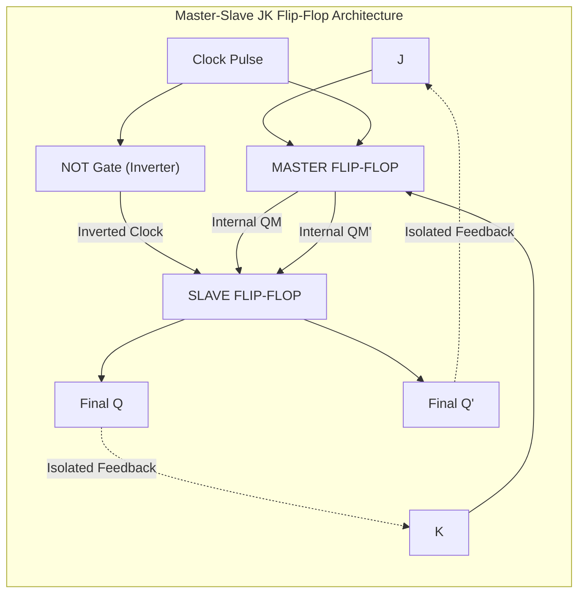

---

### 4. Universal Flip-Flop Conversion Blueprint

To convert an **Available Flip-Flop** (e.g. JK) into a **Target Flip-Flop** (e.g. D or T):
1. Draw the **Target FF Truth Table** (Inputs + Present state $Q \to$ Next state $Q^+$).
2. Append the **Available FF Excitation Columns** required to produce that transition.
3. Solve K-Maps for Available FF inputs in terms of Target inputs and $Q$.
4. Draw the combinational steering circuit!

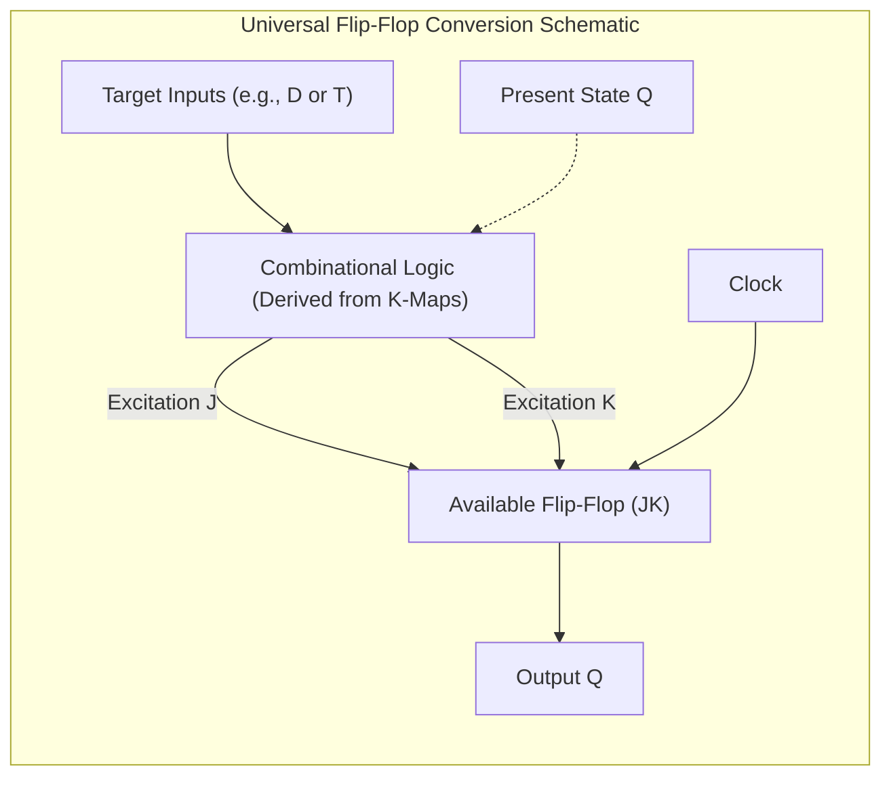

#### Solved Conversion: Convert JK to D Flip-Flop
$$\begin{array}{|c|c|c|c|c|} \hline \textbf{Target Input } D & Q & Q^+ & \textbf{Required } J & \textbf{Required } K \\ \hline 0 & 0 & 0 & 0 & X \\ 0 & 1 & 0 & X & 1 \\ 1 & 0 & 1 & 1 & X \\ 1 & 1 & 1 & X & 0 \\ \hline \end{array}$$
* K-Map for $J$: $J = D \cdot Q' + D \cdot Q = \mathbf{D}$
* K-Map for $K$: $K = D' \cdot Q + D' \cdot Q' = \mathbf{D'}$
* **Circuit**: Connect $D$ directly to $J$, and connect $\overline{D}$ (via NOT gate) to $K$!

---

### 5. Shift Register Architectures (Full Visual Schematics)

#### A. 4-Bit Serial-In Serial-Out (SISO):
Data enters serially at FF3, shifts right on each clock edge, and leaves serially at FF0.
* **Clock pulses to load 4 bits**: $N = 4$.
* **Clock pulses to unload 4 bits**: $N - 1 = 3$.
* **Total pulses**: $2N - 1 = \mathbf{7\text{ pulses}}$.

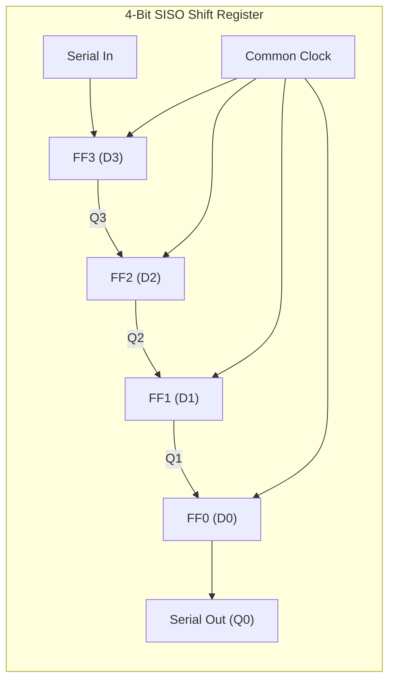

---

#### B. 4-Bit Serial-In Parallel-Out (SIPO):
Data enters serially, but all flip-flop outputs ($Q_3, Q_2, Q_1, Q_0$) are available simultaneously.
* **Clock pulses to load & read**: Exactly $\mathbf{N = 4\text{ pulses}}$ (0 pulses to read).

```mermaid
graph LR
    subgraph SIPO ["4-Bit SIPO Shift Register"]
    SI["Serial In"] --> D3["FF3"]
    D3 -->|"Q3"| D2["FF2"]
    D2 -->|"Q2"| D1["FF1"]
    D1 -->|"Q1"| D0["FF0"]
    
    D3 --> O3["Parallel Out Q3"]
    D2 --> O2["Parallel Out Q2"]
    D1 --> O1["Parallel Out Q1"]
    D0 --> O0["Parallel Out Q0"]
    end
```

---

#### C. 4-Bit Parallel-In Serial-Out (PISO):
Requires a **$\text{Shift} / \overline{\text{Load}}$** control line to select between parallel loading ($X_3 \dots X_0$) and serial shifting.
* When $\text{Shift} / \overline{\text{Load}} = 0$: Parallel data $X_i$ loads into flip-flops.
* When $\text{Shift} / \overline{\text{Load}} = 1$: Data shifts right towards the serial output.
* **Steering Logic per Stage**: $D_i = (\text{Shift} \cdot Q_{i+1}) + (\overline{\text{Shift}} \cdot X_i)$

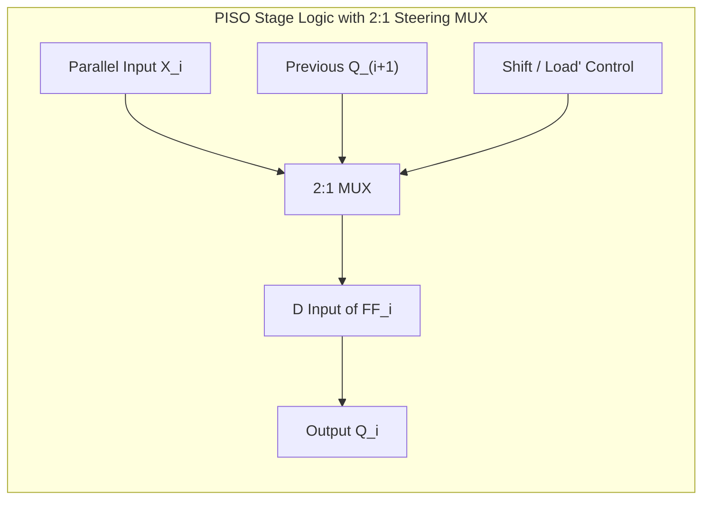

---

#### D. 4-Bit Parallel-In Parallel-Out (PIPO):
Highest throughput: Loads all bits in parallel on 1 clock pulse, and reads them all in parallel on 1 clock pulse.
* **Total clock pulses**: **1 pulse**!

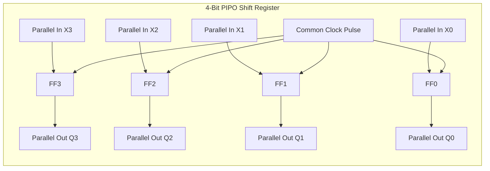

---

#### E. Ring Counter vs. Johnson Counter Feedback Loops

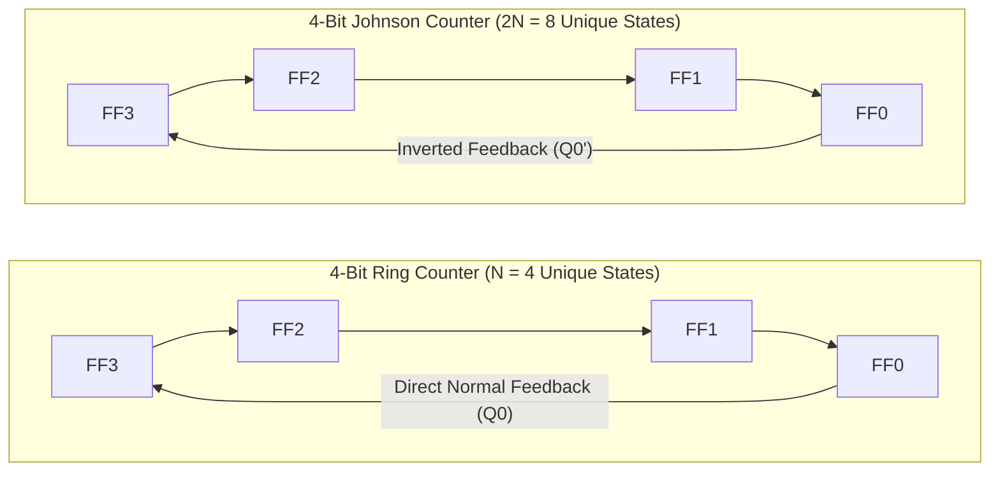

* **Ring Counter**:
  * Modulus: $\text{MOD} = N = 4$ states: $\text{1000} \to \text{0100} \to \text{0010} \to \text{0001} \to \text{1000}$.
  * Needs pre-loading a '1' on startup.
* **Johnson Counter (Twisted-Ring)**:
  * Modulus: $\text{MOD} = 2N = 8$ states.
  * Self-starts from `0000`. Each state decoded by a single 2-input AND gate!

---

## 🧭 TIER 1: The Problem Symptom & Keyword Decoder

| If Question Shows / Asks... | It Means This Exact Topic | What You Do (In 5 Seconds) |
| :--- | :--- | :--- |
| "Convert Flip-Flop A to Flip-Flop B" | **Universal FF Conversion** | Write Target truth table $\to$ add Excitation columns for Available FF $\to$ solve K-Maps for inputs. |
| "Explain Race-Around condition & solution" | **Master-Slave JK Flip-Flop** | State condition $t_p > t_{pd}$ with $J=K=1$. Draw Master-Slave block diagram with clock inverter. |
| "Load 1111 into 4-bit SISO/SIPO", clock trace | **Shift Register Timing Table** | Table: Clock $1 \dots 7$. Trace shift of bits stage by stage. SISO takes 7 pulses, SIPO takes 4. |
| "Compare Ring vs Johnson counter" | **Shift Register Counters** | Ring: $N$ states, normal feedback $D=Q_{out}$. Johnson: $2N$ states, inverted feedback $D=Q_{out}'$. |
| "Analysis of sequential circuit given logic diagram" | **Sequential Circuit Analysis** | Write input equations $\to$ substitute into characteristic equation for $Q^+ \to$ build State Table $\to$ draw State Diagram. |

---

## 📝 TIER 4: Solved Classroom & Exam Archetypes

### Classroom Problem 1: 4-Bit SISO Shift Register Trace (Loading & Unloading `1111`)
*(From Class Notes Module 3 Page 1)*  
**Question**: A 4-bit Serial-In Serial-Out (SISO) register initially holds `0000`. Trace the loading of `1111` and complete unloading to zero.

$$\begin{array}{|c|c|c|c|c|c|c|}
\hline
\textbf{Clock Pulse} & \textbf{Serial In } (D_3) & Q_3 & Q_2 & Q_1 & Q_0 & \textbf{Serial Out } (Q_0) \\ \hline
\text{Initial} & - & 0 & 0 & 0 & 0 & 0 \\
\text{CP 1} & 1 & 1 & 0 & 0 & 0 & 0 \\
\text{CP 2} & 1 & 1 & 1 & 0 & 0 & 0 \\
\text{CP 3} & 1 & 1 & 1 & 1 & 0 & 0 \\
\text{CP 4} & 1 & \mathbf{1} & \mathbf{1} & \mathbf{1} & \mathbf{1} & \mathbf{1} \text{ (Fully Loaded!)} \\ \hline
\text{CP 5} & 0 & 0 & 1 & 1 & 1 & \mathbf{1} \\
\text{CP 6} & 0 & 0 & 0 & 1 & 1 & \mathbf{1} \\
\text{CP 7} & 0 & 0 & 0 & 0 & 1 & \mathbf{1} \text{ (Fully Unloaded!)} \\ \hline
\end{array}$$

---

### Classroom Problem 2: 4-Bit Johnson Counter Decoding Table
*(From Class Notes Module 3 Page 2)*  
A 4-bit Johnson counter uses inverted feedback ($D_3 = Q_0'$). Every state is decoded using a single 2-input AND gate:

$$\begin{array}{|c|c|c|c|c|c|}
\hline
\textbf{Clock Pulse} & Q_3 & Q_2 & Q_1 & Q_0 & \textbf{Decoded State AND Equation} \\ \hline
0 & 0 & 0 & 0 & 0 & Q_3' Q_0' \\
1 & 1 & 0 & 0 & 0 & Q_3 Q_2' \\
2 & 1 & 1 & 0 & 0 & Q_2 Q_1' \\
3 & 1 & 1 & 1 & 0 & Q_1 Q_0' \\
4 & 1 & 1 & 1 & 1 & Q_3 Q_0 \\
5 & 0 & 1 & 1 & 1 & Q_3' Q_2 \\
6 & 0 & 0 & 1 & 1 & Q_2' Q_1 \\
7 & 0 & 0 & 0 & 1 & Q_1' Q_0 \\ \hline
\end{array}$$

---

### Classroom Problem 3: Convert SR Flip-Flop to JK Flip-Flop
**Goal**: Build a JK flip-flop using an SR flip-flop and combinational gates.

#### Step 1: Combined Conversion Table
$$\begin{array}{|c|c|c|c|c|c|}
\hline
J & K & Q & Q^+ & \textbf{Required } S & \textbf{Required } R \\ \hline
0 & 0 & 0 & 0 & 0 & X \\
0 & 0 & 1 & 1 & X & 0 \\
0 & 1 & 0 & 0 & 0 & X \\
0 & 1 & 1 & 0 & 0 & 1 \\
1 & 0 & 0 & 1 & 1 & 0 \\
1 & 0 & 1 & 1 & X & 0 \\
1 & 1 & 0 & 1 & 1 & 0 \\
1 & 1 & 1 & 0 & 0 & 1 \\ \hline
\end{array}$$

#### Step 2: K-Map Simplification
* **For S**: Grouping 1s and Xs gives:
  $$\mathbf{S = J \cdot Q'}$$
* **For R**: Grouping 1s and Xs gives:
  $$\mathbf{R = K \cdot Q}$$

#### Step 3: Hardware Schematic
Connect a 2-input AND gate feeding into $S$ with inputs $J$ and $Q'$. Connect a 2-input AND gate feeding into $R$ with inputs $K$ and $Q$!
