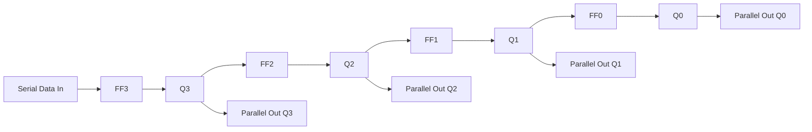
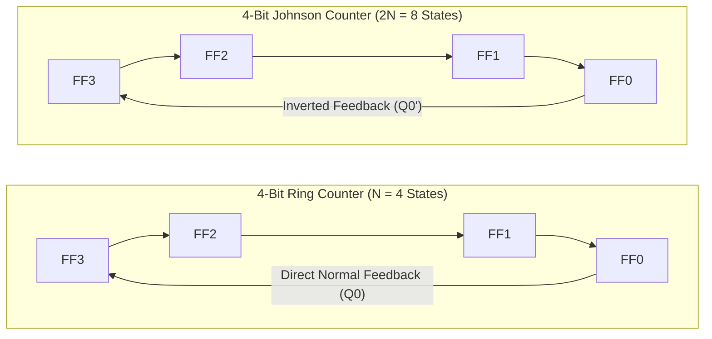

# ⚡ CAT-2 HOTS Master Crib — Module 3: Sequential Logic & Shift Registers
**Course**: ECE2002 — Digital Logic Design  
**Level**: Self-Contained & Fully Visual (From Bedrock Basics to Class Notes & HOTS)  
**Exam Mode**: Open Book / Handwritten Notes Allowed | **Target Score**: 45+ / 50

---

## 🧱 TIER 0: The "Explain Like I'm 5" Bedrock Basics
*(Read this first if you forgot everything about flip-flops and registers)*

### 1. Shift Register Architectures (Visual Block Diagrams)

#### A. 4-Bit Serial-In Serial-Out (SISO) Shift Register:

* Takes **4 clock pulses** to load 4 bits, and **3 more clock pulses** to unload ($2N-1 = 7$ total).

#### B. 4-Bit Serial-In Parallel-Out (SIPO) Shift Register:

* Takes **4 clock pulses** to load 4 bits, and **0 extra pulses to read** (All 4 bits read simultaneously).

---

### 2. Ring Counter vs Johnson Counter Feedback Loops

---

## 🧭 TIER 1: The Problem Symptom & Keyword Decoder

| If Question Shows / Asks... | It Means This Exact Topic | What You Do (In 5 Seconds) |
| :--- | :--- | :--- |
| "Convert Flip-Flop X to Flip-Flop Y" | **Flip-Flop Conversion** | Write Target FF truth table $\to$ append Excitation columns for Available FF $\to$ K-Map. |
| "Load 1111 into 4-bit SISO/SIPO", Clock analysis | **Shift Register Timing Table** | Draw table showing state of flip-flops $Q_3, Q_2, Q_1, Q_0$ after each clock pulse $1 \dots 4$. |
| "Ring Counter vs Johnson Counter" | **Shift Register Counters** | Ring: $N$ states ($1000 \to 0100$). Johnson: $2N$ states ($000 \to 100 \to 110 \dots$). Inverted feedback $D_1 = Q_N'$. |

---

## 📝 TIER 4: Solved Classroom Archetypes (From Lecture Notes)

### Classroom Problem 1: 4-Bit SISO Shift Register Trace (Loading & Unloading `1111`)
*(From Class Notes Module 3 Page 1)*  
**Question**: A 4-bit Serial-In Serial-Out (SISO) shift register using D flip-flops has initial content `0000`. Serial data input `1111` is applied (MSB first). Construct the complete state transition table for loading and unloading the data.

$$\begin{array}{|c|c|c|c|c|c|c|} \hline \text{Clock Pulse} & \text{Serial In} & Q_3 & Q_2 & Q_1 & Q_0 & \text{Serial Out } (Q_0) \\ \hline \text{Initial} & - & 0 & 0 & 0 & 0 & 0 \\ \text{CP 1} & 1 & 1 & 0 & 0 & 0 & 0 \\ \text{CP 2} & 1 & 1 & 1 & 0 & 0 & 0 \\ \text{CP 3} & 1 & 1 & 1 & 1 & 0 & 0 \\ \text{CP 4} & 1 & \mathbf{1} & \mathbf{1} & \mathbf{1} & \mathbf{1} & \mathbf{1} \text{ (Loaded!)} \\ \hline \text{CP 5} & 0 & 0 & 1 & 1 & 1 & \mathbf{1} \\ \text{CP 6} & 0 & 0 & 0 & 1 & 1 & \mathbf{1} \\ \text{CP 7} & 0 & 0 & 0 & 0 & 1 & \mathbf{1} \\ \hline \end{array}$$

---

### Classroom Problem 2: 4-Bit Johnson Counter Decoding Table
*(From Class Notes Module 3 Page 2)*  
$$\begin{array}{|c|c|c|c|c|c|} \hline \text{Clock} & Q_3 & Q_2 & Q_1 & Q_0 & \text{Decoded State AND Equation} \\ \hline 0 & 0 & 0 & 0 & 0 & Q_3' Q_0' \\ 1 & 0 & 0 & 0 & 1 & Q_1' Q_0 \\ 2 & 0 & 0 & 1 & 1 & Q_2' Q_1 \\ 3 & 0 & 1 & 1 & 1 & Q_3' Q_2 \\ 4 & 1 & 1 & 1 & 1 & Q_3 Q_0 \\ 5 & 1 & 1 & 1 & 0 & Q_1 Q_0' \\ 6 & 1 & 1 & 0 & 0 & Q_2 Q_1' \\ 7 & 1 & 0 & 0 & 0 & Q_3 Q_2' \\ \hline \end{array}$$
