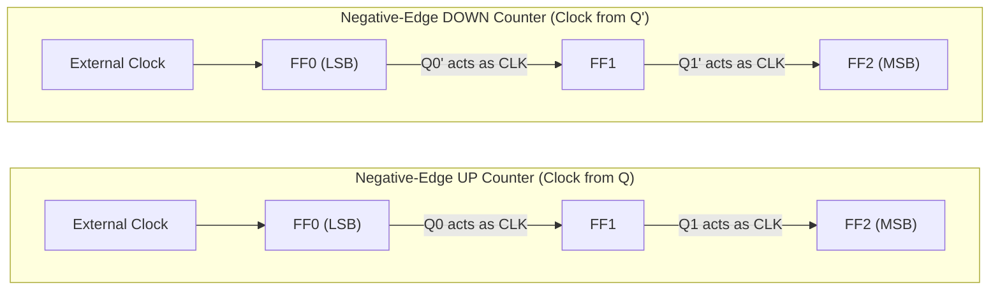
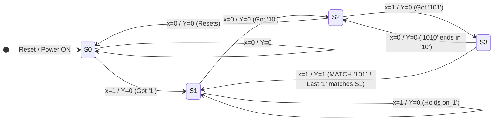
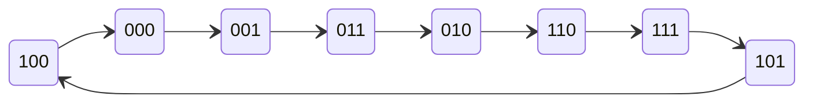

# ⚡ CAT-2 HOTS Master Crib — Module 4: Asynchronous & Synchronous Counters
**Course**: ECE2002 — Digital Logic Design  
**Level**: Self-Contained & Fully Visual (From Bedrock Basics to Class Homework & HOTS)  
**Exam Mode**: Open Book / Handwritten Notes Allowed | **Target Score**: 45+ / 50

---

## 🧱 TIER 0: The "Explain Like I'm 5" Bedrock Basics
*(Read this first if you forgot everything about counters)*

### 1. Ripple Counter Wiring (How Up vs Down Works Visually)

---

### 2. State Diagram: Mealy Overlapping Sequence Detector (`1011`)

---

### 3. State Diagram: 3-Bit Synchronous Gray Code Counter (Homework 2)

> Notice: Between every single consecutive state, **only ONE bit flips**!

---

## 🧭 TIER 1: The Problem Symptom & Keyword Decoder

| If Question Shows / Asks... | It Means This Exact Topic | What You Do (In 5 Seconds) |
| :--- | :--- | :--- |
| "Design Mod-10 synchronous counter using JK" | **BCD Synchronous Counter** | 4 JK FFs ($Q_D Q_C Q_B Q_A$). Don't cares for states $10 \dots 15$. K-Maps give $J_A=K_A=1, J_B=K_B=Q_A Q_D', J_C=K_C=Q_A Q_B, J_D=Q_A Q_B Q_C, K_D=Q_A$. |
| "Design 3-bit Gray code counter using T FF" | **Gray Code Counter** | Sequence: $000 \to 001 \to 011 \to 010 \to 110 \to 111 \to 101 \to 100 \to 000$. All 8 states used! $T_i = Q_i \oplus Q_i^+$. |
| "Arbitrary sequence $000 \to 110 \dots$" | **Custom State Loop** | List sequence $\to$ treat missing states as Don't Cares ($X$) $\to$ K-Map $\to$ Verify self-starting! |

---

## 📝 TIER 4: Solved Classroom Archetypes (From Class Notes)

### Classroom Homework 1: Mod-10 Synchronous UP Counter using JK Flip-Flops
*(From Class Notes Module 4 Homework 1)*  
**Equations**:
* $\mathbf{J_A = 1, \quad K_A = 1}$
* $\mathbf{J_B = K_B = Q_A \cdot Q_D'}$
* $\mathbf{J_C = K_C = Q_A \cdot Q_B}$
* $\mathbf{J_D = Q_A \cdot Q_B \cdot Q_C, \quad K_D = Q_A}$

---

### Classroom Homework 2: 3-Bit Synchronous Gray Code Counter using T Flip-Flops
*(From Class Notes Module 4 Homework 2)*  
**Equations**:
* $\mathbf{T_2 = Q_1 Q_0'}$
* $\mathbf{T_1 = Q_2' Q_0}$
* $\mathbf{T_0 = (Q_2 \oplus Q_1)'}$
