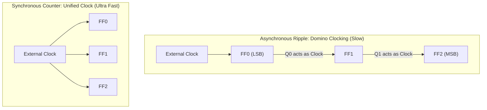
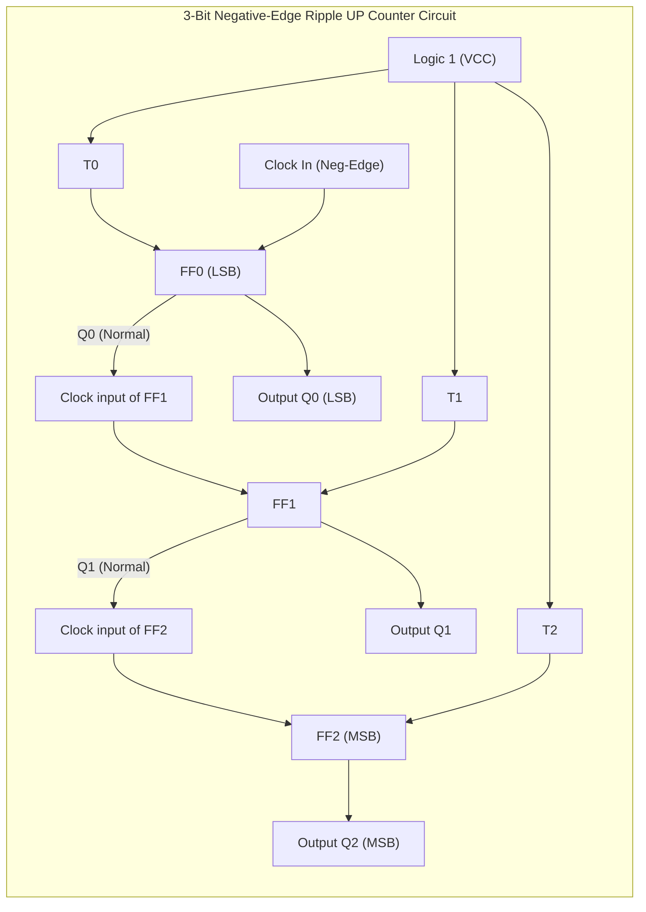
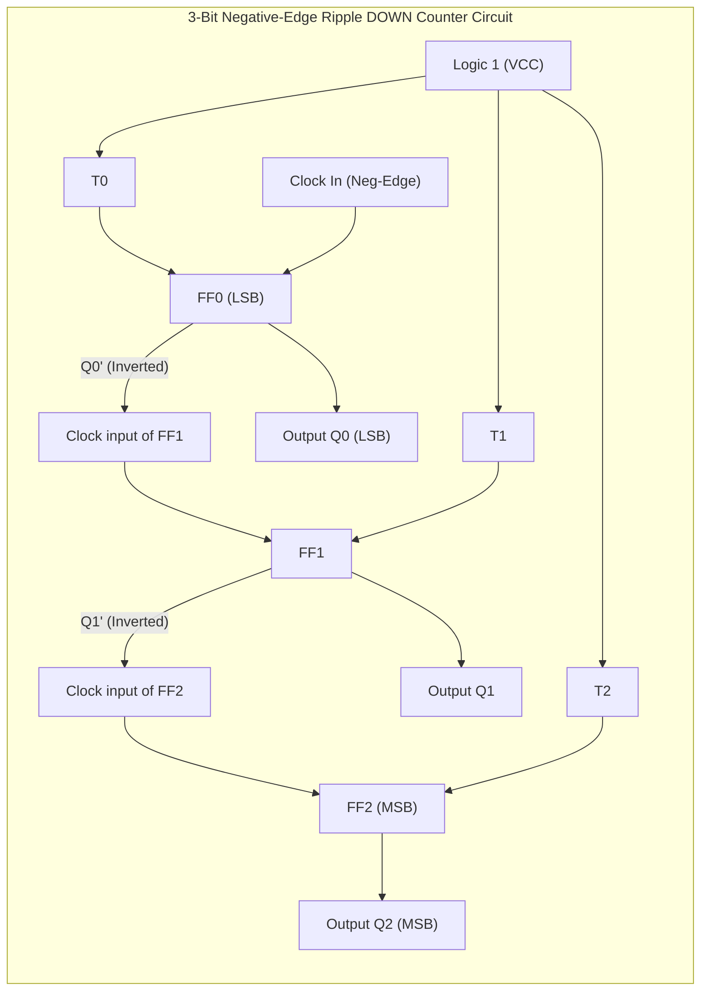
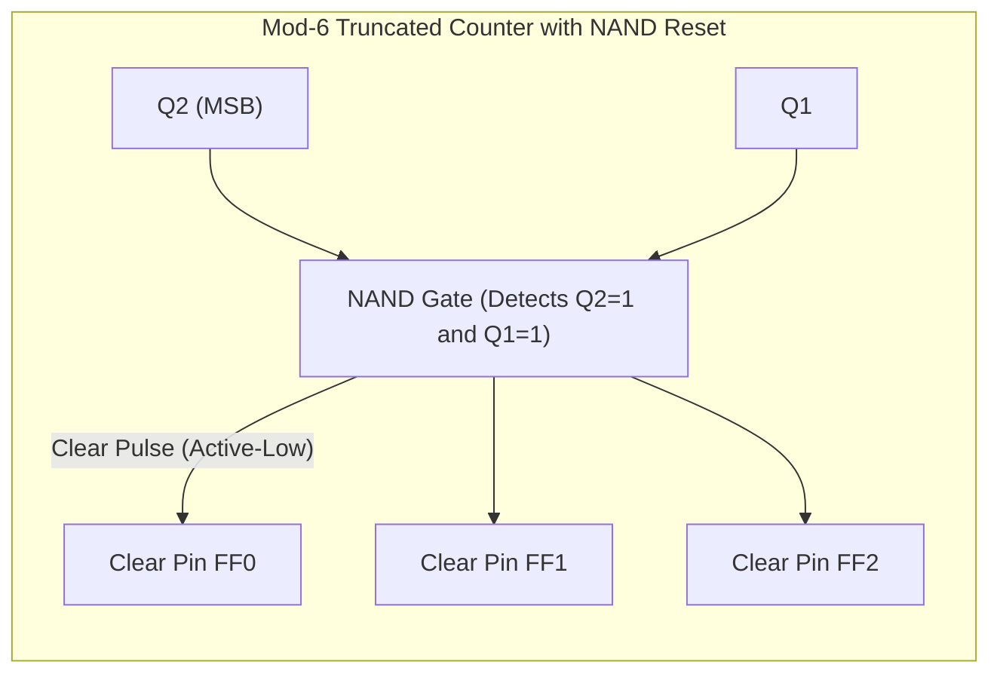
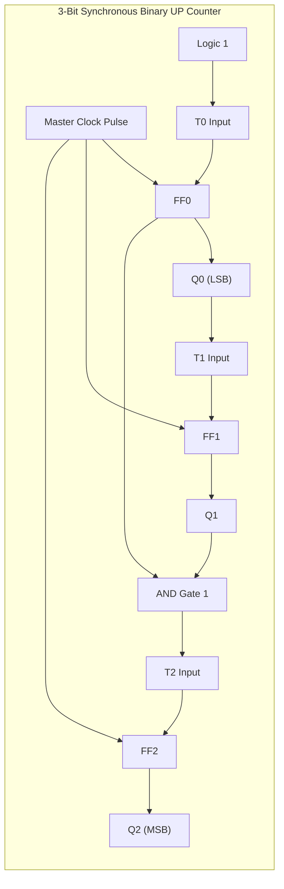
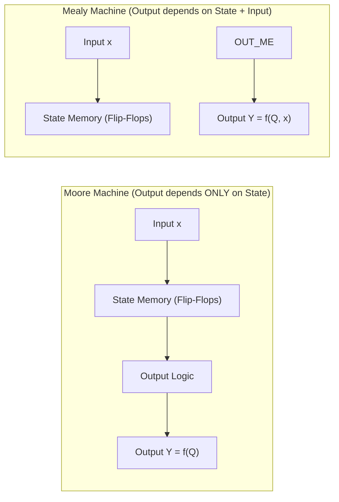
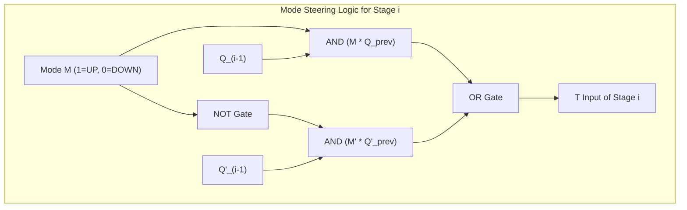
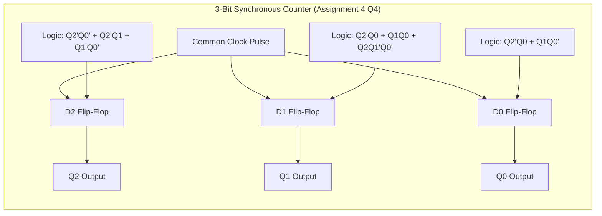
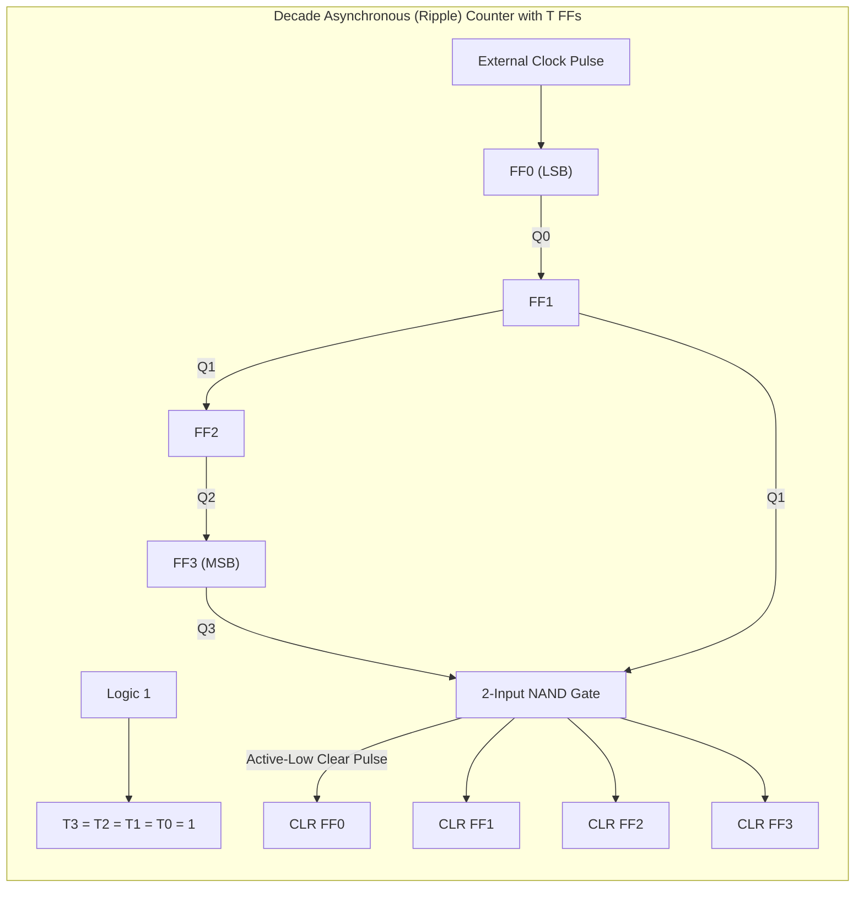

# ⚡ CAT-2 HOTS Master Crib — Module 4: Asynchronous & Synchronous Counters & FSMs
**Course**: ECE2002 — Digital Logic Design  
**Level**: Self-Contained & Fully Visual (Zero-Assumption Bedrock Basics to Circuit Schematics)  
**Exam Mode**: Open Book / Handwritten Notes Allowed | **Target Score**: 45+ / 50

---

## 🧱 TIER 0: The "Explain Like I'm 5" Bedrock Basics
*(Read this first if counter circuits look like chaotic spaghetti wiring)*

### 1. What is a Counter? (Ripple vs. Synchronous)
A counter is a circuit that cycles through a set sequence of binary numbers on every clock pulse:
* **Asynchronous (Ripple) Counter**:
  * External clock is connected **ONLY to the first flip-flop (LSB)**.
  * Each flip-flop's output triggers the clock of the NEXT flip-flop!
  * Like falling dominoes, the clock **ripples** down the line $\implies$ **Slow! Accumulates delay ($n \times t_{pd}$)**.
* **Synchronous Counter**:
  * External clock connects **SIMULTANEOUSLY to ALL flip-flops**!
  * All flip-flops update at the exact same instant $\implies$ **Blazing fast! Delay is only 1 flip-flop ($t_{pd}$)**.

---

### 2. Asynchronous (Ripple) Counter Circuit Schematics

#### The 4 Golden Rules of Ripple Direction:
* If flip-flops trigger on **Negative Edge ($\downarrow$)**:
  * Clock from normal output **$Q \implies$ UP Counter** ($0 \to 1 \to 2 \dots$).
  * Clock from inverted output **$Q' \implies$ DOWN Counter** ($7 \to 6 \to 5 \dots$).
* If flip-flops trigger on **Positive Edge ($\uparrow$)**:
  * Clock from normal output **$Q \implies$ DOWN Counter**.
  * Clock from inverted output **$Q' \implies$ UP Counter**.

#### A. 3-Bit Asynchronous UP Counter (Negative-Edge Triggered T FFs):
* All $T$ inputs are tied to Logic HIGH ($1$) so they operate in **TOGGLE mode**.
* External clock connects to FF0 ($Q_0$). Output $Q_0$ clocks FF1. Output $Q_1$ clocks FF2.

---

#### B. 3-Bit Asynchronous DOWN Counter:
* To count downwards ($7 \to 6 \to 5 \dots$), we simply take the clock for the next stage from the **inverted output $Q'$**!

---

#### C. Truncated Mod-N Ripple Counter (Mod-6 Counter with Reset):
* A 3-bit counter naturally counts 8 states ($0 \dots 7$).
* To make a **Mod-6 counter** (counts $0, 1, 2, 3, 4, 5$ and resets on $6$):
  * Binary of $6$ is $Q_2 Q_1 Q_0 = \mathbf{1 1 0_2}$.
  * Connect $Q_2$ and $Q_1$ into a **NAND gate**.
  * The NAND output connects to the active-low **CLEAR / RESET** pins of all flip-flops!
  * The instant $6$ appears, NAND output becomes $0$, instantly clearing all flip-flops back to $000$!

---

### 3. Synchronous Binary Counter Circuit Schematics

In a synchronous counter, every flip-flop gets the master clock simultaneously. A flip-flop should toggle **only when ALL previous lower-order bits are 1**!
* $T_0 = \mathbf{1}$ (Toggles every single clock pulse).
* $T_1 = \mathbf{Q_0}$ (Toggles when $Q_0 = 1$).
* $T_2 = \mathbf{Q_0 \cdot Q_1}$ (Toggles when both $Q_0$ and $Q_1$ are 1!).
* $T_3 = \mathbf{Q_0 \cdot Q_1 \cdot Q_2}$ (Toggles when $Q_0, Q_1, Q_2$ are all 1!).

---

### 4. Finite State Machines (Mealy vs. Moore Block Diagrams)

* **Moore Machine**:
  * Output depends **ONLY on the Present State** ($Y = f(Q)$).
  * Safe against input noise/glitches, but responds 1 clock cycle later.
  * Outputs are written **INSIDE the state bubbles** (e.g. `S0 / 0`).
* **Mealy Machine**:
  * Output depends on **BOTH Present State AND Current Input** ($Y = f(Q, x)$).
  * Reacts instantly to inputs within the same clock cycle, but prone to input glitches!
  * Outputs are written **ON the transition arrows** (e.g. `x=1 / Y=1`).

---

### 5. Synchronous UP / DOWN Counter with Mode Control ($M$)
A single counter that counts UP when $M=1$, and counts DOWN when $M=0$:
* **UP Counting ($M=1$)**: A stage toggles when all previous **normal outputs $Q_k = 1$**.
* **DOWN Counting ($M=0$)**: A stage toggles when all previous **inverted outputs $Q_k' = 1$**.
* **Steering Logic for Stage $i$**:
  $$T_i = (M \cdot Q_0 \dots Q_{i-1}) + (M' \cdot Q_0' \dots Q_{i-1}')$$
  * $T_0 = \mathbf{1}$
  * $T_1 = M \cdot Q_0 + M' \cdot Q_0'$
  * $T_2 = M \cdot (Q_0 Q_1) + M' \cdot (Q_0' Q_1')$

---

### 6. Maximum Operating Clock Frequency ($f_{max}$) Calculation
In HOTS questions, you will be given timing parameters and asked: *"What is the maximum clock frequency at which this counter can operate reliably?"*

#### The Key Timing Parameters:
* $t_{cq}$ (or $t_{pd}$): Flip-flop clock-to-output propagation delay.
* $t_{comb}$: Delay through combinational logic gates (e.g. AND carry gates).
* $t_{su}$: Flip-flop setup time (data must be stable before the clock edge).

#### A. For Synchronous Counters:
All flip-flops update in parallel, but the carry must ripple through the AND gates before the next clock:
$$T_{clk} \ge t_{cq} + t_{comb} + t_{su}$$
$$\mathbf{f_{max} = \frac{1}{T_{clk}} = \frac{1}{t_{cq} + t_{comb} + t_{su}}}$$
*(Notice: $f_{max}$ is independent of the number of flip-flops $n$ if carry lookahead is used!)*

#### B. For Asynchronous (Ripple) Counters:
The clock signal must ripple through all $n$ flip-flops consecutively:
$$T_{clk} \ge (n \times t_{cq}) + t_{su}$$
$$\mathbf{f_{max} = \frac{1}{n \cdot t_{cq} + t_{su}}}$$
*(Notice: As bit-width $n$ increases, $f_{max}$ drops drastically!)*

---

## 🧭 TIER 1: The Problem Symptom & Keyword Decoder

| If Question Shows / Asks... | It Means This Exact Topic | What You Do (In 5 Seconds) |
| :--- | :--- | :--- |
| "Design Mod-10 synchronous counter using JK" | **BCD Synchronous Counter** | 4 JK FFs ($Q_D Q_C Q_B Q_A$). Don't cares for states $10 \dots 15$. K-Maps: $J_A=K_A=1, J_B=K_B=Q_A Q_D', J_C=K_C=Q_A Q_B, J_D=Q_A Q_B Q_C, K_D=Q_A$. |
| "Design decade asynchronous counter using T FF" | **Decade Ripple Counter** | 4 T FFs in toggle mode ($T=1$). Reset on state $10$ (`1010`) using a NAND gate on $Q_3$ and $Q_1$ connected to $\overline{\text{CLR}}$. |
| "Design 3-bit Gray code counter using T FF" | **Gray Code Counter** | Sequence: $000 \to 001 \to 011 \to 010 \to 110 \to 111 \to 101 \to 100 \to 000$. All 8 states used! $T_i = Q_i \oplus Q_i^+$. |
| "Arbitrary sequence counter using D FFs" | **Custom Synchronous Counter** | List Present $\to$ Next states. Since $D_i = Q_i^+$, K-Maps for $D_i$ are read directly from next-state columns! |
| "Synchronous UP/DOWN counter with mode M" | **Mode-Controlled Counter** | $T_i = M \cdot (\text{carry from } Q) + M' \cdot (\text{borrow from } Q')$. |
| "Calculate maximum clock frequency f_max" | **Timing Delay Analysis** | Synchronous: $f_{max} = 1 / (t_{cq} + t_{comb} + t_{su})$. Ripple: $f_{max} = 1 / (n \cdot t_{cq} + t_{su})$. |
| "Design a sequence detector for 1011" | **FSM Sequence Detector** | Draw states: $S_0$ (Start), $S_1$ (Got '1'), $S_2$ (Got '10'), $S_3$ (Got '101'). If overlapping, from $S_3$ on '1' go to $S_1$ with $Y=1$. |

---

## 📝 TIER 4: Solved Classroom & Exam Archetypes

### Classroom Homework 1: Mod-10 Synchronous UP Counter using JK Flip-Flops
*(From Class Notes Module 4 Homework 1)*  
**Goal**: Design a BCD counter that counts $0 \to 1 \to 2 \dots \to 9 \to 0$.

#### 1. State Table with JK Excitations:
$$\begin{array}{|c|cccc|cccc|cc|cc|cc|cc|}
\hline
\textbf{State} & Q_D & Q_C & Q_B & Q_A & Q_D^+ & Q_C^+ & Q_B^+ & Q_A^+ & J_D & K_D & J_C & K_C & J_B & K_B & J_A & K_A \\ \hline
0 & 0 & 0 & 0 & 0 & 0 & 0 & 0 & 1 & 0 & X & 0 & X & 0 & X & 1 & X \\
1 & 0 & 0 & 0 & 1 & 0 & 0 & 1 & 0 & 0 & X & 0 & X & 1 & X & X & 1 \\
2 & 0 & 0 & 1 & 0 & 0 & 0 & 1 & 1 & 0 & X & 0 & X & X & 0 & 1 & X \\
3 & 0 & 0 & 1 & 1 & 0 & 1 & 0 & 0 & 0 & X & 1 & X & X & 1 & X & 1 \\
4 & 0 & 1 & 0 & 0 & 0 & 1 & 0 & 1 & 0 & X & X & 0 & 0 & X & 1 & X \\
5 & 0 & 1 & 0 & 1 & 0 & 1 & 1 & 0 & 0 & X & X & 0 & 1 & X & X & 1 \\
6 & 0 & 1 & 1 & 0 & 0 & 1 & 1 & 1 & 0 & X & X & 0 & X & 0 & 1 & X \\
7 & 0 & 1 & 1 & 1 & 1 & 0 & 0 & 0 & 1 & X & X & 1 & X & 1 & X & 1 \\
8 & 1 & 0 & 0 & 0 & 1 & 0 & 0 & 1 & X & 0 & 0 & X & 0 & X & 1 & X \\
9 & 1 & 0 & 0 & 1 & 0 & 0 & 0 & 0 & X & 1 & 0 & X & 0 & X & X & 1 \\ \hline
\end{array}$$
*(Unused states $10 \dots 15$ are filled with Don't Cares $X$ in K-Maps!)*

#### 2. Minimized Input Equations:
* $\mathbf{J_A = 1, \quad K_A = 1}$
* $\mathbf{J_B = K_B = Q_A \cdot Q_D'}$
* $\mathbf{J_C = K_C = Q_A \cdot Q_B}$
* $\mathbf{J_D = Q_A \cdot Q_B \cdot Q_C, \quad K_D = Q_A}$

---

### Classroom Homework 2: 3-Bit Synchronous Gray Code Counter using T Flip-Flops
*(From Class Notes Module 4 Homework 2)*  
**Gray Sequence**: $000 \to 001 \to 011 \to 010 \to 110 \to 111 \to 101 \to 100 \to 000$

#### 1. Transition & Excitation Table ($T_i = Q_i \oplus Q_i^+$):
$$\begin{array}{|c|ccc|ccc|c|c|c|}
\hline
\textbf{Step} & Q_2 & Q_1 & Q_0 & Q_2^+ & Q_1^+ & Q_0^+ & T_2 & T_1 & T_0 \\ \hline
0 & 0 & 0 & 0 & 0 & 0 & 1 & 0 & 0 & 1 \\
1 & 0 & 0 & 1 & 0 & 1 & 1 & 0 & 1 & 0 \\
2 & 0 & 1 & 1 & 0 & 1 & 0 & 0 & 0 & 1 \\
3 & 0 & 1 & 0 & 1 & 1 & 0 & 1 & 0 & 0 \\
4 & 1 & 1 & 0 & 1 & 1 & 1 & 0 & 0 & 1 \\
5 & 1 & 1 & 1 & 1 & 0 & 1 & 0 & 1 & 0 \\
6 & 1 & 0 & 1 & 1 & 0 & 0 & 0 & 0 & 1 \\
7 & 1 & 0 & 0 & 0 & 0 & 0 & 1 & 0 & 0 \\ \hline
\end{array}$$

#### 2. Minimized T Equations from K-Maps:
* $\mathbf{T_0 = Q_1' Q_2' + Q_1 Q_2 = \overline{Q_1 \oplus Q_2}}$ (XNOR Gate!)
* $\mathbf{T_1 = Q_2' Q_0}$
* $\mathbf{T_2 = Q_1' Q_0'}$

---

### Classroom Problem 3: Arbitrary Sequence Counter & Lockout Prevention
**Sequence**: $000 \to 110 \to 010 \to 011 \to 101 \to 000$ (5 valid states; 3 unused states: $001, 100, 111$).

#### Why Lockout Verification is Mandatory in CAT-2:
* If noise pushes the counter into an unused state (e.g. $001$), **will it return to the main loop, or get trapped forever in a dead-end cycle?**
* **Self-Starting Check**:
  * Analyze next state for all 3 unused states using the derived equations.
  * If $001 \to 010$, $100 \to 000$, $111 \to 011$ (all lead into valid states) $\implies$ **SELF-STARTING & LOCKOUT FREE ✅**!

---

### Classroom Problem 4: Assignment 4 Q4 — 3-Bit Synchronous Counter ($0 \to 4 \to 6 \to 1 \to 3 \to 7 \to 2 \to 5 \to 0$) using D Flip-Flops
*(From Assignment-4 Problem 4)*  
**Goal**: Design a 3-bit synchronous counter that traverses all 8 states in the specified non-binary sequence using D flip-flops.

#### 1. Transition Table & D Excitations ($D_i = Q_i^+$):
$$\begin{array}{|c|ccc|ccc|c|c|c|}
\hline
\textbf{Decimal} & Q_2 & Q_1 & Q_0 & Q_2^+ & Q_1^+ & Q_0^+ & D_2 & D_1 & D_0 \\ \hline
0 & 0 & 0 & 0 & 1 & 0 & 0 & 1 & 0 & 0 \\
4 & 1 & 0 & 0 & 1 & 1 & 0 & 1 & 1 & 0 \\
6 & 1 & 1 & 0 & 0 & 0 & 1 & 0 & 0 & 1 \\
1 & 0 & 0 & 1 & 0 & 1 & 1 & 0 & 1 & 1 \\
3 & 0 & 1 & 1 & 1 & 1 & 1 & 1 & 1 & 1 \\
7 & 1 & 1 & 1 & 0 & 1 & 0 & 0 & 1 & 0 \\
2 & 0 & 1 & 0 & 1 & 0 & 1 & 1 & 0 & 1 \\
5 & 1 & 0 & 1 & 0 & 0 & 0 & 0 & 0 & 0 \\ \hline
\end{array}$$

#### 2. K-Map Minimization for D Inputs:
* **For $D_2(Q_2, Q_1, Q_0)$**: Minterms $m(0, 2, 3, 4)$
  * Group $(0, 2) \implies Q_2' Q_0'$
  * Group $(2, 3) \implies Q_2' Q_1$
  * Group $(0, 4) \implies Q_1' Q_0'$
  * $\mathbf{D_2 = Q_2' Q_0' + Q_2' Q_1 + Q_1' Q_0'}$
* **For $D_1(Q_2, Q_1, Q_0)$**: Minterms $m(1, 3, 4, 7)$
  * Group $(1, 3) \implies Q_2' Q_0$
  * Group $(3, 7) \implies Q_1 Q_0$
  * Minterm $4 \implies Q_2 Q_1' Q_0'$
  * $\mathbf{D_1 = Q_2' Q_0 + Q_1 Q_0 + Q_2 Q_1' Q_0'}$
* **For $D_0(Q_2, Q_1, Q_0)$**: Minterms $m(1, 2, 3, 6)$
  * Group $(1, 3) \implies Q_2' Q_0$
  * Group $(2, 3, 6 \text{ wait: } 2, 3 \implies Q_2' Q_1; 2, 6 \implies Q_1 Q_0')$
  * $\mathbf{D_0 = Q_2' Q_0 + Q_1 Q_0'}$

---

### Classroom Problem 5: Assignment 4 Q5 — Design Decade Asynchronous Counter using T Flip-Flops
*(From Assignment-4 Problem 5)*  
**Goal**: Design a BCD asynchronous (ripple) counter that counts $0 \dots 9$ (`0000` to `1001`) and resets to zero on the 10th count (`1010`).

#### 1. Counter Requirements:
* Modulus: $\text{MOD} = 10$.
* Number of Flip-Flops: $2^{n-1} < 10 \le 2^n \implies \mathbf{n = 4\text{ Flip-Flops}}$ ($Q_3, Q_2, Q_1, Q_0$).
* Connect all $T$ inputs to $1$ ($T_3 = T_2 = T_1 = T_0 = 1$) so each flip-flop toggles.
* Clocking: Negative-edge triggered ripple UP counter $\implies$ Output $Q_i$ connects to clock input of stage $i+1$.

#### 2. Reset Logic Formulation:
* Natural count continues up to $15$. To stop at $10$:
  $$\text{Binary of } 10_{10} = Q_3 Q_2 Q_1 Q_0 = \mathbf{1 0 1 0_2}$$
* We need to detect when **$Q_3 = 1$ AND $Q_1 = 1$**.
* Use a **2-input NAND gate** with inputs $Q_3$ and $Q_1$:
  $$\text{Reset Signal } \overline{R} = \overline{Q_3 \cdot Q_1}$$
* The NAND output connects directly to the **active-low $\overline{\text{CLEAR}}$ inputs** of all 4 flip-flops!

* **Transient Glitch Analysis**: The state $1010$ ($10$) exists for only a few nanoseconds (the propagation delay of the NAND gate plus the internal clear delay of the flip-flops), after which the counter immediately resets to $0000$. Hence, only states $0 \dots 9$ are seen externally!

