# 🏆 ECE2002: Digital Logic Design — Curated Faculty High-Yield Solutions Master Guide

> **Course**: ECE2002 — Digital Logic Design  
> **Faculty**: Dr. Kanimozhi M | **Slot**: A14+D11+D12  
> **Target**: TEE FAT Exam — 16-Oct-2026 (01:15 PM – 04:15 PM)  
> **Source Material**: Official Faculty Important Topics (`tee_imp.txt`), Lecture PPTs, Group Activity A & B, and Assignments 3, 4, 5.  
> **Format**: Written strictly following **Dr. Kanimozhi's 5-Step Evaluation Rubric**:  
> `State/Truth Table` ➔ `K-Map Grouping & EPIs` ➔ `Minimal Equations` ➔ `Logic Schematic` ➔ `Verification/Traces`.

---

## 📑 TABLE OF CONTENTS
1. [MODULE 1: Number Systems, Complements, RTL Logic & Universal Gates](#module-1-number-systems-complements-rtl-logic--universal-gates)
   - [Q1.1: Fractional Base Conversions (Binary, Octal, Hex, Radix-4)](#q11-fractional-base-conversions-class--ppt-problems)
   - [Q1.2: 1's and 2's Complement Subtraction](#q12-1s-and-2s-complement-subtraction-class--ppt-problems)
   - [Q1.3: 9's and 10's Complement Decimal Subtraction](#q13-9s-and-10s-complement-decimal-subtraction)
   - [Q1.4: Resistor-Transistor Logic (RTL) NOR Gate & IC Performance Parameters](#q14-resistor-transistor-logic-rtl-nor-gate--ic-parameters)
   - [Q1.5: Universal Logic Realization (NAND-Only & NOR-Only) & Consensus Theorem](#q15-universal-logic-realization-nandnor--consensus-theorem)
2. [MODULE 2: K-Maps, Code Converters, Decoders, Encoders & Multiplexers](#module-2-k-maps-code-converters-decoders-encoders--multiplexers)
   - [Q2.1: 4-Variable & 5-Variable K-Map Minimization with Don't Cares](#q21-4-variable--5-variable-k-map-minimization-with-dont-cares)
   - [Q2.2: BCD to Excess-3 Code Converter (Complete 5-Step Design)](#q22-bcd-to-excess-3-code-converter-complete-5-step-design)
   - [Q2.3: Binary to Gray & Gray to Binary Converters](#q23-binary-to-gray--gray-to-binary-converters)
   - [Q2.4: Full Adder Implementation using 3:8 Decoder](#q24-full-adder-implementation-using-38-decoder)
   - [Q2.5: Decoder Expansion (4:16 and 5:32 Decoders)](#q25-decoder-expansion-416-and-532-decoders)
   - [Q2.6: 8:1 & 4:1 Multiplexer Function Implementations](#q26-81--41-multiplexer-function-implementations)
   - [Q2.7: 8:3 Priority Encoder with Valid Bit](#q27-83-priority-encoder-with-valid-bit)
3. [MODULE 3: Flip-Flops, Master-Slave JK & Sequential Circuit Analysis](#module-3-flip-flops-master-slave-jk--sequential-circuit-analysis)
   - [Q3.1: Master Flip-Flop Suite (SR, JK, D, T Tables, Equations & State Diagrams)](#q31-master-flip-flop-suite-sr-jk-d-t)
   - [Q3.2: Race-Around Condition & Master-Slave JK Flip-Flop Operation](#q32-race-around-condition--master-slave-jk-flip-flop)
   - [Q3.3: Universal Flip-Flop Conversion Algorithm (SR to JK, JK to D, JK to T)](#q33-universal-flip-flop-conversion-algorithm)
   - [Q3.4: Analysis of Clocked Sequential Circuits (State Equations ➔ State Diagram)](#q34-analysis-of-clocked-sequential-circuits)
4. [MODULE 4: Counters, Sequence Detectors & Finite State Machines](#module-4-counters-sequence-detectors--finite-state-machines)
   - [Q4.1: Synchronous Decade (Mod-10) Counter using JK Flip-Flops](#q41-synchronous-decade-mod-10-counter-using-jk-flip-flops)
   - [Q4.2: Arbitrary Sequence Counter (0 ➔ 4 ➔ 6 ➔ 1 ➔ 3 ➔ 7 ➔ 2 ➔ 5 ➔ 0)](#q42-arbitrary-sequence-counter-using-d-flip-flops)
   - [Q4.3: Synchronous Prime Number Counter (2 ➔ 3 ➔ 5 ➔ 7) using T Flip-Flops](#q43-synchronous-prime-number-counter-using-t-flip-flops)
   - [Q4.4: Asynchronous (Ripple) Decade Counter with Asynchronous Reset](#q44-asynchronous-ripple-decade-counter-with-nand-reset)
   - [Q4.5: Ring Counter vs Johnson Counter (State Sequence & Frequency Division)](#q45-ring-counter-vs-johnson-counter)
   - [Q4.6: Sequence Detector Design ('1010' Mealy & Moore Models)](#q46-sequence-detector-design-1010-mealy--moore)
   - [Q4.7: FSM Comparison & State Minimization using Implication Table](#q47-fsm-comparison--state-minimization-using-implication-table)
5. [MODULE 5: All Questions from Group Activity A & B (Verilog HDL)](#module-5-all-questions-from-group-activity-a--b-verilog-hdl)
   - [Q5.1: Verilog Modeling Levels & Suitability Comparison](#q51-verilog-modeling-levels--suitability-comparison)
   - [Q5.2: EX-OR Gate in All Three Modeling Styles (Gate, Dataflow, Behavioral)](#q52-ex-or-gate-in-all-three-modeling-styles)
   - [Q5.3: Gate-Level Full Adder with Delays (AND=10ns, OR=10ns, NOT=5ns)](#q53-gate-level-full-adder-with-gate-delays)
   - [Q5.4: Gate-Level Full Subtractor with Gate Delays](#q54-gate-level-full-subtractor-with-gate-delays)
   - [Q5.5: 8:1 Multiplexer (Behavioral) & Simulation Testbench](#q55-81-multiplexer-behavioral--simulation-testbench)
   - [Q5.6: 8:3 Priority Encoder (Behavioral) & Simulation Testbench](#q56-83-priority-encoder-behavioral--simulation-testbench)
   - [Q5.7: SR & JK Flip-Flop Behavioral Models with Asynchronous Reset](#q57-sr--jk-flip-flop-behavioral-models)
   - [Q5.8: Decade (BCD) Counter Behavioral Model](#q58-decade-bcd-counter-behavioral-model)
   - [Q5.9: Gate-Level Verilog for Group Activity Circuit 1 (circuit_activity_a.png)](#q59-gate-level-verilog-for-circuit-1-circuit_activity_apng)
   - [Q5.10: Gate-Level Verilog for Group Activity Circuit 2 (circuit_activity_b.png)](#q510-gate-level-verilog-for-circuit-2-circuit_activity_bpng)

---

# MODULE 1: Number Systems, Complements, RTL Logic & Universal Gates

---

### Q1.1: Fractional Base Conversions (Class & PPT Problems)

#### Problem (a): Convert $(37.8125)_{10}$ into its Binary equivalent.
1. **Integer Part ($37_{10}$)** — Successive Division by 2:
   $$\begin{aligned}
   37 \div 2 &= 18 \quad \text{rem } \mathbf{1} \quad (\text{LSB}) \\
   18 \div 2 &= 9  \quad \text{rem } \mathbf{0} \\
   9 \div 2  &= 4  \quad \text{rem } \mathbf{1} \\
   4 \div 2  &= 2  \quad \text{rem } \mathbf{0} \\
   2 \div 2  &= 1  \quad \text{rem } \mathbf{0} \\
   1 \div 2  &= 0  \quad \text{rem } \mathbf{1} \quad (\text{MSB})
   \end{aligned}$$
   Reading remainders from bottom to top: $(37)_{10} = (\mathbf{100101})_2$.

2. **Fractional Part ($0.8125_{10}$)** — Successive Multiplication by 2:
   $$\begin{aligned}
   0.8125 \times 2 &= \mathbf{1}.625  \quad \implies \text{Integer } \mathbf{1} \\
   0.625 \times 2  &= \mathbf{1}.25   \quad \implies \text{Integer } \mathbf{1} \\
   0.25 \times 2   &= \mathbf{0}.5    \quad \implies \text{Integer } \mathbf{0} \\
   0.5 \times 2    &= \mathbf{1}.0    \quad \implies \text{Integer } \mathbf{1}
   \end{aligned}$$
   Reading integer carries from top to bottom: $(0.8125)_{10} = (\mathbf{0.1101})_2$.

3. **Combined Result**:
   $$(37.8125)_{10} = \mathbf{(100101.1101)_2}$$

---

#### Problem (b): Convert $(214.45)_{10}$ into its Octal equivalent.
1. **Integer Part ($214_{10}$)** — Successive Division by 8:
   $$\begin{aligned}
   214 \div 8 &= 26 \quad \text{rem } \mathbf{6} \quad (\text{LSB}) \\
   26 \div 8  &= 3  \quad \text{rem } \mathbf{2} \\
   3 \div 8   &= 0  \quad \text{rem } \mathbf{3} \quad (\text{MSB})
   \end{aligned}$$
   $(214)_{10} = (\mathbf{326})_8$.

2. **Fractional Part ($0.45_{10}$)** — Successive Multiplication by 8 (up to 5 places):
   $$\begin{aligned}
   0.45 \times 8 &= \mathbf{3}.60 \quad \implies \mathbf{3} \\
   0.60 \times 8 &= \mathbf{4}.80 \quad \implies \mathbf{4} \\
   0.80 \times 8 &= \mathbf{6}.40 \quad \implies \mathbf{6} \\
   0.40 \times 8 &= \mathbf{3}.20 \quad \implies \mathbf{3} \\
   0.20 \times 8 &= \mathbf{1}.60 \quad \implies \mathbf{1}
   \end{aligned}$$
   $(0.45)_{10} = (\mathbf{0.34631})_8$.

3. **Combined Result**:
   $$(214.45)_{10} = \mathbf{(326.34631)_8}$$

---

#### Problem (c): Convert $(3509.64)_{10}$ into its Hexadecimal equivalent.
1. **Integer Part ($3509_{10}$)** — Successive Division by 16:
   $$\begin{aligned}
   3509 \div 16 &= 219 \quad \text{rem } 5 = \mathbf{5} \quad (\text{LSB}) \\
   219 \div 16  &= 13  \quad \text{rem } 11 = \mathbf{B} \\
   13 \div 16   &= 0   \quad \text{rem } 13 = \mathbf{D} \quad (\text{MSB})
   \end{aligned}$$
   $(3509)_{10} = (\mathbf{DB5})_{16}$.

2. **Fractional Part ($0.64_{10}$)** — Successive Multiplication by 16:
   $$\begin{aligned}
   0.64 \times 16 &= \mathbf{10}.24 \implies \mathbf{A} \\
   0.24 \times 16 &= \mathbf{3}.84  \implies \mathbf{3} \\
   0.84 \times 16 &= \mathbf{13}.44 \implies \mathbf{D} \\
   0.44 \times 16 &= \mathbf{7}.04  \implies \mathbf{7}
   \end{aligned}$$
   $(0.64)_{10} = (\mathbf{0.A3D7})_{16}$.

3. **Combined Result**:
   $$(3509.64)_{10} = \mathbf{(DB5.A3D7)_{16}}$$

---

### Q1.2: 1's and 2's Complement Subtraction (Class & PPT Problems)

**Problem**: Given two binary numbers $A = 1010100_2$ and $B = 1000011_2$. Perform:
1. $A - B$ using 1's complement.
2. $B - A$ using 1's complement.
3. $A - B$ using 2's complement.
4. $B - A$ using 2's complement.

#### 1. $A - B$ using 1's Complement:
- Number of bits in $A$ and $B = 7$ bits.
- $1$'s complement of $B (1000011) = 0111100$.
- Add $A$ and $1$'s comp of $B$:
  $$\begin{array}{r@{\quad}l}
    1010100 & (A) \\
  + 0111100 & (1\text{'s comp of } B) \\
  \hline
  \mathbf{1}0010000 & \text{Sum with End Carry } 1
  \end{array}$$
- **End-Around Carry**: Since end carry is $1$, add $1$ to LSB:
  $$0010000 + 1 = \mathbf{0010001_2} = (+17_{10})$$
  *(Verification: $A = 84_{10}, B = 67_{10} \implies 84 - 67 = +17_{10}$. Correct!)*

#### 2. $B - A$ using 1's Complement:
- $1$'s complement of $A (1010100) = 0101011$.
- Add $B$ and $1$'s comp of $A$:
  $$\begin{array}{r@{\quad}l}
    1000011 & (B) \\
  + 0101011 & (1\text{'s comp of } A) \\
  \hline
    1101110 & \text{No End Carry!}
  \end{array}$$
- **Rule for No End Carry**: Result is **negative** and in $1$'s complement form.
- Take $1$'s complement of result to find magnitude:
  $$1$'s comp of $1101110 = 0010001_2 = (17)_{10}$$
- Final Result: $\mathbf{-0010001_2} = \mathbf{-17_{10}}$.

#### 3. $A - B$ using 2's Complement:
- $2$'s complement of $B (1000011)$:
  $$\text{1's comp} = 0111100 \implies \text{2's comp} = 0111100 + 1 = 0111101_2$$
- Add $A$ and $2$'s comp of $B$:
  $$\begin{array}{r@{\quad}l}
    1010100 & (A) \\
  + 0111101 & (2\text{'s comp of } B) \\
  \hline
  \mathbf{1}0010001 & \text{Carry out } = 1
  \end{array}$$
- **Rule for 2's Complement Carry**: Discard the carry out! Result is positive.
- Final Result: $\mathbf{+0010001_2} = \mathbf{+17_{10}}$.

#### 4. $B - A$ using 2's Complement:
- $2$'s complement of $A (1010100)$:
  $$\text{1's comp} = 0101011 \implies \text{2's comp} = 0101011 + 1 = 0101100_2$$
- Add $B$ and $2$'s comp of $A$:
  $$\begin{array}{r@{\quad}l}
    1000011 & (B) \\
  + 0101100 & (2\text{'s comp of } A) \\
  \hline
    1101111 & \text{No Carry!}
  \end{array}$$
- **Rule for No Carry in 2's Comp**: Result is **negative** and stored in 2's complement form.
- Find magnitude by taking 2's complement:
  $$\text{1's comp of } 1101111 = 0010000 \implies \text{2's comp} = 0010000 + 1 = 0010001_2 = 17_{10}$$
- Final Result: $\mathbf{-0010001_2} = \mathbf{-17_{10}}$.

---

### Q1.3: 9's and 10's Complement Decimal Subtraction

#### Definitions:
* **9's Complement of $N$**: $(10^n - 1) - N$ (subtract each digit from 9).
* **10's Complement of $N$**: $9\text{'s comp} + 1 = 10^n - N$.

#### Problem: Perform $M - N$ where $M = 72532$ and $N = 03250$ (5 digits).

#### (a) Using 10's Complement:
1. **$72532 - 03250$ (Large - Small)**:
   - 9's comp of $03250 = 99999 - 03250 = 96749$.
   - 10's comp of $03250 = 96749 + 1 = 96750$.
   - Add $M$ and 10's comp of $N$:
     $$\begin{array}{r@{\quad}l}
       72532 & (M) \\
     + 96750 & (10\text{'s comp of } N) \\
     \hline
     \mathbf{1}69282 & \text{Carry } = 1
     \end{array}$$
   - Discard carry $\implies$ Result is positive: $\mathbf{+69282}$.

2. **$03250 - 72532$ (Small - Large)**:
   - 9's comp of $72532 = 99999 - 72532 = 27467$.
   - 10's comp of $72532 = 27467 + 1 = 27468$.
   - Add $M$ and 10's comp of $N$:
     $$\begin{array}{r@{\quad}l}
       03250 \\
     + 27468 \\
     \hline
       30718 & \text{No Carry!}
     \end{array}$$
   - No carry $\implies$ Result is negative.
   - Take 10's complement of result:
     $$99999 - 30718 = 69281 \implies 69281 + 1 = 69282$$
   - Result: $\mathbf{-69282}$.

#### (b) Using 9's Complement:
1. **$72532 - 03250$**:
   - Add $M$ and 9's comp of $N$:
     $$\begin{array}{r@{\quad}l}
       72532 \\
     + 96749 \\
     \hline
     \mathbf{1}69281 & \text{End Carry } 1
     \end{array}$$
   - **End-Around Carry**: Add 1 to LSB $\implies 69281 + 1 = \mathbf{+69282}$.

2. **$03250 - 72532$**:
   - Add $M$ and 9's comp of $N$:
     $$03250 + 27467 = 30717 \quad (\text{No Carry})$$
   - Result is negative. Take 9's comp of 30717:
     $$99999 - 30717 = 69282 \implies \mathbf{-69282}$$.

---

### Q1.4: Resistor-Transistor Logic (RTL) NOR Gate & IC Parameters

#### 1. Circuit Schematic:

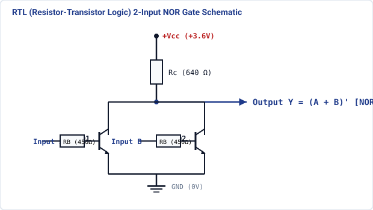
*Figure 1.1: Complete Schematic of 2-Input RTL NOR Gate showing Transistors Q1, Q2, Base Resistors RB, Collector Resistor RC, and Output Node Y.*

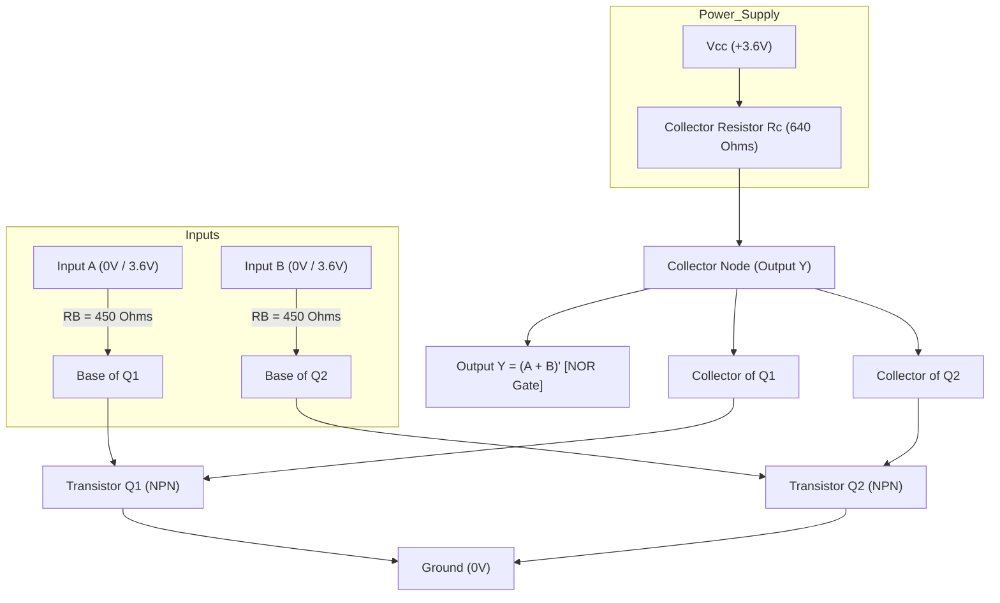

```
                +Vcc (+3.6V)
                   │
                   ┌─┐
                   │ │ Rc (640 Ω)
                   └─┘
                   │
                   ├─────────────── Output Y = (A + B)'
                   │
             ┌─────┴─────┐
             │           │
           ┌─┴─┐       ┌─┴─┐
     RB    │   │ Q1    │   │ Q2
 A ──[===]─┤   │   B ──[===]─┤
 (450 Ω)   └─┬─┘ (450 Ω)└─┬─┘
             │           │
             └─────┬─────┘
                   │
                  GND (0V)
```

#### 2. Working Principle:
- **Case 1: Both Inputs LOW ($A = 0, B = 0 \le 0.2\text{ V}$)**:
  - Both transistors $Q_1$ and $Q_2$ are in **CUTOFF** mode ($V_{BE} < 0.7\text{ V}$).
  - No collector current flows through $R_C$ ($I_C = 0$).
  - The output voltage pulls up to supply voltage:
    $$Y = V_{CC} - I_C R_C = V_{CC} - 0 \approx \mathbf{1 \text{ to } 3.6\text{ V (Logic HIGH '1')}}$$
- **Case 2: Any Input HIGH ($A = 1$ or $B = 1 \ge 1\text{ V}$)**:
  - Base current drives the corresponding transistor into **SATURATION** mode.
  - The collector-to-emitter path conducts heavily, pulling output down to:
    $$Y = V_{CE(sat)} \approx \mathbf{0.2\text{ V (Logic LOW '0')}}$$
- **Conclusion**: Output is HIGH only when ALL inputs are LOW. Hence, the circuit functions as a **NOR Gate**:
  $$Y = \overline{A + B}$$

#### 3. RTL Performance Specifications:
| Parameter | Value | Assessment |
|:---|:---|:---|
| **Basic Logic Gate** | **NOR Gate** | Standard primitive |
| **Propagation Delay ($t_p$)** | **$25\text{ ns}$** | Slow speed (due to transistor saturation charge storage) |
| **Power Dissipation** | **$12\text{ mW}$** | High power consumption |
| **Noise Margin ($NM_L$)** | **$0.4\text{ V}$** | Poor noise immunity |
| **Fan-Out** | **$5$** | Low drive capability |

#### 4. The 9 Performance Parameters of Digital ICs:
1. **Power Dissipation ($P_D$)**: Average power drawn from $V_{CC}$ during a complete cycle ($P_D = V_{CC} \times I_{CC(avg)}$).
2. **Propagation Delay ($t_p$)**: Average time delay between input switching and output response ($t_p = (t_{pLH} + t_{pHL}) / 2$).
3. **Fan-In**: Maximum number of inputs a single logic gate can accept.
4. **Fan-Out**: Maximum number of standard logic inputs a gate output can reliably drive without degrading logic voltage levels.
5. **Input Logic Levels**: $V_{IL(max)}$ (maximum voltage recognized as logic 0) and $V_{IH(min)}$ (minimum voltage recognized as logic 1).
6. **Output Logic Levels**: $V_{OL(max)}$ (maximum voltage output for logic 0) and $V_{OH(min)}$ (minimum voltage output for logic 1).
7. **Noise Margin**: Immunity against electrical noise disturbances:
   $$NM_L = V_{IL} - V_{OL}, \quad NM_H = V_{OH} - V_{IH}$$
8. **Compatibility**: Ability of one logic family to directly drive another family without level shifters.
9. **Speed-Power Product (Figure of Merit)**: Product of propagation delay and power dissipation ($PDP = t_p \times P_D$), expressed in **picojoules (pJ)**. Lower is better!

---

### Q1.5: Universal Logic Realization (NAND/NOR) & Consensus Theorem

#### 1. Universal Gate Realization Table:
| Desired Gate | NAND-Only Implementation | NOR-Only Implementation |
|:---|:---|:---|
| **NOT ($A'$)** | $\overline{A \cdot A}$ (1 gate) | $\overline{A + A}$ (1 gate) |
| **AND ($AB$)** | $\overline{\overline{AB} \cdot \overline{AB}}$ (2 gates) | $\overline{\overline{A} + \overline{B}}$ (3 gates: 2 inverters + 1 NOR) |
| **OR ($A+B$)** | $\overline{\overline{A} \cdot \overline{B}}$ (3 gates: 2 inverters + 1 NAND) | $\overline{\overline{A+B} + \overline{A+B}}$ (2 gates) |
| **XOR ($A \oplus B$)** | **4 NAND gates** | **5 NOR gates** |
| **XNOR ($A \odot B$)** | **5 NAND gates** | **4 NOR gates** |

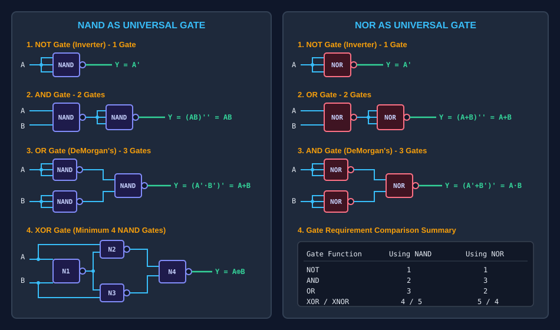
*Figure 1.2: Complete Visual Blueprint for realizing NOT, AND, OR, XOR using NAND-Only and NOR-Only configurations.*

#### 2. Consensus Theorem Proof (Algebraic):
**Theorem**: $A B + \overline{A} C + B C = A B + \overline{A} C$
- Expand the redundant term $B C$ by multiplying with $(A + \overline{A}) = 1$:
  $$\begin{aligned}
  LHS &= A B + \overline{A} C + B C (A + \overline{A}) \\
      &= A B + \overline{A} C + A B C + \overline{A} B C \\
      &= A B (1 + C) + \overline{A} C (1 + B) \\
      &= A B (1) + \overline{A} C (1) \quad (\because 1 + X = 1) \\
      &= \mathbf{A B + \overline{A} C} = RHS \quad \blacksquare
  \end{aligned}$$

---

# MODULE 2: K-Maps, Code Converters, Decoders, Encoders & Multiplexers

---

### Q2.1: 4-Variable & 5-Variable K-Map Minimization with Don't Cares

#### Problem: Simplify $F(A,B,C,D) = \sum m(1,3,7,11,15) + d(0,2,5,8,10)$ using 4-variable K-map. Identify all Essential Prime Implicants.

1. **K-Map Cell Layout ($AB \backslash CD$)**:
   ```
   CD \ AB |  00 (A'B') |  01 (A'B)  |  11 (AB)   |  10 (AB')  |
   --------+------------+------------+------------+------------+
   00 (C'D'|   d (0)    |    0 (4)   |    0 (12)  |   d (8)    |
   01 (C'D)|   1 (1)    |    d (5)   |    0 (13)  |   0 (9)    |
   11 (CD) |   1 (3)    |    1 (7)   |    1 (15)  |   1 (11)   |
   10 (CD')|   d (2)    |    0 (6)   |    0 (14)  |   d (10)   |
   ```

2. **Grouping Analysis**:
   - **Group 1 (Octet / Quad)**: Column $CD = 11$ contains minterms $\{3, 7, 15, 11\}$ $\implies$ covers minterms $3, 7, 11, 15$. Term $= \mathbf{CD}$.
   - **Group 2 (Quad with Don't Cares)**: Cells $\{0, 1, 2, 3\}$ in column $AB = 00$ (with $d_0, d_2$ used) $\implies$ Term $= \mathbf{A' B'}$.
   - **Alternative Group 3 (Quad on Row $C'D$)**: Cells $\{1, 5, 11, 15\}$ (using $d_5$) or Cells $\{0, 2, 8, 10\}$ (corners).

3. **Essential Prime Implicant Verification**:
   - Minterm $m_7$ is covered ONLY by Group $CD$. Hence **$CD$ is an EPI**.
   - Minterm $m_1$ needs coverage. Grouping $\{0, 1, 2, 3\}$ gives $A'B'$.
4. **Minimal SOP Expression**:
   $$\mathbf{F(A, B, C, D) = C D + A' B'}$$

---

### Q2.2: BCD to Excess-3 Code Converter (Complete 5-Step Design)

> **Faculty Rubric**: Step 1 (Truth Table) $\to$ Step 2 (K-Maps) $\to$ Step 3 (Equations) $\to$ Step 4 (Logic Schematic).

#### Step 1: Truth Table
Excess-3 is formed by adding $3$ ($0011_2$) to each BCD digit ($0000_2$ to $1001_2$). Minterms $10$ to $15$ are **Don't Care ($X$)** states.

| Decimal | BCD Inputs ($A B C D$) | Excess-3 Outputs ($W X Y Z$) |
|:---:|:---:|:---:|
| 0 | 0 0 0 0 | 0 0 1 1 |
| 1 | 0 0 0 1 | 0 1 0 0 |
| 2 | 0 0 1 0 | 0 1 0 1 |
| 3 | 0 0 1 1 | 0 1 1 0 |
| 4 | 0 1 0 0 | 0 1 1 1 |
| 5 | 0 1 0 1 | 1 0 0 0 |
| 6 | 0 1 1 0 | 1 0 0 1 |
| 7 | 0 1 1 1 | 1 0 1 0 |
| 8 | 1 0 0 0 | 1 0 1 1 |
| 9 | 1 0 0 1 | 1 1 0 0 |
| 10–15 | 1010 to 1111 | $X\ X\ X\ X$ |

#### Step 2: K-Map Minimization for Each Output
1. **For Output $W$**:
   - Minterms: $\sum m(5, 6, 7, 8, 9) + d(10, 11, 12, 13, 14, 15)$.
   - Group 1: Octet of rows $AB = 11, 10$ $\implies A$.
   - Group 2: Quad of $\{5, 7, 13, 15\} \implies BD$.
   - Group 3: Quad of $\{6, 7, 14, 15\} \implies BC$.
   - **Equation**: $\mathbf{W = A + B C + B D = A + B(C + D)}$

2. **For Output $X$**:
   - Minterms: $\sum m(1, 2, 3, 4, 9) + d(10, 11, 12, 13, 14, 15)$.
   - Group 1: Pair $\{1, 3\} \implies B' C' D + B' C D = B' D$.
   - Group 2: Pair $\{2, 3\} \implies B' C$.
   - Group 3: Cells $\{4, 12\} \implies B C' D'$.
   - **Equation**: $\mathbf{X = B' C + B' D + B C' D' = B'(C + D) + B(C + D)' = B \oplus (C + D)}$

3. **For Output $Y$**:
   - Minterms: $\sum m(0, 3, 4, 7, 8) + d(10, 11, 12, 13, 14, 15)$.
   - Group 1: Pairs $\{0, 4, 8, 12\} \implies C' D'$.
   - Group 2: Pairs $\{3, 7, 11, 15\} \implies C D$.
   - **Equation**: $\mathbf{Y = C D + C' D' = \overline{C \oplus D}}$ (XNOR)

4. **For Output $Z$**:
   - Minterms: $\sum m(0, 2, 4, 6, 8) + d(10, 11, 12, 13, 14, 15)$.
   - Complete 8-cell grouping of all even minterms $\implies \mathbf{Z = D'}$

#### Step 3: Minimal Boolean Equations
$$\begin{aligned}
Z &= D' \\
Y &= C \odot D = (C \oplus D)' \\
X &= B \oplus (C + D) \\
W &= A + B(C + D)
\end{aligned}$$

#### Step 4: Logic Schematic

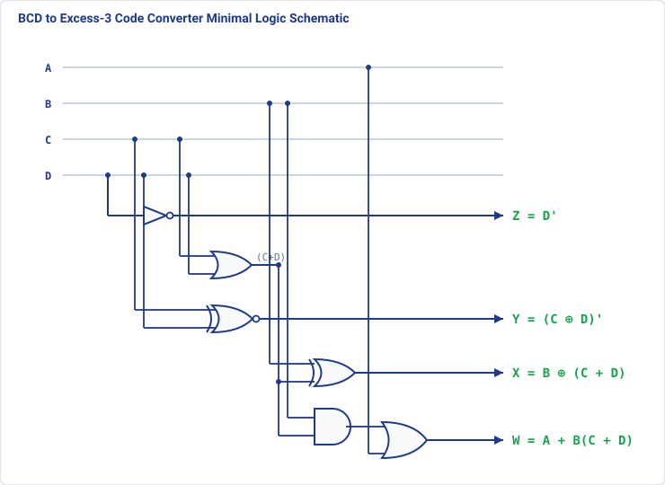
*Figure 2.1: Minimized 4-Bit Gate-Level Schematic of BCD to Excess-3 Code Converter (Outputs W, X, Y, Z).*

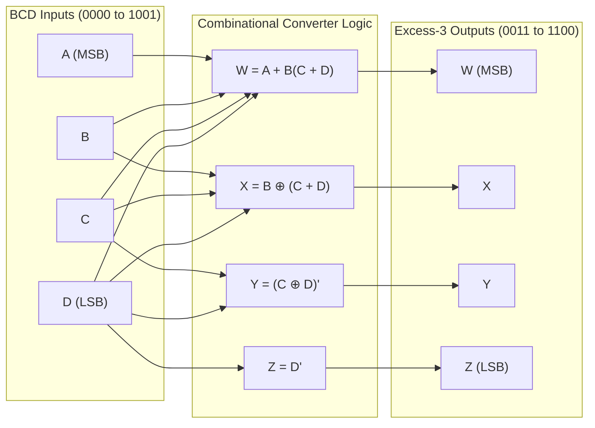

- Invert $D$ to get $Z$.
- Connect $C, D$ to an OR gate $(C + D)$ and an XNOR gate to get $Y$.
- Feed $(C + D)$ and $B$ into an XOR gate to get $X$.
- AND $B$ with $(C + D)$, then OR with $A$ to get $W$.

---

### Q2.3: Binary to Gray & Gray to Binary Converters

#### 1. Binary to Gray Code:
* **Truth Table (4-bit)**:
  - MSB is identical: $G_3 = B_3$.
  - Each subsequent bit is obtained by XORing with the preceding binary bit:
    $$\begin{aligned}
    G_3 &= B_3 \\
    G_2 &= B_3 \oplus B_2 \\
    G_1 &= B_2 \oplus B_1 \\
    G_0 &= B_1 \oplus B_0
    \end{aligned}$$
* **Hardware**: Exactly **3 XOR gates**.

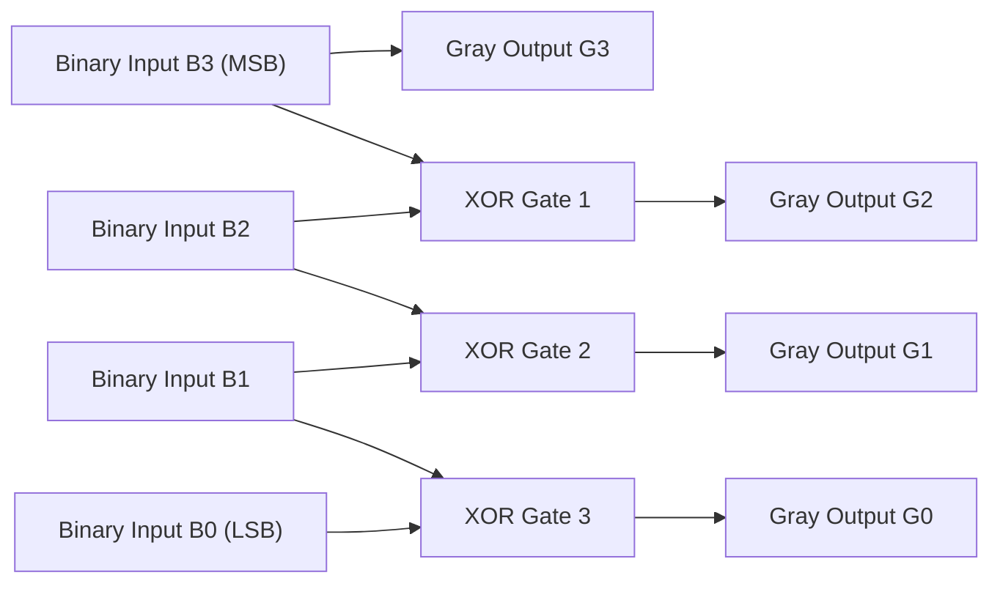


#### 2. Gray to Binary Code:

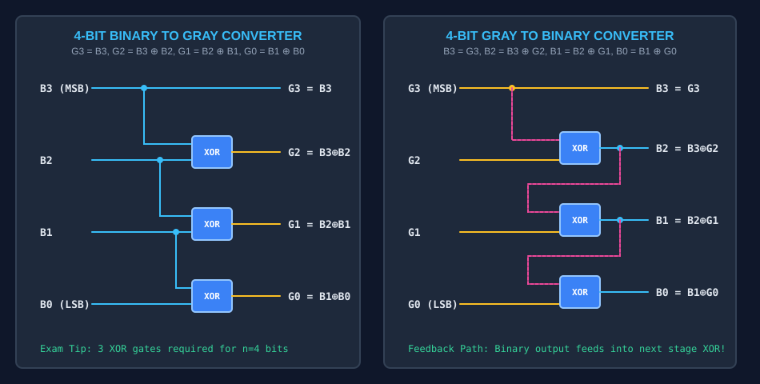
*Figure 2.2: Side-by-Side Gate Schematics for 4-Bit Binary-to-Gray and Gray-to-Binary Converters with XOR Cascade.*

* **Inverse Equations**:
  $$\begin{aligned}
  B_3 &= G_3 \\
  B_2 &= B_3 \oplus G_2 \\
  B_1 &= B_2 \oplus G_1 \\
  B_0 &= B_1 \oplus G_0
  \end{aligned}$$
* **Hardware**: Exactly **3 XOR gates** connected in a ripple-feedback cascade.

---

### Q2.4: Full Adder Implementation using 3:8 Decoder

#### 1. Theory & Minterm Equations:
A $3 \times 8$ decoder has 3 inputs $(A, B, C_{in})$ and generates all 8 minterms $m_0$ to $m_7$.
- **Sum**: $S(A, B, C_{in}) = \sum m(1, 2, 4, 7)$
- **Carry Out**: $C_{out}(A, B, C_{in}) = \sum m(3, 5, 6, 7)$

#### 2. Implementation with Active-Low Decoder (74LS138 style):


*Figure 2.3: Hardware Implementation of Full Adder (S, Cout) using a 3:8 Active-Low Decoder and two 4-Input NAND Gates.*

- An active-low decoder produces $\overline{m_i}$ at output pin $Y_i$.
- By De Morgan's Law:
  $$S = m_1 + m_2 + m_4 + m_7 = \overline{\overline{m_1} \cdot \overline{m_2} \cdot \overline{m_4} \cdot \overline{m_7}}$$
- **Connection**: Connect decoder output pins $Y_1, Y_2, Y_4, Y_7$ to a **4-input NAND gate** to produce $S$.
- Connect decoder output pins $Y_3, Y_5, Y_6, Y_7$ to a second **4-input NAND gate** to produce $C_{out}$.
- Total hardware: **One 3:8 Decoder + Two 4-input NAND gates!**

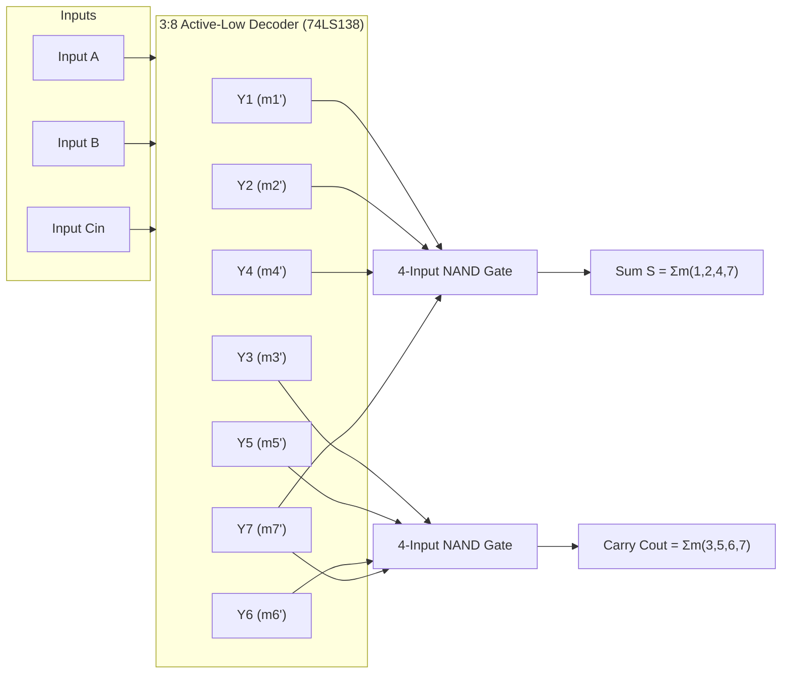


---

### Q2.5: Decoder Expansion (4:16 and 5:32 Decoders)

#### 1. Construct 4:16 Decoder using two 3:8 Decoders:
- Inputs: $A, B, C, D$ ($A$ is MSB).
- Connect $B, C, D$ in parallel to the input lines of both 3:8 decoders.
- Use MSB input $A$ as the **Enable ($E$)** controller:
  - Feed $\overline{A}$ (via inverter) to Enable of Decoder 1 (active for minterms $0–7$ when $A=0$).
  - Feed $A$ directly to Enable of Decoder 2 (active for minterms $8–15$ when $A=1$).


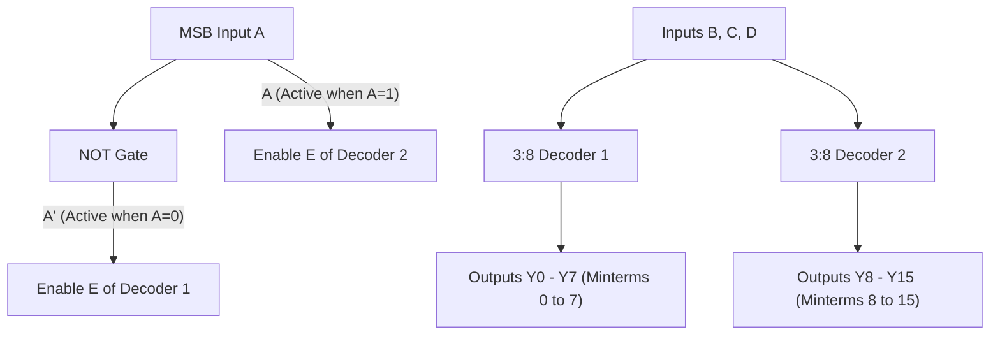


#### 2. Construct 5:32 Decoder using four 3:8 Decoders & one 2:4 Decoder:
- Inputs: $A, B, C, D, E$ ($A, B$ are higher 2 bits; $C, D, E$ are lower 3 bits).
- Connect $C, D, E$ in parallel to the 3 input pins of all four 3:8 decoders.
- Connect $A, B$ to the 2:4 decoder inputs. The four outputs of the 2:4 decoder ($Y_0, Y_1, Y_2, Y_3$) drive the active-high Enable pins of Decoders 1, 2, 3, and 4 respectively!

---

### Q2.6: 8:1 & 4:1 Multiplexer Function Implementations

#### Problem: Implement $F(A,B,C,D) = \sum m(1, 3, 4, 11, 12, 13, 14, 15)$ using an 8:1 MUX.

1. **Select Line Assignment**:
   - Connect $A, B, C$ to select lines: $S_2 = A, S_1 = B, S_0 = C$.
   - Data line $I_k$ will be driven by variable $D$ ($0, 1, D, \text{ or } D'$).

2. **Implementation Table**:
   | Select ($ABC$) | Minterm with $D=0$ | Minterm with $D=1$ | Selected Output $I_k$ |
   |:---:|:---:|:---:|:---:|
   | **$I_0$ ($000$)** | $m_0$ | **$m_1$** (Circle) | **$D$** |
   | **$I_1$ ($001$)** | $m_2$ | **$m_3$** (Circle) | **$D$** |
   | **$I_2$ ($010$)** | **$m_4$** (Circle) | $m_5$ | **$D'$** |
   | **$I_3$ ($011$)** | $m_6$ | $m_7$ | **$0$** |
   | **$I_4$ ($100$)** | $m_8$ | $m_9$ | **$0$** |
   | **$I_5$ ($101$)** | $m_{10}$ | **$m_{11}$** (Circle) | **$D$** |
   | **$I_6$ ($110$)** | **$m_{12}$** (Circle) | **$m_{13}$** (Circle) | **$1$** |
   | **$I_7$ ($111$)** | **$m_{14}$** (Circle) | **$m_{15}$** (Circle) | **$1$** |


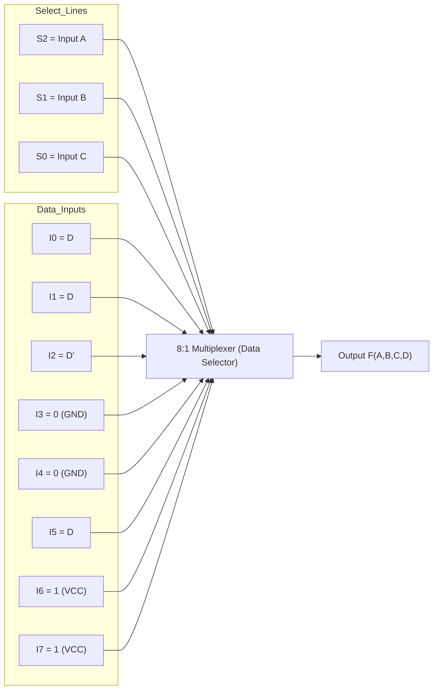


3. **Pin Connections**:
   $$I_0 = D, \quad I_1 = D, \quad I_2 = D', \quad I_3 = 0, \quad I_4 = 0, \quad I_5 = D, \quad I_6 = 1, \quad I_7 = 1$$

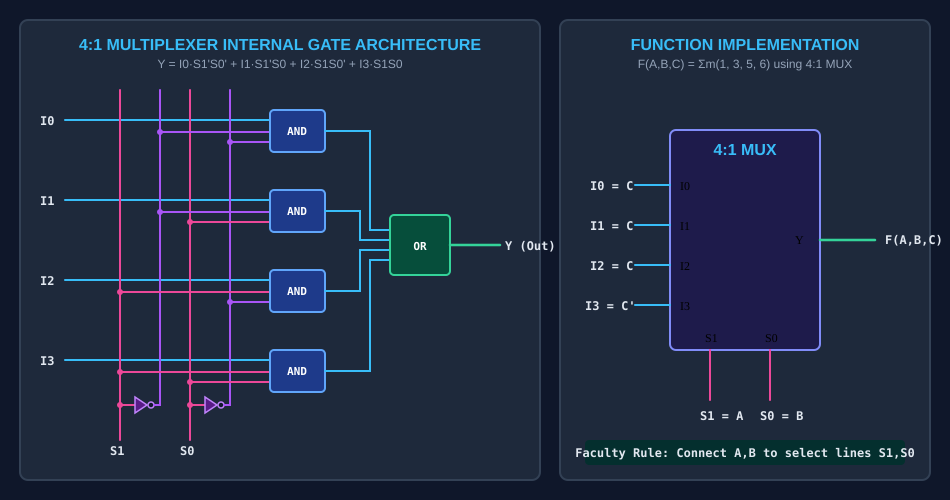
*Figure 2.4: 4:1 Multiplexer Internal Gate-Level Architecture and Boolean Function Realization Block Diagram.*

---

### Q2.7: 8:3 Priority Encoder with Valid Bit

* **Inputs**: $D_0, D_1, \dots, D_7$ ($D_7$ has highest priority).
* **Outputs**: $A, B, C$ (binary code) and $V$ (Valid flag: $V=1$ if at least one input is active; $V=0$ if all inputs are 0).
* **Logic Equations**:
  $$\begin{aligned}
  V &= D_0 + D_1 + D_2 + D_3 + D_4 + D_5 + D_6 + D_7 \\
  A &= D_4 + D_5 + D_6 + D_7 \\
  B &= D_2 + D_3 + D_6 + D_7 \quad (\text{with lower priority terms masked}) \\
  C &= D_1 + D_3 + D_5 + D_7 \quad (\text{with lower priority terms masked})
  \end{aligned}$$

---

# MODULE 3: Flip-Flops, Master-Slave JK & Sequential Circuit Analysis

---

### Q3.1: Master Flip-Flop Suite (SR, JK, D, T)

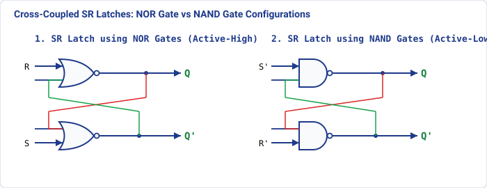
*Figure 3.1: Circuit Topologies and Truth Tables for NOR Latch (Active-High) and NAND Latch (Active-Low).*

#### Flip-Flop State Transition Diagram (JK Flip-Flop Model):

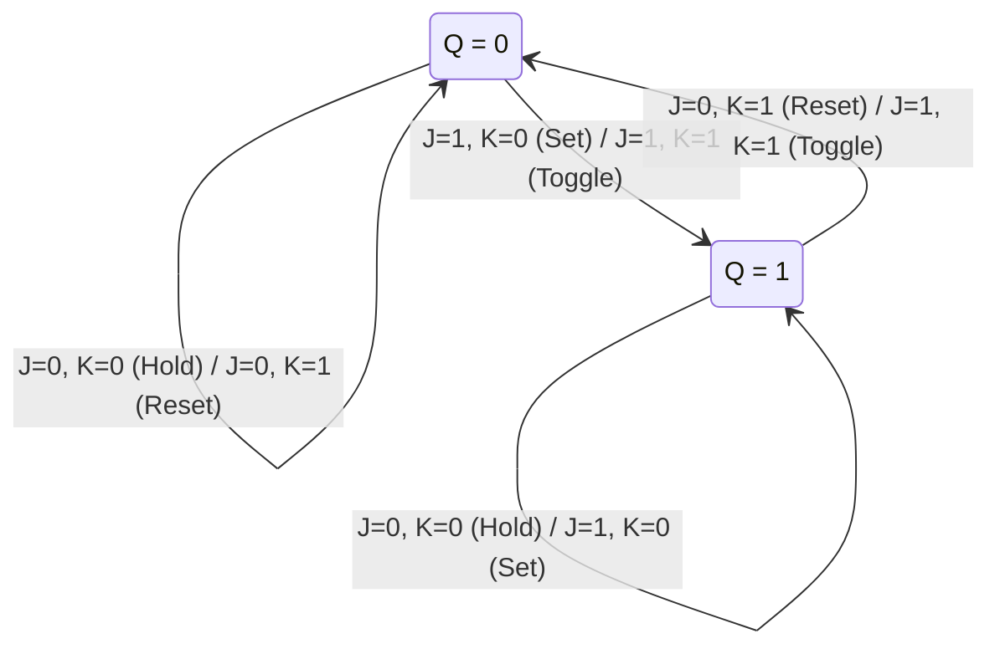


#### Complete Comparison Matrix:
| Flip-Flop | Characteristic Equation | Excitation Table ($Q_n \to Q_{n+1}$) | Invalid / Problem State |
|:---:|:---|:---|:---|
| **SR** | $Q_{n+1} = S + R' Q_n \quad (SR=0)$ | $0 \to 0: S=0, R=X$<br>$0 \to 1: S=1, R=0$<br>$1 \to 0: S=0, R=1$<br>$1 \to 1: S=X, R=0$ | $S=1, R=1$ is **UNDEFINED** |
| **JK** | $Q_{n+1} = J Q_n' + K' Q_n$ | $0 \to 0: J=0, K=X$<br>$0 \to 1: J=1, K=X$<br>$1 \to 0: J=X, K=1$<br>$1 \to 1: J=X, K=0$ | Race-around when $J=K=1$ & $t_w > t_p$ |
| **D** | $Q_{n+1} = D$ | $0 \to 0: D=0$<br>$0 \to 1: D=1$<br>$1 \to 0: D=0$<br>$1 \to 1: D=1$ | None |
| **T** | $Q_{n+1} = T \oplus Q_n$ | $0 \to 0: T=0$<br>$0 \to 1: T=1$<br>$1 \to 0: T=1$<br>$1 \to 1: T=0$ | None |

---

### Q3.2: Race-Around Condition & Master-Slave JK Flip-Flop

#### 1. What is the Race-Around Condition?
In a level-triggered JK flip-flop, when $J = 1$ and $K = 1$, the output toggles ($Q_{n+1} = Q_n'$). If the clock pulse width $t_w$ is greater than the propagation delay of the flip-flop ($t_{pd}$):
$$t_w > t_{pd}$$
The output complements, feeds back to inputs, complements again, and continues oscillating uncontrollably between 0 and 1 for the entire duration of the clock pulse! At the end of the pulse, the final state is **unpredictable**.

#### 2. The Master-Slave JK Solution:

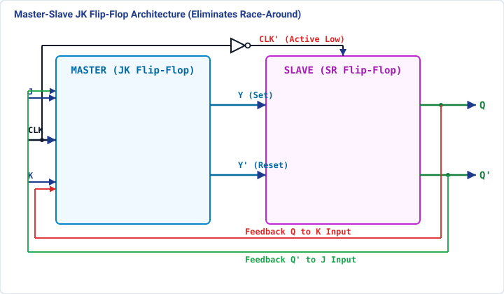
*Figure 3.2: Complete Gate-Level Schematic of Master-Slave JK Flip-Flop showing Clock Inverter and Anti-Race Feedback Paths.*

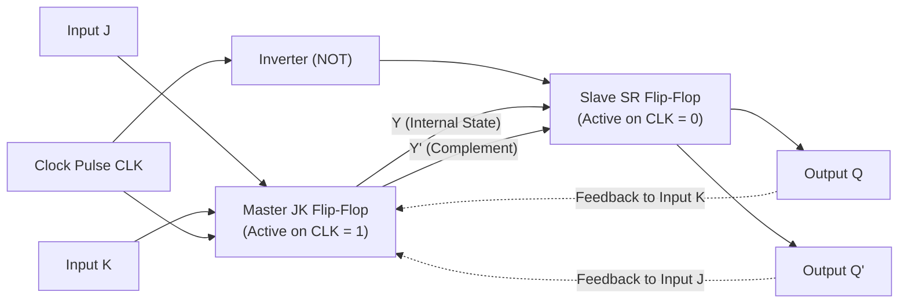

- **Architecture**: Two flip-flops in series:
  - **Master**: Clocked JK flip-flop driven by $CLK$.
  - **Slave**: Clocked SR flip-flop driven by inverted clock $\overline{CLK}$.
- **Operation Cycle**:
  1. **When $CLK = 1$ ($\overline{CLK} = 0$)**: Master is ACTIVE; Slave is ISOLATED (disabled). Master accepts inputs $J, K$ and sets internal state $Y$.
  2. **When $CLK$ transitions from $1 \to 0$ ($\overline{CLK} = 1$)**: Master is DISABLED (isolated from inputs); Slave is ACTIVATED. Slave copies the state $Y$ of the Master to final output $Q$.
- **Why it eliminates Race-Around**: At no point are both Master and Slave simultaneously active. Therefore, feedback from output $Q$ cannot re-trigger the Master during the same clock cycle!

---

### Q3.3: Universal Flip-Flop Conversion Algorithm

**Algorithm**:
1. Identify **Target FF** and **Available FF**.
2. Construct **Conversion Table** listing Target Inputs, Present State $Q_n$, and Next State $Q_{n+1}$.
3. Fill required Available FF inputs using the **Excitation Table** of the Available FF.
4. Solve K-maps for Available inputs in terms of Target inputs and $Q_n$.
5. Draw the logic schematic.

#### Conversion: SR Flip-Flop into JK Flip-Flop
* Target: JK ($J, K$). Available: SR ($S, R$).
* **Conversion Table**:
  | $J$ | $K$ | $Q_n$ | $Q_{n+1}$ | Required $S$ | Required $R$ |
  |:---:|:---:|:---:|:---:|:---:|:---:|
  | 0 | 0 | 0 | 0 | 0 | $X$ |
  | 0 | 0 | 1 | 1 | $X$ | 0 |
  | 0 | 1 | 0 | 0 | 0 | $X$ |
  | 0 | 1 | 1 | 0 | 0 | 1 |
  | 1 | 0 | 0 | 1 | 1 | 0 |
  | 1 | 0 | 1 | 1 | $X$ | 0 |
  | 1 | 1 | 0 | 1 | 1 | 0 |
  | 1 | 1 | 1 | 0 | 0 | 1 |

* **K-Map for $S$**:
  - Minterms: $m_4, m_6$; Don't Cares: $m_1, m_5$.
  - Grouping $\{m_4, m_6\} \implies \mathbf{S = J Q_n'}$
* **K-Map for $R$**:
  - Minterms: $m_3, m_7$; Don't Cares: $m_0, m_2$.
  - Grouping $\{m_3, m_7\} \implies \mathbf{R = K Q_n}$
* **Schematic**: Connect an AND gate ($J \cdot Q'$) to $S$ pin; connect an AND gate ($K \cdot Q$) to $R$ pin.

---

### Q3.4: Analysis of Clocked Sequential Circuits

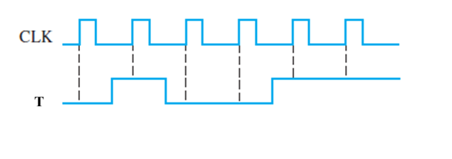
*Figure 3.3: Clocked Sequential Circuit from Assignment 4 (Flip-Flops with Combinational Logic).*

**Methodology**:
1. Determine the input equations for each flip-flop from the circuit schematic.
2. Substitute input equations into characteristic equations to find the **Next-State Equations** ($Q_A^+, Q_B^+$).
3. Construct the **State Transition Table** for all combinations of Present States and External Inputs.
4. Draw the **State Diagram** (nodes = states, directed arrows = transitions labeled $x/y$).

---

# MODULE 4: Counters, Sequence Detectors & Finite State Machines

---

### Q4.1: Synchronous Decade (Mod-10) Counter using JK Flip-Flops

> **Dr. Kanimozhi's 5-Step Presentation**:

#### Step 1: State Sequence & State Diagram

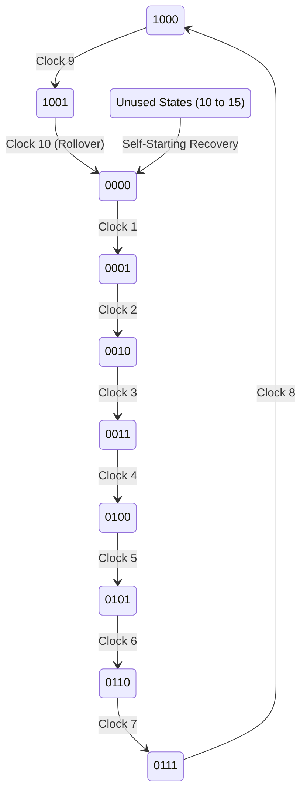

Counts from $0$ ($0000_2$) to $9$ ($1001_2$). States $10$ to $15$ are unused (Don't Cares).  
Number of flip-flops: $2^n \ge 10 \implies n = 4$ flip-flops ($Q_D, Q_C, Q_B, Q_A$, where $Q_A$ is LSB).

#### Step 2: State Transition & Excitation Table
Using JK Excitation Table ($0 \to 0: 0X; 0 \to 1: 1X; 1 \to 0: X1; 1 \to 1: X0$):

| Present State ($Q_D Q_C Q_B Q_A$) | Next State ($Q_D^+ Q_C^+ Q_B^+ Q_A^+$) | $J_D K_D$ | $J_C K_C$ | $J_B K_B$ | $J_A K_A$ |
|:---:|:---:|:---:|:---:|:---:|:---:|
| 0 0 0 0 | 0 0 0 1 | 0 X | 0 X | 0 X | 1 X |
| 0 0 0 1 | 0 0 1 0 | 0 X | 0 X | 1 X | X 1 |
| 0 0 1 0 | 0 0 1 1 | 0 X | 0 X | X 0 | 1 X |
| 0 0 1 1 | 0 1 0 0 | 0 X | 1 X | X 1 | X 1 |
| 0 1 0 0 | 0 1 0 1 | 0 X | X 0 | 0 X | 1 X |
| 0 1 0 1 | 0 1 1 0 | 0 X | X 0 | 1 X | X 1 |
| 0 1 1 0 | 0 1 1 1 | 0 X | X 0 | X 0 | 1 X |
| 0 1 1 1 | 1 0 0 0 | 1 X | X 1 | X 1 | X 1 |
| 1 0 0 0 | 1 0 0 1 | X 0 | 0 X | 0 X | 1 X |
| 1 0 0 1 | 0 0 0 0 | X 1 | 0 X | 0 X | X 1 |

#### Step 3: Minimal K-Map Equations (Unused states 10–15 are Don't Cares)
1. **Flip-Flop A (LSB)**:
   - $J_A = 1, \quad K_A = 1$ (toggles on every single clock pulse).
2. **Flip-Flop B**:
   - $J_B = Q_A \cdot Q_D'$
   - $K_B = Q_A$
3. **Flip-Flop C**:
   - $J_C = Q_A \cdot Q_B$
   - $K_C = Q_A \cdot Q_B$
4. **Flip-Flop D (MSB)**:
   - $J_D = Q_A \cdot Q_B \cdot Q_C$
   - $K_D = Q_A$

#### Step 4: Logic Circuit Schematic

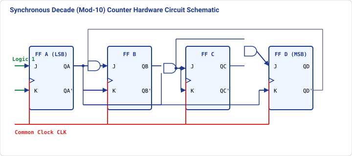
*Figure 4.1: Complete Synchronous Mod-10 Decade Counter Logic Schematic with 4 JK Flip-Flops and Synchronized Clocking.*

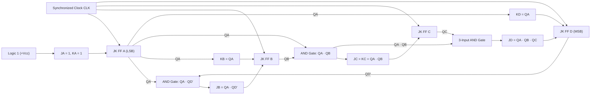

- All 4 flip-flops receive the identical master clock pulse simultaneously.
- An AND gate ($Q_A \cdot Q_D'$) feeds $J_B$.
- An AND gate ($Q_A \cdot Q_B$) feeds $J_C$ and $K_C$.
- A 3-input AND gate ($Q_A \cdot Q_B \cdot Q_C$) feeds $J_D$.
- $K_D$ and $K_B$ connect directly to $Q_A$.

#### Step 5: Self-Starting Check
- Testing unused state $10$ ($1010_2$): Inputs evaluate to next state $0000_2$ $\implies$ returns directly to valid sequence! Counter is **Self-Starting**.

---

### Q4.2: Arbitrary Sequence Counter using D Flip-Flops
**Problem (Assignment 4)**: Design a 3-bit synchronous counter that counts in the sequence:
$$0 \to 4 \to 6 \to 1 \to 3 \to 7 \to 2 \to 5 \to 0$$

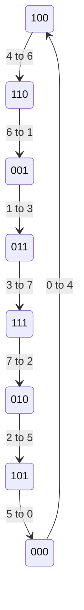


1. **Number of FFs**: 8 states $\implies 3$ D Flip-Flops ($A, B, C$).
2. **Transition Table & Excitation ($D = Q_{next}$)**:
   | Present State ($A B C$) | Next State ($A^+ B^+ C^+$) | $D_A = A^+$ | $D_B = B^+$ | $D_C = C^+$ |
   |:---:|:---:|:---:|:---:|:---:|
   | 0 (000) | 4 (100) | 1 | 0 | 0 |
   | 4 (100) | 6 (110) | 1 | 1 | 0 |
   | 6 (110) | 1 (001) | 0 | 0 | 1 |
   | 1 (001) | 3 (011) | 0 | 1 | 1 |
   | 3 (011) | 7 (111) | 1 | 1 | 1 |
   | 7 (111) | 2 (010) | 0 | 1 | 0 |
   | 2 (010) | 5 (101) | 1 | 0 | 1 |
   | 5 (101) | 0 (000) | 0 | 0 | 0 |

3. **K-Map Simplifications**:
   - $D_A(A, B, C) = \sum m(0, 4, 3, 2) \implies \mathbf{D_A = A' B' C' + A B' C' + A' B = B' C' + A' B}$
   - $D_B(A, B, C) = \sum m(4, 1, 3, 7) \implies \mathbf{D_B = A B' C' + C}$
   - $D_C(A, B, C) = \sum m(6, 1, 2) \implies \mathbf{D_C = A B C' + A' B' C + A' B C'}$
4. **Schematic**: Connect logic gates realizing $D_A, D_B, D_C$ to the respective D pins.

---

### Q4.3: Synchronous Prime Number Counter using T Flip-Flops
**Problem (Assignment 5)**: Design a counter for prime numbers from 1 to 10 ($2 \to 3 \to 5 \to 7 \to 2$) using T flip-flops.

1. **States**: $2 (0010) \to 3 (0011) \to 5 (0101) \to 7 (0111) \to 2 (0010)$.
   - Bits required: $Q_C, Q_B, Q_A$ (since MSB $Q_D$ is always 0 for values $\le 7$).
2. **Transition Table**:
   | Present ($Q_C Q_B Q_A$) | Next ($Q_C^+ Q_B^+ Q_A^+$) | $T_C = Q_C \oplus Q_C^+$ | $T_B = Q_B \oplus Q_B^+$ | $T_A = Q_A \oplus Q_A^+$ |
   |:---:|:---:|:---:|:---:|:---:|
   | 2 (010) | 3 (011) | 0 | 0 | 1 |
   | 3 (011) | 5 (101) | 1 | 1 | 0 |
   | 5 (101) | 7 (111) | 0 | 1 | 0 |
   | 7 (111) | 2 (010) | 1 | 0 | 1 |
   | Unused: 0, 1, 4, 6 | Don't Care ($X$) | $X$ | $X$ | $X$ |

3. **K-Maps (with Don't Cares $0, 1, 4, 6$)**:
   - $T_C = Q_A$
   - $T_B = Q_A$
   - $T_A = Q_B'$
4. **Schematic**: 3 T flip-flops with $T_C = Q_A, T_B = Q_A, T_A = Q_B'$.

---

### Q4.4: Asynchronous (Ripple) Decade Counter with NAND Reset

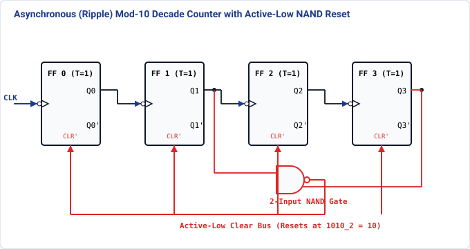
*Figure 4.2: Asynchronous Ripple Decade Counter (0000 to 1001) with 2-Input NAND Gate Clear at State 1010.*

* **Structure**: 4 T (or JK) Flip-Flops with $T=1$ (toggle mode).
* **Clocking**: Negative edge-triggered. Output $Q_0$ drives clock of $FF_1$, $Q_1$ drives clock of $FF_2$, $Q_2$ drives clock of $FF_3$.
* **Asynchronous Reset**:

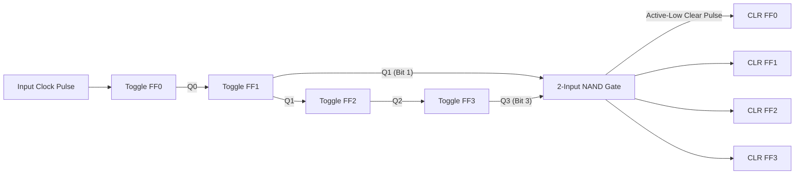

  - The counter naturally counts $0000$ to $1001$ ($9_{10}$).
  - At the 10th clock pulse, it temporarily enters state $1010_2$ ($Q_3=1, Q_2=0, Q_1=1, Q_0=0$).
  - A **2-input NAND gate** connects to $Q_3$ and $Q_1$. Output of NAND gate $= \overline{Q_3 \cdot Q_1}$.
  - The output feeds the active-low $\overline{\text{CLEAR}}$ pins of all 4 flip-flops, resetting them immediately to $0000_2$!

---

### Q4.5: Ring Counter vs Johnson Counter


*Figure 4.3: Comparison of 4-Bit Ring Counter (Straight Feedback) and 4-Bit Johnson Counter (Twisted-Ring Inverted Feedback).*

| Parameter | 4-Bit Ring Counter | 4-Bit Johnson Counter |
|:---|:---|:---|
| **Feedback Connection** | Normal output $Q_3 \to D_0$ | Inverted output $\overline{Q_3} \to D_0$ |
| **Initial Preset State** | Must be initialized with `1000` | Initializes at `0000` |
| **Number of Distinct States** | **$N = 4$ states** | **$2N = 8$ states** |
| **State Sequence** | `1000 -> 0100 -> 0010 -> 0001` | `0000 -> 1000 -> 1100 -> 1110 -> 1111 -> 0111 -> 0011 -> 0001` |
| **Frequency Division Ratio** | $f_{\text{out}} = f_{\text{clk}} / N = \mathbf{f_{\text{clk}} / 4}$ | $f_{\text{out}} = f_{\text{clk}} / 2N = \mathbf{f_{\text{clk}} / 8}$ |
| **Hardware Economy** | Inefficient ($N$ states for $N$ FFs) | Twice as efficient ($2N$ states for $N$ FFs) |

* **Numerical (Assignment 5)**:
  - Initial clock $f = 12\text{ kHz}$. Distinct states $= \mathbf{4}$.
  - Output frequency at $Q_3 = 12\text{ kHz} / 4 = \mathbf{3\text{ kHz}}$.
  - If clock increased to $20\text{ kHz} \implies f_{\text{new}} = 20\text{ kHz} / 4 = \mathbf{5\text{ kHz}}$.

---

### Q4.6: Sequence Detector Design ('1010' Mealy & Moore)

#### 1. Mealy State Diagram (Overlapping '1010'):

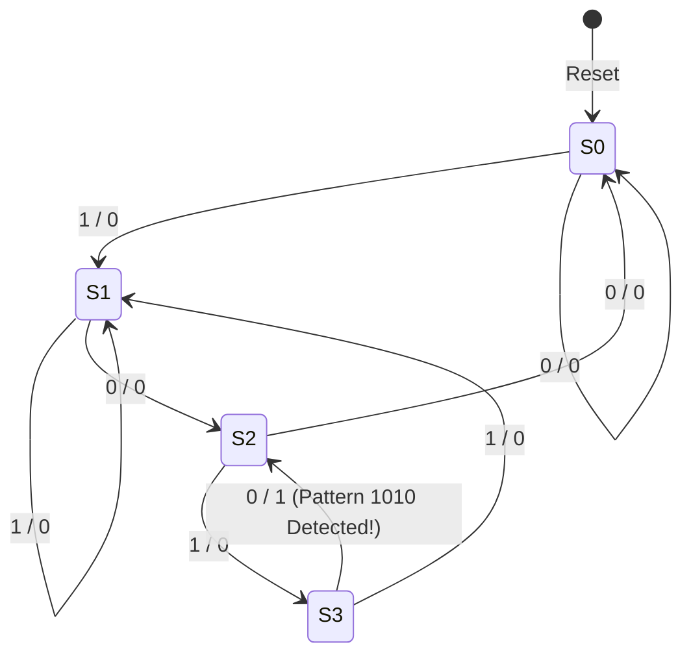

- States:
  - $S_0$: Reset / Initial (saw nothing)
  - $S_1$: Saw '1'
  - $S_2$: Saw '10'
  - $S_3$: Saw '101'
- Transitions ($Input / Output$):
  - From $S_0$: on $0 \to S_0/0$; on $1 \to S_1/0$.
  - From $S_1$: on $1 \to S_1/0$; on $0 \to S_2/0$.
  - From $S_2$: on $0 \to S_0/0$; on $1 \to S_3/0$.
  - From $S_3$: on $1 \to S_1/0$; **on $0 \to S_2 / 1$ (Sequence Detected! Overlaps into '10' prefix)**.

#### 2. Moore State Diagram (Requires 5 States):

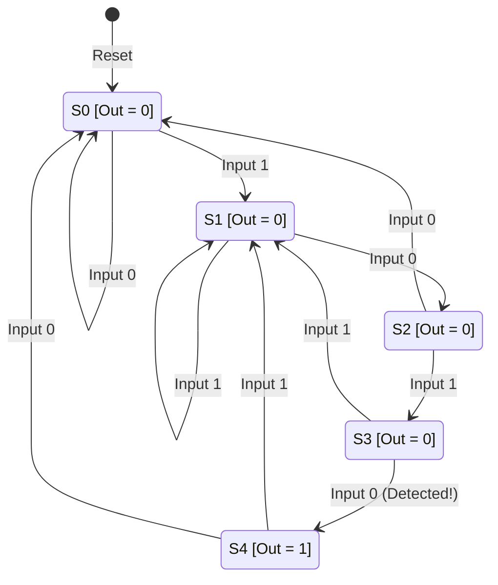

- States: $S_0 (0), S_1 (0), S_2 (0), S_3 (0), S_4 (1)$.
- Output is associated with state $S_4$.

---

### Q4.7: FSM Comparison & State Minimization using Implication Table

#### 1. Mealy vs Moore:
* **Mealy**: Output $= f(\text{Present State}, \text{Present Input})$. Reacts faster (within clock cycle); requires fewer states.
* **Moore**: Output $= f(\text{Present State})$. Glitch-free synchronous output; requires 1 more state than Mealy.

#### 2. Implication Table State Reduction Algorithm:
1. Construct lower-triangular grid with states on rows ($S_1 \dots S_n$) and columns ($S_0 \dots S_{n-1}$).
2. **Immediate Incompatibility**: Cross out $(S_i, S_j)$ with an 'X' if their outputs differ for the same input.
3. In remaining cells, write down implied next-state pairs.
4. Pass through table: If an implied pair is marked with 'X', mark the current cell with 'X'.
5. Repeat until no new marks appear. Unmarked cells are **equivalent states** and are merged!

---

# MODULE 5: All Questions from Group Activity A & B (Verilog HDL)

---

### Q5.1: Verilog Modeling Levels & Suitability Comparison

| Level of Modeling | Key Construct | Hardware Realization | Primary Application |
|:---|:---|:---|:---|
| **Gate-Level (Structural)** | `and`, `or`, `not`, `xor` primitives | Direct netlist of physical gates | ASICs, library cells, post-synthesis verification with exact pin-to-pin delays |
| **Dataflow** | Continuous assignment: `assign` | Concurrent Boolean equations | Pure combinational arithmetic units, multiplexers, ALUs |
| **Behavioral** | Procedural: `always @(*)`, `case`, `if-else` | High-level algorithmic state machine | Complex FSMs, sequential counters, microprocessors, testbenches |
| **Switch-Level** | `pmos`, `nmos`, `cmos` primitives | Transistor-level switch circuits | Custom CMOS transistor layout simulation |

---

### Q5.2: EX-OR Gate in All Three Modeling Styles

```verilog
// 1. Gate-Level Modeling
module xor_gate_level (input a, b, output y);
    xor g1 (y, a, b);
endmodule

// 2. Dataflow Modeling
module xor_dataflow (input a, b, output y);
    assign y = a ^ b;
endmodule

// 3. Behavioral Modeling
module xor_behavioral (input a, b, output reg y);
    always @(*) begin
        if (a == b)
            y = 1'b0;
        else
            y = 1'b1;
    end
endmodule
```

---

### Q5.3: Gate-Level Full Adder with Gate Delays
**Specifications**: AND = $10\text{ ns}$, OR = $10\text{ ns}$, NOT = $5\text{ ns}$.

```verilog
`timescale 1ns / 1ps

module full_adder_delays (
    input a, b, cin,
    output sum, cout
);
    wire s1, c1, c2;
    wire na, nb, ncin, ns1;
    wire a_nb, na_b, s1_ncin, ns1_cin;

    // XOR gate for s1 = a ^ b using NOT, AND, OR with delays
    not #5  inv1 (na, a);
    not #5  inv2 (nb, b);
    and #10 and1 (a_nb, a, nb);
    and #10 and2 (na_b, na, b);
    or  #10 or1  (s1, a_nb, na_b);       // s1 = a ^ b

    // XOR gate for sum = s1 ^ cin
    not #5  inv3 (ns1, s1);
    not #5  inv4 (ncin, cin);
    and #10 and3 (s1_ncin, s1, ncin);
    and #10 and4 (ns1_cin, ns1, cin);
    or  #10 or2  (sum, s1_ncin, ns1_cin); // sum

    // Carry logic: cout = ab + cin(a ^ b)
    and #10 and5 (c1, a, b);
    and #10 and6 (c2, s1, cin);
    or  #10 or3  (cout, c1, c2);          // cout
endmodule
```

---

### Q5.4: Gate-Level Full Subtractor with Gate Delays
**Specifications**: AND = $10\text{ ns}$, OR = $10\text{ ns}$, NOT = $5\text{ ns}$.

```verilog
`timescale 1ns / 1ps

module full_subtractor_delays (
    input a, b, bin,
    output diff, bout
);
    wire d1, na, nb, nbin, nd1;
    wire a_nb, na_b, d1_nbin, nd1_bin;
    wire na_and_b, nd1_and_bin;

    // Difference logic: diff = a ^ b ^ bin
    not #5  inv1 (na, a);
    not #5  inv2 (nb, b);
    and #10 and1 (a_nb, a, nb);
    and #10 and2 (na_b, na, b);
    or  #10 or1  (d1, a_nb, na_b);         // d1 = a ^ b

    not #5  inv3 (nd1, d1);
    not #5  inv4 (nbin, bin);
    and #10 and3 (d1_nbin, d1, nbin);
    and #10 and4 (nd1_bin, nd1, bin);
    or  #10 or2  (diff, d1_nbin, nd1_bin); // diff

    // Borrow logic: bout = a'b + bin(a ^ b)'
    and #10 and5 (na_and_b, na, b);
    and #10 and6 (nd1_and_bin, nd1, bin);
    or  #10 or3  (bout, na_and_b, nd1_and_bin); // bout
endmodule
```

---

### Q5.5: 8:1 Multiplexer (Behavioral) & Simulation Testbench

```verilog
// Design Module
module mux8to1_behavioral (
    input [7:0] in,
    input [2:0] sel,
    output reg y
);
    always @(*) begin
        case (sel)
            3'b000: y = in[0];
            3'b001: y = in[1];
            3'b010: y = in[2];
            3'b011: y = in[3];
            3'b100: y = in[4];
            3'b101: y = in[5];
            3'b110: y = in[6];
            3'b111: y = in[7];
            default: y = 1'b0;
        endcase
    end
endmodule

// Testbench Module
`timescale 1ns / 1ps

module tb_mux8to1;
    reg [7:0] in;
    reg [2:0] sel;
    wire y;

    mux8to1_behavioral uut (.in(in), .sel(sel), .y(y));

    initial begin
        $monitor("Time=%0t | in=%b sel=%b | y=%b", $time, in, sel, y);
        in = 8'b10101100;
        sel = 3'b000; #10; // y = 0
        sel = 3'b010; #10; // y = 1
        sel = 3'b101; #10; // y = 0
        sel = 3'b111; #10; // y = 1
        $finish;
    end
endmodule
```

---

### Q5.6: 8:3 Priority Encoder (Behavioral) & Simulation Testbench

```verilog
// Design Module
module priority_encoder_8to3 (
    input [7:0] in,
    output reg [2:0] code,
    output reg valid
);
    always @(*) begin
        valid = 1'b1;
        if      (in[7]) code = 3'b111;
        else if (in[6]) code = 3'b110;
        else if (in[5]) code = 3'b101;
        else if (in[4]) code = 3'b100;
        else if (in[3]) code = 3'b011;
        else if (in[2]) code = 3'b010;
        else if (in[1]) code = 3'b001;
        else if (in[0]) code = 3'b000;
        else begin
            code  = 3'b000;
            valid = 1'b0; // Inactive
        end
    end
endmodule

// Testbench Module
`timescale 1ns / 1ps

module tb_priority_encoder;
    reg [7:0] in;
    wire [2:0] code;
    wire valid;

    priority_encoder_8to3 uut (.in(in), .code(code), .valid(valid));

    initial begin
        $monitor("Time=%0t | in=%b | code=%b valid=%b", $time, in, code, valid);
        in = 8'b00000000; #10; // valid=0
        in = 8'b00000100; #10; // code=2, valid=1
        in = 8'b00100100; #10; // code=5, valid=1
        in = 8'b10000001; #10; // code=7, valid=1
        $finish;
    end
endmodule
```

---

### Q5.7: SR & JK Flip-Flop Behavioral Models

```verilog
// 1. SR Flip-Flop with Asynchronous Reset
module sr_ff (
    input clk, rst, s, r,
    output reg q, q_bar
);
    always @(posedge clk or posedge rst) begin
        if (rst) begin
            q     <= 1'b0;
            q_bar <= 1'b1;
        end else begin
            case ({s, r})
                2'b00: q <= q;         // Hold
                2'b01: q <= 1'b0;      // Reset
                2'b10: q <= 1'b1;      // Set
                2'b11: q <= 1'bx;      // Indeterminate
            endcase
            q_bar <= ~q;
        end
    end
endmodule

// 2. JK Flip-Flop with Toggle Mode
module jk_ff (
    input clk, rst, j, k,
    output reg q, q_bar
);
    always @(posedge clk or posedge rst) begin
        if (rst) begin
            q     <= 1'b0;
            q_bar <= 1'b1;
        end else begin
            case ({j, k})
                2'b00: q <= q;         // Hold
                2'b01: q <= 1'b0;      // Reset
                2'b10: q <= 1'b1;      // Set
                2'b11: q <= ~q;        // Toggle
            endcase
            q_bar <= ~q;
        end
    end
endmodule
```

---

### Q5.8: Decade (BCD) Counter Behavioral Model

```verilog
module bcd_counter (
    input clk,
    input reset,
    output reg [3:0] q
);
    always @(posedge clk or posedge reset) begin
        if (reset)
            q <= 4'b0000;
        else if (q == 4'b1001) // Reset after 9
            q <= 4'b0000;
        else
            q <= q + 1'b1;     // Increment
    end
endmodule
```

---

### Q5.9: Gate-Level Verilog for Circuit 1 (`circuit_activity_a.png`)


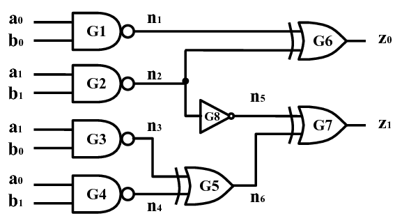
*Figure 5.1: Group Activity Circuit 1 Schematic Diagram.*


```verilog
module circuit_activity_a (
    input a0, b0, a1, b1,
    output z0, z1
);
    wire n1, n2, n3, n4, n5, n6;

    // Layer 1: 4 NAND gates
    nand G1 (n1, a0, b0);
    nand G2 (n2, a1, b1);
    nand G3 (n3, a1, b0);
    nand G4 (n4, a0, b1);

    // Layer 2: Inverter and XOR gate
    not G8 (n5, n2);
    xor G5 (n6, n3, n4);

    // Layer 3: Output XOR gates
    xor G6 (z0, n1, n2);
    xor G7 (z1, n5, n6);
endmodule
```

---

### Q5.10: Gate-Level Verilog for Circuit 2 (`circuit_activity_b.png`)


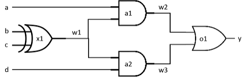
*Figure 5.2: Group Activity Circuit 2 Schematic Diagram.*


```verilog
module circuit_activity_b (
    input a, b, c, d,
    output y
);
    wire w1, w2, w3;

    // XOR gate x1
    xor x1 (w1, b, c);

    // AND gates a1 and a2
    and a1 (w2, a, w1);
    and a2 (w3, w1, d);

    // Output OR gate o1
    or o1 (y, w2, w3);
endmodule
```

---

## 🏆 Final Exam Day Golden Checklist (Dr. Kanimozhi's Scoring Keys)
1. **Always draw truth/state table FIRST**: Even if the question only asks for the circuit, 30% of marks are tied to the table.
2. **Circle EPIs explicitly in K-maps**: Write `Essential Prime Implicants: ...` before writing the minimized equation.
3. **Use standard logic gate symbols**: Draw distinct curved inputs for OR/NOR and flat inputs for AND/NAND. Put inversion bubbles clearly at gate outputs.
4. **Verilog golden rule**: Use non-blocking `<= ` inside clocked `always @(posedge clk)` blocks; use blocking `=` inside combinational `always @(*)` blocks.


---

# 🎯 SPECIAL SECTION: Faculty Classroom Revision Hacks & Exam Directives
*(Extracted directly from Dr. Kanimozhi M's blackboard revision notes & hints)*

---

### ⚡ HACK 1: The Register Clock Pulse Rule (Exam Numerical Guaranteed!)


*Figure 4.5: Master Architectural Comparison of All 4 Shift Registers (SISO, SIPO, PISO, PIPO) with Clock Pulse Formulations.*

**Question**: *For an n-bit (4-bit or 8-bit) shift register, how many clock pulses are required to load and retrieve data?*

| Shift Register Mode | Pulses to LOAD Data | Pulses to READ / UNLOAD Data | Total Clock Pulses (Load + Unload) |
|:---|:---:|:---:|:---:|
| **SISO** (Serial-In Serial-Out) | **n pulses** | **n - 1 pulses** | **2n - 1 pulses** (e.g. 4-bit = 7 pulses, 8-bit = 15 pulses) |
| **SIPO** (Serial-In Parallel-Out) | **n pulses** | **0 pulses** (Instantaneous in parallel) | **n pulses** (4-bit = 4, 8-bit = 8) |
| **PISO** (Parallel-In Serial-Out) | **1 pulse** (Parallel load) | **n - 1 pulses** (Serial shift) | **n pulses** (4-bit = 4, 8-bit = 8) |
| **PIPO** (Parallel-In Parallel-Out) | **1 pulse** | **0 pulses** | **1 pulse** (Fastest register) |

---

### ⚡ HACK 2: Sequence Detector — Always Default to D Flip-Flop!
> **Faculty Instruction**: *"Agar nhi likha kis FF se krna hai to D FF se kro!"*
- **Why D Flip-Flop?** Because the characteristic equation of D-FF is:
  $$D = Q_{next}$$
  This means you **never need an excitation table**! The K-map for input $D_A$ is literally the column of $Q_A^+$, and $D_B$ is literally $Q_B^+$. This cuts your exam solving time by 70%!

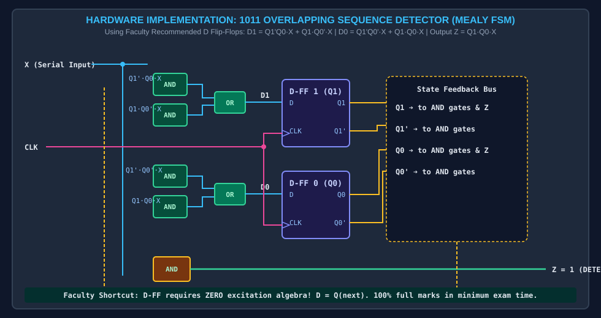
*Figure 4.4: Complete Hardware Implementation of 1011 Overlapping Sequence Detector using 2 D Flip-Flops and Combinational Gates.*

#### Worked Example: Overlapping '1010' Sequence Detector using D Flip-Flops
1. **States**: $S_0 (00), S_1 (01), S_2 (10), S_3 (11)$ with 2 state variables $Q_1, Q_0$.
2. **State Transition Table**:
   | Present State ($Q_1 Q_0$) | Input $x=0$ ($Q_1^+ Q_0^+, y$) | Input $x=1$ ($Q_1^+ Q_0^+, y$) |
   |:---:|:---:|:---:|
   | $S_0$ (00) | 00, 0 | 01, 0 |
   | $S_1$ (01) | 10, 0 | 01, 0 |
   | $S_2$ (10) | 00, 0 | 11, 0 |
   | $S_3$ (11) | **10, 1 (Detected!)** | 01, 0 |
3. **D Inputs**:
   - $D_1 = Q_1^+ = \sum m(1, 7)$ (for inputs $x, Q_1, Q_0$) $\implies \mathbf{D_1 = x' Q_1' Q_0 + x Q_1 Q_0'}$
   - $D_0 = Q_0^+ = x$ (simply equals input $x$!)
   - Output $y = x' Q_1 Q_0$
4. **Schematic**: Two D flip-flops with $D_0 = x$, $D_1 = x' Q_1' Q_0 + x Q_1 Q_0'$, and $y = x' Q_1 Q_0$. Done in under 5 minutes!

---

### ⚡ HACK 3: Mod-6 Synchronous Counter (Mod-N Design)
**Sequence**: $0 \to 1 \to 2 \to 3 \to 4 \to 5 \to 0$. Unused states: $6 (110_2), 7 (111_2)$.
1. **Number of FFs**: $2^n \ge 6 \implies n = 3$ FFs ($Q_C, Q_B, Q_A$).
2. **Transition & D-FF Excitation Table ($D = Q^+$)**:
   | Present ($Q_C Q_B Q_A$) | Next ($Q_C^+ Q_B^+ Q_A^+$) | $D_C$ | $D_B$ | $D_A$ |
   |:---:|:---:|:---:|:---:|:---:|
   | 0 0 0 | 0 0 1 | 0 | 0 | 1 |
   | 0 0 1 | 0 1 0 | 0 | 1 | 0 |
   | 0 1 0 | 0 1 1 | 0 | 1 | 1 |
   | 0 1 1 | 1 0 0 | 1 | 0 | 0 |
   | 1 0 0 | 1 0 1 | 1 | 0 | 1 |
   | 1 0 1 | 0 0 0 | 0 | 0 | 0 |
   | 1 1 0 (Unused) | X X X | X | X | X |
   | 1 1 1 (Unused) | X X X | X | X | X |

3. **K-Maps (with Don't Cares 6, 7)**:
   - $D_C = Q_C Q_A' + Q_B Q_A$
   - $D_B = Q_C' Q_B' Q_A + Q_B Q_A' = Q_C' (Q_B \oplus Q_A)$
   - $D_A = Q_A'$
4. **Schematic**: 3 D flip-flops clocked simultaneously.

---

### ⚡ HACK 4: Module 5 "Only Coding" — 4:1 MUX & 2:4 Decoder with `case`
> **Faculty Instruction**: *"Truth table de denge, fir code likhna hoga... use case statement!"*

#### 1. 2:4 Decoder with Enable in Behavioral Verilog (`case` statement):
```verilog
module decoder2to4_behavioral (
    input [1:0] a,
    input en,
    output reg [3:0] y
);
    always @(*) begin
        if (!en)
            y = 4'b0000;
        else begin
            case (a)
                2'b00: y = 4'b0001;
                2'b01: y = 4'b0010;
                2'b10: y = 4'b0100;
                2'b11: y = 4'b1000;
                default: y = 4'b0000;
            endcase
        end
    end
endmodule
```

#### 2. 4:1 Multiplexer in Behavioral Verilog (`case` statement):
```verilog
module mux4to1_behavioral (
    input [3:0] in,
    input [1:0] sel,
    output reg y
);
    always @(*) begin
        case (sel)
            2'b00: y = in[0];
            2'b01: y = in[1];
            2'b10: y = in[2];
            2'b11: y = in[3];
            default: y = 1'b0;
        endcase
    end
endmodule
```

---

### ⚡ HACK 5: SR and D Latches using NAND and NOR Gates

#### 1. SR Latch using NOR Gates:
```text
R ───┤ NOR 1 ├─────── Q
     │       │   ┌───┘
     │       └───┼───┐
S ───┤ NOR 2 ├─────── Q'
```
* **Truth Table**:
  - $S=0, R=0 \implies$ No change ($Q_n$)
  - $S=0, R=1 \implies$ Reset ($Q=0, Q'=1$)
  - $S=1, R=0 \implies$ Set ($Q=1, Q'=0$)
  - $S=1, R=1 \implies$ **Forbidden / Invalid ($Q=0, Q'=0$)**

#### 2. SR Latch using NAND Gates:
* Cross-coupled NAND gates operate with **active-low inputs** ($\overline{S}, \overline{R}$):
  - $\overline{S}=1, \overline{R}=1 \implies$ No change
  - $\overline{S}=1, \overline{R}=0 \implies$ Reset ($Q=0$)
  - $\overline{S}=0, \overline{R}=1 \implies$ Set ($Q=1$)
  - $\overline{S}=0, \overline{R}=0 \implies$ **Invalid ($Q=1, Q'=1$)**

#### 3. D Latch (Transparent Latch):
* Formed from an enabled SR latch where $S = D$ and $R = \overline{D}$ (via an inverter).
* When $EN = 1$: Output tracks input ($Q = D$).
* When $EN = 0$: Output retains previous state ($Q = Q_{prev}$).
