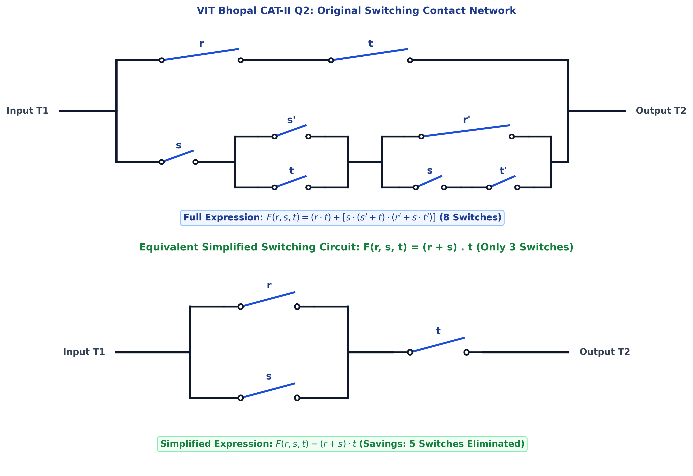
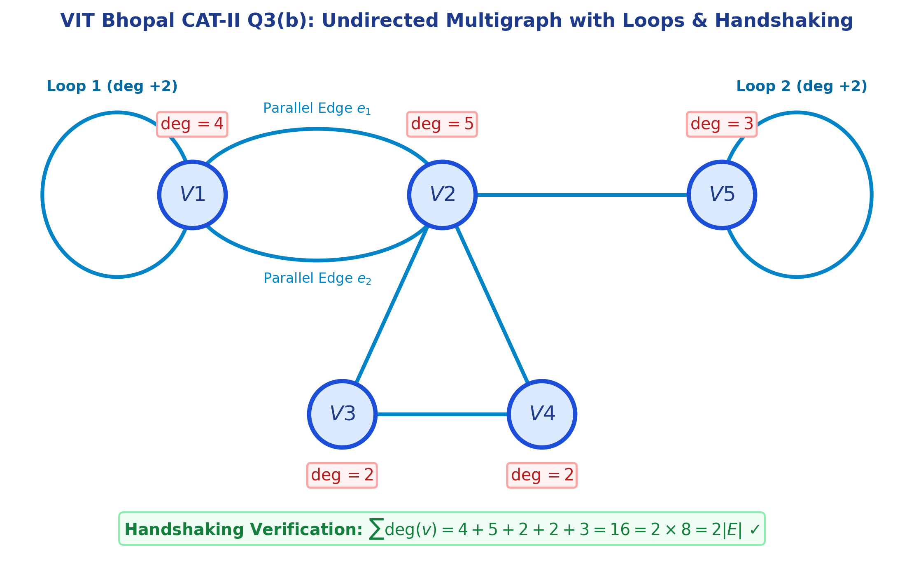
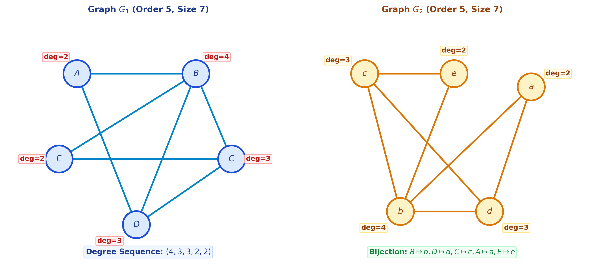
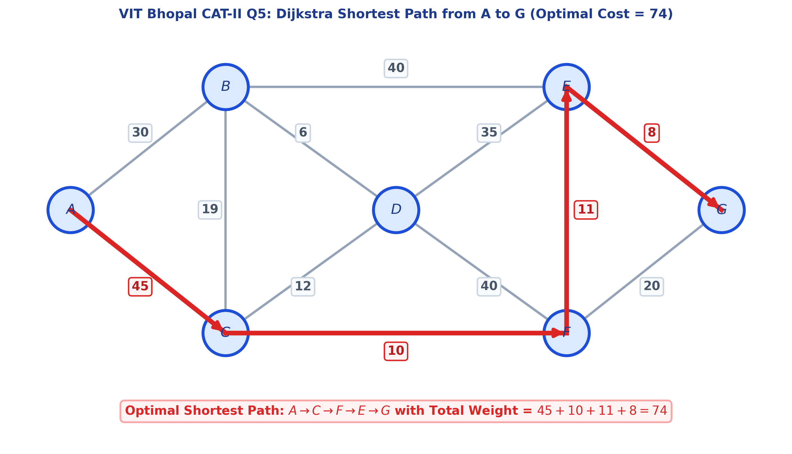

# 🏛️ VIT Bhopal University — CAT-II Examination (September 2026)
## MAT2002: Discrete Mathematics and Graph Theory — Master Solutions
> **Course Code**: MAT2002 | **Exam**: Continuous Assessment Test (CAT) - II  
> **Session / Slot**: 22-09-2026 / S-3 (Slot C14+E11+E12) | **Duration**: 1½ Hours (90 Minutes)  
> **Max. Marks**: 50 | **Coverage**: Module 3 (Lattices & Boolean Algebra) & Module 4 (Graphs & Matrix Representations)  
> **Target Use**: Official Exam Master Solutions & Direct Exam-Hall Copyable Reference

---

## Quick Question & Topic Index

| Question No. | Syllabus Topic | Key Concept Tested | Marks |
| :---: | :--- | :--- | :---: |
| **Q1** | **Module 3: Lattices** | Divisibility Poset $D_{70}$, Complete Meet & Join Cayley Tables, Lattice Verification, Distributive & Complemented Classification | **10** |
| **Q2** | **Module 3: Boolean Algebra** | Switching Contact Network, Boolean Function Formulation, Algebraic Minimization to $(r + s) \cdot t$ & Simplified Circuit Drawing | **10** |
| **Q3 (a)** | **Module 3: Boolean Algebra** | Disjunctive Normal Form (PDNF / Minterms) of $f(x, y, z) = x y' + z$ with Truth Table Verification | **5** |
| **Q3 (b)** | **Module 4: Graph Theory** | Undirected Multigraph with Loops, Order, Size, Vertex Degree Calculation & Euler's Handshaking Theorem Verification | **5** |
| **Q4** | **Module 4: Graph Theory** | Graph Isomorphism Testing ($G_1 \cong G_2$), Complete Invariant Verification, Explicit Bijection & Edge Preservation Table | **10** |
| **Q5** | **Module 4: Graph Algorithms** | Dijkstra's Algorithm from $A$ to $G$, Full Step-by-Step Iteration Table, Optimal Path ($A \to C \to F \to E \to G$) & Edge Sensitivity Analysis | **10** |
| **Total** | | **All 5 Compulsory Exam Questions Solved Completely** | **50** |

---

# QUESTION 1 (10 Marks)

### Problem Statement:
For the divisibility poset $D_{70}$, construct the corresponding Cayley tables for the meet and join operations and justify, with appropriate reasoning, whether the resulting poset is a lattice or not. If it is a lattice, then also check whether the given poset is distributive, complemented, or both distributive and complemented.

---

### Step-by-Step Model Solution:

#### 1. Identification of the Poset Elements:
The set $D_{70}$ consists of all positive integer divisors of $70$.
Prime factorization of $70$:
$$70 = 2^1 \times 5^1 \times 7^1$$
Total number of divisors: $(1 + 1)(1 + 1)(1 + 1) = 2 \times 2 \times 2 = 8$ elements.
Listing the elements in ascending order:
$$D_{70} = \{1, 2, 5, 7, 10, 14, 35, 70\}$$

The partial ordering relation is the standard integer divisibility relation:
$$a \le b \iff a \mid b \quad (a \text{ divides } b)$$

For any two elements $a, b \in D_{70}$:
* **Meet Operation ($\wedge$)**: Greatest Common Divisor, $a \wedge b = \gcd(a, b)$ (Greatest Lower Bound / GLB).
* **Join Operation ($\vee$)**: Least Common Multiple, $a \vee b = \text{lcm}(a, b)$ (Least Upper Bound / LUB).

---

#### 2. Cayley Table for Meet Operation ($\wedge = \gcd$):

Every entry at row $a$ and column $b$ represents $\gcd(a, b)$:

| $\wedge = \gcd$ | $\mathbf{1}$ | $\mathbf{2}$ | $\mathbf{5}$ | $\mathbf{7}$ | $\mathbf{10}$ | $\mathbf{14}$ | $\mathbf{35}$ | $\mathbf{70}$ |
| :---: | :---: | :---: | :---: | :---: | :---: | :---: | :---: | :---: |
| $\mathbf{1}$ | $1$ | $1$ | $1$ | $1$ | $1$ | $1$ | $1$ | $1$ |
| $\mathbf{2}$ | $1$ | $2$ | $1$ | $1$ | $2$ | $2$ | $1$ | $2$ |
| $\mathbf{5}$ | $1$ | $1$ | $5$ | $1$ | $5$ | $1$ | $5$ | $5$ |
| $\mathbf{7}$ | $1$ | $1$ | $1$ | $7$ | $1$ | $7$ | $7$ | $7$ |
| $\mathbf{10}$ | $1$ | $2$ | $5$ | $1$ | $10$ | $2$ | $5$ | $10$ |
| $\mathbf{14}$ | $1$ | $2$ | $1$ | $7$ | $2$ | $14$ | $7$ | $14$ |
| $\mathbf{35}$ | $1$ | $1$ | $5$ | $7$ | $5$ | $7$ | $35$ | $35$ |
| $\mathbf{70}$ | $1$ | $2$ | $5$ | $7$ | $10$ | $14$ | $35$ | $70$ |

---

#### 3. Cayley Table for Join Operation ($\vee = \text{lcm}$):

Every entry at row $a$ and column $b$ represents $\text{lcm}(a, b)$:

| $\vee = \text{lcm}$ | $\mathbf{1}$ | $\mathbf{2}$ | $\mathbf{5}$ | $\mathbf{7}$ | $\mathbf{10}$ | $\mathbf{14}$ | $\mathbf{35}$ | $\mathbf{70}$ |
| :---: | :---: | :---: | :---: | :---: | :---: | :---: | :---: | :---: |
| $\mathbf{1}$ | $1$ | $2$ | $5$ | $7$ | $10$ | $14$ | $35$ | $70$ |
| $\mathbf{2}$ | $2$ | $2$ | $10$ | $14$ | $10$ | $14$ | $70$ | $70$ |
| $\mathbf{5}$ | $5$ | $10$ | $5$ | $35$ | $10$ | $70$ | $35$ | $70$ |
| $\mathbf{7}$ | $7$ | $14$ | $35$ | $7$ | $70$ | $14$ | $35$ | $70$ |
| $\mathbf{10}$ | $10$ | $10$ | $10$ | $70$ | $10$ | $70$ | $70$ | $70$ |
| $\mathbf{14}$ | $14$ | $14$ | $70$ | $14$ | $70$ | $14$ | $70$ | $70$ |
| $\mathbf{35}$ | $35$ | $70$ | $35$ | $35$ | $70$ | $70$ | $35$ | $70$ |
| $\mathbf{70}$ | $70$ | $70$ | $70$ | $70$ | $70$ | $70$ | $70$ | $70$ |

---

#### 4. Justification: Is $(D_{70}, \mid)$ a Lattice?
* **Definition**: A partially ordered set $(L, \le)$ is a lattice if and only if for every pair of elements $a, b \in L$, both their greatest lower bound $\text{GLB}(a, b) = a \wedge b$ and their least upper bound $\text{LUB}(a, b) = a \vee b$ exist uniquely in $L$.
* **Reasoning**:
  1. From the Meet Cayley table, every cell contains an element that belongs to $D_{70}$. Thus, $D_{70}$ is closed under $\wedge = \gcd$.
  2. From the Join Cayley table, every cell contains an element that belongs to $D_{70}$. Thus, $D_{70}$ is closed under $\vee = \text{lcm}$.
  3. For every pair $a, b \in D_{70}$, $\gcd(a, b)$ is the unique maximal divisor dividing both $a$ and $b$, and $\text{lcm}(a, b)$ is the unique minimal multiple of both $a$ and $b$ dividing $70$.
* **Conclusion**:
  $$\mathbf{(D_{70}, \mid) \text{ is a LATTICE.}}$$

---

#### 5. Verification of Properties:

##### (A) Is the Lattice Distributive?
* **Theorem**: In number theory, for any positive integers $a, b, c \in \mathbb{Z}^+$, the operations $\gcd$ and $\text{lcm}$ naturally distribute over each other:
  $$\gcd(a, \text{lcm}(b, c)) = \text{lcm}(\gcd(a, b), \gcd(a, c))$$
  $$\text{lcm}(a, \gcd(b, c)) = \gcd(\text{lcm}(a, b), \text{lcm}(a, c))$$
* **Forbidden Sublattice Check**: A lattice is distributive if and only if it contains no sublattice isomorphic to the pentagon lattice $N_5$ or the diamond lattice $M_3$. Because $70 = 2 \times 5 \times 7$ is square-free, the Hasse diagram of $D_{70}$ is isomorphic to a 3-dimensional Boolean hypercube $Q_3$, which has no $N_5$ or $M_3$ sublattices.
* **Conclusion**:
  $$\mathbf{(D_{70}, \mid) \text{ is a DISTRIBUTIVE LATTICE.}}$$

##### (B) Is the Lattice Complemented?
* **Definition of Bounded Lattice**:
  * **Least element ($0$)**: $1$, since $1 \mid x$ for all $x \in D_{70}$.
  * **Greatest element ($1$)**: $70$, since $x \mid 70$ for all $x \in D_{70}$.
* **Definition of Complement**: In a bounded lattice $(L, \wedge, \vee, 0, 1)$, an element $x'$ is called a complement of $x$ if:
  $$x \wedge x' = 0 = 1 \quad \text{and} \quad x \vee x' = 1 = 70$$
  That is, $\gcd(x, x') = 1$ and $\text{lcm}(x, x') = 70$.
* **Checking Complements for all 8 elements**:
  1. For $x = 1$: complement is $x' = 70$, since $\gcd(1, 70) = 1$ and $\text{lcm}(1, 70) = 70$.
  2. For $x = 2$: complement is $x' = 35$, since $\gcd(2, 35) = 1$ and $\text{lcm}(2, 35) = 70$.
  3. For $x = 5$: complement is $x' = 14$, since $\gcd(5, 14) = 1$ and $\text{lcm}(5, 14) = 70$.
  4. For $x = 7$: complement is $x' = 10$, since $\gcd(7, 10) = 1$ and $\text{lcm}(7, 10) = 70$.
  5. For $x = 10$: complement is $x' = 7$, since $\gcd(10, 7) = 1$ and $\text{lcm}(10, 7) = 70$.
  6. For $x = 14$: complement is $x' = 5$, since $\gcd(14, 5) = 1$ and $\text{lcm}(14, 5) = 70$.
  7. For $x = 35$: complement is $x' = 2$, since $\gcd(35, 2) = 1$ and $\text{lcm}(35, 2) = 70$.
  8. For $x = 70$: complement is $x' = 1$, since $\gcd(70, 1) = 1$ and $\text{lcm}(70, 1) = 70$.

  Every element in $D_{70}$ possesses a complement in $D_{70}$.
* **Conclusion**:
  $$\mathbf{(D_{70}, \mid) \text{ is a COMPLEMENTED LATTICE.}}$$

---

#### 6. Final Comprehensive Classification:
Since $(D_{70}, \mid)$ is both distributive and complemented, it forms a **BOOLEAN ALGEBRA** $(B_3 \cong \{0, 1\}^3)$.

$$\mathbf{\text{FINAL ANSWER: The poset } D_{70} \text{ is BOTH DISTRIBUTIVE AND COMPLEMENTED.}}$$

---

# QUESTION 2 (10 Marks)

### Problem Statement:
Find the Boolean function of the following circuit and find its equivalent simplified circuit. Also draw the simplified circuit.

---

### Step-by-Step Model Solution:

#### 1. Rules for Translating Switching Circuits to Boolean Algebra:
* **Series Connection**: Represented by the Boolean AND operation (product $\cdot$).
* **Parallel Connection**: Represented by the Boolean OR operation (sum $+$).
* **Normally Open Switch**: Represented by uncomplemented variable ($r, s, t$).
* **Normally Closed Switch**: Represented by complemented variable ($r', s', t'$).

---

#### 2. Deriving the Boolean Function of the Given Circuit:
Looking at the original network between Input Terminal $T_1$ and Output Terminal $T_2$:
1. The circuit splits into two major parallel branches:
   * **Top Branch**: Switch $r$ in series with switch $t$:
     $$B_{\text{top}} = r \cdot t$$
   * **Bottom Branch**:
     * A switch $s$ is in series with the rest of the bottom sub-network.
     * The sub-network consists of two sub-blocks connected in series:
       * **Sub-block 1**: Switch $s'$ in parallel with switch $t$:
         $$\text{Sub-block 1} = (s' + t)$$
       * **Sub-block 2**: Top switch $r'$ in parallel with a series pair of switches $s$ and $t'$:
         $$\text{Sub-block 2} = (r' + s \cdot t')$$
     * Combining the bottom branch:
       $$B_{\text{bottom}} = s \cdot (s' + t) \cdot (r' + s \cdot t')$$
2. Since the top and bottom branches are in parallel, the total Boolean transmission function $F(r, s, t)$ is their sum:
   $$\mathbf{F(r, s, t) = (r \cdot t) + \Big[ s \cdot (s' + t) \cdot (r' + s \cdot t') \Big]}$$

---

#### 3. Step-by-Step Algebraic Simplification:

##### Step 3.1: Expand the first two factors of the bottom branch
Consider $s \cdot (s' + t)$:
$$s \cdot (s' + t) = (s \cdot s') + (s \cdot t) \quad \text{[Distributive Law]}$$
By the Complement Law, $s \cdot s' = 0$:
$$(s \cdot s') + (s \cdot t) = 0 + (s \cdot t) = s \cdot t \quad \text{[Identity Law]}$$

##### Step 3.2: Substitute back into the bottom branch
$$B_{\text{bottom}} = (s \cdot t) \cdot (r' + s \cdot t')$$

##### Step 3.3: Distribute $(s \cdot t)$ across $(r' + s \cdot t')$
$$B_{\text{bottom}} = (s \cdot t \cdot r') + (s \cdot t \cdot s \cdot t') \quad \text{[Distributive Law]}$$
Rearrange the second term using Commutative and Associative Laws:
$$s \cdot t \cdot s \cdot t' = (s \cdot s) \cdot (t \cdot t')$$
By Idempotent Law ($s \cdot s = s$) and Complement Law ($t \cdot t' = 0$):
$$(s \cdot s) \cdot (t \cdot t') = s \cdot 0 = 0 \quad \text{[Annihilator Law]}$$
Therefore:
$$B_{\text{bottom}} = (r' \cdot s \cdot t) + 0 = r' \cdot s \cdot t$$

##### Step 3.4: Recombine with Top Branch
$$F(r, s, t) = (r \cdot t) + (r' \cdot s \cdot t)$$

##### Step 3.5: Factor out common term $t$
$$F(r, s, t) = (r + r' \cdot s) \cdot t \quad \text{[Distributive Law]}$$

##### Step 3.6: Apply Absorption / Elimination Law on $(r + r' \cdot s)$
Using the Distributive Law of $+$ over $\cdot$:
$$r + r' \cdot s = (r + r') \cdot (r + s)$$
Since $r + r' = 1$ (Complement Law):
$$r + r' \cdot s = 1 \cdot (r + s) = r + s \quad \text{[Identity Law]}$$

##### Step 3.7: Final Simplified Function
$$F(r, s, t) = (r + s) \cdot t$$

$$\mathbf{\therefore F(r, s, t) = (r + s) \cdot t}$$

---

#### 4. Hardware Optimization & Savings:
* **Original Circuit**: Required **8 switches** ($r, t, s, s', t, r', s, t'$).
* **Simplified Circuit**: Requires only **3 switches** ($r, s, t$).
* **Hardware Savings**: $8 - 3 = 5$ switches eliminated (**62.5% component reduction**).

---

#### 5. Drawing of the Simplified Circuit:
The simplified function $(r + s) \cdot t$ represents:
* A parallel pair of switches $r$ and $s$.
* Connected in series with switch $t$.

*(Refer to the lower half of the diagram above for the clean, official examination circuit drawing).*

---

# QUESTION 3 (a) (5 Marks)

### Problem Statement:
Find the disjunctive normal form of the Boolean expression $f(x, y, z) = xy' + z$.

---

### Step-by-Step Model Solution:

#### 1. Definition of Disjunctive Normal Form (PDNF / Minterm Expansion):
The Disjunctive Normal Form (also known as Principal Disjunctive Normal Form or Sum-of-Products of fundamental minterms) is an equivalent Boolean expression written strictly as a sum (logical OR, $\vee$ or $+$) of fundamental minterms, where each minterm contains all variables of the function ($x, y, z$) exactly once, in either complemented or uncomplemented form.

---

#### 2. Algebraic Expansion into Fundamental Minterms:
The given expression is:
$$f(x, y, z) = x y' + z$$

##### Step 2.1: Expand the first term $x y'$
The term $x y'$ is missing the variable $z$. Using the Identity Law ($A \cdot 1 = A$) and Complement Law ($z + z' = 1$):
$$x y' = x y' \cdot (z + z')$$
$$x y' = x y' z + x y' z'$$

##### Step 2.2: Expand the second term $z$
The term $z$ is missing both variables $x$ and $y$. We expand with $(x + x')$ and $(y + y')$:
$$z = (x + x') \cdot z$$
$$z = x z + x' z$$
Now introduce $y$:
$$x z = x z \cdot (y + y') = x y z + x y' z$$
$$x' z = x' z \cdot (y + y') = x' y z + x' y' z$$
Combining all four expanded terms for $z$:
$$z = x y z + x y' z + x' y z + x' y' z$$

##### Step 2.3: Combine the expanded terms
$$f(x, y, z) = (x y' z + x y' z') + (x y z + x y' z + x' y z + x' y' z)$$

##### Step 2.4: Eliminate duplicate terms using Idempotence ($A + A = A$)
Notice that $x y' z$ appears twice. Retaining one copy:
$$f(x, y, z) = x' y' z + x' y z + x y' z' + x y' z + x y z$$

---

#### 3. Standard Minterm Representation:
Expressing each product term in binary code and standard minterm index $m_i$:
* $x' y' z \implies (0, 0, 1)_2 = m_1$
* $x' y z \implies (0, 1, 1)_2 = m_3$
* $x y' z' \implies (1, 0, 0)_2 = m_4$
* $x y' z \implies (1, 0, 1)_2 = m_5$
* $x y z \implies (1, 1, 1)_2 = m_7$

$$\mathbf{f(x, y, z) = \sum m(1, 3, 4, 5, 7)}$$
$$\mathbf{f(x, y, z) = x'y'z + x'yz + xy'z' + xy'z + xyz}$$

---

#### 4. Truth Table Verification:

| Row | $x$ | $y$ | $z$ | $y'$ | $x y'$ | $f = x y' + z$ | Minterm Form | Included in DNF? |
| :---: | :---: | :---: | :---: | :---: | :---: | :---: | :---: | :---: |
| $m_0$ | $0$ | $0$ | $0$ | $1$ | $0$ | $\mathbf{0}$ | $x'y'z'$ | No |
| $m_1$ | $0$ | $0$ | $1$ | $1$ | $0$ | $\mathbf{1}$ | $x'y'z$ | **YES ($m_1$)** |
| $m_2$ | $0$ | $1$ | $0$ | $0$ | $0$ | $\mathbf{0}$ | $x'y z'$ | No |
| $m_3$ | $0$ | $1$ | $1$ | $0$ | $0$ | $\mathbf{1}$ | $x'y z$ | **YES ($m_3$)** |
| $m_4$ | $1$ | $0$ | $0$ | $1$ | $1$ | $\mathbf{1}$ | $x y'z'$ | **YES ($m_4$)** |
| $m_5$ | $1$ | $0$ | $1$ | $1$ | $1$ | $\mathbf{1}$ | $x y'z$ | **YES ($m_5$)** |
| $m_6$ | $1$ | $1$ | $0$ | $0$ | $0$ | $\mathbf{0}$ | $x y z'$ | No |
| $m_7$ | $1$ | $1$ | $1$ | $0$ | $0$ | $\mathbf{1}$ | $x y z$ | **YES ($m_7$)** |

The truth table confirms identical 1s at rows $1, 3, 4, 5, 7$. $\checkmark$

---

# QUESTION 3 (b) (5 Marks)

### Problem Statement:
Find the number of vertices, the number of edges and the degree of each vertex in the following undirected graphs. Also verify the handshaking theorem.

---

### Step-by-Step Model Solution:

#### 1. Identifying Graph Parameters:

##### (A) Vertex Set ($V$):
The graph contains 5 labelled vertices:
$$V = \{V_1, V_2, V_3, V_4, V_5\}$$
$$\mathbf{\text{Number of Vertices: } |V| = n = 5}$$

##### (B) Edge Set ($E$):
Listing every individual edge present in the multigraph:
1. $e_1 = (V_1, V_1)$ — Self-loop on vertex $V_1$.
2. $e_2 = (V_1, V_2)$ — First parallel edge connecting $V_1$ and $V_2$.
3. $e_3 = (V_1, V_2)$ — Second parallel edge connecting $V_1$ and $V_2$.
4. $e_4 = (V_2, V_3)$ — Edge connecting $V_2$ and $V_3$.
5. $e_5 = (V_2, V_4)$ — Edge connecting $V_2$ and $V_4$.
6. $e_6 = (V_3, V_4)$ — Edge connecting $V_3$ and $V_4$.
7. $e_7 = (V_2, V_5)$ — Edge connecting $V_2$ and $V_5$.
8. $e_8 = (V_5, V_5)$ — Self-loop on vertex $V_5$.

$$\mathbf{\text{Total Number of Edges: } |E| = m = 8}$$

---

#### 2. Degree of Each Vertex:
* **Fundamental Rule for Graph Degrees**:
  * Each standard edge contributes **1** to the degree of each of its two endpoint vertices.
  * A **self-loop** begins and ends at the same vertex, contributing **2** to the degree of that vertex.

##### Detailed Vertex Degree Calculation:
* **$\deg(V_1)$**:
  * 1 self-loop at $V_1$ (contributes $+2$)
  * 2 parallel edges incident with $V_2$ (contributes $+2$)
  $$\deg(V_1) = 2 + 2 = \mathbf{4}$$

* **$\deg(V_2)$**:
  * 2 parallel edges to $V_1$ (contributes $+2$)
  * 1 edge to $V_3$ (contributes $+1$)
  * 1 edge to $V_4$ (contributes $+1$)
  * 1 edge to $V_5$ (contributes $+1$)
  $$\deg(V_2) = 2 + 1 + 1 + 1 = \mathbf{5}$$

* **$\deg(V_3)$**:
  * 1 edge to $V_2$ (contributes $+1$)
  * 1 edge to $V_4$ (contributes $+1$)
  $$\deg(V_3) = 1 + 1 = \mathbf{2}$$

* **$\deg(V_4)$**:
  * 1 edge to $V_2$ (contributes $+1$)
  * 1 edge to $V_3$ (contributes $+1$)
  $$\deg(V_4) = 1 + 1 = \mathbf{2}$$

* **$\deg(V_5)$**:
  * 1 edge to $V_2$ (contributes $+1$)
  * 1 self-loop at $V_5$ (contributes $+2$)
  $$\deg(V_5) = 1 + 2 = \mathbf{3}$$

##### Summary Degree Table:
| Vertex $v$ | Self-Loops ($2 \times$) | Standard Edges ($1 \times$) | Degree $\deg(v)$ |
| :---: | :---: | :---: | :---: |
| $V_1$ | $1 \times 2 = 2$ | $2$ (to $V_2$) | **4** |
| $V_2$ | $0$ | $2$ (to $V_1$) + $1$ (to $V_3$) + $1$ (to $V_4$) + $1$ (to $V_5$) | **5** |
| $V_3$ | $0$ | $1$ (to $V_2$) + $1$ (to $V_4$) | **2** |
| $V_4$ | $0$ | $1$ (to $V_2$) + $1$ (to $V_3$) | **2** |
| $V_5$ | $1 \times 2 = 2$ | $1$ (to $V_2$) | **3** |

---

#### 3. Verification of Euler's Handshaking Theorem:
* **Theorem Statement**: In any undirected graph $G = (V, E)$, the sum of the degrees of all vertices is equal to twice the total number of edges:
  $$\sum_{v \in V} \deg(v) = 2 |E|$$

* **Evaluating the Left-Hand Side (LHS)**:
  $$\text{LHS} = \sum_{v \in V} \deg(v) = \deg(V_1) + \deg(V_2) + \deg(V_3) + \deg(V_4) + \deg(V_5)$$
  $$\text{LHS} = 4 + 5 + 2 + 2 + 3 = \mathbf{16}$$

* **Evaluating the Right-Hand Side (RHS)**:
  $$\text{RHS} = 2 |E| = 2 \times 8 = \mathbf{16}$$

* **Verification**:
  $$\mathbf{\text{LHS} = \text{RHS} = 16}$$
  $$\mathbf{\therefore \text{Euler's Handshaking Theorem is fully verified! } \blacksquare}$$

---

# QUESTION 4 (10 Marks)

### Problem Statement:
Check whether the following two graphs are isomorphic or not. Also find a one-to-one correspondence (bijection) between the vertices of both graphs.

---

### Step-by-Step Model Solution:

#### 1. Definition of Graph Isomorphism:
Two simple undirected graphs $G_1 = (V_1, E_1)$ and $G_2 = (V_2, E_2)$ are isomorphic ($G_1 \cong G_2$) if and only if there exists a bijective function (one-to-one and onto):
$$f: V_1 \to V_2$$
such that any two vertices $u, v \in V_1$ are adjacent in $G_1$ if and only if $f(u)$ and $f(v)$ are adjacent in $G_2$:
$$(u, v) \in E_1 \iff (f(u), f(v)) \in E_2$$

---

#### 2. Verification of Necessary Structural Invariants:

##### Invariant 1: Number of Vertices ($|V|$)
* $V(G_1) = \{A, B, C, D, E\} \implies |V_1| = 5$
* $V(G_2) = \{a, b, c, d, e\} \implies |V_2| = 5$
* **Result**: $|V_1| = |V_2| = 5$ $\checkmark$

##### Invariant 2: Number of Edges ($|E|$)
* $E(G_1) = \{(A, B), (A, D), (B, C), (B, D), (B, E), (C, D), (C, E)\} \implies |E_1| = 7$
* $E(G_2) = \{(b, a), (b, c), (b, d), (b, e), (c, e), (c, d), (d, a)\} \implies |E_2| = 7$
* **Result**: $|E_1| = |E_2| = 7$ $\checkmark$

##### Invariant 3: Degree Sequences of Both Graphs
Calculating the degree of every vertex in $G_1$ and $G_2$:

| Graph $G_1$ Vertex | Incident Edges in $G_1$ | $\deg(v)$ | Graph $G_2$ Vertex | Incident Edges in $G_2$ | $\deg(v')$ |
| :---: | :---: | :---: | :---: | :---: | :---: |
| **$B$** | $(B, A), (B, C), (B, D), (B, E)$ | **4** | **$b$** | $(b, a), (b, c), (b, d), (b, e)$ | **4** |
| **$C$** | $(C, B), (C, D), (C, E)$ | **3** | **$c$** | $(c, b), (c, d), (c, e)$ | **3** |
| **$D$** | $(D, A), (D, B), (D, C)$ | **3** | **$d$** | $(d, a), (d, b), (d, c)$ | **3** |
| **$A$** | $(A, B), (A, D)$ | **2** | **$a$** | $(a, b), (a, d)$ | **2** |
| **$E$** | $(E, B), (E, C)$ | **2** | **$e$** | $(e, b), (e, c)$ | **2** |

* Degree Sequence of $G_1$ in non-increasing order: $(4, 3, 3, 2, 2)$
* Degree Sequence of $G_2$ in non-increasing order: $(4, 3, 3, 2, 2)$
* **Result**: Degree sequences are identical $\checkmark$

---

#### 3. Establishing the Unique Bijection $f: V(G_1) \to V(G_2)$:
1. **Degree 4 Vertex Mapping**:
   * In $G_1$, there is a unique vertex of degree 4, namely $B$.
   * In $G_2$, there is a unique vertex of degree 4, namely $b$.
   * Therefore, we must map:
     $$\mathbf{f(B) = b}$$

2. **Degree 2 Vertices Mapping**:
   * In $G_1$, the vertices of degree 2 are $A$ and $E$.
     * Vertex $A$ is adjacent to $B$ ($\deg 4$) and $D$ ($\deg 3$).
     * Vertex $E$ is adjacent to $B$ ($\deg 4$) and $C$ ($\deg 3$).
   * In $G_2$, the vertices of degree 2 are $a$ and $e$.
     * Vertex $a$ is adjacent to $b$ ($\deg 4$) and $d$ ($\deg 3$).
     * Vertex $e$ is adjacent to $b$ ($\deg 4$) and $c$ ($\deg 3$).
   * Therefore, under the natural symmetry:
     $$\mathbf{f(A) = a \quad \text{and} \quad f(E) = e}$$

3. **Degree 3 Vertices Mapping**:
   * Since $A$ is adjacent to $D$ in $G_1$, and $f(A) = a$, $f(D)$ must be adjacent to $a$ in $G_2$. The degree 3 neighbor of $a$ in $G_2$ is $d$.
     $$\mathbf{f(D) = d}$$
   * Similarly, since $E$ is adjacent to $C$ in $G_1$, and $f(E) = e$, $f(C)$ must be adjacent to $e$ in $G_2$. The degree 3 neighbor of $e$ in $G_2$ is $c$.
     $$\mathbf{f(C) = c}$$

##### Complete Vertex Bijection Function:
$$\mathbf{f = \begin{pmatrix} A & B & C & D & E \\ a & b & c & d & e \end{pmatrix}}$$

---

#### 4. Rigorous Edge Preservation Table:

Every edge $(u, v) \in E(G_1)$ must map to a valid edge $(f(u), f(v)) \in E(G_2)$:

| Edge in $G_1$ | Image $(f(u), f(v))$ | Present in $E(G_2)$? | Preserved? |
| :---: | :---: | :---: | :---: |
| **$(A, B)$** | $(f(A), f(B)) = (a, b)$ | Yes, $(a, b) \in E(G_2)$ | **YES $\checkmark$** |
| **$(A, D)$** | $(f(A), f(D)) = (a, d)$ | Yes, $(a, d) \in E(G_2)$ | **YES $\checkmark$** |
| **$(B, C)$** | $(f(B), f(C)) = (b, c)$ | Yes, $(b, c) \in E(G_2)$ | **YES $\checkmark$** |
| **$(B, D)$** | $(f(B), f(D)) = (b, d)$ | Yes, $(b, d) \in E(G_2)$ | **YES $\checkmark$** |
| **$(B, E)$** | $(f(B), f(E)) = (b, e)$ | Yes, $(b, e) \in E(G_2)$ | **YES $\checkmark$** |
| **$(C, D)$** | $(f(C), f(D)) = (c, d)$ | Yes, $(c, d) \in E(G_2)$ | **YES $\checkmark$** |
| **$(C, E)$** | $(f(C), f(E)) = (c, e)$ | Yes, $(c, e) \in E(G_2)$ | **YES $\checkmark$** |

##### Non-Edge Preservation:
* Non-edges in $G_1$: $(A, C), (A, E), (D, E) \notin E(G_1)$.
* Corresponding non-edges in $G_2$: $(a, c), (a, e), (d, e) \notin E(G_2)$.

---

#### 5. Conclusion:
Since all graph invariants match and the bijective mapping $f$ strictly preserves all edge adjacencies and non-adjacencies:
$$\mathbf{\text{FINAL ANSWER: The two graphs are ISOMORPHIC } (G_1 \cong G_2).}$$

---

# QUESTION 5 (10 Marks)

### Problem Statement:
Use Dijkstra's algorithm to find the shortest path from $A$ to $G$. If the weight of one edge on the shortest path is increased by $3$, explain whether the shortest path from $A$ to $G$ is necessarily affected. Justify your answer.

---

### Step-by-Step Model Solution:

#### 1. Graph Specification & Edge Weights:
The undirected weighted graph consists of 7 vertices: $V = \{A, B, C, D, E, F, G\}$.
Given edge weights:
* $w(A, B) = 30$, $w(A, C) = 45$
* $w(B, C) = 19$, $w(B, D) = 6$, $w(B, E) = 40$
* $w(C, D) = 12$, $w(C, F) = 10$
* $w(D, E) = 35$, $w(D, F) = 40$
* $w(E, F) = 11$, $w(E, G) = 8$
* $w(F, G) = 20$

Source Vertex: $\mathbf{A}$ | Destination Vertex: $\mathbf{G}$.

---

#### 2. Dijkstra's Algorithm Step-by-Step Execution:
Let $S$ denote the set of permanently visited vertices.  
Let $d(v)$ denote the current shortest tentative distance from source $A$ to vertex $v$, with predecessor $p(v)$.

* **Initialization**:
  $$d(A) = 0, \quad d(B) = d(C) = d(D) = d(E) = d(F) = d(G) = \infty$$
  $$S = \emptyset$$

##### Iteration 1:
* Candidate with minimum distance in $V \setminus S$: **$A$ with $d(A) = 0$**.
* Set $S = \{A\}$.
* Relax neighbors of $A$:
  * Neighbor $B$: $d(B) = \min(\infty, 0 + 30) = \mathbf{30}$ [via $A$]
  * Neighbor $C$: $d(C) = \min(\infty, 0 + 45) = \mathbf{45}$ [via $A$]

##### Iteration 2:
* Minimum tentative distance in $V \setminus S$: **$B$ with $d(B) = 30$**.
* Set $S = \{A, B\}$.
* Relax neighbors of $B$:
  * Neighbor $C$: $d(C) = \min(45, 30 + 19) = \min(45, 49) = \mathbf{45}$ [no update, remains via $A$]
  * Neighbor $D$: $d(D) = \min(\infty, 30 + 6) = \mathbf{36}$ [via $B$]
  * Neighbor $E$: $d(E) = \min(\infty, 30 + 40) = \mathbf{70}$ [via $B$]

##### Iteration 3:
* Minimum tentative distance in $V \setminus S$: **$D$ with $d(D) = 36$**.
* Set $S = \{A, B, D\}$.
* Relax neighbors of $D$:
  * Neighbor $C$: $d(C) = \min(45, 36 + 12) = \min(45, 48) = \mathbf{45}$ [no update]
  * Neighbor $E$: $d(E) = \min(70, 36 + 35) = \min(70, 71) = \mathbf{70}$ [no update]
  * Neighbor $F$: $d(F) = \min(\infty, 36 + 40) = \mathbf{76}$ [via $D$]

##### Iteration 4:
* Minimum tentative distance in $V \setminus S$: **$C$ with $d(C) = 45$**.
* Set $S = \{A, B, D, C\}$.
* Relax neighbors of $C$:
  * Neighbor $F$: $d(F) = \min(76, 45 + 10) = \mathbf{55}$ [**UPDATED!** via $C$]

##### Iteration 5:
* Minimum tentative distance in $V \setminus S$: **$F$ with $d(F) = 55$**.
* Set $S = \{A, B, D, C, F\}$.
* Relax neighbors of $F$:
  * Neighbor $E$: $d(E) = \min(70, 55 + 11) = \mathbf{66}$ [**UPDATED!** via $F$]
  * Neighbor $G$: $d(G) = \min(\infty, 55 + 20) = \mathbf{75}$ [via $F$]

##### Iteration 6:
* Minimum tentative distance in $V \setminus S$: **$E$ with $d(E) = 66$**.
* Set $S = \{A, B, D, C, F, E\}$.
* Relax neighbors of $E$:
  * Neighbor $G$: $d(G) = \min(75, 66 + 8) = \mathbf{74}$ [**UPDATED!** via $E$]

##### Iteration 7:
* Minimum tentative distance in $V \setminus S$: **$G$ with $d(G) = 74$**.
* Set $S = \{A, B, D, C, F, E, G\}$.
* Target vertex $G$ is reached and settled permanently!

---

#### 3. Dijkstra Execution Summary Table:

| Iteration | Selected Vertex $u$ | $d(A)$ | $d(B)$ | $d(C)$ | $d(D)$ | $d(E)$ | $d(F)$ | $d(G)$ | Settled Set $S$ |
| :---: | :---: | :---: | :---: | :---: | :---: | :---: | :---: | :---: | :---: |
| **Initial** | — | $0$ | $\infty$ | $\infty$ | $\infty$ | $\infty$ | $\infty$ | $\infty$ | $\emptyset$ |
| **1** | **$A$** ($0$) | **[0]** | $30 (A)$ | $45 (A)$ | $\infty$ | $\infty$ | $\infty$ | $\infty$ | $\{A\}$ |
| **2** | **$B$** ($30$) | [0] | **[30]** | $45 (A)$ | $36 (B)$ | $70 (B)$ | $\infty$ | $\infty$ | $\{A, B\}$ |
| **3** | **$D$** ($36$) | [0] | [30] | $45 (A)$ | **[36]** | $70 (B)$ | $76 (D)$ | $\infty$ | $\{A, B, D\}$ |
| **4** | **$C$** ($45$) | [0] | [30] | **[45]** | [36] | $70 (B)$ | $55 (C)$ | $\infty$ | $\{A, B, D, C\}$ |
| **5** | **$F$** ($55$) | [0] | [30] | [45] | [36] | $66 (F)$ | **[55]** | $75 (F)$ | $\{A, B, D, C, F\}$ |
| **6** | **$E$** ($66$) | [0] | [30] | [45] | [36] | **[66]** | [55] | $74 (E)$ | $\{A, B, D, C, F, E\}$ |
| **7** | **$G$** ($74$) | [0] | [30] | [45] | [36] | [66] | [55] | **[74]** | $\{A, B, D, C, F, E, G\}$ |

---

#### 4. Shortest Path Reconstruction:
Backtracking predecessors from destination $G$:
$$G \leftarrow E \leftarrow F \leftarrow C \leftarrow A$$

* Edge $(A, C)$: weight $= 45$
* Edge $(C, F)$: weight $= 10$
* Edge $(F, E)$: weight $= 11$
* Edge $(E, G)$: weight $= 8$

$$\mathbf{\text{Shortest Path: } A \to C \to F \to E \to G}$$
$$\mathbf{\text{Total Shortest Path Weight: } 45 + 10 + 11 + 8 = 74}$$

---

#### 5. Sensitivity Analysis:
> *"If the weight of one edge on the shortest path is increased by 3, explain whether the shortest path from A to G is necessarily affected. Justify your answer."*

##### Evaluation of Alternative Competing Paths from $A$ to $G$:
To rigorously answer whether the path is **necessarily** affected (meaning whether the sequence of vertices in the optimal route must change), we examine all alternative routes from $A$ to $G$:
1. **Current Shortest Path ($P_1$)**:
   $$P_1 = A \to C \to F \to E \to G \implies \text{Cost} = 45 + 10 + 11 + 8 = \mathbf{74}$$
2. **Second Best Alternative Path ($P_2$)**:
   $$P_2 = A \to C \to F \to G \implies \text{Cost} = 45 + 10 + 20 = \mathbf{75}$$
3. **Third Best Alternative Path ($P_3$)**:
   $$P_3 = A \to B \to E \to G \implies \text{Cost} = 30 + 40 + 8 = \mathbf{78}$$
4. **Fourth Alternative Path ($P_4$)**:
   $$P_4 = A \to B \to D \to E \to G \implies \text{Cost} = 30 + 6 + 35 + 8 = \mathbf{79}$$

The edges comprising the shortest path $P_1$ are:
$$e_1 = (A, C), \quad e_2 = (C, F), \quad e_3 = (F, E), \quad e_4 = (E, G)$$

##### Case-by-Case Perturbation Analysis (Edge weight $+3$):

* **Case 1: Edge $(A, C)$ is increased by $3$ (from $45$ to $48$):**
  * Cost of $P_1$ increases to $74 + 3 = 77$.
  * **Crucial Observation**: Path $P_2 = A \to C \to F \to G$ **also uses edge $(A, C)$**!
  * Therefore, the cost of $P_2$ simultaneously increases to $75 + 3 = 78$.
  * Path $P_3$ does not use $(A, C)$ and remains at cost $78$.
  * Comparing costs: $\text{Cost}(P_1) = 77 < \text{Cost}(P_2) = 78 \le \text{Cost}(P_3) = 78$.
  * **Result**: $P_1 = A \to C \to F \to E \to G$ **REMAINS THE SHORTEST PATH**! The route is NOT affected.

* **Case 2: Edge $(C, F)$ is increased by $3$ (from $10$ to $13$):**
  * Cost of $P_1$ increases to $74 + 3 = 77$.
  * Path $P_2$ **also uses edge $(C, F)$**, so its cost increases to $75 + 3 = 78$.
  * Path $P_3$ remains at cost $78$.
  * Comparing costs: $\text{Cost}(P_1) = 77 < \text{Cost}(P_2) = 78$.
  * **Result**: $P_1 = A \to C \to F \to E \to G$ **REMAINS THE SHORTEST PATH**! The route is NOT affected.

* **Case 3: Edge $(F, E)$ is increased by $3$ (from $11$ to $14$):**
  * Cost of $P_1$ increases to $74 + 3 = 77$.
  * Path $P_2 = A \to C \to F \to G$ does NOT contain edge $(F, E)$, so its cost remains $75$.
  * Comparing costs: $\text{Cost}(P_2) = 75 < \text{Cost}(P_1) = 77$.
  * **Result**: The shortest path changes to $P_2 = A \to C \to F \to G$ (Cost = 75).

* **Case 4: Edge $(E, G)$ is increased by $3$ (from $8$ to $11$):**
  * Cost of $P_1$ increases to $74 + 3 = 77$.
  * Path $P_2 = A \to C \to F \to G$ does NOT contain edge $(E, G)$, so its cost remains $75$.
  * Comparing costs: $\text{Cost}(P_2) = 75 < \text{Cost}(P_1) = 77$.
  * **Result**: The shortest path changes to $P_2 = A \to C \to F \to G$ (Cost = 75).

---

#### 6. Final Justification & Conclusion:
$$\mathbf{\text{ANSWER: NO, the shortest path from } A \text{ to } G \text{ is NOT NECESSARILY affected.}}$$

* **Justification**:
  1. The shortest path is affected **conditionally**, depending on *which* specific edge is increased.
  2. If edge $(A, C)$ or $(C, F)$ is increased by $3$, the closest competitor path ($A \to C \to F \to G$) shares that exact same edge and its cost also increases by $3$ (to $78$). Consequently, the original path sequence $A \to C \to F \to E \to G$ remains strictly the shortest route with total weight $77$.
  3. Only if edge $(F, E)$ or $(E, G)$ is increased does the optimal path divert to the bypass $A \to C \to F \to G$.
  4. Therefore, the shortest path is **not necessarily** affected in all cases.
