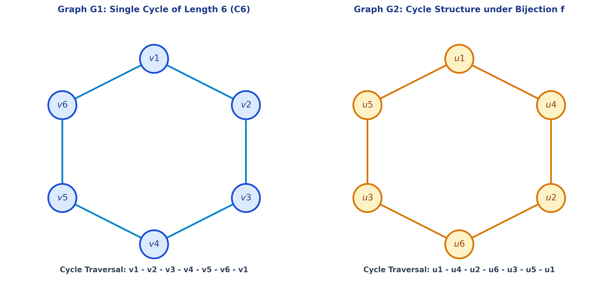
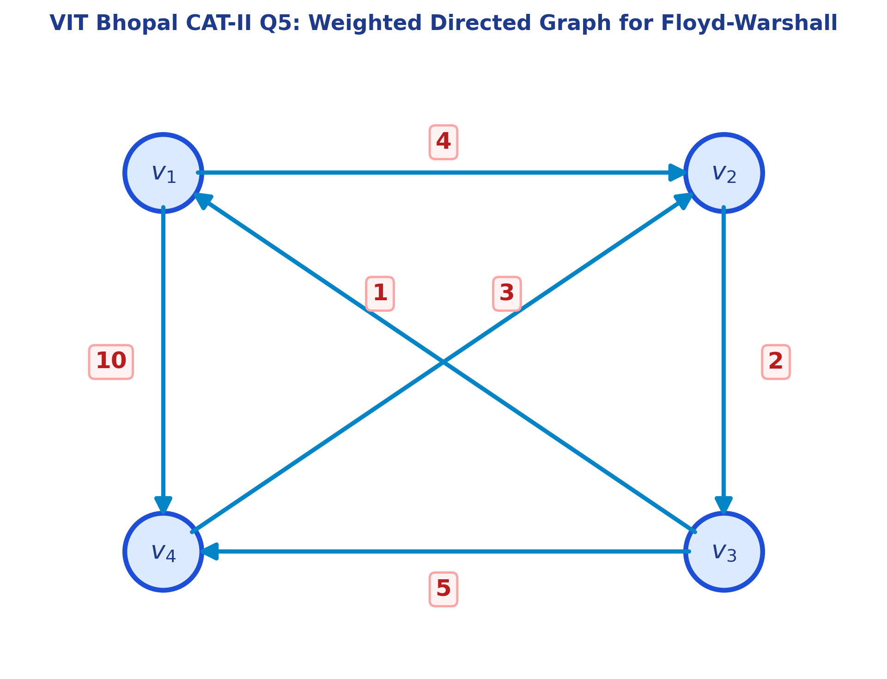

# 🏛️ VIT Bhopal University — CAT-II Examination (September 2026)
## MAT2002: Discrete Mathematics and Graph Theory — Master Solutions
> **Course Code**: MAT2002 | **Exam**: Continuous Assessment Test (CAT) - II  
> **Session / Slot**: September 2026 (Slot B22+B24+F21) | **Duration**: 1½ Hours (90 Minutes)  
> **Max. Marks**: 50 | **Coverage**: Module 3 (Lattices & Boolean Algebra) & Module 4 (Graphs & Matrix Representations)  
> **Target Use**: Official Exam Master Solutions & Direct Exam-Hall Copyable Crib

---

## Quick Question & Topic Index

| Question No. | Syllabus Topic | Key Concept Tested | Marks |
| :---: | :--- | :--- | :---: |
| **Q1** | **Module 3: Lattices** | Distributive Lattice Self-Dual Median Identity Proof ($x = y$) | **10** |
| **Q2** | **Module 3: Boolean Algebra** | 3-Variable Boolean Function, 8-Row Truth Table, PDNF & PCNF | **10** |
| **Q3 (a)** | **Module 3: Posets & Lattices** | Divisor Lattice $(D_{12}, \mid)$, Zero/Unit Elements & Complementation Counterexample | **5** |
| **Q3 (b)** | **Module 4: Graph Theory** | Degree Partition & Euler's Handshaking Lemma Impossibility Proof | **5** |
| **Q4** | **Module 4: Graph Theory** | Invariants Check & Isomorphism Proof of $G_1 (C_6) \cong G_2$ with Explicit Bijection | **10** |
| **Q5** | **Module 4: Graph Algorithms** | Floyd-Warshall All-Pairs Shortest Path Algorithm (Full Matrices $D^{(0)} \dots D^{(4)}$) | **10** |
| **Total** | | **All Compulsory Questions** | **50** |

---

# QUESTION 1 (10 Marks)

### Problem Statement:
Let $(L, \wedge, \vee, 0, 1)$ be a bounded lattice. For any three elements $a, b, c \in L$, we define the following two structural expressions:
$$x = (a \wedge b) \vee (b \wedge c) \vee (c \wedge a)$$
$$y = (a \vee b) \wedge (b \vee c) \wedge (c \vee a)$$
Prove that if $L$ is a distributive lattice, then $x = y$ holds identically for all $a, b, c \in L$. Show all logical steps clearly.

---

### Step-by-Step Model Solution:

#### 1. Given Axioms of Distributive Lattice $L$:
In any distributive lattice $(L, \wedge, \vee)$, the following two distributive laws hold identically for all elements $u, v, w \in L$:
1. **Meet distributes over Join**:
   $$u \wedge (v \vee w) = (u \wedge v) \vee (u \wedge w)$$
2. **Join distributes over Meet**:
   $$u \vee (v \wedge w) = (u \vee v) \wedge (u \vee w)$$
3. **Commutative Laws**: $u \wedge v = v \wedge u$ and $u \vee v = v \vee u$.
4. **Absorption Laws**: $u \wedge (u \vee v) = u$ and $u \vee (u \wedge v) = u$.
5. **Idempotent Laws**: $u \wedge u = u$ and $u \vee u = u$.

---

#### 2. Algebraic Expansion of Expression $y$:
We are given:
$$y = (a \vee b) \wedge (b \vee c) \wedge (c \vee a)$$

##### Step 2.1: Group the first two factors
Consider the sub-expression:
$$T = (a \vee b) \wedge (b \vee c)$$
By commutativity of join, $a \vee b = b \vee a$. Hence:
$$T = (b \vee a) \wedge (b \vee c)$$
Applying the **second distributive law** (factoring out $b$):
$$T = b \vee (a \wedge c)$$
*(Proof of this step: $b \vee (a \wedge c) = (b \vee a) \wedge (b \vee c) = (a \vee b) \wedge (b \vee c)$).*

##### Step 2.2: Substitute $T$ back into $y$
$$y = T \wedge (c \vee a) = [b \vee (a \wedge c)] \wedge (c \vee a)$$

##### Step 2.3: Apply the first distributive law
Distribute $\wedge (c \vee a)$ over the join $\vee$:
$$y = \Big( b \wedge (c \vee a) \Big) \vee \Big( (a \wedge c) \wedge (c \vee a) \Big)$$

---

#### 3. Simplifying Each Part:

##### Part A: Evaluate $b \wedge (c \vee a)$
Applying the distributive law of $\wedge$ over $\vee$:
$$b \wedge (c \vee a) = (b \wedge c) \vee (b \wedge a)$$
By commutativity:
$$b \wedge (c \vee a) = (a \wedge b) \vee (b \wedge c)$$

##### Part B: Evaluate $(a \wedge c) \wedge (c \vee a)$
By commutativity, $c \vee a = a \vee c$. Let $u = a \wedge c$. Then:
$$(a \wedge c) \wedge (c \vee a) = u \wedge (a \vee c)$$
Notice that in any lattice, $a \wedge c \le a \le a \vee c$.
More formally, applying the distributive law:
$$(a \wedge c) \wedge (a \vee c) = \Big( (a \wedge c) \wedge a \Big) \vee \Big( (a \wedge c) \wedge c \Big)$$
By associativity and idempotence:
* $(a \wedge c) \wedge a = (a \wedge a) \wedge c = a \wedge c$
* $(a \wedge c) \wedge c = a \wedge (c \wedge c) = a \wedge c$
Therefore:
$$(a \wedge c) \wedge (c \vee a) = (a \wedge c) \vee (a \wedge c) = a \wedge c = c \wedge a$$

---

#### 4. Final Recombination:
Substitute Part A and Part B back into the expression for $y$:
$$y = \Big[ (a \wedge b) \vee (b \wedge c) \Big] \vee (c \wedge a)$$
By associativity of join $\vee$:
$$y = (a \wedge b) \vee (b \wedge c) \vee (c \wedge a)$$
Comparing with the definition of $x$:
$$x = (a \wedge b) \vee (b \wedge c) \vee (c \wedge a)$$
$$\mathbf{\therefore x = y \quad \forall a, b, c \in L. \quad \blacksquare}$$

> **Key Takeaway**: This self-dual function $m(a,b,c) = x = y$ is known as the **Median Operator** of a distributive lattice.

---

# QUESTION 2 (10 Marks)

### Problem Statement:
A Boolean function $f(x, y, z)$ of three variables is defined as follows: the function outputs 1 if and only if the modified expression tuple $(x, y', z)$ contains more 1s than 0s, where $y'$ denotes the logical complement of $y$.
(a) Construct the complete truth table for $f(x, y, z)$ for all 8 possible input combinations.
(b) Find Principal Disjunctive Normal Form (PDNF) (Sum-of-Minterms) and Principal Conjunctive Normal Form (PCNF) (Product-of-Maxterms) of $f(x, y, z)$.

---

### Step-by-Step Model Solution:

#### 1. Mathematical Condition for $f(x, y, z) = 1$:
* The tuple consists of three binary variables: $T = (x, y', z)$.
* The total number of elements in the tuple is 3.
* The tuple contains **more 1s than 0s** if and only if the count of 1s is **at least 2** (i.e., count of 1s $\in \{2, 3\}$).
* Algebraically:
  $$f(x, y, z) = 1 \iff (x \wedge y') \vee (y' \wedge z) \vee (x \wedge z) = 1$$

---

#### 2. Part (a): Complete Truth Table Construction:

| Row $i$ | $x$ | $y$ | $z$ | Complement $y'$ | Modified Tuple $(x, y', z)$ | Number of 1s in Tuple | Output $f(x, y, z)$ | Minterm ($m_i$) | Maxterm ($M_i$) |
| :---: | :---: | :---: | :---: | :---: | :---: | :---: | :---: | :---: | :---: |
| **0** | 0 | 0 | 0 | 1 | $(0, 1, 0)$ | 1 | **0** | $x' \wedge y' \wedge z'$ | $x \vee y \vee z$ |
| **1** | 0 | 0 | 1 | 1 | $(0, 1, 1)$ | 2 | **1** | $x' \wedge y' \wedge z$ | $x \vee y \vee z'$ |
| **2** | 0 | 1 | 0 | 0 | $(0, 0, 0)$ | 0 | **0** | $x' \wedge y \wedge z'$ | $x \vee y' \vee z$ |
| **3** | 0 | 1 | 1 | 0 | $(0, 0, 1)$ | 1 | **0** | $x' \wedge y \wedge z$ | $x \vee y' \vee z'$ |
| **4** | 1 | 0 | 0 | 1 | $(1, 1, 0)$ | 2 | **1** | $x \wedge y' \wedge z'$ | $x' \vee y \vee z$ |
| **5** | 1 | 0 | 1 | 1 | $(1, 1, 1)$ | 3 | **1** | $x \wedge y' \wedge z$ | $x' \vee y \vee z'$ |
| **6** | 1 | 1 | 0 | 0 | $(1, 0, 0)$ | 1 | **0** | $x \wedge y \wedge z'$ | $x' \vee y' \vee z$ |
| **7** | 1 | 1 | 1 | 0 | $(1, 0, 1)$ | 2 | **1** | $x \wedge y \wedge z$ | $x' \vee y' \vee z'$ |

---

#### 3. Part (b): Principal Normal Forms:

##### 3.1 Principal Disjunctive Normal Form (PDNF / Sum-of-Minterms):
PDNF is the logical OR (disjunction) of all minterms corresponding to input combinations where **$f(x, y, z) = 1$**.
From the truth table, $f = 1$ for rows **1, 4, 5, 7**:

$$\mathbf{\text{PDNF} = m_1 \vee m_4 \vee m_5 \vee m_7 = \sum m(1, 4, 5, 7)}$$

Writing each minterm explicitly:
$$\mathbf{\text{PDNF} = (x' \wedge y' \wedge z) \vee (x \wedge y' \wedge z') \vee (x \wedge y' \wedge z) \vee (x \wedge y \wedge z)}$$

##### 3.2 Principal Conjunctive Normal Form (PCNF / Product-of-Maxterms):
PCNF is the logical AND (conjunction) of all maxterms corresponding to input combinations where **$f(x, y, z) = 0$**.
From the truth table, $f = 0$ for rows **0, 2, 3, 6**:

$$\mathbf{\text{PCNF} = M_0 \wedge M_2 \wedge M_3 \wedge M_6 = \prod M(0, 2, 3, 6)}$$

Writing each maxterm explicitly:
$$\mathbf{\text{PCNF} = (x \vee y \vee z) \wedge (x \vee y' \vee z) \wedge (x \vee y' \vee z') \wedge (x' \vee y' \vee z)}$$

---

# QUESTION 3 (10 Marks Total: 5 + 5)

---

## Question 3 (a) (5 Marks)

### Problem Statement:
Let $S = \{1, 2, 3, 4, 6, 12\}$ be the set of divisors of 12. We define two operations for any $a, b \in S$:
$$a \wedge b = \gcd(a, b)$$
$$a \vee b = \text{lcm}(a, b)$$
Find the zero element and the unit element of this structure. Is this structure a valid Boolean algebra? If yes, explain why. If no, name the property that fails and give a clear counterexample.

---

### Step-by-Step Model Solution:

#### 1. Zero Element ($0_S$):
* By definition, the zero element $0_S \in S$ must satisfy:
  $$a \wedge 0_S = 0_S \quad \text{and} \quad a \vee 0_S = a \quad \forall a \in S$$
* For $\wedge = \gcd$ and $\vee = \text{lcm}$, the identity element with respect to $\text{lcm}$ is $1$:
  $$\gcd(a, 1) = 1 \quad \text{and} \quad \text{lcm}(a, 1) = a \quad \forall a \in S$$
* $\mathbf{\text{Zero Element } 0_S = 1}$.

#### 2. Unit Element ($1_S$):
* By definition, the unit element $1_S \in S$ must satisfy:
  $$a \wedge 1_S = a \quad \text{and} \quad a \vee 1_S = 1_S \quad \forall a \in S$$
* For $\wedge = \gcd$ and $\vee = \text{lcm}$, the identity element with respect to $\gcd$ is $12$:
  $$\gcd(a, 12) = a \quad \text{and} \quad \text{lcm}(a, 12) = 12 \quad \forall a \in S$$
* $\mathbf{\text{Unit Element } 1_S = 12}$.

#### 3. Boolean Algebra Verification:
* **Answer**: **NO, $(S, \wedge, \vee, 1, 12)$ is NOT a valid Boolean algebra.**
* **Failing Property**: The **Complementation Property** fails (i.e., $(S, \le)$ is not a complemented lattice).
* **Clear Counterexample**:
  * For any element $a \in S$, its complement $a'$ must satisfy:
    $$a \wedge a' = 0_S = 1 \implies \gcd(a, a') = 1$$
    $$a \vee a' = 1_S = 12 \implies \text{lcm}(a, a') = 12$$
  * Consider element $\mathbf{a = 2 \in S}$:
    * Divisors in $S$ coprime to 2 ($\gcd(2, x) = 1$) are only $\{1, 3\}$.
    * Test $x = 1$: $\text{lcm}(2, 1) = 2 \ne 12$.
    * Test $x = 3$: $\text{lcm}(2, 3) = 6 \ne 12$.
    * Hence, **no element $x \in S$ satisfies both conditions**.
    * Therefore, **element 2 has NO complement in $S$**.
  * *(Alternative Counterexample: Element $\mathbf{a = 6 \in S}$ also has no complement, since $\gcd(6, x) = 1 \implies x = 1$, but $\text{lcm}(6, 1) = 6 \ne 12$).*
* **Root Mathematical Cause**: $12 = 2^2 \times 3$ is **not square-free** (the prime factor 2 has exponent 2). A divisor lattice $(D_n, \mid)$ is a Boolean algebra if and only if $n$ is square-free.

---

## Question 3 (b) (5 Marks)

### Problem Statement:
A simple graph $G = (V, E)$ has 15 edges. The vertex set $V$ is partitioned into two disjoint subsets, $V_1$ and $V_2$. Every vertex in $V_1$ has a degree of 2, and every vertex in $V_2$ has a degree of 4. The number of vertices in $V_1$ is exactly twice the number of vertices in $V_2$.
Determine whether such a simple graph $G$ exists. If it exists, find the total number of edges in $G$. If it does not exist, provide a proper justification.

---

### Step-by-Step Model Solution:

#### 1. Mathematical Formulation:
Let:
* $|V_2| = k$, where $k$ must be a positive integer ($k \in \mathbb{Z}^+$).
* Given that the number of vertices in $V_1$ is twice that of $V_2$:
  $$|V_1| = 2k$$
* Total number of vertices in $G$:
  $$|V| = |V_1| + |V_2| = 2k + k = 3k$$
* Given degrees:
  * Every vertex $u \in V_1$ has $\deg(u) = 2$.
  * Every vertex $v \in V_2$ has $\deg(v) = 4$.
* Given edge count:
  $$|E| = 15$$

---

#### 2. Application of Euler's Handshaking Lemma:
By Euler's Handshaking Lemma, for any undirected graph:
$$\sum_{v \in V} \deg(v) = 2|E|$$

Substitute the degrees of the partition subsets:
$$\sum_{u \in V_1} \deg(u) + \sum_{v \in V_2} \deg(v) = 2|E|$$
$$(|V_1| \times 2) + (|V_2| \times 4) = 2 \times 15$$
$$(2k \times 2) + (k \times 4) = 30$$
$$4k + 4k = 30$$
$$8k = 30$$
$$k = \frac{30}{8} = \frac{15}{4} = \mathbf{3.75}$$

---

#### 3. Conclusion & Rigorous Justification:
* The number of vertices in any graph must be an **integer** ($k = |V_2| \in \mathbb{Z}^+$).
* However, solving the Handshaking equation yields:
  $$k = 3.75 \notin \mathbb{Z}$$
* Alternatively, the total sum of degrees is $\sum \deg(v) = 8k$, which is strictly a **multiple of 8** for any integer $k$.
* But twice the number of edges is $2 \times 15 = 30$, and:
  $$30 \not\equiv 0 \pmod 8 \quad (30 = 8 \times 3 + 6)$$
* Because $8k = 30$ has no integer solution, the degree requirements and edge count are mutually contradictory.

$$\mathbf{\text{Conclusion: NO such simple graph } G \text{ exists.}}$$

---

# QUESTION 4 (10 Marks)

### Problem Statement:
Consider the two simple graphs, $G_1 = (V_1, E_1)$ and $G_2 = (V_2, E_2)$, defined by their structural properties below:
* **Graph $G_1$**: The vertex set is $V_1 = \{v_1, v_2, v_3, v_4, v_5, v_6\}$. The edges form a single cycle of length 6 ($C_6$).
* **Graph $G_2$**: The vertex set is $V_2 = \{u_1, u_2, u_3, u_4, u_5, u_6\}$. The edge set is given explicitly as:
  $$E_2 = \{(u_1, u_4), (u_1, u_5), (u_2, u_4), (u_2, u_6), (u_3, u_5), (u_3, u_6)\}$$

(a) Check the standard basic isomorphism invariants for $G_1$ and $G_2$. Do these basic invariants rule out an isomorphism?  
(b) Determine whether $G_1$ and $G_2$ are isomorphic. If they are isomorphic, provide a valid bijection $f: V_1 \to V_2$ that preserves edge adjacency. If they are not isomorphic, provide a rigorous structural proof demonstrating why no such bijection can exist.

---

### Step-by-Step Model Solution:

#### 1. Structural Analysis of Graph $G_1$:
* $G_1$ is explicitly defined as a 6-cycle $C_6$:
  * $V_1 = \{v_1, v_2, v_3, v_4, v_5, v_6\}$
  * $E_1 = \{(v_1, v_2), (v_2, v_3), (v_3, v_4), (v_4, v_5), (v_5, v_6), (v_6, v_1)\}$
* **Order**: $|V_1| = 6$.
* **Size**: $|E_1| = 6$.
* **Degrees**: Every vertex in $C_6$ has degree 2:
  $$\deg(v_1) = \deg(v_2) = \deg(v_3) = \deg(v_4) = \deg(v_5) = \deg(v_6) = 2$$
  Degree Sequence: $(2, 2, 2, 2, 2, 2)$.

---

#### 2. Structural Analysis of Graph $G_2$:
* $V_2 = \{u_1, u_2, u_3, u_4, u_5, u_6\}$.
* $E_2 = \{(u_1, u_4), (u_1, u_5), (u_2, u_4), (u_2, u_6), (u_3, u_5), (u_3, u_6)\}$.
* **Order**: $|V_2| = 6$.
* **Size**: $|E_2| = 6$.
* **Degrees of each vertex in $G_2$**:
  * $\deg(u_1)$: incident to $(u_1, u_4), (u_1, u_5) \implies \deg(u_1) = 2$.
  * $\deg(u_2)$: incident to $(u_2, u_4), (u_2, u_6) \implies \deg(u_2) = 2$.
  * $\deg(u_3)$: incident to $(u_3, u_5), (u_3, u_6) \implies \deg(u_3) = 2$.
  * $\deg(u_4)$: incident to $(u_1, u_4), (u_2, u_4) \implies \deg(u_4) = 2$.
  * $\deg(u_5)$: incident to $(u_1, u_5), (u_3, u_5) \implies \deg(u_5) = 2$.
  * $\deg(u_6)$: incident to $(u_2, u_6), (u_3, u_6) \implies \deg(u_6) = 2$.
  All vertices have degree 2 $\implies$ Degree Sequence: $(2, 2, 2, 2, 2, 2)$.

---

#### 3. Part (a): Basic Invariants Check:

| Graph Invariant | Graph $G_1$ | Graph $G_2$ | Matching Status |
| :--- | :---: | :---: | :---: |
| **Order ($|V|$)** | 6 | 6 | **Match** ($\checkmark$) |
| **Size ($|E|$)** | 6 | 6 | **Match** ($\checkmark$) |
| **Degree Sequence** | $(2, 2, 2, 2, 2, 2)$ | $(2, 2, 2, 2, 2, 2)$ | **Match** ($\checkmark$) |
| **Regularity** | 2-regular | 2-regular | **Match** ($\checkmark$) |

**Answer for (a)**:  
$$\mathbf{\text{NO, these basic isomorphism invariants do NOT rule out an isomorphism.}}$$
*(All necessary basic invariants are identically satisfied).*

---

#### 4. Part (b): Determination of Isomorphism & Explicit Bijection:

##### 4.1 Cycle Structure Tracing of $G_2$:
Since every 2-regular graph is a disjoint union of cycles, and $|V_2| = 6$, $G_2$ must be either a single 6-cycle ($C_6$) or two disjoint 3-cycles ($2C_3$).
Let us trace the neighbors starting from $u_1$:
1. Start at $u_1$. Neighbors of $u_1$ are $\{u_4, u_5\}$. Move along edge $(u_1, u_4) \to \mathbf{u_4}$.
2. Neighbors of $u_4$ are $\{u_1, u_2\}$. Move along edge $(u_4, u_2) \to \mathbf{u_2}$.
3. Neighbors of $u_2$ are $\{u_4, u_6\}$. Move along edge $(u_2, u_6) \to \mathbf{u_6}$.
4. Neighbors of $u_6$ are $\{u_2, u_3\}$. Move along edge $(u_6, u_3) \to \mathbf{u_3}$.
5. Neighbors of $u_3$ are $\{u_6, u_5\}$. Move along edge $(u_3, u_5) \to \mathbf{u_5}$.
6. Neighbors of $u_5$ are $\{u_3, u_1\}$. Move along edge $(u_5, u_1) \to \mathbf{u_1}$.

This trace forms a single closed walk of length 6:
$$\mathbf{u_1 - u_4 - u_2 - u_6 - u_3 - u_5 - u_1}$$
Because all 6 vertices of $V_2$ are visited with no repetition, **$G_2$ is a single connected cycle of length 6 ($C_6$)**!
Since both $G_1$ and $G_2$ are isomorphic to $C_6$:
$$\mathbf{G_1 \cong G_2 \quad (\text{The graphs ARE isomorphic}).}$$

##### 4.2 Construction of the Valid Bijection $f: V_1 \to V_2$:
Map the consecutive vertices along the cycle of $G_1$ to the consecutive vertices along the traced cycle of $G_2$:

$$\begin{aligned}
f(v_1) &= u_1 \\
f(v_2) &= u_4 \\
f(v_3) &= u_2 \\
f(v_4) &= u_6 \\
f(v_5) &= u_3 \\
f(v_6) &= u_5
\end{aligned}$$

##### 4.3 Edge Adjacency Preservation Verification:
For every edge $(v_i, v_j) \in E_1$, we check if $(f(v_i), f(v_j)) \in E_2$:
1. $(v_1, v_2) \in E_1 \implies (f(v_1), f(v_2)) = (u_1, u_4) \in E_2$ $\checkmark$
2. $(v_2, v_3) \in E_1 \implies (f(v_2), f(v_3)) = (u_4, u_2) \in E_2$ $\checkmark$
3. $(v_3, v_4) \in E_1 \implies (f(v_3), f(v_4)) = (u_2, u_6) \in E_2$ $\checkmark$
4. $(v_4, v_5) \in E_1 \implies (f(v_4), f(v_5)) = (u_6, u_3) \in E_2$ $\checkmark$
5. $(v_5, v_6) \in E_1 \implies (f(v_5), f(v_6)) = (u_3, u_5) \in E_2$ $\checkmark$
6. $(v_6, v_1) \in E_1 \implies (f(v_6), f(v_1)) = (u_5, u_1) \in E_2$ $\checkmark$

All non-adjacent vertex pairs in $G_1$ map to non-adjacent pairs in $G_2$.
Therefore, $f$ is an edge-preserving bijective homomorphism.
$$\mathbf{G_1 \cong G_2 \quad \blacksquare}$$

---

# QUESTION 5 (10 Marks)

### Problem Statement:
Consider the weighted directed graph $G = (V, E)$ shown below. Use the Floyd-Warshall Algorithm to find the shortest path between any pair of vertices.

---

### Step-by-Step Model Solution:

#### 1. Graph Specification & Edge List:
* **Vertices**: $V = \{v_1, v_2, v_3, v_4\}$ ($n = 4$).
* **Directed Edges & Weights**:
  * $(v_1 \to v_2)$ with weight $w = 4$
  * $(v_1 \to v_4)$ with weight $w = 10$
  * $(v_2 \to v_3)$ with weight $w = 2$
  * $(v_3 \to v_4)$ with weight $w = 5$
  * $(v_4 \to v_2)$ with weight $w = 3$
  * $(v_3 \to v_1)$ with weight $w = 1$

---

#### 2. Floyd-Warshall Algorithm Recurrence Relation:
For $k = 1, 2, \dots, n$:
$$D^{(k)}[i, j] = \min\Big( D^{(k-1)}[i, j], \; D^{(k-1)}[i, k] + D^{(k-1)}[k, j] \Big)$$
* $D^{(k)}[i, j]$ denotes the shortest distance from vertex $v_i$ to vertex $v_j$ using only intermediate vertices from $\{v_1, v_2, \dots, v_k\}$.
* Predecessor matrix $\Pi^{(k)}[i, j]$ records the immediate predecessor of $v_j$ on the shortest path from $v_i$.

---

#### 3. Initialization: Step $k = 0$ (Direct Edges Only):

$$D^{(0)} = \begin{bmatrix}
0 & 4 & \infty & 10 \\
\infty & 0 & 2 & \infty \\
1 & \infty & 0 & 5 \\
\infty & 3 & \infty & 0
\end{bmatrix}, \qquad
\Pi^{(0)} = \begin{bmatrix}
\text{NIL} & v_1 & \text{NIL} & v_1 \\
\text{NIL} & \text{NIL} & v_2 & \text{NIL} \\
v_3 & \text{NIL} & \text{NIL} & v_3 \\
\text{NIL} & v_4 & \text{NIL} & \text{NIL}
\end{bmatrix}$$

---

#### 4. Iteration $k = 1$ (Allowing Intermediate Vertex $v_1$):
* Row 1 and Column 1 remain unchanged.
* We test whether passing through $v_1$ improves any entry:
  $$D^{(1)}[i, j] = \min(D^{(0)}[i, j], \; D^{(0)}[i, 1] + D^{(0)}[1, j])$$
  * For $(v_3, v_2)$:
    $$D^{(1)}[3, 2] = \min(D^{(0)}[3, 2], \; D^{(0)}[3, 1] + D^{(0)}[1, 2]) = \min(\infty, \; 1 + 4) = \mathbf{5} \quad (\text{Path: } v_3 \to v_1 \to v_2)$$
    $\Pi^{(1)}[3, 2] = \Pi^{(0)}[1, 2] = v_1$.
  * For $(v_3, v_4)$:
    $$D^{(1)}[3, 4] = \min(5, \; D^{(0)}[3, 1] + D^{(0)}[1, 4]) = \min(5, \; 1 + 10 = 11) = \mathbf{5} \quad (\text{Unchanged})$$
  * All other pairs with $i \in \{2, 4\}$ have $D^{(0)}[i, 1] = \infty$, so no further updates occur.

$$D^{(1)} = \begin{bmatrix}
0 & 4 & \infty & 10 \\
\infty & 0 & 2 & \infty \\
1 & \mathbf{5} & 0 & 5 \\
\infty & 3 & \infty & 0
\end{bmatrix}, \qquad
\Pi^{(1)} = \begin{bmatrix}
\text{NIL} & v_1 & \text{NIL} & v_1 \\
\text{NIL} & \text{NIL} & v_2 & \text{NIL} \\
v_3 & \mathbf{v_1} & \text{NIL} & v_3 \\
\text{NIL} & v_4 & \text{NIL} & \text{NIL}
\end{bmatrix}$$

---

#### 5. Iteration $k = 2$ (Allowing Intermediate Vertex $v_2$):
* Row 2 and Column 2 remain unchanged.
* Evaluate paths using $v_2$:
  $$D^{(2)}[i, j] = \min(D^{(1)}[i, j], \; D^{(1)}[i, 2] + D^{(1)}[2, j])$$
  Row 2 values: $D^{(1)}[2, :] = [\infty, 0, 2, \infty]$.
  * For $(v_1, v_3)$:
    $$D^{(2)}[1, 3] = \min(D^{(1)}[1, 3], \; D^{(1)}[1, 2] + D^{(1)}[2, 3]) = \min(\infty, \; 4 + 2) = \mathbf{6} \quad (\text{Path: } v_1 \to v_2 \to v_3)$$
    $\Pi^{(2)}[1, 3] = \Pi^{(1)}[2, 3] = v_2$.
  * For $(v_4, v_3)$:
    $$D^{(2)}[4, 3] = \min(D^{(1)}[4, 3], \; D^{(1)}[4, 2] + D^{(1)}[2, 3]) = \min(\infty, \; 3 + 2) = \mathbf{5} \quad (\text{Path: } v_4 \to v_2 \to v_3)$$
    $\Pi^{(2)}[4, 3] = \Pi^{(1)}[2, 3] = v_2$.
  * For $(v_3, v_3)$: $\min(0, 5 + 2 = 7) = 0$.

$$D^{(2)} = \begin{bmatrix}
0 & 4 & \mathbf{6} & 10 \\
\infty & 0 & 2 & \infty \\
1 & 5 & 0 & 5 \\
\infty & 3 & \mathbf{5} & 0
\end{bmatrix}, \qquad
\Pi^{(2)} = \begin{bmatrix}
\text{NIL} & v_1 & \mathbf{v_2} & v_1 \\
\text{NIL} & \text{NIL} & v_2 & \text{NIL} \\
v_3 & v_1 & \text{NIL} & v_3 \\
\text{NIL} & v_4 & \mathbf{v_2} & \text{NIL}
\end{bmatrix}$$

---

#### 6. Iteration $k = 3$ (Allowing Intermediate Vertex $v_3$):
* Row 3 and Column 3 remain unchanged.
* Evaluate paths using $v_3$:
  $$D^{(3)}[i, j] = \min(D^{(2)}[i, j], \; D^{(2)}[i, 3] + D^{(2)}[3, j])$$
  Row 3 values: $D^{(2)}[3, :] = [1, 5, 0, 5]$.
  * For $(v_2, v_1)$:
    $$D^{(3)}[2, 1] = \min(D^{(2)}[2, 1], \; D^{(2)}[2, 3] + D^{(2)}[3, 1]) = \min(\infty, \; 2 + 1) = \mathbf{3} \quad (\text{Path: } v_2 \to v_3 \to v_1)$$
    $\Pi^{(3)}[2, 1] = \Pi^{(2)}[3, 1] = v_3$.
  * For $(v_2, v_4)$:
    $$D^{(3)}[2, 4] = \min(D^{(2)}[2, 4], \; D^{(2)}[2, 3] + D^{(2)}[3, 4]) = \min(\infty, \; 2 + 5) = \mathbf{7} \quad (\text{Path: } v_2 \to v_3 \to v_4)$$
    $\Pi^{(3)}[2, 4] = \Pi^{(2)}[3, 4] = v_3$.
  * For $(v_4, v_1)$:
    $$D^{(3)}[4, 1] = \min(D^{(2)}[4, 1], \; D^{(2)}[4, 3] + D^{(2)}[3, 1]) = \min(\infty, \; 5 + 1) = \mathbf{6} \quad (\text{Path: } v_4 \to v_2 \to v_3 \to v_1)$$
    $\Pi^{(3)}[4, 1] = \Pi^{(2)}[3, 1] = v_3$.
  * For $(v_1, v_4)$:
    $$D^{(3)}[1, 4] = \min(10, \; D^{(2)}[1, 3] + D^{(2)}[3, 4]) = \min(10, \; 6 + 5 = 11) = \mathbf{10} \quad (\text{Unchanged})$$

$$D^{(3)} = \begin{bmatrix}
0 & 4 & 6 & 10 \\
\mathbf{3} & 0 & 2 & \mathbf{7} \\
1 & 5 & 0 & 5 \\
\mathbf{6} & 3 & 5 & 0
\end{bmatrix}, \qquad
\Pi^{(3)} = \begin{bmatrix}
\text{NIL} & v_1 & v_2 & v_1 \\
\mathbf{v_3} & \text{NIL} & v_2 & \mathbf{v_3} \\
v_3 & v_1 & \text{NIL} & v_3 \\
\mathbf{v_3} & v_4 & v_2 & \text{NIL}
\end{bmatrix}$$

---

#### 7. Iteration $k = 4$ (Allowing Intermediate Vertex $v_4$):
* Row 4 and Column 4 remain unchanged.
* Evaluate paths using $v_4$:
  $$D^{(4)}[i, j] = \min(D^{(3)}[i, j], \; D^{(3)}[i, 4] + D^{(3)}[4, j])$$
  Row 4 values: $D^{(3)}[4, :] = [6, 3, 5, 0]$.
  * Check candidate improvements:
    * $(v_1, v_2): \min(4, \; 10 + 3 = 13) = 4$ (Unchanged)
    * $(v_1, v_3): \min(6, \; 10 + 5 = 15) = 6$ (Unchanged)
    * $(v_2, v_1): \min(3, \; 7 + 6 = 13) = 3$ (Unchanged)
    * $(v_2, v_2): \min(0, \; 7 + 3 = 10) = 0$ (Unchanged)
    * $(v_3, v_1): \min(1, \; 5 + 6 = 11) = 1$ (Unchanged)
    * $(v_3, v_2): \min(5, \; 5 + 3 = 8) = 5$ (Unchanged)
* **No entry improves in Step 4**. Thus $D^{(4)} = D^{(3)}$ and $\Pi^{(4)} = \Pi^{(3)}$.

---

#### 8. Final Results:

##### Final Shortest Distance Matrix $D^{(4)}$:
$$\mathbf{D^{(4)} = \begin{bmatrix}
0 & 4 & 6 & 10 \\
3 & 0 & 2 & 7 \\
1 & 5 & 0 & 5 \\
6 & 3 & 5 & 0
\end{bmatrix}}$$

##### Final Predecessor Matrix $\Pi^{(4)}$:
$$\mathbf{\Pi^{(4)} = \begin{bmatrix}
\text{NIL} & v_1 & v_2 & v_1 \\
v_3 & \text{NIL} & v_2 & v_3 \\
v_3 & v_1 & \text{NIL} & v_3 \\
v_3 & v_4 & v_2 & \text{NIL}
\end{bmatrix}}$$

---

#### 9. Complete All-Pairs Shortest Path Schedule:

| Source ($u$) | Target ($v$) | Shortest Distance | Intermediate Path Reconstruction | Full Path Sequence |
| :---: | :---: | :---: | :--- | :--- |
| **$v_1$** | **$v_2$** | **4** | Direct edge | $v_1 \to v_2$ |
| **$v_1$** | **$v_3$** | **6** | Via $v_2$: $\Pi[1,3]=v_2$ | $v_1 \to v_2 \to v_3$ |
| **$v_1$** | **$v_4$** | **10** | Direct edge | $v_1 \to v_4$ |
| **$v_2$** | **$v_1$** | **3** | Via $v_3$: $\Pi[2,1]=v_3$ | $v_2 \to v_3 \to v_1$ |
| **$v_2$** | **$v_3$** | **2** | Direct edge | $v_2 \to v_3$ |
| **$v_2$** | **$v_4$** | **7** | Via $v_3$: $\Pi[2,4]=v_3$ | $v_2 \to v_3 \to v_4$ |
| **$v_3$** | **$v_1$** | **1** | Direct edge | $v_3 \to v_1$ |
| **$v_3$** | **$v_2$** | **5** | Via $v_1$: $\Pi[3,2]=v_1$ | $v_3 \to v_1 \to v_2$ |
| **$v_3$** | **$v_4$** | **5** | Direct edge | $v_3 \to v_4$ |
| **$v_4$** | **$v_1$** | **6** | Via $v_2, v_3$: $\Pi[4,1]=v_3, \Pi[4,3]=v_2$ | $v_4 \to v_2 \to v_3 \to v_1$ |
| **$v_4$** | **$v_2$** | **3** | Direct edge | $v_4 \to v_2$ |
| **$v_4$** | **$v_3$** | **5** | Via $v_2$: $\Pi[4,3]=v_2$ | $v_4 \to v_2 \to v_3$ |

$$\mathbf{\text{All pairs shortest paths successfully computed via Floyd-Warshall Algorithm. } \blacksquare}$$
