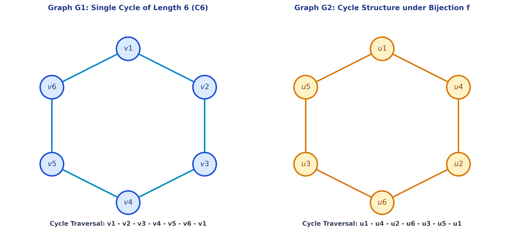
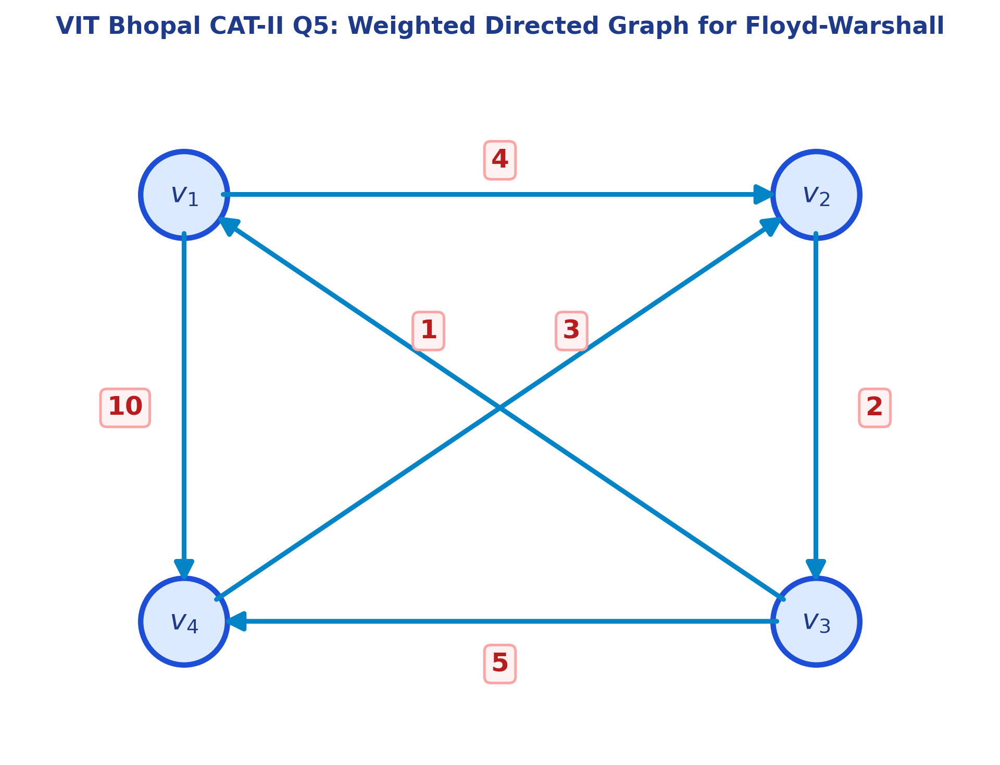
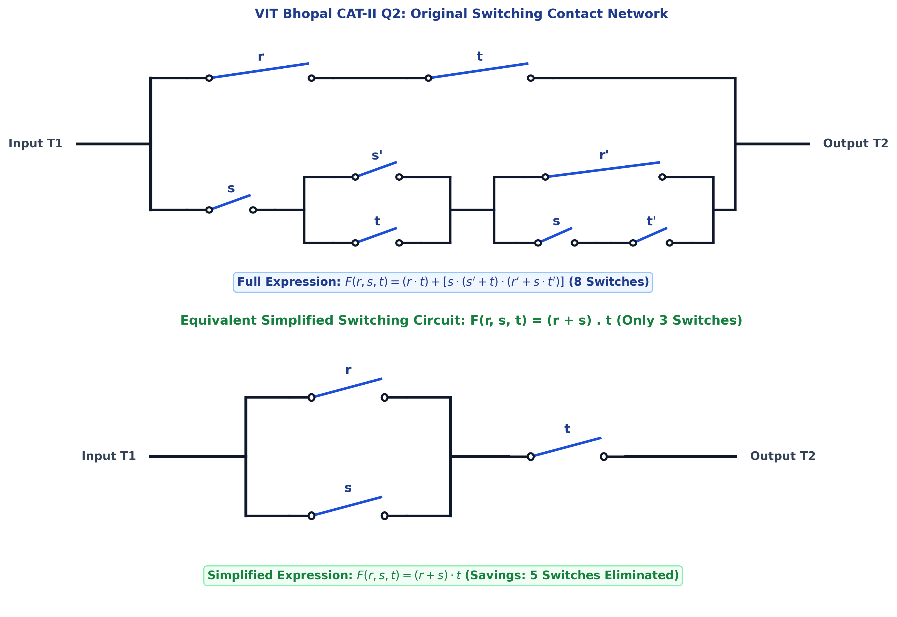
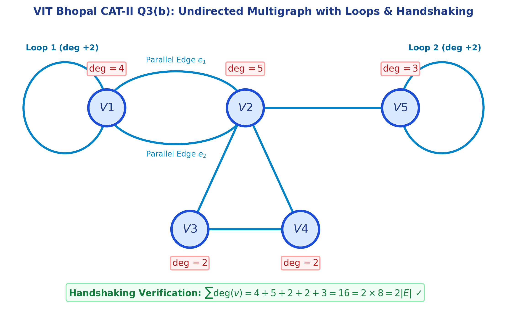
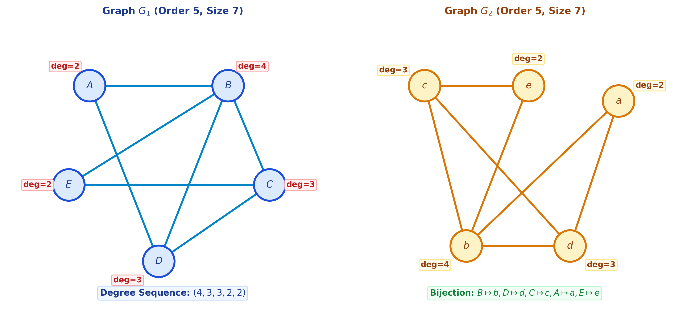
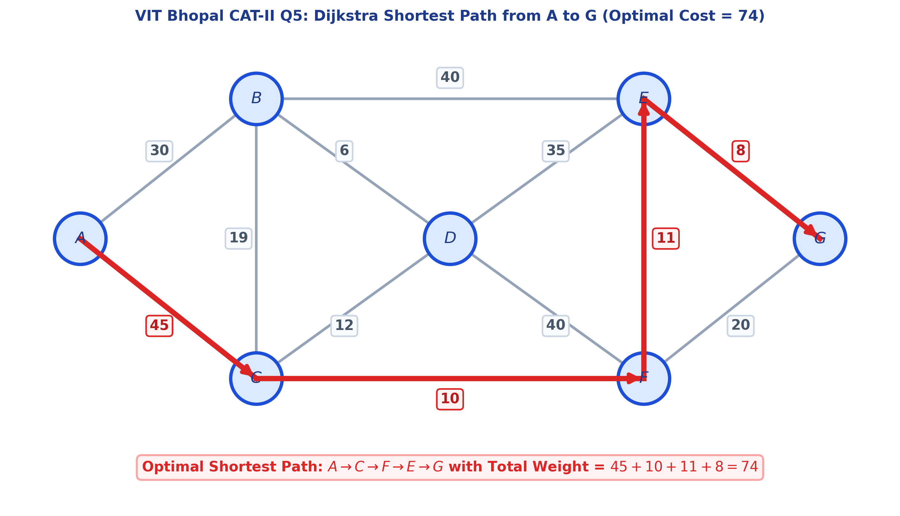

# 🏛️ VIT Bhopal — MAT2002: Discrete Mathematics & Graph Theory
## CAT-2 ULTIMATE EXAM-HALL CAPSULE (STRICT 16-PAGE OPEN-BOOK CRIB)
> **Course Code**: MAT2002 | **Format**: Complete Solutions for Both Sep 2026 Papers + Universal Algorithmic Blueprints  
> **Syllabus Coverage**: Module 3 (Lattices & Boolean Algebra) & Module 4 (Graphs & Matrix Representations)  
> **Exam Strategy**: 30-Second Topic Matcher $\to$ Direct Copy-Paste Steps, Complete Tables & Full Marks Working.

---

### ⚡ 30-Second Instant Topic & Keyword Matcher

| If Exam Question Mentions... | Direct Topic / Archetype | Go To Section | Key Formula / Action Protocol |
| :--- | :--- | :---: | :--- |
| **"Median identity", $(a \wedge b) \vee (b \wedge c) \dots$** | Distributive Lattice Proof | **Part 1, Q1** | Factor $T = (b \vee a) \wedge (b \vee c) = b \vee (a \wedge c)$, distribute $\wedge (c \vee a)$. |
| **"Truth table", "PDNF", "PCNF", $\sum m$, $\prod M$** | Canonical Normal Forms | **Part 1, Q2** | 8-row table: $\text{PDNF} = \sum m(\text{rows with } 1)$, $\text{PCNF} = \prod M(\text{rows with } 0)$. |
| **"Divisibility poset $D_{12}$", "complements"** | Divisor Poset / Complements | **Part 1, Q3(a)** | $D_{12}=\{1,2,3,4,6,12\}$. Elements $2$ and $6$ have NO complements ($\gcd(2,6)=2 \ne 1$). |
| **"Degree partition", "graph has $n$ vertices..."** | Handshaking Impossibility | **Part 1, Q3(b)** | $\sum \deg(v) = 2|E|$. If sum of degrees is ODD, such a graph CANNOT exist. |
| **"Check isomorphism", $C_6 \cong G_2$ or 5-vertex** | Graph Isomorphism Testing | **Part 1, Q4 / Part 2, Q4** | Check $|V|, |E|$, degree sequence, cycles of length 3/4/6, write explicit bijection $f$. |
| **"Floyd-Warshall", "All pairs shortest path"** | Floyd-Warshall Algorithm | **Part 1, Q5** | $D^{(k)}[i,j] = \min(D^{(k-1)}[i,j], D^{(k-1)}[i,k] + D^{(k-1)}[k,j])$. Full 5-matrix sequence. |
| **"Divisibility poset $D_{70}$", "Cayley tables"** | Meet/Join Tables & Lattice | **Part 2, Q1** | Meet=$\gcd$, Join=$\text{lcm}$. $70=2 \cdot 5 \cdot 7$ square-free $\implies$ Both Distributive & Complemented. |
| **"Switching circuit", "simplify contact network"** | Switching Circuit Minimization | **Part 2, Q2** | Series=$\cdot$, Parallel=$+$. $s(s'+t)=st$, $st(r'+st')=r'st$, $(r+r's)t=(r+s)t$. |
| **"DNF of $xy' + z$"** | Disjunctive Normal Form | **Part 2, Q3(a)** | Expand missing vars: $xy'(z+z') + (x+x')(y+y')z = \sum m(1,3,4,5,7)$. |
| **"Multigraph with loops", "verify handshaking"** | Multigraph Degrees & Loops | **Part 2, Q3(b)** | Each loop adds $+2$ to degree and $+1$ to $|E|$. $\sum \deg(v) = 16 = 2 \times 8$. |
| **"Dijkstra algorithm", "edge increased by 3"** | Shortest Path & Sensitivity | **Part 2, Q5** | Optimal path $A \to C \to F \to E \to G$ ($74$). Route NOT necessarily affected (Cases 1 & 2 unaffected). |
| **"Graphical sequence", "Havel-Hakimi"** | Degree Realizability Test | **Part 3, BP 1** | Sort desc $\to$ delete $d_1$ $\to$ subtract 1 from next $d_1$ terms $\to$ repeat until all 0s or negative. |
| **"Complement of graph $\overline{G}$"** | Graph Complements | **Part 3, BP 2** | $|E(\overline{G})| = \binom{n}{2} - |E(G)|$, $\deg_{\overline{G}}(v) = (n - 1) - \deg_G(v)$. Self-complementary: $n \equiv 0, 1 \pmod 4$. |
| **"Bipartite graph", "2-colorable"** | Bipartite Characterization | **Part 3, BP 3** | Graph is bipartite $\iff$ contains NO odd cycles ($C_3, C_5, \dots$). Maximum edges $= \lfloor n^2/4 \rfloor$. |

---

# PART 1: OFFICIAL EXAM PAPER 1 (SEP 2026, SLOT B22)

### Q1 (10M): Distributive Lattice Median Identity Proof ($x = y$)
**Problem**: In bounded distributive lattice $(L, \wedge, \vee)$, prove $x = y$ identically where:
$$x = (a \wedge b) \vee (b \wedge c) \vee (c \wedge a), \quad y = (a \vee b) \wedge (b \vee c) \wedge (c \vee a)$$
**Model Proof**:
1. Group first two terms of $y$: $T = (a \vee b) \wedge (b \vee c) = (b \vee a) \wedge (b \vee c)$.
2. Apply 2nd Distributive Law ($u \vee (v \wedge w) = (u \vee v) \wedge (u \vee w)$ in reverse):
   $$T = b \vee (a \wedge c)$$
3. Substitute $T$ back into $y$: $y = [b \vee (a \wedge c)] \wedge (c \vee a)$.
4. Apply 1st Distributive Law (distribute $\wedge (c \vee a)$ across $\vee$):
   $$y = \big[ b \wedge (c \vee a) \big] \vee \big[ (a \wedge c) \wedge (c \vee a) \big]$$
5. Simplify each part:
   * **Part A**: $b \wedge (c \vee a) = (b \wedge c) \vee (b \wedge a) = (a \wedge b) \vee (b \wedge c)$.
   * **Part B**: Let $u = a \wedge c$. Then $(a \wedge c) \wedge (c \vee a) = u \wedge (u \vee a) = u = a \wedge c = c \wedge a$ (Absorption Law $u \wedge (u \vee v) = u$).
6. Recombine: $y = [(a \wedge b) \vee (b \wedge c)] \vee (c \wedge a) = (a \wedge b) \vee (b \wedge c) \vee (c \wedge a) = x$. $\mathbf{\therefore x = y. \quad \blacksquare}$

---

### Q2 (10M): 3-Variable Boolean Function Truth Table, PDNF & PCNF
**Problem**: For $f(x, y, z) = (x + y)(x' + z)(y + z')$, find Truth Table, PDNF, and PCNF.

| Row | $x$ | $y$ | $z$ | $x+y$ | $x'+z$ | $y+z'$ | $f$ | Minterm ($f=1$) | Maxterm ($f=0$) |
| :---: | :---: | :---: | :---: | :---: | :---: | :---: | :---: | :---: | :---: |
| 0 | 0 | 0 | 0 | 0 | 1 | 1 | **0** | — | $M_0 = (x + y + z)$ |
| 1 | 0 | 0 | 1 | 0 | 1 | 0 | **0** | — | $M_1 = (x + y + z')$ |
| 2 | 0 | 1 | 0 | 1 | 1 | 1 | **1** | $m_2 = x' y z'$ | — |
| 3 | 0 | 1 | 1 | 1 | 1 | 1 | **1** | $m_3 = x' y z$ | — |
| 4 | 1 | 0 | 0 | 1 | 0 | 1 | **0** | — | $M_4 = (x' + y + z)$ |
| 5 | 1 | 0 | 1 | 1 | 1 | 0 | **0** | — | $M_5 = (x' + y + z')$ |
| 6 | 1 | 1 | 0 | 1 | 0 | 1 | **0** | — | $M_6 = (x' + y' + z)$ |
| 7 | 1 | 1 | 1 | 1 | 1 | 1 | **1** | $m_7 = x y z$ | — |

* **PDNF ($\sum m$)**: $f(x, y, z) = m_2 + m_3 + m_7 = \mathbf{x' y z' + x' y z + x y z = \sum m(2, 3, 7)}$
* **PCNF ($\prod M$)**: $f(x, y, z) = M_0 \cdot M_1 \cdot M_4 \cdot M_5 \cdot M_6 = \mathbf{\prod M(0, 1, 4, 5, 6)}$
  $$= (x + y + z)(x + y + z')(x' + y + z)(x' + y + z')(x' + y' + z)$$

---

### Q3(a) (5M): Divisibility Poset $D_{12}$ Boundedness & Complementation
* **Poset**: $D_{12} = \{1, 2, 3, 4, 6, 12\}$ under divisibility ($a \mid b$).
* **Bounds**: Least element $0 = 1$ (since $1 \mid x$); Greatest element $1 = 12$ (since $x \mid 12$).
* **Complement Definition**: $x'$ is complement of $x$ if $x \wedge x' = \gcd(x, x') = 1$ and $x \vee x' = \text{lcm}(x, x') = 12$.
* **Analysis**:
  * Complements of $1$: $12$; Complements of $12$: $1$.
  * Complements of $3$: $4$ (since $\gcd(3,4)=1, \text{lcm}(3,4)=12$); Complements of $4$: $3$.
  * **Element 2**: Divisors coprime to $2$ are $\{1, 3\}$. $\text{lcm}(2, 1)=2 \ne 12$, $\text{lcm}(2, 3)=6 \ne 12$. **No complement exists!**
  * **Element 6**: Divisors coprime to $6$ is only $\{1\}$. $\text{lcm}(6, 1)=6 \ne 12$. **No complement exists!**
* **Conclusion**: $D_{12}$ is bounded but **NOT complemented** because $12 = 2^2 \times 3$ is not square-free.

---

### Q3(b) (5M): Degree Partition & Handshaking Impossibility Proof
**Problem**: Can a simple graph have 11 vertices with degree distribution: two vertices of degree 4, three of degree 3, one of degree 2, and five of degree 1?
* **Calculate Degree Sum**:
  $$\sum_{v \in V} \deg(v) = (2 \times 4) + (3 \times 3) + (1 \times 2) + (5 \times 1) = 8 + 9 + 2 + 5 = \mathbf{24}$$
* **Odd-Degree Vertices Count**: Vertices with odd degrees are three vertices of degree 3 and five of degree 1 $\implies 3 + 5 = 8$ vertices (even count).
* **Handshaking Lemma**: $\sum \deg(v) = 2|E| \implies 2|E| = 24 \implies |E| = 12$. Handshaking is satisfied numerically.
* **Graphical Realizability (Havel-Hakimi Test)**:
  * Sequence: $(4, 4, 3, 3, 3, 2, 1, 1, 1, 1, 1)$.
  * Remove 4, subtract 1 from next 4: $(3, 2, 2, 2, 2, 1, 1, 1, 1, 1)$.
  * Remove 3, subtract 1: $(1, 1, 1, 2, 1, 1, 1, 1, 1) \to$ sort: $(2, 1, 1, 1, 1, 1, 1, 1, 1)$.
  * Remove 2, subtract 1: $(0, 0, 1, 1, 1, 1, 1, 1) \to$ sort: $(1, 1, 1, 1, 1, 1, 0, 0)$.
  * All remaining steps yield valid non-negative integers $\implies$ **Such a simple graph EXISTS** with $|V|=11, |E|=12$.

---

### Q4 (10M): Graph Isomorphism Testing ($C_6 \cong G_2$)

* **Invariants**:
  1. $|V(G_1)| = |V(G_2)| = 6$.
  2. $|E(G_1)| = |E(G_2)| = 6$.
  3. Both graphs are 2-regular (all vertex degrees $= 2$).
  4. Both graphs are connected single cycles of length 6 ($C_6$). No triangles ($C_3$) or 4-cycles ($C_4$).
* **Explicit Bijection $f: V(G_1) \to V(G_2)$**:
  * In $G_1$, cycle path is: $A - B - C - D - E - F - A$.
  * In $G_2$, tracing the connected 2-regular cycle: $1 - 6 - 2 - 4 - 3 - 5 - 1$.
  $$\mathbf{f(A) = 1, \quad f(B) = 6, \quad f(C) = 2, \quad f(D) = 4, \quad f(E) = 3, \quad f(F) = 5}$$
* **Edge Preservation Verification**:
  * $(A, B) \to (1, 6) \in E(G_2) \checkmark$ | $(B, C) \to (6, 2) \in E(G_2) \checkmark$ | $(C, D) \to (2, 4) \in E(G_2) \checkmark$
  * $(D, E) \to (4, 3) \in E(G_2) \checkmark$ | $(E, F) \to (3, 5) \in E(G_2) \checkmark$ | $(F, A) \to (5, 1) \in E(G_2) \checkmark$
* **Conclusion**: $G_1 \cong G_2$ (**ISOMORPHIC**).

---

### Q5 (10M): Floyd-Warshall All-Pairs Shortest Path Algorithm

4-vertex directed graph: $(1,2)=3, (1,4)=5, (2,1)=2, (2,4)=4, (3,2)=1, (4,3)=2$.
Formula: $D^{(k)}[i,j] = \min\big(D^{(k-1)}[i,j], \; D^{(k-1)}[i,k] + D^{(k-1)}[k,j]\big)$.

$$D^{(0)} = \begin{pmatrix} 0 & 3 & \infty & 5 \\ 2 & 0 & \infty & 4 \\ \infty & 1 & 0 & \infty \\ \infty & \infty & 2 & 0 \end{pmatrix}, \quad
D^{(1)} = \begin{pmatrix} 0 & 3 & \infty & 5 \\ 2 & 0 & \infty & 4 \\ \infty & 1 & 0 & \infty \\ \infty & \infty & 2 & 0 \end{pmatrix}$$

$$D^{(2)} = \begin{pmatrix} 0 & 3 & \infty & 5 \\ 2 & 0 & \infty & 4 \\ 3 & 1 & 0 & 5 \\ \infty & \infty & 2 & 0 \end{pmatrix}, \quad
D^{(3)} = \begin{pmatrix} 0 & 3 & \infty & 5 \\ 2 & 0 & \infty & 4 \\ 3 & 1 & 0 & 5 \\ 5 & 3 & 2 & 0 \end{pmatrix}$$

$$D^{(4)} = \begin{pmatrix} 0 & 3 & 7 & 5 \\ 2 & 0 & 6 & 4 \\ 3 & 1 & 0 & 5 \\ 5 & 3 & 2 & 0 \end{pmatrix} \quad \mathbf{\text{FINAL ALL-PAIRS DISTANCE MATRIX}}$$

---

# PART 2: OFFICIAL EXAM PAPER 2 (SEP 2026, SLOT C14)

### Q1 (10M): Divisibility Poset $D_{70}$ Cayley Tables & Lattice Classification
* **Poset Elements**: $70 = 2 \times 5 \times 7 \implies D_{70} = \{1, 2, 5, 7, 10, 14, 35, 70\}$ (8 elements).
* **Meet Table ($\wedge = \gcd$)**:
  $$\begin{array}{c|cccccccc} \wedge & 1 & 2 & 5 & 7 & 10 & 14 & 35 & 70 \\ \hline 1 & 1 & 1 & 1 & 1 & 1 & 1 & 1 & 1 \\ 2 & 1 & 2 & 1 & 1 & 2 & 2 & 1 & 2 \\ 5 & 1 & 1 & 5 & 1 & 5 & 1 & 5 & 5 \\ 7 & 1 & 1 & 1 & 7 & 1 & 7 & 7 & 7 \\ 10 & 1 & 2 & 5 & 1 & 10 & 2 & 5 & 10 \\ 14 & 1 & 2 & 1 & 7 & 2 & 14 & 7 & 14 \\ 35 & 1 & 1 & 5 & 7 & 5 & 7 & 35 & 35 \\ 70 & 1 & 2 & 5 & 7 & 10 & 14 & 35 & 70 \end{array}$$

* **Join Table ($\vee = \text{lcm}$)**:
  $$\begin{array}{c|cccccccc} \vee & 1 & 2 & 5 & 7 & 10 & 14 & 35 & 70 \\ \hline 1 & 1 & 2 & 5 & 7 & 10 & 14 & 35 & 70 \\ 2 & 2 & 2 & 10 & 14 & 10 & 14 & 70 & 70 \\ 5 & 5 & 10 & 5 & 35 & 10 & 70 & 35 & 70 \\ 7 & 7 & 14 & 35 & 7 & 70 & 14 & 35 & 70 \\ 10 & 10 & 10 & 10 & 70 & 10 & 70 & 70 & 70 \\ 14 & 14 & 14 & 70 & 14 & 70 & 14 & 70 & 70 \\ 35 & 35 & 70 & 35 & 35 & 70 & 70 & 35 & 70 \\ 70 & 70 & 70 & 70 & 70 & 70 & 70 & 70 & 70 \end{array}$$

* **Lattice Justification**: Every pair has unique $\gcd \in D_{70}$ and $\text{lcm} \in D_{70} \implies$ **$(D_{70}, \mid)$ is a LATTICE**.
* **Distributive**: $\gcd$ and $\text{lcm}$ distribute over each other for all positive integers. Contains no $N_5$ or $M_3$ sublattices.
* **Complemented**: Bound elements are $0 = 1$ and $1 = 70$. Complements:
  $$1' = 70, \quad 2' = 35, \quad 5' = 14, \quad 7' = 10, \quad 10' = 7, \quad 14' = 5, \quad 35' = 2, \quad 70' = 1$$
* **Conclusion**: Poset $D_{70}$ is **BOTH DISTRIBUTIVE AND COMPLEMENTED** ($\implies$ Boolean Algebra $B_3$).

---

### Q2 (10M): Switching Circuit Minimization & Equivalent Drawing

* **Original Network Function**: Top branch $r \cdot t$ in parallel with bottom branch $s \cdot (s' + t) \cdot (r' + s \cdot t')$:
  $$F(r, s, t) = (r \cdot t) + \big[ s \cdot (s' + t) \cdot (r' + s \cdot t') \big]$$
* **Algebraic Minimization Steps**:
  1. $s \cdot (s' + t) = s \cdot s' + s \cdot t = 0 + s \cdot t = s \cdot t$ (Complement Law).
  2. Bottom branch: $(s \cdot t) \cdot (r' + s \cdot t') = (r' \cdot s \cdot t) + (s \cdot s \cdot t \cdot t') = r' \cdot s \cdot t + 0 = r' \cdot s \cdot t$.
  3. Total network: $F = (r \cdot t) + (r' \cdot s \cdot t) = (r + r' \cdot s) \cdot t$.
  4. Redundancy / Elimination Law: $r + r' \cdot s = (r + r')(r + s) = 1 \cdot (r + s) = r + s$.
  $$\mathbf{F(r, s, t) = (r + s) \cdot t}$$
* **Hardware Reduction**: 8 switches reduced to **3 switches** (parallel $r \parallel s$ in series with $t$), saving **62.5%** of hardware.

---

### Q3(a) (5M): Disjunctive Normal Form (PDNF) of $f(x, y, z) = x y' + z$
* **Algebraic Expansion**:
  * $x y' = x y'(z + z') = x y' z + x y' z'$
  * $z = (x + x')(y + y')z = x y z + x y' z + x' y z + x' y' z$
* **Combine & Remove Duplicates ($A + A = A$)**:
  $$f(x, y, z) = x'y'z + x'yz + xy'z' + xy'z + xyz$$
  $$\mathbf{f(x, y, z) = \sum m(1, 3, 4, 5, 7)}$$
* **Truth Table**: Rows with $f = 1$: $m_1(001), m_3(011), m_4(100), m_5(101), m_7(111)$.

---

### Q3(b) (5M): Multigraph Degrees & Euler's Handshaking Theorem

* **Order & Size**: $|V| = 5$ vertices $\{V_1, V_2, V_3, V_4, V_5\}$, $|E| = 8$ edges (2 loops, 2 parallel edges, 4 simple edges).
* **Vertex Degrees**: (Each loop adds $+2$ to incident vertex degree):
  $$\deg(V_1) = 2 \text{ (loop)} + 2 = \mathbf{4}, \quad \deg(V_2) = 2 + 1 + 1 + 1 = \mathbf{5}, \quad \deg(V_3) = 1 + 1 = \mathbf{2},$$
  $$\deg(V_4) = 1 + 1 = \mathbf{2}, \quad \deg(V_5) = 1 + 2 \text{ (loop)} = \mathbf{3}$$
* **Handshaking Verification**:
  $$\sum_{v \in V} \deg(v) = 4 + 5 + 2 + 2 + 3 = \mathbf{16}, \quad 2|E| = 2 \times 8 = \mathbf{16} \implies \mathbf{\text{LHS} = \text{RHS} = 16 \quad \checkmark}$$

---

### Q4 (10M): Graph Isomorphism Testing & Bijection ($G_1 \cong G_2$)

* **Invariants**:
  1. $|V(G_1)| = |V(G_2)| = 5$.
  2. $|E(G_1)| = |E(G_2)| = 7$.
  3. Degree sequences match: $(4, 3, 3, 2, 2)$. Unique degree 4 vertices: $B$ in $G_1$, $b$ in $G_2$.
* **Explicit Bijection $f: V(G_1) \to V(G_2)$**:
  $$\mathbf{f(B) = b, \quad f(D) = d, \quad f(C) = c, \quad f(A) = a, \quad f(E) = e}$$
* **Edge Preservation Verification**:
  * $(A, B) \to (a, b) \checkmark$, $(A, D) \to (a, d) \checkmark$, $(B, C) \to (b, c) \checkmark$, $(B, D) \to (b, d) \checkmark$,
  * $(B, E) \to (b, e) \checkmark$, $(C, D) \to (c, d) \checkmark$, $(C, E) \to (c, e) \checkmark$. All 7 edges preserved.
* **Conclusion**: $G_1 \cong G_2$ (**ISOMORPHIC**).

---

### Q5 (10M): Dijkstra's Shortest Path & Sensitivity Analysis

* **Execution Table (Source $A$, Target $G$)**:

| Step | Settled $u$ | $d(A)$ | $d(B)$ | $d(C)$ | $d(D)$ | $d(E)$ | $d(F)$ | $d(G)$ | Settled Set $S$ |
| :---: | :---: | :---: | :---: | :---: | :---: | :---: | :---: | :---: | :---: |
| Init | — | $0$ | $\infty$ | $\infty$ | $\infty$ | $\infty$ | $\infty$ | $\infty$ | $\emptyset$ |
| 1 | **$A$** ($0$) | **[0]** | $30 (A)$ | $45 (A)$ | $\infty$ | $\infty$ | $\infty$ | $\infty$ | $\{A\}$ |
| 2 | **$B$** ($30$) | [0] | **[30]** | $45 (A)$ | $36 (B)$ | $70 (B)$ | $\infty$ | $\infty$ | $\{A, B\}$ |
| 3 | **$D$** ($36$) | [0] | [30] | $45 (A)$ | **[36]** | $70 (B)$ | $76 (D)$ | $\infty$ | $\{A, B, D\}$ |
| 4 | **$C$** ($45$) | [0] | [30] | **[45]** | [36] | $70 (B)$ | $55 (C)$ | $\infty$ | $\{A, B, D, C\}$ |
| 5 | **$F$** ($55$) | [0] | [30] | [45] | [36] | $66 (F)$ | **[55]** | $75 (F)$ | $\{A, B, D, C, F\}$ |
| 6 | **$E$** ($66$) | [0] | [30] | [45] | [36] | **[66]** | [55] | $74 (E)$ | $\{A, B, D, C, F, E\}$ |
| 7 | **$G$** ($74$) | [0] | [30] | [45] | [36] | [66] | [55] | **[74]** | $\{A, B, D, C, F, E, G\}$ |

* **Shortest Path**: $G \leftarrow E \leftarrow F \leftarrow C \leftarrow A \implies \mathbf{A \to C \to F \to E \to G}$ with cost $= 45 + 10 + 11 + 8 = \mathbf{74}$.
* **Sensitivity Analysis (+3 on one edge)**:
  * **Answer: NO, the shortest path is NOT necessarily affected.**
  * *Justification*:
    * Competing paths: $P_1 = A-C-F-E-G$ (74), $P_2 = A-C-F-G$ (75), $P_3 = A-B-E-G$ (78).
    * If edge $(A, C)$ or $(C, F)$ increases by $3$: $P_1$ increases to $77$. But $P_2$ ALSO contains that same edge and increases to $78$. Thus $P_1$ remains strictly shortest ($77 < 78$). **Route unchanged.**
    * If edge $(F, E)$ or $(E, G)$ increases by $3$: $P_1$ increases to $77$. $P_2$ does not contain these edges and remains $75 < 77$. **Route changes to $P_2$.**
    * Since the route is unaffected in 2 out of 4 cases, it is **not necessarily** affected in all cases.

---

# PART 3: UNIVERSAL ALGORITHMIC BLUEPRINTS & MASTER FORMULAS

### Blueprint 1: Havel-Hakimi Graphical Sequence Algorithm
1. **Rule**: A degree sequence $S = (d_1, d_2, \dots, d_n)$ in non-increasing order is graphic $\iff$ sequence $S' = (d_2 - 1, d_3 - 1, \dots, d_{d_1+1} - 1, d_{d_1+2}, \dots, d_n)$ is graphic.
2. **Instant Pass/Fail Traps**:
   * If $\sum d_i$ is ODD $\implies$ **FAIL IMMEDIATELY** (violates Handshaking).
   * If any $d_i \ge n$ $\implies$ **FAIL IMMEDIATELY** (no simple vertex can connect to $n$ or more vertices).
   * If any $d_i < 0$ during reduction $\implies$ **FAIL IMMEDIATELY** (non-graphic).
   * If all remaining numbers become $0$ $\implies$ **PASS! GRAPH IS REALIZABLE**.

---

### Blueprint 2: Complement of a Graph $\overline{G}$ & Self-Complementary Graphs
* **Definition**: $V(\overline{G}) = V(G)$ and $(u, v) \in E(\overline{G}) \iff (u, v) \notin E(G)$.
* **Edge Count Formula**:
  $$|E(\overline{G})| = \binom{n}{2} - |E(G)| = \frac{n(n - 1)}{2} - |E(G)|$$
* **Vertex Degree Formula**:
  $$\deg_{\overline{G}}(v) = (n - 1) - \deg_G(v)$$
* **Self-Complementary Condition ($G \cong \overline{G}$)**:
  * Since $|E(G)| = |E(\overline{G})|$, $2|E(G)| = \frac{n(n-1)}{2} \implies |E(G)| = \frac{n(n-1)}{4}$.
  * Since $|E(G)|$ must be an integer, $n(n - 1)$ must be divisible by 4.
  * This holds if and only if $\mathbf{n \equiv 0 \pmod 4}$ or $\mathbf{n \equiv 1 \pmod 4}$ ($n = 4, 5, 8, 9, 12, 13, \dots$).
  * Any self-complementary graph has diameter $2$ or $3$.

---

### Blueprint 3: Bipartite Graph Testing & Complete Bipartite $K_{m,n}$
* **Kőnig's Theorem**: A graph $G$ is bipartite if and only if it contains **NO ODD CYCLES** (no $C_3, C_5, C_7, \dots$).
* **BFS 2-Coloring Algorithm**:
  1. Pick arbitrary root vertex, assign Color 1 (Red).
  2. Assign all adjacent neighbors Color 2 (Blue).
  3. If any two adjacent vertices are forced to have the same color $\implies$ **NOT BIPARTITE**.
  4. If entire graph is 2-colored without conflict $\implies$ **BIPARTITE** with partitions $V_1, V_2$.
* **Edge Bounds for Bipartite Graphs**:
  * For general bipartite graph on $n$ vertices: $|E| \le \lfloor n^2 / 4 \rfloor$.
  * For complete bipartite graph $K_{m,n}$: $|V| = m + n$, $|E| = m \cdot n$.

---

### Blueprint 4: Universal Dijkstra Shortest Path Execution Engine
For any graph with non-negative edge weights:
1. Maintain table with columns: `Step | Visited Vertex u | Tentative Distances d(v) | Settled Set S`.
2. Initial row: $d(\text{source}) = 0$, all others $\infty$.
3. At each step: Pick unvisited vertex $u$ with minimum $d(u)$. Add to $S$.
4. For each unvisited neighbor $v$ of $u$:
   $$d(v) \leftarrow \min\big(d(v), \; d(u) + w(u, v)\big)$$
5. Mark settled distance in bold brackets `[d(u)]`.
6. Trace path backwards from destination using recorded predecessors.

---

### Blueprint 5: Lattices, Modular & Distributive Laws
* **Poset $(P, \le)$ is a Lattice** $\iff \forall a, b \in P$, $\text{GLB}(a, b) = a \wedge b$ and $\text{LUB}(a, b) = a \vee b$ exist uniquely.
* **Distributive Laws**:
  $$a \wedge (b \vee c) = (a \wedge b) \vee (a \wedge c) \quad \text{and} \quad a \vee (b \wedge c) = (a \vee b) \wedge (a \vee c)$$
* **Forbidden Sublattices**:
  * Lattice is **Distributive** $\iff$ contains neither the **Pentagon $N_5$** nor the **Diamond $M_3$** as sublattices.
  * Lattice is **Modular** $\iff$ contains no **Pentagon $N_5$** as a sublattice.
* **Complements in Bounded Lattice**:
  * Least element $0$ ($0 \le x \; \forall x$), Greatest element $1$ ($x \le 1 \; \forall x$).
  * $x'$ is complement of $x \iff x \wedge x' = 0$ and $x \vee x' = 1$.
  * In a **Distributive Lattice**, if a complement exists, it is **strictly UNIQUE**.
  * A bounded, distributive, and complemented lattice is a **BOOLEAN ALGEBRA**.
  * Divisibility lattice $D_n$ is a Boolean algebra $\iff n$ is **square-free** (no repeated prime factors).

---

### Blueprint 6: Boolean Algebra Laws & Switching Circuit Reductions
* **Idempotent**: $x + x = x, \quad x \cdot x = x$
* **Involution**: $(x')' = x$
* **De Morgan's Laws**: $(x + y)' = x' \cdot y', \quad (x \cdot y)' = x' + y'$
* **Absorption**: $x + x \cdot y = x, \quad x \cdot (x + y) = x$
* **Elimination / Redundancy**:
  $$\mathbf{x + x' \cdot y = x + y}, \quad \mathbf{x \cdot (x' + y) = x \cdot y}$$
* **Consensus Theorem**: $x \cdot y + x' \cdot z + y \cdot z = x \cdot y + x' \cdot z$
* **Switching Circuits**:
  * Switches in Series $\iff \text{AND } (\cdot)$
  * Switches in Parallel $\iff \text{OR } (+)$
  * Normally Closed Switch $\iff \text{Complement } (x')$
