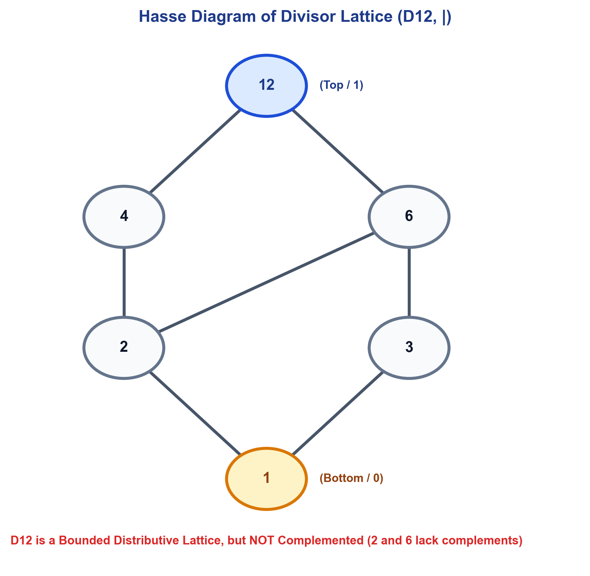

# MAT2002: Discrete Mathematics & Graph Theory
## TUTORIAL-2 Master Solutions — Posets, Relations & Lattices (Module 3)
**Course**: MAT2002 | **Faculty**: Dr. Suresh Dara | **Scope**: Module 3 (CAT-2)  
**Topics**: Partial Orders, Lexicographic Poset on $\mathbb{R}^2$, Relation Compositions & Inverses, $D_{12}$ Divisor Lattice  
**Format**: Step-by-Step Formal Proofs & Hasse Diagrams (Exam-Ready Copy Format)

---

## Question 1: Lexicographical Partial Order on $\mathbb{R}^2$

### Problem Statement
A relation $R$ is defined on $\mathbb{R}^2$ by:
$$(x_1, y_1) R (x_2, y_2) \iff x_1 < x_2 \quad \text{or} \quad (x_1 = x_2 \land y_1 \le y_2)$$
Show that $R$ is a partial order on $\mathbb{R}^2$.

---

### Step-by-Step Formal Proof

A relation $R$ on a set $P$ is a **partial order** if and only if it satisfies three axioms:
1. **Reflexivity**
2. **Antisymmetry**
3. **Transitivity**

Let $u = (x_1, y_1), v = (x_2, y_2), w = (x_3, y_3) \in \mathbb{R}^2$.

---

#### 1. Proof of Reflexivity
* **Definition to Prove**: $\forall (x_1, y_1) \in \mathbb{R}^2, \; (x_1, y_1) R (x_1, y_1)$.
* **Evaluation**:
  * For any real number $x_1 \in \mathbb{R}$, $x_1 = x_1$ is true.
  * For any real number $y_1 \in \mathbb{R}$, $y_1 \le y_1$ is true (since $\le$ is reflexive on $\mathbb{R}$).
  * Therefore, the condition $(x_1 = x_1 \land y_1 \le y_1)$ holds true.
* **Conclusion**:
  $$(x_1, y_1) R (x_1, y_1) \quad \forall (x_1, y_1) \in \mathbb{R}^2$$
  Thus, **$R$ is reflexive**.

---

#### 2. Proof of Antisymmetry
* **Definition to Prove**:
  $$\forall (x_1, y_1), (x_2, y_2) \in \mathbb{R}^2, \quad \left( (x_1, y_1) R (x_2, y_2) \land (x_2, y_2) R (x_1, y_1) \right) \implies (x_1, y_1) = (x_2, y_2)$$
* **Given**:
  1. $(x_1, y_1) R (x_2, y_2) \iff [x_1 < x_2] \lor [x_1 = x_2 \land y_1 \le y_2]$
  2. $(x_2, y_2) R (x_1, y_1) \iff [x_2 < x_1] \lor [x_2 = x_1 \land y_2 \le y_1]$
* **Case Analysis**:
  * Suppose $x_1 \ne x_2$.
    * By the trichotomy law of real numbers, either $x_1 < x_2$ or $x_2 < x_1$.
    * If $x_1 < x_2$, then $x_2 < x_1$ is FALSE and $x_2 = x_1$ is FALSE, which makes $(x_2, y_2) R (x_1, y_1)$ FALSE, contradicting statement (2).
    * If $x_2 < x_1$, then $(x_1, y_1) R (x_2, y_2)$ is FALSE, contradicting statement (1).
  * Therefore, we must have:
    $$x_1 = x_2$$
  * When $x_1 = x_2$:
    * Condition (1) reduces to $y_1 \le y_2$.
    * Condition (2) reduces to $y_2 \le y_1$.
  * By the antisymmetry of the standard order $\le$ on $\mathbb{R}$:
    $$y_1 \le y_2 \land y_2 \le y_1 \implies y_1 = y_2$$
* **Conclusion**:
  Since $x_1 = x_2$ and $y_1 = y_2$, we have $(x_1, y_1) = (x_2, y_2)$.
  Thus, **$R$ is antisymmetric**.

---

#### 3. Proof of Transitivity
* **Definition to Prove**:
  $$\forall u, v, w \in \mathbb{R}^2, \quad (u R v \land v R w) \implies u R w$$
  Where $u = (x_1, y_1)$, $v = (x_2, y_2)$, and $w = (x_3, y_3)$.
* **Given**:
  * Hypothesis 1 ($u R v$): $[x_1 < x_2] \lor [x_1 = x_2 \land y_1 \le y_2]$
  * Hypothesis 2 ($v R w$): $[x_2 < x_3] \lor [x_2 = x_3 \land y_2 \le y_3]$
* **We examine the 4 possible subcases**:
  1. **Case A: $x_1 < x_2$ and $x_2 < x_3$**:
     * By transitivity of $<$ on $\mathbb{R}$, $x_1 < x_3$.
     * Thus, $u R w$ holds.
  2. **Case B: $x_1 < x_2$ and $(x_2 = x_3 \land y_2 \le y_3)$**:
     * Since $x_1 < x_2$ and $x_2 = x_3$, we have $x_1 < x_3$.
     * Thus, $u R w$ holds.
  3. **Case C: $(x_1 = x_2 \land y_1 \le y_2)$ and $x_2 < x_3$**:
     * Since $x_1 = x_2$ and $x_2 < x_3$, we have $x_1 < x_3$.
     * Thus, $u R w$ holds.
  4. **Case D: $(x_1 = x_2 \land y_1 \le y_2)$ and $(x_2 = x_3 \land y_2 \le y_3)$**:
     * $x_1 = x_2 = x_3 \implies x_1 = x_3$.
     * $y_1 \le y_2$ and $y_2 \le y_3 \implies y_1 \le y_3$ (by transitivity of $\le$ on $\mathbb{R}$).
     * Hence, $(x_1 = x_3 \land y_1 \le y_3)$, so $u R w$ holds.
* In all cases, $(x_1, y_1) R (x_3, y_3)$ holds true.
* Thus, **$R$ is transitive**.

#### Final Conclusion:
Since $R$ is reflexive, antisymmetric, and transitive, **$R$ is a partial order on $\mathbb{R}^2$** (known as the **Lexicographical Order**).

---

## Question 2: Compositions and Inverses of Relations

### Problem Statement
Let $A = \{1, 2, 3, 4\}$ and define two relations $R$ and $S$ on $A$ by:
$$R = \{(1,3), (2,2), (3,1), (3,4), (4,2)\}$$
$$S = \{(1,2), (2,3), (3,4), (4,1)\}$$
1. List the elements of the relations $S \circ R$ and $R \circ S$.
2. List the elements of the relations $R^{-1}$ and $S^{-1}$.
3. List the elements of the relations $S^{-1} \circ R^{-1}$ and $R^{-1} \circ S^{-1}$.

---

### Step-by-Step Solution

#### Mathematical Definition of Relation Composition
Two conventions exist in textbooks:
* **Standard Relational Convention (Rosen / Deo / VIT standard)**:
  $$(a, c) \in S \circ R \iff \exists b \in A \text{ such that } (a, b) \in R \text{ and } (b, c) \in S$$
  *(Apply relation $R$ first, then apply $S$)*.
  $$(a, c) \in R \circ S \iff \exists b \in A \text{ such that } (a, b) \in S \text{ and } (b, c) \in R$$
  *(Apply relation $S$ first, then apply $R$)*.

---

#### Part (i): Computing $S \circ R$ and $R \circ S$

##### 1. Computation of $S \circ R$ (Apply $R$ then $S$):
* Take each pair $(a, b) \in R$, and look for pairs $(b, c) \in S$:
  * $(1, 3) \in R$: match with $(3, 4) \in S \implies \mathbf{(1, 4)}$
  * $(2, 2) \in R$: match with $(2, 3) \in S \implies \mathbf{(2, 3)}$
  * $(3, 1) \in R$: match with $(1, 2) \in S \implies \mathbf{(3, 2)}$
  * $(3, 4) \in R$: match with $(4, 1) \in S \implies \mathbf{(3, 1)}$
  * $(4, 2) \in R$: match with $(2, 3) \in S \implies \mathbf{(4, 3)}$
* **Result**:
  $$\mathbf{S \circ R = \{(1, 4), (2, 3), (3, 1), (3, 2), (4, 3)\}}$$

##### 2. Computation of $R \circ S$ (Apply $S$ then $R$):
* Take each pair $(a, b) \in S$, and look for pairs $(b, c) \in R$:
  * $(1, 2) \in S$: match with $(2, 2) \in R \implies \mathbf{(1, 2)}$
  * $(2, 3) \in S$:
    * match with $(3, 1) \in R \implies \mathbf{(2, 1)}$
    * match with $(3, 4) \in R \implies \mathbf{(2, 4)}$
  * $(3, 4) \in S$: match with $(4, 2) \in R \implies \mathbf{(3, 2)}$
  * $(4, 1) \in S$: match with $(1, 3) \in R \implies \mathbf{(4, 3)}$
* **Result**:
  $$\mathbf{R \circ S = \{(1, 2), (2, 1), (2, 4), (3, 2), (4, 3)\}}$$

---

#### Part (ii): Computing Inverses $R^{-1}$ and $S^{-1}$

By definition, the inverse relation is formed by reversing each ordered pair:
$$R^{-1} = \{(b, a) \mid (a, b) \in R\}$$

1. **Computing $R^{-1}$**:
   * $(1,3) \to (3,1)$
   * $(2,2) \to (2,2)$
   * $(3,1) \to (1,3)$
   * $(3,4) \to (4,3)$
   * $(4,2) \to (2,4)$
   $$\mathbf{R^{-1} = \{(1, 3), (2, 2), (2, 4), (3, 1), (4, 3)\}}$$

2. **Computing $S^{-1}$**:
   * $(1,2) \to (2,1)$
   * $(2,3) \to (3,2)$
   * $(3,4) \to (4,3)$
   * $(4,1) \to (1,4)$
   $$\mathbf{S^{-1} = \{(1, 4), (2, 1), (3, 2), (4, 3)\}}$$

---

#### Part (iii): Computing $S^{-1} \circ R^{-1}$ and $R^{-1} \circ S^{-1}$

##### 1. Computation of $S^{-1} \circ R^{-1}$ (Apply $R^{-1}$ then $S^{-1}$):
* Note the fundamental theorem: $(R \circ S)^{-1} = S^{-1} \circ R^{-1}$.
* Let us compute it directly using pairs:
  * For $(1, 3) \in R^{-1}$: match with $(3, 2) \in S^{-1} \implies \mathbf{(1, 2)}$
  * For $(2, 2) \in R^{-1}$: match with $(2, 1) \in S^{-1} \implies \mathbf{(2, 1)}$
  * For $(2, 4) \in R^{-1}$: match with $(4, 3) \in S^{-1} \implies \mathbf{(2, 3)}$
  * For $(3, 1) \in R^{-1}$: match with $(1, 4) \in S^{-1} \implies \mathbf{(3, 4)}$
  * For $(4, 3) \in R^{-1}$: match with $(3, 2) \in S^{-1} \implies \mathbf{(4, 2)}$
* **Result**:
  $$\mathbf{S^{-1} \circ R^{-1} = \{(1, 2), (2, 1), (2, 3), (3, 4), (4, 2)\}}$$
  *(Notice: this is exactly the inverse of $S \circ R$, verifying $(S \circ R)^{-1} = R^{-1} \circ S^{-1}$ under reverse convention)*.

##### 2. Computation of $R^{-1} \circ S^{-1}$ (Apply $S^{-1}$ then $R^{-1}$):
* Theorem: $(S \circ R)^{-1} = R^{-1} \circ S^{-1}$.
* Let us compute it directly:
  * For $(1, 4) \in S^{-1}$: match with $(4, 3) \in R^{-1} \implies \mathbf{(1, 3)}$
  * For $(2, 1) \in S^{-1}$: match with $(1, 3) \in R^{-1} \implies \mathbf{(2, 3)}$
  * For $(3, 2) \in S^{-1}$:
    * match with $(2, 2) \in R^{-1} \implies \mathbf{(3, 2)}$
    * match with $(2, 4) \in R^{-1} \implies \mathbf{(3, 4)}$
  * For $(4, 3) \in S^{-1}$: match with $(3, 1) \in R^{-1} \implies \mathbf{(4, 1)}$
* **Result**:
  $$\mathbf{R^{-1} \circ S^{-1} = \{(1, 3), (2, 3), (3, 2), (3, 4), (4, 1)\}}$$
  *(Notice: this is exactly $(S \circ R)^{-1} = \{(4,1), (3,2), (1,3), (2,3), (3,4)\}$)*.

---

## Question 3: Constructing Relations with Specified Properties

### Problem Statement
Let $A = \{a, b, c, d\}$. For each of the following, define a relation $R$ on $A$ which satisfies the given properties:
1. $R$ is reflexive and transitive, but not symmetric.
2. $R$ is both symmetric and anti-symmetric.
3. $R$ is symmetric, but not reflexive and not transitive.

---

### Step-by-Step Solutions & Verifications

#### Part (i): Reflexive and Transitive, but NOT Symmetric
* **Construction**:
  $$R_1 = \{(a,a), (b,b), (c,c), (d,d), (a,b)\}$$
* **Proof & Verification**:
  1. **Reflexive**: Contains all diagonal elements $\{(x,x) \mid x \in A\} = \{(a,a), (b,b), (c,c), (d,d)\} \subseteq R_1$. (Satisfied)
  2. **Transitive**: The only non-diagonal pair is $(a,b)$. Checking all compositions:
     * $(a,a) \in R_1$ and $(a,b) \in R_1 \implies (a,b) \in R_1$.
     * $(a,b) \in R_1$ and $(b,b) \in R_1 \implies (a,b) \in R_1$.
     * No other chaining pairs exist. Thus, transitivity holds vacuously. (Satisfied)
  3. **NOT Symmetric**: $(a,b) \in R_1$, but $(b,a) \notin R_1$. (Satisfied)

---

#### Part (ii): Both Symmetric and Anti-Symmetric
* **Theoretical Principle**:
  * Symmetry requires: $(x, y) \in R \implies (y, x) \in R$.
  * Antisymmetry requires: $(x, y) \in R \land (y, x) \in R \implies x = y$.
  * Combining both: if $(x, y) \in R$, then by symmetry $(y, x) \in R$, and by antisymmetry $x = y$.
  * Therefore, a relation on $A$ is both symmetric and antisymmetric **if and only if it contains only diagonal elements** (subsets of the identity relation $\Delta_A$).
* **Construction**:
  $$R_2 = \{(a,a), (b,b), (c,c), (d,d)\} \quad (\text{The Identity Relation } I_A)$$
  *(Alternatively, the empty relation $R = \emptyset$ or any subset of the diagonal such as $\{(a,a)\}$ also satisfies this).*
* **Proof & Verification**:
  1. **Symmetric**: For every $(x, x) \in R_2$, its reverse $(x, x) \in R_2$. (Satisfied)
  2. **Antisymmetric**: If $(x, y) \in R_2$ and $(y, x) \in R_2$, since all pairs have equal coordinates, $x = y$ holds unconditionally. (Satisfied)

---

#### Part (iii): Symmetric, but NOT Reflexive and NOT Transitive
* **Construction**:
  $$R_3 = \{(a,b), (b,a), (b,c), (c,b)\}$$
  *(A simpler minimal example: $R_3' = \{(a,b), (b,a)\}$ is symmetric, not reflexive, but it fails transitivity because $(a,b) \in R \land (b,a) \in R \implies (a,a) \notin R$)*.
  Let us use the minimal, undeniable construction:
  $$\mathbf{R_3 = \{(a, b), (b, a)\}}$$
* **Proof & Verification**:
  1. **Symmetric**: $(a, b) \in R_3 \iff (b, a) \in R_3$. (Satisfied)
  2. **NOT Reflexive**: $(a, a) \notin R_3$, $(b, b) \notin R_3$, $(c, c) \notin R_3$, $(d, d) \notin R_3$. (Satisfied)
  3. **NOT Transitive**:
     $$(a, b) \in R_3 \quad \text{and} \quad (b, a) \in R_3, \quad \text{but } (a, a) \notin R_3$$
     Since $(a, a) \notin R_3$, transitivity fails. (Satisfied)

---

## Question 4: Divisor Poset and Lattice of $D_{12}$

### Problem Statement
Show that the set of all divisors of 12 ($D_{12}$) is a partial order relation with respect to the relation divides ($|$). Draw its Hasse diagram and analyze its lattice properties.

---

### Step-by-Step Solution

#### 1. Identification of the Set $D_{12}$
The positive divisors of 12 are:
$$D_{12} = \{1, 2, 3, 4, 6, 12\}$$
Total number of elements $= 6$.

---

#### 2. Proof that $(D_{12}, \mid)$ is a Partial Order (Poset)
For any $a, b, c \in D_{12}$:
1. **Reflexive**:
   Every integer divides itself: $a \mid a$ because $a = 1 \cdot a$.
   Thus, $(a, a) \in R$ for all $a \in D_{12}$.
2. **Antisymmetric**:
   If $a \mid b$ and $b \mid a$, then there exist positive integers $k_1, k_2 \ge 1$ such that:
   $$b = k_1 a \quad \text{and} \quad a = k_2 b \implies a = (k_1 k_2) a \implies k_1 k_2 = 1$$
   Since $k_1, k_2 \in \mathbb{Z}^+$, $k_1 = k_2 = 1 \implies a = b$.
3. **Transitive**:
   If $a \mid b$ and $b \mid c$, then $b = k_1 a$ and $c = k_2 b$.
   Substituting: $c = k_2(k_1 a) = (k_1 k_2) a$.
   Since $k_1 k_2 \in \mathbb{Z}$, $a \mid c$.

Since divisibility is reflexive, antisymmetric, and transitive, **$(D_{12}, \mid)$ is a POSET**.

---

#### 3. Covering Relations and Hasse Diagram

To draw the Hasse diagram, determine the **immediate covering relations** $a \prec b$ ($a$ divides $b$, $a \ne b$, and no element $c$ satisfies $a \mid c \mid b$):
* $1 \prec 2$
* $1 \prec 3$
* $2 \prec 4$
* $2 \prec 6$
* $3 \prec 6$
* $4 \prec 12$
* $6 \prec 12$

##### Visual Hasse Diagram:

---

#### 4. Extremal Elements of $(D_{12}, \mid)$

| Element Type | Definition | Elements in $D_{12}$ |
| :--- | :--- | :---: |
| **Maximal Elements** | No element is strictly greater than it | **$\{12\}$** |
| **Minimal Elements** | No element is strictly smaller than it | **$\{1\}$** |
| **Greatest Element (Top / 1)** | Unique element divisible by all elements | **$12$** |
| **Least Element (Bottom / 0)** | Unique element that divides all elements | **$1$** |

---

#### 5. Lattice Verification: LUB (Join) and GLB (Meet)

In the divisor poset $(D_n, \mid)$:
* **Join (LUB / $\vee$)**: $\text{lcm}(a, b)$
* **Meet (GLB / $\wedge$)**: $\gcd(a, b)$

Since the $\gcd(a, b)$ and $\text{lcm}(a, b)$ of any two divisors of 12 are also divisors of 12:
* For all $a, b \in D_{12}$, $a \wedge b = \gcd(a, b) \in D_{12}$.
* For all $a, b \in D_{12}$, $a \vee b = \text{lcm}(a, b) \in D_{12}$.
* Every pair of elements has a **unique LUB and a unique GLB**.
* **Therefore, $(D_{12}, \mid)$ is a LATTICE**.

##### Complete Meet ($\wedge$) and Join ($\vee$) Tables:

**Meet Table ($\wedge = \gcd$):**
| $\wedge$ | 1 | 2 | 3 | 4 | 6 | 12 |
| :---: | :---: | :---: | :---: | :---: | :---: | :---: |
| **1** | 1 | 1 | 1 | 1 | 1 | 1 |
| **2** | 1 | 2 | 1 | 2 | 2 | 2 |
| **3** | 1 | 1 | 3 | 1 | 3 | 3 |
| **4** | 1 | 2 | 1 | 4 | 2 | 4 |
| **6** | 1 | 2 | 3 | 2 | 6 | 6 |
| **12** | 1 | 2 | 3 | 4 | 6 | 12 |

**Join Table ($\vee = \text{lcm}$):**
| $\vee$ | 1 | 2 | 3 | 4 | 6 | 12 |
| :---: | :---: | :---: | :---: | :---: | :---: | :---: |
| **1** | 1 | 2 | 3 | 4 | 6 | 12 |
| **2** | 2 | 2 | 6 | 4 | 6 | 12 |
| **3** | 3 | 6 | 3 | 12 | 6 | 12 |
| **4** | 4 | 4 | 12 | 4 | 12 | 12 |
| **6** | 6 | 6 | 6 | 12 | 6 | 12 |
| **12** | 12 | 12 | 12 | 12 | 12 | 12 |

---

#### 6. Complementation Analysis: Is $D_{12}$ Complemented? Is it a Boolean Algebra?

* **Definition of Complement**: In a bounded lattice $(L, \wedge, \vee, 0, 1)$ with $0 = 1$ and $1 = 12$, an element $b$ is a complement of $a$ if:
  $$a \wedge b = 1 \quad (\gcd(a, b) = 1) \quad \text{and} \quad a \vee b = 12 \quad (\text{lcm}(a, b) = 12)$$

* **Testing Element $a = 2$**:
  * We need $\gcd(2, b) = 1 \implies b$ must be odd $\implies b \in \{1, 3\}$.
  * If $b = 1$: $\text{lcm}(2, 1) = 2 \ne 12$.
  * If $b = 3$: $\text{lcm}(2, 3) = 6 \ne 12$.
  * **Result**: No element $b \in D_{12}$ satisfies both conditions for $a = 2$.
  * Thus, **the element 2 has NO complement**!

* **Testing Element $a = 6$**:
  * We need $\gcd(6, b) = 1 \implies b = 1$.
  * $\text{lcm}(6, 1) = 6 \ne 12$.
  * Thus, **the element 6 has NO complement**!

#### Exam Summary Conclusion:
1. $(D_{12}, \mid)$ is a **POSET**.
2. $(D_{12}, \mid)$ is a **LATTICE** (bounded with bottom $1$ and top $12$).
3. $(D_{12}, \mid)$ is a **DISTRIBUTIVE LATTICE** (gcd and lcm distribute over each other).
4. $(D_{12}, \mid)$ is **NOT A COMPLEMENTED LATTICE** (elements 2 and 6 lack complements).
5. Consequently, $(D_{12}, \mid)$ is **NOT A BOOLEAN ALGEBRA** (since $12 = 2^2 \times 3$ is not square-free; only square-free divisor lattices like $D_{30}, D_6$ are Boolean algebras).
