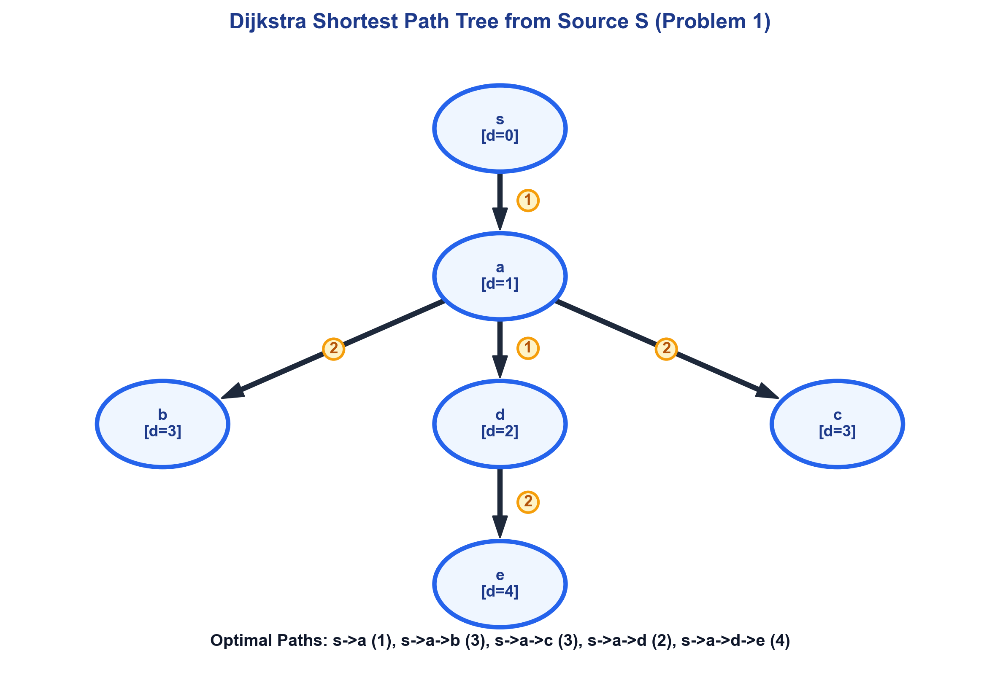
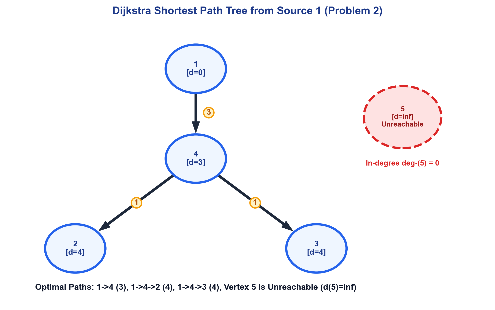

# MAT2002: Discrete Mathematics & Graph Theory
## TUTORIAL-4 Master Solutions — Shortest Path Algorithms (Module 4)
**Course**: MAT2002 | **Faculty**: Dr. Suresh Dara | **Scope**: Module 4 (CAT-2)  
**Method**: Dijkstra's Algorithm on Directed Weighted Graphs  
**Format**: Step-by-Step Iteration Tables & Shortest Path Trees (Exam-Ready Copy Format)

---

## Dijkstra's Shortest Path Algorithm: Mathematical Framework

### 1. Objective
Given a directed weighted graph $G = (V, E)$ with non-negative edge weights $w(u, v) \ge 0$, and a designated source vertex $s \in V$, find the shortest directed distance $d(s, v)$ and the corresponding shortest path from $s$ to every vertex $v \in V$.

### 2. Algorithmic State Variables
At every step of the algorithm:
* **Permanent Set $S$**: The set of vertices whose shortest distance from the source $s$ has been definitively determined.
* **Tentative Distance $d[v]$**: An upper bound on the shortest path distance from $s$ to $v$.
  * Initially: $d[s] = 0$, and $d[v] = \infty$ for all $v \ne s$.
* **Predecessor / Parent $\pi[v]$**: The immediate predecessor of vertex $v$ along the current shortest path from $s$.
* **Relaxation Step**: When a vertex $u \in V \setminus S$ with the minimum tentative label is added to $S$, for every outgoing directed edge $(u \to v) \in E$ where $v \notin S$:
  $$\text{If } d[u] + w(u, v) < d[v], \quad \text{then } d[v] \leftarrow d[u] + w(u, v), \quad \pi[v] \leftarrow u$$

---

## Problem 1: Dijkstra's Algorithm on 6-Vertex Directed Graph (Source $S$)

### Problem Statement
Find the shortest path from the vertex $S$ to all the other vertices using Dijkstra's algorithm.

---

### Step-by-Step Solution

#### 1. Graph Specification
* **Vertex Set**: $V = \{s, a, b, c, d, e\}$, Order $n = 6$.
* **Source Vertex**: $s$.
* **Directed Weighted Edges**:
  * Outgoing from $s$: $(s \to a) = 1, \; (s \to b) = 5$
  * Outgoing from $a$: $(a \to b) = 2, \; (a \to c) = 2, \; (a \to d) = 1$
  * Outgoing from $b$: $(b \to d) = 2$
  * Outgoing from $c$: $(c \to d) = 3, \; (c \to e) = 1$
  * Outgoing from $d$: $(d \to e) = 2$
  * Outgoing from $e$: None (Sink vertex)

---

#### 2. Complete Iteration-by-Iteration Execution Trace

##### Initial State (Iteration 0):
* Permanent Set: $S = \emptyset$
* Tentative Labels:
  $$d[s] = 0, \quad d[a] = \infty, \quad d[b] = \infty, \quad d[c] = \infty, \quad d[d] = \infty, \quad d[e] = \infty$$
* Predecessors: $\pi[v] = \text{NIL}$ for all $v$.

---

##### Iteration 1:
* **Select Vertex**: Find $u \in V \setminus S$ with $\min d[u]$:
  $$\min \{d[s]=0, d[a]=\infty, d[b]=\infty, d[c]=\infty, d[d]=\infty, d[e]=\infty\} \implies u = \mathbf{s}$$
* **Permanence**: Add $s$ to $S \implies S = \{s\}$. Final distance: $d[s] = 0$.
* **Relax Outgoing Edges from $s$**:
  * Edge $(s \to a)$, weight 1:
    $$d[a] = \min(\infty, d[s] + 1) = \min(\infty, 0 + 1) = \mathbf{1}, \quad \pi[a] = s$$
  * Edge $(s \to b)$, weight 5:
    $$d[b] = \min(\infty, d[s] + 5) = \min(\infty, 0 + 5) = \mathbf{5}, \quad \pi[b] = s$$
* **Tentative Status**: $a: [1, s], \quad b: [5, s], \quad c: [\infty, -], \quad d: [\infty, -], \quad e: [\infty, -]$

---

##### Iteration 2:
* **Select Vertex**: Find $u \in V \setminus S$ with $\min d[u]$:
  $$\min \{d[a]=1, d[b]=5, d[c]=\infty, d[d]=\infty, d[e]=\infty\} \implies u = \mathbf{a}$$
* **Permanence**: Add $a$ to $S \implies S = \{s, a\}$. Final distance: $d[a] = 1$.
* **Relax Outgoing Edges from $a$**:
  * Edge $(a \to b)$, weight 2:
    $$d[b] = \min(5, d[a] + 2) = \min(5, 1 + 2) = \mathbf{3}, \quad \pi[b] = a$$
  * Edge $(a \to c)$, weight 2:
    $$d[c] = \min(\infty, d[a] + 2) = \min(\infty, 1 + 2) = \mathbf{3}, \quad \pi[c] = a$$
  * Edge $(a \to d)$, weight 1:
    $$d[d] = \min(\infty, d[a] + 1) = \min(\infty, 1 + 1) = \mathbf{2}, \quad \pi[d] = a$$
* **Tentative Status**: $b: [3, a], \quad c: [3, a], \quad d: [2, a], \quad e: [\infty, -]$

---

##### Iteration 3:
* **Select Vertex**: Find $u \in V \setminus S$ with $\min d[u]$:
  $$\min \{d[b]=3, d[c]=3, d[d]=2, d[e]=\infty\} \implies u = \mathbf{d}$$
* **Permanence**: Add $d$ to $S \implies S = \{s, a, d\}$. Final distance: $d[d] = 2$.
* **Relax Outgoing Edges from $d$**:
  * Edge $(d \to e)$, weight 2:
    $$d[e] = \min(\infty, d[d] + 2) = \min(\infty, 2 + 2) = \mathbf{4}, \quad \pi[e] = d$$
* **Tentative Status**: $b: [3, a], \quad c: [3, a], \quad e: [4, d]$

---

##### Iteration 4:
* **Select Vertex**: Find $u \in V \setminus S$ with $\min d[u]$:
  $$\min \{d[b]=3, d[c]=3, d[e]=4\} \implies \text{Tie between } b \text{ and } c. \text{ Select } u = \mathbf{b}$$
* **Permanence**: Add $b$ to $S \implies S = \{s, a, d, b\}$. Final distance: $d[b] = 3$.
* **Relax Outgoing Edges from $b$**:
  * Edge $(b \to d)$, weight 2:
    * Note that $d \in S$ is already permanently labeled ($d[d] = 2$). Furthermore, $d[b] + 2 = 3 + 2 = 5 > 2$. No change.
* **Tentative Status**: $c: [3, a], \quad e: [4, d]$

---

##### Iteration 5:
* **Select Vertex**: Find $u \in V \setminus S$ with $\min d[u]$:
  $$\min \{d[c]=3, d[e]=4\} \implies u = \mathbf{c}$$
* **Permanence**: Add $c$ to $S \implies S = \{s, a, d, b, c\}$. Final distance: $d[c] = 3$.
* **Relax Outgoing Edges from $c$**:
  * Edge $(c \to d)$, weight 3:
    * $d \in S$; $d[c] + 3 = 3 + 3 = 6 > 2$. No change.
  * Edge $(c \to e)$, weight 1:
    $$d[e] = \min(4, d[c] + 1) = \min(4, 3 + 1) = \mathbf{4}$$
    *(Both paths $s \to a \to d \to e$ and $s \to a \to c \to e$ have equal cost 4; we can retain $\pi[e] = d$ or set $\pi[e] = c$).*
* **Tentative Status**: $e: [4, d]$ (or $[4, c]$)

---

##### Iteration 6:
* **Select Vertex**: $u = \mathbf{e}$ (last remaining vertex).
* **Permanence**: Add $e$ to $S \implies S = \{s, a, d, b, c, e\} = V$. Final distance: $d[e] = 4$.
* Outgoing edges from $e$: None.
* **Algorithm Terminates**.

---

#### 3. Master Dijkstra Trace Table (Format for Exam Copy)

| Iteration | Selected Vertex $u$ | Permanent Set $S$ | $d[s]$ | $d[a]$ | $d[b]$ | $d[c]$ | $d[d]$ | $d[e]$ |
| :---: | :---: | :---: | :---: | :---: | :---: | :---: | :---: | :---: |
| **0 (Init)** | — | $\emptyset$ | $\mathbf{0}$ | $\infty$ | $\infty$ | $\infty$ | $\infty$ | $\infty$ |
| **1** | $\mathbf{s}$ | $\{s\}$ | $\mathbf{0}$ | $1_{(s)}$ | $5_{(s)}$ | $\infty$ | $\infty$ | $\infty$ |
| **2** | $\mathbf{a}$ | $\{s, a\}$ | $\mathbf{0}$ | $\mathbf{1}_{(s)}$ | $3_{(a)}$ | $3_{(a)}$ | $2_{(a)}$ | $\infty$ |
| **3** | $\mathbf{d}$ | $\{s, a, d\}$ | $\mathbf{0}$ | $\mathbf{1}_{(s)}$ | $3_{(a)}$ | $3_{(a)}$ | $\mathbf{2}_{(a)}$ | $4_{(d)}$ |
| **4** | $\mathbf{b}$ | $\{s, a, d, b\}$ | $\mathbf{0}$ | $\mathbf{1}_{(s)}$ | $\mathbf{3}_{(a)}$ | $3_{(a)}$ | $\mathbf{2}_{(a)}$ | $4_{(d)}$ |
| **5** | $\mathbf{c}$ | $\{s, a, d, b, c\}$ | $\mathbf{0}$ | $\mathbf{1}_{(s)}$ | $\mathbf{3}_{(a)}$ | $\mathbf{3}_{(a)}$ | $\mathbf{2}_{(a)}$ | $4_{(d)}$ |
| **6** | $\mathbf{e}$ | $\{s, a, d, b, c, e\}$ | $\mathbf{0}$ | $\mathbf{1}_{(s)}$ | $\mathbf{3}_{(a)}$ | $\mathbf{3}_{(a)}$ | $\mathbf{2}_{(a)}$ | $\mathbf{4}_{(d)}$ |

*(Subscripts indicate the predecessor vertex $\pi[v]$)*.

---

#### 4. Final Shortest Paths and Distances from Source $S$

| Destination Vertex | Shortest Distance | Shortest Path Sequence | Edge Weight Breakdown |
| :---: | :---: | :--- | :--- |
| **$s$** | **0** | $s$ | $0$ |
| **$a$** | **1** | $s \to a$ | $1$ |
| **$b$** | **3** | $s \to a \to b$ | $1 + 2 = 3$ |
| **$c$** | **3** | $s \to a \to c$ | $1 + 2 = 3$ |
| **$d$** | **2** | $s \to a \to d$ | $1 + 1 = 2$ |
| **$e$** | **4** | $s \to a \to d \to e$ *(or $s \to a \to c \to e$)* | $1 + 1 + 2 = 4$ |

#### 5. Shortest Path Tree Representation

---

## Problem 2: Dijkstra's Algorithm on 5-Vertex Directed Graph (Source $1$)

### Problem Statement
Find the shortest path from the vertex $1$ to all the other vertices using Dijkstra's algorithm.

---

### Step-by-Step Solution

#### 1. Graph Specification
* **Vertex Set**: $V = \{1, 2, 3, 4, 5\}$, Order $n = 5$.
* **Source Vertex**: $1$.
* **Directed Weighted Edges**:
  * Outgoing from $1$: $(1 \to 4) = 3, \; (1 \to 3) = 6$
  * Outgoing from $2$: $(2 \to 1) = 3$
  * Outgoing from $3$: $(3 \to 4) = 2$
  * Outgoing from $4$: $(4 \to 2) = 1, \; (4 \to 3) = 1$
  * Outgoing from $5$: $(5 \to 2) = 4, \; (5 \to 4) = 2$
* **Critical Topological Observation**:
  * Vertex $5$ has **in-degree zero** ($\deg^-(5) = 0$). There is no incoming directed edge into vertex $5$ from any other vertex.
  * Consequently, vertex $5$ cannot be reached from vertex $1$. Its distance will strictly remain **$\infty$**.

---

#### 2. Complete Iteration-by-Iteration Execution Trace

##### Initial State (Iteration 0):
* Permanent Set: $S = \emptyset$
* Tentative Labels:
  $$d[1] = 0, \quad d[2] = \infty, \quad d[3] = \infty, \quad d[4] = \infty, \quad d[5] = \infty$$

---

##### Iteration 1:
* **Select Vertex**: Find $u \in V \setminus S$ with $\min d[u]$:
  $$\min \{d[1]=0, d[2]=\infty, d[3]=\infty, d[4]=\infty, d[5]=\infty\} \implies u = \mathbf{1}$$
* **Permanence**: Add $1$ to $S \implies S = \{1\}$. Final distance: $d[1] = 0$.
* **Relax Outgoing Edges from $1$**:
  * Edge $(1 \to 4)$, weight 3:
    $$d[4] = \min(\infty, d[1] + 3) = \min(\infty, 0 + 3) = \mathbf{3}, \quad \pi[4] = 1$$
  * Edge $(1 \to 3)$, weight 6:
    $$d[3] = \min(\infty, d[1] + 6) = \min(\infty, 0 + 6) = \mathbf{6}, \quad \pi[3] = 1$$
* **Tentative Status**: $2: [\infty, -], \quad 3: [6, 1], \quad 4: [3, 1], \quad 5: [\infty, -]$

---

##### Iteration 2:
* **Select Vertex**: Find $u \in V \setminus S$ with $\min d[u]$:
  $$\min \{d[2]=\infty, d[3]=6, d[4]=3, d[5]=\infty\} \implies u = \mathbf{4}$$
* **Permanence**: Add $4$ to $S \implies S = \{1, 4\}$. Final distance: $d[4] = 3$.
* **Relax Outgoing Edges from $4$**:
  * Edge $(4 \to 2)$, weight 1:
    $$d[2] = \min(\infty, d[4] + 1) = \min(\infty, 3 + 1) = \mathbf{4}, \quad \pi[2] = 4$$
  * Edge $(4 \to 3)$, weight 1:
    $$d[3] = \min(6, d[4] + 1) = \min(6, 3 + 1) = \mathbf{4}, \quad \pi[3] = 4$$
* **Tentative Status**: $2: [4, 4], \quad 3: [4, 4], \quad 5: [\infty, -]$

---

##### Iteration 3:
* **Select Vertex**: Find $u \in V \setminus S$ with $\min d[u]$:
  $$\min \{d[2]=4, d[3]=4, d[5]=\infty\} \implies \text{Tie between } 2 \text{ and } 3. \text{ Select } u = \mathbf{2}$$
* **Permanence**: Add $2$ to $S \implies S = \{1, 4, 2\}$. Final distance: $d[2] = 4$.
* **Relax Outgoing Edges from $2$**:
  * Edge $(2 \to 1)$, weight 3:
    * Vertex $1 \in S$ (already permanent, $d[1] = 0$).
    * Furthermore, $d[2] + 3 = 4 + 3 = 7 > 0$. No change.
* **Tentative Status**: $3: [4, 4], \quad 5: [\infty, -]$

---

##### Iteration 4:
* **Select Vertex**: Find $u \in V \setminus S$ with $\min d[u]$:
  $$\min \{d[3]=4, d[5]=\infty\} \implies u = \mathbf{3}$$
* **Permanence**: Add $3$ to $S \implies S = \{1, 4, 2, 3\}$. Final distance: $d[3] = 4$.
* **Relax Outgoing Edges from $3$**:
  * Edge $(3 \to 4)$, weight 2:
    * Vertex $4 \in S$ (already permanent, $d[4] = 3$).
    * $d[3] + 2 = 4 + 2 = 6 > 3$. No change.
* **Tentative Status**: $5: [\infty, -]$

---

##### Iteration 5:
* **Select Vertex**: Remaining vertex in $V \setminus S$ is $u = \mathbf{5}$ with $d[5] = \infty$.
* **Permanence**: Add $5$ to $S \implies S = \{1, 4, 2, 3, 5\} = V$. Final distance: $d[5] = \mathbf{\infty}$.
* **Algorithm Terminates**.

---

#### 3. Master Dijkstra Trace Table (Format for Exam Copy)

| Iteration | Selected Vertex $u$ | Permanent Set $S$ | $d[1]$ | $d[2]$ | $d[3]$ | $d[4]$ | $d[5]$ |
| :---: | :---: | :---: | :---: | :---: | :---: | :---: | :---: |
| **0 (Init)** | — | $\emptyset$ | $\mathbf{0}$ | $\infty$ | $\infty$ | $\infty$ | $\infty$ |
| **1** | $\mathbf{1}$ | $\{1\}$ | $\mathbf{0}$ | $\infty$ | $6_{(1)}$ | $3_{(1)}$ | $\infty$ |
| **2** | $\mathbf{4}$ | $\{1, 4\}$ | $\mathbf{0}$ | $4_{(4)}$ | $4_{(4)}$ | $\mathbf{3}_{(1)}$ | $\infty$ |
| **3** | $\mathbf{2}$ | $\{1, 4, 2\}$ | $\mathbf{0}$ | $\mathbf{4}_{(4)}$ | $4_{(4)}$ | $\mathbf{3}_{(1)}$ | $\infty$ |
| **4** | $\mathbf{3}$ | $\{1, 4, 2, 3\}$ | $\mathbf{0}$ | $\mathbf{4}_{(4)}$ | $\mathbf{4}_{(4)}$ | $\mathbf{3}_{(1)}$ | $\infty$ |
| **5** | $\mathbf{5}$ | $\{1, 4, 2, 3, 5\}$ | $\mathbf{0}$ | $\mathbf{4}_{(4)}$ | $\mathbf{4}_{(4)}$ | $\mathbf{3}_{(1)}$ | $\mathbf{\infty}$ |

*(Subscripts indicate predecessor $\pi[v]$)*.

---

#### 4. Final Shortest Paths and Distances from Source $1$

| Destination Vertex | Shortest Distance | Shortest Path Sequence | Edge Weight Breakdown | Status |
| :---: | :---: | :--- | :--- | :---: |
| **$1$** | **0** | $1$ | $0$ | Source |
| **$2$** | **4** | $1 \to 4 \to 2$ | $3 + 1 = 4$ | Reached |
| **$3$** | **4** | $1 \to 4 \to 3$ | $3 + 1 = 4$ | Reached |
| **$4$** | **3** | $1 \to 4$ | $3$ | Reached |
| **$5$** | **$\infty$** | **No path exists** | N/A | **Unreachable** |

#### 5. Shortest Path Tree Representation

> **Exam Note on Vertex 5**:
> State clearly in your answer script: "Since vertex 5 has in-degree $\deg^-(5) = 0$, there are no directed edges entering vertex 5 from any vertex in the graph. Therefore, vertex 5 is unreachable from the source vertex 1, and its shortest distance is strictly $\infty$."
