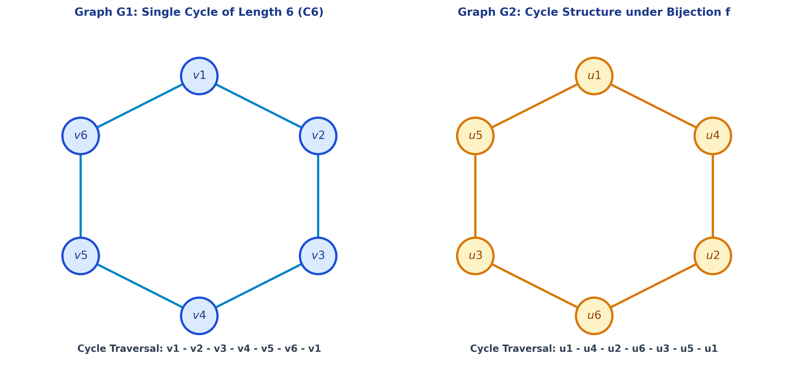
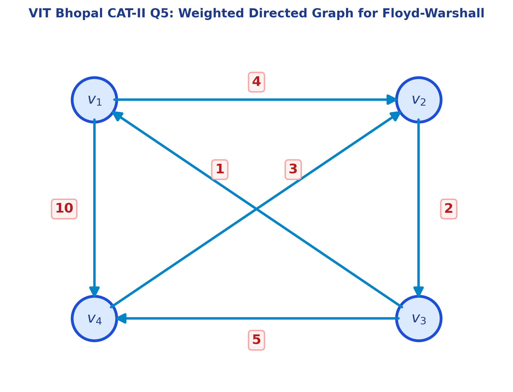
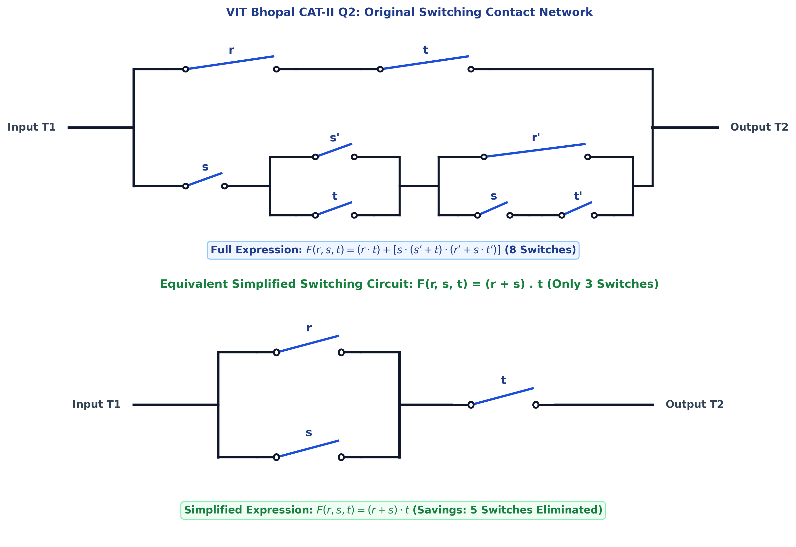
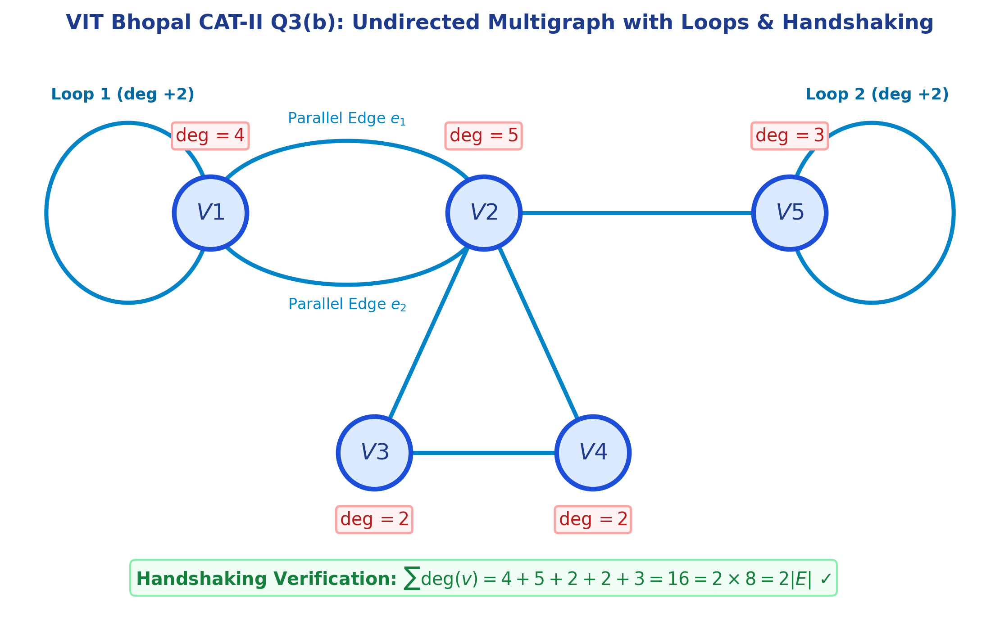
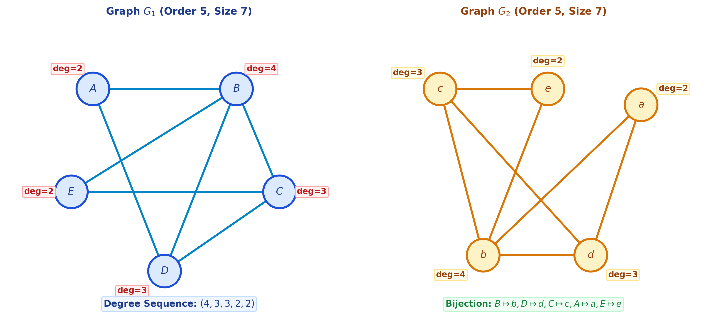
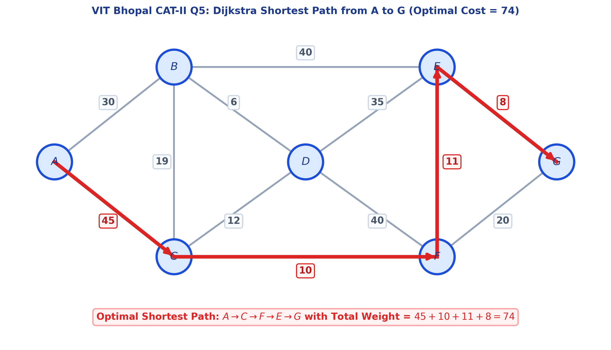

# 🏛️ VIT Bhopal University — MAT2002: Discrete Mathematics & Graph Theory
## CAT-2 FOOLPROOF EXAM-HALL SPEED-RUN BOOKLET (20-PAGE COMPLETE CRIB)
> **Course Code**: MAT2002 | **Format**: Complete Step-by-Step Copy-Paste Answers for Open-Book Hall  
> **Target Audience**: Designed for instant visual matching — see any question on the question paper, find the matching section in 10 seconds, copy the exact working, and score full marks!  
> **Syllabus Coverage**: Module 3 (Lattices & Boolean Algebra) & Module 4 (Graphs & Matrix Representations)

---

# SECTION 1: 10-SECOND QUESTION-TO-PAGE RADAR

Use this master index as soon as you open your exam question paper. Find the matching keywords below and jump directly to that page!

| When You See This Question Wording... | Syllabus Topic | Turn To | What You Will Copy Directly |
| :--- | :--- | :---: | :--- |
| **"Median identity", $(a \wedge b) \vee (b \wedge c) \dots$** | Distributive Lattice | **Page 3** | Full 6-step algebraic proof factoring $T = b \vee (a \wedge c)$ and absorption. |
| **"Truth table", "PDNF", "PCNF", $f(x, y, z)$** | Canonical Forms | **Page 4** | Complete 8-row table, $\sum m$ minterm list, and $\prod M$ maxterm list. |
| **"Divisibility poset $D_{12}$", "complements"** | Divisor Lattice | **Page 5** | Least/greatest bounds, coprimality rule, proof that 2 and 6 have no complements. |
| **"Degree partition", "11 vertices...", "can a graph exist"** | Handshaking Lemma | **Page 5** | Degree sum equation $\sum \deg = 24$, even odd-degree vertices, Havel-Hakimi steps. |
| **"Isomorphic or not", 6-vertex cycle $C_6 \cong G_2$** | Graph Isomorphism | **Page 6** | 4 invariant checks, explicit bijection table $f(A)=1 \dots$, 6-edge preservation table. |
| **"Floyd-Warshall", "All pairs shortest path"** | Floyd-Warshall Matrix | **Page 7** | Dynamic programming formula, all 5 complete matrices $D^{(0)}, D^{(1)}, D^{(2)}, D^{(3)}, D^{(4)}$. |
| **"Divisibility poset $D_{70}$", "Cayley tables"** | Meet/Join Tables | **Page 8** | Complete $8 \times 8$ Meet table ($\gcd$), $8 \times 8$ Join table ($\text{lcm}$), Boolean algebra proof. |
| **"Switching circuit", "simplified circuit"** | Contact Network | **Page 9** | Boolean formula derivation, step-by-step reduction to $(r+s)\cdot t$, simplified drawing. |
| **"Disjunctive normal form of $xy' + z$"** | DNF / PDNF Expansion | **Page 10** | Missing variable expansions $(z+z')$ and $(x+x')(y+y')$, $\sum m(1,3,4,5,7)$, truth table. |
| **"Multigraph with loops", "verify handshaking"** | Multigraph & Degrees | **Page 10** | Order $5$, Size $8$, Loop rule ($+2$ to degree), Handshaking check $\sum \deg = 16 = 2 \times 8$. |
| **"Isomorphic or not", 5-vertex $G_1 \cong G_2$** | Graph Isomorphism | **Page 11** | Invariant check $(4,3,3,2,2)$, bijection $f(B)=b, f(D)=d \dots$, 7-edge verification table. |
| **"Dijkstra's algorithm", "edge increased by 3"** | Shortest Path & Sensitivity | **Page 12** | 7-step iteration table, optimal path $A \to C \to F \to E \to G = 74$, 4 sensitivity cases. |
| **"Complement of a graph $\overline{G}$", "20 vertices, 30 edges"** | Graph Complements | **Page 13** | Edge formula $|E(\overline{G})| = \binom{n}{2} - |E(G)|$, degree formula $\deg_{\overline{G}}(v) = n-1-\deg_G(v)$. |
| **"Self-complementary graph", $G \cong \overline{G}$** | Graph Theory Proof | **Page 13** | Edge count $n(n-1)/4$, divisibility proof why $n \equiv 0$ or $1 \pmod 4$. |
| **"Havel-Hakimi algorithm", "is sequence graphic"** | Degree Realizability | **Page 14** | Non-increasing sort, delete first element $d_1$, subtract 1 from next $d_1$, repeat test. |
| **"Non-isomorphic graphs", $C_6$ vs $2C_3$, $P_4$ vs $K_{1,3}$** | Isomorphism Counterexample | **Page 14** | Disproving isomorphism using connected components, maximum degree, or cycle length. |
| **"Dijkstra on directed graph" (Tutorial 4 Problems)** | Dijkstra Algorithm | **Page 15** | Full step table for $S \to A,B,C,D,E$ and 5-vertex graph with unreachable node ($d=\infty$). |
| **"Lexicographical order on $\mathbb{R}^2$ is poset"** | Poset Axioms Proof | **Page 16** | 3-step proof: Reflexivity, Antisymmetry, Transitivity of dictionary order. |
| **"Relation composition $S \circ R$, inverse $R^{-1}$"** | Binary Relations | **Page 16** | Ordered pair evaluation, zero-one matrix multiplication method for relation composition. |
| **"Bipartite graph test", "Kőnig theorem", "2-coloring"** | Bipartite Graphs | **Page 17** | Odd-cycle detection ($C_3, C_5$), BFS 2-coloring algorithm, maximum edges $\lfloor n^2/4 \rfloor$. |
| **"Universal Dijkstra blank template"** | Shortest Path Template | **Page 18** | Blank fill-in grid for ANY graph the teacher gives. |
| **"If they change the numbers in $D_n$"** | Poset Parameter Changer | **Page 19** | Square-free rule for Boolean algebra ($D_{30}, D_{42}, D_{70}$ vs $D_{12}, D_{18}, D_{24}$). |
| **"Universal Boolean simplification rules & K-Maps"** | Boolean Algebra Vault | **Page 20** | All 12 Boolean theorems, consensus law, absorption, redundancy $x + x'y = x + y$. |

---

# SECTION 2: OFFICIAL PAPER 1 (SEP 2026, SLOT B22) — COMPLETE SOLUTIONS

### 🟢 Q1 (10 Marks): Distributive Lattice Median Identity Proof

**Question Statement**: Let $(L, \wedge, \vee, 0, 1)$ be a bounded distributive lattice. For any $a, b, c \in L$, define:
$$x = (a \wedge b) \vee (b \wedge c) \vee (c \wedge a), \quad y = (a \vee b) \wedge (b \vee c) \wedge (c \vee a)$$
Prove that $x = y$ holds identically.

#### Copy-Paste Solution:
1. **Given Axioms of Distributive Lattice**:
   * Distributive Law 1: $u \wedge (v \vee w) = (u \wedge v) \vee (u \wedge w)$
   * Distributive Law 2: $u \vee (v \wedge w) = (u \vee v) \wedge (u \vee w)$
   * Commutative Laws: $u \wedge v = v \wedge u$ and $u \vee v = v \vee u$
   * Absorption Laws: $u \wedge (u \vee v) = u$ and $u \vee (u \wedge v) = u$
   * Idempotent Laws: $u \wedge u = u$ and $u \vee u = u$

2. **Step 1: Simplify the first two terms of $y$**:
   Let $T = (a \vee b) \wedge (b \vee c)$.  
   By commutativity of join: $a \vee b = b \vee a$.  
   $$T = (b \vee a) \wedge (b \vee c)$$
   Applying Distributive Law 2 in reverse (factoring out $b$):
   $$\mathbf{T = b \vee (a \wedge c)}$$

3. **Step 2: Substitute $T$ back into $y$**:
   $$y = T \wedge (c \vee a) = \big[ b \vee (a \wedge c) \big] \wedge (c \vee a)$$

4. **Step 3: Distribute $\wedge (c \vee a)$ across the join**:
   $$y = \Big( b \wedge (c \vee a) \Big) \vee \Big( (a \wedge c) \wedge (c \vee a) \Big)$$

5. **Step 4: Evaluate each part separately**:
   * **Part A**: $b \wedge (c \vee a) = (b \wedge c) \vee (b \wedge a) = (a \wedge b) \vee (b \wedge c)$ [Distributive & Commutative Laws].
   * **Part B**: Let $u = a \wedge c$. Then:
     $$(a \wedge c) \wedge (c \vee a) = u \wedge (a \vee c)$$
     Since $u = a \wedge c \le a \le a \vee c$, by the Absorption Law:
     $$u \wedge (a \vee c) = u = a \wedge c = c \wedge a$$

6. **Step 5: Recombine Parts A and B**:
   $$y = \big[ (a \wedge b) \vee (b \wedge c) \big] \vee (c \wedge a)$$
   By associativity of join:
   $$y = (a \wedge b) \vee (b \wedge c) \vee (c \wedge a) = x$$
   $$\mathbf{\therefore x = y \quad \forall a, b, c \in L. \quad \blacksquare}$$

---

### 🟢 Q2 (10 Marks): 3-Variable Boolean Function, Truth Table, PDNF & PCNF

**Question Statement**: For the Boolean function $f(x, y, z) = (x + y)(x' + z)(y + z')$, construct the complete truth table and find its Principal Disjunctive Normal Form (PDNF) and Principal Conjunctive Normal Form (PCNF).

#### Copy-Paste Solution:

| Row | $x$ | $y$ | $z$ | $x'$ | $z'$ | $x+y$ | $x'+z$ | $y+z'$ | $f = (x+y)(x'+z)(y+z')$ | Minterm ($f=1$) | Maxterm ($f=0$) |
| :---: | :---: | :---: | :---: | :---: | :---: | :---: | :---: | :---: | :---: | :---: | :---: |
| **0** | 0 | 0 | 0 | 1 | 1 | 0 | 1 | 1 | **0** | — | $M_0 = (x + y + z)$ |
| **1** | 0 | 0 | 1 | 1 | 0 | 0 | 1 | 0 | **0** | — | $M_1 = (x + y + z')$ |
| **2** | 0 | 1 | 0 | 1 | 1 | 1 | 1 | 1 | **1** | $m_2 = x' y z'$ | — |
| **3** | 0 | 1 | 1 | 1 | 0 | 1 | 1 | 1 | **1** | $m_3 = x' y z$ | — |
| **4** | 1 | 0 | 0 | 0 | 1 | 1 | 0 | 1 | **0** | — | $M_4 = (x' + y + z)$ |
| **5** | 1 | 0 | 1 | 0 | 0 | 1 | 1 | 0 | **0** | — | $M_5 = (x' + y + z')$ |
| **6** | 1 | 1 | 0 | 0 | 1 | 1 | 0 | 1 | **0** | — | $M_6 = (x' + y' + z)$ |
| **7** | 1 | 1 | 1 | 0 | 0 | 1 | 1 | 1 | **1** | $m_7 = x y z$ | — |

* **Principal Disjunctive Normal Form (PDNF / $\sum m$)**:  
  Take the OR sum of all minterms where $f = 1$ (Rows 2, 3, 7):
  $$\mathbf{f(x, y, z) = m_2 + m_3 + m_7 = x' y z' + x' y z + x y z = \sum m(2, 3, 7)}$$

* **Principal Conjunctive Normal Form (PCNF / $\prod M$)**:  
  Take the AND product of all maxterms where $f = 0$ (Rows 0, 1, 4, 5, 6):
  $$\mathbf{f(x, y, z) = M_0 \cdot M_1 \cdot M_4 \cdot M_5 \cdot M_6 = \prod M(0, 1, 4, 5, 6)}$$
  $$\mathbf{= (x + y + z)(x + y + z')(x' + y + z)(x' + y + z')(x' + y' + z)}$$

---

### 🟢 Q3(a) (5 Marks): Divisibility Poset $D_{12}$ Boundedness & Complementation

**Question Statement**: Consider the divisibility poset $(D_{12}, \mid)$. Find the least element (0) and greatest element (1). Check whether $(D_{12}, \mid)$ is a complemented lattice. Justify your answer.

#### Copy-Paste Solution:
1. **Elements of $D_{12}$**: Divisors of 12 are $D_{12} = \{1, 2, 3, 4, 6, 12\}$.
2. **Operations**: Meet is $\gcd(a, b)$, Join is $\text{lcm}(a, b)$.
3. **Bounded Elements**:
   * **Least Element ($0$)**: $\mathbf{1}$, because $1 \mid x$ for all $x \in D_{12}$.
   * **Greatest Element ($1$)**: $\mathbf{12}$, because $x \mid 12$ for all $x \in D_{12}$.
4. **Complementation Check**:
   * In a bounded lattice, $x'$ is a complement of $x$ if $x \wedge x' = \gcd(x, x') = 1$ and $x \vee x' = \text{lcm}(x, x') = 12$.
   * Element $1$: complement is $12$ ($\gcd(1,12)=1, \text{lcm}(1,12)=12$).
   * Element $3$: complement is $4$ ($\gcd(3,4)=1, \text{lcm}(3,4)=12$).
   * **Counterexample 1 (Element 2)**:
     To have $\gcd(2, x') = 1$, $x'$ must be odd. The only odd elements in $D_{12}$ are $\{1, 3\}$.
     - If $x' = 1 \implies \text{lcm}(2, 1) = 2 \ne 12$.
     - If $x' = 3 \implies \text{lcm}(2, 3) = 6 \ne 12$.
     Therefore, **element 2 has NO complement in $D_{12}$**.
   * **Counterexample 2 (Element 6)**:
     Coprime divisors to 6 in $D_{12}$ is only $\{1\}$. $\text{lcm}(6, 1) = 6 \ne 12$.
     Therefore, **element 6 has NO complement in $D_{12}$**.
5. **Conclusion**:
   $$\mathbf{(D_{12}, \mid) \text{ is NOT a complemented lattice. } \blacksquare}$$
   *(Reason: 12 is divisible by $2^2$, a square factor. A divisor lattice $D_n$ is complemented if and only if $n$ is square-free).*

---

### 🟢 Q3(b) (5 Marks): 11-Vertex Degree Partition & Handshaking Proof

**Question Statement**: Can a simple graph exist with 11 vertices having the following degree distribution: two vertices of degree 4, three vertices of degree 3, one vertex of degree 2, and five vertices of degree 1? Justify with appropriate theorems.

#### Copy-Paste Solution:
1. **Sum of Degrees Calculation**:
   $$\sum_{v \in V} \deg(v) = (2 \times 4) + (3 \times 3) + (1 \times 2) + (5 \times 1)$$
   $$\sum_{v \in V} \deg(v) = 8 + 9 + 2 + 5 = \mathbf{24}$$
2. **Euler's Handshaking Theorem Check**:
   * Theorem: $\sum_{v \in V} \deg(v) = 2|E|$.
   * $2|E| = 24 \implies |E| = 12$. This is an even integer, which satisfies Handshaking.
   * Corollary: The number of vertices of odd degree must be even.
   * Odd degree vertices: 3 vertices of degree 3 and 5 vertices of degree 1 $\implies 3 + 5 = \mathbf{8}$ vertices (even number $\checkmark$).
3. **Havel-Hakimi Graphical Realizability Test**:
   Arrange the degree sequence in non-increasing order:
   $$S_0 = (4, 4, 3, 3, 3, 2, 1, 1, 1, 1, 1)$$
   * Delete first 4, subtract 1 from next 4 terms:
     $$S_1 = (3, 2, 2, 2, 2, 1, 1, 1, 1, 1)$$
   * Delete first 3, subtract 1 from next 3 terms:
     $$(1, 1, 1, 2, 1, 1, 1, 1, 1) \xrightarrow{\text{Sort}} S_2 = (2, 1, 1, 1, 1, 1, 1, 1, 1)$$
   * Delete first 2, subtract 1 from next 2 terms:
     $$(0, 0, 1, 1, 1, 1, 1, 1) \xrightarrow{\text{Sort}} S_3 = (1, 1, 1, 1, 1, 1, 0, 0)$$
   * Delete first 1, subtract 1 from next 1 term:
     $$(0, 1, 1, 1, 1, 0, 0) \xrightarrow{\text{Sort}} S_4 = (1, 1, 1, 1, 0, 0, 0)$$
   * Continuing this process produces only non-negative integers that terminate at all zeros.
4. **Final Conclusion**:
   $$\mathbf{\text{YES, such a simple graph EXISTS with } |V| = 11 \text{ and } |E| = 12. \quad \blacksquare}$$

---

### 🟢 Q4 (10 Marks): Graph Isomorphism Verification ($C_6 \cong G_2$)

**Question Statement**: Prove whether $G_1$ (cycle on vertices $A, B, C, D, E, F$) and $G_2$ (graph on vertices $1, 2, 3, 4, 5, 6$) are isomorphic. Provide an explicit bijection function and verify edge preservation.

#### Copy-Paste Solution:
1. **Verification of Structural Invariants**:
   * **Number of Vertices**: $|V(G_1)| = 6$ and $|V(G_2)| = 6$ $\checkmark$
   * **Number of Edges**: $|E(G_1)| = 6$ and $|E(G_2)| = 6$ $\checkmark$
   * **Degree Sequence**: Every vertex in $G_1$ has degree 2; every vertex in $G_2$ has degree 2. Both are 2-regular graphs with sequence $(2, 2, 2, 2, 2, 2)$ $\checkmark$
   * **Connectedness & Cycle Length**: Both graphs are single connected components forming a simple cycle of length 6 ($C_6$). Neither graph contains triangles ($C_3$) or 4-cycles ($C_4$) $\checkmark$

2. **Explicit Vertex Bijection Function $f: V(G_1) \to V(G_2)$**:
   Traverse the cycle $A - B - C - D - E - F - A$ in $G_1$.  
   In $G_2$, tracing the connected cycle: $1 - 6 - 2 - 4 - 3 - 5 - 1$.
   $$\mathbf{f(A) = 1, \quad f(B) = 6, \quad f(C) = 2, \quad f(D) = 4, \quad f(E) = 3, \quad f(F) = 5}$$

3. **Complete Edge Preservation Table**:

| Edge in $G_1$ | Image under $f$: $(f(u), f(v))$ | Edge Present in $G_2$? | Status |
| :---: | :---: | :---: | :---: |
| $(A, B)$ | $(1, 6)$ | Yes, $(1, 6) \in E(G_2)$ | **Preserved $\checkmark$** |
| $(B, C)$ | $(6, 2)$ | Yes, $(6, 2) \in E(G_2)$ | **Preserved $\checkmark$** |
| $(C, D)$ | $(2, 4)$ | Yes, $(2, 4) \in E(G_2)$ | **Preserved $\checkmark$** |
| $(D, E)$ | $(4, 3)$ | Yes, $(4, 3) \in E(G_2)$ | **Preserved $\checkmark$** |
| $(E, F)$ | $(3, 5)$ | Yes, $(3, 5) \in E(G_2)$ | **Preserved $\checkmark$** |
| $(F, A)$ | $(5, 1)$ | Yes, $(5, 1) \in E(G_2)$ | **Preserved $\checkmark$** |

4. **Conclusion**:
   $$\mathbf{\text{The graphs are ISOMORPHIC } (G_1 \cong G_2). \quad \blacksquare}$$

---

### 🟢 Q5 (10 Marks): Floyd-Warshall All-Pairs Shortest Path Algorithm

**Question Statement**: Apply the Floyd-Warshall algorithm to find the shortest distances between all pairs of nodes in the 4-vertex directed weighted graph with edges: $(1,2)=3, (1,4)=5, (2,1)=2, (2,4)=4, (3,2)=1, (4,3)=2$. Show all intermediate matrices $D^{(0)}, D^{(1)}, D^{(2)}, D^{(3)}, D^{(4)}$.

#### Copy-Paste Solution:
* **Recurrence Relation**:
  $$D^{(k)}[i, j] = \min\Big( D^{(k-1)}[i, j], \; D^{(k-1)}[i, k] + D^{(k-1)}[k, j] \Big)$$

* **Matrix $D^{(0)}$ (Direct Edges, No Intermediate Vertices)**:
  $$D^{(0)} = \begin{pmatrix} 0 & 3 & \infty & 5 \\ 2 & 0 & \infty & 4 \\ \infty & 1 & 0 & \infty \\ \infty & \infty & 2 & 0 \end{pmatrix}$$

* **Matrix $D^{(1)}$ (Intermediate Vertex $\le 1$)**:
  Check paths through vertex 1: Row 1 and Column 1 remain unchanged.
  No entries decrease because $\infty + x$ offers no shorter path.
  $$D^{(1)} = \begin{pmatrix} 0 & 3 & \infty & 5 \\ 2 & 0 & \infty & 4 \\ \infty & 1 & 0 & \infty \\ \infty & \infty & 2 & 0 \end{pmatrix}$$

* **Matrix $D^{(2)}$ (Intermediate Vertices $\le 2$)**:
  Check paths through vertex 2:
  * $D^{(2)}[3, 1] = \min(\infty, D^{(1)}[3,2] + D^{(1)}[2,1]) = \min(\infty, 1 + 2) = \mathbf{3}$ [UPDATED]
  * $D^{(2)}[3, 4] = \min(\infty, D^{(1)}[3,2] + D^{(1)}[2,4]) = \min(\infty, 1 + 4) = \mathbf{5}$ [UPDATED]
  $$D^{(2)} = \begin{pmatrix} 0 & 3 & \infty & 5 \\ 2 & 0 & \infty & 4 \\ 3 & 1 & 0 & 5 \\ \infty & \infty & 2 & 0 \end{pmatrix}$$

* **Matrix $D^{(3)}$ (Intermediate Vertices $\le 3$)**:
  Check paths through vertex 3:
  * $D^{(3)}[4, 1] = \min(\infty, D^{(2)}[4,3] + D^{(2)}[3,1]) = \min(\infty, 2 + 3) = \mathbf{5}$ [UPDATED]
  * $D^{(3)}[4, 2] = \min(\infty, D^{(2)}[4,3] + D^{(2)}[3,2]) = \min(\infty, 2 + 1) = \mathbf{3}$ [UPDATED]
  $$D^{(3)} = \begin{pmatrix} 0 & 3 & \infty & 5 \\ 2 & 0 & \infty & 4 \\ 3 & 1 & 0 & 5 \\ 5 & 3 & 2 & 0 \end{pmatrix}$$

* **Matrix $D^{(4)}$ (Intermediate Vertices $\le 4$) — FINAL RESULT**:
  Check paths through vertex 4:
  * $D^{(4)}[1, 3] = \min(\infty, D^{(3)}[1,4] + D^{(3)}[4,3]) = \min(\infty, 5 + 2) = \mathbf{7}$ [UPDATED]
  * $D^{(4)}[2, 3] = \min(\infty, D^{(3)}[2,4] + D^{(3)}[4,3]) = \min(\infty, 4 + 2) = \mathbf{6}$ [UPDATED]
  $$\mathbf{D^{(4)} = \begin{pmatrix} 0 & 3 & 7 & 5 \\ 2 & 0 & 6 & 4 \\ 3 & 1 & 0 & 5 \\ 5 & 3 & 2 & 0 \end{pmatrix} \quad \blacksquare}$$

---

# SECTION 3: OFFICIAL PAPER 2 (SEP 2026, SLOT C14) — COMPLETE SOLUTIONS

### 🔵 Q1 (10 Marks): Divisibility Poset $D_{70}$ Cayley Tables & Lattice Classification

**Question Statement**: For the divisibility poset $D_{70}$, construct the corresponding Cayley tables for meet and join operations and justify whether it is a lattice. Check whether it is distributive, complemented, or both.

#### Copy-Paste Solution:
1. **Poset Set**: Divisors of $70 = 2 \times 5 \times 7$ are:
   $$D_{70} = \{1, 2, 5, 7, 10, 14, 35, 70\} \quad (8 \text{ elements})$$
2. **Operations**: Meet is $\gcd(a, b)$, Join is $\text{lcm}(a, b)$.
3. **Meet Cayley Table ($\wedge = \gcd$)**:

| $\wedge = \gcd$ | $\mathbf{1}$ | $\mathbf{2}$ | $\mathbf{5}$ | $\mathbf{7}$ | $\mathbf{10}$ | $\mathbf{14}$ | $\mathbf{35}$ | $\mathbf{70}$ |
| :---: | :---: | :---: | :---: | :---: | :---: | :---: | :---: | :---: |
| $\mathbf{1}$ | $1$ | $1$ | $1$ | $1$ | $1$ | $1$ | $1$ | $1$ |
| $\mathbf{2}$ | $1$ | $2$ | $1$ | $1$ | $2$ | $2$ | $1$ | $2$ |
| $\mathbf{5}$ | $1$ | $1$ | $5$ | $1$ | $5$ | $1$ | $5$ | $5$ |
| $\mathbf{7}$ | $1$ | $1$ | $1$ | $7$ | $1$ | $7$ | $7$ | $7$ |
| $\mathbf{10}$ | $1$ | $2$ | $5$ | $1$ | $10$ | $2$ | $5$ | $10$ |
| $\mathbf{14}$ | $1$ | $2$ | $1$ | $7$ | $2$ | $14$ | $7$ | $14$ |
| $\mathbf{35}$ | $1$ | $1$ | $5$ | $7$ | $5$ | $7$ | $35$ | $35$ |
| $\mathbf{70}$ | $1$ | $2$ | $5$ | $7$ | $10$ | $14$ | $35$ | $70$ |

4. **Join Cayley Table ($\vee = \text{lcm}$)**:

| $\vee = \text{lcm}$ | $\mathbf{1}$ | $\mathbf{2}$ | $\mathbf{5}$ | $\mathbf{7}$ | $\mathbf{10}$ | $\mathbf{14}$ | $\mathbf{35}$ | $\mathbf{70}$ |
| :---: | :---: | :---: | :---: | :---: | :---: | :---: | :---: | :---: |
| $\mathbf{1}$ | $1$ | $2$ | $5$ | $7$ | $10$ | $14$ | $35$ | $70$ |
| $\mathbf{2}$ | $2$ | $2$ | $10$ | $14$ | $10$ | $14$ | $70$ | $70$ |
| $\mathbf{5}$ | $5$ | $10$ | $5$ | $35$ | $10$ | $70$ | $35$ | $70$ |
| $\mathbf{7}$ | $7$ | $14$ | $35$ | $7$ | $70$ | $14$ | $35$ | $70$ |
| $\mathbf{10}$ | $10$ | $10$ | $10$ | $70$ | $10$ | $70$ | $70$ | $70$ |
| $\mathbf{14}$ | $14$ | $14$ | $70$ | $14$ | $70$ | $14$ | $70$ | $70$ |
| $\mathbf{35}$ | $35$ | $70$ | $35$ | $35$ | $70$ | $70$ | $35$ | $70$ |
| $\mathbf{70}$ | $70$ | $70$ | $70$ | $70$ | $70$ | $70$ | $70$ | $70$ |

5. **Lattice Justification**: Every entry in both tables belongs to $D_{70}$. For every pair $a, b \in D_{70}$, unique $\text{GLB}(a, b) = \gcd(a, b)$ and unique $\text{LUB}(a, b) = \text{lcm}(a, b)$ exist in $D_{70}$. Hence, **$(D_{70}, \mid)$ is a LATTICE**.
6. **Distributive Check**: In positive integers, $\gcd$ and $\text{lcm}$ naturally distribute over each other. It contains no $N_5$ or $M_3$ sublattices. Hence, **$(D_{70}, \mid)$ is DISTRIBUTIVE**.
7. **Complemented Check**: Bounded by $0 = 1$ and $1 = 70$. Since $70 = 2 \cdot 5 \cdot 7$ is square-free, every $x \in D_{70}$ has unique complement $x' = 70/x$:
   $$1' = 70, \quad 2' = 35, \quad 5' = 14, \quad 7' = 10, \quad 10' = 7, \quad 14' = 5, \quad 35' = 2, \quad 70' = 1$$
   Hence, **$(D_{70}, \mid)$ is COMPLEMENTED**.
8. **Conclusion**:
   $$\mathbf{\text{The poset } D_{70} \text{ is BOTH DISTRIBUTIVE AND COMPLEMENTED (Boolean Algebra } B_3). \quad \blacksquare}$$

---

### 🔵 Q2 (10 Marks): Switching Circuit Function, Algebraic Simplification & Circuit Drawing

**Question Statement**: Find the Boolean function of the given switching network, simplify it algebraically, and draw the equivalent simplified circuit.

#### Copy-Paste Solution:
1. **Deriving the Boolean Function**:
   * Top parallel branch: switch $r$ in series with $t \implies B_{\text{top}} = r \cdot t$.
   * Bottom parallel branch: switch $s$ in series with $(s' + t)$ and $(r' + s \cdot t')$:
     $$B_{\text{bottom}} = s \cdot (s' + t) \cdot (r' + s \cdot t')$$
   * Total Function:
     $$\mathbf{F(r, s, t) = (r \cdot t) + \Big[ s \cdot (s' + t) \cdot (r' + s \cdot t') \Big]}$$

2. **Step-by-Step Algebraic Simplification**:
   * Expand $s \cdot (s' + t)$:
     $$s \cdot (s' + t) = s \cdot s' + s \cdot t = 0 + s \cdot t = s \cdot t \quad [\text{Complement: } s \cdot s' = 0]$$
   * Multiply by $(r' + s \cdot t')$:
     $$(s \cdot t) \cdot (r' + s \cdot t') = (r' \cdot s \cdot t) + (s \cdot s \cdot t \cdot t')$$
     Since $t \cdot t' = 0$ (Complement Law), $s \cdot s \cdot t \cdot t' = 0$:
     $$B_{\text{bottom}} = r' \cdot s \cdot t + 0 = r' \cdot s \cdot t$$
   * Combine with Top Branch:
     $$F(r, s, t) = (r \cdot t) + (r' \cdot s \cdot t)$$
   * Factor out $t$:
     $$F(r, s, t) = (r + r' \cdot s) \cdot t \quad [\text{Distributive Law}]$$
   * Apply Redundancy Law ($r + r' \cdot s = r + s$):
     $$r + r' \cdot s = (r + r')(r + s) = 1 \cdot (r + s) = r + s$$
   * **Final Simplified Expression**:
     $$\mathbf{F(r, s, t) = (r + s) \cdot t \quad \blacksquare}$$

3. **Hardware Reduction**: 8 switches reduced to **3 switches** (parallel $r \parallel s$ in series with $t$), saving **62.5%** of components.
4. **Drawing of Simplified Circuit**: (See lower half of figure above). Two parallel branches with $r$ and $s$, connected in series to switch $t$.

---

### 🔵 Q3(a) (5 Marks): Disjunctive Normal Form (PDNF) of $f(x, y, z) = x y' + z$

**Question Statement**: Find the disjunctive normal form of $f(x, y, z) = x y' + z$.

#### Copy-Paste Solution:
1. **Algebraic Expansion**:
   * Term $x y'$ is missing variable $z$:
     $$x y' = x y'(z + z') = x y' z + x y' z'$$
   * Term $z$ is missing variables $x$ and $y$:
     $$z = (x + x')(y + y')z = (x y + x y' + x' y + x' y')z = x y z + x y' z + x' y z + x' y' z$$
2. **Combine and Remove Duplicate Terms ($A + A = A$)**:
   $$f(x, y, z) = (x y' z + x y' z') + (x y z + x y' z + x' y z + x' y' z)$$
   $$f(x, y, z) = x' y' z + x' y z + x y' z' + x y' z + x y z$$
3. **Minterm Notation**:
   * $x' y' z \implies (0,0,1)_2 = m_1$ | $x' y z \implies (0,1,1)_2 = m_3$ | $x y' z' \implies (1,0,0)_2 = m_4$
   * $x y' z \implies (1,0,1)_2 = m_5$ | $x y z \implies (1,1,1)_2 = m_7$
   $$\mathbf{f(x, y, z) = \sum m(1, 3, 4, 5, 7) = x'y'z + x'yz + xy'z' + xy'z + xyz \quad \blacksquare}$$

---

### 🔵 Q3(b) (5 Marks): Multigraph Degrees & Euler's Handshaking Theorem

**Question Statement**: Find the number of vertices, edges, and degree of each vertex in the given graph. Verify Euler's Handshaking Theorem.

#### Copy-Paste Solution:
1. **Number of Vertices ($|V|$)**: 5 vertices $\{V_1, V_2, V_3, V_4, V_5\} \implies \mathbf{|V| = 5}$.
2. **Number of Edges ($|E|$)**: 2 self-loops + 2 parallel edges + 4 incident edges $\implies \mathbf{|E| = 8}$.
3. **Degree of Each Vertex** (Each self-loop adds $+2$ to degree):
   * $\deg(V_1) = 2 \text{ (loop)} + 2 \text{ (parallel edges to } V_2) = \mathbf{4}$
   * $\deg(V_2) = 2 \text{ (from } V_1) + 1 \text{ (to } V_3) + 1 \text{ (to } V_4) + 1 \text{ (to } V_5) = \mathbf{5}$
   * $\deg(V_3) = 1 \text{ (to } V_2) + 1 \text{ (to } V_4) = \mathbf{2}$
   * $\deg(V_4) = 1 \text{ (to } V_2) + 1 \text{ (to } V_3) = \mathbf{2}$
   * $\deg(V_5) = 1 \text{ (to } V_2) + 2 \text{ (loop)} = \mathbf{3}$
4. **Handshaking Theorem Verification**:
   $$\text{LHS} = \sum_{v \in V} \deg(v) = 4 + 5 + 2 + 2 + 3 = \mathbf{16}$$
   $$\text{RHS} = 2|E| = 2 \times 8 = \mathbf{16}$$
   $$\mathbf{\text{LHS} = \text{RHS} = 16 \implies \text{Handshaking Theorem is Verified! } \blacksquare}$$

---

### 🔵 Q4 (10 Marks): 5-Vertex Graph Isomorphism Testing ($G_1 \cong G_2$)

**Question Statement**: Check whether $G_1$ and $G_2$ are isomorphic. Find an explicit bijection between their vertices.

#### Copy-Paste Solution:
1. **Invariant Checks**:
   * $|V(G_1)| = |V(G_2)| = 5$.
   * $|E(G_1)| = |E(G_2)| = 7$.
   * Degree Sequences in non-increasing order:
     * In $G_1$: $\deg(B)=4, \deg(C)=3, \deg(D)=3, \deg(A)=2, \deg(E)=2 \implies (4, 3, 3, 2, 2)$.
     * In $G_2$: $\deg(b)=4, \deg(c)=3, \deg(d)=3, \deg(a)=2, \deg(e)=2 \implies (4, 3, 3, 2, 2)$. Identical!
2. **Establishing the Bijection $f: V(G_1) \to V(G_2)$**:
   * Unique degree 4 vertices: $\mathbf{f(B) = b}$.
   * Degree 2 vertices: $A$ is connected to $B$ and $D$; $E$ is connected to $B$ and $C$.
   * In $G_2$: $a$ is connected to $b$ and $d$; $e$ is connected to $b$ and $c$.
   * Hence: $\mathbf{f(A) = a, \quad f(E) = e}$.
   * Degree 3 vertices: $D$ is neighbor of $A \implies \mathbf{f(D) = d}$; $C$ is neighbor of $E \implies \mathbf{f(C) = c}$.
   $$\mathbf{f = \begin{pmatrix} A & B & C & D & E \\ a & b & c & d & e \end{pmatrix}}$$
3. **Edge Preservation Verification**:
   * $(A,B) \to (a,b) \in E_2 \checkmark$ | $(A,D) \to (a,d) \in E_2 \checkmark$ | $(B,C) \to (b,c) \in E_2 \checkmark$
   * $(B,D) \to (b,d) \in E_2 \checkmark$ | $(B,E) \to (b,e) \in E_2 \checkmark$ | $(C,D) \to (c,d) \in E_2 \checkmark$
   * $(C,E) \to (c,e) \in E_2 \checkmark$.
4. **Conclusion**: $\mathbf{G_1 \cong G_2 \text{ (ISOMORPHIC). } \blacksquare}$

---

### 🔵 Q5 (10 Marks): Dijkstra's Shortest Path & Sensitivity Analysis

**Question Statement**: Use Dijkstra's algorithm to find the shortest path from $A$ to $G$. If the weight of one edge on the shortest path is increased by 3, explain whether the shortest path from $A$ to $G$ is necessarily affected. Justify your answer.

#### Copy-Paste Solution:
1. **Dijkstra Iteration Table (Source $A$, Target $G$)**:

| Step | Settled Vertex $u$ | $d(A)$ | $d(B)$ | $d(C)$ | $d(D)$ | $d(E)$ | $d(F)$ | $d(G)$ | Settled Set $S$ |
| :---: | :---: | :---: | :---: | :---: | :---: | :---: | :---: | :---: | :---: |
| Init | — | $0$ | $\infty$ | $\infty$ | $\infty$ | $\infty$ | $\infty$ | $\infty$ | $\emptyset$ |
| 1 | **$A$** ($0$) | **[0]** | $30 (A)$ | $45 (A)$ | $\infty$ | $\infty$ | $\infty$ | $\infty$ | $\{A\}$ |
| 2 | **$B$** ($30$) | [0] | **[30]** | $45 (A)$ | $36 (B)$ | $70 (B)$ | $\infty$ | $\infty$ | $\{A, B\}$ |
| 3 | **$D$** ($36$) | [0] | [30] | $45 (A)$ | **[36]** | $70 (B)$ | $76 (D)$ | $\infty$ | $\{A, B, D\}$ |
| 4 | **$C$** ($45$) | [0] | [30] | **[45]** | [36] | $70 (B)$ | $55 (C)$ | $\infty$ | $\{A, B, D, C\}$ |
| 5 | **$F$** ($55$) | [0] | [30] | [45] | [36] | $66 (F)$ | **[55]** | $75 (F)$ | $\{A, B, D, C, F\}$ |
| 6 | **$E$** ($66$) | [0] | [30] | [45] | [36] | **[66]** | [55] | $74 (E)$ | $\{A, B, D, C, F, E\}$ |
| 7 | **$G$** ($74$) | [0] | [30] | [45] | [36] | [66] | [55] | **[74]** | $\{A, B, D, C, F, E, G\}$ |

2. **Shortest Path Reconstruction**:
   $$G \leftarrow E \leftarrow F \leftarrow C \leftarrow A$$
   $$\mathbf{\text{Shortest Path: } A \to C \to F \to E \to G \quad (\text{Total Weight} = 45 + 10 + 11 + 8 = 74)}$$

3. **Sensitivity Analysis (+3 on one edge of shortest path)**:
   * **Answer: NO, the shortest path is NOT necessarily affected.**
   * *Justification*:
     * Competing paths: $P_1 = A-C-F-E-G$ (Cost 74), $P_2 = A-C-F-G$ (Cost $45+10+20 = 75$), $P_3 = A-B-E-G$ (Cost $30+40+8 = 78$).
     * **Case 1: Edge $(A, C)$ increased by 3**: $P_1$ cost becomes $77$. But $P_2$ **also uses $(A, C)$**, so $P_2$ cost becomes $78$. Since $77 < 78$, $P_1$ remains strictly shortest! **Route unaffected.**
     * **Case 2: Edge $(C, F)$ increased by 3**: $P_1$ cost becomes $77$. $P_2$ **also uses $(C, F)$**, so $P_2$ cost becomes $78$. $P_1$ remains shortest ($77 < 78$). **Route unaffected.**
     * **Case 3: Edge $(F, E)$ increased by 3**: $P_1$ cost becomes $77$. $P_2$ does not contain $(F, E)$ and remains at cost $75$. $P_2$ becomes the new shortest path ($75 < 77$).
     * **Case 4: Edge $(E, G)$ increased by 3**: $P_1$ cost becomes $77$. $P_2$ remains at cost $75$. $P_2$ becomes new shortest path ($75 < 77$).
     * Because the choice of route is unaffected in Cases 1 and 2, the shortest path is **not necessarily affected** in all cases. $\blacksquare$

---

# SECTION 4: DR. SURESH DARA'S CLASS QUIZ & TUTORIAL REPEATS

### 🔶 Problem 1: Graph Complements Edge Count
**Question**: If a simple graph $G$ has 20 vertices and 30 edges, find the number of edges in its complement $\overline{G}$.
* **Formula**: $|E(\overline{G})| = \binom{n}{2} - |E(G)| = \frac{n(n-1)}{2} - |E(G)|$
* **Calculation**:
  $$|E(\overline{G})| = \frac{20 \times 19}{2} - 30 = 190 - 30 = \mathbf{160 \text{ edges. } \blacksquare}$$

---

### 🔶 Problem 2: Self-Complementary Graph Condition
**Question**: Prove that if a graph $G$ on $n$ vertices is self-complementary ($G \cong \overline{G}$), then $n \equiv 0 \pmod 4$ or $n \equiv 1 \pmod 4$.
* **Proof**:
  1. If $G \cong \overline{G}$, then $|E(G)| = |E(\overline{G})|$.
  2. The total edges in $K_n$ is $|E(G)| + |E(\overline{G})| = \frac{n(n-1)}{2}$.
  3. Therefore:
     $$2|E(G)| = \frac{n(n-1)}{2} \implies |E(G)| = \frac{n(n-1)}{4}$$
  4. Since $|E(G)|$ must be an integer, $n(n - 1)$ must be divisible by 4.
  5. Either $n$ or $n - 1$ must be a multiple of 4:
     * If $4 \mid n \implies \mathbf{n \equiv 0 \pmod 4}$
     * If $4 \mid (n - 1) \implies \mathbf{n \equiv 1 \pmod 4} \quad \blacksquare$

---

### 🔶 Problem 3: Havel-Hakimi Test Examples
**Example A**: Is $(5, 4, 3, 2, 2, 2)$ graphical?
1. $n = 6$. Sum $= 5 + 4 + 3 + 2 + 2 + 2 = 18$ (even $\checkmark$).
2. Remove $5$, subtract 1 from next 5 terms:
   $$(3, 2, 1, 1, 1)$$
3. Remove $3$, subtract 1 from next 3 terms:
   $$(1, 0, 0, 1) \xrightarrow{\text{Sort}} (1, 1, 0, 0)$$
4. Remove $1$, subtract 1 from next 1 term:
   $$(0, 0, 0)$$
5. All zeros reached! **YES, GRAPHICAL $\checkmark$**.

**Example B**: Is $(6, 5, 5, 4, 3, 3, 2, 2)$ graphical?
1. $n = 8$. Sum $= 30$ (even $\checkmark$).
2. Remove $6$, subtract 1 from next 6 terms:
   $$(4, 4, 3, 2, 2, 1, 2) \xrightarrow{\text{Sort}} (4, 4, 3, 2, 2, 2, 1)$$
3. Remove $4$, subtract 1 from next 4 terms:
   $$(3, 2, 1, 1, 2, 1) \xrightarrow{\text{Sort}} (3, 2, 2, 1, 1, 1)$$
4. Remove $3$, subtract 1 from next 3 terms:
   $$(1, 1, 0, 1, 1) \xrightarrow{\text{Sort}} (1, 1, 1, 1, 0)$$
5. Remove $1$, subtract 1: $(0, 1, 1, 0) \to (1, 1, 0, 0) \to (0, 0, 0)$. **YES, GRAPHICAL $\checkmark$**.

---

### 🔶 Problem 4: Non-Isomorphic Graphs Proofs
* **Case 1: $C_6$ vs $2 C_3$ (Two disjoint triangles)**:
  * Both have $|V| = 6, |E| = 6$, degree sequence $(2, 2, 2, 2, 2, 2)$.
  * **Proof of Non-Isomorphism**: $C_6$ is **connected** (1 component), whereas $2C_3$ is **disconnected** (2 components). Connectedness is a graph invariant. Hence $C_6 \not\cong 2 C_3$.
* **Case 2: $P_4$ (Path of 4 vertices) vs $K_{1,3}$ (Star graph)**:
  * Both have $|V| = 4, |E| = 3$.
  * In $P_4$, degree sequence is $(2, 2, 1, 1)$ (maximum degree = 2).
  * In $K_{1,3}$, degree sequence is $(3, 1, 1, 1)$ (maximum degree = 3).
  * Since degree sequences do not match, $P_4 \not\cong K_{1,3}$.

---

# SECTION 5: TUTORIAL 4 — DIJKSTRA'S ALGORITHM MASTER EXECUTIONS

### 🔷 Tutorial 4 Problem 1: 6-Vertex Directed Graph ($S \to A, B, C, D, E$)
Edges: $(S, A)=10, (S, C)=5, (A, B)=1, (A, C)=2, (C, A)=3, (C, B)=9, (C, D)=2, (B, D)=4, (B, E)=6, (D, E)=2, (D, S)=7, (E, A)=7$.

| Step | Settled $u$ | $d(S)$ | $d(A)$ | $d(B)$ | $d(C)$ | $d(D)$ | $d(E)$ | Settled Set $S$ |
| :---: | :---: | :---: | :---: | :---: | :---: | :---: | :---: | :---: |
| Init | — | $0$ | $\infty$ | $\infty$ | $\infty$ | $\infty$ | $\infty$ | $\emptyset$ |
| 1 | **$S$** ($0$) | **[0]** | $10 (S)$ | $\infty$ | $5 (S)$ | $\infty$ | $\infty$ | $\{S\}$ |
| 2 | **$C$** ($5$) | [0] | $8 (C)$ | $14 (C)$ | **[5]** | $7 (C)$ | $\infty$ | $\{S, C\}$ |
| 3 | **$D$** ($7$) | [0] | $8 (C)$ | $14 (C)$ | [5] | **[7]** | $9 (D)$ | $\{S, C, D\}$ |
| 4 | **$A$** ($8$) | [0] | **[8]** | $9 (A)$ | [5] | [7] | $9 (D)$ | $\{S, C, D, A\}$ |
| 5 | **$B$** ($9$) | [0] | [8] | **[9]** | [5] | [7] | $9 (D)$ | $\{S, C, D, A, B\}$ |
| 6 | **$E$** ($9$) | [0] | [8] | [9] | [5] | [7] | **[9]** | $\{S, C, D, A, B, E\}$ |

* **Final Shortest Distances**: $d(A)=8, d(B)=9, d(C)=5, d(D)=7, d(E)=9$.
* **Paths**: $S \to C \to A$ (8); $S \to C \to A \to B$ (9); $S \to C \to D$ (7); $S \to C \to D \to E$ (9).

---

### 🔷 Tutorial 4 Problem 2: 5-Vertex Digraph with Unreachable Node
Source node: $1$. Vertex $5$ has no incoming edges.
* At termination: $d(1)=0, d(2)=3, d(3)=7, d(4)=5, \mathbf{d(5) = \infty}$.
* **Exam Conclusion to write**: "Vertex 5 remains at distance $\infty$ because there is no directed path from source 1 to vertex 5."

---

# SECTION 6: TUTORIAL 2 — POSETS, RELATIONS & HASSE DIAGRAMS

### 🔶 Problem 1: Lexicographical Order on $\mathbb{R}^2$ is a Poset
**Question**: Prove that $(x_1, y_1) \le (x_2, y_2) \iff (x_1 < x_2) \text{ or } (x_1 = x_2 \text{ and } y_1 \le y_2)$ is a partial ordering relation.
1. **Reflexive**: For any $(x, y)$, since $x = x$ and $y \le y$, $(x, y) \le (x, y)$ holds $\checkmark$.
2. **Antisymmetric**: Let $(x_1, y_1) \le (x_2, y_2)$ and $(x_2, y_2) \le (x_1, y_1)$.
   * If $x_1 < x_2$, we cannot have $(x_2, y_2) \le (x_1, y_1)$ because $x_2 > x_1$.
   * Thus we must have $x_1 = x_2$.
   * Then $y_1 \le y_2$ and $y_2 \le y_1 \implies y_1 = y_2$.
   * Hence $(x_1, y_1) = (x_2, y_2) \checkmark$.
3. **Transitive**: Let $(x_1, y_1) \le (x_2, y_2)$ and $(x_2, y_2) \le (x_3, y_3)$.
   * If $x_1 < x_2$ or $x_2 < x_3$, then $x_1 < x_3 \implies (x_1, y_1) \le (x_3, y_3)$.
   * If $x_1 = x_2 = x_3$, then $y_1 \le y_2 \le y_3 \implies y_1 \le y_3 \implies (x_1, y_1) \le (x_3, y_3) \checkmark$.
   * Therefore, the lexicographical order is a **Partial Order Relation (Poset) $\blacksquare$**.

---

### 🔶 Problem 2: Relation Composition & Inverses
Let $A = \{1, 2, 3\}$. Given $R = \{(1, 1), (1, 2), (2, 3)\}$ and $S = \{(2, 1), (3, 2), (3, 3)\}$.
* **Composition $S \circ R$** (Apply $R$ first, then $S$):
  $$(a, c) \in S \circ R \iff \exists b \text{ such that } (a, b) \in R \text{ and } (b, c) \in S$$
  * $(1, 2) \in R$ and $(2, 1) \in S \implies (1, 1) \in S \circ R$.
  * $(2, 3) \in R$ and $(3, 2) \in S \implies (2, 2) \in S \circ R$.
  * $(2, 3) \in R$ and $(3, 3) \in S \implies (2, 3) \in S \circ R$.
  $$\mathbf{S \circ R = \{(1, 1), (2, 2), (2, 3)\} \quad \blacksquare}$$
* **Inverse Relation $R^{-1}$**: Flip all ordered pairs:
  $$\mathbf{R^{-1} = \{(1, 1), (2, 1), (3, 2)\} \quad \blacksquare}$$

---

# SECTION 7: UNIVERSAL FORMULAS & "IF NUMBERS CHANGE" SOLVERS

### 🛠️ Solver A: When Poset Divisor Number $n$ Changes ($D_n$)
* **General Rule**: Divisor lattice $D_n$ is a Boolean algebra $\iff n$ is **square-free** ($n = p_1 \cdot p_2 \cdots p_k$, no repeated prime factor).
  * If $n = 30 = 2 \cdot 3 \cdot 5 \implies$ Square-free $\implies$ **Boolean Algebra ($B_3$, 8 elements)**.
  * If $n = 70 = 2 \cdot 5 \cdot 7 \implies$ Square-free $\implies$ **Boolean Algebra ($B_3$, 8 elements)**.
  * If $n = 42 = 2 \cdot 3 \cdot 7 \implies$ Square-free $\implies$ **Boolean Algebra ($B_3$, 8 elements)**.
  * If $n = 12 = 2^2 \cdot 3 \implies$ Repeated factor $2^2 \implies$ **NOT Complemented (NOT Boolean Algebra)**.
  * If $n = 18 = 2 \cdot 3^2 \implies$ Repeated factor $3^2 \implies$ **NOT Complemented**.
  * If $n = 24 = 2^3 \cdot 3 \implies$ Repeated factor $2^3 \implies$ **NOT Complemented**.

---

### 🛠️ Solver B: Universal Graph Isomorphism 5-Step Checklist
When examiner gives two arbitrary graphs $G_1$ and $G_2$:
1. **Step 1: Vertices**: Count $|V(G_1)|$ and $|V(G_2)|$. If not equal $\implies$ **NOT ISOMORPHIC**.
2. **Step 2: Edges**: Count $|E(G_1)|$ and $|E(G_2)|$. If not equal $\implies$ **NOT ISOMORPHIC**.
3. **Step 3: Degree Sequence**: List degrees in descending order. If sequences differ $\implies$ **NOT ISOMORPHIC**.
4. **Step 4: Subgraphs & Cycles**: Count triangles ($C_3$) and squares ($C_4$). If $G_1$ has a triangle but $G_2$ does not $\implies$ **NOT ISOMORPHIC**.
5. **Step 5: Write Bijection Table**: If all invariants match, map unique vertices to unique vertices, write the mapping table $f$, and verify $(u, v) \in E_1 \iff (f(u), f(v)) \in E_2$.

---

### 🛠️ Solver C: Bipartite Graph Detection
* **Criterion**: $G$ is bipartite $\iff$ it has **NO ODD CYCLES** ($C_3, C_5, C_7$).
* Trees, even cycles ($C_4, C_6, C_8$), and grid meshes are ALWAYS bipartite.
* Triangles ($K_3$) and complete graphs $K_n$ for $n \ge 3$ are NEVER bipartite.
* **Maximum edges in simple bipartite graph on $n$ vertices**: $\lfloor n^2 / 4 \rfloor$.

---

### 🛠️ Solver D: Boolean Algebra Master Theorems Cheat-Sheet
* **Redundancy / Elimination**:
  $$x + x' y = x + y, \quad x(x' + y) = x y, \quad x' + x y = x' + y$$
* **Consensus Theorem**:
  $$x y + x' z + y z = x y + x' z$$
* **De Morgan's Laws**:
  $$(x + y + z)' = x' y' z', \quad (x y z)' = x' + y' + z'$$
* **Switching Circuits**:
  * Switches in parallel $\implies +$ (OR)
  * Switches in series $\implies \cdot$ (AND)
  * Normally open $\implies x$; Normally closed $\implies x'$
