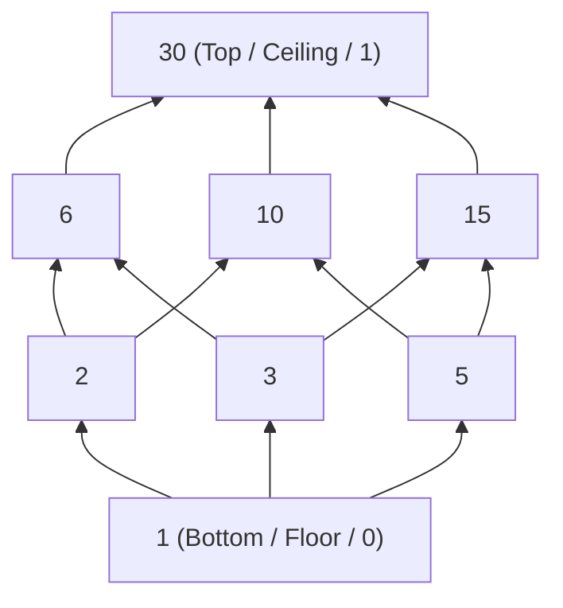
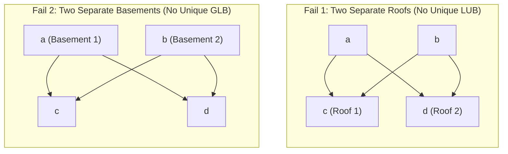
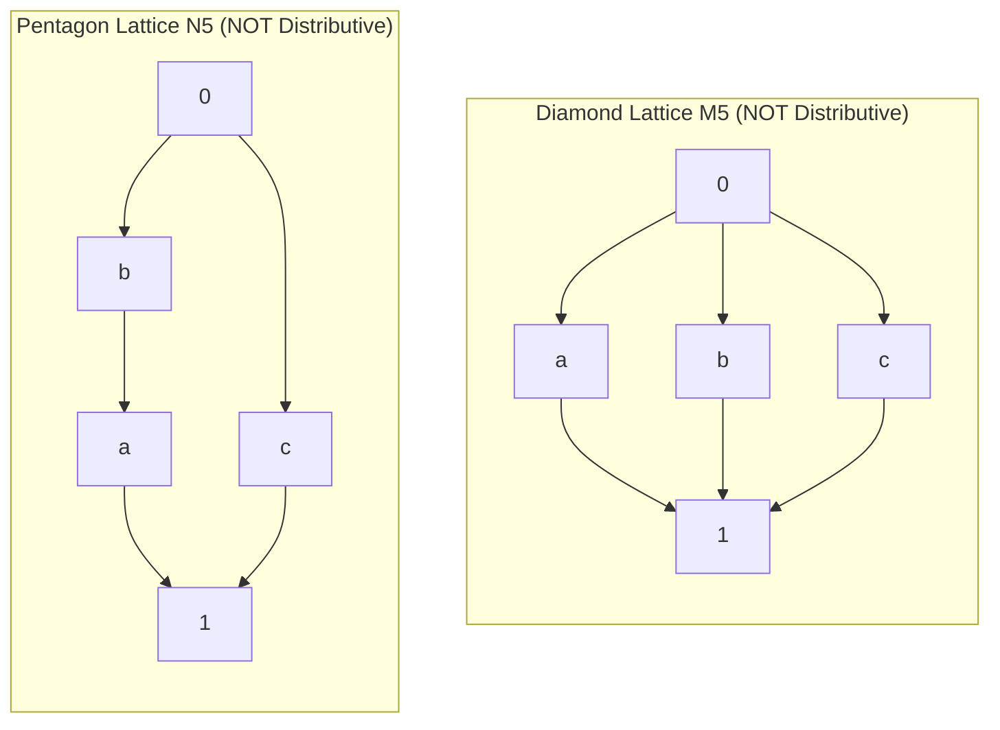
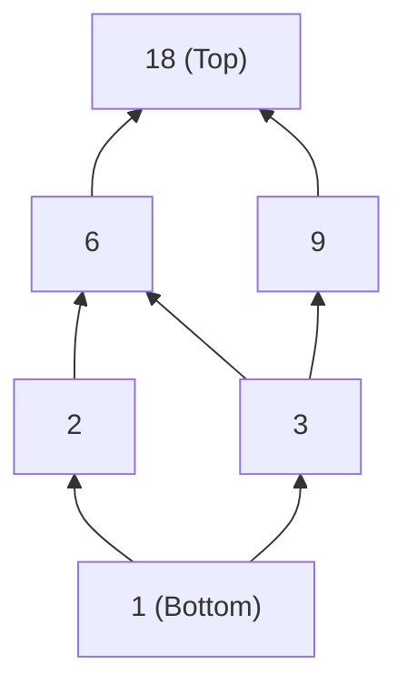
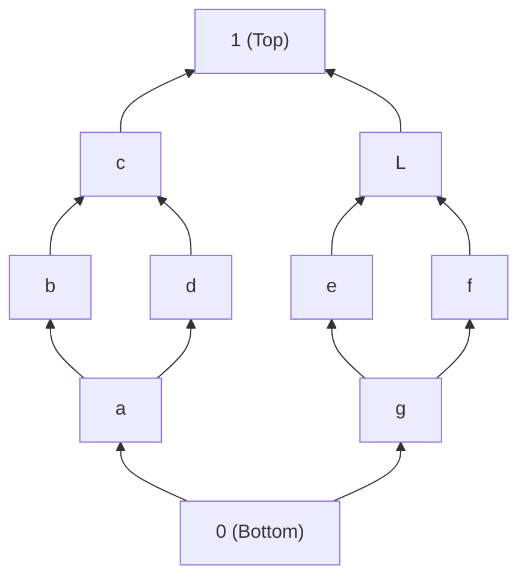
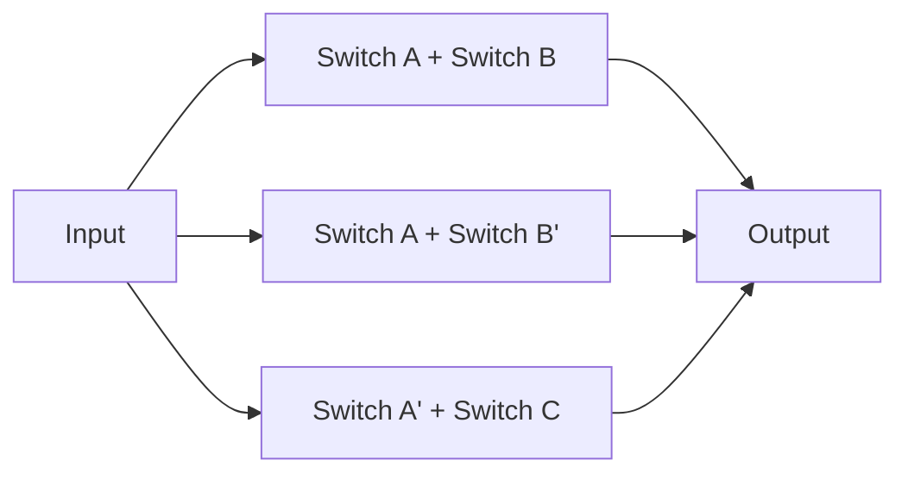
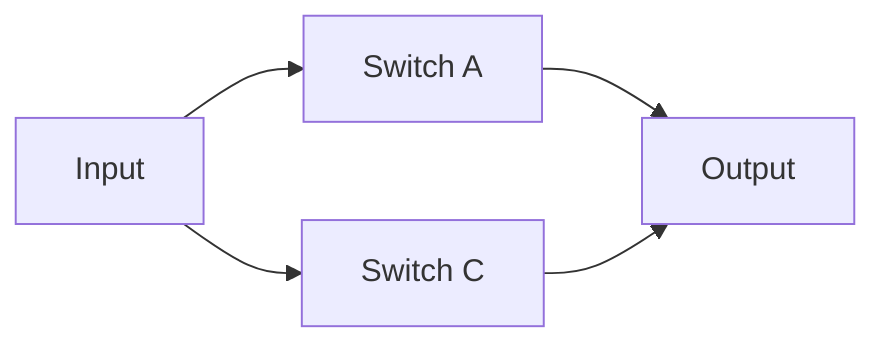

# ⚡ CAT-2 HOTS Master Crib — Module 3: Lattices & Boolean Algebra
**Course**: MAT2002 — Discrete Mathematics & Graph Theory  
**Level**: Self-Contained & Fully Visual (From Bedrock Basics to Class Notes & HOTS)  
**Exam Mode**: Open Book / Handwritten Notes Allowed | **Target Score**: 45+ / 50

---

## 🧱 TIER 0: The "Explain Like I'm 5" Bedrock Basics
*(Read this first if you forgot everything from CAT-1 or previous classes)*

### 1. What on Earth is a Hasse Diagram?
A Hasse diagram is just a **ladder drawing** showing which element is "smaller" and which is "bigger":
* If $a$ is connected to $b$ and $b$ is **higher up**, it means **$a \le b$** (or $a$ divides $b$, or $a \subseteq b$).
* You **only walk UPWARDS** along the lines.

#### Visual Hasse Diagram of Divisor Lattice $D_{30}$:

---

### 2. What is Upper Bound, Lower Bound, LUB and GLB?
Imagine two dots on the diagram, say $2$ and $3$.

* **Upper Bound (Common Roof)**: Any dot you can reach going **UP** from both $2$ and $3$.
  * Looking at the diagram above, going up from $2$ and $3$, you can reach $\{6, 30\}$.
* **LUB (Least Upper Bound / Join / $2 \vee 3$)**:
  * Among the roofs $\{6, 30\}$, which is lowest down? **$6$**!
  * So $2 \vee 3 = \text{lcm}(2, 3) = \mathbf{6}$.
* **Lower Bound (Common Basement)**: Any dot you can reach going **DOWN** from both $2$ and $3$.
  * Going down from $2$ and $3$, they both reach $\{1\}$.
* **GLB (Greatest Lower Bound / Meet / $2 \wedge 3$)**:
  * The highest common basement is **$1$**.
  * So $2 \wedge 3 = \gcd(2, 3) = \mathbf{1}$.

---

### 3. What is a LATTICE? (And Why Do Drawings Fail?)
A drawing is a **LATTICE** $\iff$ **EVERY pair has a unique LUB and unique GLB**.

#### The Two Visual Shapes that DESTROY a Lattice:

* In Fail 1: Dots $a$ and $b$ meet at both $c$ and $d$. Since $c$ and $d$ are side-by-side, **neither is lower** $\implies$ **NOT A LATTICE ❌**.

---

### 4. What is a "Distributive Lattice"? (The Forbidden Sublattices)
Birkhoff's Theorem: A lattice is distributive $\iff$ it contains **NO Diamond ($M_5$) or Pentagon ($N_5$) sublattices**!

---

## 🧭 TIER 1: The Problem Symptom & Keyword Decoder

| If Question Shows... | It Means This Exact Problem | What You Do (In 5 Seconds) |
| :--- | :--- | :--- |
| A Hasse diagram and asks: *"Is this a lattice?"* | **Lattice Check** | Check non-adjacent side-by-side elements. Look for the "two roofs" or "two basements" trap! |
| $(D_n, \mid)$ and asks: *"Is it a Boolean Algebra?"* | **Divisor Lattice Test** | Factor $n$. If $n$ has ANY squared prime factor ($p^2$ like $4, 9, 12, 18, 36$), say: **NO, $n$ is not square-free!** |
| Hasse diagram and asks: *"Is it distributive?"* | **Distributivity Test** | Search for Pentagon ($N_5$) or Diamond ($M_5$) sub-shapes. Write down the 3 elements where $a \wedge (b \vee c) \ne (a \wedge b) \vee (a \wedge c)$. |
| "Find PDNF and PCNF" for logic proposition | **Normal Forms** | Build truth table. PDNF = rows where $f=1$ (Minterms $\sum m$). PCNF = rows where $f=0$ (Maxterms $\prod M$). |

---

## 📝 TIER 4: Solved Classroom & Exam Archetypes (From Lecture Notes)

### Classroom Problem 1: Hasse Diagram of $D_{18}$ & Complements
*(From Class Notes Page 8)*  
**Question**: Draw the Hasse diagram for $D_{18} = \{1, 2, 3, 6, 9, 18\}$ and find complements of all elements.

**Step-by-Step Complement Evaluation**:
* $1' = 18$ and $18' = 1$
* For element $2$: $\gcd(2, 9) = 1$ and $\text{lcm}(2, 9) = 18 \implies \mathbf{2' = 9}$.
* For element $3$: To get $\text{lcm}(3, x) = 18$, $x$ must be a multiple of $2$ and $9 \implies x \in \{18\}$. But $\gcd(3, 18) = 3 \ne 1$.
  * **Element $3$ has NO COMPLEMENT ❌**.
* **Verdict**: $D_{18}$ is **NOT a Boolean Algebra**!

---

### Classroom Problem 2: Distributivity Check on the 10-Element Lattice
*(From Class Notes Page 6)*  
**Question**: Determine whether the 10-element lattice below is distributive:

**Step-by-Step Solution**:
1. Select elements $b, d, g$:
   - Join $d \vee g$: The lowest upper bound of $d$ and $g$ is the top element **$1$**.
   - Compute LHS:
     $$\text{LHS} = b \wedge (d \vee g) = b \wedge 1 = \mathbf{b}$$
   - Meet $b \wedge d = \mathbf{a}$.
   - Meet $b \wedge g = \mathbf{0}$.
   - Compute RHS:
     $$\text{RHS} = (b \wedge d) \vee (b \wedge g) = a \vee 0 = \mathbf{a}$$
2. **Comparison**: $\text{LHS} = b \ne \text{RHS} = a$.
3. **Verdict**: **The lattice is NOT distributive ❌**.

---

### Classroom Problem 3: Switching Circuit Simplification & Redraw
**Question**: Simplify the circuit $T = (A \cdot B) + (A \cdot B') + (A' \cdot C)$ and redraw.

#### Original Circuit (6 Switches):

#### Minimized Circuit (2 Switches):
* $A \cdot B + A \cdot B' = A(B + B') = A \cdot 1 = A$.
* $T = A + A' C = \mathbf{A + C}$.

