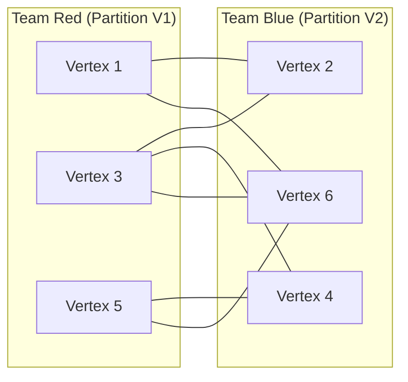
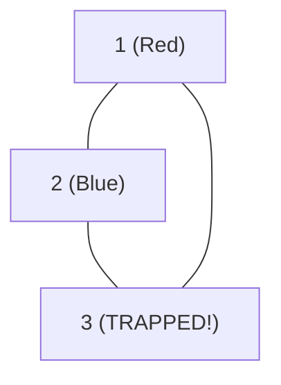
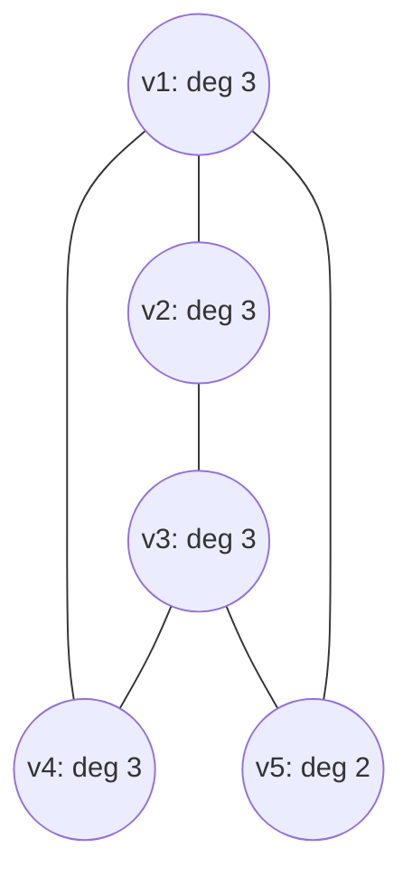

# ⚡ CAT-2 HOTS Master Crib — Module 4: Graphs & Matrix Representations
**Course**: MAT2002 — Discrete Mathematics & Graph Theory  
**Level**: Self-Contained & Fully Visual (From Bedrock Basics to Class Notes & HOTS)  
**Exam Mode**: Open Book / Handwritten Notes Allowed | **Target Score**: 45+ / 50

---

## 🧱 TIER 0: The "Explain Like I'm 5" Bedrock Basics
*(Read this first if you forgot everything about graphs)*

### 1. What is a Bipartite Graph? (The "Two Teams" Concept)
Can you divide all dots into **TWO teams (Team Red and Team Blue)** such that **NO line connects two dots of the same team**?


> Every single road connects a Red dot to a Blue dot! No Red connects to Red, no Blue connects to Blue. This is **BIPARTITE ✅**.

#### The Forbidden Triangle (Why Odd Cycles Break Bipartiteness):

* If Dot 1 is Red and Dot 2 is Blue, Dot 3 connects to **BOTH** 1 and 2. Whatever color you give Dot 3, it violates the rule $\implies$ **ODD CYCLES CAN NEVER BE BIPARTITE ❌!**

---

### 2. Graph Isomorphism (The 6-Vertex Classroom Puzzle)
Two graphs are isomorphic ($G_1 \cong G_2$) $\iff$ they are identical twins in disguise.

#### The Classroom Counterexample: $G_1$ vs $G_2$
Both graphs have 6 vertices, 9 edges, and all vertices have degree 3 (3-regular). Are they isomorphic?

```mermaid
graph TD
    subgraph G1 ["Graph G1: 6-Cycle with 3 Chords (NO Triangles)"]
    a((a)) --- b((b))
    b --- c((c))
    c --- d((d))
    d --- e((e))
    e --- f((f))
    f --- a
    a -.- d
    b -.- e
    c -.- f
    end

    subgraph G2 ["Graph G2: Triangular Prism (HAS 2 Triangles)"]
<<<<<<< HEAD
    u1((1)) --- u2((2))
    u2 --- u3((3))
    u3 --- u1
    u4((4)) --- u5((5))
    u5 --- u6((6))
    u6 --- u4
    u1 -.- u4
    u2 -.- u5
    u3 -.- u6
=======
    1((1)) --- 2((2))
    2 --- 3((3))
    3 --- 1
    4((4)) --- 5((5))
    5 --- 6((6))
    6 --- 4
    1 -.- 4
    2 -.- 5
    3 -.- 6
>>>>>>> c8bb71ee524e261f526d08168feaf936ef9118fd
    end
```

* **Visual Proof of Failure**:
  * Look at $G_2$: It clearly has **TWO triangles** $\{1, 2, 3\}$ and $\{4, 5, 6\}$.
  * Look at $G_1$: Opposite chords connect opposite sides. It has **ZERO triangles** (its shortest cycle has 4 edges!).
  * Because $G_2$ has triangles and $G_1$ has no triangles, **$G_1$ and $G_2$ are NOT isomorphic ($G_1 \not\cong G_2$) ❌**.

---

## 🧭 TIER 1: The Problem Symptom & Keyword Decoder

| If Question Shows... | It Means This Exact Problem | What You Do (In 5 Seconds) |
| :--- | :--- | :--- |
| "Registration number $q$ edges", "Minimum vertices $n$" | **Max Edge Inversion Formula** | Solve $\frac{n(n-1)}{2} \ge q \implies n^2 - n - 2q \ge 0$. Find smallest integer $n$. |
| Numbers like $(5, 4, 3, 3, 2, 1)$, "Is it graphic?" | **Havel-Hakimi Algorithm** | Check sum $\to$ if odd, reject. If even $\to$ delete first number $d_1$, subtract 1 from next $d_1$ numbers. Repeat. |
| Two 6-vertex graphs, "Are they isomorphic?" | **Isomorphism Proof/Disproof** | Check degree sequence $\to$ if identical, **count triangles ($C_3$)**! If one has triangles and other has none $\implies$ NOT isomorphic. |
| Adjacency matrix $A$, "Walks of length 2 between $v_i, v_j$" | **Matrix Walks Shortcut** | Take dot product of Row $i$ and Row $j$ of $A$ (Counts common neighbors!). |

---

## 📝 TIER 4: Solved Classroom Archetypes (From Lecture Notes)

### Classroom Problem 1: The Registration Number Graph Problem
*(From Class Notes Page 14)*  
**Question**: Take the last 3 digits of your registration number as the number of edges $q$ (e.g., $q = 242$). What is the minimum number of vertices $n$ required to construct a simple undirected graph?

**Step-by-Step Solution**:
1. In any simple graph with $n$ vertices, the maximum possible number of edges occurs in the complete graph $K_n$:
   $$|E|_{max} = \frac{n(n-1)}{2}$$
2. For a graph to have $q = 242$ edges:
   $$\frac{n(n-1)}{2} \ge 242 \implies n(n-1) \ge 484$$
3. Test values of $n$:
   - For $n = 21$: $21 \times 20 = 420 < 484$ ❌
   - For $n = 22$: $22 \times 21 = 462 < 484$ ❌
   - For $n = 23$: $23 \times 22 = 506 \ge 484$ ✅
4. **Conclusion**:
   The minimum number of vertices required is **$n = 23$**.

---

### Classroom Problem 2: Graph Construction for Graphic Sequence $(3, 3, 3, 3, 2)$
*(From Class Notes Page 16)*  
We previously proved $(3, 3, 3, 3, 2)$ is graphic via Havel-Hakimi. Here is the constructed graph on 5 vertices $\{v_1, v_2, v_3, v_4, v_5\}$:


* $\deg(v_1) = 3$, $\deg(v_2) = 2+1=3$, $\deg(v_3) = 3$, $\deg(v_4) = 3$, $\deg(v_5) = 2$.
* Total degree sum $= 3+3+3+3+2 = 14 = 2 \times 7$ edges ✅.
