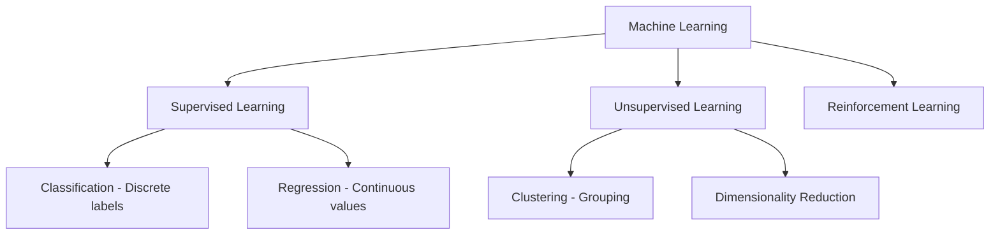

# 🧠 Lesson 2 — The 3 Types of Machine Learning

> **TL;DR**: There are only 3 types. **Supervised** = you give it labeled examples (like a teacher grading homework). **Unsupervised** = it finds patterns on its own (like sorting socks by color without being told). **Reinforcement** = it learns by trial and error (like training a dog with treats). That's it. That's the whole classification.

---

## 🗂️ The Big Picture



<details>
<summary>📱 Tap here for Mobile/Text version</summary>

```text
Machine Learning
├── Supervised Learning (Labeled Data)
│   ├── Classification (Discrete: Yes/No, Cat/Dog)
│   └── Regression (Continuous: House Price, Temperature)
├── Unsupervised Learning (Unlabeled Data)
│   ├── Clustering (Grouping similar items)
│   └── Dimensionality Reduction (Compressing features)
└── Reinforcement Learning (Rewards & Penalties)
```
</details>

---

## 1️⃣ Supervised Learning — "Learning with a Teacher"

You give the algorithm data that's already labeled (like flashcards with answers on the back).

### Two sub-types:

| | Classification | Regression |
|---|---|---|
| **What it predicts** | A **category** (discrete) | A **number** (continuous) |
| **Real-life example** | Is this email spam? (Yes/No) | What's the price of this house? ($420,000) |
| **Think of it as** | Sorting clothes into buckets | Drawing a line through scatter plot |
| **Algorithms** | Logistic Regression, Decision Trees, SVM, k-NN, Naive Bayes | Linear Regression, Ridge, Lasso, Polynomial |

> 🧠 **Memory Trick**: If the answer is a CATEGORY → Classification. If the answer is a NUMBER → Regression. That simple.

> 🤦 **Common Exam Trap**: "Predicting student marks (0-100)" — is this Classification or Regression? It's **Regression** (continuous number), NOT classification. Even though it looks discrete, marks can be 72.5, 83.3, etc.

---

## 2️⃣ Unsupervised Learning — "Learning Without a Teacher"

No labels. The algorithm just gets raw data and has to find patterns by itself.

| Type | What it does | Real-life analogy |
|---|---|---|
| **Clustering** | Groups similar things together | Spotify auto-sorting your music into "Chill Vibes", "Workout", "Study" playlists |
| **Dimensionality Reduction** | Compresses features to keep only the important ones | Summarizing a 500-page book into a 2-page summary |

**Key Algorithms**: K-Means (clustering), PCA (dimensionality reduction)

---

## 3️⃣ Reinforcement Learning — "Learning by Trial and Error"

An **Agent** takes **Actions** in an **Environment** and gets **Rewards** (good move) or **Penalties** (bad move).

> Think of it like training a puppy 🐕: do a trick → get a treat. Pee on the carpet → no treat. Over time, the puppy learns what works.

**Famous examples**: AlphaGo (beat the world champion at Go), self-driving cars, game-playing AI.

---

## 🏋️ Solved Exam Practice Questions

### Question 1 (Classification vs Regression — The Trick Question)
**Identify each as Classification or Regression:**
1. Predicting whether a customer will churn (leave) next month.
2. Estimating total sales revenue ($) next quarter.
3. Predicting student test marks (0 to 100).
4. Identifying whether an image is a cat, dog, or bird.

<details>
<summary>💡 Answers</summary>

1. **Classification** — Binary discrete output (Churn / No Churn).
2. **Regression** — Continuous dollar value.
3. **Regression** — Continuous score range (can be 72.5).
4. **Classification** — Multi-class discrete categories (cat/dog/bird). ✅
</details>

---

## ✅ Quick Self-Check (30 seconds)

1. Which paradigm uses labeled data?
2. K-Means is supervised or unsupervised?
3. What's the goal of Reinforcement Learning in one sentence?

<details>
<summary>🔑 Answers</summary>

1. **Supervised Learning**.
2. **Unsupervised** (it's clustering — no labels).
3. To maximize cumulative reward through trial-and-error interaction with an environment.

</details>

---

**⏱️ Time spent: ~10 mins. Next →** [03 - Data Preprocessing & Evaluation](./03-data-preprocessing-and-evaluation.md)
