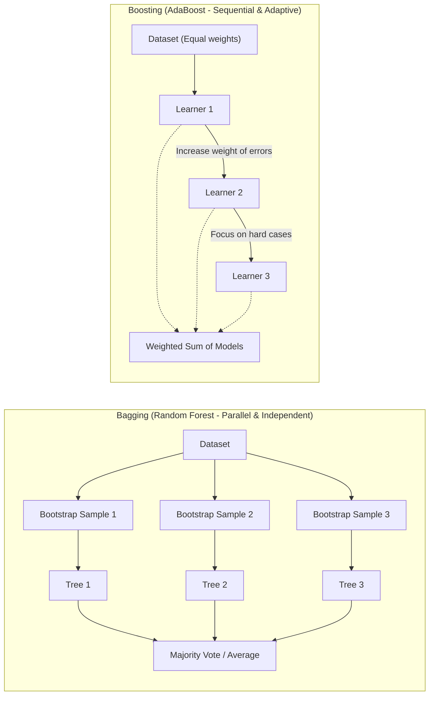
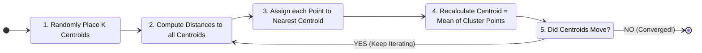
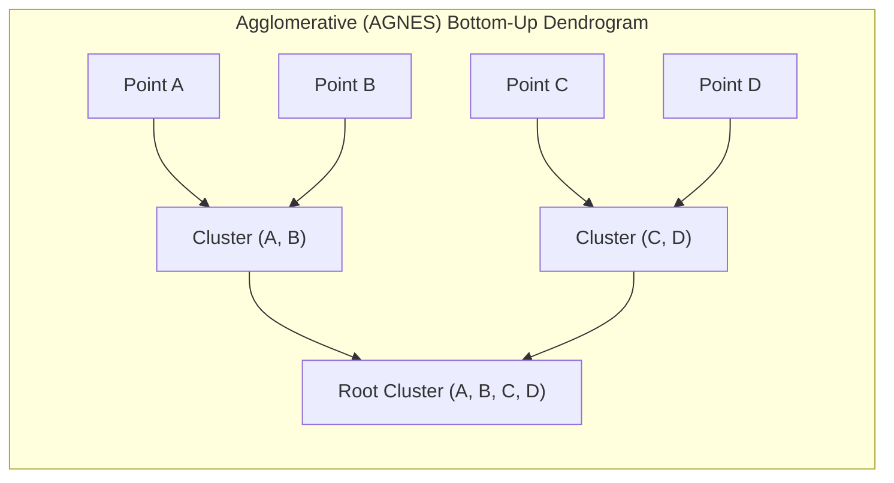

# ⚡ CAT-2 HOTS Master Crib — Module 3: Ensemble & Unsupervised Learning
**Course**: CSE4005 — Machine Learning  
**Coverage**: Ensemble Methods & Clustering Algorithms | **Exam Mode**: Open Book / Notes Allowed  
**Target Score**: 45+ / 50 (S-Grade Boundary)

---

## 🧱 TIER 0: The "Explain Like I'm 5" Bedrock Basics
*(Read this first if you forgot everything or need crystal-clear visual intuition)*

### 1. Bagging vs Boosting: How Do Ensembles Work?
* **Ensemble Learning**: Don't rely on one smart expert; ask a committee of simple models.
* **Bagging (Bootstrap Aggregating)**:
  * Train 100 trees **in parallel** on random subsets with replacement.
  * Combine by simple voting. **Goal: Kill Variance (Overfitting)**.
* **Boosting (Adaptive Boosting / AdaBoost)**:
  * Train models **one-by-one in series**.
  * If Learner 1 makes a mistake on an example, **amplify that example's weight** so Learner 2 is forced to fix it.
  * Combine by weighted voting ($\alpha_t$). **Goal: Kill Bias (Underfitting)**.

---

### 2. How Does K-Means Find Clusters?
Imagine dropping $k$ pins on a floor.
1. Each dot runs to its closest pin.
2. Each pin walks to the center (mean) of all dots that ran to it.
3. Repeat until pins stop moving.

---

### 3. Hierarchical Clustering (Dendrogram)
* **AGNES (Agglomerative)**: Bottom-Up. Every point starts as its own cluster. Most similar pairs merge repeatedly until 1 giant cluster remains.
* **DIANA (Divisive)**: Top-Down. Starts with 1 giant cluster and repeatedly splits it into smaller groups.

---

## 🧭 TIER 1: The Problem Symptom & Keyword Decoder

| If Question Mentions / Shows... | It Means This Exact Topic | Your Immediate Formula / Action |
| :--- | :--- | :--- |
| "AdaBoost numerical", "Weights update", $\alpha_t$ | **AdaBoost Step-by-Step** | $\epsilon_t = \sum_{\text{misclass}} w_i$; $\alpha_t = \frac{1}{2} \ln \left(\frac{1-\epsilon_t}{\epsilon_t}\right)$; $w_{i}^{(t+1)} = \frac{w_i^{(t)} \exp(-\alpha_t y_i h_t(x_i))}{Z_t}$. |
| "Bagging vs Boosting vs Stacking" | **Ensemble Comparison** | Bagging: Parallel, reduces variance (e.g. Random Forest). Boosting: Sequential, reduces bias (e.g. AdaBoost). Stacking: Heterogeneous models + Meta-learner. |
| "K-Means clustering numerical", Centroids $C_1, C_2$ | **K-Means Clustering** | 1. Calculate Euclidean distance $d(p, C) = \sqrt{(x-x_c)^2 + (y-y_c)^2} \to$ 2. Assign to closest centroid $\to$ 3. Recalculate mean of points in each cluster. |
| "AGNES vs DIANA", "Dendrogram", Linkage | **Hierarchical Clustering** | AGNES: Agglomerative (Bottom-up). DIANA: Divisive (Top-down). Single linkage: $\min(d)$, Complete linkage: $\max(d)$, Average linkage: $\text{avg}(d)$. |
| "Expectation-Maximization", GMM | **Gaussian Mixture Models** | E-step: Compute posterior probability (responsibility $\gamma_{ik}$). M-step: Update cluster mean $\mu_k$, covariance $\Sigma_k$, and mixing coefficient $\pi_k$. |

---

## 🛠️ TIER 2: Deterministic Algorithmic Recipes

### Recipe 3.1: The AdaBoost Numerical Calculation Template
Given $N$ training examples with initial weights $w_i^{(1)} = \frac{1}{N}$:

1. **Step 1 (Compute Weighted Error $\epsilon_t$)**:
   $$\epsilon_t = \sum_{i: h_t(x_i) \ne y_i} w_i^{(t)}$$
   *(Note: $\epsilon_t$ must be $< 0.5$ for weak learner. If $\epsilon_t = 0.5$, $\alpha_t = 0$ and no learning occurs!)*
2. **Step 2 (Compute Classifier Weight $\alpha_t$)**:
   $$\alpha_t = \frac{1}{2} \ln \left( \frac{1 - \epsilon_t}{\epsilon_t} \right)$$
3. **Step 3 (Update Example Weights)**:
   * For **Correctly Classified** points ($y_i = h_t(x_i)$):
     $$w_i^{\text{new}} = w_i^{(t)} \times e^{-\alpha_t} = w_i^{(t)} \times \sqrt{\frac{\epsilon_t}{1 - \epsilon_t}}$$
   * For **Misclassified** points ($y_i \ne h_t(x_i)$):
     $$w_i^{\text{new}} = w_i^{(t)} \times e^{\alpha_t} = w_i^{(t)} \times \sqrt{\frac{1 - \epsilon_t}{\epsilon_t}}$$
4. **Step 4 (Normalize Weights)**:
   $$Z_t = \sum_{i=1}^N w_i^{\text{new}} = 2 \sqrt{\epsilon_t(1 - \epsilon_t)}$$
   $$w_i^{(t+1)} = \frac{w_i^{\text{new}}}{Z_t}$$
   *(Sanity Check: $\sum w_i^{(t+1)}$ must equal $1.0$!)*
5. **Final Strong Classifier**:
   $$H(x) = \text{sign}\left( \sum_{t=1}^T \alpha_t h_t(x) \right)$$

---

### Recipe 3.2: K-Means Clustering Algorithmic Trace
Given dataset $D = \{p_1, p_2, \dots, p_N\}$ and $k$ initial centroids $\{C_1, C_2, \dots, C_k\}$:
1. **Distance Calculation**: Construct a table with columns: `Point | Dist to C1 | Dist to C2 | ... | Assigned Cluster`.
   $$d(p_i, C_j) = \sqrt{(x_i - x_{C_j})^2 + (y_i - y_{C_j})^2} \quad (\text{or Manhattan: } |x_i - x_{C_j}| + |y_i - y_{C_j}|)$$
2. **Assignment Step**: Assign $p_i$ to Cluster $j$ having the minimum distance.
3. **Centroid Update Step**:
   $$C_j^{\text{new}} = \left( \frac{1}{|S_j|} \sum_{p \in S_j} x_p, \quad \frac{1}{|S_j|} \sum_{p \in S_j} y_p \right)$$
4. **Convergence Check**: If $C_j^{\text{new}} = C_j^{\text{old}}$ for all $j \implies$ **STOP (Converged)**. Else, repeat distance calculation with new centroids.

---

### Recipe 3.3: Hierarchical Agglomerative Clustering (AGNES)
1. Start with each point as its own cluster ($N$ clusters).
2. Compute $N \times N$ pairwise distance matrix $D$.
3. At each iteration:
   - Find the minimum non-zero distance entry $D(A, B)$.
   - Merge clusters $A$ and $B$ into a new cluster $(A \cup B)$.
   - Update distance from $(A \cup B)$ to all other clusters $C$:
     * **Single Linkage**: $d(A \cup B, C) = \min(d(A, C), d(B, C))$ (Prone to chaining!).
     * **Complete Linkage**: $d(A \cup B, C) = \max(d(A, C), d(B, C))$ (Produces compact, spherical clusters).
     * **Average Linkage**: $d(A \cup B, C) = \frac{|A| d(A, C) + |B| d(B, C)}{|A| + |B|}$.
4. Repeat until only 1 cluster remains. Record merge heights to plot Dendrogram.

---

## 🚨 TIER 3: Faculty Trap Radar

1. **The AdaBoost Error $\ge 0.5$ Trap**: If a weak classifier has $\epsilon_t > 0.5$, invert its predictions ($h_t' = -h_t$), which turns its error into $1 - \epsilon_t < 0.5$!
2. **K-Means Empty Cluster Problem**: If no points are assigned to a centroid $C_j$ during an iteration, choose the point with the highest squared error from its current centroid and set it as the new $C_j$.
3. **Single Linkage Chaining**: Single linkage has a major flaw called **chaining** (long straggly clusters connected by a thin line of points). Examiners ask: *"Which linkage avoids chaining?"* Answer: **Complete linkage or Ward's method**.

---

## 📝 TIER 4: Master Solved HOTS Archetypes

### Archetype 1: Full AdaBoost Weight & Alpha Calculation
**Question**: A dataset of 5 points has initial weights $w_1 = w_2 = w_3 = w_4 = w_5 = 0.2$. A weak classifier $h_1$ correctly classifies points $1, 2, 3$ and misclassifies points $4, 5$.
1. Find the weighted training error $\epsilon_1$.
2. Calculate the classifier weight $\alpha_1$.
3. Compute the updated normalized weights for all 5 points.

**Solution Template**:
1. **Weighted Error $\epsilon_1$**:
   $$\epsilon_1 = \sum_{\text{misclassified}} w_i = w_4 + w_5 = 0.2 + 0.2 = \mathbf{0.40}$$
2. **Classifier Weight $\alpha_1$**:
   $$\alpha_1 = \frac{1}{2} \ln\left( \frac{1 - 0.40}{0.40} \right) = \frac{1}{2} \ln(1.5) = \frac{1}{2} (0.4055) = \mathbf{0.2027}$$
3. **Weight Multipliers**:
   * For correct points ($1, 2, 3$): $e^{-\alpha_1} = e^{-0.2027} = \mathbf{0.8165}$
   * For incorrect points ($4, 5$): $e^{\alpha_1} = e^{0.2027} = \mathbf{1.2247}$
4. **Unnormalized Weights**:
   * $w_1' = w_2' = w_3' = 0.2 \times 0.8165 = 0.1633$
   * $w_4' = w_5' = 0.2 \times 1.2247 = 0.2449$
5. **Normalization Factor $Z_1$**:
   $$Z_1 = 3(0.1633) + 2(0.2449) = 0.4899 + 0.4898 = \mathbf{0.9797}$$
   *(Note: Theoretical $Z_1 = 2\sqrt{0.4 \times 0.6} = 2\sqrt{0.24} = 2(0.4899) = 0.9798$)*
6. **Final Normalized Weights**:
   * $w_1^{(2)} = w_2^{(2)} = w_3^{(2)} = \frac{0.1633}{0.9797} = \mathbf{0.1667}$
   * $w_4^{(2)} = w_5^{(2)} = \frac{0.2449}{0.9797} = \mathbf{0.2500}$
   * Verification: $3(0.1667) + 2(0.2500) = 0.5001 + 0.5000 = 1.0001 \approx 1.0$ ✅.

---

### Archetype 2: 2-Iteration 1D/2D K-Means Numerical
**Question**: Given 1D points $D = \{2, 4, 10, 12, 3, 20, 30, 11, 25\}$ and initial centroids $C_1 = 2, C_2 = 4$. Execute 1 full iteration of K-Means clustering.

**Solution Template**:
1. **Distance Calculation to $C_1=2, C_2=4$**:
   * Point $2$: $|2-2|=0$, $|2-4|=2 \implies \mathbf{C_1}$
   * Point $4$: $|4-2|=2$, $|4-4|=0 \implies \mathbf{C_2}$
   * Point $10$: $|10-2|=8$, $|10-4|=6 \implies \mathbf{C_2}$
   * Point $12$: $|12-2|=10$, $|12-4|=8 \implies \mathbf{C_2}$
   * Point $3$: $|3-2|=1$, $|3-4|=1 \implies \text{Tie, assign to } \mathbf{C_1}$
   * Point $20$: $|20-2|=18$, $|20-4|=16 \implies \mathbf{C_2}$
   * Point $30$: $|30-2|=28$, $|30-4|=26 \implies \mathbf{C_2}$
   * Point $11$: $|11-2|=9$, $|11-4|=7 \implies \mathbf{C_2}$
   * Point $25$: $|25-2|=23$, $|25-4|=21 \implies \mathbf{C_2}$
2. **Cluster Formations**:
   * Cluster 1: $\{2, 3\}$
   * Cluster 2: $\{4, 10, 11, 12, 20, 25, 30\}$
3. **Recompute New Centroids**:
   * $C_1^{\text{new}} = \frac{2 + 3}{2} = \mathbf{2.5}$
   * $C_2^{\text{new}} = \frac{4 + 10 + 11 + 12 + 20 + 25 + 30}{7} = \frac{112}{7} = \mathbf{16.0}$

---

### Archetype 3: Error-Correcting Output Codes (ECOC) & Stacking
1. **Error-Correcting Output Codes (ECOC)**:
   * **Problem**: Solving a $K$-class problem using $L$ binary classifiers ($L > K$).
   * **Codeword Matrix $M \in \{-1, +1\}^{K \times L}$**: Each class $k$ is assigned a unique $L$-bit code row.
   * **Decoding**: An unseen instance is classified by each of the $L$ binary classifiers to produce vector $\hat{y} \in \{-1, +1\}^L$.
   * **Hamming Distance Assignment**: Assign instance to the class $k$ whose codeword minimizes Hamming distance:
     $$d_H(\hat{y}, M_k) = \sum_{l=1}^L \frac{1 - \hat{y}_l M_{kl}}{2}$$
   * **Error Correction Capability**: If the minimum Hamming distance between any pair of class codewords is $d_{\min}$, ECOC is guaranteed to correct up to:
     $$\text{Max Errors Corrected} = \left\lfloor \frac{d_{\min} - 1}{2} \right\rfloor$$

2. **Stacking (Stacked Generalization)**:
   * **Architecture**: 2-Tier ensemble using heterogeneous base learners.
   * **Level-0 (Base Learners)**: Train diverse models (e.g. SVM, Decision Tree, Logistic Regression) using $K$-Fold Cross Validation to prevent target leakage.
   * **Level-1 (Meta-Learner)**: Takes the out-of-fold probability predictions of the Level-0 models as input features and learns the optimal combination weights to make the final prediction.

---

### Archetype 4: K-Modes Clustering for Categorical Data
* **When to use**: When data attributes are categorical (e.g., Blood Group, Color, Education Level) where Euclidean distance and arithmetic means are mathematically invalid.
* **Simple Matching Dissimilarity**:
  $$d(X, Y) = \sum_{j=1}^m \delta(x_j, y_j) \quad \text{where } \delta(x_j, y_j) = \begin{cases} 0 & \text{if } x_j = y_j \\ 1 & \text{if } x_j \ne y_j \end{cases}$$
* **Cluster Mode Calculation**: The mode vector $Q = [q_1, q_2, \dots, q_m]$ of cluster $C$ minimizes total dissimilarity, where $q_j$ is the **most frequent category** among all objects in cluster $C$ for attribute $j$.
