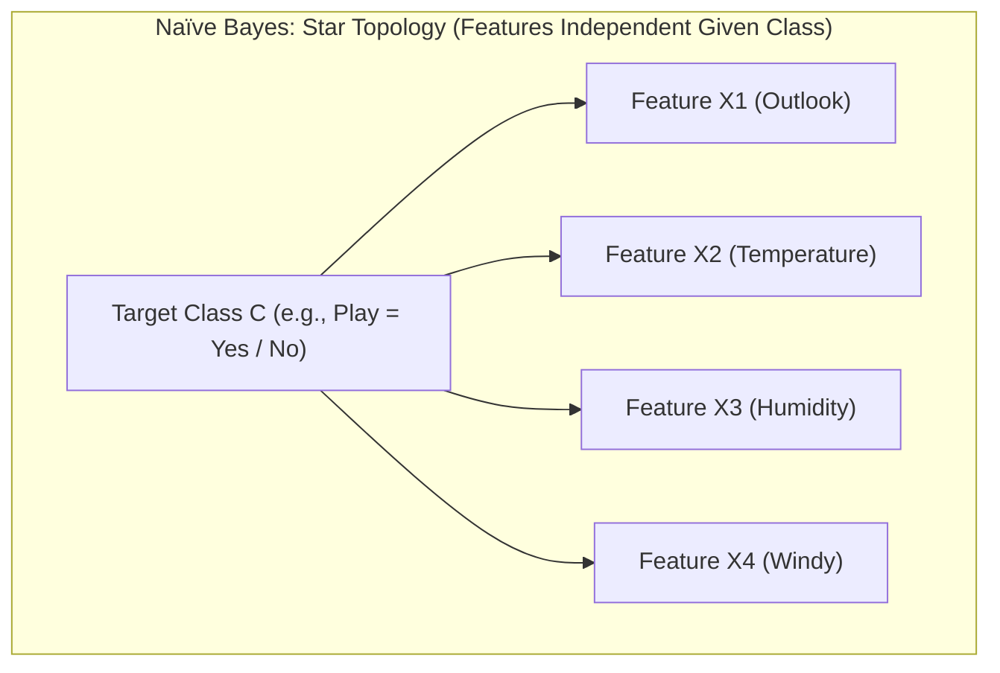
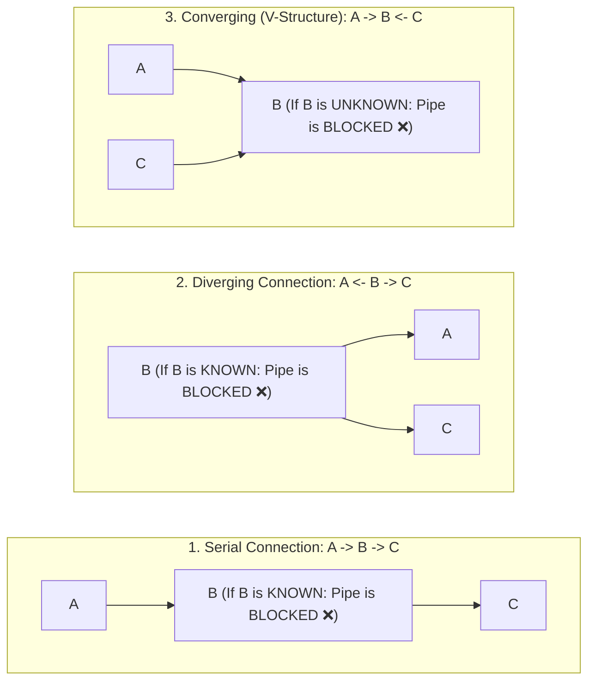
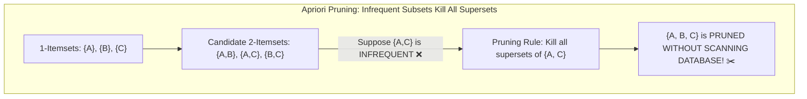

# ⚡ CAT-2 HOTS Master Crib — Module 4: Probabilistic Learning & Association Rules
**Course**: CSE4005 — Machine Learning  
**Coverage**: Bayesian Learning & Association Rule Mining | **Exam Mode**: Open Book / Notes Allowed  
**Target Score**: 45+ / 50 (S-Grade Boundary)

---

## 🧱 TIER 0: The "Explain Like I'm 5" Bedrock Basics
*(Read this first if probability or graphs confuse you)*

### 1. What Makes Naïve Bayes "Naïve"?
* Normal Bayes requires knowing how every feature affects every other feature (e.g. how temperature interacts with humidity and wind). That requires millions of probabilities!
* **The "Naïve" Trick**: We pretend all features are completely **independent of each other**, given the class!
* Each feature connects **only** to the Class label:

---

### 2. D-Separation in Bayesian Networks: Are A and C Independent?
Think of information flowing like water through a pipe from $A$ to $C$:

* **Summary Rules**:
  * For **Serial** ($A \to B \to C$) & **Diverging** ($A \leftarrow B \to C$): Knowing $B$ **BLOCKS** the path $\implies A \perp C \mid B$ (Conditionally Independent).
  * For **V-Structure** ($A \to B \leftarrow C$): Knowing $B$ (or its child) **OPENS** the path (Explaining Away effect)! If $B$ is unobserved, path is naturally **BLOCKED**.

---

### 3. How Does the Apriori Algorithm Save Time?
* **Golden Rule (Anti-Monotonicity)**: If an itemset is **INFREQUENT**, all of its supersets are **GUARANTEED TO BE INFREQUENT**!
* You never need to scan the database for $\{A, B, C\}$ if $\{A, C\}$ already failed to meet minimum support!

---

## 🧭 TIER 1: The Problem Symptom & Keyword Decoder

| If Question Mentions / Shows... | It Means This Exact Topic | Your Immediate Formula / Action |
| :--- | :--- | :--- |
| Dataset with features + Class, "Classify query using Naïve Bayes" | **Naïve Bayes Classifier** | $P(C_k \mid X) \propto P(C_k) \prod_{i=1}^d P(x_i \mid C_k)$. Pick class with max product! |
| "Zero frequency problem", "Zero probability" | **Laplacian Smoothing** | Add 1 to numerator, add number of distinct values $|V_i|$ to denominator: $\hat{P}(x_i \mid c) = \frac{\text{count} + 1}{N_c + |V_i|}$. |
| DAG with probabilities, "Bayesian Network", CPT | **Bayesian Belief Network** | Joint Probability: $P(X_1, \dots, X_n) = \prod_{i=1}^n P(X_i \mid \text{Parents}(X_i))$. Use CPTs directly! |
| "d-separation", "Conditional independence in network" | **BBN D-Separation** | Serial ($A \to B \to C$): blocked if $B$ known. Diverging ($A \leftarrow B \to C$): blocked if $B$ known. Converging ($A \to B \leftarrow C$): blocked if $B$ UNKNOWN! |
| Transaction database, "Find frequent itemsets using Apriori" | **Apriori Algorithm** | $C_1 \to L_1 \to C_2 \to L_2 \to \dots$. Prune itemsets if any subset is NOT in $L_{k-1}$. |
| "Calculate Support, Confidence, Lift" | **Association Rule Metrics** | $\text{Supp} = \frac{\sigma(A \cup B)}{N}$; $\text{Conf} = \frac{\sigma(A \cup B)}{\sigma(A)}$; $\text{Lift} = \frac{\text{Conf}}{P(B)} = \frac{P(A \cap B)}{P(A)P(B)}$. |
| "FP-Tree vs Apriori", "Header table" | **FP-Growth Algorithm** | Compresses database into a tree in 2 passes. Eliminates candidate generation overhead. |

---

## 🛠️ TIER 2: Deterministic Algorithmic Recipes

### Recipe 4.1: The 4-Step Naïve Bayes Classification Template
Given a training dataset and a test query $X = (x_1, x_2, \dots, x_d)$:

1. **Step 1 (Compute Class Priors)**:
   $$P(C_k) = \frac{\text{Count of examples in class } C_k}{\text{Total examples } N}$$
2. **Step 2 (Compute Conditional Likelihoods for each feature)**:
   For each feature value $x_i$ in the query:
   $$P(x_i \mid C_k) = \frac{\text{Count of examples where } X_i = x_i \text{ and Class} = C_k}{\text{Total examples in Class } C_k}$$
   *If count is 0, use Laplace Correction:*
   $$P_{\text{Laplace}}(x_i \mid C_k) = \frac{\text{Count} + 1}{N_{C_k} + K_i} \quad (K_i = \text{number of possible values for attribute } i)$$
3. **Step 3 (Compute Posterior Score for each class)**:
   $$\text{Score}(C_k) = P(C_k) \times P(x_1 \mid C_k) \times P(x_2 \mid C_k) \times \dots \times P(x_d \mid C_k)$$
4. **Step 4 (Normalize & Decide)**:
   * Classify $X$ as whichever class has the larger score.
   * If asked for exact probability:
     $$P(C_1 \mid X) = \frac{\text{Score}(C_1)}{\text{Score}(C_1) + \text{Score}(C_2)}$$

---

### Recipe 4.2: Apriori Algorithm Step-by-Step Execution
Given minimum support count $s_{min}$ and transaction database $T$:

1. **Generate $L_1$**: Count occurrences of each single item. Filter items where $\text{count} \ge s_{min}$.
2. **Generate $C_k$ from $L_{k-1}$ (Join Step)**:
   - Join two $(k-1)$-itemsets if their first $k-2$ items are identical and their last items differ.
3. **The Apriori Pruning Step (CRITICAL)**:
   - For every candidate in $C_k$, check all of its $(k-1)$-subsets.
   - If **ANY** subset is not in $L_{k-1}$, **PRUNE (delete) that candidate immediately!**
4. **Scan Database to form $L_k$**: Count support of remaining candidates in $C_k$. Filter by $s_{min}$.
5. **Repeat** until $L_k = \emptyset$.
6. **Rule Generation**:
   - For every frequent itemset $l \in L_k$, generate all non-empty subsets $s \subset l$.
   - Form rule: $s \implies (l \setminus s)$.
   - Compute: $\text{Confidence} = \frac{\text{Support}(l)}{\text{Support}(s)}$.
   - Keep rule $\iff \text{Confidence} \ge \text{min\_confidence}$.

---

## 🚨 TIER 3: Faculty Trap Radar

1. **The Zero Probability Multiplier Trap**: If a query has even ONE feature value that never appeared with Class $C_k$ in the training data, $P(x_i \mid C_k) = 0$. In standard Naïve Bayes, this wipes out the entire product to 0 regardless of all other evidence! **Always check if you need Laplace smoothing!**
2. **Lift Interpretation Trap**:
   - $\text{Lift}(A \implies B) > 1 \implies A$ and $B$ are **positively correlated** (buying $A$ increases chance of buying $B$).
   - $\text{Lift}(A \implies B) = 1 \implies A$ and $B$ are **independent**.
   - $\text{Lift}(A \implies B) < 1 \implies A$ and $B$ are **negatively correlated** (buying $A$ decreases chance of buying $B$).
3. **BBN V-Structure (Collider) Inversion**: In a converging node $A \to B \leftarrow C$:
   - If $B$ is **NOT observed**, $A$ and $C$ are **independent**.
   - If $B$ (or any descendant of $B$) is **observed**, $A$ and $C$ become **conditionally DEPENDENT** (explaining-away effect)!

---

## 📝 TIER 4: Master Solved HOTS Archetypes

### Archetype 1: Complete Naïve Bayes Classification with Laplace Smoothing
**Question**: Given training data:
$$\begin{array}{|c|c|c|c|c|} \hline \text{Day} & \text{Outlook} & \text{Humidity} & \text{Wind} & \text{Play} \\ \hline 1 & \text{Sunny} & \text{High} & \text{Weak} & \text{No} \\ 2 & \text{Sunny} & \text{High} & \text{Strong} & \text{No} \\ 3 & \text{Overcast} & \text{High} & \text{Weak} & \text{Yes} \\ 4 & \text{Rain} & \text{Normal} & \text{Weak} & \text{Yes} \\ 5 & \text{Rain} & \text{Normal} & \text{Strong} & \text{No} \\ \hline \end{array}$$
Classify the query $X = (\text{Outlook}=\text{Sunny}, \text{Humidity}=\text{Normal}, \text{Wind}=\text{Weak})$ using Naïve Bayes with Laplace smoothing.

**Solution Template**:
1. **Priors**: Total $N = 5$.
   * $\text{Play}=\text{Yes}: 2$ examples $\implies P(\text{Yes}) = 2/5 = 0.4$.
   * $\text{Play}=\text{No}: 3$ examples $\implies P(\text{No}) = 3/5 = 0.6$.
2. **Vocabulary Sizes**:
   * Outlook $\in \{\text{Sunny}, \text{Overcast}, \text{Rain}\} \implies K_1 = 3$.
   * Humidity $\in \{\text{High}, \text{Normal}\} \implies K_2 = 2$.
   * Wind $\in \{\text{Weak}, \text{Strong}\} \implies K_3 = 2$.
3. **Likelihoods with Laplace Smoothing $\hat{P}(x_i \mid C) = \frac{\text{count} + 1}{N_C + K_i}$**:
   * **For Class Yes ($N_{\text{Yes}} = 2$)**:
     * $P(\text{Sunny} \mid \text{Yes}) = \frac{0 + 1}{2 + 3} = \frac{1}{5} = 0.2$
     * $P(\text{Normal} \mid \text{Yes}) = \frac{1 + 1}{2 + 2} = \frac{2}{4} = 0.5$
     * $P(\text{Weak} \mid \text{Yes}) = \frac{2 + 1}{2 + 2} = \frac{3}{4} = 0.75$
   * **For Class No ($N_{\text{No}} = 3$)**:
     * $P(\text{Sunny} \mid \text{No}) = \frac{2 + 1}{3 + 3} = \frac{3}{6} = 0.5$
     * $P(\text{Normal} \mid \text{No}) = \frac{1 + 1}{3 + 2} = \frac{2}{5} = 0.4$
     * $P(\text{Weak} \mid \text{No}) = \frac{1 + 1}{3 + 2} = \frac{2}{5} = 0.4$
4. **Compute Posterior Scores**:
   $$\text{Score}(\text{Yes}) = 0.4 \times 0.2 \times 0.5 \times 0.75 = \mathbf{0.030}$$
   $$\text{Score}(\text{No}) = 0.6 \times 0.5 \times 0.4 \times 0.4 = \mathbf{0.048}$$
5. **Conclusion**: Since $\text{Score}(\text{No}) = 0.048 > \text{Score}(\text{Yes}) = 0.030$, the query is classified as **Play = No ✅**.

---

### Archetype 2: Apriori Association Rules with Confidence & Lift
**Question**: In a supermarket with 100 transactions:
* 60 transactions contain Bread.
* 40 transactions contain Butter.
* 30 transactions contain both Bread and Butter.
Calculate the Support, Confidence, and Lift for the rule: $\text{Bread} \implies \text{Butter}$. Explain the business insight.

**Solution Template**:
1. **Support**:
   $$\text{Support}(\text{Bread} \implies \text{Butter}) = \frac{\text{Count}(\text{Bread} \cap \text{Butter})}{N} = \frac{30}{100} = \mathbf{30\%} \quad (0.30)$$
2. **Confidence**:
   $$\text{Confidence}(\text{Bread} \implies \text{Butter}) = \frac{\text{Count}(\text{Bread} \cap \text{Butter})}{\text{Count}(\text{Bread})} = \frac{30}{60} = \mathbf{50\%} \quad (0.50)$$
3. **Lift**:
   $$\text{Lift}(\text{Bread} \implies \text{Butter}) = \frac{\text{Confidence}}{P(\text{Butter})} = \frac{0.50}{40/100} = \frac{0.50}{0.40} = \mathbf{1.25}$$
4. **Business Interpretation**:
   * A Lift of $1.25 > 1$ indicates a **positive association**.
   * Customers who purchase Bread are **$1.25$ times more likely** to purchase Butter compared to the average customer.

---

### Archetype 3: FP-Growth (Frequent Pattern Tree) Execution Blueprint
> **Core Advantage over Apriori**: Scans the transaction database **only twice**; uses a compact prefix tree and **never generates costly candidate itemsets ($C_k$)**.

1. **Step 1 (First Scan — Build Header Table)**:
   - Scan database once to find support of single items.
   - Filter items where $\text{support} \ge s_{\min}$.
   - Sort frequent items in **descending order of frequency** (e.g. $f:4, c:4, a:3, b:3, m:3, p:3$).
2. **Step 2 (Second Scan — Construct FP-Tree)**:
   - Root is labelled `null`.
   - For each transaction, reorder its items according to the sorted Header Table.
   - Insert transaction as a branch into tree. If an item prefix already exists, increment node count; otherwise, create a new child branch.
   - Maintain horizontal node-links connecting identical items across different branches.
3. **Step 3 (Mining the FP-Tree Bottom-Up)**:
   - Start from the least frequent item in Header Table (e.g. $p$).
   - **Conditional Pattern Base**: Extract all prefix paths in the tree ending at $p$ (e.g., $(f:c:a:m: 2), (c:b: 1)$).
   - **Conditional FP-Tree**: Accumulate counts for items along these prefix paths and build a mini-tree filtering items with count $\ge s_{\min}$.
   - Concatenate $p$ with the frequent itemsets discovered from the conditional tree to yield all frequent itemsets containing $p$.

---

### Archetype 4: Association-Based Decision Trees (CBA / CARs)
* **Concept**: Integrates association rule mining with classification by generating **Class Association Rules (CARs)** of the form:
  $$\text{Feature Condition } (X_1 = v_1 \wedge X_2 = v_2) \implies \text{Class } C_k$$
* **Rule Ordering Rule**:
  1. Rank rules primarily by **Confidence** (higher is better).
  2. If tied, rank by **Support** (higher is better).
  3. If tied, rank by **Rule Length** (shorter condition is preferred for Occam's Razor).
* **Classification**: To classify an unseen query, find the first rule in the ranked list whose condition matches the query. If no rule matches, classify using the default majority class.
