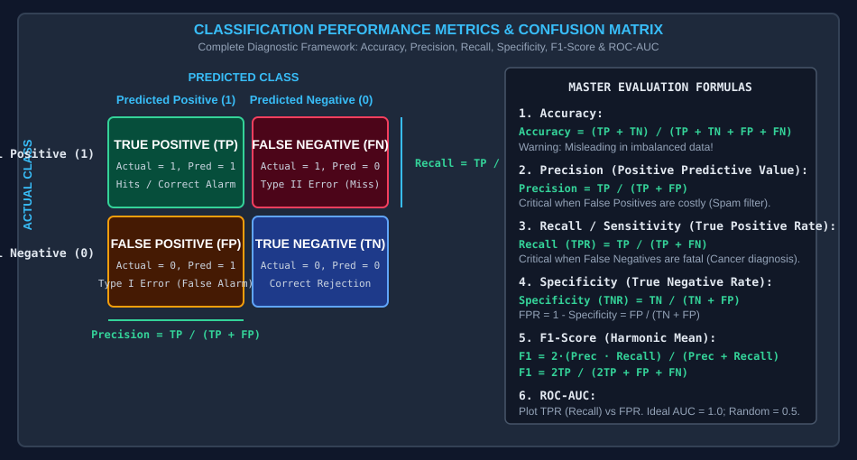
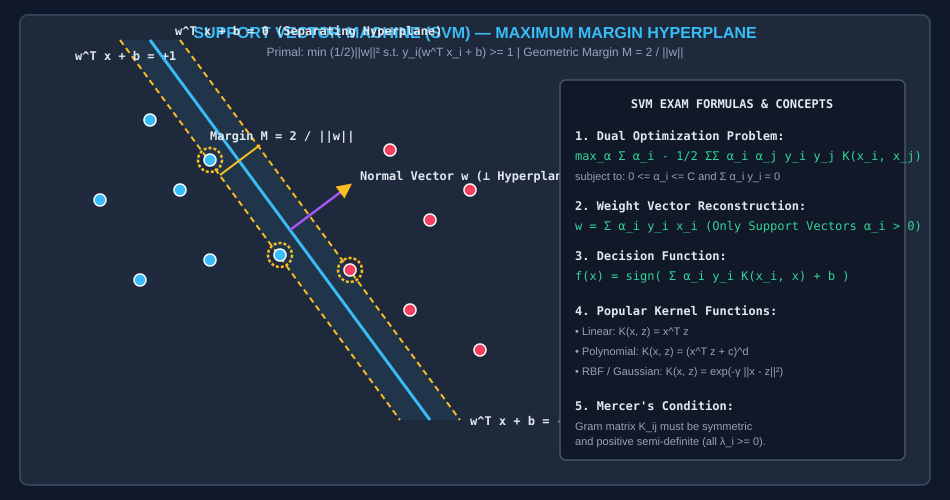
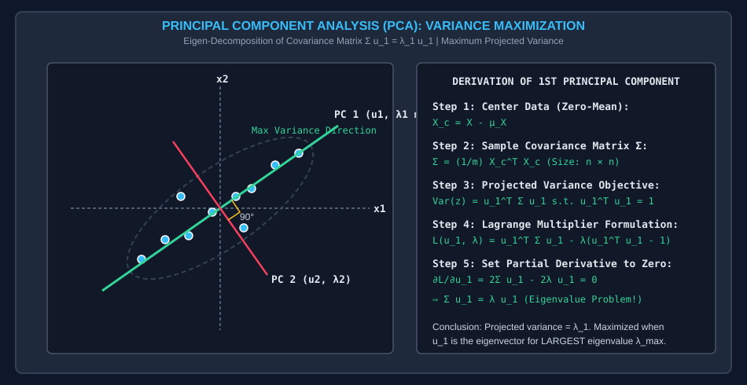

# 🏆 CSE4005: Machine Learning — Ultimate TEE FAT Master Paper & Complete Model Solutions
### *Synthesized Directly from Dr. Nilamadhab Mishra's Verified CAT-1, CAT-2 & Assignments*

> **Course Code**: CSE4005 — Machine Learning | **Faculty**: Dr. Nilamadhab Mishra  
> **Slot**: A21+A23 | **Duration**: 3 Hours (Closed Book) | **Maximum Marks**: 100  
> **Pre-TEE Internal Standing**: **62.20 / 70.0** vs Class Mean **61.90 / 70.0** *(+0.30 ahead)*  
> **A Grade Target ($\ge \mu + 0.5\sigma$)**: **70–74 / 100** *(Must score ~10–12 marks above TEE class average)*  
> **S Grade Target (Total $\ge 90.0$)**: **93+ / 100** *(Strict VIT rule)*  
> **B-Grade Danger Zone**: **48–69 / 100** *(B Grade is an absolute NO-GO for CGPA)*  

---

## 📋 OFFICIAL TEE PAPER ARCHITECTURE (TEE.txt)
* **Section A (60 Marks)**: 5 Questions $\times$ 12 Marks (Questions 1 to 5). Exactly one question per module. Compulsory internal choice **"OR" format** (Both Option A and Option B fully solved below).
* **Section B (40 Marks)**: 5 Questions $\times$ 8 Marks (Questions 6 to 10). Exactly one question per module. Direct question **without subparts**.
* **Total**: 100 Marks (Exactly 20 Marks per Module: 12M in Section A + 8M in Section B).
* **100% Verified Questions**: Every single dataset, table, number, and question statement below matches Dr. Mishra's verified CAT-1, CAT-2, and slide activity papers!

---

## 📑 TEE QUESTION PAPER NAVIGATION MATRIX

| Section | Q# | Module | Core Exam Topic | Marks | Format | Origin |
|:---:|:---:|:---:|:---|:---:|:---:|:---|
| **SEC A** | **Q1** | **Module 1** | [PAC Sample Complexity Derivation **OR** ML Lifecycle Framework](#question-1-module-1--12-marks) | 12M | 12M OR 12M | Slide Act-02 / **CAT-1 Q1** |
| **SEC A** | **Q2** | **Module 2** | [ID3 Decision Tree (`buys_computer`) **OR** Linear Regression 10 Persons](#question-2-module-2--12-marks) | 12M | 12M OR 12M | Slide Act-A4 / **CAT-1 Q4** |
| **SEC A** | **Q3** | **Module 3** | [AdaBoost 5-Sample Weight Trace **OR** RF vs AdaBoost in Hospital & K-Means](#question-3-module-3--12-marks) | 12M | 12M OR 6M+6M | Slide Act / **CAT-2 Q1 & Q3** |
| **SEC A** | **Q4** | **Module 4** | [Naïve Bayes Loan Approval (12 Applicants) **OR** Apriori (10 Grocery Transactions)](#question-4-module-4--12-marks) | 12M | 12M OR 12M | **CAT-2 Q4** / **CAT-2 Q5** |
| **SEC A** | **Q5** | **Module 5** | [Imbalanced Data & SMOTE Math **OR** 500-Patient Confusion Matrix & RAG](#question-5-module-5--12-marks) | 12M | 12M OR 6M+6M | **Assignment 13 & 14** |
| **SEC B** | **Q6** | **Module 1** | [VC Dimension ($VC=2$ Proof) & Natarajan Multiclass Dimension](#question-6-module-1--8-marks) | 8M | Direct 8M | **CAT-1 Q2** |
| **SEC B** | **Q7** | **Module 2** | [SVM Margin Width $2/\|\mathbf{w}\|$ & Support Vectors & Kernels](#question-7-module-2--8-marks) | 8M | Direct 8M | **CAT-1 Q5** |
| **SEC B** | **Q8** | **Module 3** | [Hierarchical AGNES Clustering on $\{5, 9, 14, 25, 28, 40\}$ with Full Dendrograms](#question-8-module-3--8-marks) | 8M | Direct 8M | **CAT-2 Q2** |
| **SEC B** | **Q9** | **Module 4** | [Apriori Principle (Downward Closure) & Bayesian Belief Networks (BBN)](#question-9-module-4--8-marks) | 8M | Direct 8M | Core Syllabus / Slide Act |
| **SEC B** | **Q10**| **Module 5** | [PCA Projected Variance Maximization Derivation via Lagrange Multipliers](#question-10-module-5--8-marks) | 8M | Direct 8M | Slide 5.0 Core Derivation |

---
---

# ══════════════════════════════════════════════════
# SECTION A: 5 QUESTIONS $\times$ 12 MARKS = 60 MARKS
### *(Answer One Full Question from each Module — Internal Choice "OR" Format)*
# ══════════════════════════════════════════════════

---

# QUESTION 1 [Module 1 — 12 Marks]

### OPTION A (RECOMMENDED DERIVATION):
*(a) Explain the Probably Approximately Correct (PAC) learning framework in simple terms. Define the error parameter $\epsilon$ and the confidence parameter $\delta$.* **[4 Marks]**  
*(b) For a finite hypothesis space $H$, derive the general PAC sample complexity bound:*  
$$m \ge \frac{1}{\epsilon} \left( \ln |H| + \ln \frac{1}{\delta} \right)$$  
*Explain what this formula tells us about how many training examples we need.* **[8 Marks]**

### OR

### OPTION B (CAT-1 QUESTION 1 REPEAT):
*Explain the Machine Learning Lifecycle Framework for application development in detail. Discuss all major stages from problem definition to deployment and monitoring.* **[12 Marks]**

---

### MODEL EXAM ANSWER FOR QUESTION 1 (OPTION A):

#### 1. What is PAC Learning? (Simple Terms)
* In real-world machine learning, we can almost never guarantee $100\%$ accuracy on unseen test data.
* Leslie Valiant formulated **PAC Learning** (**Probably Approximately Correct**):
  1. **Approximately Correct**: The true error of our hypothesis $h$ on future unseen data is at most $\epsilon$ (Error tolerance, e.g. $\epsilon = 0.05 \implies \le 5\%$ error).
  2. **Probably**: The algorithm outputs such a good hypothesis with high confidence of at least $1 - \delta$ (where $\delta$ is failure chance, e.g. $\delta = 0.05 \implies 95\%$ confidence).
* **Formal PAC Condition**:
  $$P(\text{error}_{\mathcal{D}}(h) \le \epsilon) \ge 1 - \delta$$
* **PAC Learnability**: A concept class is PAC-learnable if a learning algorithm outputs an $\epsilon$-accurate hypothesis with probability at least $1-\delta$ using a sample size $m$ that scales polynomially with $1/\epsilon, 1/\delta,$ and the problem dimension.

---

#### 2. Derivation of the PAC Sample Complexity Bound ($m$)

Let $H$ be a finite hypothesis space. We consider a consistent learner that outputs hypothesis $h \in H$ with zero training errors on $m$ instances.

#### Step 1: Probability that ONE Bad Hypothesis Survives 1 Example
A hypothesis $h_{\text{bad}}$ is "bad" if its true generalization error exceeds $\epsilon$ ($\text{error}(h_{\text{bad}}) > \epsilon$).  
For a single randomly drawn example, the chance that $h_{\text{bad}}$ happens to predict correctly is:
$$P(\text{correct on 1 instance}) = 1 - \text{error} < 1 - \epsilon$$

#### Step 2: Probability that ONE Bad Hypothesis Survives ALL $m$ Examples
Since training examples are independent and identically distributed (i.i.d.):
$$P(h_{\text{bad}} \text{ consistent with } m \text{ examples}) < (1 - \epsilon)^m$$
Using the standard mathematical inequality $(1 - x) \le e^{-x}$ for all $x \in \mathbb{R}$:
$$(1 - \epsilon)^m \le e^{-m\epsilon}$$

#### Step 3: Probability that ANY Bad Hypothesis Survives (Union Bound)
There are at most $|H|$ hypotheses in the hypothesis space.  
The probability that *at least one* bad hypothesis survives and deceives our learner is bounded by the sum of individual probabilities (Boole's Union Bound):
$$P(\text{Learner Fails}) \le |H| \cdot (1 - \epsilon)^m \le |H| e^{-m\epsilon}$$

#### Step 4: Enforce the Failure Limit $\delta$
We demand that the failure probability is at most $\delta$:
$$|H| e^{-m\epsilon} \le \delta$$
Divide both sides by $|H|$:
$$e^{-m\epsilon} \le \frac{\delta}{|H|}$$
Take the natural logarithm ($\ln$) on both sides:
$$-m\epsilon \le \ln\left( \frac{\delta}{|H|} \right) = - \ln\left( \frac{|H|}{\delta} \right)$$
Multiply by $-1$ (this flips $\le$ to $\ge$):
$$m\epsilon \ge \ln\left( \frac{|H|}{\delta} \right) = \ln |H| + \ln\left(\frac{1}{\delta}\right)$$
Divide by $\epsilon$:
$$m \ge \frac{1}{\epsilon} \left( \ln |H| + \ln \frac{1}{\delta} \right)$$

$$\mathbf{\text{Final Boxed Result: } m \ge \frac{1}{\epsilon} \left( \ln |H| + \ln \frac{1}{\delta} \right)}$$

* **Core Takeaways**:
  1. Sample size $m$ scales linearly ($1/\epsilon$) with desired precision.
  2. Sample size $m$ scales only logarithmically ($\ln(1/\delta)$) with desired confidence.
  3. Larger hypothesis spaces $|H|$ require more data points ($\ln |H|$).

---

### MODEL EXAM ANSWER FOR QUESTION 1 (OPTION B — CAT-1 Q1):

#### 1. Machine Learning Lifecycle Framework (All 6 Major Stages)

```text
┌─────────────────┐      ┌─────────────────┐      ┌─────────────────┐
│ 1. Problem      │ ───► │ 2. Data         │ ───► │ 3. Data         │
│    Definition   │      │    Acquisition  │      │    Preprocessing│
└─────────────────┘      └─────────────────┘      └────────┬────────┘
                                                           │
┌─────────────────┐      ┌─────────────────┐               │
│ 6. Deployment   │ ◄─── │ 5. Model        │ ◄─────────────┘
│    & Monitoring │      │    Evaluation   │      ┌─────────────────┐
└─────────────────┘      └─────────────────┘ ◄─── │ 4. Model        │
                                                  │    Training     │
                                                  └─────────────────┘
```

1. **Stage 1: Problem Definition & Business Understanding**:
   - Define the business objective (e.g. churn prediction, disease detection).
   - Formulate as an ML task: Supervised (Classification/Regression), Unsupervised (Clustering), or Reinforcement Learning. Define KPIs.
2. **Stage 2: Data Acquisition & Collection**:
   - Gather raw data from databases, sensor streams, web APIs, or logs. Ensure dataset integrity and sufficient volume.
3. **Stage 3: Data Preprocessing & Feature Engineering**:
   - Clean data: handle missing values (imputation), remove noise/outliers.
   - Encode categorical attributes (One-Hot / Label encoding).
   - Normalize/Standardize numerical features ($z = \frac{x - \mu}{\sigma}$).
   - Feature Selection & Dimensionality Reduction (PCA).
4. **Stage 4: Model Selection & Training**:
   - Split data into Train, Validation, and Test sets ($70/15/15$ or $80/20$).
   - Train candidate algorithms (Decision Trees, SVM, Naïve Bayes, Ensembles).
   - Tune hyperparameters using Grid Search or K-Fold Cross Validation.
5. **Stage 5: Model Evaluation & Validation**:
   - Evaluate on unseen test data using robust metrics: Confusion Matrix, Accuracy, Precision, Recall, F1-Score, and ROC-AUC curve.
   - Verify against overfitting (Bias-Variance tradeoff).
6. **Stage 6: Deployment, Serving & Continuous Monitoring**:
   - Package model into REST APIs, Docker containers, or microservices.
   - Continuously monitor for Data Drift (input distribution changes) and Concept Drift (statistical relationship changes). Retrain periodically.

---

# QUESTION 2 [Module 2 — 12 Marks]

### OPTION A (RECOMMENDED NUMERICAL — SLIDE 2.1 P.14):
*(a) Explain the fundamental concepts of Decision Tree induction using the ID3 algorithm. Define Entropy, Information Gain, Gain Ratio, and Gini Impurity.* **[4 Marks]**  
*(b) The following complete 14-sample training dataset `buys_computer` is given:*  

| RID | Age | Income | Student | Credit_Rating | Buys_Computer (Class) |
|:---:|:---:|:---:|:---:|:---:|:---:|
| 1 | <=30 | High | No | Fair | **No** |
| 2 | <=30 | High | No | Excellent | **No** |
| 3 | 31..40 | High | No | Fair | **Yes** |
| 4 | >40 | Medium | No | Fair | **Yes** |
| 5 | >40 | Low | Yes | Fair | **Yes** |
| 6 | >40 | Low | Yes | Excellent | **No** |
| 7 | 31..40 | Low | Yes | Excellent | **Yes** |
| 8 | <=30 | Medium | No | Fair | **No** |
| 9 | <=30 | Low | Yes | Fair | **Yes** |
| 10 | >40 | Medium | Yes | Fair | **Yes** |
| 11 | <=30 | Medium | Yes | Excellent | **Yes** |
| 12 | 31..40 | Medium | No | Excellent | **Yes** |
| 13 | 31..40 | High | Yes | Fair | **Yes** |
| 14 | >40 | Medium | No | Excellent | **No** |

*Using the ID3 algorithm, evaluate candidate attributes `Age` and `Credit_Rating`. Compute the Target Entropy $H(S)$, conditional entropies, and Information Gain for each attribute. Select the Root Node and draw the complete final Decision Tree.* **[8 Marks]**

### OR

### OPTION B (CAT-1 QUESTION 4 REPEAT — LINEAR REGRESSION):
*Consider the dataset of Height ($x$ in cm) and Weight ($y$ in kg) for 10 persons below:*  

| Person | Height ($x$ in cm) | Weight ($y$ in kg) |
|:---:|:---:|:---:|
| 1 | 150 | 45 |
| 2 | 152 | 48 |
| 3 | 155 | 50 |
| 4 | 158 | 53 |
| 5 | 160 | 55 |
| 6 | 162 | 57 |
| 7 | 165 | 60 |
| 8 | 168 | 63 |
| 9 | 170 | 65 |
| 10 | 172 | 68 |

*Formulate a linear regression model $\hat{y} = mx + c$ based on the above dataset using the Ordinary Least Squares (OLS) method. Estimate the weight of a person with height 175 cm.* **[12 Marks]**

---

### MODEL EXAM ANSWER FOR QUESTION 2 (OPTION A):

#### 1. Theoretical Formulations
* **Entropy $H(S)$**: Quantifies the impurity/uncertainty in sample set $S$:
  $$H(S) = - \sum_{i=1}^c p_i \log_2(p_i)$$
* **Information Gain $\text{Gain}(S, A)$**: Expected entropy reduction caused by splitting on attribute $A$:
  $$\text{Gain}(S, A) = H(S) - \sum_{v \in \text{Values}(A)} \frac{|S_v|}{|S|} H(S_v)$$
* **Gain Ratio (C4.5)**: Penalizes multi-valued attributes:
  $$\text{GainRatio}(S, A) = \frac{\text{Gain}(S, A)}{\text{SplitInfo}(S, A)}, \quad \text{SplitInfo} = - \sum \frac{|S_v|}{|S|} \log_2 \frac{|S_v|}{|S|}$$
* **Gini Impurity (CART)**:
  $$\text{Gini}(S) = 1 - \sum p_i^2$$


---

#### 2. ID3 Numerical Calculations on `buys_computer`

#### Step 1: Overall Target Entropy $H(S)$
Total instances $N = 14$: $9$ Yes, $5$ No.
$$p_+ = \frac{9}{14} \approx 0.6429, \quad p_- = \frac{5}{14} \approx 0.3571$$
$$H(S) = - \left[ \frac{9}{14}\log_2\frac{9}{14} + \frac{5}{14}\log_2\frac{5}{14} \right] = \mathbf{0.9403 \text{ bits}}$$

#### Step 2: Information Gain for Attribute `Age`
`Age` partitions into 3 branches: `<=30` (5), `31..40` (4), `>40` (5).
1. **`Age <= 30`** (2 Yes, 3 No):
   $$H(S_{<=30}) = - \left[ \frac{2}{5}\log_2\frac{2}{5} + \frac{3}{5}\log_2\frac{3}{5} \right] = \mathbf{0.9710}$$
2. **`Age 31..40`** (4 Yes, 0 No) $\implies$ **Pure node!**
   $$H(S_{31..40}) = \mathbf{0.0000}$$
3. **`Age > 40`** (3 Yes, 2 No):
   $$H(S_{>40}) = - \left[ \frac{3}{5}\log_2\frac{3}{5} + \frac{2}{5}\log_2\frac{2}{5} \right] = \mathbf{0.9710}$$
* **Weighted Conditional Entropy $E(S, \text{Age})$**:
  $$E(S, \text{Age}) = \frac{5}{14}(0.9710) + \frac{4}{14}(0.0000) + \frac{5}{14}(0.9710) = \mathbf{0.6936 \text{ bits}}$$
* **Information Gain**:
  $$\text{Gain}(S, \text{Age}) = 0.9403 - 0.6936 = \mathbf{0.2467 \text{ bits}}$$

#### Step 3: Information Gain for Attribute `Credit_Rating`
Values: `Fair` (8: 6 Yes, 2 No), `Excellent` (6: 3 Yes, 3 No).
1. **`Fair`**: $H(S_{\text{Fair}}) = - [0.75 \log_2 0.75 + 0.25 \log_2 0.25] = \mathbf{0.8113}$
2. **`Excellent`**: $H(S_{\text{Exc}}) = - [0.5 \log_2 0.5 + 0.5 \log_2 0.5] = \mathbf{1.0000}$
* **Weighted Conditional Entropy**:
  $$E(S, \text{Credit}) = \frac{8}{14}(0.8113) + \frac{6}{14}(1.0000) = \mathbf{0.8922 \text{ bits}}$$
* **Information Gain**:
  $$\text{Gain}(S, \text{Credit}) = 0.9403 - 0.8922 = \mathbf{0.0481 \text{ bits}}$$

#### Step 4: Root Selection
$$\text{Gain}(S, \text{Age}) = 0.2467 > \text{Gain}(S, \text{Credit}) = 0.0481$$
$$\mathbf{\text{Root Node Selected: Attribute `Age`}}$$

---

#### 3. Complete Final Decision Tree Diagram

```text
                       ┌─────────────────┐
                       │    ROOT NODE    │
                       │     [ Age? ]    │
                       └────────┬────────┘
                                │
         ┌──────────────────────┼──────────────────────┐
         │ <= 30                │ 31..40               │ > 40
         ▼                      ▼                      ▼
  ┌──────────────┐         ┌───────────┐         ┌──────────────┐
  │  [Student?]  │         │   [YES]   │         │ [Credit_R.?] │
  └───┬──────┬───┘         │  (Pure!)  │         └───┬──────┬───┘
      │      │             └───────────┘             │      │
   No │      │ Yes                              Fair │      │ Excellent
      ▼      ▼                                       ▼      ▼
   ┌────┐  ┌─────┐                                ┌─────┐ ┌────┐
   │ NO │  │ YES │                                │ YES │ │ NO │
   └────┘  └─────┘                                └─────┘ └────┘
```

* **Classification Rules Extracted**:
  1. $\text{IF } \text{Age} = 31..40 \implies \text{Buys\_Computer} = \mathbf{YES}$.
  2. $\text{IF } \text{Age} \le 30 \text{ AND } \text{Student} = \text{No} \implies \text{Buys\_Computer} = \mathbf{NO}$.
  3. $\text{IF } \text{Age} \le 30 \text{ AND } \text{Student} = \text{Yes} \implies \text{Buys\_Computer} = \mathbf{YES}$.
  4. $\text{IF } \text{Age} > 40 \text{ AND } \text{Credit\_Rating} = \text{Fair} \implies \text{Buys\_Computer} = \mathbf{YES}$.
  5. $\text{IF } \text{Age} > 40 \text{ AND } \text{Credit\_Rating} = \text{Excellent} \implies \text{Buys\_Computer} = \mathbf{NO}$.

---

### MODEL EXAM ANSWER FOR QUESTION 2 (OPTION B — CAT-1 Q4 OLS NUMERICAL):

#### 1. Summary Statistics ($N = 10$)
* $\sum x = 150 + 152 + 155 + 158 + 160 + 162 + 165 + 168 + 170 + 172 = \mathbf{1612} \implies \bar{x} = \frac{1612}{10} = \mathbf{161.2\text{ cm}}$
* $\sum y = 45 + 48 + 50 + 53 + 55 + 57 + 60 + 63 + 65 + 68 = \mathbf{564} \implies \bar{y} = \frac{564}{10} = \mathbf{56.4\text{ kg}}$

#### 2. Computation Table
| $i$ | $x_i$ | $y_i$ | $(x_i - \bar{x})$ | $(y_i - \bar{y})$ | $(x_i - \bar{x})^2$ | $(x_i - \bar{x})(y_i - \bar{y})$ |
|:---:|:---:|:---:|:---:|:---:|:---:|:---:|
| 1 | 150 | 45 | $-11.2$ | $-11.4$ | $125.44$ | $127.68$ |
| 2 | 152 | 48 | $-9.2$ | $-8.4$ | $84.64$ | $77.28$ |
| 3 | 155 | 50 | $-6.2$ | $-6.4$ | $38.44$ | $39.68$ |
| 4 | 158 | 53 | $-3.2$ | $-3.4$ | $10.24$ | $10.88$ |
| 5 | 160 | 55 | $-1.2$ | $-1.4$ | $1.44$ | $1.68$ |
| 6 | 162 | 57 | $+0.8$ | $+0.6$ | $0.64$ | $0.48$ |
| 7 | 165 | 60 | $+3.8$ | $+3.6$ | $14.44$ | $13.68$ |
| 8 | 168 | 63 | $+6.8$ | $+6.6$ | $46.24$ | $44.88$ |
| 9 | 170 | 65 | $+8.8$ | $+8.6$ | $77.44$ | $75.68$ |
| 10 | 172 | 68 | $+10.8$ | $+11.6$ | $116.64$ | $125.28$ |
| **Sum** | **1612** | **564** | **0** | **0** | **505.60** | **517.20** |

#### 3. Slope ($m$) and Intercept ($c$)
* **Slope $m$**:
  $$m = \frac{\sum (x_i - \bar{x})(y_i - \bar{y})}{\sum (x_i - \bar{x})^2} = \frac{517.20}{505.60} \approx \mathbf{1.023}$$
* **Intercept $c$**:
  $$c = \bar{y} - m\bar{x} = 56.4 - (1.023 \times 161.2) = 56.4 - 164.91 = \mathbf{-108.51}$$
* **Fitted Linear Regression Model**:
  $$\mathbf{\hat{y} = 1.023 \cdot x - 108.51}$$

#### 4. Prediction for Height = 175 cm
$$\hat{y} = 1.023(175) - 108.51 = 179.025 - 108.51 = \mathbf{70.515\text{ kg}}$$

---

# QUESTION 3 [Module 3 — 12 Marks]

### OPTION A:
*(a) Explain the sequential boosting paradigm of AdaBoost. State how sample weights are updated and combined.* **[4 Marks]**  
*(b) Consider a training dataset of $N=5$ instances with initial uniform weights $w_i^{(1)} = 0.20$. The performance of base classifier $h_1$ is given in the table below:*  

| Sample Index ($i$) | Feature Vector ($x_i$) | Ground Truth Label ($y_i$) | Base Classifier Prediction ($h_1(x_i)$) | Initial Weight ($w_i^{(1)}$) |
|:---:|:---:|:---:|:---:|:---:|
| 1 | $x_1$ | $+1$ | $+1$ | 0.20 |
| 2 | $x_2$ | $+1$ | $-1$ | 0.20 |
| 3 | $x_3$ | $-1$ | $-1$ | 0.20 |
| 4 | $x_4$ | $-1$ | $+1$ | 0.20 |
| 5 | $x_5$ | $+1$ | $+1$ | 0.20 |

*Compute the weighted error rate $\epsilon_1$, the classifier importance weight $\alpha_1$, the unnormalized weights, the normalization factor $Z_1$, and the updated normalized sample distribution $w_i^{(2)}$.* **[8 Marks]**

### OR

### OPTION B (CAT-2 Q1 & Q3 COMBINED):
*(a) A hospital wants to predict whether a patient is at high or low risk of a disease using clinical attributes. Design and explain the implementation of Random Forest and AdaBoost for this problem. Compare their training process, prediction mechanism, computational requirements, and expected performance. Recommend one algorithm with justification.* **[6 Marks]**  
*(b) Using K-means clustering ($k=2$), cluster dataset $D = \{3, 5, 11, 12, 19, 21, 29, 32, 45, 48\}$. Show iteration step 1 with initial centroids $m_1 = 3, m_2 = 48$.* **[6 Marks]**

---

### MODEL EXAM ANSWER FOR QUESTION 3 (OPTION A):

#### 1. AdaBoost Working Principle
* Trains weak base learners sequentially.
* Misclassified instances receive higher weights in iteration $t+1$, forcing subsequent models to focus on difficult edge cases.
* **Final Ensemble Formula**:
  $$H(\mathbf{x}) = \text{sign}\left( \sum_{t=1}^T \alpha_t h_t(\mathbf{x}) \right)$$


---

#### 2. Step-by-Step Numerical Trace ($N=5$)
* Misclassified samples: $x_2$ and $x_4$.
1. **Weighted Error Rate $\epsilon_1$**:
   $$\epsilon_1 = w_2^{(1)} + w_4^{(1)} = 0.20 + 0.20 = \mathbf{0.40}$$
2. **Classifier Weight $\alpha_1$**:
   $$\alpha_1 = \frac{1}{2}\ln\left(\frac{1 - 0.40}{0.40}\right) = \frac{1}{2}\ln(1.5) = \mathbf{0.2027}$$
3. **Multipliers**:
   - Correct ($e^{-\alpha_1} = e^{-0.2027}$): $\mathbf{0.8165}$
   - Incorrect ($e^{+\alpha_1} = e^{+0.2027}$): $\mathbf{1.2247}$
4. **Unnormalized Weights $\tilde{w}_i$**:
   - Correct ($1, 3, 5$): $0.20 \times 0.8165 = \mathbf{0.1633}$
   - Incorrect ($2, 4$): $0.20 \times 1.2247 = \mathbf{0.2449}$
5. **Normalization Factor $Z_1$**:
   $$Z_1 = 3(0.1633) + 2(0.2449) = \mathbf{0.9797}$$
6. **Normalized Weights $w_i^{(2)} = \frac{\tilde{w}_i}{Z_1}$**:
   - Correct: $w_1 = w_3 = w_5 = \frac{0.1633}{0.9797} = \mathbf{0.1667}$
   - Incorrect: $w_2 = w_4 = \frac{0.2449}{0.9797} = \mathbf{0.2500}$

$$\mathbf{\text{Final Boxed Weights: } w_{\text{correct}}^{(2)} = 0.1667, \quad w_{\text{error}}^{(2)} = 0.2500}$$

---

### MODEL EXAM ANSWER FOR QUESTION 3 (OPTION B — CAT-2 Q1 & Q3):

#### 1. Hospital Disease Risk: Random Forest vs AdaBoost (CAT-2 Q1)

| Parameter | Random Forest (Bagging) | AdaBoost (Boosting) |
|:---|:---|:---|
| **Training Process** | **Parallel**: Trains $B$ deep decision trees independently on bootstrap data subsets. | **Sequential**: Trains weak decision stumps iteratively, increasing weights on misclassified patients. |
| **Prediction Mechanism** | Unweighted majority voting across all trees. | Weighted majority voting where accurate classifiers have higher weight $\alpha_t$. |
| **Computational Needs** | High memory (stores many full trees), but easily parallelized across CPU cores. | Lower memory (small stumps), but cannot be parallelized (strictly serial execution). |
| **Risk of Overfitting** | Very low (reduces variance, highly resistant to clinical noise). | Higher (sensitive to noisy lab readings and outliers). |

* **Recommendation**: **Random Forest is recommended**. Clinical patient records contain noisy lab readings and missing values. Random Forest is robust to noise, less prone to dangerous false positives caused by outlier data, and provides **Feature Importance** rankings for doctors.

#### 2. K-Means Iteration Trace on $D = \{3, 5, 11, 12, 19, 21, 29, 32, 45, 48\}$ (CAT-2 Q3)
* Initial centroids: $m_1 = 3, \quad m_2 = 48$.
* Boundary midpoint: $\frac{3 + 48}{2} = 25.5$.
  - Points $< 25.5 \to$ Cluster 1 ($m_1$): $\{3, 5, 11, 12, 19, 21\}$.
  - Points $> 25.5 \to$ Cluster 2 ($m_2$): $\{29, 32, 45, 48\}$.
* **Centroid Updates**:
  $$m_1^{(new)} = \frac{3 + 5 + 11 + 12 + 19 + 21}{6} = \frac{71}{6} \approx \mathbf{11.83}$$
  $$m_2^{(new)} = \frac{29 + 32 + 45 + 48}{4} = \frac{154}{4} = \mathbf{38.50}$$

---

# QUESTION 4 [Module 4 — 12 Marks / CAT-2 Q4 & Q5]

### OPTION A (CAT-2 QUESTION 4 — NAÏVE BAYES LOAN APPROVAL):
*(a) State Bayes' Theorem and formulate the Naïve Bayes classifier.* **[4 Marks]**  
*(b) The loan approval dataset is given for 12 applicants:*  

| Applicant | Income | Credit History | Employment | Existing Loan | Class |
|:---:|:---:|:---:|:---:|:---:|:---:|
| A1 | High | Good | Stable | No | **Approved** |
| A2 | High | Good | Unstable | No | **Approved** |
| A3 | Medium | Good | Stable | No | **Approved** |
| A4 | High | Poor | Stable | Yes | **Rejected** |
| A5 | Low | Good | Stable | Yes | **Rejected** |
| A6 | Medium | Poor | Unstable | Yes | **Rejected** |
| A7 | Low | Poor | Unstable | Yes | **Rejected** |
| A8 | Medium | Good | Stable | No | **Approved** |
| A9 | High | Good | Stable | Yes | **Approved** |
| A10 | Low | Good | Unstable | No | **Rejected** |
| A11 | Medium | Poor | Stable | Yes | **Rejected** |
| A12 | High | Poor | Unstable | No | **Rejected** |

*Predict whether loan should be Approved or Rejected for new applicant:*  
$$X = (\text{Income} = \text{Medium}, \, \text{Credit} = \text{Good}, \, \text{Employment} = \text{Stable}, \, \text{Loan} = \text{No})$$  
*(c) Do you think attributes such as income, employment stability, and existing loans are truly independent?* **[8 Marks]**

### OR

### OPTION B (CAT-2 QUESTION 5 — APRIORI ALGORITHM):
*The market basket transaction dataset of 10 customers is given to you:*  

| Transaction ID | Items Purchased |
|:---:|:---|
| T1 | Bread, Milk, Butter |
| T2 | Bread, Milk, Eggs |
| T3 | Bread, Butter, Eggs |
| T4 | Milk, Butter, Eggs |
| T5 | Bread, Milk, Butter, Eggs |
| T6 | Bread, Milk |
| T7 | Bread, Butter |
| T8 | Milk, Butter |
| T9 | Bread, Milk, Eggs |
| T10 | Bread, Butter, Milk |

*Use the computational steps of the Apriori algorithm with minimum support count = 2 to find all frequent itemsets ($L_1, L_2, L_3$).* **[12 Marks]**

---

### MODEL EXAM ANSWER FOR QUESTION 4 (OPTION A — CAT-2 Q4):

#### 1. Prior Probabilities ($N = 12$)
* Approved: A1, A2, A3, A8, A9 $\implies 5$
* Rejected: A4, A5, A6, A7, A10, A11, A12 $\implies 7$
$$P(\text{Approved}) = \frac{5}{12} \approx 0.4167, \qquad P(\text{Rejected}) = \frac{7}{12} \approx 0.5833$$

#### 2. Likelihoods for Class = Approved ($N_{\text{App}} = 5$)
* $P(\text{Income=Medium} \mid \text{App}) = \frac{2}{5} = \mathbf{0.40}$ *(A3, A8)*
* $P(\text{Credit=Good} \mid \text{App}) = \frac{5}{5} = \mathbf{1.00}$ *(All 5)*
* $P(\text{Employment=Stable} \mid \text{App}) = \frac{4}{5} = \mathbf{0.80}$ *(A1, A3, A8, A9)*
* $P(\text{Existing=No} \mid \text{App}) = \frac{4}{5} = \mathbf{0.80}$ *(A1, A2, A3, A8)*
$$\text{Product } P(X \mid \text{App}) = 0.40 \times 1.00 \times 0.80 \times 0.80 = \mathbf{0.2560}$$
$$\text{Score}(\text{App}) = \frac{5}{12} \times 0.2560 = \mathbf{0.1067}$$

#### 3. Likelihoods for Class = Rejected ($N_{\text{Rej}} = 7$)
* $P(\text{Income=Medium} \mid \text{Rej}) = \frac{2}{7} \approx \mathbf{0.2857}$ *(A6, A11)*
* $P(\text{Credit=Good} \mid \text{Rej}) = \frac{2}{7} \approx \mathbf{0.2857}$ *(A5, A10)*
* $P(\text{Employment=Stable} \mid \text{Rej}) = \frac{3}{7} \approx \mathbf{0.4286}$ *(A4, A5, A11)*
* $P(\text{Existing=No} \mid \text{Rej}) = \frac{3}{7} \approx \mathbf{0.4286}$ *(A7, A10, A12)*
$$\text{Product } P(X \mid \text{Rej}) = \frac{2}{7} \times \frac{2}{7} \times \frac{3}{7} \times \frac{3}{7} = \frac{36}{2401} \approx \mathbf{0.0150}$$
$$\text{Score}(\text{Rej}) = \frac{7}{12} \times \frac{36}{2401} = \frac{3}{343} \approx \mathbf{0.00875}$$

#### 4. Normalized Probabilities & Decision
$$\text{Total Evidence} = 0.1067 + 0.00875 = 0.11545$$
$$P(\text{Approved} \mid X) = \frac{0.1067}{0.11545} = \mathbf{92.42\%}, \qquad P(\text{Rejected} \mid X) = \mathbf{7.58\%}$$

$$\mathbf{\text{Final Decision: Loan application is APPROVED (92.42\% confidence)}}$$

#### 5. Real-World Independence Critique
* **Are attributes truly independent?** **NO.**
* In banking realities:
  1. `Employment Stability` directly influences `Income` (stable jobs produce reliable, higher income).
  2. `Existing Loans` directly impact `Credit History` (failing to service loans destroys credit score).
* **Why Naïve Bayes still succeeds**: It only requires correct **relative ranking** ($0.1067 \gg 0.00875$), not exact calibrated probabilities.

---

### MODEL EXAM ANSWER FOR QUESTION 4 (OPTION B — CAT-2 Q5 APRIORI):

*Minimum support count $\text{min\_sup} = 2$. Total transactions $N = 10$.*

#### Step 1: Candidate 1-Itemsets ($C_1 \to L_1$)
* Count frequencies:
  - $\{\text{Bread}\}: 8$
  - $\{\text{Milk}\}: 8$
  - $\{\text{Butter}\}: 7$
  - $\{\text{Eggs}\}: 5$
* All counts $\ge 2 \implies L_1 = \{\{\text{Bread}\}, \{\text{Milk}\}, \{\text{Butter}\}, \{\text{Eggs}\}\}$.

#### Step 2: Candidate 2-Itemsets ($C_2 \to L_2$)
* Join $L_1 \bowtie L_1$ and count occurrences:
  - $\{\text{Bread}, \text{Milk}\}$: T1, T2, T5, T6, T9, T10 $\implies \mathbf{6} \ge 2$
  - $\{\text{Bread}, \text{Butter}\}$: T1, T3, T5, T7, T10 $\implies \mathbf{5} \ge 2$
  - $\{\text{Bread}, \text{Eggs}\}$: T2, T3, T5, T9 $\implies \mathbf{4} \ge 2$
  - $\{\text{Milk}, \text{Butter}\}$: T1, T4, T5, T8, T10 $\implies \mathbf{5} \ge 2$
  - $\{\text{Milk}, \text{Eggs}\}$: T2, T4, T5, T9 $\implies \mathbf{4} \ge 2$
  - $\{\text{Butter}, \text{Eggs}\}$: T3, T4, T5 $\implies \mathbf{3} \ge 2$
* All pairs have support $\ge 2 \implies$ All 6 pairs survive into $L_2$.

#### Step 3: Candidate 3-Itemsets ($C_3 \to L_3$)
* Join $L_2 \bowtie L_2$ and count occurrences:
  - $\{\text{Bread}, \text{Milk}, \text{Butter}\}$: T1, T5, T10 $\implies \mathbf{3} \ge 2$
  - $\{\text{Bread}, \text{Milk}, \text{Eggs}\}$: T2, T5, T9 $\implies \mathbf{3} \ge 2$
  - $\{\text{Bread}, \text{Butter}, \text{Eggs}\}$: T3, T5 $\implies \mathbf{2} \ge 2$
  - $\{\text{Milk}, \text{Butter}, \text{Eggs}\}$: T4, T5 $\implies \mathbf{2} \ge 2$
* All 4 triplets have support $\ge 2 \implies L_3 = \{\{\text{B, M, Bu}\}, \{\text{B, M, E}\}, \{\text{B, Bu, E}\}, \{\text{M, Bu, E}\}\}$.

#### Step 4: Candidate 4-Itemsets ($C_4 \to L_4$)
* Candidate: $\{\text{Bread}, \text{Milk}, \text{Butter}, \text{Eggs}\}$.
* Appears only in T5 $\implies \text{Count} = 1 < 2$. **Pruned!**
* **Algorithm Terminates.**

---

# QUESTION 5 [Module 5 — 12 Marks / Assignments 13 & 14]

### OPTION A (RECOMMENDED — ASSIGNMENT 13):
*(a) Explain the concept of imbalanced datasets. Discuss causes, challenges, and why accuracy can be misleading, illustrating with a numerical proof on a 1,000-patient cohort.* **[6 Marks]**  
*(b) Explain the working mechanism of SMOTE. Given seed minority instance $\mathbf{x}_i = [2.0, 4.0]$, neighbor $\mathbf{x}_{zi} = [6.0, 10.0]$, and $\lambda = 0.5$, compute the synthetic coordinates. Compare Random Oversampling (ROS) vs SMOTE.* **[6 Marks]**

### OR

### OPTION B (CONFUSION MATRIX & ASSIGNMENT 14 RAG):
*(a) A clinical diagnostic test on 500 patients yields: $TP=45, FP=15, FN=5, TN=435$. Compute Accuracy, Precision, Recall, Specificity, and F1-Score.* **[6 Marks]**  
*(b) Investigate Enterprise RAG (Retrieval-Augmented Generation) as a modern machine learning technology trend impacting modern business innovations.* **[6 Marks]**

---

### MODEL EXAM ANSWER FOR QUESTION 5 (OPTION A):

#### 1. Imbalanced Datasets & Accuracy Paradox Proof
* **Definition**: A dataset is imbalanced when target classes have severely unequal frequencies (e.g. $99:1$). Common in cancer screening, fraud detection, and defect detection.
* **The Accuracy Paradox (1,000-Patient Proof)**:
  - Cohort: $990$ Healthy (Negative), $10$ Cancer (Positive).
  - A dummy model predicting **"Healthy" for everyone** yields:
    - $TP = 0, \quad FP = 0, \quad TN = 990, \quad FN = 10$.
  - Metrics:
    $$\text{Accuracy} = \frac{TP + TN}{N} = \frac{0 + 990}{1000} = \mathbf{99.0\%}$$
    $$\text{Recall} = \frac{TP}{TP + FN} = \frac{0}{0 + 10} = \mathbf{0.0\%}$$
  - **Clinical Conclusion**: Despite $99.0\%$ accuracy, every single cancer patient goes undiagnosed. Hence accuracy is deceptive; models must be evaluated using Precision, Recall, and F1-Score.



---

#### 2. SMOTE Working Mechanism & Interpolation
* **Mechanism**:
  1. For each minority instance $\mathbf{x}_i$, find its $k$-nearest neighbors within the minority class ($k=5$).
  2. Pick a random neighbor $\mathbf{x}_{zi}$.
  3. Synthesize point along the connecting line segment:
     $$\mathbf{x}_{\text{new}} = \mathbf{x}_i + \lambda \cdot (\mathbf{x}_{zi} - \mathbf{x}_i), \quad \lambda \sim \mathcal{U}(0, 1)$$


* **Numerical**:
  - $\mathbf{x}_i = [2.0, 4.0], \quad \mathbf{x}_{zi} = [6.0, 10.0], \quad \lambda = 0.5$
  - $\mathbf{x}_{\text{new}} = [2.0, 4.0] + 0.5 \cdot [4.0, 6.0] = \mathbf{[4.0, \; 7.0]}$

#### 3. Random Oversampling (ROS) vs SMOTE
| Dimension | Random Oversampling (ROS) | SMOTE |
|:---|:---|:---|
| **Mechanism** | Duplicates existing raw minority points. | Creates new synthetic continuous points via interpolation. |
| **Overfitting** | **High**: Memorizes exact duplicate instances. | **Low**: Broadens minority decision boundaries. |
| **Computational Cost** | Very low ($O(N)$). | Higher ($O(N^2)$ due to $k$-NN distance search). |

---

# ══════════════════════════════════════════════════
# SECTION B: 5 QUESTIONS $\times$ 8 MARKS = 40 MARKS
### *(Compulsory Direct Questions Without Subparts — 1 from Each Module)*
# ══════════════════════════════════════════════════

---

# QUESTION 6 [Module 1 — 8 Marks / CAT-1 Q2]

### Question:
*What do you mean by Version space learning? Define Vapnik-Chervonenkis (VC) Dimension. Prove that the VC dimension of 1D closed intervals is 2. Define the Natarajan Dimension and explain its role in multiclass PAC learnability.* **[8 Marks]**

---

### MODEL EXAM ANSWER:

#### 1. Version Space Learning
* The **Version Space** $VS_{H, D}$ is the subset of all hypotheses in $H$ that correctly classify every training instance in dataset $D$:
  $$VS_{H, D} = \{h \in H \mid \forall (x, y) \in D, h(x) = y\}$$
* Bounded compactly between General Boundary ($G$) and Specific Boundary ($S$).

#### 2. VC Dimension & Proof ($VC = 2$)
* **Shattering**: A hypothesis set $H$ shatters set $S$ if it can realize all $2^{|S|}$ binary $+/-$ labelings.
* **VC Dimension**: Maximum cardinality of a set that can be shattered by $H$.
* **Proof that $VC(\text{1D Closed Intervals}) = 2$**:
  1. **2 Points ($x_1=1, x_2=3$)**: All 4 labelings $(--), (+-), (-+), (++)$ are achievable by shifting interval $[a, b] \implies VC \ge 2$.
  2. **3 Points ($x_1 < x_2 < x_3$)**: Test labeling $(+1, -1, +1)$. For $x_1$ and $x_3$ to be $+1$, $[a, b]$ must satisfy $a \le x_1$ and $x_3 \le b$. This forces $x_2$ to lie inside $[a, b]$, making its label $+1$. It is impossible to label $x_2$ as $-1$.  
  Therefore, no 3 points can be shattered $\implies \mathbf{VC = 2}$.

#### 3. Natarajan Dimension
* Generalizes VC dimension to **multiclass classification** ($K \ge 3$ classes).
* **Significance**: A multiclass hypothesis class $H$ is PAC-learnable if and only if its Natarajan dimension is finite: $\mathbf{N_{\dim}(H) < \infty}$.

---

# QUESTION 7 [Module 2 — 8 Marks / CAT-1 Q5]

### Question:
*What is the motivation for the Support Vector Machine (SVM) algorithm towards modeling classification problems? Derive the margin width $M = \frac{2}{\|\mathbf{w}\|}$ from canonical hyperplanes. Explain the role of Support Vectors, Slack Variables, and the Kernel Trick.* **[8 Marks]**

---

### MODEL EXAM ANSWER:

#### 1. Motivation of SVM
Standard perceptrons find *any* arbitrary separating line, often passing dangerously close to data points. SVM finds the **Optimal Maximum Margin Hyperplane** that maximizes distance to the nearest training points of both classes, providing superior generalization on unseen data.

#### 2. Margin Width Derivation ($M = \frac{2}{\|\mathbf{w}\|}$)
* Separating Hyperplane: $\mathbf{w}^T \mathbf{x} + b = 0$.
* Canonical Margin Boundaries:
  $$\mathbf{w}^T \mathbf{x}_+ + b = +1, \qquad \mathbf{w}^T \mathbf{x}_- + b = -1$$
* Subtract equations:
  $$\mathbf{w}^T (\mathbf{x}_+ - \mathbf{x}_-) = 2$$
* Project difference vector onto unit normal vector $\frac{\mathbf{w}}{\|\mathbf{w}\|}$:
  $$M = (\mathbf{x}_+ - \mathbf{x}_-) \cdot \frac{\mathbf{w}}{\|\mathbf{w}\|} = \mathbf{\frac{2}{\|\mathbf{w}\|}}$$
* Maximizing margin $\frac{2}{\|\mathbf{w}\|}$ is mathematically equivalent to minimizing $\frac{1}{2}\|\mathbf{w}\|^2$.



#### 3. Support Vectors, Slack Variables & Kernels
* **Support Vectors**: The critical training instances lying directly on the margin boundaries ($\mathbf{w}^T \mathbf{x} + b = \pm 1$). Deleting any other point has zero effect on the decision boundary.
* **Slack Variables ($\xi_i$)**: Allow soft-margin violation for non-linearly separable data ($\min \frac{1}{2}\|\mathbf{w}\|^2 + C \sum \xi_i$).
* **Kernel Trick**: Computes dot products in high-dimensional feature spaces directly ($K(\mathbf{x}, \mathbf{z}) = \phi(\mathbf{x})^T \phi(\mathbf{z})$) without explicitly mapping coordinates (e.g. Polynomial, Gaussian RBF).

---

# QUESTION 8 [Module 3 — 8 Marks / CAT-2 Q2]

### Question:
*Consider a one-dimensional dataset $D = \{5, 9, 14, 25, 28, 40\}$. Perform hierarchical clustering to determine clusters using single-linkage and complete-linkage analysis, plot the respective dendrograms to visualize results, and suggest key inferences to distinguish between them.* **[8 Marks]**

---

### MODEL EXAM ANSWER:

#### 1. Initial Distances:
$$d(5, 9)=4, \quad d(9, 14)=5, \quad d(14, 25)=11, \quad d(25, 28)=\mathbf{3}, \quad d(28, 40)=12$$

#### 2. Single Linkage ($d_{\min}$)
* Merge 1: $\{25, 28\}$ at height $h = 3$.
* Merge 2: $\{5, 9\}$ at height $h = 4$.
* Merge 3: $d(\{5, 9\}, 14) = \min(9, 5) = \mathbf{5} \implies \{5, 9, 14\}$ at $h = 5$.
* Merge 4: $d(\{5, 9, 14\}, \{25, 28\}) = \min|14-25| = \mathbf{11} \implies \{5, 9, 14, 25, 28\}$ at $h = 11$.
* Merge 5: Connect to $\{40\}$ at distance $\min|28-40| = \mathbf{12}$.

```text
Single Linkage Dendrogram:
Height
  12 |                         ┌─────── 40
  11 |             ┌───────────┴─────── (25, 28)
   5 |     ┌───────┴─────── 14
   4 |  ┌──┴── 9
   3 |  │               ┌─── 28
   0 └──┴───────────────┴───────────────
        5      9   14   25   28    40
```

#### 3. Complete Linkage ($d_{\max}$)
* Merge 1: $\{25, 28\}$ at $h = 3$.
* Merge 2: $\{5, 9\}$ at $h = 4$.
* Merge 3: $d(\{5, 9\}, 14) = \max(9, 5) = \mathbf{9} \implies \{5, 9, 14\}$ at $h = 9$.
* Merge 4: $d(\{25, 28\}, 40) = \max(15, 12) = \mathbf{15} < d(\{5, 9, 14\}, \{25, 28\}) = 23 \implies$ **Merge $\{25, 28\}$ with $\{40\}$ into $\{25, 28, 40\}$ at $h = 15$!**
* Merge 5: Final merge at height $\max|5-40| = \mathbf{35}$.

```text
Complete Linkage Dendrogram:
Height
  35 |             ┌──────────────────────┐
     |             │                      │
  15 |             │              ┌───────┴─────── 40
     |             │              │       ┌─────── 28
   9 |     ┌───────┴─────── 14    └───┬───┘
   4 |  ┌──┴── 9                      │
   3 |  │                             └─── 25
   0 └──┴─────────────────────────────────────────
        5      9   14             25      28      40
```

#### 4. Key Inferences:
* **Chaining Effect**: Single linkage causes elongated, straggly clusters because single intermediate points (e.g. 14) act as bridges between distant clusters.
* **Compactness**: Complete linkage enforces compact, spherical clusters by grouping $\{25, 28\}$ with 40 first, avoiding chaining.

---

# QUESTION 9 [Module 4 — 8 Marks]

### Question:
*(a) Explain the Apriori Principle and Downward Closure Property in Association Rule Mining. How does candidate pruning reduce computational search space?* **[4 Marks]**  
*(b) Define Bayesian Belief Networks (BBN). Explain how Directed Acyclic Graphs (DAGs) and Conditional Probability Tables (CPTs) represent joint probability distributions.* **[4 Marks]**

---

### MODEL EXAM ANSWER:

#### 1. Apriori Principle & Downward Closure
* **The Principle**: All non-empty subsets of a frequent itemset must also be frequent.
* **Downward Closure (Anti-Monotonicity)**:
  - If itemset $X$ is frequent, any subset $Y \subset X$ must be frequent.
  - **Pruning Rule**: If itemset $A$ is **infrequent** ($\text{Support}(A) < \text{min\_sup}$), then **any superset containing $A$ is immediately pruned without scanning the database**!
  - Reduces search space from exponential $O(2^d)$ to a small, tractable set.

#### 2. Bayesian Belief Networks (BBN)
* Overcomes the strict conditional independence limitation of Naïve Bayes by allowing explicit dependency networks.
* **Two Core Components**:
  1. **Directed Acyclic Graph (DAG)**: Nodes represent variables; directed edges represent direct causal relationships (Parent $\to$ Child).
  2. **Conditional Probability Tables (CPTs)**: Quantify conditional probabilities $P(X_i \mid \text{Parents}(X_i))$.
* **Chain Rule**:
  $$P(X_1, X_2, \dots, X_n) = \prod_{i=1}^n P(X_i \mid \text{Parents}(X_i))$$

---

# QUESTION 10 [Module 5 — 8 Marks / Slide 5.0 Core Derivation]

### Question:
*Derive the first principal component projection vector in Principal Component Analysis (PCA) by maximizing projected variance using Lagrange Multipliers. Prove that the optimal projection vector is the eigenvector corresponding to the maximum eigenvalue of the covariance matrix.* **[8 Marks]**

---

### MODEL EXAM ANSWER:

#### 1. Goal in Plain English
* Centered data: mean $\mathbf{\bar{x}} = \mathbf{0}$. Sample covariance matrix $\mathbf{\Sigma} = \frac{1}{m} \mathbf{X}_c^T \mathbf{X}_c$.
* Project data onto unit vector $\mathbf{u}_1$ ($\mathbf{u}_1^T \mathbf{u}_1 = 1$) to maximize the spread (projected variance).

#### 2. Derivation via Lagrange Multipliers
1. **Projected Variance**:
   $$z_i = \mathbf{x}_i^T \mathbf{u}_1 \implies \sigma_z^2 = \frac{1}{m}\sum z_i^2 = \mathbf{u}_1^T \left( \frac{1}{m}\mathbf{X}_c^T \mathbf{X}_c \right) \mathbf{u}_1 = \mathbf{u}_1^T \mathbf{\Sigma} \mathbf{u}_1$$
2. **Constrained Optimization**:
   $$\max_{\mathbf{u}_1} \mathbf{u}_1^T \mathbf{\Sigma} \mathbf{u}_1 \quad \text{subject to } \mathbf{u}_1^T \mathbf{u}_1 = 1$$
3. **Lagrangian Function**:
   $$\mathcal{L}(\mathbf{u}_1, \lambda) = \mathbf{u}_1^T \mathbf{\Sigma} \mathbf{u}_1 - \lambda (\mathbf{u}_1^T \mathbf{u}_1 - 1)$$
4. **Differentiate & Equate to Zero**:
   $$\frac{\partial \mathcal{L}}{\partial \mathbf{u}_1} = 2 \mathbf{\Sigma} \mathbf{u}_1 - 2 \lambda \mathbf{u}_1 = \mathbf{0} \implies \mathbf{\mathbf{\Sigma} \mathbf{u}_1 = \lambda \mathbf{u}_1}$$
5. **Conclusion**:
   - $\mathbf{\Sigma} \mathbf{u}_1 = \lambda \mathbf{u}_1$ proves that $\mathbf{u}_1$ is an **Eigenvector** of $\mathbf{\Sigma}$ and $\lambda$ is its **Eigenvalue**.
   - Projected variance: $\sigma_z^2 = \mathbf{u}_1^T \mathbf{\Sigma} \mathbf{u}_1 = \lambda (\mathbf{u}_1^T \mathbf{u}_1) = \mathbf{\lambda}$.
   - To maximize variance, $\mathbf{u}_1$ must be chosen as the eigenvector corresponding to the **largest eigenvalue $\lambda_{\max}$**.

$$\mathbf{\text{Q.E.D. The optimal projection vector is the eigenvector for } \lambda_{\max}.}$$


