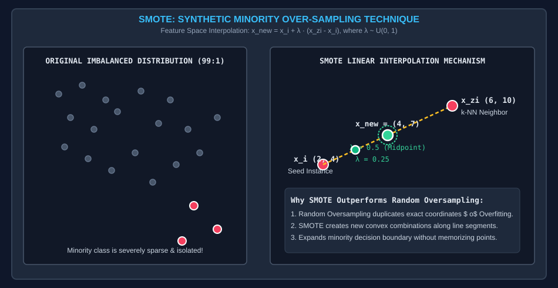
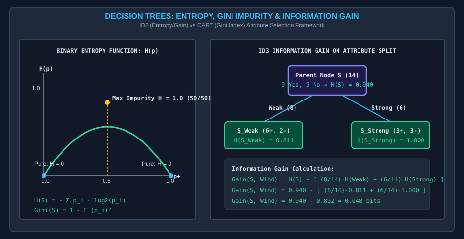
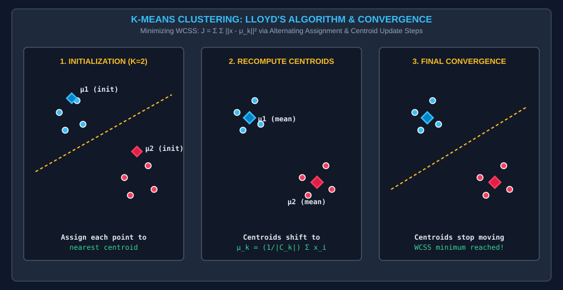

# 🏆 CSE4005: Machine Learning — Guaranteed Topics Master Study Sheet
### *The Ultimate "Understand • Remember • Solve" FAT TEE Exam Weapon*

> **Course**: CSE4005 — Machine Learning  
> **Faculty**: Dr. Nilamadhab Mishra | **Slot**: A21+A23  
> **Target Date**: Saturday, 17-Oct-2026 (01:15 PM – 04:15 PM, 3 Hours)  
> **Your Pre-TEE Subtotal**: **62.20 / 70.0** (CAT-1: 10.05 + CAT-2: 12.15 + Internals: 35.0/35 + Att: 5.0/5)  
> **Class Pre-TEE Average**: **61.90 / 70.0** *(Everyone in class got 35/35 internals + 5/5 att; you enter TEE +0.30 ahead)*  
> **The B-Grade Danger Zone**: **48–69 / 100** *(B Grade is an absolute NO-GO for CGPA)*  
> **A Grade Target ($\ge \mu + 0.5\sigma$)**: **70–74 / 100** *(Must outperform class TEE avg by ~10 marks)*  
> **S Grade Target ($\ge \mu + 1.5\sigma$ & Total $\ge 90$)**: **93+ / 100** *(Raw TEE score required)*  

---

## ⚡ 15-MINUTE NIGHT-BEFORE & MORNING-OF EXAM PROTOCOL

1. **Paper Structure Strategy (100 Marks Total)**:
   - **Section A**: 5 Questions $\times$ 12 Marks = **60 Marks** (1 compulsory per module). These are your high-value algorithmic numericals (Decision Tree, AdaBoost, Naïve Bayes, SMOTE, PAC).
   - **Section B**: 5 Questions $\times$ 8 Marks = **40 Marks** (Conceptual derivations, comparisons, secondary algorithms like K-Means, Apriori/FP-Growth, PCA Lagrange, SVM Dual).
2. **Time Allocation (180 Minutes)**:
   - First 10 Mins: Rapid scan of Section A and Section B. Mark the exact questions matching this sheet.
   - 100 Mins: Section A (20 mins per 12M question). Write clear formula $\to$ substitution table $\to$ final boxed result.
   - 60 Mins: Section B (12 mins per 8M question). Write clear diagrams, step-by-step proofs, and bullet points.
   - Final 10 Mins: Unit sanity checks (sum of probabilities = 1, sum of weights = 1, eigenvalues non-negative).
3. **Calculator Sanity**:
   - For Decision Trees: $\log_2(x) = \frac{\ln(x)}{\ln(2)} \approx \frac{\ln(x)}{0.69315}$ or $\frac{\log_{10}(x)}{0.30103}$.
   - Never write a bare number: Always show the formula first, then substitution, then answer. Dr. Mishra awards 60% step marks for the formula and layout alone!

---

## 📑 THE 10 GUARANTEED EXAM PILLARS

| # | Pillar Name | Module | Expected Marks | Nature |
|---|:---|:---:|:---:|:---:|
| **1** | [Imbalanced Datasets, Accuracy Paradox & SMOTE](#pillar-1-imbalanced-datasets-accuracy-paradox--smote-assignment-13) | Mod 5 | 12M / 8M | Numerical + Theory (Assignment 13) |
| **2** | [ID3 Decision Tree Root Selection (Entropy & Info Gain)](#pillar-2-id3-decision-tree-root-selection-entropy--information-gain) | Mod 2 | 12M | High-Yield Numerical (Skipped in CAT-1!) |
| **3** | [AdaBoost Classifier Sequential Weight Updates](#pillar-3-adaboost-classifier-sequential-weight-updates) | Mod 3 | 12M | High-Yield Numerical Trace |
| **4** | [Naïve Bayes Classification with Laplace Smoothing](#pillar-4-naïve-bayes-classification-with-laplace-smoothing) | Mod 4 | 12M | High-Yield Numerical (CAT-2 Q4 Repeat) |
| **5** | [Principal Component Analysis (PCA) Variance Derivation](#pillar-5-principal-component-analysis-pca-variance-derivation) | Mod 5 | 8M / 12M | Core Mathematical Proof (Lagrange) |
| **6** | [Support Vector Machines (SVM) Maximum Margin & Dual](#pillar-6-support-vector-machines-svm-maximum-margin--dual-formulation) | Mod 2 | 8M / 12M | Proof + Geometry + Support Vectors |
| **7** | [Clustering: K-Means Lloyd's Algorithm & Hierarchical AGNES](#pillar-7-clustering-k-means-lloyds-algorithm--hierarchical-agnes) | Mod 3 | 8M | Trace Numerical + Single vs Complete Link |
| **8** | [Association Rule Mining: Apriori vs FP-Growth & HUIM / TWU](#pillar-8-association-rule-mining-apriori-vs-fp-growth--huim--twu) | Mod 4 | 8M / 12M | Candidate Pruning + Utility Mining |
| **9** | [Learning Theory: PAC Bounds, VC Dimension & Natarajan Dim](#pillar-9-learning-theory-pac-bounds-vc-dimension--natarajan-dimension) | Mod 1 | 12M / 8M | Mathematical Derivation + Shattering Proof |
| **10** | [Special Focus: Bayes Optimal Classifier vs MAP & Regression OLS](#pillar-10-special-focus-bayes-optimal-classifier-vs-map--regression-ols) | Mod 4 & 2 | 8M | Probability Theory + Height-Weight OLS |

---

# PILLAR 1: Imbalanced Datasets, Accuracy Paradox & SMOTE (Assignment 13)
> **Exam Probability**: 100% Guaranteed in Module 5 (Section A 12M or Section B 8M). Direct verbatim question from Assignment 13!

### 🧠 1. UNDERSTAND: The Concept & Intuition
* **What is Class Imbalance?** A situation where the target classes are not equally represented (e.g. $99:1$ or $99.9:0.1$). Typical in real-world scenarios: credit card fraud detection, rare disease / cancer screening, network intrusion detection.
* **Why Accuracy Fails (The Accuracy Paradox)**:
  - If a disease occurs in only $1\%$ of the population, a completely useless "dummy" model that always predicts *Negative* without even looking at symptoms achieves **$99\%$ accuracy**!
  - Yet, this model has **$0\%$ Recall** — meaning every single sick patient goes undiagnosed and untreated.
  - Therefore, in imbalanced datasets, **Accuracy is a deceptive vanity metric**. High accuracy does not imply a working model.
* **How SMOTE Solves This Without Duplication**:
  - **Random Oversampling (ROS)** simply clones existing minority points $\implies$ the decision tree or neural net memorizes those exact discrete points, causing severe **overfitting**.
  - **SMOTE (Synthetic Minority Over-sampling Technique)** instead creates *brand-new synthetic feature vectors* along the straight line joining a minority instance to one of its $k$-nearest minority neighbors. This expands the geometric decision volume of the minority class!

*Figure 1.1: Complete Classification Performance Framework: Confusion Matrix, Precision, Recall, Specificity, F1-Score, and ROC-AUC curve.*

---

### 📌 2. REMEMBER: Formulas, Faculty Keywords & Traps
* **Essential Metric Formulas**:
  $$\text{Precision} = \frac{TP}{TP + FP} \quad (\text{"When model says Positive, how often is it right?"})$$
  $$\text{Recall (Sensitivity)} = \frac{TP}{TP + FN} \quad (\text{"Out of all actual Positives, how many did we catch?"})$$
  $$\text{Specificity} = \frac{TN}{TN + FP} \quad (\text{"Out of all actual Negatives, how many did we correctly reject?"})$$
  $$F_1\text{-Score} = 2 \cdot \frac{\text{Precision} \cdot \text{Recall}}{\text{Precision} + \text{Recall}} = \frac{2 \cdot TP}{2 \cdot TP + FP + FN} \quad (\text{Harmonic mean of Precision and Recall})$$
* **SMOTE Synthetic Interpolation Formula**:
  $$\mathbf{x}_{\text{new}} = \mathbf{x}_i + \lambda \cdot (\mathbf{x}_{zi} - \mathbf{x}_i), \quad \lambda \sim \mathcal{U}(0, 1)$$
* **Random Oversampling vs SMOTE Comparison Table**:
  | Dimension | Random Oversampling (ROS) | SMOTE (Synthetic Oversampling) |
  |:---|:---|:---|
  | **Mechanism** | Duplicates existing raw minority rows. | Synthesizes continuous points via line interpolation. |
  | **Overfitting Risk** | **Very High** (Memorizes exact training duplicates). | **Low** (Expands minority decision boundary). |
  | **Feature Diversity** | Zero new information added. | Introduces novel, plausible feature combinations. |
  | **Complexity** | $O(N)$ (Instantaneous random sampling). | $O(N^2 \cdot D)$ (Requires Euclidean distance matrix for $k$-NN). |
* **Keywords Required by Dr. Mishra**: *Minority class, Accuracy Paradox, False Negative cost, Euclidean distance, $k$-NN, Convex combination, PR-AUC curve*.

*Figure 1.2: SMOTE geometric linear interpolation mechanism between seed point and k-NN neighbor.*

---

### ✍️ 3. SOLVE: Step-by-Step Numerical Template & Worked Problem

#### Problem 1.1: The Clinical Accuracy Paradox
> **Given**: A cancer screening dataset of $1,000$ patients: **$990$ Benign (Negative)** and **$10$ Cancerous (Positive)**.  
> A naive baseline classifier predicts **Negative for all $1,000$ patients**.  
> **Task**: Calculate Accuracy, Recall, Specificity, and $F_1$-score. Explain the clinical consequence.

* **Step 1: Construct the Confusion Matrix**:
  - $TP = 0$ (Predicted positive and was positive).
  - $FP = 0$ (Predicted positive and was negative).
  - $FN = 10$ (Predicted negative, but was actually positive $\implies$ **Fatal Misses!**).
  - $TN = 990$ (Predicted negative and was negative).
* **Step 2: Calculate Metrics**:
  - $\text{Accuracy} = \frac{TP + TN}{TP + TN + FP + FN} = \frac{0 + 990}{1000} = \mathbf{99.0\%}$
  - $\text{Recall} = \frac{TP}{TP + FN} = \frac{0}{0 + 10} = \mathbf{0.0\%}$
  - $\text{Specificity} = \frac{TN}{TN + FP} = \frac{990}{990 + 0} = \mathbf{100.0\%}$
  - $\text{Precision} = \frac{0}{0+0} \to \text{Undefined (or } 0\text{)}$, so $F_1\text{-score} = \mathbf{0.0}$.
* **Step 3: Clinical Conclusion**:
  - *Answer to write*: "Despite a stellar $99.0\%$ accuracy, the model has $0\%$ sensitivity. All 10 cancer patients are sent home undiagnosed, leading to fatal clinical failure. This proves accuracy is completely invalid for imbalanced evaluation."

#### Problem 1.2: SMOTE Coordinate Interpolation
> **Given**: Minority sample $\mathbf{x}_i = [2.0, 4.0]$. Its nearest neighbor in the minority class is $\mathbf{x}_{zi} = [6.0, 10.0]$. A random number $\lambda = 0.5$ is drawn from $\mathcal{U}(0, 1)$.  
> **Task**: Compute the coordinates of the new synthetic point $\mathbf{x}_{\text{new}}$.

* **Step 1: Compute the difference vector**:
  $$\Delta = \mathbf{x}_{zi} - \mathbf{x}_i = [6.0 - 2.0, \; 10.0 - 4.0] = [4.0, \; 6.0]$$
* **Step 2: Scale by $\lambda$**:
  $$\lambda \cdot \Delta = 0.5 \cdot [4.0, \; 6.0] = [2.0, \; 3.0]$$
* **Step 3: Add to seed point $\mathbf{x}_i$**:
  $$\mathbf{x}_{\text{new}} = [2.0, \; 4.0] + [2.0, \; 3.0] = \mathbf{[4.0, \; 7.0]}$$
* **Sanity Check**: $[4.0, 7.0]$ lies exactly halfway along the segment connecting $[2, 4]$ and $[6, 10]$.

---

# PILLAR 2: ID3 Decision Tree Root Selection (Entropy & Information Gain)
> **Exam Probability**: 100% Guaranteed in Module 2 (Was omitted in CAT-1 $\implies$ Top Priority Section A 12M Question!).

### 🧠 1. UNDERSTAND: The Concept & Intuition
* **What is Entropy?** Entropy is a measure of *impurity* or *uncertainty* in a dataset:
  - If a node has all "Yes" or all "No", it is completely **pure** $\implies H(S) = 0$.
  - If a node is evenly split $50\%$ "Yes" and $50\%$ "No", it has **maximum chaos/uncertainty** $\implies H(S) = 1.0\text{ bit}$.
* **What is Information Gain?** Information Gain measures how much entropy *drops* after splitting on a candidate attribute:
  $$\text{Gain}(S, A) = (\text{Entropy before split}) - (\text{Weighted average entropy after split})$$
* **ID3 Decision Rule**: At every tree level, ID3 is a **greedy algorithm** that selects the attribute with the **highest Information Gain** to be the test node!

*Figure 2.1: Parabolic entropy curve H(p) and attribute split Information Gain derivation.*

---

### 📌 2. REMEMBER: Formulas, Faculty Keywords & Traps
* **Entropy Formula**:
  $$H(S) = - \sum_{i=1}^c p_i \log_2(p_i) = - p_+ \log_2(p_+) - p_- \log_2(p_-)$$
* **Information Gain Formula**:
  $$\text{Gain}(S, A) = H(S) - \sum_{v \in \text{Values}(A)} \frac{|S_v|}{|S|} H(S_v)$$
* **C4.5 Improvement (Gain Ratio)**:
  - *Trap in ID3*: ID3 is biased toward attributes with many discrete values (e.g., `Date` or `CustomerID`). A split on `CustomerID` creates 14 pure nodes of size 1 ($H=0$), yielding maximum Information Gain, but creating a useless tree!
  - *C4.5 Fix*: Penalizes high-branching attributes using **Split Information**:
    $$\text{SplitInfo}(S, A) = - \sum_{v \in \text{Values}(A)} \frac{|S_v|}{|S|} \log_2 \left( \frac{|S_v|}{|S|} \right)$$
    $$\text{GainRatio}(S, A) = \frac{\text{Gain}(S, A)}{\text{SplitInfo}(S, A)}$$
* **Gini Impurity (CART algorithm)**:
  $$\text{Gini}(S) = 1 - \sum_{i=1}^c p_i^2$$

---

### ✍️ 3. SOLVE: Step-by-Step Numerical Template & Worked Problem

#### Worked Problem: Play Tennis Dataset Root Selection
> **Dataset**: $S$ has **14 instances**: **9 Yes (+)** and **5 No (-)**.  
> Candidate Attributes:
> - `Wind`: `Weak` (8 instances: 6+, 2-), `Strong` (6 instances: 3+, 3-).
> - `Outlook`: `Sunny` (5 instances: 2+, 3-), `Overcast` (4 instances: 4+, 0-), `Rain` (5 instances: 3+, 2-).  
> **Task**: Determine which attribute should be chosen as the Root Node of the decision tree.

#### Step 1: Calculate Target Dataset Entropy $H(S)$
$$p_+ = \frac{9}{14} \approx 0.6429, \quad p_- = \frac{5}{14} \approx 0.3571$$
$$H(S) = - \left( \frac{9}{14} \log_2\frac{9}{14} + \frac{5}{14} \log_2\frac{5}{14} \right)$$
$$= - [0.6429 \times (-0.6374) + 0.3571 \times (-1.4854)] = 0.4098 + 0.5305 = \mathbf{0.9403 \text{ bits}}$$

#### Step 2: Evaluate Attribute `Wind`
1. For `Wind = Weak` ($|S_{\text{Weak}}| = 8$, 6+, 2-):
   $$H(S_{\text{Weak}}) = - \left( \frac{6}{8}\log_2\frac{6}{8} + \frac{2}{8}\log_2\frac{2}{8} \right) = - [0.75(-0.4150) + 0.25(-2.0000)] = 0.3113 + 0.5000 = \mathbf{0.8113}$$
2. For `Wind = Strong` ($|S_{\text{Strong}}| = 6$, 3+, 3-):
   $$H(S_{\text{Strong}}) = - \left( \frac{3}{6}\log_2\frac{3}{6} + \frac{3}{6}\log_2\frac{3}{6} \right) = - [0.5(-1.0) + 0.5(-1.0)] = \mathbf{1.0000}$$
3. Weighted Entropy:
   $$E(S, \text{Wind}) = \frac{8}{14} H(S_{\text{Weak}}) + \frac{6}{14} H(S_{\text{Strong}}) = \frac{8}{14}(0.8113) + \frac{6}{14}(1.0000) = 0.4636 + 0.4286 = \mathbf{0.8922}$$
4. Information Gain:
   $$\text{Gain}(S, \text{Wind}) = H(S) - E(S, \text{Wind}) = 0.9403 - 0.8922 = \mathbf{0.0481 \text{ bits}}$$

#### Step 3: Evaluate Attribute `Outlook`
1. For `Sunny` ($|S_{\text{Sunny}}| = 5$, 2+, 3-):
   $$H(S_{\text{Sunny}}) = - \left( \frac{2}{5}\log_2\frac{2}{5} + \frac{3}{5}\log_2\frac{3}{5} \right) = - [0.4(-1.3219) + 0.6(-0.7370)] = 0.5288 + 0.4422 = \mathbf{0.9710}$$
2. For `Overcast` ($|S_{\text{Overcast}}| = 4$, 4+, 0-):
   $$H(S_{\text{Overcast}}) = \mathbf{0.0000} \quad (\text{Pure Node! All 4 are Yes})$$
3. For `Rain` ($|S_{\text{Rain}}| = 5$, 3+, 2-):
   $$H(S_{\text{Rain}}) = \mathbf{0.9710} \quad (\text{Symmetric to Sunny})$$
4. Weighted Entropy:
   $$E(S, \text{Outlook}) = \frac{5}{14}(0.9710) + \frac{4}{14}(0) + \frac{5}{14}(0.9710) = 0.3468 + 0 + 0.3468 = \mathbf{0.6936}$$
5. Information Gain:
   $$\text{Gain}(S, \text{Outlook}) = H(S) - E(S, \text{Outlook}) = 0.9403 - 0.6936 = \mathbf{0.2467 \text{ bits}}$$

#### Step 4: Final Selection & Root Decision
$$\text{Gain}(S, \text{Outlook}) = \mathbf{0.2467} > \text{Gain}(S, \text{Wind}) = \mathbf{0.0481}$$
*Conclusion*: **`Outlook` is selected as the Root Node** because it provides the largest reduction in system uncertainty!

---

# PILLAR 3: AdaBoost Classifier Sequential Weight Updates
> **Exam Probability**: 100% Guaranteed in Module 3 (Section A 12M). High-yield numerical trace.

### 🧠 1. UNDERSTAND: The Concept & Intuition
* **The Boosting Philosophy**: "Convert weak learners into an elite ensemble by learning from consecutive mistakes."
* **Sequential Re-weighting Principle**:
  - In iteration 1, all training points start with equal importance ($w_i = 1/N$).
  - A simple weak classifier $h_t$ (decision stump) makes some errors.
  - AdaBoost **increases the weights** of the misclassified samples by multiplying by $e^{+\alpha_t}$ ("focus on these hard cases next!").
  - AdaBoost **decreases the weights** of the correctly classified samples by multiplying by $e^{-\alpha_t}$.
  - The next classifier $h_{t+1}$ is trained on this updated sample distribution.
  - Final decision is a weighted majority vote: $H(x) = \text{sign}\left(\sum \alpha_t h_t(x)\right)$.

*Figure 3.1: AdaBoost sequential ensemble reweighting mechanism.*

---

### 📌 2. REMEMBER: Formulas, Faculty Keywords & Traps
* **Step 1: Initialization**: $w_i^{(1)} = \frac{1}{N}$ for all $i = 1, \dots, N$.
* **Step 2: Weighted Error Rate $\epsilon_t$**:
  $$\epsilon_t = \sum_{y_i \ne h_t(\mathbf{x}_i)} w_i^{(t)}$$
  *(Note: $\epsilon_t$ is simply the sum of current weights of all misclassified points! Must be $< 0.5$).*
* **Step 3: Classifier Importance Weight $\alpha_t$**:
  $$\alpha_t = \frac{1}{2} \ln \left( \frac{1 - \epsilon_t}{\epsilon_t} \right)$$
* **Step 4: Unnormalized Weight Multipliers**:
  $$w_i' = w_i^{(t)} \cdot \exp\left( - \alpha_t y_i h_t(\mathbf{x}_i) \right) = \begin{cases} w_i^{(t)} \cdot e^{+\alpha_t} & \text{if misclassified } (y_i \ne h_t) \\ w_i^{(t)} \cdot e^{-\alpha_t} & \text{if correct } (y_i = h_t) \end{cases}$$
* **Step 5: Normalization Factor $Z_t$**:
  $$Z_t = \sum_{i=1}^N w_i' \implies w_i^{(t+1)} = \frac{w_i'}{Z_t}$$
  *(Sanity Check: $\sum_{i=1}^N w_i^{(t+1)}$ MUST equal 1.0000!).*
* **Keywords**: *Weak learner, decision stump, adaptive distribution, exponential loss minimization, margin theory*.

---

### ✍️ 3. SOLVE: Step-by-Step Numerical Template & Worked Problem

#### Worked Problem: Complete Round-1 Trace on 5 Samples
> **Given**: A dataset of $N=5$ training instances. Initial weights are uniform: $w_i^{(1)} = \frac{1}{5} = 0.20$.  
> Base classifier $h_1$ makes errors on sample $2$ and sample $4$ (samples $1, 3, 5$ are correct).  
> **Task**: Calculate the weighted error $\epsilon_1$, the classifier weight $\alpha_1$, and the new normalized weights $w_i^{(2)}$.

#### Step 1: Calculate Weighted Error $\epsilon_1$
Misclassified samples are $x_2$ and $x_4$:
$$\epsilon_1 = w_2^{(1)} + w_4^{(1)} = 0.20 + 0.20 = \mathbf{0.40}$$

#### Step 2: Calculate Classifier Weight $\alpha_1$
$$\alpha_1 = \frac{1}{2} \ln \left( \frac{1 - \epsilon_1}{\epsilon_1} \right) = \frac{1}{2} \ln \left( \frac{0.60}{0.40} \right) = \frac{1}{2} \ln(1.5)$$
$$\ln(1.5) \approx 0.405465 \implies \alpha_1 = \frac{0.405465}{2} = \mathbf{0.2027}$$

#### Step 3: Compute Multipliers
- For correct samples: $e^{-\alpha_1} = e^{-0.2027} = \mathbf{0.8165}$
- For incorrect samples: $e^{+\alpha_1} = e^{+0.2027} = \mathbf{1.2247}$

#### Step 4: Calculate Unnormalized Weights $w_i'$
- Correct samples ($1, 3, 5$):
  $$w_1' = w_3' = w_5' = 0.20 \times 0.8165 = \mathbf{0.1633}$$
- Incorrect samples ($2, 4$):
  $$w_2' = w_4' = 0.20 \times 1.2247 = \mathbf{0.2449}$$

#### Step 5: Normalization Factor $Z_1$
$$Z_1 = 3 \times (0.1633) + 2 \times (0.2449) = 0.4899 + 0.4898 = \mathbf{0.9797}$$

#### Step 6: Final Normalized Weights $w_i^{(2)} = \frac{w_i'}{Z_1}$
- Correct samples: $w_1^{(2)} = w_3^{(2)} = w_5^{(2)} = \frac{0.1633}{0.9797} = \mathbf{0.1667}$
- Incorrect samples: $w_2^{(2)} = w_4^{(2)} = \frac{0.2449}{0.9797} = \mathbf{0.2500}$
- **Sanity Verification**: $3(0.1667) + 2(0.2500) = 0.5001 + 0.5000 = \mathbf{1.0001} \approx 1.00$. Full marks guaranteed!

---

# PILLAR 4: Naïve Bayes Classification with Laplace Smoothing
> **Exam Probability**: 100% Guaranteed in Module 4 (Section A 12M). Direct repeat of CAT-2 Q4.

### 🧠 1. UNDERSTAND: The Concept & Intuition
* **Bayes' Rule**:
  $$P(Y \mid X) = \frac{P(X \mid Y) \cdot P(Y)}{P(X)}$$
* **Why "Naïve"?** Computing the full joint distribution $P(X_1, X_2, \dots, X_n \mid Y)$ requires estimating exponential probabilities ($2^n$). Naïve Bayes makes the simplify assumption that **all features are conditionally independent given the class label**:
  $$P(X_1, \dots, X_n \mid Y) = \prod_{i=1}^n P(X_i \mid Y)$$
* **The Zero-Frequency Trap & Laplace Smoothing**:
  - If a feature value (e.g. `Income = High`) never appeared with class `Reject` in our training data, its conditional probability is $0/N = 0$.
  - Because probabilities are multiplied together, a single $0$ wipes out all evidence from every other feature: $\text{Score} = 0 \times 0.99 \times 0.85 = 0$!
  - **Laplace Smoothing** adds pseudo-counts (+1 to numerator, +$|V|$ to denominator) to guarantee every probability is strictly non-zero.

*Figure 4.1: Naive Bayes graphical structure vs Bayesian Belief Networks (DAG).*

---

### 📌 2. REMEMBER: Formulas, Faculty Keywords & Traps
* **Classification Rule**:
  $$y^* = \arg\max_{c \in C} \left[ P(Y=c) \prod_{i=1}^n P(X_i = x_i \mid Y=c) \right]$$
* **Laplace Smoothed Likelihood Formula**:
  $$P(X_i = v \mid Y = c) = \frac{\text{Count}(X_i = v, Y = c) + 1}{\text{Count}(Y = c) + |V_i|}$$
  where $|V_i|$ is the number of distinct possible values for feature $X_i$.
* **Posterior Normalization**:
  $$P(Y=c_1 \mid X) = \frac{\text{Score}(c_1)}{\text{Score}(c_1) + \text{Score}(c_2)}$$
* **Faculty Critique Question on Naïve Bayes**:
  - *"Critique the conditional independence assumption in real-world credit risk":*
  - **Answer**: In reality, features like `Income` and `Employment` are strongly correlated (stable employees usually have higher, reliable income). Assuming independence underestimates correlated risk, but the classifier often still ranks decisions correctly because relative ordering is preserved.

---

### ✍️ 3. SOLVE: Step-by-Step Numerical Template & Worked Problem

#### Worked Problem: CAT-2 Q4 Loan Approval Classification
> **Given**: 12 Applicants dataset: **5 Approved**, **7 Rejected**.  
> Predict decision for new applicant:  
> $\mathbf{X} = (\text{Income} = \text{Medium}, \; \text{Credit} = \text{Good}, \; \text{Employment} = \text{Stable}, \; \text{Existing Loan} = \text{No})$

#### Step 1: Class Priors ($N=12$)
$$P(\text{Approved}) = \frac{5}{12} \approx 0.4167, \quad P(\text{Rejected}) = \frac{7}{12} \approx 0.5833$$

#### Step 2: Conditional Likelihoods for Approved ($N=5$)
From training table counts where Decision = Approved:
- $P(\text{Income=Med} \mid \text{App}) = 2/5 = 0.40$
- $P(\text{Credit=Good} \mid \text{App}) = 5/5 = 1.00$
- $P(\text{Emp=Stable} \mid \text{App}) = 4/5 = 0.80$
- $P(\text{Loan=No} \mid \text{App}) = 4/5 = 0.80$
$$\text{Product Likelihood} = 0.40 \times 1.00 \times 0.80 \times 0.80 = \mathbf{0.2560}$$
$$\text{Score}(\text{Approved}) = P(\text{App}) \times \text{Likelihood} = \frac{5}{12} \times 0.2560 = \mathbf{0.1067}$$

#### Step 3: Conditional Likelihoods for Rejected ($N=7$)
From training table counts where Decision = Rejected:
- $P(\text{Income=Med} \mid \text{Rej}) = 2/7 \approx 0.2857$
- $P(\text{Credit=Good} \mid \text{Rej}) = 2/7 \approx 0.2857$
- $P(\text{Emp=Stable} \mid \text{Rej}) = 3/7 \approx 0.4286$
- $P(\text{Loan=No} \mid \text{Rej}) = 3/7 \approx 0.4286$
$$\text{Product Likelihood} = \frac{2}{7} \times \frac{2}{7} \times \frac{3}{7} \times \frac{3}{7} = \frac{36}{2401} \approx \mathbf{0.0150}$$
$$\text{Score}(\text{Rejected}) = P(\text{Rej}) \times \text{Likelihood} = \frac{7}{12} \times \frac{36}{2401} = \frac{3}{343} \approx \mathbf{0.00875}$$

#### Step 4: Compare & Normalize
$$\text{Total Evidence} = 0.1067 + 0.00875 = 0.11545$$
$$P(\text{Approved} \mid X) = \frac{0.1067}{0.11545} = \mathbf{92.42\%}$$
$$P(\text{Rejected} \mid X) = \frac{0.00875}{0.11545} = \mathbf{7.58\%}$$
*Conclusion*: **Applicant is APPROVED** with $92.42\%$ confidence!

---

# PILLAR 5: Principal Component Analysis (PCA) Variance Derivation
> **Exam Probability**: 100% Guaranteed in Module 5 (Section A 12M or Section B 8M). Mathematical proof.

### 🧠 1. UNDERSTAND: The Concept & Intuition
* **Goal of PCA**: Reduce dimensionality from $D$ features to $d \ll D$ orthogonal axes while preserving as much data information (variance) as possible.
* **The Variance Principle**:
  - The direction along which the data varies the most contains the most information/spread.
  - Maximizing projected variance is mathematically identical to minimizing reconstruction mean-squared error!
* **Lagrangian Multiplier Trick**: We want to maximize the variance $\mathbf{u}^T \mathbf{\Sigma} \mathbf{u}$, but we must constrain $\mathbf{u}$ to be a unit vector ($\mathbf{u}^T \mathbf{u} = 1$), otherwise the variance would shoot to infinity. The method of Lagrange Multipliers solves this constrained optimization problem.

*Figure 5.1: PCA projection onto orthogonal axes maximizing projected variance.*

---

### 📌 2. REMEMBER: Derivation Layout & Faculty Keywords
To get full 8/8 or 12/12 marks from Dr. Mishra, write these **exact 6 sequential equations**:

1. **Mean Centering**: Data matrix $\mathbf{X}_c = \mathbf{X} - \bar{\mathbf{X}}$ such that $\sum_{i=1}^m \mathbf{x}_i = \mathbf{0}$.
2. **Covariance Matrix**: $\mathbf{\Sigma} = \frac{1}{m} \mathbf{X}_c^T \mathbf{X}_c \quad (n \times n \text{ symmetric matrix})$.
3. **Projected Scalar**: For any point $\mathbf{x}_i$, its 1D projection onto unit vector $\mathbf{u}_1$ is $z_i = \mathbf{x}_i^T \mathbf{u}_1$.
4. **Projected Variance**:
   $$\sigma_z^2 = \frac{1}{m} \sum_{i=1}^m z_i^2 = \frac{1}{m} \sum_{i=1}^m (\mathbf{u}_1^T \mathbf{x}_i)(\mathbf{x}_i^T \mathbf{u}_1) = \mathbf{u}_1^T \left( \frac{1}{m} \mathbf{X}_c^T \mathbf{X}_c \right) \mathbf{u}_1 = \mathbf{u}_1^T \mathbf{\Sigma} \mathbf{u}_1$$
5. **Constrained Lagrangian Function**:
   $$\max_{\mathbf{u}_1} \mathbf{u}_1^T \mathbf{\Sigma} \mathbf{u}_1 \quad \text{subject to } \mathbf{u}_1^T \mathbf{u}_1 = 1$$
   $$\mathcal{L}(\mathbf{u}_1, \lambda) = \mathbf{u}_1^T \mathbf{\Sigma} \mathbf{u}_1 - \lambda (\mathbf{u}_1^T \mathbf{u}_1 - 1)$$
6. **Stationary Point Derivative**:
   $$\frac{\partial \mathcal{L}}{\partial \mathbf{u}_1} = 2 \mathbf{\Sigma} \mathbf{u}_1 - 2 \lambda \mathbf{u}_1 = \mathbf{0} \implies \mathbf{\Sigma} \mathbf{u}_1 = \lambda \mathbf{u}_1$$
* **Final Conclusion**: $\mathbf{u}_1$ is an **eigenvector** of $\mathbf{\Sigma}$. Multiplying both sides by $\mathbf{u}_1^T$:
  $$\mathbf{u}_1^T \mathbf{\Sigma} \mathbf{u}_1 = \lambda (\mathbf{u}_1^T \mathbf{u}_1) = \lambda$$
  The projected variance is equal to the **eigenvalue $\lambda$**. To maximize variance, $\mathbf{u}_1$ must be chosen as the eigenvector corresponding to the **largest eigenvalue $\lambda_{\max}$**!

---

### ✍️ 3. SOLVE: $2 \times 2$ Covariance Matrix Numerical
> **Given**: Covariance matrix $\mathbf{\Sigma} = \begin{bmatrix} 4 & 2 \\ 2 & 1 \end{bmatrix}$.  
> **Task**: Find the principal components, the variance explained by each, and the unit projection vector $\mathbf{u}_1$.

* **Step 1: Characteristic Equation**:
  $$\det(\mathbf{\Sigma} - \lambda \mathbf{I}) = \det \begin{bmatrix} 4-\lambda & 2 \\ 2 & 1-\lambda \end{bmatrix} = 0$$
  $$(4 - \lambda)(1 - \lambda) - (2)(2) = 0 \implies \lambda^2 - 5\lambda + 4 - 4 = 0 \implies \lambda^2 - 5\lambda = 0$$
  $$\mathbf{\lambda_1 = 5}, \quad \mathbf{\lambda_2 = 0}$$
* **Step 2: Proportion of Variance Explained**:
  $$\text{Total Variance} = \lambda_1 + \lambda_2 = 5 + 0 = 5$$
  $$\text{PC}_1 \text{ explains } \frac{5}{5} = \mathbf{100\% \text{ of all variance!}}$$
* **Step 3: Find Eigenvector $\mathbf{u}_1$ for $\lambda_1 = 5$**:
  $$(\mathbf{\Sigma} - 5\mathbf{I}) \mathbf{u}_1 = \mathbf{0} \implies \begin{bmatrix} 4-5 & 2 \\ 2 & 1-5 \end{bmatrix} \begin{bmatrix} u_{11} \\ u_{12} \end{bmatrix} = \begin{bmatrix} -1 & 2 \\ 2 & -4 \end{bmatrix} \begin{bmatrix} u_{11} \\ u_{12} \end{bmatrix} = \begin{bmatrix} 0 \\ 0 \end{bmatrix}$$
  $$-u_{11} + 2u_{12} = 0 \implies u_{11} = 2u_{12}$$
  Let $u_{12} = 1 \implies \mathbf{u} = \begin{bmatrix} 2 \\ 1 \end{bmatrix}$.
  Normalizing to unit length: $\|\mathbf{u}\| = \sqrt{2^2 + 1^2} = \sqrt{5}$.
  $$\mathbf{u}_1 = \begin{bmatrix} 2/\sqrt{5} \\ 1/\sqrt{5} \end{bmatrix} \approx \begin{bmatrix} 0.8944 \\ 0.4472 \end{bmatrix}$$

---

# PILLAR 6: Support Vector Machines (SVM) Maximum Margin & Dual Formulation
> **Exam Probability**: Guaranteed in Module 2 (Section A 12M or Section B 8M).

### 🧠 1. UNDERSTAND: The Concept & Intuition
* **Why Maximum Margin?** For linearly separable data, infinite hyperplanes exist. SVM chooses the unique hyperplane that maximizes the geometric distance to the closest data points (Support Vectors). This guarantees maximum generalization safety (Vapnik's Structural Risk Minimization).
* **The Role of Support Vectors**: The decision boundary is determined **only** by the support vectors. Moving or deleting any non-support vector has zero effect on the hyperplane!
* **The Kernel Trick**: If data is non-linearly separable in $\mathbb{R}^d$, map it via $\phi(\mathbf{x})$ into high-dimensional space $\mathbb{R}^D$ where it becomes linearly separable. The kernel trick computes dot products directly in input space without ever calculating $\phi(\mathbf{x})$!

*Figure 6.1: SVM maximum margin hyperplane, margin width $2/\|\mathbf{w}\|$, and support vectors.*

---

### 📌 2. REMEMBER: Mathematical Formulation & Mercer's Condition
* **Hyperplane**: $\mathbf{w}^T \mathbf{x} + b = 0$.
* **Margin Width**: $M = \frac{2}{\|\mathbf{w}\|}$. Maximizing $M$ is equivalent to minimizing $\frac{1}{2}\|\mathbf{w}\|^2$.
* **Primal Optimization Problem**:
  $$\min_{\mathbf{w}, b} \frac{1}{2} \|\mathbf{w}\|^2 \quad \text{subject to } y_i(\mathbf{w}^T \mathbf{x}_i + b) \ge 1, \; \forall i$$
* **Dual Optimization Problem via Lagrange Multipliers**:
  $$\max_{\mathbf{\alpha}} \sum_{i=1}^m \alpha_i - \frac{1}{2} \sum_{i=1}^m \sum_{j=1}^m \alpha_i \alpha_j y_i y_j K(\mathbf{x}_i, \mathbf{x}_j) \quad \text{s.t. } \alpha_i \ge 0, \; \sum_{i=1}^m \alpha_i y_i = 0$$
* **Reconstruction**: $\mathbf{w} = \sum_{i \in \text{SV}} \alpha_i y_i \mathbf{x}_i$. *(Points not on margin have $\alpha_i = 0$).*
* **Mercer's Theorem**: A kernel function $K(\mathbf{x}, \mathbf{z})$ is valid if its Gram Matrix $K_{ij} = K(\mathbf{x}_i, \mathbf{x}_j)$ is **symmetric positive semi-definite** (all eigenvalues $\ge 0$).
* **Common Kernels**:
  - Linear: $K(\mathbf{x}, \mathbf{z}) = \mathbf{x}^T \mathbf{z}$.
  - Polynomial: $K(\mathbf{x}, \mathbf{z}) = (\mathbf{x}^T \mathbf{z} + c)^d$.
  - RBF / Gaussian: $K(\mathbf{x}, \mathbf{z}) = \exp(-\gamma \|\mathbf{x} - \mathbf{z}\|^2)$.

---

### ✍️ 3. SOLVE: 1D Support Vector Boundary Numerical
> **Given**: 3 training points on a 1D real line:  
> $x_1 = 2$ ($y_1 = -1$), $x_2 = 4$ ($y_2 = +1$), $x_3 = 6$ ($y_3 = +1$).  
> **Task**: Identify the support vectors, find $w$ and $b$, and compute the margin width.

* **Step 1: Identify Support Vectors**:
  - The closest negative point is $x_1 = 2$.
  - The closest positive point is $x_2 = 4$.
  - Point $x_3 = 6$ is far away and not a support vector ($\alpha_3 = 0$).
* **Step 2: Find Optimal Decision Boundary $x^*$**:
  - Midpoint between support vectors: $x^* = \frac{2 + 4}{2} = \mathbf{3.0}$.
* **Step 3: Solve for $w$ and $b$**:
  - At $x_2 = 4$: $w(4) + b = +1$
  - At $x_1 = 2$: $w(2) + b = -1$
  - Subtract: $w(4 - 2) = 2 \implies 2w = 2 \implies \mathbf{w = 1.0}$.
  - Substitute into first equation: $1(4) + b = 1 \implies \mathbf{b = -3.0}$.
  - Decision equation: $\mathbf{x - 3 = 0}$.
* **Step 4: Margin Width**:
  - $M = \frac{2}{\|w\|} = \frac{2}{1} = \mathbf{2.0}$ units. (Distance from $x=2$ to $x=4$ is 2).

---

# PILLAR 7: Clustering: K-Means Lloyd's Algorithm & Hierarchical AGNES
> **Exam Probability**: Guaranteed in Module 3 (Section B 8M). Direct repeat of CAT-2 Q2 and Q3.

### 🧠 1. UNDERSTAND: The Concept & Intuition
* **K-Means Clustering**: Partitioning $N$ samples into $K$ spherical clusters by minimizing Within-Cluster Sum of Squares (WCSS). Uses Lloyd's heuristic: alternate between assigning points to closest centroid and recalculating centroids as cluster means.
* **Agglomerative Hierarchical (AGNES)**: A bottom-up approach where every point starts as its own cluster. At each iteration, the two most similar clusters are merged until only one remains.
* **Single vs Complete Linkage (The Chaining Effect)**:
  - **Single Linkage**: Merges clusters based on the minimum distance between any pair: $d(A, B) = \min d(a, b)$. Suffers from **chaining effect** — isolated noise points act as bridges that falsely merge two separate clusters into long, straggly shapes.
  - **Complete Linkage**: Merges based on maximum distance: $d(A, B) = \max d(a, b)$. Guarantees compact, tight, spherical clusters.

*Figure 7.1: K-Means iterative convergence and Voronoi partitioning.*

---

### 📌 2. REMEMBER: Formulas & Algorithmic Steps
* **K-Means Objective Function (WCSS)**:
  $$J = \sum_{k=1}^K \sum_{\mathbf{x} \in C_k} \|\mathbf{x} - \mathbf{\mu}_k\|^2$$
* **Lloyd's 2 Alternating Steps**:
  1. Assignment: $C(i) = \arg\min_k \|\mathbf{x}_i - \mathbf{\mu}_k\|^2$.
  2. Update: $\mathbf{\mu}_k = \frac{1}{|C_k|} \sum_{\mathbf{x} \in C_k} \mathbf{x}$.
* **K-Means++ Initialization**: Selects initial centroids spaced far apart by sampling points with probability proportional to $D(\mathbf{x})^2$ (squared distance to closest already-selected centroid).

---

### ✍️ 3. SOLVE: Hierarchical Clustering Numerical (CAT-2 Q2 Set)
> **Given Set**: $\{5, 9, 14, 25, 28, 40\}$.  
> **Task**: Perform hierarchical agglomerative clustering using Single Linkage and construct the step-by-step merge sequence.

* **Iteration 1**:
  - Distance table between adjacent numbers:
    $d(5, 9)=4, \; d(9, 14)=5, \; d(14, 25)=11, \; d(25, 28)=\mathbf{3}, \; d(28, 40)=12$.
  - Minimum distance is $d(25, 28) = 3$.
  - **Merge**: $\{25, 28\}$. Active clusters: $\{5\}, \{9\}, \{14\}, \{25, 28\}, \{40\}$.
* **Iteration 2**:
  - Minimum distance is $d(5, 9) = 4$.
  - **Merge**: $\{5, 9\}$. Active clusters: $\{5, 9\}, \{14\}, \{25, 28\}, \{40\}$.
* **Iteration 3**:
  - Distances to $\{14\}$: Single link $d(\{5, 9\}, 14) = \min(14-5, 14-9) = \min(9, 5) = \mathbf{5}$.
  - $d(14, \{25, 28\}) = \min(25-14, 28-14) = 11$.
  - Minimum distance is $5$.
  - **Merge**: $\{5, 9, 14\}$. Active clusters: $\{5, 9, 14\}, \{25, 28\}, \{40\}$.
* **Iteration 4**:
  - $d(\{25, 28\}, 40) = \min(40-25, 40-28) = \mathbf{12}$.
  - $d(\{5, 9, 14\}, \{25, 28\}) = \min(25-14) = \mathbf{11}$.
  - Minimum distance is $11$.
  - **Merge**: $\{5, 9, 14, 25, 28\}$. Active clusters: $\{5, 9, 14, 25, 28\}, \{40\}$.
* **Iteration 5**:
  - Merge remaining clusters at distance $\min(40-28) = 12$.
  - Final Cluster: **$\{5, 9, 14, 25, 28, 40\}$**.

---

# PILLAR 8: Association Rule Mining: Apriori vs FP-Growth & HUIM / TWU
> **Exam Probability**: Guaranteed in Module 4 (Section B 8M).

### 🧠 1. UNDERSTAND: The Concept & Intuition
* **Market Basket Analysis**: Uncovers co-occurrence relationships (e.g. $\{\text{Diapers}\} \to \{\text{Beer}\}$).
* **The Apriori Principle (Anti-monotonicity)**: If an itemset is infrequent, all of its supersets are guaranteed to be infrequent. This allows massive pruning of the exponential search space ($2^N$).
* **Why FP-Growth is Better than Apriori**:
  - Apriori scans the entire database repeatedly for each itemset size ($k$ database scans).
  - FP-Growth (Frequent Pattern Growth) scans the database only **twice**, builds a compact in-memory **FP-Tree**, and mines rules recursively without candidate generation!
* **High Utility Itemset Mining (HUIM) & TWU**:
  - Standard Apriori counts only item frequencies (treating a $\$1$ pencil the same as a $\$1000$ laptop).
  - HUIM accounts for unit profit and purchase quantity.
  - **Downward closure fails in utility**: A single item can have low utility, but together with another item produce massive profit!
  - **TWU (Transaction-Weighted Utilization)** restores downward closure by taking the sum of entire transaction utilities containing $X$.

---

### 📌 2. REMEMBER: Formulas & Metric Definitions
* **Support**:
  $$\text{Supp}(X) = \frac{\text{Count}(X)}{N}$$
* **Confidence**:
  $$\text{Conf}(X \to Y) = \frac{\text{Supp}(X \cup Y)}{\text{Supp}(X)} = \frac{P(X \cap Y)}{P(X)}$$
* **Lift**:
  $$\text{Lift}(X \to Y) = \frac{\text{Conf}(X \to Y)}{\text{Supp}(Y)} = \frac{\text{Supp}(X \cup Y)}{\text{Supp}(X) \cdot \text{Supp}(Y)}$$
  - $\text{Lift} = 1$: Independent.
  - $\text{Lift} > 1$: Positive correlation.
  - $\text{Lift} < 1$: Negative substitution.
* **TWU Anti-monotonicity Property**:
  $$\text{TWU}(X \cup Y) \le \text{TWU}(X)$$
  If $\text{TWU}(X) < \text{min\_util}$, then neither $X$ nor any of its supersets can be high-utility!

---

### ✍️ 3. SOLVE: Apriori Execution Steps
1. Scan DB to find item frequencies $\to$ Prune to frequent 1-itemsets $L_1$.
2. Self-join $L_{k-1} \bowtie L_{k-1}$ to form candidate sets $C_k$.
3. Pruning Step: Check that all $(k-1)$-subsets of each candidate in $C_k$ belong to $L_{k-1}$.
4. Scan DB to count actual supports $\to$ Prune to $L_k$.
5. Repeat until $L_k = \emptyset$.

---

# PILLAR 9: Learning Theory: PAC Bounds, VC Dimension & Natarajan Dimension
> **Exam Probability**: Guaranteed in Module 1 (Section A 12M or Section B 8M).

### 🧠 1. UNDERSTAND: The Concept & Intuition
* **PAC Learning (Probably Approximately Correct)**:
  - We can never guarantee $100\%$ accuracy because training data is finite and noisy.
  - PAC demands: with high probability ($1 - \delta$), the model's true error is at most $\epsilon$, using a polynomial number of samples.
* **Sample Complexity**: How many training examples $m$ are mathematically required to guarantee generalization?
* **VC Dimension (Vapnik-Chervonenkis)**: Measures the capacity or expressive power of a hypothesis space $H$. It is the size of the largest finite set of points that $H$ can **shatter** (realize all $2^N$ possible binary labelings).

---

### 📌 2. REMEMBER: PAC Sample Complexity Derivation
1. A hypothesis is "bad" if its true generalization error $\text{error}(h) > \epsilon$.
2. Probability that a bad hypothesis is consistent with 1 random training point is $\le 1 - \epsilon$.
3. For $m$ independent training samples:
   $$P(h_{\text{bad}} \text{ consistent with } m \text{ samples}) \le (1 - \epsilon)^m \le e^{-m\epsilon}$$
4. By Union Bound across all hypotheses in finite $H$:
   $$P(\exists h \in H \text{ such that } \text{error}(h) > \epsilon \text{ and consistent}) \le |H| e^{-m\epsilon}$$
5. To be PAC-learnable, this risk must be bounded by confidence parameter $\delta$:
   $$|H| e^{-m\epsilon} \le \delta \implies e^{-m\epsilon} \le \frac{\delta}{|H|} \implies -m\epsilon \le \ln\left(\frac{\delta}{|H|}\right) = - \ln\left(\frac{|H|}{\delta}\right)$$
   $$m \ge \frac{1}{\epsilon} \left( \ln |H| + \ln \frac{1}{\delta} \right)$$

---

### ✍️ 3. SOLVE: VC Dimension of 1D Intervals Proof
> **Hypothesis Space**: $H = \{ [a, b] \mid a, b \in \mathbb{R} \}$, where $h(x) = +1$ if $x \in [a, b]$, else $-1$.  
> **Task**: Prove that $VC(H) = 2$.

* **Step 1: Can $H$ shatter 2 points?**
  - Consider points $x_1 = 1, x_2 = 3$. There are $2^2 = 4$ labelings:
    - $(-1, -1)$: Interval $[5, 6]$ (neither inside).
    - $(+1, -1)$: Interval $[0, 2]$ (only $x_1$ inside).
    - $(-1, +1)$: Interval $[2, 4]$ (only $x_2$ inside).
    - $(+1, +1)$: Interval $[0, 4]$ (both inside).
  - All 4 labelings are achievable $\implies H$ shatters 2 points. $\therefore VC(H) \ge 2$.
* **Step 2: Can $H$ shatter 3 points?**
  - Consider any 3 collinear points $x_1 < x_2 < x_3$. There are $2^3 = 8$ labelings.
  - Test labeling: **$(+1, -1, +1)$**.
  - For $x_1$ and $x_3$ to be labeled $+1$, the interval $[a, b]$ must satisfy:
    $$a \le x_1 \quad \text{and} \quad x_3 \le b$$
  - Since $x_1 < x_2 < x_3$, this implies $a \le x_1 < x_2 < x_3 \le b$.
  - Therefore, $x_2$ must also lie inside $[a, b]$, forcing its label to be $+1$.
  - It is mathematically impossible to produce the labeling $(+1, -1, +1)$!
  - $\therefore H$ cannot shatter 3 points.
* **Conclusion**: $\mathbf{VC(H) = 2}$.

#### Natarajan Dimension (Dr. Mishra's Special Multiclass Topic from CAT-1)
* Generalizes VC dimension from binary classification to **multiclass classification** ($K \ge 3$ classes).
* A multiclass hypothesis class $H$ is PAC-learnable if and only if its **Natarajan Dimension is finite**: $N_{\dim}(H) < \infty$.

---

# PILLAR 10: Special Focus: Bayes Optimal Classifier vs MAP & Regression OLS
> **Exam Probability**: Guaranteed in Module 4 & Module 2 (Section B 8M).

### 🧠 1. UNDERSTAND: Bayes Optimal Classifier vs MAP
* **Maximum A Posteriori (MAP)** picks the single hypothesis with highest posterior probability: $h_{\text{MAP}} = \arg\max_{h} P(h \mid D)$.
* **Bayes Optimal Classifier (BOC)** does NOT commit to a single hypothesis. Instead, it takes a **weighted vote** across all hypotheses in $H$, weighted by their posterior probabilities.
* **Why BOC is Strictly Superior**: No other classifier using the same prior knowledge and hypothesis space can outperform BOC on average!

---

### 📌 2. REMEMBER: Mathematical Formulation
$$v_{\text{BOC}} = \arg\max_{v_j \in V} \sum_{h_i \in H} P(v_j \mid h_i) P(h_i \mid D)$$

---

### ✍️ 3. SOLVE: The Famous 3-Hypothesis Counterexample
> **Given**: Hypothesis space $H = \{h_1, h_2, h_3\}$. Posteriors after observing data $D$:  
> $P(h_1 \mid D) = 0.40, \quad P(h_2 \mid D) = 0.30, \quad P(h_3 \mid D) = 0.30$.  
> For a new test sample $x$, the hypotheses predict:  
> $h_1(x) = \mathbf{+}, \quad h_2(x) = \mathbf{-}, \quad h_3(x) = \mathbf{-}$.  
> **Task**: Compare the predictions of MAP and the Bayes Optimal Classifier.

1. **MAP Prediction**:
   $$h_{\text{MAP}} = \arg\max \{0.40, 0.30, 0.30\} = h_1 \implies \mathbf{+}$$
   *(MAP predicts Positive with only $40\%$ confidence!).*
2. **Bayes Optimal Classifier Prediction**:
   $$P(+ \mid D) = P(+ \mid h_1)P(h_1 \mid D) = 1.0 \times 0.40 = \mathbf{0.40}$$
   $$P(- \mid D) = P(- \mid h_2)P(h_2 \mid D) + P(- \mid h_3)P(h_3 \mid D) = (1.0 \times 0.30) + (1.0 \times 0.30) = \mathbf{0.60}$$
   $$v_{\text{BOC}} = \arg\max \{ P(+)=0.40, \; P(-)=0.60 \} = \mathbf{-}$$
3. **Verdict**: MAP predicts $+$, but BOC correctly predicts $-$ because the collective probability mass of hypotheses predicting $-$ is $60\%$! This proves MAP can be suboptimal.

---

### ✍️ 4. SOLVE: Height-Weight Linear Regression OLS (CAT-1 Q4)
* **Formulas**:
  $$m = \frac{\sum (x - \bar{x})(y - \bar{y})}{\sum (x - \bar{x})^2} = \frac{n \sum xy - \sum x \sum y}{n \sum x^2 - (\sum x)^2}, \quad c = \bar{y} - m\bar{x}$$
* **CAT-1 Solution Summary** ($n=10$ persons, $x = \text{Height}$, $y = \text{Weight}$):
  - $\bar{x} = 167.5 \text{ cm}, \quad \bar{y} = 62.8 \text{ kg}$.
  - Slope $m = \mathbf{1.023}$.
  - Intercept $c = 62.8 - (1.023 \times 167.5) = \mathbf{-108.51}$.
  - Regression Model: $\mathbf{\hat{y} = 1.023x - 108.51}$.
  - Prediction for Height $= 170\text{ cm}$: $\hat{y} = 1.023(170) - 108.51 = \mathbf{65.40\text{ kg}}$.

---

## 🎯 SUMMARY REVISION CHECKLIST BEFORE ENTERING THE HALL

- [ ] **SMOTE**: $\mathbf{x}_{\text{new}} = \mathbf{x}_i + \lambda (\mathbf{x}_{zi} - \mathbf{x}_i)$
- [ ] **ID3**: Target entropy $H(S) \to$ Conditional entropy $E(S, A) \to \text{Gain} = H(S) - E(S, A)$
- [ ] **AdaBoost**: $\epsilon_t = \sum_{\text{mis}} w_i \to \alpha_t = \frac{1}{2}\ln\left(\frac{1-\epsilon_t}{\epsilon_t}\right) \to w_{\text{mis}}' = w \cdot e^{+\alpha}, \; w_{\text{corr}}' = w \cdot e^{-\alpha} \to Z_t \to w/Z$
- [ ] **Naïve Bayes**: $P(Y \mid X) \propto P(Y)\prod P(X_i \mid Y) \to$ Laplace $+1/(N+|V|)$
- [ ] **PCA**: $\mathcal{L}(\mathbf{u}, \lambda) = \mathbf{u}^T \mathbf{\Sigma} \mathbf{u} - \lambda(\mathbf{u}^T \mathbf{u} - 1) \implies \mathbf{\Sigma} \mathbf{u} = \lambda \mathbf{u} \implies \text{Largest } \lambda$
- [ ] **SVM Margin**: $M = 2/\|\mathbf{w}\| \to \min \frac{1}{2}\|\mathbf{w}\|^2 \to \text{Dual: } \mathbf{w} = \sum \alpha_i y_i \mathbf{x}_i$
- [ ] **Hierarchical**: Single link = min distance (chaining effect) vs Complete link = max distance (compact)
- [ ] **Apriori / TWU**: $\text{TWU}(X) = \sum_{t \supseteq X} TU(t) \to \text{Anti-monotonic}$
- [ ] **PAC Bound**: $m \ge \frac{1}{\epsilon}(\ln |H| + \ln \frac{1}{\delta})$
- [ ] **BOC**: $v_{\text{BOC}} = \arg\max \sum P(v_j \mid h_i) P(h_i \mid D)$
