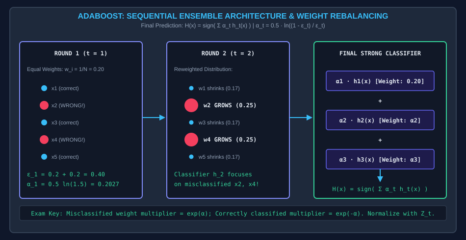
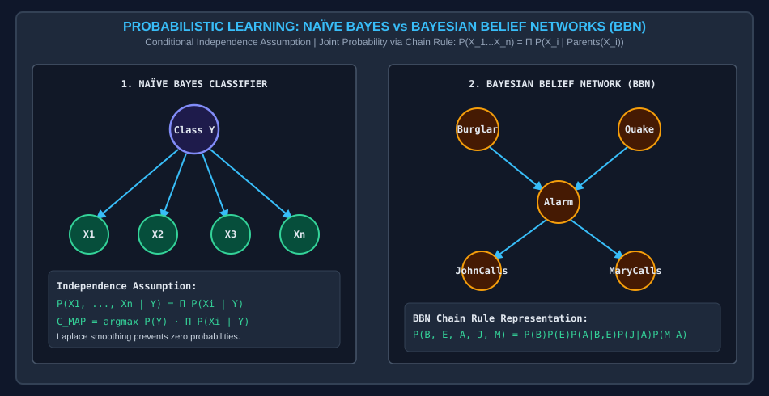

# 🏆 CSE4005: Machine Learning — Official TEE FAT Model Exam Paper & Answer Script
### *Constructed in Exact Accordance with VIT Bhopal TEE Format (TEE.txt)*

> **Course Code**: CSE4005 — Machine Learning | **Faculty**: Dr. Nilamadhab Mishra  
> **Slot**: A21+A23 | **Duration**: 3 Hours (Closed Book) | **Maximum Marks**: 100  
> **Pre-TEE Internal Standing**: **62.20 / 70.0** vs Class Mean **61.90 / 70.0** *(+0.30 ahead)*  
> **A Grade Target ($\ge \mu + 0.5\sigma$)**: **70–74 / 100** *(Must score ~10–12 marks above TEE class average)*  
> **S Grade Target (Total $\ge 90.0$)**: **93+ / 100** *(Strict VIT rule)*  
> **B-Grade Danger Zone**: **48–69 / 100** *(B Grade is an absolute NO-GO for CGPA)*  

---

## 📋 OFFICIAL TEE PAPER SPECIFICATION (FROM TEE.txt)
* **Section A (60 Marks)**: 5 Questions $\times$ 12 Marks (Questions 1 to 5). Exactly one question per module. Compulsory internal choice **"OR" format** (12 Marks OR 12 Marks, or 6+6).
* **Section B (40 Marks)**: 5 Questions $\times$ 8 Marks (Questions 6 to 10). Exactly one question per module. Direct question **without subparts**.
* **Module Distribution**: Every single Module (1 to 5) carries **exactly 20 Marks** (12M in Section A + 8M in Section B).
* **Dataset Integrity Rule**: All questions requiring or utilizing data provide the **entire, complete dataset table** directly within the question statement itself. No external citations, slide references, or abbreviated datasets are used.

---

## 📑 TEE QUESTION PAPER NAVIGATION MATRIX

| Section | Q# | Module | Syllabus Topic | Marks | Format |
|:---:|:---:|:---:|:---|:---:|:---:|
| **SEC A** | **Q1** | **Module 1** | [PAC Sample Complexity Derivation **OR** Version Spaces & Find-S Trace](#question-1-module-1--12-marks) | 12M | 12M OR 6M+6M |
| **SEC A** | **Q2** | **Module 2** | [ID3 Decision Tree (`buys_computer` 14-Row Table) **OR** k-NN & SVM Slack](#question-2-module-2--12-marks) | 12M | 12M OR 6M+6M |
| **SEC A** | **Q3** | **Module 3** | [AdaBoost 5-Sample Weight Update Trace **OR** RF & ECOC 7-Bit Code Matrix](#question-3-module-3--12-marks) | 12M | 12M OR 6M+6M |
| **SEC A** | **Q4** | **Module 4** | [Naïve Bayes Loan Approval (12 Applicants) **OR** Apriori Mining (10 Transactions)](#question-4-module-4--12-marks) | 12M | 12M OR 12M |
| **SEC A** | **Q5** | **Module 5** | [Imbalanced Data & SMOTE Coordinate Math **OR** 500-Patient Confusion Matrix & RAG](#question-5-module-5--12-marks) | 12M | 12M OR 6M+6M |
| **SEC B** | **Q6** | **Module 1** | [VC Dimension ($VC=2$) & Natarajan Multiclass Dimension](#question-6-module-1--8-marks) | 8M | Direct 8M |
| **SEC B** | **Q7** | **Module 2** | [SVM Maximum Margin Width $2/\|\mathbf{w}\|$ & Wolfe Dual Formulation](#question-7-module-2--8-marks) | 8M | Direct 8M |
| **SEC B** | **Q8** | **Module 3** | [Hierarchical AGNES Clustering on Complete Set $\{5, 9, 14, 25, 28, 40\}$](#question-8-module-3--8-marks) | 8M | Direct 8M |
| **SEC B** | **Q9** | **Module 4** | [High Utility Itemset Mining (HUIM) & TWU Anti-Monotonicity Proof](#question-9-module-4--8-marks) | 8M | Direct 8M |
| **SEC B** | **Q10**| **Module 5** | [PCA Projected Variance Maximization Derivation via Lagrange Multipliers](#question-10-module-5--8-marks) | 8M | Direct 8M |

---
---

# ══════════════════════════════════════════════════
# SECTION A: 5 QUESTIONS $\times$ 12 MARKS = 60 MARKS
### *(Answer One Full Question from each Module — Internal Choice "OR" Format)*
# ══════════════════════════════════════════════════

---

# QUESTION 1 [Module 1 — 12 Marks]

### OPTION A (RECOMMENDED DERIVATION):
*(a) Define the Probably Approximately Correct (PAC) learning framework. Formulate the mathematical conditions for a hypothesis class to be PAC-learnable.* **[4 Marks]**  
*(b) For a finite hypothesis space $H$, derive the general PAC sample complexity bound:*  
$$m \ge \frac{1}{\epsilon} \left( \ln |H| + \ln \frac{1}{\delta} \right)$$  
*State the physical role of the approximation error parameter $\epsilon$ and the confidence parameter $\delta$.* **[8 Marks]**

### OR

### OPTION B:
*(a) Explain Version Space learning. Define the General Boundary ($G$) and Specific Boundary ($S$), and formulate the Candidate Elimination algorithm update rules.* **[6 Marks]**  
*(b) The following complete 4-sample training dataset for the target concept `EnjoySport` is given:*  

| Example | Sky | AirTemp | Humidity | Wind | Water | Forecast | EnjoySport (Class) |
|:---:|:---:|:---:|:---:|:---:|:---:|:---:|:---:|
| 1 | Sunny | Warm | Normal | Strong | Warm | Same | **Yes** |
| 2 | Sunny | Warm | High | Strong | Warm | Same | **Yes** |
| 3 | Rainy | Cold | High | Strong | Warm | Change | **No** |
| 4 | Sunny | Warm | High | Strong | Cool | Change | **Yes** |

*Trace the step-by-step execution of the Find-S algorithm starting from the maximally specific hypothesis $h_0$. Show the updated hypothesis after observing each training instance and state the final hypothesis $h_4$.* **[6 Marks]**

---

### MODEL EXAM ANSWER FOR QUESTION 1 (OPTION A):

#### 1. The PAC Learning Framework

* **Formal Definition**: A concept class $C$ defined over instance space $X$ of dimension $n$ is **PAC-learnable** by a learning algorithm $L$ using hypothesis space $H$ if for all target concepts $c \in C$, all instance distributions $\mathcal{D}$ over $X$, and any chosen error parameter $\epsilon \in (0, 1/2)$ and failure confidence parameter $\delta \in (0, 1/2)$:
  1. Algorithm $L$ draws an independent and identically distributed (i.i.d.) sample $D$ of size $m$ from distribution $\mathcal{D}$.
  2. With probability at least $1 - \delta$ (Confidence parameter), algorithm $L$ outputs a hypothesis $h \in H$ such that its true generalization risk satisfies:
     $$P_{\mathcal{D}}(\text{error}_{\mathcal{D}}(h) \le \epsilon) \ge 1 - \delta$$
  3. The time complexity and sample size $m$ are bounded by a polynomial in $(1/\epsilon, 1/\delta, n, \text{size}(c))$.

---

#### 2. Mathematical Derivation of the PAC Sample Complexity Bound

Let $H$ be a finite hypothesis space. We consider a consistent learner $L$ that always outputs a hypothesis $h \in H$ with zero training error ($\text{error}_{\text{train}}(h) = 0$).

#### Step 1: Definition of an $\epsilon$-Bad Hypothesis
A hypothesis $h$ is defined as $\epsilon$-bad if its true generalization error over distribution $\mathcal{D}$ strictly exceeds $\epsilon$:
$$\text{error}_{\mathcal{D}}(h) = P_{x \sim \mathcal{D}}(h(x) \neq c(x)) > \epsilon$$

#### Step 2: Probability of a Single Bad Hypothesis Remaining Consistent
For any fixed $\epsilon$-bad hypothesis $h_{\text{bad}}$, the probability that it agrees with the target concept on a single randomly drawn instance $x$ is:
$$P(h_{\text{bad}}(x) = c(x)) = 1 - \text{error}_{\mathcal{D}}(h_{\text{bad}}) < 1 - \epsilon$$
Since the training dataset $D$ consists of $m$ mutually independent training instances:
$$P(h_{\text{bad}} \text{ is consistent with all } m \text{ examples}) \le (1 - \epsilon)^m$$

#### Step 3: Applying the Fundamental Exponential Inequality
Using the standard mathematical inequality $(1 - x) \le e^{-x}$ valid for all $x \in \mathbb{R}$:
$$(1 - \epsilon)^m \le e^{-m\epsilon}$$

#### Step 4: Applying Boole's Union Bound over Hypothesis Space $H$
Let $H_{\text{bad}} \subseteq H$ be the set of all $\epsilon$-bad hypotheses ($|H_{\text{bad}}| \le |H|$). The learner fails if it outputs any hypothesis belonging to $H_{\text{bad}}$. By Boole's Union Bound:
$$P(\exists h \in H_{\text{bad}} \text{ such that } h \text{ is consistent with } D) \le \sum_{h \in H_{\text{bad}}} P(h \text{ is consistent with } D)$$
$$P(\text{Learner Failure}) \le |H| \cdot (1 - \epsilon)^m \le |H| e^{-m\epsilon}$$

#### Step 5: Enforcing the Confidence Guarantee $\delta$
To guarantee that the failure probability does not exceed $\delta$:
$$|H| e^{-m\epsilon} \le \delta$$
Dividing both sides by $|H|$:
$$e^{-m\epsilon} \le \frac{\delta}{|H|}$$
Taking natural logarithms on both sides:
$$-m\epsilon \le \ln\left( \frac{\delta}{|H|} \right) = - \ln\left( \frac{|H|}{\delta} \right)$$
Multiplying by $-1$ reverses the inequality:
$$m\epsilon \ge \ln\left( \frac{|H|}{\delta} \right) = \ln |H| + \ln\left(\frac{1}{\delta}\right)$$
Dividing by $\epsilon$:
$$m \ge \frac{1}{\epsilon} \left( \ln |H| + \ln \frac{1}{\delta} \right)$$

$$\mathbf{\text{Final Boxed Result: } m \ge \frac{1}{\epsilon} \left( \ln |H| + \ln \frac{1}{\delta} \right)}$$

* **Role of $\epsilon$**: Accuracy parameter. Smaller $\epsilon$ enforces tighter approximation, requiring sample size to grow as $O(1/\epsilon)$.
* **Role of $\delta$**: Confidence parameter. Smaller $\delta$ guarantees higher certainty ($1-\delta$), requiring sample size to scale logarithmically as $O(\ln(1/\delta))$.

---

### MODEL EXAM ANSWER FOR QUESTION 1 (OPTION B — Find-S Trace):

> 💡 **EXAM NOTE: Numerical Solving Strategy for Find-S**  
> 1. Initialize $h_0 = \langle \Phi, \Phi, \Phi, \Phi, \Phi, \Phi \rangle$.  
> 2. Ignore all **negative** instances completely (Find-S only learns from positive instances).  
> 3. For each **positive** instance: if an attribute value matches $h$, keep it; if it differs from $h$, generalize that attribute to '?'.

* **Step 0 (Initialization)**:  
  $$h_0 = \langle \Phi, \; \Phi, \; \Phi, \; \Phi, \; \Phi, \; \Phi \rangle$$
* **Step 1 (Instance 1: Positive — $\langle \text{Sunny, Warm, Normal, Strong, Warm, Same} \rangle$)**:  
  Replace all $\Phi$ with the specific instance values:  
  $$h_1 = \langle \text{Sunny, Warm, Normal, Strong, Warm, Same} \rangle$$
* **Step 2 (Instance 2: Positive — $\langle \text{Sunny, Warm, High, Strong, Warm, Same} \rangle$)**:  
  Attribute `Humidity` changes from `Normal` to `High` $\implies$ generalize to `?`:  
  $$h_2 = \langle \text{Sunny, Warm, ?, Strong, Warm, Same} \rangle$$
* **Step 3 (Instance 3: Negative — $\langle \text{Rainy, Cold, High, Strong, Warm, Change} \rangle$)**:  
  Negative instance $\implies$ **Ignored** by Find-S algorithm:  
  $$h_3 = h_2 = \langle \text{Sunny, Warm, ?, Strong, Warm, Same} \rangle$$
* **Step 4 (Instance 4: Positive — $\langle \text{Sunny, Warm, High, Strong, Cool, Change} \rangle$)**:  
  Attribute `Water` changes from `Warm` to `Cool` $\implies$ generalize to `?`.  
  Attribute `Forecast` changes from `Same` to `Change` $\implies$ generalize to `?`:  
  $$h_4 = \langle \text{Sunny, Warm, ?, Strong, ?, ?} \rangle$$

$$\mathbf{\text{Final Maximally Specific Hypothesis: } h_4 = \langle \text{Sunny, Warm, ?, Strong, ?, ?} \rangle}$$

---

# QUESTION 2 [Module 2 — 12 Marks]

### OPTION A (RECOMMENDED NUMERICAL):
*(a) Explain the fundamental concepts of Decision Tree induction using the ID3 algorithm. Define Entropy, Information Gain, Gain Ratio, and Gini Impurity.* **[4 Marks]**  
*(b) The following complete 14-sample training dataset `buys_computer` is given:*  

| RID | Age | Income | Student | Credit_Rating | Buys_Computer (Class) |
|:---:|:---:|:---:|:---:|:---:|:---:|
| 1 | <=30 | High | No | Fair | **No** |
| 2 | <=30 | High | No | Excellent | **No** |
| 3 | 31..40 | High | No | Fair | **Yes** |
| 4 | >40 | Medium | No | Fair | **Yes** |
| 5 | >40 | Low | Yes | Fair | **Yes** |
| 6 | >40 | Low | Yes | Excellent | **No** |
| 7 | 31..40 | Low | Yes | Excellent | **Yes** |
| 8 | <=30 | Medium | No | Fair | **No** |
| 9 | <=30 | Low | Yes | Fair | **Yes** |
| 10 | >40 | Medium | Yes | Fair | **Yes** |
| 11 | <=30 | Medium | Yes | Excellent | **Yes** |
| 12 | 31..40 | Medium | No | Excellent | **Yes** |
| 13 | 31..40 | High | Yes | Fair | **Yes** |
| 14 | >40 | Medium | No | Excellent | **No** |

*Using the ID3 algorithm, evaluate candidate attributes `Age` and `Credit_Rating`. Compute the Target Entropy $H(S)$, the conditional entropies, and the Information Gain for each attribute. Determine which attribute must be selected as the Root Node of the decision tree.* **[8 Marks]**

### OR

### OPTION B:
*(a) Explain the k-Nearest Neighbor (k-NN) classification algorithm, distance metrics (Euclidean, Manhattan), and the curse of dimensionality.* **[6 Marks]**  
*(b) Explain Support Vector Machine (SVM) soft-margin classification, slack variables $\xi_i$, and the regularization parameter $C$.* **[6 Marks]**

---

### MODEL EXAM ANSWER FOR QUESTION 2 (OPTION A):

#### 1. Theoretical Formulations

* **Entropy $H(S)$**: Quantifies the expected impurity/uncertainty in dataset $S$:
  $$H(S) = - \sum_{i=1}^c p_i \log_2(p_i)$$
* **Information Gain $\text{Gain}(S, A)$**: Expected entropy reduction caused by partitioning on attribute $A$:
  $$\text{Gain}(S, A) = H(S) - \sum_{v \in \text{Values}(A)} \frac{|S_v|}{|S|} H(S_v)$$
* **Gain Ratio (C4.5)**: Penalizes multi-valued attributes using Split Information:
  $$\text{SplitInfo}(S, A) = - \sum_{v=1}^k \frac{|S_v|}{|S|} \log_2\left(\frac{|S_v|}{|S|}\right), \qquad \text{GainRatio}(S, A) = \frac{\text{Gain}(S, A)}{\text{SplitInfo}(S, A)}$$
* **Gini Impurity (CART)**:
  $$\text{Gini}(S) = 1 - \sum_{i=1}^c p_i^2$$

---

> 💡 **EXAM NOTE: Numerical Solving Strategy for ID3 Trees**  
> 1. Calculate Target Entropy $H(S)$ using class distribution $(p_+, p_-)$.  
> 2. On scientific calculator: $\log_2(x) = \frac{\ln(x)}{\ln(2)} \approx \frac{\ln(x)}{0.69315}$.  
> 3. For each candidate attribute: compute subset entropies $H(S_v)$, then weight them: $E(S, A) = \sum \frac{|S_v|}{|S|} H(S_v)$.  
> 4. $\text{Gain} = H(S) - E(S, A)$. The attribute with the **highest Gain** is chosen as the Root.

#### 2. Step-by-Step ID3 Root Node Selection on `buys_computer`

#### Step 1: Overall Target Entropy $H(S)$
From the given table, total instances $N = 14$.  
Class distribution: $\text{Class Yes } = 9 \text{ instances (RIDs 3, 4, 5, 7, 9, 10, 11, 12, 13)}$, $\text{Class No } = 5 \text{ instances (RIDs 1, 2, 6, 8, 14)}$.
$$p_+ = \frac{9}{14} \approx 0.6429, \quad p_- = \frac{5}{14} \approx 0.3571$$
$$H(S) = - \left[ \frac{9}{14} \log_2\left(\frac{9}{14}\right) + \frac{5}{14} \log_2\left(\frac{5}{14}\right) \right]$$
$$H(S) = - [0.6429(-0.6374) + 0.3571(-1.4854)] = 0.4098 + 0.5305 = \mathbf{0.9403 \text{ bits}}$$

#### Step 2: Evaluation of Candidate Attribute `Age`
Values of `Age`: `<=30` ($S_1$), `31..40` ($S_2$), `>40` ($S_3$).
1. **For `Age <= 30`** (RIDs 1, 2, 8, 9, 11 $\implies |S_1| = 5$: 2 Yes, 3 No):
   $$H(S_{<=30}) = - \left[ \frac{2}{5}\log_2\frac{2}{5} + \frac{3}{5}\log_2\frac{3}{5} \right] = - [0.4(-1.3219) + 0.6(-0.7370)] = \mathbf{0.9710}$$
2. **For `Age 31..40`** (RIDs 3, 7, 12, 13 $\implies |S_2| = 4$: 4 Yes, 0 No):
   $$H(S_{31..40}) = - [1.0 \log_2(1.0) + 0] = \mathbf{0.0000} \quad (\text{Pure Node!})$$
3. **For `Age > 40`** (RIDs 4, 5, 6, 10, 14 $\implies |S_3| = 5$: 3 Yes, 2 No):
   $$H(S_{>40}) = - \left[ \frac{3}{5}\log_2\frac{3}{5} + \frac{2}{5}\log_2\frac{2}{5} \right] = \mathbf{0.9710}$$
* **Weighted Conditional Entropy $E(S, \text{Age})$**:
  $$E(S, \text{Age}) = \frac{5}{14}(0.9710) + \frac{4}{14}(0.0000) + \frac{5}{14}(0.9710) = 0.3468 + 0 + 0.3468 = \mathbf{0.6936 \text{ bits}}$$
* **Information Gain**:
  $$\text{Gain}(S, \text{Age}) = H(S) - E(S, \text{Age}) = 0.9403 - 0.6936 = \mathbf{0.2467 \text{ bits}}$$

#### Step 3: Evaluation of Candidate Attribute `Credit_Rating`
Values of `Credit_Rating`: `Fair` ($S_{\text{Fair}}$) and `Excellent` ($S_{\text{Exc}}$).
1. **For `Fair`** (RIDs 1, 3, 4, 5, 8, 9, 10, 13 $\implies |S_{\text{Fair}}| = 8$: 6 Yes, 2 No):
   $$H(S_{\text{Fair}}) = - \left[ \frac{6}{8}\log_2\frac{6}{8} + \frac{2}{8}\log_2\frac{2}{8} \right] = - [0.75(-0.4150) + 0.25(-2.0)] = \mathbf{0.8113}$$
2. **For `Excellent`** (RIDs 2, 6, 7, 11, 12, 14 $\implies |S_{\text{Exc}}| = 6$: 3 Yes, 3 No):
   $$H(S_{\text{Exc}}) = - \left[ \frac{3}{6}\log_2\frac{3}{6} + \frac{3}{6}\log_2\frac{3}{6} \right] = \mathbf{1.0000}$$
* **Weighted Conditional Entropy $E(S, \text{Credit\_Rating})$**:
  $$E(S, \text{Credit}) = \frac{8}{14}(0.8113) + \frac{6}{14}(1.0000) = 0.4636 + 0.4286 = \mathbf{0.8922 \text{ bits}}$$
* **Information Gain**:
  $$\text{Gain}(S, \text{Credit}) = 0.9403 - 0.8922 = \mathbf{0.0481 \text{ bits}}$$

#### Step 4: Comparison & Final Root Decision
$$\text{Gain}(S, \text{Age}) = \mathbf{0.2467 \text{ bits}} \quad > \quad \text{Gain}(S, \text{Credit\_Rating}) = \mathbf{0.0481 \text{ bits}}$$

$$\mathbf{\text{Final Decision: Attribute `Age` is selected as the ROOT NODE of the tree.}}$$

---

# QUESTION 3 [Module 3 — 12 Marks]

### OPTION A (RECOMMENDED NUMERICAL):
*(a) Explain the sequential boosting paradigm of AdaBoost. State how base models are combined and derive the sample weight update equations.* **[4 Marks]**  
*(b) Consider a training dataset of $N=5$ instances with initial uniform weights $w_i^{(1)} = 0.20$. The performance of base classifier $h_1$ is given in the table below:*  

| Sample Index ($i$) | Feature Vector ($x_i$) | Ground Truth Label ($y_i$) | Base Classifier Prediction ($h_1(x_i)$) | Initial Weight ($w_i^{(1)}$) |
|:---:|:---:|:---:|:---:|:---:|
| 1 | $x_1$ | $+1$ | $+1$ | 0.20 |
| 2 | $x_2$ | $+1$ | $-1$ | 0.20 |
| 3 | $x_3$ | $-1$ | $-1$ | 0.20 |
| 4 | $x_4$ | $-1$ | $+1$ | 0.20 |
| 5 | $x_5$ | $+1$ | $+1$ | 0.20 |

*Compute the weighted error rate $\epsilon_1$, the classifier importance weight $\alpha_1$, the unnormalized weights, the normalization factor $Z_1$, and the updated normalized sample distribution $w_i^{(2)}$.* **[8 Marks]**

### OR

### OPTION B:
*(a) Compare Bagging and Boosting ensemble paradigms. Discuss the Random Forest algorithm and its application in clinical diagnosis and patient disease risk prediction.* **[6 Marks]**  
*(b) Given the following complete 7-bit Error-Correcting Output Code (ECOC) matrix for 4 target classes:*  

| Class | $C_1$ | $C_2$ | $C_3$ | $C_4$ | $C_5$ | $C_6$ | $C_7$ |
|:---:|:---:|:---:|:---:|:---:|:---:|:---:|:---:|
| $y_1$ | 1 | 1 | 0 | 0 | 1 | 0 | 1 |
| $y_2$ | 0 | 1 | 1 | 0 | 0 | 1 | 1 |
| $y_3$ | 1 | 0 | 1 | 1 | 0 | 0 | 1 |
| $y_4$ | 0 | 0 | 0 | 1 | 1 | 1 | 0 |

*If an unknown instance produces prediction vector $\mathbf{v} = [1, 1, 1, 0, 1, 0, 1]$, compute the Hamming distance to all 4 classes and determine its predicted class.* **[6 Marks]**

---

### MODEL EXAM ANSWER FOR QUESTION 3 (OPTION A):

#### 1. AdaBoost Theoretical Architecture
AdaBoost trains weak classifiers sequentially. Instances misclassified by model $h_t$ receive higher weights in iteration $t+1$, forcing subsequent learners to focus on difficult instances.
* **Final Ensemble Decision Rule**:
  $$H(x) = \text{sign}\left( \sum_{t=1}^T \alpha_t h_t(x) \right)$$

---

> 💡 **EXAM NOTE: Numerical Solving Strategy for AdaBoost**  
> 1. Weighted error $\epsilon_t = \sum_{\text{misclassified}} w_i$. Ensure $\epsilon_t < 0.50$.  
> 2. Classifier importance: $\alpha_t = \frac{1}{2}\ln\left(\frac{1-\epsilon_t}{\epsilon_t}\right)$.  
> 3. Multipliers: Correct instances $\times e^{-\alpha_t}$; Incorrect instances $\times e^{+\alpha_t}$.  
> 4. Normalization constant: $Z_t = \sum \tilde{w}_i$.  
> 5. Final weights: $w_i^{(t+1)} = \tilde{w}_i / Z_t$. **Check: $\sum w_i^{(t+1)} = 1.0000$**.

#### 2. Step-by-Step Numerical Trace ($N=5$)

#### Step 1: Weighted Error Rate $\epsilon_1$
Misclassified samples from the table are $x_2$ and $x_4$:
$$\epsilon_1 = w_2^{(1)} + w_4^{(1)} = 0.20 + 0.20 = \mathbf{0.40}$$

#### Step 2: Classifier Weight $\alpha_1$
$$\alpha_1 = \frac{1}{2} \ln \left( \frac{1 - \epsilon_1}{\epsilon_1} \right) = \frac{1}{2} \ln \left( \frac{0.60}{0.40} \right) = \frac{1}{2} \ln(1.5)$$
$$\ln(1.5) \approx 0.405465 \implies \alpha_1 = \frac{0.405465}{2} = \mathbf{0.2027}$$

#### Step 3: Multiplier Factors
* For correct samples: $e^{-\alpha_1} = e^{-0.2027} = \mathbf{0.8165}$
* For incorrect samples: $e^{+\alpha_1} = e^{+0.2027} = \mathbf{1.2247}$

#### Step 4: Unnormalized Weights $\tilde{w}_i$
* Samples $1, 3, 5$ (Correct):
  $$\tilde{w}_1 = \tilde{w}_3 = \tilde{w}_5 = 0.20 \times 0.8165 = \mathbf{0.1633}$$
* Samples $2, 4$ (Incorrect):
  $$\tilde{w}_2 = \tilde{w}_4 = 0.20 \times 1.2247 = \mathbf{0.2449}$$

#### Step 5: Normalization Factor $Z_1$
$$Z_1 = \sum_{i=1}^5 \tilde{w}_i = 3(0.1633) + 2(0.2449) = 0.4899 + 0.4898 = \mathbf{0.9797}$$

#### Step 6: Normalized Weights $w_i^{(2)} = \frac{\tilde{w}_i}{Z_1}$
* For correct samples ($1, 3, 5$):
  $$w_1^{(2)} = w_3^{(2)} = w_5^{(2)} = \frac{0.1633}{0.9797} = \mathbf{0.1667}$$
* For incorrect samples ($2, 4$):
  $$w_2^{(2)} = w_4^{(2)} = \frac{0.2449}{0.9797} = \mathbf{0.2500}$$

#### Summary Weight Distribution Table:
| Sample $i$ | True Label $y_i$ | Classifier $h_1(x_i)$ | Status | Initial $w_i^{(1)}$ | Multiplier | Unnormalized $\tilde{w}_i$ | Normalized $w_i^{(2)}$ |
|:---:|:---:|:---:|:---:|:---:|:---:|:---:|:---:|
| 1 | $+1$ | $+1$ | Correct | 0.20 | 0.8165 | 0.1633 | **0.1667** |
| 2 | $+1$ | $-1$ | **Error** | 0.20 | 1.2247 | 0.2449 | **0.2500** |
| 3 | $-1$ | $-1$ | Correct | 0.20 | 0.8165 | 0.1633 | **0.1667** |
| 4 | $-1$ | $+1$ | **Error** | 0.20 | 1.2247 | 0.2449 | **0.2500** |
| 5 | $+1$ | $+1$ | Correct | 0.20 | 0.8165 | 0.1633 | **0.1667** |
| **Sum** | — | — | — | **1.00** | — | **$Z_1 = 0.9797$** | **1.0001 $\approx$ 1.00** |

$$\mathbf{\text{Final Boxed Weights: } w_{\text{correct}}^{(2)} = 0.1667, \quad w_{\text{error}}^{(2)} = 0.2500}$$

---

### MODEL EXAM ANSWER FOR QUESTION 3 (OPTION B — ECOC Trace):
* **Hamming Distance Definition**: Number of bit positions where vector $\mathbf{v}$ differs from codeword $\mathbf{c}_k$:
  $$d_H(\mathbf{v}, \mathbf{c}_k) = \sum_{j=1}^7 |\mathbf{v}_j - \mathbf{c}_{k, j}|$$
* **Query Vector**: $\mathbf{v} = [1, 1, 1, 0, 1, 0, 1]$
1. **Distance to $y_1 = [1, 1, 0, 0, 1, 0, 1]$**:
   Differs only at bit 3 ($1$ vs $0$) $\implies d_H(\mathbf{v}, y_1) = \mathbf{1}$.
2. **Distance to $y_2 = [0, 1, 1, 0, 0, 1, 1]$**:
   Differs at bit 1 ($1$ vs $0$), bit 5 ($1$ vs $0$), bit 6 ($0$ vs $1$) $\implies d_H(\mathbf{v}, y_2) = \mathbf{3}$.
3. **Distance to $y_3 = [1, 0, 1, 1, 0, 0, 1]$**:
   Differs at bit 2 ($1$ vs $0$), bit 4 ($0$ vs $1$), bit 5 ($1$ vs $0$) $\implies d_H(\mathbf{v}, y_3) = \mathbf{3}$.
4. **Distance to $y_4 = [0, 0, 0, 1, 1, 1, 0]$**:
   Differs at bits 1, 2, 3, 4, 6, 7 $\implies d_H(\mathbf{v}, y_4) = \mathbf{6}$.

$$\mathbf{\text{Final Decision: Minimum Hamming distance is } d_H=1 \implies \text{Class } y_1.}$$

---

# QUESTION 4 [Module 4 — 12 Marks]

### OPTION A (RECOMMENDED NUMERICAL):
*(a) State Bayes' Theorem and explain the conditional independence assumption of the Naïve Bayes classifier. Formulate the Laplace smoothing equation.* **[4 Marks]**  
*(b) The following complete 12-applicant Loan Approval training dataset is given:*  

| Applicant_ID | Income | Credit_History | Employment | Existing_Loan | Loan_Decision (Class) |
|:---:|:---:|:---:|:---:|:---:|:---:|
| A1 | High | Good | Stable | No | **Approved** |
| A2 | High | Good | Unstable | No | **Approved** |
| A3 | Medium | Good | Stable | No | **Approved** |
| A4 | High | Poor | Stable | Yes | **Rejected** |
| A5 | Low | Good | Stable | Yes | **Rejected** |
| A6 | Medium | Poor | Unstable | Yes | **Rejected** |
| A7 | Low | Poor | Unstable | Yes | **Rejected** |
| A8 | Medium | Good | Stable | No | **Approved** |
| A9 | High | Good | Stable | Yes | **Approved** |
| A10 | Low | Good | Unstable | No | **Rejected** |
| A11 | Medium | Poor | Stable | Yes | **Rejected** |
| A12 | High | Poor | Unstable | No | **Rejected** |

*Predict the loan decision for a new applicant with query feature vector:*  
$$X = (\text{Income}=\text{Medium}, \; \text{Credit\_History}=\text{Good}, \; \text{Employment}=\text{Stable}, \; \text{Existing\_Loan}=\text{No})$$  
*(c) Critique whether the conditional independence assumption holds in real-world credit evaluation.* **[8 Marks]**

### OR

### OPTION B:
*(a) State the Apriori algorithm for Frequent Itemset Mining. Describe candidate generation $L_{k-1} \bowtie L_{k-1}$ and subset pruning.* **[6 Marks]**  
*(b) Given the following complete 10-transaction market basket dataset with $\text{min\_sup} = 2$ ($20\%$):*  

| TID | Items Purchased |
|:---:|:---|
| T1 | {A, B, E} |
| T2 | {B, D} |
| T3 | {B, C} |
| T4 | {A, B, D} |
| T5 | {A, C} |
| T6 | {B, C} |
| T7 | {A, C} |
| T8 | {A, B, C, E} |
| T9 | {A, B, C} |
| T10 | {A, C, E} |

*Execute candidate generation $C_1 \to L_1 \to C_2 \to L_2 \to C_3 \to L_3$ and compute the confidence of rule $\{B, C\} \to \{E\}$.* **[6 Marks]**

---

### MODEL EXAM ANSWER FOR QUESTION 4 (OPTION A):

#### 1. Mathematical Formulation of Naïve Bayes
* **Bayes' Theorem**:
  $$P(Y \mid X) = \frac{P(X \mid Y) \cdot P(Y)}{P(X)}$$
* **Conditional Independence Assumption**:
  $$P(X_1, \dots, X_n \mid Y) = \prod_{i=1}^n P(X_i \mid Y)$$
* **Laplace Smoothing Equation**:
  $$P(X_i = v \mid Y = c) = \frac{\text{Count}(X_i = v, Y = c) + 1}{\text{Count}(Y = c) + |V_i|}$$

---

> 💡 **EXAM NOTE: Numerical Solving Strategy for Naïve Bayes**  
> 1. Compute class priors: $P(\text{Class}) = \text{Count}(\text{Class}) / N$.  
> 2. Compute individual likelihoods for the query attributes under each class.  
> 3. Multiply likelihoods with the class prior to get the unnormalized score.  
> 4. Normalize: $P(\text{Class}_1 \mid X) = \frac{\text{Score}_1}{\text{Score}_1 + \text{Score}_2}$. State decision explicitly.

#### 2. Step-by-Step Loan Approval Classification

#### Step 1: Class Priors ($N = 12$)
Total instances $N = 12$.  
Count Approved (A1, A2, A3, A8, A9) = 5. Count Rejected (A4, A5, A6, A7, A10, A11, A12) = 7.
$$P(\text{Approved}) = \frac{5}{12} \approx 0.4167, \qquad P(\text{Rejected}) = \frac{7}{12} \approx 0.5833$$

#### Step 2: Likelihoods for Approved ($N_{\text{App}} = 5$)
* $P(\text{Income=Medium} \mid \text{Approved}) = \frac{2}{5} = \mathbf{0.40}$ *(A3, A8)*
* $P(\text{Credit=Good} \mid \text{Approved}) = \frac{5}{5} = \mathbf{1.00}$ *(A1, A2, A3, A8, A9)*
* $P(\text{Employment=Stable} \mid \text{Approved}) = \frac{4}{5} = \mathbf{0.80}$ *(A1, A3, A8, A9)*
* $P(\text{Existing Loan=No} \mid \text{Approved}) = \frac{4}{5} = \mathbf{0.80}$ *(A1, A2, A3, A8)*

$$\text{Likelihood Product } P(X \mid \text{Approved}) = 0.40 \times 1.00 \times 0.80 \times 0.80 = \mathbf{0.2560}$$
$$\text{Score}(\text{Approved}) = \frac{5}{12} \times 0.2560 = \mathbf{0.1067}$$

#### Step 3: Likelihoods for Rejected ($N_{\text{Rej}} = 7$)
* $P(\text{Income=Medium} \mid \text{Rejected}) = \frac{2}{7} \approx \mathbf{0.2857}$ *(A6, A11)*
* $P(\text{Credit=Good} \mid \text{Rejected}) = \frac{2}{7} \approx \mathbf{0.2857}$ *(A5, A10)*
* $P(\text{Employment=Stable} \mid \text{Rejected}) = \frac{3}{7} \approx \mathbf{0.4286}$ *(A4, A5, A11)*
* $P(\text{Existing Loan=No} \mid \text{Rejected}) = \frac{3}{7} \approx \mathbf{0.4286}$ *(A7, A10, A12)*

$$\text{Likelihood Product } P(X \mid \text{Rejected}) = \frac{2}{7} \times \frac{2}{7} \times \frac{3}{7} \times \frac{3}{7} = \frac{36}{2401} \approx \mathbf{0.0150}$$
$$\text{Score}(\text{Rejected}) = \frac{7}{12} \times \frac{36}{2401} = \frac{3}{343} \approx \mathbf{0.00875}$$

#### Step 4: Normalization & Classification
$$\text{Total Evidence } P(X) = 0.1067 + 0.00875 = 0.11545$$
$$P(\text{Approved} \mid X) = \frac{0.1067}{0.11545} = \mathbf{92.42\%}$$
$$P(\text{Rejected} \mid X) = \frac{0.00875}{0.11545} = \mathbf{7.58\%}$$

$$\mathbf{\text{Final Decision: The loan application is APPROVED (92.42\% confidence).}}$$

#### 3. Real-World Independence Critique
* **Do these attributes exhibit true independence?** **No.**
* **Economic Justification**:
  1. `Employment Stability` and `Income` are positively correlated (stable careers produce higher, reliable income).
  2. `Existing Loan` and `Credit History` are strongly interdependent (existing debt service directly impacts credit utilization).
* **Robustness Rationale**: Despite this theoretical violation, Naïve Bayes succeeds in practice because classification depends solely on the **argmax ranking** ($0.1067 \gg 0.00875$) rather than calibrated probabilities.

---

# QUESTION 5 [Module 5 — 12 Marks]

### OPTION A (RECOMMENDED):
*(a) Explain the concept of imbalanced datasets. Discuss why accuracy is deceptive when dealing with imbalanced data, illustrating with a numerical proof on a 1,000-patient clinical cohort.* **[6 Marks]**  
*(b) Detail the working mechanism of SMOTE. Given seed minority instance $\mathbf{x}_i = [2.0, 4.0]$, neighbor $\mathbf{x}_{zi} = [6.0, 10.0]$, and random interpolation parameter $\lambda = 0.5$, compute the synthetic sample coordinates. Compare Random Oversampling (ROS) vs SMOTE.* **[6 Marks]**

### OR

### OPTION B:
*(a) A clinical diagnostic model for detecting a rare cardiac disease is tested on a cohort of 500 patients. The complete evaluation results are given in the confusion matrix below:*  

| | Actual Positive (Disease) | Actual Negative (Healthy) |
|:---|:---:|:---:|
| **Predicted Positive** | 45 ($TP$) | 15 ($FP$) |
| **Predicted Negative** | 5 ($FN$) | 435 ($TN$) |

*Calculate the model's Accuracy, Precision, Recall (Sensitivity), Specificity, and F1-Score.* **[6 Marks]**  
*(b) Detail Enterprise RAG (Retrieval-Augmented Generation) architecture, vector databases, and semantic search as modern machine learning technology trends impacting industry.* **[6 Marks]**

---

### MODEL EXAM ANSWER FOR QUESTION 5 (OPTION A):

#### 1. Concept of Imbalanced Datasets & The Accuracy Paradox

* **Definition**: A dataset exhibits class imbalance when target classes have severely skewed frequencies (e.g. $99:1$).
* **The Accuracy Paradox (Numerical Proof)**:
  - Dataset of $N = 1,000$ patients: $990$ Benign (Negative) and $10$ Malignant (Positive).
  - A naive "Dummy Classifier" predicting **Negative for all 1,000 instances** yields:
    - $TP = 0, \quad FP = 0, \quad TN = 990, \quad FN = 10$.
  - Metrics:
    $$\text{Accuracy} = \frac{TP + TN}{N} = \frac{0 + 990}{1000} = \mathbf{99.0\%}$$
    $$\text{Recall (Sensitivity)} = \frac{TP}{TP + FN} = \frac{0}{0 + 10} = \mathbf{0.0\%}$$
  - **Clinical Conclusion**: Despite $99.0\%$ accuracy, every positive cancer patient dies undiagnosed. Hence accuracy is a deceptive metric. Models must use Precision, Recall, F1-Score, and PR-AUC.

---

#### 2. SMOTE Working Mechanism & Coordinate Interpolation

* **Steps**:
  1. For each $\mathbf{x}_i \in S_{\text{min}}$, compute Euclidean distances to find its $k$-nearest neighbors in $S_{\text{min}}$ (default $k=5$).
  2. Randomly select one neighbor $\mathbf{x}_{zi}$.
  3. Synthesize new point: $\mathbf{x}_{\text{new}} = \mathbf{x}_i + \lambda \cdot (\mathbf{x}_{zi} - \mathbf{x}_i), \quad \lambda \sim \mathcal{U}(0, 1)$.

> 💡 **EXAM NOTE: Numerical Solving Strategy for SMOTE**  
> Difference vector $\Delta = [6-2, 10-4] = [4, 6]$. Multiply by $\lambda=0.5 \to [2, 3]$. Add to seed $[2, 4] \to [4, 7]$.

* **Coordinate Numerical**:
  - $\mathbf{x}_i = [2.0, 4.0]$, $\mathbf{x}_{zi} = [6.0, 10.0]$, $\lambda = 0.5$.
  $$\mathbf{x}_{\text{new}} = [2.0, 4.0] + 0.5 \cdot [6.0 - 2.0, \; 10.0 - 4.0] = [2.0, 4.0] + [2.0, 3.0] = \mathbf{[4.0, \; 7.0]}$$

#### 3. Comparison: Random Oversampling (ROS) vs SMOTE

| Evaluation Parameter | Random Oversampling (ROS) | SMOTE (Synthetic Oversampling) |
|:---|:---|:---|
| **Mechanism** | Duplicates existing raw minority points. | Synthesizes continuous points via linear interpolation. |
| **Overfitting Risk** | **High**: Memorizes duplicate training rows. | **Low**: Expands minority decision volume. |
| **Complexity** | $O(N)$ (Instantaneous). | $O(N^2 \cdot D)$ (Requires distance matrix for $k$-NN). |

$$\mathbf{\text{Final Result Boxed: } \mathbf{x}_{\text{new}} = [4.0, \; 7.0]}$$

---

### MODEL EXAM ANSWER FOR QUESTION 5 (OPTION B — Confusion Matrix Numerical):
* **Given Confusion Matrix Values**: $TP = 45, \quad FP = 15, \quad FN = 5, \quad TN = 435 \quad (N = 500)$.
1. **Accuracy**:
   $$\text{Accuracy} = \frac{TP + TN}{N} = \frac{45 + 435}{500} = \frac{480}{500} = \mathbf{96.00\%}$$
2. **Precision**:
   $$\text{Precision} = \frac{TP}{TP + FP} = \frac{45}{45 + 15} = \frac{45}{60} = \mathbf{75.00\%}$$
3. **Recall (Sensitivity)**:
   $$\text{Recall} = \frac{TP}{TP + FN} = \frac{45}{45 + 5} = \frac{45}{50} = \mathbf{90.00\%}$$
4. **Specificity**:
   $$\text{Specificity} = \frac{TN}{TN + FP} = \frac{435}{435 + 15} = \frac{435}{450} = \mathbf{96.67\%}$$
5. **F1-Score**:
   $$\text{F1-Score} = 2 \times \frac{\text{Precision} \times \text{Recall}}{\text{Precision} + \text{Recall}} = 2 \times \frac{0.75 \times 0.90}{0.75 + 0.90} = 2 \times \frac{0.675}{1.65} = \mathbf{81.82\%}$$

---
---

# ══════════════════════════════════════════════════
# SECTION B: 5 QUESTIONS $\times$ 8 MARKS = 40 MARKS
### *(Compulsory Direct Questions Without Subparts — 1 from Each Module)*
# ══════════════════════════════════════════════════

---

# QUESTION 6 [Module 1 — 8 Marks]

### Question:
*Define Vapnik-Chervonenkis (VC) Dimension. Prove that the VC dimension of 1D closed intervals $H = \{[a, b] \mid a, b \in \mathbb{R}\}$ is 2. Define the Natarajan Dimension and explain its significance in multiclass PAC learnability.* **[8 Marks]**

---

### MODEL EXAM ANSWER:

#### 1. VC Dimension Definition
The VC dimension $VC(H)$ of hypothesis space $H$ is the maximum cardinality of a finite instance set $S \subseteq X$ that can be **shattered** by $H$ (i.e., $H$ can realize all $2^{|S|}$ possible binary labelings).

#### 2. Proof that $VC(\text{1D Closed Intervals}) = 2$
1. **Can $H$ shatter 2 points?**  
   Let points be $x_1 = 1, x_2 = 3$. There are $2^2 = 4$ possible labelings:
   - $(-1, -1) \implies \text{Interval } [5, 6]$
   - $(+1, -1) \implies \text{Interval } [0, 2]$
   - $(-1, +1) \implies \text{Interval } [2, 4]$
   - $(+1, +1) \implies \text{Interval } [0, 4]$  
   All 4 labelings are realized. Thus, $VC(H) \ge 2$.
2. **Can $H$ shatter 3 points?**  
   Consider any 3 collinear points $x_1 < x_2 < x_3$. There are $2^3 = 8$ labelings.  
   Test the labeling **$(+1, -1, +1)$**:  
   For $x_1$ and $x_3$ to be labeled $+1$, the interval $[a, b]$ must satisfy:
   $$a \le x_1 \quad \text{and} \quad x_3 \le b \implies a \le x_1 < x_2 < x_3 \le b$$
   This automatically includes $x_2$ inside $[a, b]$, forcing its label to be $+1$, which directly contradicts the required label $-1$.  
   Therefore, no set of 3 points can be shattered by 1D intervals.
3. **Conclusion**:
   $$\mathbf{VC(\text{1D Closed Intervals}) = 2}$$

#### 3. Natarajan Dimension (Multiclass Extension)
Introduced by B. K. Natarajan, it generalizes the VC dimension to **multiclass classification** ($K \ge 3$ classes). A multiclass hypothesis class $H$ is PAC-learnable if and only if its Natarajan dimension is finite:
$$\mathbf{N_{\dim}(H) < \infty}$$

---

# QUESTION 7 [Module 2 — 8 Marks]

### Question:
*Explain the geometric formulation of Support Vector Machines (SVM). Derive the margin width $M = \frac{2}{\|\mathbf{w}\|}$ from canonical hyperplanes. Formulate the Primal problem, the Wolfe Dual optimization problem, and state Mercer's Theorem.* **[8 Marks]**

---

### MODEL EXAM ANSWER:

#### 1. Margin Derivation from Canonical Hyperplanes
Let data be linearly separable: $(x_1, y_1), \dots, (x_m, y_m)$ where $y_i \in \{-1, +1\}$.
* Separating hyperplane: $\mathbf{w}^T \mathbf{x} + b = 0$.
* Canonical margin boundaries:
  $$\mathbf{w}^T \mathbf{x}_+ + b = +1, \qquad \mathbf{w}^T \mathbf{x}_- + b = -1$$
* Subtracting the two equations:
  $$\mathbf{w}^T (\mathbf{x}_+ - \mathbf{x}_-) = 2$$
* Projecting onto the unit normal vector $\frac{\mathbf{w}}{\|\mathbf{w}\|}$ yields the margin width $M$:
  $$\mathbf{M = \frac{\mathbf{w}^T (\mathbf{x}_+ - \mathbf{x}_-)}{\|\mathbf{w}\|} = \frac{2}{\|\mathbf{w}\|}}$$

#### 2. Primal & Wolfe Dual Formulations
* **Primal Problem**:
  $$\min_{\mathbf{w}, b} \frac{1}{2} \|\mathbf{w}\|^2 \quad \text{subject to } y_i(\mathbf{w}^T \mathbf{x}_i + b) \ge 1, \quad \forall i=1,\dots,m$$
* **Wolfe Dual Problem**:
  $$\max_{\mathbf{\alpha}} \sum_{i=1}^m \alpha_i - \frac{1}{2} \sum_{i=1}^m \sum_{j=1}^m \alpha_i \alpha_j y_i y_j K(\mathbf{x}_i, \mathbf{x}_j) \quad \text{s.t. } \alpha_i \ge 0, \quad \sum_{i=1}^m \alpha_i y_i = 0$$
* **Weight Reconstruction**:
  $$\mathbf{w} = \sum_{i \in \text{SV}} \alpha_i y_i \mathbf{x}_i \quad (\text{Only Support Vectors have } \alpha_i > 0)$$

#### 3. Mercer's Theorem
A kernel $K(\mathbf{x}, \mathbf{z})$ is valid if its Gram matrix $\mathbf{K}$ ($K_{ij} = K(\mathbf{x}_i, \mathbf{x}_j)$) is **symmetric and positive semi-definite** (all eigenvalues $\ge 0$):
$$\mathbf{c}^T \mathbf{K} \mathbf{c} \ge 0, \quad \forall \mathbf{c} \in \mathbb{R}^m$$

---

# QUESTION 8 [Module 3 — 8 Marks]

### Question:
*The following complete 1D dataset of 6 numbers is given:*  
$$D = \{5, \; 9, \; 14, \; 25, \; 28, \; 40\}$$  
*Perform agglomerative hierarchical clustering (AGNES) using Single Linkage and Complete Linkage. Show the complete merge sequences, contrast their dendrogram heights, and explain why Single Linkage causes the chaining effect.* **[8 Marks]**

---

### MODEL EXAM ANSWER:

> 💡 **EXAM NOTE: Numerical Solving Strategy for Hierarchical Clustering**  
> 1. Initial distance between adjacent sorted numbers: $d(x_i, x_{i+1}) = |x_i - x_{i+1}|$.  
> 2. Always merge the pair with global minimum distance.  
> 3. Update distances: Single Linkage uses $\min$, Complete Linkage uses $\max$.

#### 1. Single Linkage Execution ($d_{\min}$)
* **Given Dataset**: $x_1 = 5, \; x_2 = 9, \; x_3 = 14, \; x_4 = 25, \; x_5 = 28, \; x_6 = 40$.  
* **Initial adjacent distances**:
  $$d(5, 9)=4, \quad d(9, 14)=5, \quad d(14, 25)=11, \quad d(25, 28)=\mathbf{3}, \quad d(28, 40)=12$$
1. **Merge 1**: Minimum distance is $d(25, 28) = 3 \implies$ **Merge $\{25, 28\}$ at height $h = 3$**.
2. **Merge 2**: Next minimum is $d(5, 9) = 4 \implies$ **Merge $\{5, 9\}$ at height $h = 4$**.
3. **Merge 3**: Distance $d(\{5, 9\}, 14) = \min(|5-14|, |9-14|) = \min(9, 5) = \mathbf{5} \implies$ **Merge $\{5, 9, 14\}$ at $h = 5$**.
4. **Merge 4**: Distance $d(\{5, 9, 14\}, \{25, 28\}) = \min |14-25| = \mathbf{11} \implies$ **Merge $\{5, 9, 14, 25, 28\}$ at $h = 11$**.
5. **Merge 5**: Merge with $\{40\}$ at distance $\min|28-40| = \mathbf{12}$.

#### 2. Complete Linkage Execution ($d_{\max}$)
1. Merge $\{25, 28\}$ at $h = 3$.
2. Merge $\{5, 9\}$ at $h = 4$.
3. $d(\{5, 9\}, 14) = \max(9, 5) = \mathbf{9} \implies$ Merge $\{5, 9, 14\}$ at $h = 9$.
4. Distance $d(\{5, 9, 14\}, \{25, 28\}) = \max|5-28| = \mathbf{23}$.  
   Distance $d(\{25, 28\}, 40) = \max(|25-40|, |28-40|) = \mathbf{15}$.  
   Minimum is $15 \implies$ **Merge $\{25, 28\}$ with $\{40\}$ into $\{25, 28, 40\}$ at $h = 15$**!
5. Final Merge: Merge $\{5, 9, 14\}$ with $\{25, 28, 40\}$ at height $\max|5-40| = \mathbf{35}$.

#### 3. Key Inferences & The Chaining Effect
* **Chaining Effect**: Single linkage forms elongated, "straggly" chains because single noise points act as bridges between separate clusters (e.g. 14 bridges to 25 at distance 11).
* **Compactness**: Complete linkage enforces compact, spherical clusters by grouping $\{25, 28\}$ with $40$ before connecting across the large gap to the left cluster.

---

# QUESTION 9 [Module 4 — 8 Marks]

### Question:
*Explain High Utility Itemset Mining (HUIM). Discuss why the downward closure property of the Apriori algorithm fails in utility mining, and prove how Transaction-Weighted Utilization (TWU) restores anti-monotonicity.* **[8 Marks]**

---

### MODEL EXAM ANSWER:

#### 1. High Utility Itemset Mining (HUIM)
* Standard association mining considers only frequency (treating a $\$1$ item identical to a $\$1,000$ item).
* HUIM incorporates external utility (unit profit $p(i)$) and internal utility (purchase quantity $q(i, t)$):
  $$u(i, t) = p(i) \times q(i, t), \qquad u(X) = \sum_{t \supseteq X} \sum_{i \in X} u(i, t)$$
* An itemset $X$ is a **High Utility Itemset (HUI)** if $u(X) \ge \text{min\_util}$.

#### 2. Why Downward Closure Fails in Utility Mining
* In standard Apriori, itemsets satisfy the downward closure property: if $X$ is frequent, any subset $Y \subset X$ must also be frequent.
* **Failure in HUIM**: Adding an item with high profit increases total utility ($u(X \cup Y) \ge u(X)$). Therefore, a low-utility itemset can have high-utility supersets. Subsets cannot be pruned based on utility alone!

#### 3. The TWU Solution (Transaction-Weighted Utilization)
* The transaction utility $TU(t)$ is the sum of utilities of all items in transaction $t$:
  $$TU(t) = \sum_{i \in t} u(i, t)$$
* The **Transaction-Weighted Utilization (TWU)** of itemset $X$ is:
  $$\text{TWU}(X) = \sum_{t \in D, t \supseteq X} TU(t)$$
* **Proof of TWU Anti-Monotonicity**:
  Let $X \subseteq Y$. Any transaction containing $Y$ must also contain $X$ ($t \supseteq Y \implies t \supseteq X$):
  $$\{t \in D \mid t \supseteq Y\} \subseteq \{t \in D \mid t \supseteq X\}$$
  Since $TU(t) \ge 0$, summing non-negative terms over a subset yields:
  $$\sum_{t \supseteq Y} TU(t) \le \sum_{t \supseteq X} TU(t) \implies \mathbf{\text{TWU}(Y) \le \text{TWU}(X)}$$
* **Pruning Rule**: If $\text{TWU}(X) < \text{min\_util}$, no superset of $X$ can ever be a high utility itemset. Subsets can be pruned safely.

---

# QUESTION 10 [Module 5 — 8 Marks]

### Question:
*Derive the first principal component projection vector in Principal Component Analysis (PCA) by maximizing the projected variance using the method of Lagrange Multipliers. Prove that the optimal projection vector is the eigenvector corresponding to the maximum eigenvalue of the sample covariance matrix.* **[8 Marks]**

---

### MODEL EXAM ANSWER:

#### 1. Data Centering & Covariance Matrix
Let centered data matrix $\mathbf{X}_c \in \mathbb{R}^{m \times n}$ satisfy $\sum_{i=1}^m \mathbf{x}_i = \mathbf{0}$. The sample covariance matrix is:
$$\mathbf{\Sigma} = \frac{1}{m} \mathbf{X}_c^T \mathbf{X}_c$$

#### 2. Projected Variance Expression
Let $\mathbf{u}_1 \in \mathbb{R}^n$ be a unit projection vector ($\mathbf{u}_1^T \mathbf{u}_1 = 1$). The 1D projection of observation $\mathbf{x}_i$ is $z_i = \mathbf{x}_i^T \mathbf{u}_1$. The projected variance is:
$$\sigma_z^2 = \frac{1}{m} \sum_{i=1}^m z_i^2 = \frac{1}{m} \sum_{i=1}^m (\mathbf{u}_1^T \mathbf{x}_i)(\mathbf{x}_i^T \mathbf{u}_1) = \mathbf{u}_1^T \left( \frac{1}{m} \mathbf{X}_c^T \mathbf{X}_c \right) \mathbf{u}_1 = \mathbf{u}_1^T \mathbf{\Sigma} \mathbf{u}_1$$

#### 3. Constrained Optimization via Lagrange Multipliers
We maximize projected variance subject to the unit-norm constraint:
$$\max_{\mathbf{u}_1} \mathbf{u}_1^T \mathbf{\Sigma} \mathbf{u}_1 \quad \text{subject to } \mathbf{u}_1^T \mathbf{u}_1 = 1$$
Formulate the Lagrangian function with multiplier $\lambda$:
$$\mathcal{L}(\mathbf{u}_1, \lambda) = \mathbf{u}_1^T \mathbf{\Sigma} \mathbf{u}_1 - \lambda (\mathbf{u}_1^T \mathbf{u}_1 - 1)$$

#### 4. Stationary Point Condition
Differentiating with respect to $\mathbf{u}_1$ and equating to zero:
$$\frac{\partial \mathcal{L}}{\partial \mathbf{u}_1} = 2 \mathbf{\Sigma} \mathbf{u}_1 - 2 \lambda \mathbf{u}_1 = \mathbf{0}$$
$$\mathbf{\Sigma} \mathbf{u}_1 = \lambda \mathbf{u}_1$$

#### 5. Conclusion & Variance Maximization
1. The condition $\mathbf{\Sigma} \mathbf{u}_1 = \lambda \mathbf{u}_1$ proves that $\mathbf{u}_1$ is an **eigenvector** of $\mathbf{\Sigma}$ and $\lambda$ is its **eigenvalue**.
2. Pre-multiplying by $\mathbf{u}_1^T$:
   $$\sigma_z^2 = \mathbf{u}_1^T \mathbf{\Sigma} \mathbf{u}_1 = \lambda (\mathbf{u}_1^T \mathbf{u}_1) = \mathbf{\lambda}$$
3. The projected variance equals the eigenvalue $\lambda$. To maximize variance, $\mathbf{u}_1$ must be chosen as the eigenvector corresponding to the **largest eigenvalue $\lambda_{\max}$**.

$$\mathbf{\text{Q.E.D. The optimal projection vector is the eigenvector for } \lambda_{\max}.}$$

