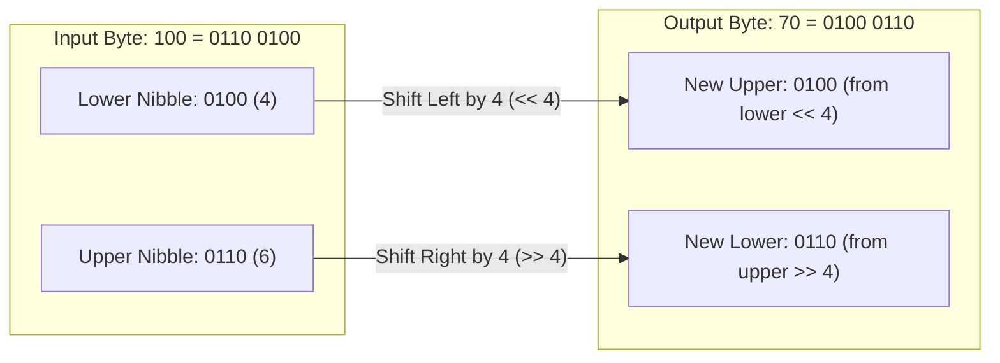
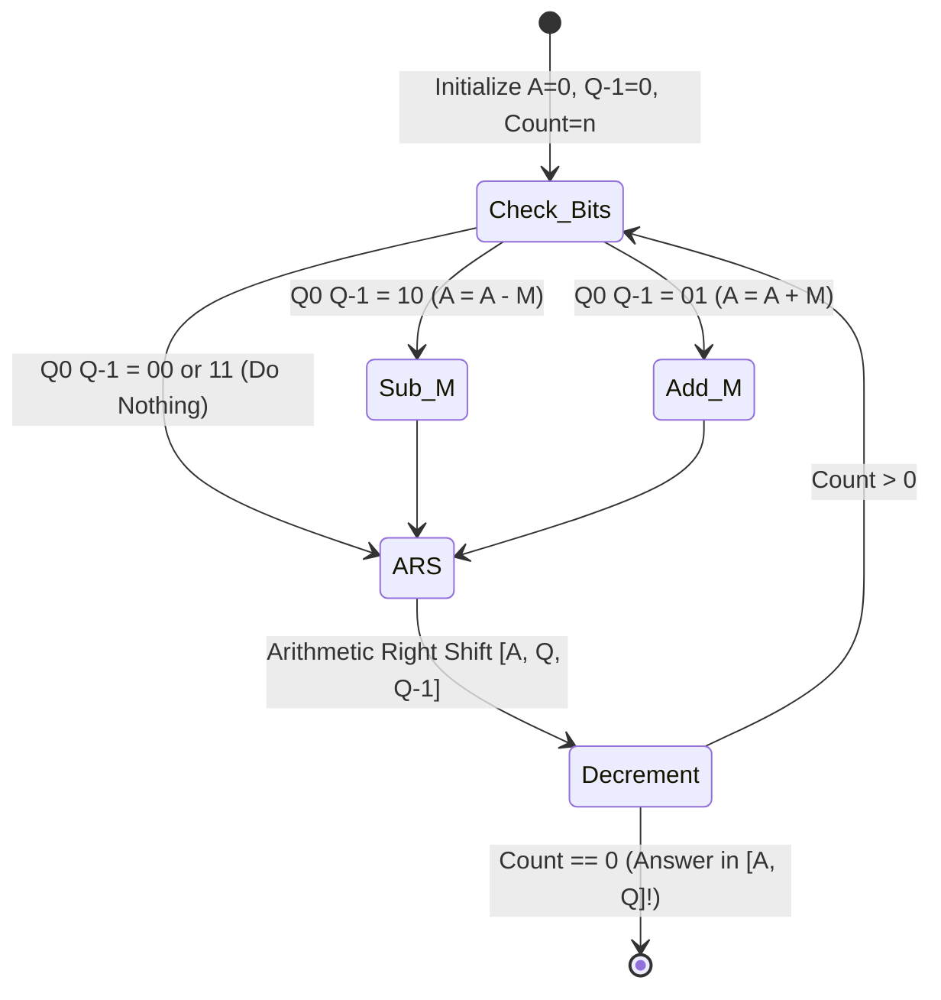

# ⚡ CAT-2 HOTS Master Crib — PLA Java DSA & Algorithms
**Course**: Placement Training & Java Algorithms (PLA)  
**Coverage**: Time Complexity, Number Theory, Bitwise Tricks & Matrix Algorithms  
**Exam Mode**: Open Book / Notes Allowed | **Target Score**: 45+ / 50

---

## 🧱 TIER 0: The "Explain Like I'm 5" Bedrock Basics
*(Read this first if bit manipulation or hardware algorithms feel confusing)*

### 1. What is a "Nibble Swap"?
* A byte has **8 bits**.
* A **nibble** is a chunk of **4 bits**. So 1 byte has an **Upper Nibble** ($b_7 b_6 b_5 b_4$) and a **Lower Nibble** ($b_3 b_2 b_1 b_0$).
* "Swap nibbles" simply takes the lower 4 bits and puts them on the left, and takes the upper 4 bits and puts them on the right:



---

### 2. Booth's Algorithm: The Step-by-Step Decision Loop
Used for hardware signed binary multiplication ($M \times Q$). Look at the last bit of $Q$ ($Q_0$) and the extra bit $Q_{-1}$:



---

## 🧭 TIER 1: The Problem Symptom & Keyword Decoder

| If Question Mentions / Asks... | It Means This Exact Topic | Your Immediate Formula / Action |
| :--- | :--- | :--- |
| "Analyze loop time & space complexity", $O(n)$ vs $O(n^2)$ | **Complexity Analysis** | Single loop up to $n \implies O(n)$. Nested loop where inner depends on $n \implies O(n^2)$. Halving loop ($i /= 2$) $\implies O(\log n)$. |
| "Simple Sieve vs Naive Primality", $O(n \log \log n)$ | **Sieve of Eratosthenes** | Naive: test each number up to $\sqrt{i} \implies O(n\sqrt{n})$. Sieve: boolean array marking multiples of primes $\implies O(n \log \log n)$. |
| "Swap two nibbles in a byte", Bit masking | **Bitwise Nibble Swap** | `result = ((n & 0x0F) << 4) | ((n & 0xF0) >> 4);` Trace with mask `0x0F` (low 4 bits) and `0xF0` (high 4 bits). |
| "Max sequence of 1s after flipping one bit" | **Bitwise Sliding Window** | Maintain `currentCount` and `previousCount` separated by single 0. Max sequence $= \text{current} + \text{previous} + 1$. |
| "Binary Palindrome check" | **Bitwise Palindrome** | Reverse bits using `(rev << 1) | (n & 1)` and compare `rev == original`. |
| "Booth's Multiplication Algorithm", Signed binary | **Booth's Algorithm** | Registers: $A=0, Q=\text{multiplier}, Q_{-1}=0, M=\text{multiplicand}$. If $Q_0 Q_{-1} = 10 \implies A = A - M$; If $01 \implies A = A + M$. Always Arithmetic Right Shift (ARS). |
| "Maximum Hour Glass Sum in 6x6 matrix" | **Matrix 2D Filter** | Iterate top-left $(i, j)$ from $0$ to $3$. Sum: row $i$ ($3$ elements) $+$ center $(i+1, j+1)$ $+$ row $i+2$ ($3$ elements). |

---

## 🛠️ TIER 2: Master Exam Solutions & Code Templates

### 1. Bitwise Nibble Swap (With Full Execution Trace for 100)
```java
public class NibbleSwap {
    public static int swapNibbles(int n) {
        // n & 0x0F isolates lower 4 bits; left-shift by 4 moves them to upper nibble
        // n & 0xF0 isolates upper 4 bits; right-shift by 4 moves them to lower nibble
        return ((n & 0x0F) << 4) | ((n & 0xF0) >> 4);
    }
}
```
#### Execution Trace for Input $100_{10}$:
1. Binary of $100$: `01100100`
2. Lower Nibble: `01100100 & 00001111 = 00000100` ($4_{10}$). Shift left by 4: `01000000` ($64_{10}$).
3. Upper Nibble: `01100100 & 11110000 = 01100000` ($96_{10}$). Shift right by 4: `00000110` ($6_{10}$).
4. Bitwise OR: `01000000 | 00000110 = 01000110` ($70_{10}$). Result = **70**.

---

### 2. Sieve of Eratosthenes vs Naive Primality (Time & Code Comparison)
```java
import java.util.Arrays;

public class PrimeAlgorithms {
    // 1. Sieve of Eratosthenes: O(n log log n) Time, O(n) Space
    public static boolean[] sieveOfEratosthenes(int n) {
        boolean[] isPrime = new boolean[n + 1];
        Arrays.fill(isPrime, true);
        isPrime[0] = isPrime[1] = false;

        for (int p = 2; p * p <= n; p++) {
            if (isPrime[p]) {
                for (int i = p * p; i <= n; i += p) {
                    isPrime[i] = false;
                }
            }
        }
        return isPrime;
    }

    // 2. Naive Approach: O(n * sqrt(n)) Time, O(1) Space
    public static boolean isPrimeNaive(int num) {
        if (num <= 1) return false;
        for (int i = 2; i * i <= num; i++) {
            if (num % i == 0) return false;
        }
        return true;
    }
}
```
* **Complexity Justification**: Sieve visits numbers proportional to $\sum \frac{n}{p} = n \sum \frac{1}{p} = O(n \log \log n)$. The naive method checks each number individually up to $\sqrt{i}$, giving $\sum_{i=1}^n \sqrt{i} \approx \int_0^n \sqrt{x} dx = O(n^{1.5}) = O(n \sqrt{n})$. For $n = 10^6$, Sieve takes $\approx 4 \times 10^6$ operations, while Naive takes $\approx 10^9$ operations!

---

### 3. Maximum Sequence of Consecutive 1s (Flip One Bit)
```java
public class MaxConsecutiveOnesFlip {
    public static int maxConsecutiveOnes(int n) {
        if (~n == 0) return Integer.BYTES * 8; // All bits are 1

        int currentLen = 0;
        int previousLen = 0;
        int maxLen = 0;

        while (n != 0) {
            if ((n & 1) == 1) {
                currentLen++;
            } else {
                // If adjacent bit is also 0, previousLen resets to 0
                previousLen = ((n & 2) == 0) ? 0 : currentLen;
                currentLen = 0;
            }
            maxLen = Math.max(previousLen + currentLen + 1, maxLen);
            n >>>= 1; // Unsigned right shift
        }
        return maxLen;
    }
}
```

---

### 4. Booth's Algorithm for Signed Multiplication (Step-by-Step)
Given Multiplicand $M$ and Multiplier $Q$ in 4-bit 2's complement:
* Initialize Accumulator $A = 0000$, $Q_{-1} = 0$, Count $= 4$.
* At each step, examine 2 bits: $Q_0 Q_{-1}$:
  * $00$ or $11$: Do nothing (Arithmetic Right Shift only).
  * $01$: $A = A + M$, then Arithmetic Right Shift $[A, Q, Q_{-1}]$.
  * $10$: $A = A - M$ ($A = A + M'$s 2's complement), then Arithmetic Right Shift $[A, Q, Q_{-1}]$.
* Decrement Count by 1. Stop when Count $= 0$.
* Result is in register pair $[A, Q]$.
