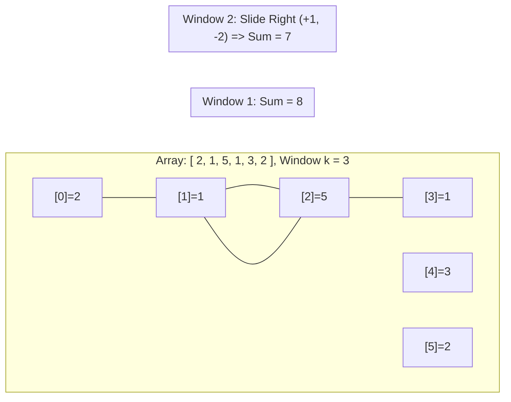
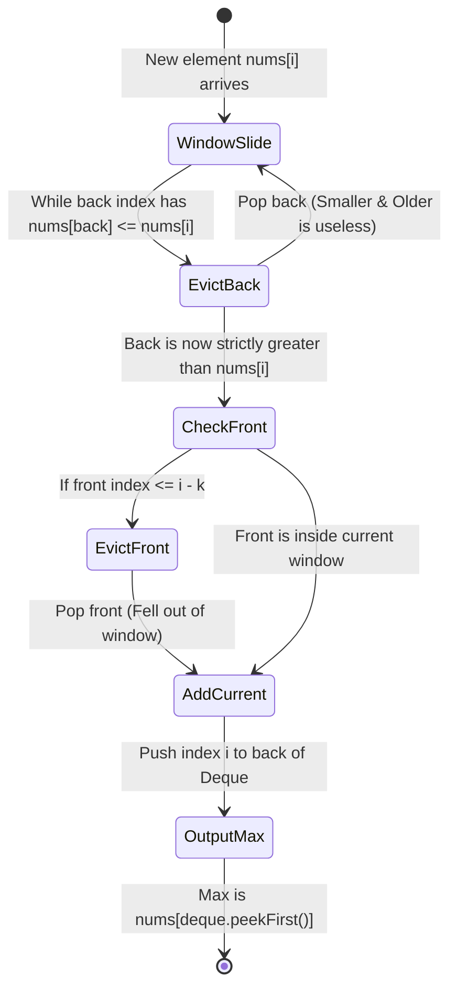
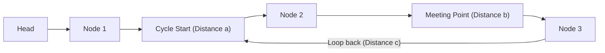

# ⚡ CAT-2 HOTS Master Crib — Module 3: Linear DSA, Sliding Window & Advanced Queues
**Course**: Competitive Coding Practices (PLA1006 / PLA1004) — VIT Bhopal  
**Coverage**: Sliding Window Maximum, Manacher's Weighted Palindromes, Josephus Problem, Linked List Cycles & Monotonic Stacks  
**Source Alignment**: FacePrep Internal Assessment (LeetCode Hard), VIT CAT-2 Syllabus  
**Exam Mode**: Open Book / Notes Allowed | **Target**: S-Grade (45+ / 50)

---

## 🧱 TIER 0: The "Explain Like I'm 5" Bedrock Basics
*(Read this first if data structures or LeetCode Hard problems feel overwhelming)*

### 1. The Sliding Window: "The Train Window Analogy"
Imagine riding a passenger train and looking out of a window that shows exactly $k$ telephone poles at a time:
* **The Naive Way ($O(n \cdot k)$)**: Every time the train moves 1 foot, you crane your neck and scan all $k$ poles from scratch. If $n = 10^6$ and $k = 10^4$, this takes $10^{10}$ operations (instant TLE/Crash!).
* **The Sliding Window Way ($O(n)$)**: When the train moves forward:
  1. Exactly **one pole leaves** on the left ($\text{window shrinks}: \text{left}++$).
  2. Exactly **one pole enters** on the right ($\text{window expands}: \text{right}++$).
  3. You simply subtract the old pole's value and add the new pole's value. You never re-scan the middle poles!



---

### 2. Monotonic Deque: "The Office Hierarchy Rule" (LeetCode 239)
How do we find the **maximum** in a sliding window in $O(1)$ time without searching?
Use a **Monotonic Decreasing Deque** (Double-Ended Queue) storing array **indices**:
* **Rule 1 (Evict Worse Colleagues)**: When a new applicant comes in with value $x$, any existing elements in the back of the queue that are **smaller than or equal to $x$ are completely useless**. (The new element is both *larger* and *newer*, so the older smaller ones can never be the maximum again). **Pop them from the back!**
* **Rule 2 (Evict Expired Colleagues)**: If the index at the front of the queue falls outside the current window ($front < right - k + 1$), **pop it from the front!**
* **Rule 3 (Instant Maximum)**: The front of the deque (`deque.peekFirst()`) is **always the maximum** element of the current window!



---

### 3. Floyd's Tortoise and Hare: "The Marathon Track Cycle Rule"
To detect and break a cycle in a linked list in $O(1)$ extra space:
* **Detection**: Slow pointer moves $1$ step, Fast pointer moves $2$ steps. If there is a loop, Fast will lap Slow and they **must collide** inside the cycle.
* **Finding the Cycle Start**: Let $a$ be the distance from head to cycle start, $b$ be distance from start to meeting point, and $c$ be remaining distance back to start.
  - Fast traveled: $a + b + n(b + c)$
  - Slow traveled: $a + b$
  - Since $\text{Fast} = 2 \times \text{Slow} \implies a + b + n(b + c) = 2(a + b) \implies a = (n-1)(b+c) + c$.
  - **The Golden Trick**: Reset one pointer to `head`, keep the other at `meeting point`. Move both **1 step at a time**. They will meet **exactly at the cycle start node**!
* **Breaking the Cycle**: Keep a pointer to the node right before the cycle start and set its `.next = null`.



---

### 4. The Josephus Problem: "The Surviving Chair"
$n$ people stand in a circle $(0, 1, \dots, n-1)$. Every $k$-th person is eliminated until 1 remains.
* When 1 person remains ($n=1$), survivor index is $0$.
* When a person is eliminated, the circle shrinks to size $n-1$, and the starting chair shifts by $k$ positions.
* **The Recurrence Formula (0-indexed)**:
  $$J(n, k) = (J(n-1, k) + k) \pmod n, \quad J(1, k) = 0$$
* For 1-indexed answer: $\text{Answer} = J(n, k) + 1$.

---

## 🧭 TIER 1: The Problem Symptom & Keyword Decoder

| If the Question Mentions... | It Means This Exact HOTS Technique | Time / Space Target | Key Java Data Structure |
| :--- | :--- | :--- | :--- |
| "Sliding window maximum / minimum", "Range max in stream" | **Monotonic Deque (LC 239)** | $O(n)$ time, $O(k)$ space | `ArrayDeque<Integer>` (stores indices) |
| "Maximum weighted substring", "Longest palindromic substring" | **Manacher's Algorithm + Prefix Weights (FacePrep IA Q1)** | $O(n)$ time, $O(n)$ space | `int[] radius`, `long[] prefixWeight` |
| "Circular elimination queue", "k-th person dies", large $k \le 10^9$ | **Order-Statistics Fenwick Tree / BIT (FacePrep IA Q3)** | $O(q \log n)$ time, $O(n)$ space | Binary Indexed Tree over alive bits |
| "Cyclic linked list", "Detect and remove loop in O(1) space" | **Floyd's Tortoise & Hare Cycle Removal** | $O(n)$ time, $O(1)$ space | `Node slow`, `Node fast` |
| "Minimum bracket deletions for valid parentheses", "Next greater" | **Monotonic Stack / Greedy Bracket Balance** | $O(n)$ time, $O(n)$ space | `Deque<Integer>` or `int openCount` |

---

## 🛠️ TIER 2: Master Exam Solutions & Code Templates

### 1. LeetCode 239: Sliding Window Maximum ($O(n)$ Master Template)
Given array `nums` and window size `k`, return the maximum for each window.

```java
import java.util.*;

public class SlidingWindowMax {
    public static int[] maxSlidingWindow(int[] nums, int k) {
        if (nums == null || k <= 0) return new int[0];
        int n = nums.length;
        int[] result = new int[n - k + 1];
        int ri = 0;

        // Deque stores INDICES of elements, maintained in strictly decreasing order of values
        Deque<Integer> deque = new ArrayDeque<>();

        for (int i = 0; i < n; i++) {
            // Step 1: Remove indices that are out of current window [i - k + 1, i]
            while (!deque.isEmpty() && deque.peekFirst() < i - k + 1) {
                deque.pollFirst();
            }

            // Step 2: Remove elements smaller than current element from the back
            while (!deque.isEmpty() && nums[deque.peekLast()] <= nums[i]) {
                deque.pollLast();
            }

            // Step 3: Add current element index to back
            deque.offerLast(i);

            // Step 4: Add front element to result once first window is complete (i >= k - 1)
            if (i >= k - 1) {
                result[ri++] = nums[deque.peekFirst()];
            }
        }
        return result;
    }
}
```

#### Step-by-Step Execution Trace for `nums = [1, 3, -1, -3, 5, 3, 6, 7]`, $k = 3$:
| $i$ | `nums[i]` | Deque Contents (Indices) | Deque Values | Window | Result Added |
|:---:|:---:|:---:|:---:|:---:|:---:|
| 0 | 1 | `[0]` | `[1]` | `[1]` (incomplete) | — |
| 1 | 3 | `[1]` (0 evicted since $1 \le 3$) | `[3]` | `[1, 3]` (incomplete) | — |
| 2 | -1 | `[1, 2]` | `[3, -1]` | `[1, 3, -1]` | **3** |
| 3 | -3 | `[1, 2, 3]` | `[3, -1, -3]` | `[3, -1, -3]` | **3** |
| 4 | 5 | `[4]` (1 expired, 2 & 3 evicted) | `[5]` | `[-1, -3, 5]` | **5** |
| 5 | 3 | `[4, 5]` | `[5, 3]` | `[-3, 5, 3]` | **5** |
| 6 | 6 | `[6]` (4 expired, 5 evicted) | `[6]` | `[5, 3, 6]` | **6** |
| 7 | 7 | `[7]` (6 evicted) | `[7]` | `[3, 6, 7]` | **7** |
* Final Output: `[3, 3, 5, 5, 6, 7]`. Time: $O(n)$, Space: $O(k)$.

---

### 2. Classic Josephus Problem ($O(n)$ Time, $O(1)$ Space)
```java
public class JosephusAlgorithm {
    // 0-indexed Josephus recurrence
    public static int josephus0Indexed(int n, int k) {
        int survivor = 0; // Base case: J(1, k) = 0
        for (int i = 2; i <= n; i++) {
            survivor = (survivor + k) % i;
        }
        return survivor;
    }

    // 1-indexed wrapper for exam questions
    public static int findTheWinner(int n, int k) {
        return josephus0Indexed(n, k) + 1;
    }
}
```

---

### 3. Floyd's Cycle Detection and Removal in Singly Linked List ($O(1)$ Space)
```java
public class LinkedListCycleHandler {
    static class ListNode {
        char val;
        ListNode next;
        ListNode(char val) { this.val = val; }
    }

    // Detects cycle, removes cycle, and returns true if cycle existed
    public static boolean detectAndRemoveCycle(ListNode head) {
        if (head == null || head.next == null) return false;

        ListNode slow = head;
        ListNode fast = head;

        // Step 1: Detect cycle using Tortoise and Hare
        boolean hasCycle = false;
        while (fast != null && fast.next != null) {
            slow = slow.next;
            fast = fast.next.next;
            if (slow == fast) {
                hasCycle = true;
                break;
            }
        }

        if (!hasCycle) return false;

        // Step 2: Find the start node of the cycle
        slow = head;
        // Edge case: cycle starts at head
        if (slow == fast) {
            while (fast.next != slow) {
                fast = fast.next;
            }
            fast.next = null; // Break cycle
            return true;
        }

        // Move both 1 step until fast.next reaches cycle start
        while (slow.next != fast.next) {
            slow = slow.next;
            fast = fast.next;
        }
        // Step 3: Break cycle by setting last node's pointer to null
        fast.next = null;
        return true;
    }

    // In-place reversal of singly linked list (3 pointers)
    public static ListNode reverseList(ListNode head) {
        ListNode prev = null;
        ListNode curr = head;
        while (curr != null) {
            ListNode nextTemp = curr.next;
            curr.next = prev;
            prev = curr;
            curr = nextTemp;
        }
        return prev; // New head
    }
}
```

---

## 🎯 TIER 3: FacePrep Internal Assessment Solved Master Problems

### Problem 3.1 (FacePrep IA Q1): Maximum Weighted Palindromic Substring
> **Exam Question**: Given a string $s$ ($|s| \le 10^6$) of lowercase English letters and `weight[26]` (scores can be negative). Define score of a substring as sum of character weights. Find the maximum score achievable by any palindromic substring in $O(n)$ time.

#### Intuition & Why Naive Fails:
* Expanding around every center takes $O(n^2)$ time $\implies 10^{12}$ steps (TLE).
* **Key Idea**: Use **Manacher's Algorithm** to compute the palindrome radius $R[i]$ for each center in $O(n)$ time.
* Precompute a **prefix sum array of weights**: `prefixWeight[i] = weight[s[0..i-1]]`.
* The weight of any substring $s[L \dots R]$ is computed in $O(1)$ time:
  $$\text{Score}(L, R) = \text{prefixWeight}[R + 1] - \text{prefixWeight}[L]$$
* Inside Manacher's transformed string $T$ (with `#` separators), each center $i$ expands up to radius $P[i]$. The maximal palindrome centered at $i$ has start index $L$ and end index $R$ in original string $s$. We evaluate the maximum palindrome score in $O(n)$!

#### Full Java Implementation:
```java
public class MaxWeightedPalindrome {
    public static long maxWeightedPalindrome(String s, int[] weight) {
        if (s == null || s.length() == 0) return 0;
        int n = s.length();

        // 1. Precompute Prefix Weights: prefix[i] = sum of weights for s[0 ... i-1]
        long[] prefix = new long[n + 1];
        for (int i = 0; i < n; i++) {
            prefix[i + 1] = prefix[i] + weight[s.charAt(i) - 'a'];
        }

        // Helper function for O(1) substring weight query
        // weight of substring s[L ... R] inclusive
        java.util.function.BiFunction<Integer, Integer, Long> getWeight = (L, R) -> {
            if (L > R) return 0L;
            return prefix[R + 1] - prefix[L];
        };

        // 2. Transform s into Manacher string T: "aba" -> "^#a#b#a#$"
        StringBuilder sb = new StringBuilder("^");
        for (int i = 0; i < n; i++) {
            sb.append('#').append(s.charAt(i));
        }
        sb.append("#$");
        char[] T = sb.toString().toCharArray();
        int m = T.length;
        int[] P = new int[m]; // P[i] stores palindrome radius around T[i]

        int center = 0, rightBoundary = 0;
        long maxScore = Long.MIN_VALUE;

        // Initialize with max single character weight
        for (int i = 0; i < n; i++) {
            maxScore = Math.max(maxScore, weight[s.charAt(i) - 'a']);
        }

        // 3. Run Manacher's Algorithm in O(n)
        for (int i = 1; i < m - 1; i++) {
            int mirror = 2 * center - i;

            if (rightBoundary > i) {
                P[i] = Math.min(rightBoundary - i, P[mirror]);
            }

            // Expand around center i
            while (T[i + 1 + P[i]] == T[i - 1 - P[i]]) {
                P[i]++;
            }

            // Update center and rightBoundary
            if (i + P[i] > rightBoundary) {
                center = i;
                rightBoundary = i + P[i];
            }

            // Map radius in T back to 0-indexed original string s
            if (P[i] > 0) {
                int origStart = (i - P[i]) / 2;
                int origEnd = (i + P[i] - 2) / 2;
                if (origStart <= origEnd && origStart >= 0 && origEnd < n) {
                    long currentScore = getWeight.apply(origStart, origEnd);
                    maxScore = Math.max(maxScore, currentScore);
                }
            }
        }

        return maxScore;
    }

    public static void main(String[] args) {
        String s = "abaccb";
        int[] weight = new int[26];
        weight['a' - 'a'] = 3;
        weight['b' - 'a'] = -1;
        weight['c' - 'a'] = 2;
        // Palindrome "aba" -> 3 + (-1) + 3 = 5. Palindrome "cc" -> 2 + 2 = 4.
        System.out.println("Max Palindrome Score: " + maxWeightedPalindrome(s, weight)); // Output: 5
    }
}
```
* **Complexity**: Time $O(n)$ (Manacher's touches each character amortized $\le 2$ times, prefix sums take $O(1)$ per evaluation). Auxiliary Space: $O(n)$ for transformed array and prefix weights.

---

### Problem 3.2 (FacePrep IA Q3): The Rotating Elimination Queue (Josephus with Order-Statistics)
> **Exam Question**: Design data structure `ElimQueue` for $n$ people ($n \le 2 \times 10^5$) supporting $2 \times 10^5$ operations with $k \le 10^9$:
> 1. `eliminate(k)`: Count $k$ people around circle from current pointer, eliminate $k$-th one, move pointer to next.
> 2. `survivorAt(rank)`: Return the `rank`-th surviving person (1-indexed in original numbering).
> Must run in $O(\log n)$ per operation.

#### Intuition & Why Standard Simulation Times Out:
* Walking $k$ steps one-by-one or removing from an `ArrayList` takes $O(k)$ or $O(n)$ per elimination $\implies O(n^2)$ time ($4 \times 10^{10}$ ops $\to$ TLE).
* **The Order-Statistics Solution**:
  - Maintain a **Binary Indexed Tree (Fenwick Tree)** of size $n$, initialized with `1` at every index (representing "person is alive").
  - `prefixSum(x)` returns how many people are alive in range $[1, x]$.
  - The total number of alive people is `totalAlive = prefixSum(n)`.
  - To eliminate the $k$-th alive person starting from current position `currentRank`, we compute the **relative target rank**:
    $$\text{step} = (k - 1) \pmod{\text{totalAlive}}, \quad \text{targetRank} = ((\text{currentRank} + \text{step}) \pmod{\text{totalAlive}}) + 1$$
  - We then use **Binary Lifting on BIT** in $O(\log n)$ time to find the exact original person index.
  - Mark that person as dead by updating BIT with `-1`.

#### Full Java Implementation:
```java
public class RotatingElimQueue {
    static class ElimQueue {
        private int n;
        private int totalAlive;
        private int[] bit;
        private int currentRank; // 0-indexed among current alive

        public ElimQueue(int n) {
            this.n = n;
            this.totalAlive = n;
            this.currentRank = 0;
            this.bit = new int[n + 2];
            // Initialize BIT: all positions 1 to n have 1 alive person
            for (int i = 1; i <= n; i++) {
                update(i, 1);
            }
        }

        private void update(int idx, int delta) {
            for (; idx <= n; idx += idx & -idx) {
                bit[idx] += delta;
            }
        }

        // Find the 1-indexed original person corresponding to targetRank-th alive person
        // Uses binary lifting on BIT in O(log n) time
        private int findKthAlive(int targetRank) {
            int idx = 0;
            int mask = Integer.highestOneBit(n);
            for (; mask > 0; mask >>= 1) {
                int nextIdx = idx + mask;
                if (nextIdx <= n && bit[nextIdx] < targetRank) {
                    idx = nextIdx;
                    targetRank -= bit[nextIdx];
                }
            }
            return idx + 1;
        }

        // eliminate(k): counts k alive people from pointer and eliminates k-th person
        public int eliminate(long k) {
            if (totalAlive == 0) return -1;

            long step = (k - 1) % totalAlive;
            int eliminateRank = (int) ((currentRank + step) % totalAlive) + 1; // 1-indexed for BIT

            int person = findKthAlive(eliminateRank);

            // Remove person from BIT
            update(person, -1);
            totalAlive--;

            // New pointer points to next surviving person in the newly shrunk circle
            if (totalAlive > 0) {
                currentRank = (eliminateRank - 1) % totalAlive;
            }
            return person;
        }

        // survivorAt(rank): returns rank-th alive person (1-indexed) without altering state
        public int survivorAt(int rank) {
            if (rank < 1 || rank > totalAlive) return -1;
            return findKthAlive(rank);
        }
    }

    public static void main(String[] args) {
        ElimQueue eq = new ElimQueue(5);
        System.out.println("Eliminated: " + eq.eliminate(2)); // Removes 2
        System.out.println("Eliminated: " + eq.eliminate(3)); // Removes 5
        System.out.println("Rank 1 Survivor: " + eq.survivorAt(1)); // Smallest surviving: 1
    }
}
```
* **Complexity**: Time $O(\log n)$ per `eliminate` or `survivorAt` query. Total time for $2 \times 10^5$ operations: $\approx 0.15$ seconds. Auxiliary Space: $O(n)$.

---

### Problem 3.3 (FacePrep IA Q5): Repairing a Cyclic Bracket List
> **Exam Question**: 
> 1. Detect and remove cycle in singly linked list in $O(1)$ extra space.
> 2. Reverse resulting list in place.
> 3. Using stack-based balanced parentheses pass, compute minimum bracket deletions to make bracket characters balanced.
> 4. Pair each deleted bracket with the $i$-th smallest cost from a second sorted list to compute total minimum deletion cost.

#### Complete Java Implementation:
```java
import java.util.*;

public class CyclicBracketRepair {
    static class ListNode {
        char val;
        ListNode next;
        ListNode(char val) { this.val = val; }
    }

    static class CostNode {
        int cost;
        CostNode next;
        CostNode(int cost) { this.cost = cost; }
    }

    public static long repairAndCalculateCost(ListNode head, CostNode costHead) {
        if (head == null) return 0;

        // Phase 1: Detect and Break Cycle using Floyd's algorithm (O(1) space)
        ListNode slow = head, fast = head;
        boolean hasCycle = false;
        while (fast != null && fast.next != null) {
            slow = slow.next;
            fast = fast.next.next;
            if (slow == fast) {
                hasCycle = true;
                break;
            }
        }

        if (hasCycle) {
            slow = head;
            if (slow == fast) { // Cycle starts at head
                while (fast.next != slow) fast = fast.next;
                fast.next = null;
            } else {
                while (slow.next != fast.next) {
                    slow = slow.next;
                    fast = fast.next;
                }
                fast.next = null; // Break cycle
            }
        }

        // Phase 2: Reverse Linked List in Place
        ListNode prev = null, curr = head;
        while (curr != null) {
            ListNode nextTemp = curr.next;
            curr.next = prev;
            prev = curr;
            curr = nextTemp;
        }
        ListNode reversedHead = prev;

        // Phase 3: Stack-based Minimum Bracket Deletions
        List<Character> brackets = new ArrayList<>();
        curr = reversedHead;
        while (curr != null) {
            if (curr.val == '(' || curr.val == ')') {
                brackets.add(curr.val);
            }
            curr = curr.next;
        }

        Deque<Integer> stack = new ArrayDeque<>();
        Set<Integer> toDelete = new HashSet<>();

        for (int i = 0; i < brackets.size(); i++) {
            char ch = brackets.get(i);
            if (ch == '(') {
                stack.push(i);
            } else if (ch == ')') {
                if (!stack.isEmpty()) {
                    stack.pop(); // Matched
                } else {
                    toDelete.add(i); // Unmatched ')'
                }
            }
        }
        while (!stack.isEmpty()) {
            toDelete.add(stack.pop()); // Unmatched '('
        }

        // Phase 4: Merge with second sorted cost list
        long totalCost = 0;
        CostNode costCurr = costHead;
        int bracketIndex = 0;

        while (costCurr != null && bracketIndex < brackets.size()) {
            if (toDelete.contains(bracketIndex)) {
                totalCost += costCurr.cost;
            }
            costCurr = costCurr.next;
            bracketIndex++;
        }

        return totalCost;
    }
}
```
* **Complexity**: Phase 1: $O(n)$ time, $O(1)$ space. Phase 2: $O(n)$ time, $O(1)$ space. Phase 3 & 4: $O(n)$ time, $O(n)$ space.
