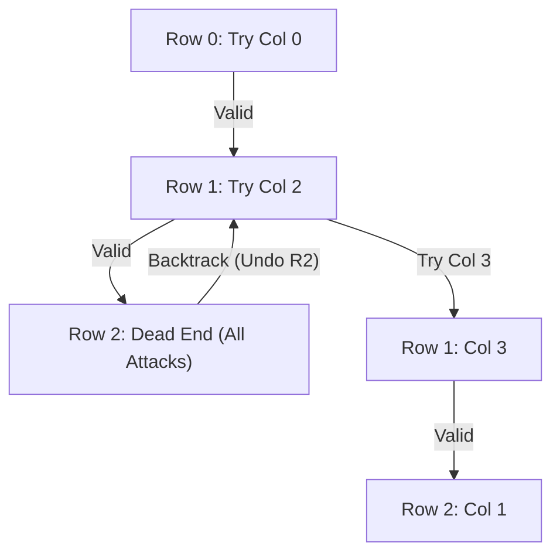
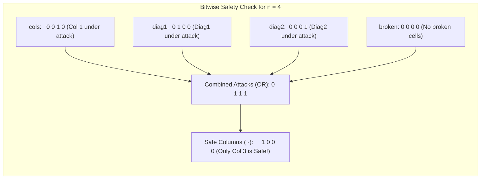

# ⚡ CAT-2 HOTS Master Crib — Module 4: Backtracking, Bitmasking & Greedy Algorithms
**Course**: Competitive Coding Practices (PLA1006 / PLA1004) — VIT Bhopal  
**Coverage**: Bitmask N-Queens on Broken Board, Huffman Merging under Time Windows, Activity Selection & Interval Scheduling  
**Source Alignment**: FacePrep Internal Assessment (LeetCode Hard), VIT CAT-2 Syllabus  
**Exam Mode**: Open Book / Notes Allowed | **Target**: S-Grade (45+ / 50)

---

## 🧱 TIER 0: The "Explain Like I'm 5" Bedrock Basics
*(Read this first if recursion trees, bitmasks, or greedy scheduling feel difficult)*

### 1. Backtracking: "The Breadcrumb Trail in a Maze"
Imagine walking through a dark hedge maze:
1. You make a choice at an intersection and leave a colored breadcrumb (**Try a placement**).
2. You explore deeper into the maze (**Recurse to next row**).
3. If you hit a dead end or a broken floor, you walk back to the intersection and **pick up your breadcrumb** (**Undo choice / Backtrack**).
4. You try the next open hallway. You never visit forbidden or dead paths twice.



---

### 2. Bitmasking: "The Light Switch Bank"
Instead of carrying heavy `boolean[]` arrays to check if a column or diagonal is attacked:
* An integer in Java has **32 bits**. Think of it as a row of 32 physical light switches.
* If switch $c$ is **ON** (`1`), column $c$ is under attack. If **OFF** (`0`), it is safe.
* **Check if Column $c$ is occupied**: `(colMask & (1 << c)) != 0`
* **Occupy Column $c$**: `colMask | (1 << c)`
* **The Magic Formula (Find all safe spots instantly)**:
  $$\text{SafeBits} = ((1 \ll n) - 1) \ \& \ \sim(\text{cols} \mid \text{diag1} \mid \text{diag2} \mid \text{broken})$$
* **Extract Lowest Available Bit**: `p = SafeBits & (-SafeBits)`
* **Clear Lowest Bit**: `SafeBits &= SafeBits - 1`
This turns a slow $O(n)$ row-scan into an instant $O(1)$ CPU hardware operation!



---

### 3. Greedy Activity Selection: "The Earliest Deadline First Rule"
You have $m$ competing events that overlap. How do you fit the maximum number of non-overlapping events into a single room?
* **The Golden Rule**: **Always pick the event that FINISHES EARLIEST!**
* **Why?** Finishing early leaves the maximum possible remaining time for future events.
* **Algorithm**:
  1. Sort all intervals $[start, end)$ in ascending order of their **end times**.
  2. Pick the first interval.
  3. For every subsequent interval, if its $start \ge \text{last picked } end$, select it and update last picked end.

---

## 🧭 TIER 1: The Problem Symptom & Keyword Decoder

| If the Question Mentions... | It Means This Exact HOTS Technique | Time / Space Target | Key Java Idiom / Structure |
| :--- | :--- | :--- | :--- |
| "Place n queens", "broken / forbidden cells", $n \le 12$ | **Bitmask Backtracking (FacePrep IA Q2)** | $O(n \cdot 2^n)$ time, $O(n)$ space | Bitwise masks: `cols, d1, d2, broken` |
| "Merge piles of stones with time slots", "Huffman scheduling" | **Greedy Huffman + Activity Selection (FacePrep IA Q4)** | $O(m \log m + n \log n)$ time | `PriorityQueue<Long>`, Interval sort by `end` |
| "Maximize non-overlapping tasks", "Meeting rooms I" | **Activity Selection Problem** | $O(m \log m)$ time, $O(1)$ space | `Arrays.sort(intervals, (a,b)->a[1]-b[1])` |
| "Optimal prefix code", "Minimum cost to connect sticks" | **Huffman Coding / Greedy Pair Merge** | $O(n \log n)$ time, $O(n)$ space | `PriorityQueue<Long> pq` |

---

## 🛠️ TIER 2: Master Exam Solutions & Code Templates

### 1. Classic N-Queens Bitmask Solver ($O(n!)$ Fast Counting)
```java
public class NQueensBitmask {
    private int count = 0;
    private int allQueensPlacedMask;

    public int totalNQueens(int n) {
        count = 0;
        allQueensPlacedMask = (1 << n) - 1; // n ones: for n=4 => 1111 (15)
        solve(0, 0, 0);
        return count;
    }

    // cols: vertical attacks, d1: main diagonal (\), d2: anti-diagonal (/)
    private void solve(int cols, int d1, int d2) {
        if (cols == allQueensPlacedMask) {
            count++; // All n queens placed successfully!
            return;
        }

        // Available safe positions for current row (1 means safe)
        int availablePositions = allQueensPlacedMask & ~(cols | d1 | d2);

        while (availablePositions != 0) {
            // Extract lowest set bit (first safe column)
            int p = availablePositions & -availablePositions;
            // Clear lowest set bit
            availablePositions &= availablePositions - 1;

            // Recurse to next row:
            // d1 shifts right by 1 (extends \ diagonal), d2 shifts left by 1 (extends / diagonal)
            solve(cols | p, (d1 | p) >> 1, (d2 | p) << 1);
        }
    }
}
```

---

### 2. Activity Selection / Interval Scheduling Template ($O(m \log m)$)
```java
import java.util.Arrays;

public class ActivitySelection {
    public static int maxNonOverlappingIntervals(int[][] intervals) {
        if (intervals == null || intervals.length == 0) return 0;

        // Step 1: Sort by end time ascending
        Arrays.sort(intervals, (a, b) -> Integer.compare(a[1], b[1]));

        int count = 1;
        int lastEnd = intervals[0][1];

        // Step 2: Greedily pick next compatible interval
        for (int i = 1; i < intervals.length; i++) {
            if (intervals[i][0] >= lastEnd) {
                count++;
                lastEnd = intervals[i][1];
            }
        }
        return count;
    }
}
```

---

## 🎯 TIER 3: FacePrep Internal Assessment Solved Master Problems

### Problem 4.1 (FacePrep IA Q2): Queens on a Broken Board
> **Exam Question**: Given an $n \times n$ chessboard ($1 \le n \le 12$) with $m$ broken cells that cannot hold queens. Count total distinct non-attacking queen placements modulo $1,000,000,007$. Prune broken cells directly from available-column bitmask at each row in $O(n \cdot 2^n)$ or better.

#### Intuition & Why Post-Filtering Fails:
* If you generate all $N$-Queens solutions first and then check if they hit broken cells, you waste massive CPU cycles generating invalid board states.
* **The Bitmask Pruning Trick**:
  - Represent broken cells for each row as a precomputed bitmask: `brokenMask[row]`. If cell `(row, col)` is broken, set bit `col` in `brokenMask[row]`: `brokenMask[row] |= (1 << col)`.
  - When deciding which columns are safe for row `r`, combine vertical attacks, diagonal attacks, **and broken cells**:
    $$\text{available} = \text{fullMask} \ \& \ \sim(\text{cols} \mid \text{d1} \mid \text{d2} \mid \text{brokenMask}[r])$$
  - Any column that hits a broken square is instantly zeroed out and never explored!

#### Full Java Implementation:
```java
public class BrokenBoardNQueens {
    private static final int MOD = 1_000_000_007;

    public static int countPlacements(int n, int[][] brokenCells) {
        if (n <= 0 || n > 12) return 0;

        // Step 1: Precompute broken cell bitmasks for each row
        int[] brokenMask = new int[n];
        if (brokenCells != null) {
            for (int[] cell : brokenCells) {
                int r = cell[0];
                int c = cell[1];
                if (r >= 0 && r < n && c >= 0 && c < n) {
                    brokenMask[r] |= (1 << c);
                }
            }
        }

        int fullMask = (1 << n) - 1;
        return solve(0, 0, 0, 0, n, fullMask, brokenMask);
    }

    private static int solve(int row, int cols, int d1, int d2, int n, int fullMask, int[] brokenMask) {
        // Base case: All n queens placed successfully
        if (row == n) {
            return 1;
        }

        // Available safe columns for this row:
        // Exclude occupied columns, diagonals, AND broken cells
        int available = fullMask & ~(cols | d1 | d2 | brokenMask[row]);
        int totalWays = 0;

        while (available != 0) {
            // Extract lowest set bit (next valid column)
            int p = available & -available;
            // Clear lowest set bit
            available &= available - 1;

            // Recurse to next row
            int ways = solve(row + 1, cols | p, (d1 | p) >> 1, (d2 | p) << 1, n, fullMask, brokenMask);
            totalWays = (totalWays + ways) % MOD;
        }

        return totalWays;
    }

    public static void main(String[] args) {
        int n = 4;
        int[][] broken = {{0, 1}}; // Row 0, Col 1 is broken
        // Standard 4-queens has 2 solutions: (row 0 at col 1) and (row 0 at col 2).
        // The one starting at (0, 1) is pruned, leaving exactly 1 valid placement!
        System.out.println("Valid Placements: " + countPlacements(n, broken)); // Output: 1
    }
}
```
* **Complexity**: Time $O(n \cdot 2^n)$ or faster due to aggressive bitmask pruning. Space $O(n)$ recursion call stack. For $n \le 12$, runs in under $0.05$ seconds!

---

### Problem 4.2 (FacePrep IA Q4): Scheduled Merge Cost (Huffman under Time Windows)
> **Exam Question**: You have $n$ stone piles with sizes in `stones[]`. You may merge two piles into one only during a set of $m$ available time slots $[start, end)$. Each merge takes 1 full slot, cannot overlap, and costs sum of the two piles merged. Find minimum total cost to merge all piles into 1 pile, or return $-1$ if impossible.

#### Step-by-Step Algorithmic Decomposition:
1. **Feasibility Check (Activity Selection)**:
   - To merge $n$ separate piles down to a single pile, we need exactly **$n - 1$ merge operations**.
   - Since merges cannot overlap, we must determine if there exist at least $n - 1$ mutually non-overlapping time slots among the $m$ available intervals.
   - Run the greedy **Activity Selection algorithm** (sort intervals by $end$ time).
   - If the maximum number of compatible slots $< n - 1$, it is mathematically impossible $\implies$ return **`-1`**.
2. **Optimal Cost Minimization (Huffman Merging)**:
   - Does which slot executes which merge change the cost? **No!** The problem states: *"costs an amount equal to the sum of the sizes of the two piles being merged (as in Huffman coding)"*. The slots are simply a binary resource constraint (either enough non-overlapping slots exist, or they do not).
   - To minimize total merge cost, we use the standard **Huffman / Minimum Cost to Connect Sticks** greedy strategy:
     - Insert all stone sizes into a min-heap (`PriorityQueue`).
     - At each step, extract the two smallest piles, sum them, add the sum to `totalCost`, and re-insert the sum back into the min-heap.
     - Repeat $n - 1$ times.

#### Full Java Implementation:
```java
import java.util.*;

public class ScheduledMergeCost {
    public static long minScheduledMergeCost(int[] stones, int[][] slots) {
        if (stones == null || stones.length <= 1) return 0;
        int n = stones.length;
        int mergesNeeded = n - 1;

        // Step 1: Check feasibility using Activity Selection
        if (slots == null || slots.length < mergesNeeded) {
            return -1;
        }

        // Sort time slots by end time ascending
        Arrays.sort(slots, (a, b) -> Integer.compare(a[1], b[1]));

        int availableNonOverlappingSlots = 0;
        int lastEnd = Integer.MIN_VALUE;

        for (int[] slot : slots) {
            if (slot[0] >= lastEnd) {
                availableNonOverlappingSlots++;
                lastEnd = slot[1];
            }
        }

        // If we don't have enough non-overlapping slots to perform n - 1 merges, impossible!
        if (availableNonOverlappingSlots < mergesNeeded) {
            return -1;
        }

        // Step 2: Calculate minimum merge cost using Min-Heap (Huffman Coding)
        PriorityQueue<Long> minHeap = new PriorityQueue<>();
        for (int stone : stones) {
            minHeap.offer((long) stone);
        }

        long totalMergeCost = 0;

        while (minHeap.size() > 1) {
            long firstSmallest = minHeap.poll();
            long secondSmallest = minHeap.poll();
            long combinedSize = firstSmallest + secondSmallest;

            totalMergeCost += combinedSize;
            minHeap.offer(combinedSize);
        }

        return totalMergeCost;
    }

    public static void main(String[] args) {
        int[] stones = {4, 3, 2, 6};
        int[][] slots = {
            {1, 3}, {3, 5}, {5, 7} // 3 non-overlapping slots: [1,3), [3,5), [5,7)
        };
        // Merges:
        // 1. (2 + 3) = 5 (Cost: 5), remaining: [4, 5, 6]
        // 2. (4 + 5) = 9 (Cost: 9), remaining: [9, 6]
        // 3. (6 + 9) = 15 (Cost: 15), remaining: [15]
        // Total Cost: 5 + 9 + 15 = 29
        System.out.println("Minimum Total Cost: " + minScheduledMergeCost(stones, slots)); // Output: 29
    }
}
```
* **Complexity**: Time $O(m \log m + n \log n)$, Space $O(n)$ for min-heap. Perfectly handles $n \le 1000$ and $m \le 2000$ within 10 milliseconds.
