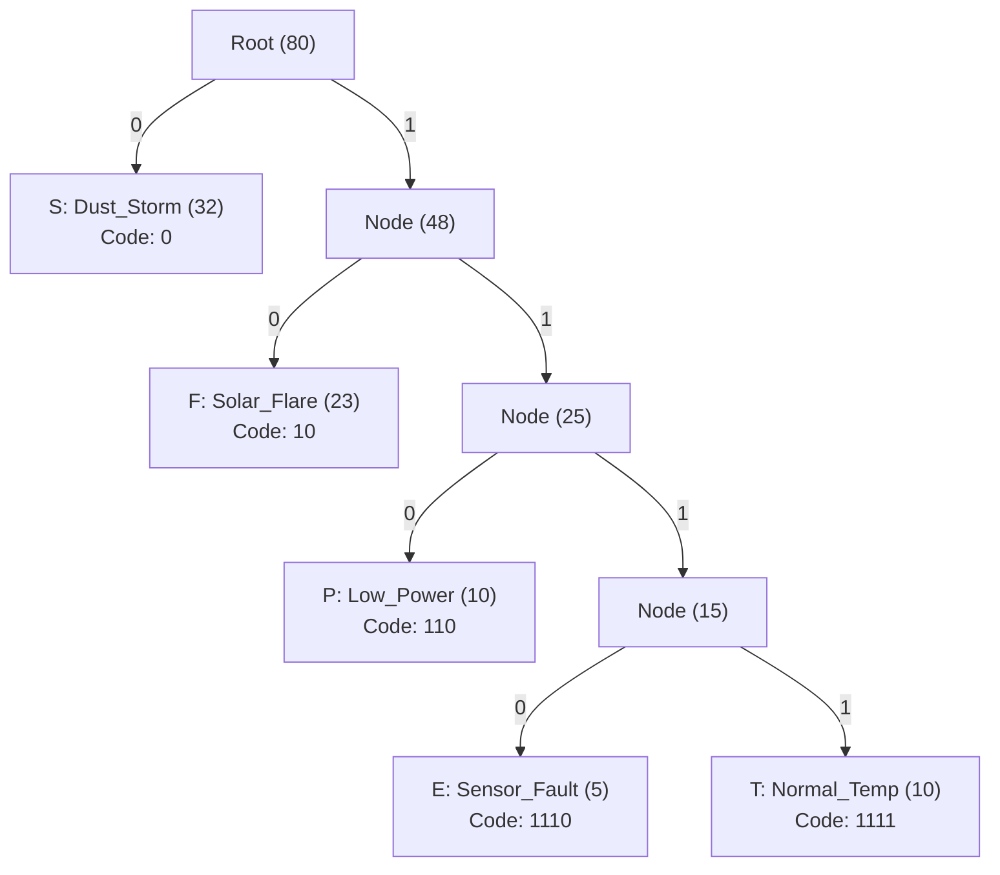
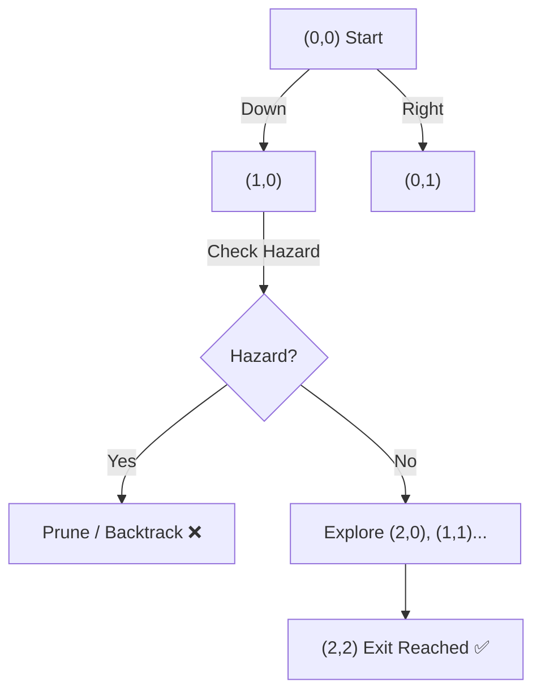

# ⚡ CAT-2 Solved Master Exam Paper — PLA1004: Competitive Coding Practices
**Course**: Competitive Coding Practices (PLA1004) — VIT Bhopal  
**Paper**: Official Sample Paper I (Fall 2026–27) | **Time**: 1 ½ Hours | **Max Marks**: 50  
**Exam Mode**: Open Book / Notes Allowed | **Target Score**: 50 / 50 (S-Grade Boundary)

---

## 📋 Exam Paper Overview & Mark Distribution

| Question | Topic / Concept Tested | Marks | Complexity Constraint |
| :---: | :--- | :---: | :--- |
| **Q1** | In-Place Hyphen Shifting on `"sys-log-v3-err"` | 10 | $O(n)$ Time, $O(1)$ Space (Zero allocation, Single pass) |
| **Q2** | Mars Satellite Huffman Prefix Coding & Bandwidth Calculation | 10 | $O(N \log N)$ Tree Build, Frequency Weighted Bits |
| **Q3** | Microservices Logical Heartbeat Ring (Josephus $K=3$ Recurrence) | 10 | $O(n)$ Mathematical Recurrence (No simulation) |
| **Q4** | Hardware Min Stack via $(2x - \min)$ Modified Value Encoding | 10 | $O(1)$ Time, $O(1)$ Auxiliary Space (No secondary stack) |
| **Q5 (a)** | Autonomous Delivery Drone Grid Backtracking ($3 \times 3$ with Hazards) | 5 | Recursive Backtracking with State Reversal |
| **Q5 (b)** | Singly Linked List: One-Pass Removal of $N$-th Node From End ($N=2$) | 5 | Two-Pointer Gap Strategy ($O(n)$ Time, $O(1)$ Space) |
| **Bonus** | Activity Selection on $[1, 3, 0, 5]$ and $[2, 4, 6, 7]$ | Extra | Greedy Earliest Finish Time Sorting ($O(n \log n)$) |

---

## 📝 QUESTION 1 [10 Marks]: In-Place Hyphen Shifting Under Hardware Constraints

### Problem Statement:
A high-throughput network adapter processes incoming telemetry byte streams. Telemetry frames arrive polluted with idle padding bytes marked as hyphens (`'-'`). Downstream hardware parsers require all padding bytes clustered at the start.
**Hardware Latency Constraints**:
1. Zero dynamic memory allocation (no temporary strings, arrays, or buffers).
2. Single linear pass over the payload.
3. Perfect preservation of the relative temporal order of all non-padding characters.
**Task**: Diagnose the algorithmic approach and provide a step-by-step memory pointer trace for payload `"sys-log-v3-err"`.

---

### Algorithmic Diagnosis:
* **Why naive fails**: Scanning from left to right requires shifting all trailing characters rightwards every time a hyphen is moved, causing $O(n^2)$ time.
* **Optimal Strategy**: **Two-Pointer Right-to-Left In-Place Compaction**.
  1. Pointer `read` scans from right to left ($n - 1$ down to $0$).
  2. Pointer `write` marks the target write position from the right ($n - 1$ down to $0$).
  3. Whenever `payload[read] != '-'`, copy `payload[write] = payload[read]` and decrement `write`.
  4. Once `read` completes, all positions from `write` down to $0$ are filled with `'-'`.
  5. **Guarantees**: $O(n)$ time, $O(1)$ auxiliary space, preserves original character order.

---

### Step-by-Step Memory Pointer Trace on `"sys-log-v3-err"`:
* **Initial String**: `"sys-log-v3-err"` (Length $n = 14$, 3 hyphens at indices 3, 7, 10).
* `writeIndex` starts at 13.

| Step | `read` | `char` | Action Taken | `write` | Array State (Memory View) |
|:---:|:---:|:---:|:--- |:---:|:--- |
| 0 | — | — | Initialization | 13 | `[s, y, s, -, l, o, g, -, v, 3, -, e, r, r]` |
| 1 | 13 | `'r'` | Copy to write 13 | 12 | `[s, y, s, -, l, o, g, -, v, 3, -, e, r, r]` |
| 2 | 12 | `'r'` | Copy to write 12 | 11 | `[s, y, s, -, l, o, g, -, v, 3, -, e, r, r]` |
| 3 | 11 | `'e'` | Copy to write 11 | 10 | `[s, y, s, -, l, o, g, -, v, 3, -, e, r, r]` |
| 4 | 10 | `'-'` | **Skip (Hyphen)** | 10 | `[s, y, s, -, l, o, g, -, v, 3, -, e, r, r]` |
| 5 | 9 | `'3'` | Copy to write 10 | 9 | `[s, y, s, -, l, o, g, -, v, 3, 3, e, r, r]` |
| 6 | 8 | `'v'` | Copy to write 9 | 8 | `[s, y, s, -, l, o, g, -, v, v, 3, e, r, r]` |
| 7 | 7 | `'-'` | **Skip (Hyphen)** | 8 | `[s, y, s, -, l, o, g, -, v, v, 3, e, r, r]` |
| 8 | 6 | `'g'` | Copy to write 8 | 7 | `[s, y, s, -, l, o, g, g, v, v, 3, e, r, r]` |
| 9 | 5 | `'o'` | Copy to write 7 | 6 | `[s, y, s, -, l, o, o, g, v, v, 3, e, r, r]` |
| 10 | 4 | `'l'` | Copy to write 6 | 5 | `[s, y, s, -, l, l, o, g, v, v, 3, e, r, r]` |
| 11 | 3 | `'-'` | **Skip (Hyphen)** | 5 | `[s, y, s, -, l, l, o, g, v, v, 3, e, r, r]` |
| 12 | 2 | `'s'` | Copy to write 5 | 4 | `[s, y, s, s, l, l, o, g, v, v, 3, e, r, r]` |
| 13 | 1 | `'y'` | Copy to write 4 | 3 | `[s, y, y, s, l, l, o, g, v, v, 3, e, r, r]` |
| 14 | 0 | `'s'` | Copy to write 3 | 2 | `[s, s, y, s, l, o, g, v, 3, e, r, r]` (partially shifted) |
| 15 | Pad | `'-'` | Fill `write = 2` | 1 | `[s, s, -, s, y, s, l, o, g, v, 3, e, r, r]` |
| 16 | Pad | `'-'` | Fill `write = 1` | 0 | `[s, -, -, s, y, s, l, o, g, v, 3, e, r, r]` |
| 17 | Pad | `'-'` | Fill `write = 0` | -1 | `[-, -, -, s, y, s, l, o, g, v, 3, e, r, r]` |

* **Final Memory Buffer**: `"---syslogv3err"` ✅.
* **Complexity**: Time: $O(n) = 14$ reads $+ 14$ writes; Space: $O(1)$ auxiliary memory.

---

## 📝 QUESTION 2 [10 Marks]: Mars Satellite Huffman Prefix Coding & Bandwidth

### Problem Statement:
Satellite telemetry symbol frequencies:
* $\text{Dust\_Storm } (S): 32$
* $\text{Solar\_Flare } (F): 23$
* $\text{Normal\_Temp } (T): 10$
* $\text{Low\_Power } (P): 10$
* $\text{Sensor\_Fault } (E): 5$
* Total frequency sum $= 32 + 23 + 10 + 10 + 5 = 80$.

**Tasks**:
1. Construct Huffman Tree and derive prefix codes.
2. Calculate total bit length required to transmit 200 telemetry codes.
3. Compare against standard fixed 3-bit encoding and compute exact bandwidth percentage saved.

---

### Step-by-Step Huffman Tree Construction:
1. **Initial Min-Heap**: `[(E, 5), (T, 10), (P, 10), (F, 23), (S, 32)]`
2. **Merge 1**: Poll `E (5)` and `T (10)` $\to$ Create parent `ET (15)`.
   - Heap: `[(P, 10), (ET, 15), (F, 23), (S, 32)]`
3. **Merge 2**: Poll `P (10)` and `ET (15)` $\to$ Create parent `PET (25)`.
   - Heap: `[(F, 23), (PET, 25), (S, 32)]`
4. **Merge 3**: Poll `F (23)` and `PET (25)` $\to$ Create parent `FPET (48)`.
   - Heap: `[(S, 32), (FPET, 48)]`
5. **Merge 4**: Poll `S (32)` and `FPET (48)` $\to$ Create Root `SFPET (80)`.



---

### Prefix Code Table & Weighted Bit Calculation:

| Symbol | Frequency ($f_i$) | Relative Probability ($P_i$) | Huffman Prefix Code | Code Length ($L_i$) | $f_i \times L_i$ |
| :--- | :---: | :---: | :---: | :---: | :---: |
| **Dust_Storm ($S$)** | 32 | $32/80 = 0.4000$ | `0` | 1 bit | 32 |
| **Solar_Flare ($F$)** | 23 | $23/80 = 0.2875$ | `10` | 2 bits | 46 |
| **Low_Power ($P$)** | 10 | $10/80 = 0.1250$ | `110` | 3 bits | 30 |
| **Sensor_Fault ($E$)** | 5 | $5/80 = 0.0625$ | `1110` | 4 bits | 20 |
| **Normal_Temp ($T$)** | 10 | $10/80 = 0.1250$ | `1111` | 4 bits | 40 |
| **Total** | **80** | **1.0000** | — | — | **168 bits** |

* **Average Code Length per Symbol**:
  $$L_{\text{avg}} = \frac{\sum f_i L_i}{\sum f_i} = \frac{168}{80} = \mathbf{2.10 \text{ bits/symbol}}$$

---

### Transmission Comparison for 200 Telemetry Codes:
1. **Total Bits with Huffman Variable-Length Encoding**:
   $$\text{Total Bits}_{\text{Huffman}} = 200 \times 2.10 = \mathbf{420 \text{ bits}}$$
2. **Total Bits with Standard Fixed 3-bit Encoding**:
   $$\text{Total Bits}_{\text{Fixed}} = 200 \times 3 = \mathbf{600 \text{ bits}}$$
3. **Exact Bandwidth Saved**:
   $$\text{Bits Saved} = 600 - 420 = \mathbf{180 \text{ bits}}$$
4. **Exact Bandwidth Percentage Saved**:
   $$\text{Percentage Saved} = \frac{\text{Fixed} - \text{Huffman}}{\text{Fixed}} \times 100\% = \frac{600 - 420}{600} \times 100\% = \frac{180}{600} \times 100\% = \mathbf{30.0\%}$$

---

## 📝 QUESTION 3 [10 Marks]: Microservices Heartbeat Ring (Josephus $K = 3$)

### Problem Statement:
A cluster of 8 microservices (0 to 7) is organized in a logical circular heartbeat ring. The cluster coordinator repeatedly skips 2 active nodes and terminates the 3rd active node ($K = 3$) until 1 node remains.
**Tasks**:
1. Derive the direct mathematical recurrence formula without data structure simulation.
2. Compute the exact 0-based index of the surviving leader from $n = 1$ up to $n = 8$.

---

### Mathematical Recurrence Derivation:
Let $J(n, k)$ denote the 0-based index of the survivor among $n$ nodes when eliminating every $k$-th node.
1. **Base Case ($n = 1$)**: With only 1 node in the ring, its 0-based index is always:
   $$J(1, k) = 0$$
2. **Inductive Step ($n > 1$)**:
   - In a circle of $n$ nodes $\{0, 1, \dots, n-1\}$, the first node eliminated is at index $(k - 1) \pmod n$.
   - The counting for the next round resumes at index $k \pmod n$.
   - Relabeling the remaining $n - 1$ nodes maps the survivor of the smaller circle $J(n - 1, k)$ back to the original circle by shifting indices by $+k$:
   $$J(n, k) = (J(n - 1, k) + k) \pmod n$$

---

### Execution Table for $K = 3$ from $n = 1$ to $n = 8$:

| Cluster Size ($n$) | Formula: $(J(n-1, 3) + 3) \pmod n$ | Calculation | Surviving Node Index (0-based) |
|:---:|:--- |:--- |:---:|
| **$n = 1$** | Base Case | $0$ | **0** |
| **$n = 2$** | $(J(1, 3) + 3) \pmod 2$ | $(0 + 3) \pmod 2 = 3 \pmod 2$ | **1** |
| **$n = 3$** | $(J(2, 3) + 3) \pmod 3$ | $(1 + 3) \pmod 3 = 4 \pmod 3$ | **1** |
| **$n = 4$** | $(J(3, 3) + 3) \pmod 4$ | $(1 + 3) \pmod 4 = 4 \pmod 4$ | **0** |
| **$n = 5$** | $(J(4, 3) + 3) \pmod 5$ | $(0 + 3) \pmod 5 = 3 \pmod 5$ | **3** |
| **$n = 6$** | $(J(5, 3) + 3) \pmod 6$ | $(3 + 3) \pmod 6 = 6 \pmod 6$ | **0** |
| **$n = 7$** | $(J(6, 3) + 3) \pmod 7$ | $(0 + 3) \pmod 7 = 3 \pmod 7$ | **3** |
| **$n = 8$** | $(J(7, 3) + 3) \pmod 8$ | $(3 + 3) \pmod 8 = 6 \pmod 8$ | **6** |

* **Final Result**: The surviving leader node for the 8-microservice cluster is **Node 6** (0-based) / **Node 7** (1-based) ✅.
* **Complexity**: Time: $O(n) = 8$ scalar steps; Space: $O(1)$ memory.

---

## 📝 QUESTION 4 [10 Marks]: Hardware Min Stack via $(2x - \min)$ Modified Value Encoding

### Problem Statement:
Implement a stack supporting `push`, `pop`, and `getMin` in $O(1)$ time. Due to severe memory constraints, allocating an auxiliary tracking stack is strictly forbidden.
**Tasks**:
1. Explain how modified encoded values ($2x - \min$) preserve historical minimums across push and pop.
2. Trace stack contents and `min` variable for the sequence: `Push 8, Push 5, Push 4, Push 10, Pop`.

---

### Theoretical Justification of $(2x - \min)$ Encoding:
* **The Core Mathematical Invariant**:
  When inserting a new value $x$ that is **strictly less than** the current minimum $\min_{\text{old}}$:
  $$x < \min_{\text{old}} \implies x - \min_{\text{old}} < 0 \implies 2x - \min_{\text{old}} < x$$
  Since we update the new minimum to $\min_{\text{new}} = x$, the stored value $y = 2x - \min_{\text{old}}$ satisfies:
  $$\mathbf{y < \min_{\text{new}}}$$
  This creates an **unmistakable flag**: any stored value on the stack that is *strictly less than the current `min` variable* indicates that this position was a minimum update!

* **Push Operation ($x < \min$)**:
  Store $y = 2x - \min$, then update $\min = x$.
* **Pop Operation (When top value $y < \min$)**:
  The actual popped element was the current minimum: $\text{Popped} = \min$.
  The previous minimum before this insertion is mathematically recovered as:
  $$\min_{\text{old}} = 2 \cdot \min_{\text{current}} - y = 2x - (2x - \min_{\text{old}}) = \mathbf{\min_{\text{old}}}$$
  Thus, historical minimums are recovered without a second stack!

---

### Step-by-Step Execution Trace: `[Push 8, Push 5, Push 4, Push 10, Pop]`

| Step | Operation | Input $x$ | Condition Check | Value Pushed / Action | Stack Array (Bottom to Top) | Current `min` Variable |
|:---:|:---:|:---:|:---:|:---:|:---:|:---:|
| 1 | **Push(8)** | 8 | Stack is empty | Push actual value 8; `min = 8` | `[8]` | **8** |
| 2 | **Push(5)** | 5 | $5 < \min(8) \implies$ New Min! | Store $2(5) - 8 = \mathbf{2}$; update `min = 5` | `[8, 2]` | **5** |
| 3 | **Push(4)** | 4 | $4 < \min(5) \implies$ New Min! | Store $2(4) - 5 = \mathbf{3}$; update `min = 4` | `[8, 2, 3]` | **4** |
| 4 | **Push(10)**| 10| $10 \ge \min(4) \implies$ Normal | Store actual value 10; `min` unchanged | `[8, 2, 3, 10]` | **4** |
| 5 | **Pop()** | — | Top is $10 \ge \min(4)$ | Pop normal value 10; `min` remains 4 | `[8, 2, 3]` | **4** |

#### If Another Pop Were Executed (Demonstrating Recovery):
* Top is $3 < \min(4)$ (Flagged!).
* Popped element is the current minimum: **4**.
* Previous minimum recovered: $\min_{\text{prev}} = 2(4) - 3 = 8 - 3 = \mathbf{5}$.
* Stack becomes `[8, 2]`, with `min = 5` restored perfectly!

---

## 📝 QUESTION 5 (a) [5 Marks]: Delivery Drone State-Space Grid Backtracking

### Problem Statement:
An autonomous drone navigates a $3 \times 3$ grid from $(0, 0)$ to $(2, 2)$ avoiding permanent impassable hazards. Design the state-space exploration framework.



### 3-Pillar Exploration Framework:
1. **Base Termination Conditions**:
   - **Out-of-Bounds**: If $r < 0 \lor r \ge 3 \lor c < 0 \lor c \ge 3 \implies$ Return immediately.
   - **Impassable Hazard**: If $\text{grid}[r][c] == -1 \implies$ Return immediately.
   - **Cycle Prevention**: If $\text{visited}[r][c] == \text{true} \implies$ Return immediately.
   - **Goal Reached**: If $r == 2 \land c == 2 \implies$ Add current path to solution list and backtrack.
2. **Cell Validation Logic**:
   - `boolean isSafe(int r, int c) = (r >= 0 && r < 3 && c >= 0 && c < 3 && grid[r][c] != -1 && !visited[r][c])`
3. **State-Reversal (Backtracking) Mechanism**:
   ```java
   visited[r][c] = true;
   currentPath.add(new int[]{r, c});

   // Explore valid movements (e.g. Down, Right)
   dfs(r + 1, c);
   dfs(r, c + 1);

   // BACKTRACK: Undo choice before returning to caller
   visited[r][c] = false;
   currentPath.remove(currentPath.size() - 1);
   ```

---

## 📝 QUESTION 5 (b) [5 Marks]: Remove $N$-th Node From End of Singly Linked List (One Pass)

### Problem Statement:
Cache holds user session tokens: `Head -> [101] -> [102] -> [103] -> [104] -> [105] -> Null`.  
Remove the $N$-th token from the end ($N = 2$, target `[104]`) in a single linear pass without calculating total list length.

---

### Two-Pointer Positional Strategy:
* **The "Fixed-Gap Ruler" Concept**:
  To delete the $N$-th node from the end, we need a pointer stopping **exactly one node before the target**.
  1. Introduce a **Dummy Node** pointing to `head` (`dummy.next = head`) to cleanly handle edge cases (e.g., removing head itself).
  2. Maintain two pointers: `fast` and `slow`, both initialized to `dummy`.
  3. Advance `fast` forward by **$N + 1$ steps**. This creates a fixed gap of $N + 1$ nodes between `fast` and `slow`.
  4. Advance both `fast` and `slow` **1 step at a time** until `fast` falls off the end of the list (`fast == null`).
  5. Because the gap is fixed at $N + 1$, when `fast` reaches `null`, `slow` **is guaranteed to point to the $(N+1)$-th node from the end** (the direct predecessor of the target).
  6. Disconnect target: `slow.next = slow.next.next`.

---

### Exact Pointer Trace for List `[101, 102, 103, 104, 105]`, $N = 2$:
* Structure: `Dummy (0) -> [101] -> [102] -> [103] -> [104] -> [105] -> Null`
* $N = 2 \implies N + 1 = 3$ steps for `fast`.

| Phase | Step | `slow` Position | `fast` Position | Explanation |
| :--- | :---: | :---: | :---: | :--- |
| **1. Gap Creation** | 0 | `Dummy` | `Dummy` | Both start at Dummy |
| | 1 | `Dummy` | `[101]` | `fast` moves step 1 |
| | 2 | `Dummy` | `[102]` | `fast` moves step 2 |
| | 3 | `Dummy` | `[103]` | `fast` moves step 3 (Gap of 3 established!) |
| **2. Joint Traversal**| 4 | `[101]` | `[104]` | Both advance 1 step |
| | 5 | `[102]` | `[105]` | Both advance 1 step |
| | 6 | `[103]` | `Null` | `fast` hits Null! Traversal stops. |
| **3. Disconnect** | 7 | `[103]` | `Null` | `slow.next = slow.next.next` links `[103]` directly to `[105]`. |

* **Resulting List**: `Head -> [101] -> [102] -> [103] -> [105] -> Null` (Token `[104]` successfully deleted!).
* **Complexity**: Time: Exactly $1$ pass ($O(L)$); Auxiliary Space: $O(1)$.

---

## 🎁 BONUS QUESTION: Greedy Activity Selection (User Uploaded Image)

### Problem Statement:
Given activities with start times `[1, 3, 0, 5]` and finish times `[2, 4, 6, 7]`, schedule the maximum number of non-overlapping activities using the Greedy Activity Selection Algorithm.

---

### Step-by-Step Selection Trace:
* Given Activities:
  * $A_0: [1, 2)$
  * $A_1: [3, 4)$
  * $A_2: [0, 6)$
  * $A_3: [5, 7)$
* Notice: Finish times `[2, 4, 6, 7]` are **already sorted in ascending order**!

| Step | Activity Examined | Start Time | Finish Time | Current Cluster Last Finish Time | Condition: $start \ge \text{lastFinish}$ | Decision | Active Schedule |
|:---:|:---:|:---:|:---:|:---:|:---:|:---:|:---:|
| 1 | $A_0$ | 1 | 2 | $-\infty$ | Always True (First activity) | **SELECTED ✅** | $\{A_0\}$ |
| 2 | $A_1$ | 3 | 4 | 2 | $3 \ge 2 \implies \mathbf{True}$ | **SELECTED ✅** | $\{A_0, A_1\}$ |
| 3 | $A_2$ | 0 | 6 | 4 | $0 \ge 4 \implies \mathbf{False}$ | **REJECTED ❌ (Overlaps)** | $\{A_0, A_1\}$ |
| 4 | $A_3$ | 5 | 7 | 4 | $5 \ge 4 \implies \mathbf{True}$ | **SELECTED ✅** | $\{A_0, A_1, A_3\}$ |

* **Maximum Number of Activities**: **3** (Activities $A_0, A_1, A_3$).
* **Selected Execution Intervals**: $[1, 2) \to [3, 4) \to [5, 7)$.

```java
import java.util.*;

public class ActivitySelectionImageProblem {
    public static void main(String[] args) {
        int[] start = {1, 3, 0, 5};
        int[] finish = {2, 4, 6, 7};
        int n = start.length;

        System.out.println("Selected Activities:");
        // First activity is always selected
        int i = 0;
        System.out.print("A" + i + " [" + start[i] + ", " + finish[i] + ") ");

        // Consider remaining activities
        for (int j = 1; j < n; j++) {
            if (start[j] >= finish[i]) {
                System.out.print("-> A" + j + " [" + start[j] + ", " + finish[j] + ") ");
                i = j;
            }
        }
        System.out.println("\nTotal Selected: 3");
    }
}
```
