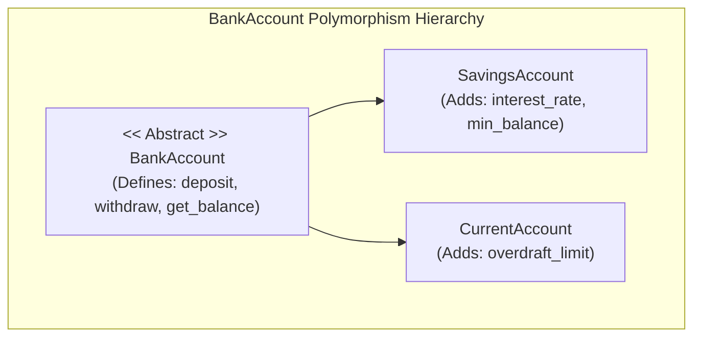
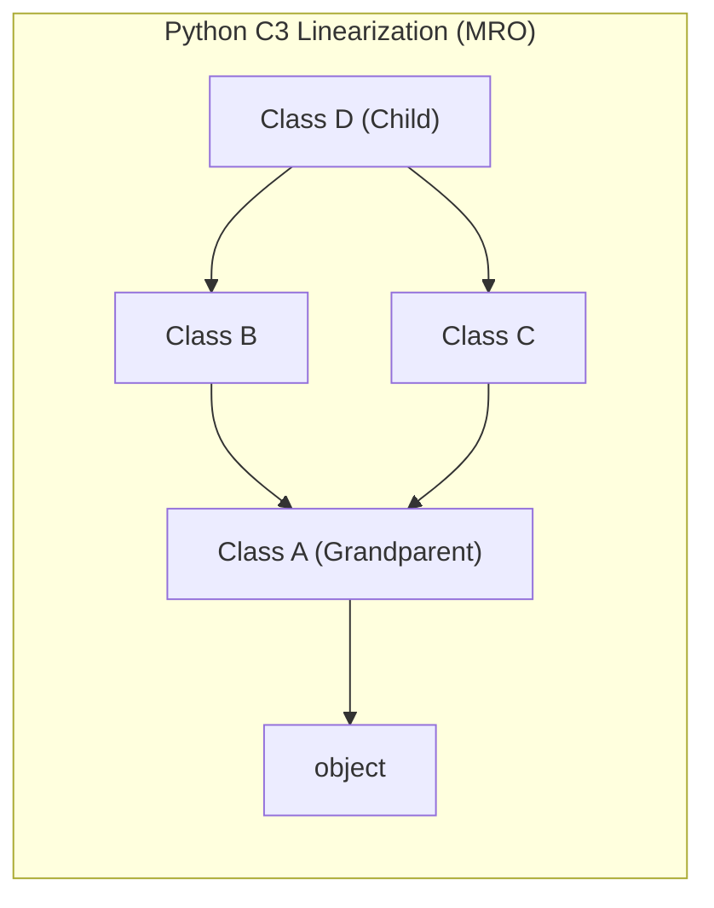

# ⚡ CAT-2 HOTS Master Crib — Module 3: Advanced OOP, Operator Overloading & Persistence
**Course**: CSE3011 — Python Programming  
**Coverage**: Object-Oriented Design, Operator Overloading & Object Persistence | **Exam Mode**: Open Book / Notes Allowed  
**Target Score**: 45+ / 50 (S-Grade Boundary)

---

## 🧱 TIER 0: The "Explain Like I'm 5" Bedrock Basics
*(Read this first if OOP concepts or design patterns feel abstract)*

### 1. Visualizing Class Inheritance & Polymorphism
* An **Abstract Base Class (ABC)** is a strict contract: It says *"Any child class MUST implement `withdraw()` and `deposit()`, or Python will refuse to create it!"*
* Both `SavingsAccount` and `CurrentAccount` inherit common properties from `BankAccount`, but have different fee/interest behaviors.



---

### 2. The Diamond Problem & Method Resolution Order (MRO)
* In multiple inheritance, if class `D` inherits from both `B` and `C`, and both inherit from `A`: which `speak()` method runs?
* Python uses the **C3 Linearization algorithm** to produce a deterministic search list (`D.__mro__`):
  $$\text{MRO}(D) = [D \to B \to C \to A \to \text{object}]$$



---

## 🧭 TIER 1: The Problem Symptom & Keyword Decoder

| If Question Mentions / Shows... | It Means This Exact Topic | Your Immediate Formula / Action |
| :--- | :--- | :--- |
| "Design an OOP system for real-world application", ABC | **Complete OOP Architecture** | Abstract base class (`ABC`), `@abstractmethod`, `super()`, encapsulation (`__private`), polymorphism. |
| "Implement operator overloading", `__add__`, `__eq__` | **Dunder / Magic Methods** | Implement `__str__`, `__repr__`, `__add__`, `__sub__`, `__eq__`, `__lt__`. Always validate operand type! |
| "Pickle vs JSON", "Object persistent storage" | **Object Serialization** | Compare JSON (Human-readable, portable, secure) vs Pickle (Python-specific, binary, security risk). |
| "Compare polymorphism vs conditional `if-elif` statements" | **Design Justification** | Polymorphism obeys Open-Closed Principle (OCP); adding new types requires zero modification of existing code. |
| Name mangling, access specification | **Encapsulation in Python** | Public: `self.name`; Protected: `self._author` (convention); Private: `self.__isbn` (`_Class__isbn`). |

---

## 🛠️ TIER 2: The Master Exam-Ready OOP Template (Copy Directly!)

This master blueprint solves **Questions 1, 3, 4, and 5 of the Open-Book Practice Exam** in one clean, unified architecture:

```python
from abc import ABC, abstractmethod
import json
import pickle

# =====================================================================
# 1. Custom Exception
# =====================================================================
class InvalidAmountError(Exception):
    """Raised when an operation is attempted with an illegal monetary value."""
    pass

# =====================================================================
# 2. Abstract Base Class (Abstraction & Polymorphism Contract)
# =====================================================================
class BankAccount(ABC):
    def __init__(self, account_number: str, holder_name: str, initial_balance: float):
        self.account_number = account_number          # Public
        self._holder_name = holder_name              # Protected (convention)
        self.__balance = float(initial_balance)       # Private (name-mangled)

    # Encapsulated Getter & Setter for Private Balance
    @property
    def balance(self) -> float:
        return self.__balance

    def deposit(self, amount: float) -> None:
        if amount <= 0:
            raise InvalidAmountError("Deposit amount must be positive!")
        self.__balance += amount

    def withdraw(self, amount: float) -> None:
        if amount <= 0:
            raise InvalidAmountError("Withdrawal amount must be positive!")
        if amount > self.__balance:
            raise InvalidAmountError("Insufficient funds!")
        self.__balance -= amount

    @abstractmethod
    def calculate_interest(self) -> float:
        """Forces all subclasses to provide custom interest calculation."""
        pass

    # =================================================================
    # 3. Meaningful Operator Overloading (Magic / Dunder Methods)
    # =================================================================
    def __str__(self) -> str:
        """User-friendly string representation."""
        return f"Account[{self.account_number}] - {self._holder_name}: ${self.__balance:.2f}"

    def __repr__(self) -> str:
        """Unambiguous developer representation."""
        return f"{self.__class__.__name__}('{self.account_number}', '{self._holder_name}', {self.__balance})"

    def __add__(self, other):
        """Allows merging two accounts or adding interest directly: acc1 + acc2."""
        if isinstance(other, BankAccount):
            return self.__balance + other.__balance
        elif isinstance(other, (int, float)):
            return self.__balance + other
        return NotImplemented

    def __eq__(self, other) -> bool:
        """Equality based on unique account number."""
        if isinstance(other, BankAccount):
            return self.account_number == other.account_number
        return False

    def __lt__(self, other) -> bool:
        """Allows sorting accounts by balance."""
        if isinstance(other, BankAccount):
            return self.__balance < other.__balance
        return NotImplemented

# =====================================================================
# 4. Concrete Subclasses (Inheritance & Polymorphism)
# =====================================================================
class SavingsAccount(BankAccount):
    def __init__(self, account_number: str, holder_name: str, initial_balance: float, interest_rate: float = 0.04):
        super().__init__(account_number, holder_name, initial_balance)
        self.interest_rate = interest_rate

    def calculate_interest(self) -> float:
        return self.balance * self.interest_rate

class CheckingAccount(BankAccount):
    def __init__(self, account_number: str, holder_name: str, initial_balance: float, overdraft_fee: float = 25.0):
        super().__init__(account_number, holder_name, initial_balance)
        self.overdraft_fee = overdraft_fee

    def calculate_interest(self) -> float:
        return 0.0  # Checking accounts typically earn zero interest
```

---

## 🛠️ TIER 3: Object Persistence Comparison & Code

### Comparison Matrix: JSON vs Pickle
| Criterion | JSON (`import json`) | Pickle (`import pickle`) |
| :--- | :--- | :--- |
| **Data Format** | Human-readable text (UTF-8) | Python-specific binary stream |
| **Portability** | **Universal** (Language agnostic: C++, Java, JS) | Python only (version dependency) |
| **Security** | **Safe** (Cannot execute arbitrary bytecode) | **Unsafe** (Deserializing untrusted data can execute malicious shell commands via `__reduce__`) |
| **Supported Types** | Built-in primitives (dicts, lists, strings, numbers) | Arbitrary complex Python objects (classes, lambdas, functions) |
| **Recommendation** | Ideal for external storage, APIs, and interoperable configs | Ideal only for internal temporary caching in trusted environments |

### Implementation Code for Storage & Retrieval:
```python
# 1. JSON Persistence (Convert to dict -> serialize)
def save_account_json(account: BankAccount, filepath: str):
    data = {
        "account_number": account.account_number,
        "holder_name": account._holder_name,
        "balance": account.balance,
        "type": account.__class__.__name__
    }
    with open(filepath, "w", encoding="utf-8") as f:
        json.dump(data, f, indent=4)

# 2. Pickle Persistence (Direct object serialization)
def save_account_pickle(account: BankAccount, filepath: str):
    with open(filepath, "wb") as f:
        pickle.dump(account, f)

def load_account_pickle(filepath: str) -> BankAccount:
    with open(filepath, "rb") as f:
        return pickle.load(f)
```

---

## 📝 TIER 4: Theory Justifications (Copy into Exam Paper)

### 1. Why Polymorphism is Superior to Conditional (`if-elif`) Statements
* **Open-Closed Principle (OCP)**: With polymorphism, if we add a new account type (`FixedDepositAccount`), we write a new class without touching existing `BankAccount` code. With `if-elif` chains, every new account type requires editing every single dispatch function across the entire codebase.
* **Code Smells & Maintenance**: Nested `if-elif` chains lead to cyclomatic complexity explosion and duplicated branching logic. Polymorphism encapsulates behavior within the object itself.

### 2. Limitations of Operator Overloading
* **Readability / Principle of Least Astonishment**: Overloading operators with non-intuitive meanings (e.g. using `*` to send an email) degrades code maintainability.
* **Type Symmetry**: In `a + b`, if `a` does not know how to add `b`, Python attempts `b.__radd__(a)`. If neither handles the type, a `TypeError` must be raised cleanly by returning `NotImplemented`.
