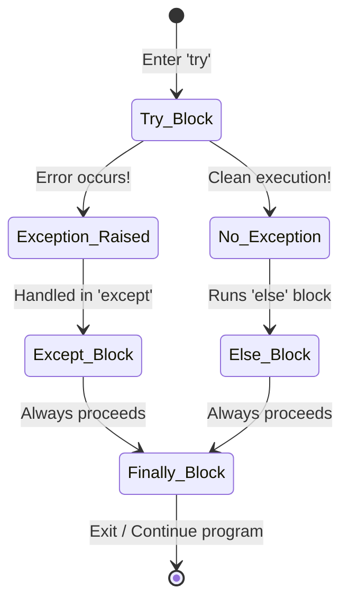
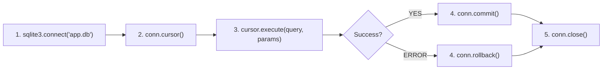

# ⚡ CAT-2 HOTS Master Crib — Module 4: Files, Exceptions & Database Connectivity
**Course**: CSE3011 — Python Programming  
**Coverage**: File Streams, System OS Operations, Exception Handling & DB APIs | **Exam Mode**: Open Book  
**Target Score**: 45+ / 50 (S-Grade Boundary)

---

## 🧱 TIER 0: The "Explain Like I'm 5" Bedrock Basics
*(Read this first if file operations or exception control flow confuse you)*

### 1. Python Exception Handling: The Complete Lifecycle
* `try`: Code that might blow up (e.g. file missing, zero division).
* `except`: Runs ONLY if an error occurs.
* `else`: Runs ONLY if **NO error** occurred!
* `finally`: **ALWAYS runs**, no matter what (used for closing files/network sockets).



---

### 2. Python DB-API 2.0: Database Transaction Flow
Every relational database in Python follows this exact 5-stage pipeline:



---

## 🧭 TIER 1: The Problem Symptom & Keyword Decoder

| If Question Mentions / Shows... | It Means This Exact Topic | Your Immediate Formula / Action |
| :--- | :--- | :--- |
| "Word frequency analysis from file" | **File Text Processing** | `open(file, 'r')` $\to$ `collections.Counter` or dictionary $\to$ sort by frequency $\to$ write to output file. |
| "Student records file handling", CSV | **Structured Records Processing** | Format: `ID,Name,Marks`. Split by delimiter, compute average/grade, write back with headers. |
| "Demonstrate try, except, else, finally" | **Robust Exception Handling** | `try`: risky code; `except`: error handler; `else`: runs if NO exception; `finally`: cleanup (always runs!). |
| "OS operations: create, rename, check, delete" | **`os` & `pathlib` Operations** | `os.path.exists()`, `os.rename()`, `os.remove()`, `os.listdir()`, `os.path.getsize()`. |
| "Database connectivity", SQLite / MySQL | **Python DB-API 2.0** | `conn = sqlite3.connect()`, `cursor = conn.cursor()`, parameterized query `cursor.execute('... ?', (val,))`, `conn.commit()`. |

---

## 🛠️ TIER 2: Master Solved Code Recipes (Directly Answering Activity 3)

### Recipe 4.1: Word Frequency Analysis & File Output
*(Direct solution to Activity 3 Question 1 & Experiment 8)*
```python
import string
from collections import Counter

def word_frequency_analysis(input_filepath: str, output_filepath: str):
    """Reads a text file, cleans punctuation, counts word frequencies, and writes sorted results."""
    try:
        with open(input_filepath, 'r', encoding='utf-8') as infile:
            text = infile.read().lower()

        # Remove punctuation
        cleaned_text = text.translate(str.maketrans('', '', string.punctuation))
        words = cleaned_text.split()

        # Count frequencies
        freq_counter = Counter(words)

        # Write results to output file
        with open(output_filepath, 'w', encoding='utf-8') as outfile:
            outfile.write(f"{'WORD':<20} | {'FREQUENCY':<10}\n")
            outfile.write("-" * 35 + "\n")
            for word, count in freq_counter.most_common():
                outfile.write(f"{word:<20} | {count:<10}\n")

        print(f"Analysis complete! Results written to {output_filepath}")

    except FileNotFoundError:
        print(f"Error: Input file '{input_filepath}' does not exist.")
    except PermissionError:
        print("Error: Permission denied while accessing file.")
```

---

### Recipe 4.2: Student Records Management with File Handling
*(Direct solution to Activity 3 Question 2)*
```python
def process_student_records(input_file: str, report_file: str):
    """Reads student records (RegNo, Name, Marks), computes grades, and writes report."""
    try:
        with open(input_file, 'r', encoding='utf-8') as infile:
            lines = infile.readlines()

        processed_records = []
        for line in lines:
            line = line.strip()
            if not line:
                continue
            reg_no, name, marks_str = [item.strip() for item in line.split(',')]
            marks = float(marks_str)
            
            # Determine grade
            if marks >= 90: grade = 'S'
            elif marks >= 80: grade = 'A'
            elif marks >= 70: grade = 'B'
            elif marks >= 60: grade = 'C'
            elif marks >= 50: grade = 'D'
            else: grade = 'F'

            processed_records.append((reg_no, name, marks, grade))

        # Write output report
        with open(report_file, 'w', encoding='utf-8') as outfile:
            outfile.write(f"{'REG NO':<15} | {'NAME':<20} | {'MARKS':<8} | {'GRADE':<6}\n")
            outfile.write("=" * 55 + "\n")
            for reg, nm, mk, gd in processed_records:
                outfile.write(f"{reg:<15} | {nm:<20} | {mk:<8.1f} | {gd:<6}\n")

    except FileNotFoundError:
        print(f"Source records file '{input_file}' not found.")
```

---

### Recipe 4.3: OS File Management Operations Suite
*(Direct solution to Activity 3 Question 4)*
```python
import os

def demonstrate_file_management(filename: str):
    """Demonstrates creating, checking, renaming, metadata querying, and deleting a file."""
    # 1. Create and write to file
    with open(filename, 'w', encoding='utf-8') as f:
        f.write("Sample test data for OS file management.")
    print(f"1. Created: '{filename}'")

    # 2. Check if file exists
    if os.path.exists(filename):
        size = os.path.getsize(filename)
        abs_path = os.path.abspath(filename)
        print(f"2. Exists: Yes | Size: {size} bytes | Path: {abs_path}")

    # 3. Rename file
    new_filename = "renamed_" + filename
    os.rename(filename, new_filename)
    print(f"3. Renamed to: '{new_filename}'")

    # 4. Delete file
    if os.path.exists(new_filename):
        os.remove(new_filename)
        print(f"4. Deleted: '{new_filename}'")
```

---

### Recipe 4.4: Generic Database Connectivity Pattern (SQLite / MySQL)
```python
import sqlite3

def init_and_query_database(db_name: str = "students.db"):
    """Demonstrates table creation, parameterized inserts, queries, and transactions."""
    conn = None
    try:
        conn = sqlite3.connect(db_name)
        cursor = conn.cursor()

        # Create table
        cursor.execute("""
            CREATE TABLE IF NOT EXISTS students (
                id INTEGER PRIMARY KEY AUTOINCREMENT,
                reg_no TEXT UNIQUE NOT NULL,
                name TEXT NOT NULL,
                cgpa REAL
            )
        """)

        # Parameterized insert (Prevents SQL Injection!)
        student_data = [('24BCE1001', 'Danny', 9.2), ('24BCE1002', 'Thomas', 8.7)]
        cursor.executemany("INSERT OR IGNORE INTO students (reg_no, name, cgpa) VALUES (?, ?, ?)", student_data)
        conn.commit()

        # Query
        cursor.execute("SELECT reg_no, name, cgpa FROM students WHERE cgpa >= ?", (9.0,))
        top_students = cursor.fetchall()
        print("Top Students:", top_students)

    except sqlite3.Error as e:
        if conn:
            conn.rollback()
        print(f"Database error: {e}")
    finally:
        if conn:
            conn.close()
            print("Database connection closed cleanly.")
```

---

### Recipe 4.5: MySQL Workbench Connector (`mysql.connector`)
*(Direct solution from `MYSQL TRIAL.docx`)*
```python
import mysql.connector

def test_mysql_connection():
    """Demonstrates connecting to MySQL Server, table creation, insertion, and query."""
    con = None
    try:
        con = mysql.connector.connect(
            host="localhost",
            user="root",
            password="YOUR_PASSWORD",  # Replace with your MySQL password
            database="college"
        )
        print("Connected to MySQL successfully!")
        cursor = con.cursor()

        # Create Table
        cursor.execute("""
            CREATE TABLE IF NOT EXISTS student (
                id INT PRIMARY KEY,
                name VARCHAR(50),
                marks INT
            )
        """)

        # Parameterized Insert
        insert_query = "INSERT INTO student (id, name, marks) VALUES (%s, %s, %s) ON DUPLICATE KEY UPDATE marks=VALUES(marks)"
        records = [(1, 'Rahul', 85), (2, 'Priya', 92)]
        cursor.executemany(insert_query, records)
        con.commit()

        # Query Table
        cursor.execute("SELECT * FROM student")
        for row in cursor.fetchall():
            print(f"ID: {row[0]}, Name: {row[1]}, Marks: {row[2]}")

    except mysql.connector.Error as err:
        print(f"MySQL Error: {err}")
    finally:
        if con and con.is_connected():
            con.close()
            print("MySQL connection closed.")
```

---

### Recipe 4.6: Practice Questions Suite (Direct Solutions from `Practice Questions.docx`)

```python
import os

# 1. Count Lines, Words, and Characters in a Text File
def count_file_statistics(filepath: str):
    """Counts lines, words, and characters in a file."""
    try:
        with open(filepath, 'r', encoding='utf-8') as f:
            lines = f.readlines()
            line_count = len(lines)
            word_count = sum(len(line.split()) for line in lines)
            char_count = sum(len(line) for line in lines)

        print(f"Lines: {line_count}, Words: {word_count}, Characters: {char_count}")
        return line_count, word_count, char_count
    except FileNotFoundError:
        print(f"Error: File '{filepath}' does not exist.")

# 2. Safe File Copy with Exception Handling (input.txt -> backup.txt)
def safe_copy_file(source_file: str, backup_file: str):
    """Copies content from source to backup with try-except."""
    try:
        with open(source_file, 'r', encoding='utf-8') as src:
            content = src.read()
        with open(backup_file, 'w', encoding='utf-8') as dest:
            dest.write(content)
        print(f"Successfully backed up '{source_file}' to '{backup_file}'.")
    except FileNotFoundError:
        print(f"Error: Source file '{source_file}' not found.")
    except PermissionError:
        print("Error: Permission denied.")

# 3. Directory Management with os Module
def directory_management_demo():
    """Demonstrates mkdir, getcwd, rename, and rmdir."""
    # Display Current Working Directory
    print("Current Working Directory:", os.getcwd())

    # Create 'College' Directory
    if not os.path.exists("College"):
        os.mkdir("College")
        print("Directory 'College' created.")

    # Create and Rename 'OldFolder' -> 'NewFolder'
    if not os.path.exists("OldFolder") and not os.path.exists("NewFolder"):
        os.mkdir("OldFolder")
        print("Directory 'OldFolder' created.")
    if os.path.exists("OldFolder"):
        os.rename("OldFolder", "NewFolder")
        print("Renamed 'OldFolder' to 'NewFolder'.")

    # Delete empty directory 'TempFolder'
    if not os.path.exists("TempFolder"):
        os.mkdir("TempFolder")
    if os.path.exists("TempFolder"):
        os.rmdir("TempFolder")
        print("Deleted empty directory 'TempFolder'.")
```

