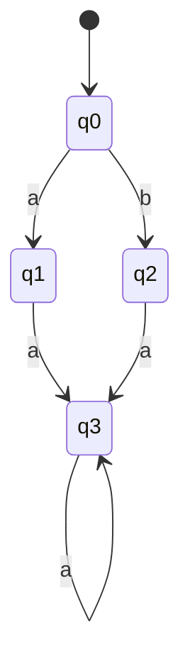
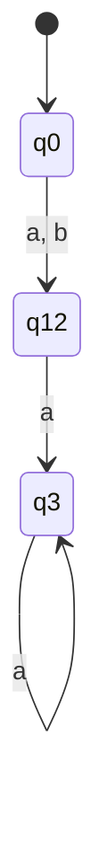

# 🧠 TOC: DFA Minimization (The Table Filling Method)

Welcome to DFA Minimization! Have you ever looked at a DFA and thought, "Wow, there are too many states here doing the exact same thing?" 

Minimizing a DFA is like cleaning your room. You throw away the garbage (unreachable states) and you merge the identical socks (equivalent states).

---

## 1. The "Clean Your Room" Algorithm (Myhill-Nerode)

> [!TIP]
> **TL;DR Steps for the Exam:**
> 1. **Delete Dead Weight:** Remove any state that cannot be reached from the Start state.
> 2. **Draw the Triangle Table:** Make a staircase grid pairing every state with every other state (e.g., `(q0, q1)`, `(q0, q2)`...).
> 3. **Mark the Obvious Mismatches:** Put an `X` in the box if one state is a Final state and the other is a Non-Final state. (A winner and a loser can never be the same).
> 4. **Test the Rest (The Chain Reaction):** For the remaining empty boxes (like `(q1, q2)`), check where they go when given a `0` or `1`. If they go to a pair that already has an `X`, then put an `X` in this box too!
> 5. **Merge the Survivors:** If any box is left empty after looping through, those two states are identical! Merge them into one mega-state.

### 💡 Example: Merging Identical Twins
If `q1` on input `a` goes to `q3`, and `q2` on input `a` goes to `q4`.
You check the box for `(q3, q4)`. If `(q3, q4)` has an `X`, then `(q1, q2)` gets an `X` too. They are "distinguishable".
If not, keep checking.

---

## 2. Mermaid Diagram Example: Before & After

### ❌ Before Minimization (Too messy!)

*(Notice how `q1` and `q2` both just go to `q3` when they see an `a`? They are basically doing the exact same job!)*

### ✅ After Minimization (Clean!)

*(We merged `q1` and `q2` into `q12`. Now it's perfectly optimized.)*

> [!WARNING]
> **Exam Trap:** Don't forget Step 1! If you forget to delete unreachable states first, your table will be huge and you'll waste 15 minutes of exam time checking useless pairs.

---

## ✅ Quick Self-Check

1. What is the very first step of DFA minimization?
2. In the Table Filling Method, which pairs get marked with an `X` immediately in the first pass?
3. If box `(q1, q2)` is left unmarked at the end of the algorithm, what does that mean?
4. True or False: You can minimize an NFA using the Table Filling method.

🔑 Answers

1. Delete all unreachable states (states you can't reach from the start state).
2. Pairs where one state is a Final State (accepting) and the other is a Non-Final State (rejecting).
3. It means `q1` and `q2` are equivalent (indistinguishable) and should be merged into a single state!
4. **False**. The table filling algorithm (Myhill-Nerode theorem application) is specifically for DFAs. You must convert an NFA to a DFA first before minimizing.

---

**⏱️ Time spent: ~15 min.**
