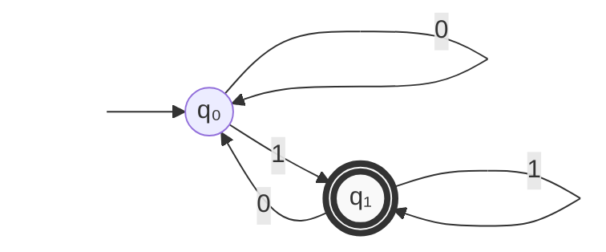
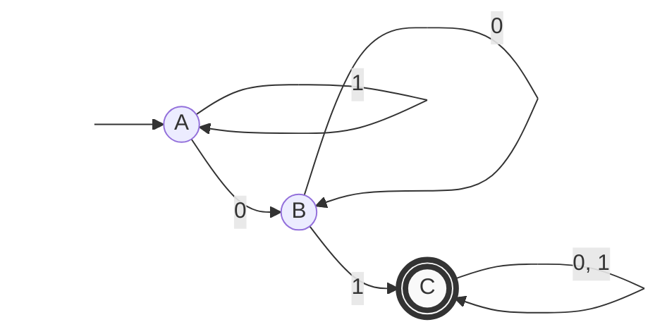

# 🤖 Lesson 4 — DFA (Deterministic Finite Automaton)

> **TL;DR**: A DFA is a machine with states and arrows. You feed it a string, it follows arrows one symbol at a time. If it ends on a "happy state" (final state) → ACCEPT. Otherwise → REJECT. That's literally it.

---

## 🎯 What is a DFA?

A DFA is the **simplest type of machine** in TOC. It:
- Reads input **one symbol at a time** (left to right)
- Has **no memory** (can't go back, can't store anything)
- At each state, for each symbol, there's **exactly one** arrow to follow (that's the "deterministic" part)

---

## 📋 Formal Definition: M = (Q, Σ, δ, q₀, F)

| Component | What it is | Example |
|:---:|---|---|
| **Q** | Finite set of **states** | {q₀, q₁, q₂} |
| **Σ** | Input **alphabet** | {0, 1} |
| **δ** | **Transition function** (the rules) | δ(q₀, 0) = q₁ |
| **q₀** | **Start state** | q₀ |
| **F** | Set of **final/accepting states** | {q₂} |

---

## 🎨 How to Draw a DFA

**Conventions:**
- **Circle** = Regular state
- **Double/Thick Circle** = Accepting/Final state
- **Arrow from nowhere** = Start state
- **Labeled Arrows** = Transitions

**Example**: DFA that accepts strings ending in '1'



<details>
<summary>📱 Tap here for Mobile/Text version of the diagram</summary>

```text
         ┌──0──┐          ┌──1──┐
         ↓     │          ↓     │
  →  ( q₀ ) ──1──→  (( q₁ ))
         ↑                 │
         └────── 0 ────────┘
```
</details>

- Start at q₀
- Reading '1' → go to q₁ (accepting state)
- Reading '0' → go back to q₀
- If string ends at q₁ → **ACCEPT** ✅
- If string ends at q₀ → **REJECT** ❌

---

## 📊 Transition Table (Alternative to Drawing)

You can represent a DFA as a table instead of a diagram:

| State | Input: 0 | Input: 1 |
|:---:|:---:|:---:|
| **→ q₀** | q₀ | q₁ |
| **\*q₁** | q₀ | q₁ |

- `→` marks the start state
- `*` marks the final/accepting state
- Each cell tells you the **next state**

---

## 🔍 Tracing a String Through a DFA

### Example: Does the DFA above accept "1010"?

```
String: 1  0  1  0

State:  q₀ →(1)→ q₁ →(0)→ q₀ →(1)→ q₁ →(0)→ q₀
                                                 ↑
                                            Not accepting!

Result: REJECT ❌ (ended on q₀, which is not a final state)
```

### Does it accept "101"?

```
State:  q₀ →(1)→ q₁ →(0)→ q₀ →(1)→ q₁
                                      ↑
                                  Accepting! ◎

Result: ACCEPT ✅ (ended on q₁)
```

---

## 🏗️ How to Design a DFA (Step by Step)

### Example: Design a DFA for L = {w ∈ {0,1}* : w contains "01" as a substring}

**Step 1**: Think about what you need to "remember" (states)
- Have I seen nothing useful yet? → state A
- Have I seen a '0' (ready for the '01' pattern)? → state B  
- Have I seen '01'? → state C (accepting — stay here forever)

**Step 2**: Draw transitions



<details>
<summary>📱 Tap here for Mobile/Text version of the diagram</summary>

```text
          1       0       0,1
    ┌───────┐  ┌────┐   ┌────┐
    ↓       │  ↓    │   ↓    │
→ ( A ) ──0──→ ( B ) ──1──→ (( C ))
```
</details>

**Step 3**: Write the transition table

| State | 0 | 1 |
|:---:|:---:|:---:|
| → A | B | A |
| B | B | C |
| *C | C | C |

**Step 4**: Verify with test strings
```
"01"  : A →0→ B →1→ C ✅ (ACCEPT)
"101" : A →1→ A →0→ B →1→ C ✅ (ACCEPT)
"111" : A →1→ A →1→ A →1→ A ❌ (REJECT — no '01' found)
"110" : A →1→ A →1→ A →0→ B ❌ (REJECT — saw '0' but no '1' after)
```

---

## 🎯 Common DFA Design Patterns

| Language | Strategy | # States |
|----------|----------|:---:|
| Strings ending in X | Remember last few symbols | 2-4 |
| Strings containing substring X | Track progress matching X | 3-4 |
| Even/odd count of a symbol | Toggle between two states | 2 |
| Divisibility by n | Use n states (remainder tracking) | n |
| Strings of specific length | Count up to that length | length + 1 |

---

## ⚡ Key Properties of DFA

| Property | Value |
|----------|-------|
| Memory | **None** |
| Deterministic? | **Yes** — exactly ONE transition per (state, symbol) pair |
| Dead states? | Yes — a "trap" state where you can never reach an accepting state |
| Every string? | Every string leads to either ACCEPT or REJECT (never "stuck") |

---

## ✅ Quick Self-Check

1. In a DFA, how many transitions exist from each state for each input symbol?
2. When does a DFA accept a string?
3. What's a "dead state"?
4. Design a DFA over {a, b} that accepts strings with an even number of a's (including zero a's)
5. Trace "aab" through your DFA from Q4

<details>
<summary>🔑 Answers</summary>

1. Exactly **one** (that's why it's "deterministic")
2. When the string is fully consumed AND the machine is in a **final/accepting state**
3. A state from which no accepting state can ever be reached — once you enter, you're stuck
4. Two states: q₀ (even a's, accepting), q₁ (odd a's). On 'a' → toggle. On 'b' → stay.
   - → *q₀ --a→ q₁, q₀ --b→ q₀
   - q₁ --a→ q₀, q₁ --b→ q₁
5. q₀ →a→ q₁ →a→ q₀ →b→ q₀ → **ACCEPT** ✅ (even a's: 2)

</details>

---

**⏱️ Time spent: ~20 min. Next →** [05 - NFA & ε-NFA](./05-nfa.md)
