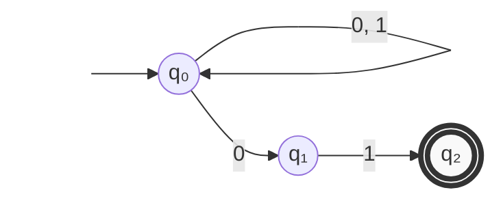
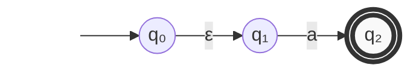

# 🌀 Lesson 5 — NFA & ε-NFA

> **TL;DR**: An NFA is like a DFA but **lazier** — from one state, you can have 0, 1, or MANY arrows for the same symbol. Also you can have "free" ε-transitions (move without reading anything). NFAs accept if **ANY** possible path leads to an accepting state. The magic: **every NFA can be converted to an equivalent DFA** (subset construction).

---

## 🤔 NFA vs DFA — What's Different?

| Feature | DFA | NFA |
|---------|:---:|:---:|
| Transitions per (state, symbol) | **Exactly 1** | **0, 1, or many** |
| ε-transitions (free moves) | ❌ No | ✅ Yes (in ε-NFA) |
| Deterministic? | ✅ Yes | ❌ No |
| When does it accept? | Ends in final state | **Any** path ends in final state |
| Computational power | = NFA | = DFA |

> 💡 **The big reveal**: NFAs and DFAs recognize **exactly the same languages** (Regular Languages). NFAs are just easier to design.

---

## 📋 NFA Formal Definition: N = (Q, Σ, δ, q₀, F)

Same 5 components as DFA, but the transition function is different:

| Component | DFA version | NFA version |
|:---:|---|---|
| **δ** | δ(state, symbol) = **one state** | δ(state, symbol) = **set of states** |

```
DFA:  δ(q₀, a) = q₁           → goes to exactly one state
NFA:  δ(q₀, a) = {q₁, q₂}    → goes to MULTIPLE states (or ∅ for none)
```

---

## 🎨 NFA Example

**Language**: L = {w ∈ {0,1}* : w ends in "01"}

### As an NFA (easy to design):



| State | 0 | 1 |
|:---:|:---:|:---:|
| → q₀ | {q₀, q₁} | {q₀} |
| q₁ | ∅ | {q₂} |
| *q₂ | ∅ | ∅ |

### How does an NFA process a string?

Think of it as the NFA **exploring ALL possible paths simultaneously** (like parallel universes). If **any** path ends in an accepting state → ACCEPT.

#### Tracing "1001":
```
Start: {q₀}

Read '1': from q₀ on '1' → {q₀}
Read '0': from q₀ on '0' → {q₀, q₁}
Read '0': from q₀ on '0' → {q₀, q₁}; from q₁ on '0' → ∅
   Combined: {q₀, q₁}
Read '1': from q₀ on '1' → {q₀}; from q₁ on '1' → {q₂}
   Combined: {q₀, q₂}

q₂ is accepting → ACCEPT ✅
```

---

## ⚡ ε-NFA — NFA with Free Moves

An ε-NFA allows **ε-transitions** = transitions that happen **without consuming any input symbol**.

**Example**:



From q₀, you can "teleport" to q₁ for free (without reading anything).

### ε-closure

The **ε-closure** of a state q = the set of all states reachable from q by following **only ε-transitions** (including q itself).

```
ECLOSE(q₀) = {q₀, q₁}    (q₀ itself + wherever ε takes you)
ECLOSE(q₁) = {q₁}         (just itself, no ε-transitions from q₁)
ECLOSE(q₂) = {q₂}         (just itself)
```

### Processing a string in ε-NFA:

For each transition:
1. Go to all immediate destination states
2. Then add all their ε-closure states too

---

## 🔄 NFA → DFA Conversion (Subset Construction)

This is the **most important algorithm** in this topic. Every NFA can be converted to an equivalent DFA.

### The Algorithm

1. **Start state of DFA** = ε-closure of NFA start state
2. For each DFA state (which is a **set** of NFA states) and each input symbol:
   - Find where each NFA state goes on that symbol
   - Take the union of all destination states
   - Add ε-closure of the result
   - This gives you the **new DFA state**
3. A DFA state is **accepting** if it contains **any** NFA accepting state
4. Repeat until no new DFA states are generated

### Simple Example

**NFA:**

| State | 0 | 1 |
|:---:|:---:|:---:|
| → q₀ | {q₀, q₁} | {q₀} |
| q₁ | ∅ | {q₂} |
| *q₂ | ∅ | ∅ |

**Converting to DFA:**

```
DFA start state: {q₀}

From {q₀}:
  on 0: q₀→{q₀,q₁} = {q₀,q₁}     → new state!
  on 1: q₀→{q₀}     = {q₀}         → already known

From {q₀,q₁}:
  on 0: q₀→{q₀,q₁}, q₁→∅  = {q₀,q₁}   → already known
  on 1: q₀→{q₀}, q₁→{q₂}  = {q₀,q₂}   → new state!

From {q₀,q₂}:
  on 0: q₀→{q₀,q₁}, q₂→∅  = {q₀,q₁}   → already known
  on 1: q₀→{q₀}, q₂→∅      = {q₀}      → already known

No more new states. Done!
```

**Resulting DFA:**

| DFA State | 0 | 1 | Accepting? |
|:---:|:---:|:---:|:---:|
| → {q₀} | {q₀,q₁} | {q₀} | No |
| {q₀,q₁} | {q₀,q₁} | {q₀,q₂} | No |
| *{q₀,q₂} | {q₀,q₁} | {q₀} | **Yes** (contains q₂) |

---

## 🧠 The Equivalence Theorem

> **DFA ≡ NFA ≡ ε-NFA**
>
> All three recognize **exactly the same class of languages**: the **Regular Languages**.

```
Every DFA is trivially an NFA (just has exactly 1 transition per symbol)
Every NFA can be converted to a DFA (subset construction)
Every ε-NFA can be converted to a regular NFA (remove ε-transitions)
```

---

## 🎯 When to Use What?

| Task | Use |
|------|-----|
| **Designing** a machine for a language | NFA (easier, fewer states) |
| **Implementing** in hardware/software | DFA (deterministic, no ambiguity) |
| **Exam question**: "build a machine for..." | Start with NFA, convert to DFA if asked |

---

## ✅ Quick Self-Check

1. How many transitions can an NFA have from one state on one input symbol?
2. What is an ε-transition?
3. When does an NFA accept a string?
4. What is the ε-closure of a state?
5. In subset construction, when is a DFA state accepting?

<details>
<summary>🔑 Answers</summary>

1. **Zero, one, or many**
2. A transition that moves to another state **without consuming any input**
3. When **at least one** possible path ends in an accepting state
4. The set of all states reachable from that state by following only ε-transitions (including itself)
5. When it **contains at least one** accepting state from the NFA

</details>

---

**⏱️ Time spent: ~20 min. Next →** [06 - Regular Expressions](./06-regular-expressions.md)
