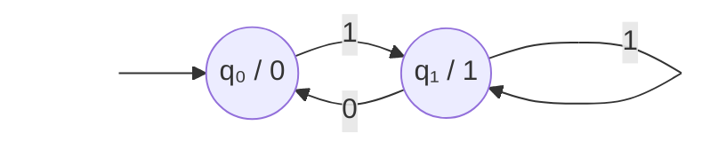
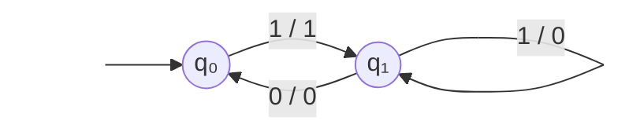

# 🤖 Lesson 9 — Mealy and Moore Machines (FSMs with Output)

> **TL;DR**: Until now, our Automata just answered "YES" (Accept) or "NO" (Reject). **Mealy** and **Moore** machines actually *output* a sequence of symbols as they run! 

---

## 🖨️ Moore Machine (Output on STATE)

In a **Moore machine**, the output is attached to the **State**. Whenever you enter a state, you print out its assigned output.

- **Format**: `State / Output`
- Think: "M**oo**re has m**o**re letters, so the output is inside the fat circle (the state)."


<details>
<summary>📱 Tap here for Mobile/Text version of the diagram</summary>

```text
       1
    +-----> (q1 / 1) -+
    |         |   ^   | 1
(q0 / 0) <----+   +---+
       0
```
</details>

*If the input is `11`, the path is: Start at `q0/0` (Output: 0) -> read `1` -> go to `q1/1` (Output: 1) -> read `1` -> stay at `q1/1` (Output: 1). Total Output: `011`.*

---

## 🏎️ Mealy Machine (Output on TRANSITION)

In a **Mealy machine**, the output is attached to the **Transition** (the arrow). You only print something when you travel along an arrow.

- **Format on arrow**: `Input / Output`
- Think: "M**e**aly machines react to the **e**dge (transition)."


<details>
<summary>📱 Tap here for Mobile/Text version of the diagram</summary>

```text
       1 / 1
    +--------> (q1) --+
    |           |  ^  | 1 / 0
  (q0) <--------+  +--+
       0 / 0
```
</details>

*If the input is `11`, the path is: Start at `q0` (Output: nothing yet) -> read `1` -> output `1` -> go to `q1` -> read `1` -> output `0` -> go to `q1`. Total Output: `10`.*

---

## 🤝 Are they equivalent?

**YES!** You can convert any Moore machine into a Mealy machine, and vice-versa. If you feed them both the exact same sequence of inputs, they will generate the exact same sequence of outputs (except the Moore machine prints one extra character at the very beginning because it outputs something as soon as it turns on in the start state).

> **💡 Exam Tip**: If asked for the difference:
> - **Moore**: Output depends *only* on the current state.
> - **Mealy**: Output depends on *both* the current state AND the input.
