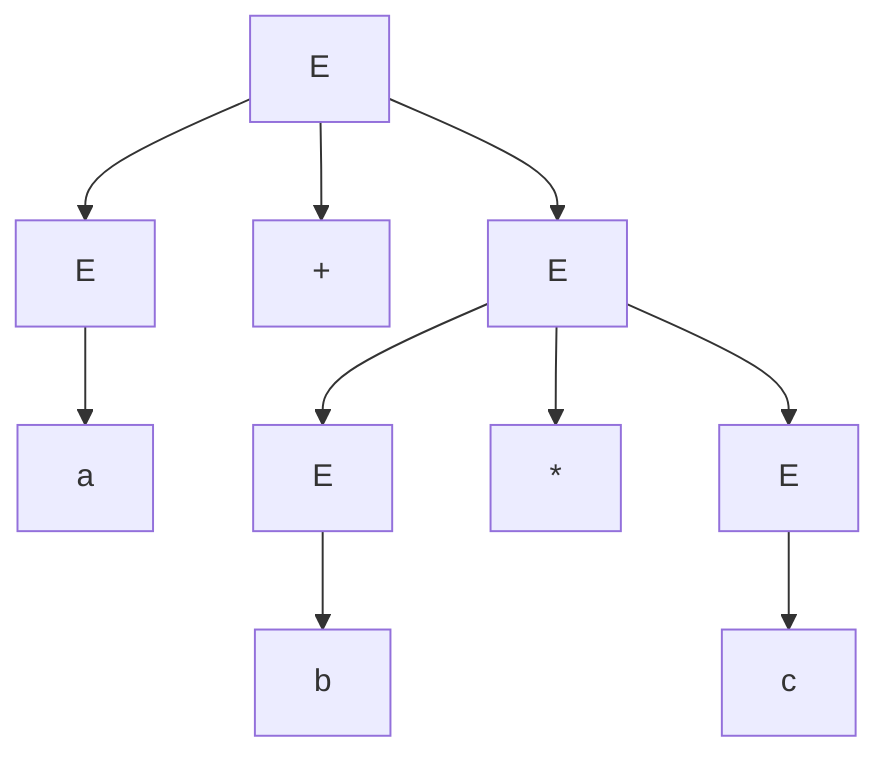

# 🌳 Lesson 10 — Context-Free Grammars & Ambiguity

> **TL;DR**: Regular languages are too weak for programming languages because they can't count (e.g., matching open/close brackets `( )`). **Context-Free Grammars (CFG)** solve this!

---

## 🏗️ What is a CFG?

A Grammar describes the legal words and sentences in a language. It is defined by 4 things:

1. **Terminals (T)**: The actual letters of the alphabet (e.g., `a`, `b`, `λ`).
2. **Non-terminals / Variables (V)**: Intermediate uppercase letters used to generate words (e.g., `S`, `A`, `B`).
3. **Start Symbol (S)**: The root where everything begins.
4. **Production Rules (P)**: The substitution rules. Left side -> Right side.

> **Example Rule**: `S -> aSb` (Replace `S` with `aSb`). Multiple rules can be combined with `|` (OR), like `S -> aSb | λ`.

### 🌟 Example: Palindromes
$L = \{w w^R\}$ (words that read the same backwards and forwards, like `aa` or `abba`).
**CFG Rules**:
```text
S -> λ
S -> aSa
S -> bSb
```
*Try generating `aa`:* `S` -> `aSa` -> `aλa` -> `aa`.

---

## 🌲 Derivations & Parse Trees

Applying a production rule is called a **derivation**. 

- **Leftmost derivation**: Always replace the leftmost non-terminal first.
- **Rightmost derivation**: Always replace the rightmost non-terminal first.

We can draw derivations as **Parse Trees** (also called Derivation Trees).

**Example Expression**: `a + b * c`



<details>
<summary>📱 Tap here for Mobile/Text version of the diagram</summary>

```text
       E
     / | \
    E  +  E
   /     / | \
  a     E  *  E
       /       \
      b         c
```
</details>

---

## 🤷‍♂️ What is Ambiguity?

A grammar is **Ambiguous** if there is **more than one valid parse tree** (or more than one leftmost derivation) for the exact same word!

**Why is this bad?** 
In programming languages (like Java or C), the compiler can't "guess" what you meant. If `a + b * c` can be parsed as `(a + b) * c` OR `a + (b * c)`, the compiler won't know which math operation to do first!

**Example Ambiguous Grammar**:
```text
S -> aS
S -> Sa
S -> a
```
For the word `aaa`, you can build multiple different trees. 

> **💡 Exam Tip**: To prove a grammar is ambiguous on the exam, you just need to draw **two different parse trees** that both result in the exact same final string.
