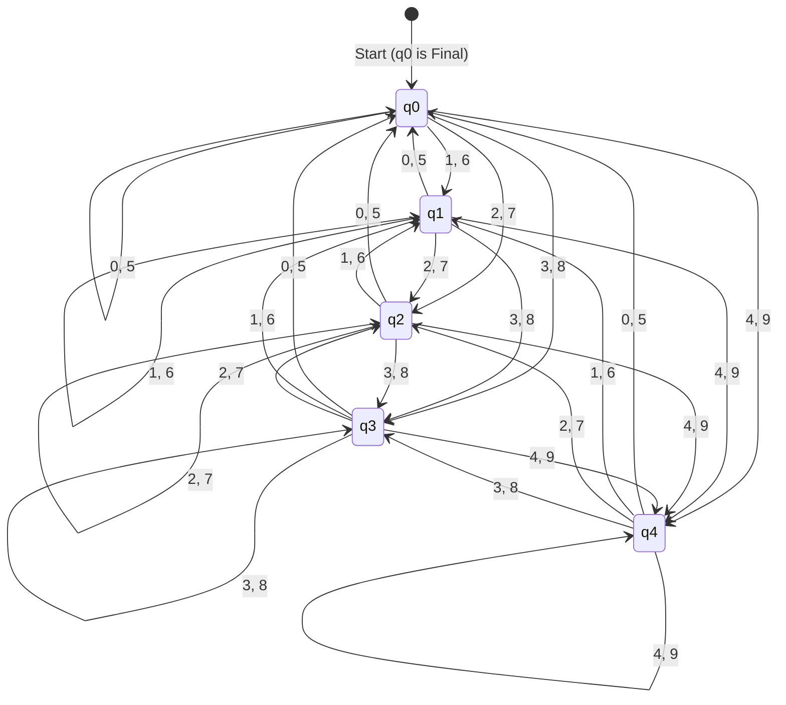
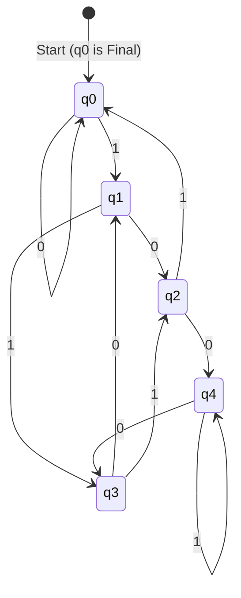
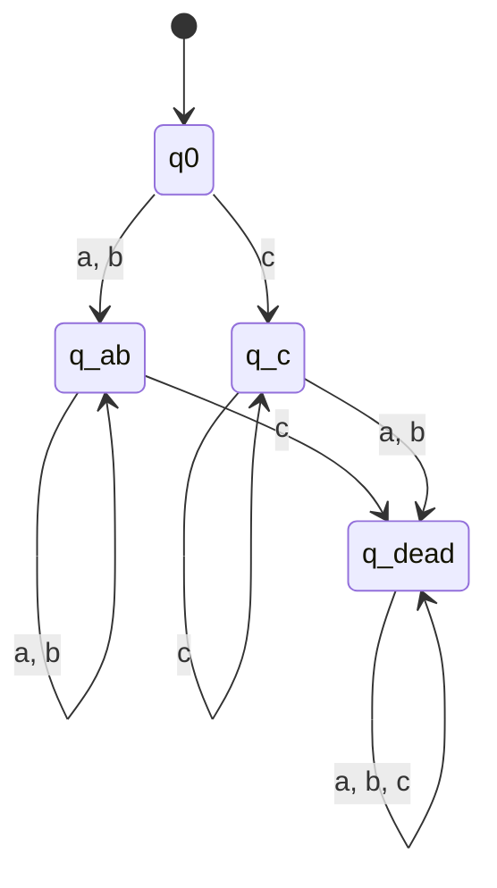
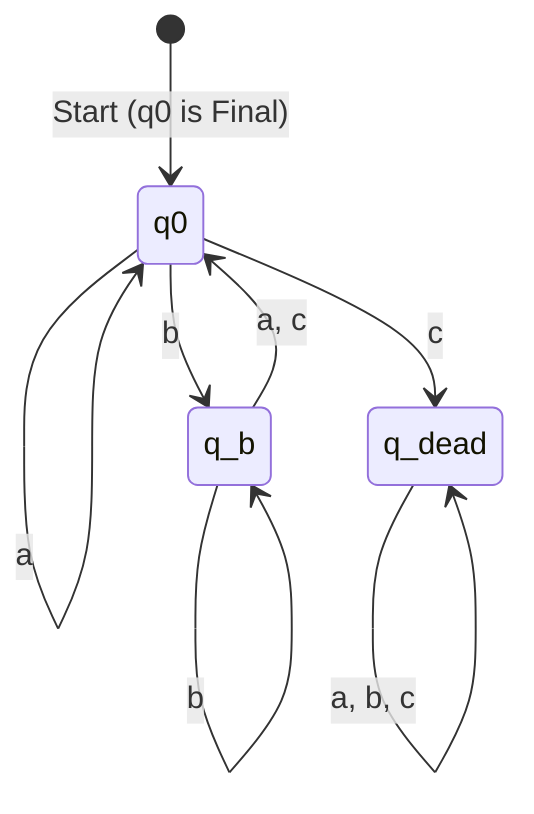
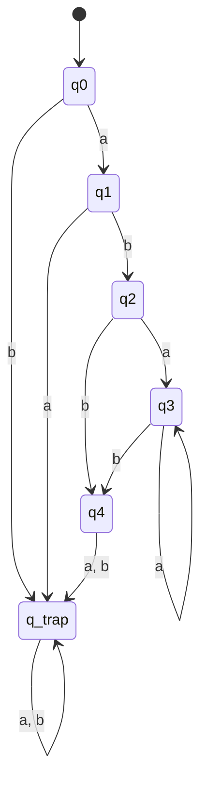
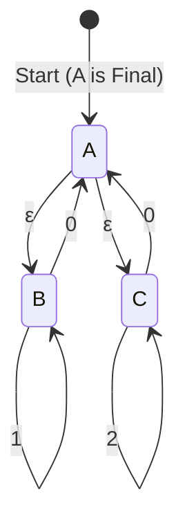
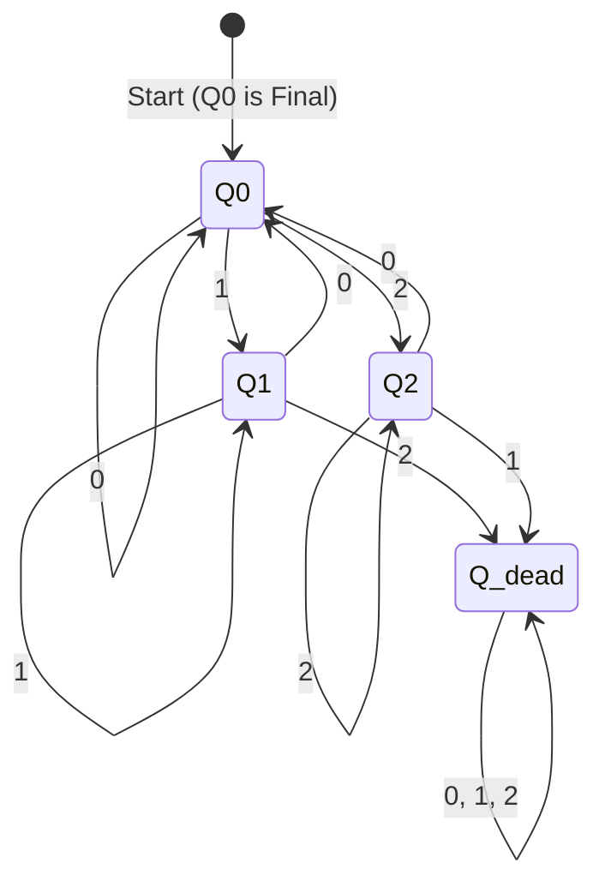

# 📝 TOC & CD Assignment 1 — Complete Master Solutions (CSE-2004)

> **Course**: Theory of Computation & Compiler Design (CSE-2004)  
> **Slot**: A11 + A12 + A13  
> **Target**: 100% Exam & Evaluation Grade Accuracy  

---

## 📌 Table of Contents
1. [Q1: DFA for Integer Numbers Divisible by 5](#q1-dfa-for-any-integer-number-divisible-by-5)
2. [Q2: Converting Regular Expressions to DFA](#q2-convert-the-following-regular-expressions-to-dfa)
   - [Part (i): $a^* b^* (a+b)^+ + c^+$](#part-i-a-b-ab--c)
   - [Part (ii): $((a+b)^+ + a^* bc)^*$](#part-ii-ab--a-bc)
3. [Q3: Trap State, Transition Function Properties & FSM for $L = \{a b a^n b \mid n \ge 0\}$](#q3-trap-state-transition-function-properties--fsm)
4. [Q4: Converting $\epsilon$-NFA to DFA](#q4-convert-the-given--nfa-into-dfa)
5. [Q5: Pumping Lemma Concept & Proof for $L = \{a^n b^n \mid n \ge 1\}$](#q5-pumping-lemma-concept--non-regularity-proof)

---

## ❓ Q1) Design a DFA for any integer number divisible by 5.

### 💡 Overview & Representation Choices
In Theory of Computation, numbers can be represented in **Decimal (Base 10)** or **Binary (Base 2)**. Both designs are presented below with Mermaid state diagrams.

---

### 🔹 Case 1: Decimal (Base 10) Representation (Alphabet $\Sigma = \{0, 1, 2, 3, 4, 5, 6, 7, 8, 9\}$)

#### 1. Mathematical Logic
A decimal integer is divisible by $5$ if and only if its **last digit is $0$ or $5$**.
When reading digits left-to-right, the state tracks the remainder modulo $5$:
$$\delta(q_r, d) = q_{(10r + d) \bmod 5}$$
Since $10 \equiv 0 \pmod 5$, $(10r + d) \bmod 5 \equiv d \bmod 5$.
Thus, the new remainder depends solely on the incoming digit $d$:
- $d \in \{0, 5\} \implies \text{remainder } 0$ (Accepting)
- $d \in \{1, 6\} \implies \text{remainder } 1$
- $d \in \{2, 7\} \implies \text{remainder } 2$
- $d \in \{3, 8\} \implies \text{remainder } 3$
- $d \in \{4, 9\} \implies \text{remainder } 4$

#### 2. Formal 5-Tuple Definition
$$\mathcal{M} = (Q, \Sigma, \delta, q_0, F)$$
- **States**: $Q = \{q_0, q_1, q_2, q_3, q_4\}$ (where $q_r$ represents remainder $r = v \bmod 5$)
- **Alphabet**: $\Sigma = \{0, 1, 2, 3, 4, 5, 6, 7, 8, 9\}$
- **Start State**: $q_0$
- **Final (Accepting) State**: $F = \{q_0\}$

#### 3. Transition Table (Base 10)

| Present State | Input $\{0, 5\}$ | Input $\{1, 6\}$ | Input $\{2, 7\}$ | Input $\{3, 8\}$ | Input $\{4, 9\}$ |
| :---: | :---: | :---: | :---: | :---: | :---: |
| **$\to *q_0$** | $q_0$ | $q_1$ | $q_2$ | $q_3$ | $q_4$ |
| **$q_1$** | $q_0$ | $q_1$ | $q_2$ | $q_3$ | $q_4$ |
| **$q_2$** | $q_0$ | $q_1$ | $q_2$ | $q_3$ | $q_4$ |
| **$q_3$** | $q_0$ | $q_1$ | $q_2$ | $q_3$ | $q_4$ |
| **$q_4$** | $q_0$ | $q_1$ | $q_2$ | $q_3$ | $q_4$ |

#### 4. Mermaid State Diagram (Base 10)



<details>
<summary>📱 Click here for ASCII diagram fallback</summary>

```text
        ┌───────────────────────────────────────────────────────────┐
        │                                                           │
        ▼                                                           │
   (( *q_0 )) ───{1,6}───► [ q_1 ]                                  │
     │  ▲                    │                                      │
  {0,5} │                    │                                      │
     └──┘ ◄──────{0,5}───────┼─────────┐                            │
          ◄──────{0,5}───────┼──────┐  │                            │
                             │      │  │                            │
   ┌─────────────{2,7}───────┘      │  │                            │
   │                                │  │                            │
   ▼                                │  │                            │
 [ q_2 ] ────────{3,8}───► [ q_3 ] ─┘  │                            │
   │                                   │                            │
   └─────────────{4,9}───────────────► [ q_4 ] ──────{0,5}──────────┘
```
</details>

---

### 🔹 Case 2: Binary (Base 2) Representation (Alphabet $\Sigma = \{0, 1\}$)

#### 1. Mathematical Logic
When a binary string is read Most Significant Bit (MSB) first:
- If current value is $v \pmod 5 = r$, append a bit $b \in \{0, 1\}$ updates the value to $2v + b$.
- New remainder state: $\delta(q_r, b) = q_{(2r + b) \bmod 5}$.

#### 2. Formal 5-Tuple Definition
$$\mathcal{M} = (Q, \Sigma, \delta, q_0, F)$$
- $Q = \{q_0, q_1, q_2, q_3, q_4\}$, $\Sigma = \{0, 1\}$, Start = $q_0$, $F = \{q_0\}$

#### 3. Transition Table (Base 2)

| Present State ($r = v \bmod 5$) | Input `0` ($2r + 0 \bmod 5$) | Input `1` ($2r + 1 \bmod 5$) |
| :---: | :---: | :---: |
| **$\to *q_0$** | $q_0$ | $q_1$ |
| **$q_1$** | $q_2$ | $q_3$ |
| **$q_2$** | $q_4$ | $q_0$ |
| **$q_3$** | $q_1$ | $q_2$ |
| **$q_4$** | $q_3$ | $q_4$ |

#### 4. Mermaid State Diagram (Base 2)



<details>
<summary>📱 Click here for ASCII diagram fallback</summary>

```text
                     ┌─── 1 ───┐
                     │         ▼
      ┌──0──┐    ┌───┴───┐   ┌───────┐
      ▼     │    │       │──1─►│       │
    ((q_0)) ──1─►│  q_1  │   │  q_3  │◄──0──┐
      ▲          └───┬───┘   └───┬───┘      │
      │              │0          │1         │
      │              ▼           ▼          │
      └──────1──── [ q_2 ]    [ q_4 ] ──1───┤
                     │           ▲          │
                     └─────0─────┴────0─────┘
```
</details>

---

## ❓ Q2) Convert the following regular expressions to DFA:

---

### 🔹 Part (i): $r_1 = a^* b^* (a+b)^+ + c^+$

#### 1. Language Analysis
- **Sub-expression 1**: $c^+$ produces non-empty strings consisting purely of $c$'s ($c, cc, ccc, \dots$).
- **Sub-expression 2**: $a^* b^* (a+b)^+$ produces any non-empty string over $\{a, b\}$.
- **Combined Language $L(r_1)$**: All non-empty strings over $\{a, b\}$ OR all non-empty strings over $\{c\}$.
- A string is REJECTED if it contains both $c$ and any symbol from $\{a, b\}$.

#### 2. Formal 5-Tuple Definition
$$\mathcal{M}_1 = (Q, \Sigma, \delta, q_0, F)$$
- $Q = \{q_0, q_{ab}, q_c, q_{\text{dead}}\}$
- $\Sigma = \{a, b, c\}$
- $q_0 = q_0$
- $F = \{q_{ab}, q_c\}$

#### 3. Transition Table

| State | Input `a` | Input `b` | Input `c` | State Type |
| :---: | :---: | :---: | :---: | :---: |
| **$\to q_0$** | $q_{ab}$ | $q_{ab}$ | $q_c$ | Initial |
| **$*q_{ab}$** | $q_{ab}$ | $q_{ab}$ | $q_{\text{dead}}$ | Accepting |
| **$*q_c$** | $q_{\text{dead}}$ | $q_{\text{dead}}$ | $q_c$ | Accepting |
| **$q_{\text{dead}}$** | $q_{\text{dead}}$ | $q_{\text{dead}}$ | $q_{\text{dead}}$ | Trap / Dead |

#### 4. Mermaid State Diagram



<details>
<summary>📱 Click here for ASCII diagram fallback</summary>

```text
                 ┌─── a, b ───┐
                 ▼            │
               ((*q_ab)) ─────┼─────────────┐
              ▲               │             │
          a,b │               │             │
              │               │             ▼
     (q_0) ───┼───────────────┼────────► [ q_dead ] ◄───┐
              │               │             ▲           │
            c │               │             │           │ a,b,c
              ▼               │             │           │
                ((*q_c)) ─────┴─────────────┘           │
                  │                                     │
                  └────────────── c ────────────────────┘
```
</details>

---

### 🔹 Part (ii): $r_2 = ((a+b)^+ + a^* bc)^*$

#### 1. Language Analysis
- $(a+b)^+$ allows any sequence of $a$'s and $b$'s.
- $a^* bc$ allows $c$ to appear, but **$c$ MUST be immediately preceded by $b$**!
- The outer Kleene star $(\dots)^*$ allows repetition and includes $\epsilon$.
- **Language Condition**: $L(r_2)$ accepts ALL strings over $\{a, b, c\}$ EXCEPT those starting with $c$, containing $ac$, or containing $cc$.

#### 2. Formal 5-Tuple Definition
$$\mathcal{M}_2 = (Q, \Sigma, \delta, q_0, F)$$
- $Q = \{q_0, q_b, q_{\text{dead}}\}$
- $\Sigma = \{a, b, c\}$
- $q_0 = q_0$
- $F = \{q_0, q_b\}$

#### 3. Transition Table

| State | Input `a` | Input `b` | Input `c` | State Type |
| :---: | :---: | :---: | :---: | :---: |
| **$\to *q_0$** | $q_0$ | $q_b$ | $q_{\text{dead}}$ | Initial & Accepting |
| **$*q_b$** | $q_0$ | $q_b$ | $q_0$ | Accepting |
| **$q_{\text{dead}}$** | $q_{\text{dead}}$ | $q_{\text{dead}}$ | $q_{\text{dead}}$ | Trap / Dead |

#### 4. Mermaid State Diagram



<details>
<summary>📱 Click here for ASCII diagram fallback</summary>

```text
       ┌─── a ───┐
       ▼         │
   (( *q_0 )) ───┼────── b ──────► (( *q_b )) ──┐
      ▲  ▲       │                    │   ▲     │
      │  └───────┼────── c ───────────┘   │     │ b
      │          │                        └───┬─┘
      │        c │                            │
      │          ▼                            │
      └──── [ q_dead ] ◄──────────────────────┘
               ▲  │
               └──┘ a, b, c
```
</details>

---

## ❓ Q3) Trap State, Transition Function Properties & FSM

### 🔹 Part 1: What is a Trap State in FA?
A **trap state** (also known as a **dead state** or **sink state**) in a Finite Automaton is a non-accepting state $q_d \in Q \setminus F$ from which the automaton can never escape once entered.

$$\text{1. } q_d \notin F \quad \text{and} \quad \text{2. } \forall a \in \Sigma, \,\, \delta(q_d, a) = q_d$$

- **Purpose**: In a DFA, the transition function $\delta$ must be defined for every state and input symbol (completeness). If an input prefix violates the language rules beyond recovery, the DFA transitions to the trap state.

---

### 🔹 Part 2: Properties of the Transition Function ($\delta$)

1. **Determinism Property**: For a DFA, $\delta(q, a)$ returns **exactly one** next state $q' \in Q$.
2. **Extended Transition Function ($\delta^*$)**: Defined over strings $w \in \Sigma^*$:
   - **Base Case**: $\delta^*(q, \epsilon) = q$
   - **Inductive Case**: $\delta^*(q, xa) = \delta(\delta^*(q, x), a)$ for $x \in \Sigma^*, a \in \Sigma$.
3. **Identity Property**: $\delta^*(q, \epsilon) = q$.
4. **Composition / Concatenation Property**: For any strings $u, v \in \Sigma^*$,
   $$\delta^*(q, uv) = \delta^*(\delta^*(q, u), v)$$

---

### 🔹 Part 3: Create FSM & 5-Tuple for $L = \{a b a^n b \mid n \ge 0\}$

Strings: $n=0 \to \mathbf{abb}$, $n=1 \to \mathbf{abab}$, $n=2 \to \mathbf{abaab}$, etc.

#### 1. Formal 5-Tuple Definition
$$\mathcal{M} = (Q, \Sigma, \delta, q_0, F)$$
- $Q = \{q_0, q_1, q_2, q_3, q_4, q_{\text{trap}}\}$, $\Sigma = \{a, b\}$, Start = $q_0$, $F = \{q_4\}$

#### 2. Transition Table

| Present State | Input `a` | Input `b` | Description / Progress |
| :---: | :---: | :---: | :--- |
| **$\to q_0$** | $q_1$ | $q_{\text{trap}}$ | Initial state; expects first `a` |
| **$q_1$** | $q_{\text{trap}}$ | $q_2$ | Seen `a`; expects `b` |
| **$q_2$** | $q_3$ | $q_4$ | Seen `ab`; on `b` $\to$ accept ($n=0$), on `a` $\to q_3$ ($n \ge 1$) |
| **$q_3$** | $q_3$ | $q_4$ | Seen `ab a^+`; loop on `a`, on `b` $\to$ accept |
| **$*q_4$** | $q_{\text{trap}}$ | $q_{\text{trap}}$ | Accepting state |
| **$q_{\text{trap}}$** | $q_{\text{trap}}$ | $q_{\text{trap}}$ | Trap state |

#### 3. Mermaid State Diagram



<details>
<summary>📱 Click here for ASCII diagram fallback</summary>

```text
         a              b              b
  (q_0) ───► [ q_1 ] ───► [ q_2 ] ──────────────► (( *q_4 ))
    │          │            │                       ▲
    │ b        │ a          │ a                     │ b
    ▼          ▼            ▼                       │
 [ q_trap ] ◄──┴───────── [ q_3 ] ───a───► [ q_3 ] ─┘
    ▲  │                    │
    └──┴────────────────────┘
```
</details>

---

## ❓ Q4) Convert the given $\epsilon$-NFA into DFA:

### 🔹 1. Given $\epsilon$-NFA Specification
- $Q = \{A, B, C\}$, Start State = $A$, Final State $F = \{A\}$
- $\delta(A, \epsilon) = \{B, C\}$
- $\delta(B, 0) = \{A\}, \quad \delta(B, 1) = \{B\}$
- $\delta(C, 0) = \{A\}, \quad \delta(C, 2) = \{C\}$

#### Mermaid Diagram of Input $\epsilon$-NFA



---

### 🔹 2. Step 1: $\epsilon$-Closures
- $\epsilon\text{-CLOSURE}(A) = \{A, B, C\}$
- $\epsilon\text{-CLOSURE}(B) = \{B\}$
- $\epsilon\text{-CLOSURE}(C) = \{C\}$

---

### 🔹 3. Step 2: Subset Construction

1. **Initial State $Q_0 = \epsilon\text{-CLOSURE}(A) = \{A, B, C\}$** (Accepting State since $A \in Q_0$):
   - $\delta'(Q_0, 0) = \epsilon\text{-CLOSURE}(\delta(\{A,B,C\}, 0)) = \epsilon\text{-CLOSURE}(\{A\}) = \{A, B, C\} = Q_0$
   - $\delta'(Q_0, 1) = \epsilon\text{-CLOSURE}(\delta(\{A,B,C\}, 1)) = \epsilon\text{-CLOSURE}(\{B\}) = \{B\} \equiv Q_1$
   - $\delta'(Q_0, 2) = \epsilon\text{-CLOSURE}(\delta(\{A,B,C\}, 2)) = \epsilon\text{-CLOSURE}(\{C\}) = \{C\} \equiv Q_2$

2. **State $Q_1 = \{B\}$** (Non-Accepting):
   - $\delta'(Q_1, 0) = \epsilon\text{-CLOSURE}(\{A\}) = \{A, B, C\} = Q_0$
   - $\delta'(Q_1, 1) = \epsilon\text{-CLOSURE}(\{B\}) = \{B\} = Q_1$
   - $\delta'(Q_1, 2) = \epsilon\text{-CLOSURE}(\emptyset) = \emptyset \equiv Q_{\text{dead}}$

3. **State $Q_2 = \{C\}$** (Non-Accepting):
   - $\delta'(Q_2, 0) = \epsilon\text{-CLOSURE}(\{A\}) = \{A, B, C\} = Q_0$
   - $\delta'(Q_2, 1) = \epsilon\text{-CLOSURE}(\emptyset) = Q_{\text{dead}}$
   - $\delta'(Q_2, 2) = \epsilon\text{-CLOSURE}(\{C\}) = \{C\} = Q_2$

4. **State $Q_{\text{dead}} = \emptyset$** (Trap State):
   - $\delta'(Q_{\text{dead}}, x) = Q_{\text{dead}}$ for $x \in \{0, 1, 2\}$.

---

### 🔹 4. DFA Transition Table & Mermaid State Diagram

$$\mathcal{M}_{\text{DFA}} = (Q', \Sigma, \delta', Q_0, F') \quad \text{where } F' = \{Q_0\}$$

| DFA State | NFA Subset | Input `0` | Input `1` | Input `2` | State Type |
| :---: | :---: | :---: | :---: | :---: | :---: |
| **$\to *Q_0$** | $\{A, B, C\}$ | $Q_0$ | $Q_1$ | $Q_2$ | Initial & Accepting |
| **$Q_1$** | $\{B\}$ | $Q_0$ | $Q_1$ | $Q_{\text{dead}}$ | Non-Accepting |
| **$Q_2$** | $\{C\}$ | $Q_0$ | $Q_{\text{dead}}$ | $Q_2$ | Non-Accepting |
| **$Q_{\text{dead}}$** | $\emptyset$ | $Q_{\text{dead}}$ | $Q_{\text{dead}}$ | $Q_{\text{dead}}$ | Trap / Dead |

#### Mermaid State Diagram of Resulting DFA



<details>
<summary>📱 Click here for ASCII diagram fallback</summary>

```text
                   ┌─── 0 ───┐
                   ▼         │
               (( *Q_0 )) ───┴─────────────────────────┐
              ▲   │   ▲                                │
            0 │   │1   │ 0                             │
              │   │    │                               ▼
            [ Q_1 ]    [ Q_2 ] ───────── 1 ──────► [ Q_dead ] ◄───┐
              ▲          ▲                             ▲          │
            1 │        2 │                             │ 2        │ 0,1,2
              └──┘       └──┘                          │          │
              │                                        │          │
              └────────────── 2 ───────────────────────┘          │
                                                                  └───┘
```
</details>

---

## ❓ Q5) Pumping Lemma Concept & Non-Regularity Proof

### 🔹 Part 1: Concept of Pumping Lemma
If a language $L$ is regular, there exists a pumping length $p \ge 1$ such that any string $w \in L$ with $|w| \ge p$ can be decomposed into $w = xyz$ satisfying:
1. $|y| \ge 1$
2. $|xy| \le p$
3. $\forall k \ge 0, \quad x y^k z \in L$

**Intuition**: Any string of length $\ge p$ processed by a $p$-state DFA must revisit a state (Pigeonhole Principle). The loop is $y$. Repeating ($y^k$) or removing ($y^0$) the loop stays within the language.

---

### 🔹 Part 2: Prove $L = \{a^n b^n \mid n \ge 1\}$ is NOT Regular

1. **Assumption**: Assume for contradiction that $L = \{a^n b^n \mid n \ge 1\}$ is regular.
2. **Pumping Length**: Let $p \ge 1$ be the pumping length given by the Pumping Lemma.
3. **Choice of String**: Choose $w = a^p b^p \in L$. Note $|w| = 2p \ge p$.
4. **Decomposition**: By Pumping Lemma, $w = xyz$ where $|xy| \le p$ and $|y| \ge 1$.
   - Since $|xy| \le p$, $xy$ lies entirely within the initial block of $a$'s.
   - Therefore, $y = a^m$ for some $1 \le m \le p$.
5. **Pump $k = 2$**:
   $$x y^2 z = x y y z = a^{p + m} b^p$$
6. **Contradiction**: $x y^2 z$ has $p + m$ $a$'s and $p$ $b$'s. Since $m \ge 1$, $p + m \ne p$, so:
   $$x y^2 z \notin L$$
7. **Conclusion**: This violates Condition 3 of the Pumping Lemma.
   $$\therefore L = \{a^n b^n \mid n \ge 1\} \text{ is NOT a regular language.} \quad \blacksquare$$
