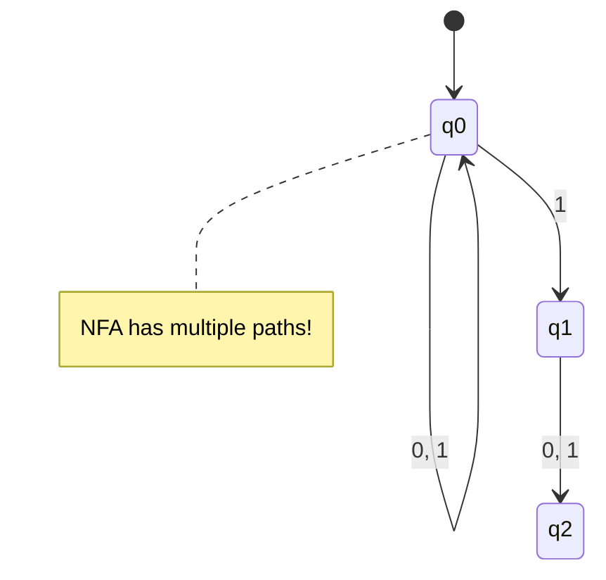
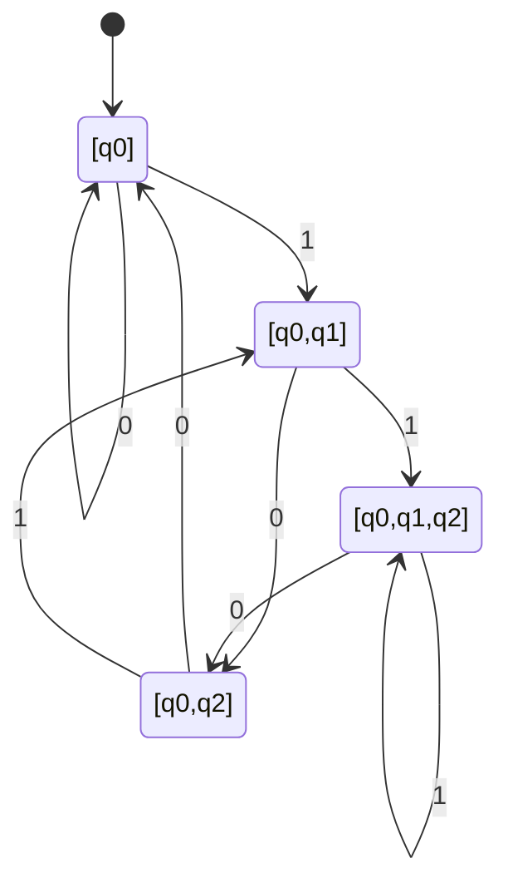
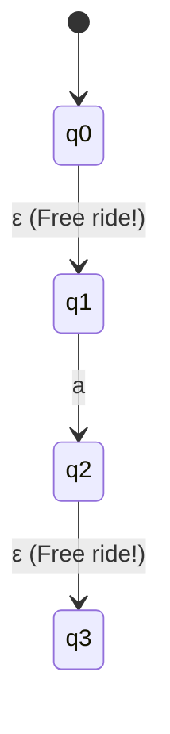
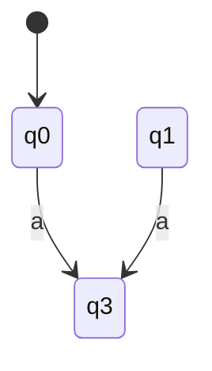

# 📝 TOC: Assignment 2 Master Solutions

Here are the step-by-step generic solutions for converting **NFA to DFA** and **NFA with ε-moves to NFA**. Since we can't extract the exact images from your PDF directly, use these perfect templates and just swap in your states!

---

## Q1: NFA to DFA Conversion (Subset Construction)

**The Problem:** NFAs are magical; they can be in multiple states at once. Computers hate magic. We need to convert it to a DFA where every state has exactly ONE defined path for every input.

**The Solution Method:**
1. **Start State:** Your DFA start state is just `[q0]` (the start state of the NFA wrapped in brackets).
2. **Transition Table Magic:** 
   - Look at `[q0]`. Where does the NFA go on input `0`? Let's say it goes to `q0` AND `q1`.
   - Your DFA now has a NEW state called `[q0, q1]`.
3. **Expand:** Now take that new state `[q0, q1]`. Where does it go on input `0`? It goes wherever `q0` goes UNION wherever `q1` goes. 
4. **Repeat:** Keep doing this until no new bracket-states are generated.
5. **Final States:** Any DFA state that contains an NFA final state (e.g., if `q2` is final, then `[q0, q2]` is final) becomes a final state!

### 💡 Visual Example

**Becomes this DFA:**

---

## Q2: NFA with ε-moves to NFA (Eliminating the Ghosts)

**The Problem:** ε (Epsilon) moves are free rides. You can travel to another state without consuming any input. We need to kill the free rides but keep the logic intact.

**The Solution Method:**
1. **Find ε-closures:** For every state, find all the states you can reach for FREE (including itself). 
   - E.g., `ε-closure(q0) = {q0, q1, q2}`.
2. **The New Transition Formula:** 
   - To find where `q0` goes on input `a`, you calculate: `ε-closure( transition( ε-closure(q0), a ) )`
   - *Translation:* Where can I go for free? --> Then take an `a` --> Then where can I go for free from there?
3. **Final States:** If a state's ε-closure contains an original final state, it becomes a final state too!

### 💡 Visual Example

**Becomes this NFA (No more ε):**

*(Notice how the free rides are baked right into the paths!)*
