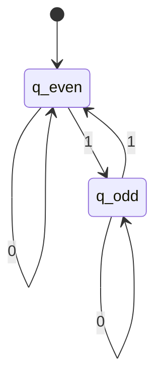
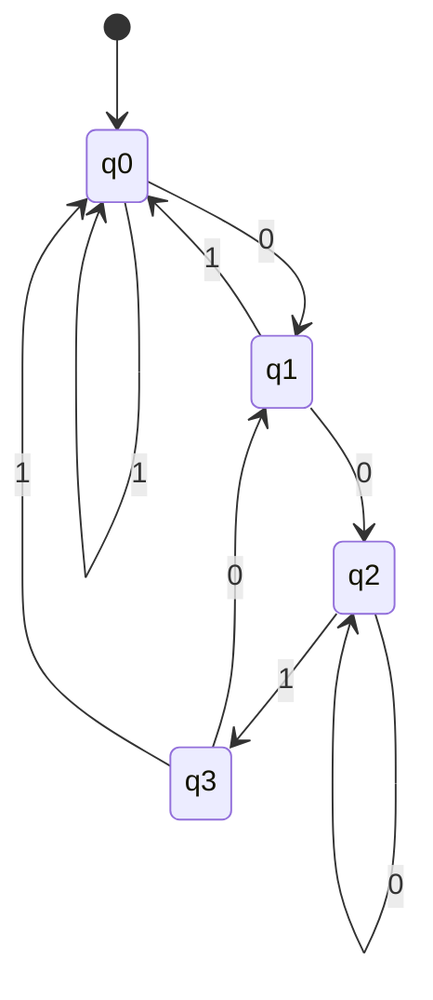
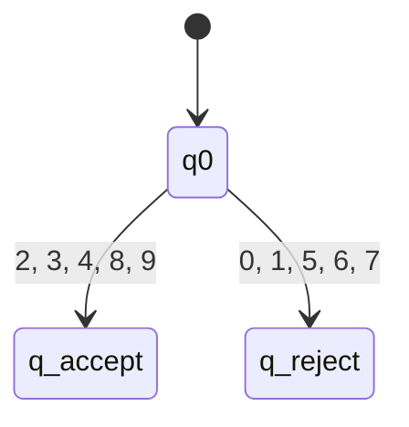

# 🎯 TOC CAT-1 Master Exam Blitz

> **Tailored specifically for your CAT-1 Scope!**
>
> ❌ **NOT in CAT-1:** Mealy/Moore machines, Pumping Lemma, LEX, $\epsilon$-NFA.  
> ✅ **IN CAT-1:** 5-Tuples, DFA/NFA Construction, Class Questions, NFA $\rightarrow$ DFA, FSM $\leftrightarrow$ RE, FSM Minimization, CFG & Valid/Invalid Grammars.

---

## 1. Core Basics & The 5-Tuple Definition

A Finite Automaton (DFA) is defined formally as a 5-tuple:
$$M = (Q, \Sigma, \delta, q_0, F)$$

| Element | Name | What it means | Example |
|:---:|---|---|---|
| **$Q$** | Set of States | All possible states in the machine | $\{q_0, q_1, q_2\}$ |
| **$\Sigma$** | Input Alphabet | Set of allowed input symbols | $\{0, 1\}$ or $\{a, b\}$ |
| **$\delta$** | Transition Function | $\delta: Q \times \Sigma \rightarrow Q$ (Mapping state + input $\to$ next state) | $\delta(q_0, 0) = q_1$ |
| **$q_0$** | Initial State | Starting state ($q_0 \in Q$) | $q_0$ |
| **$F$** | Set of Final/Accepting States | Goal states ($F \subseteq Q$) | $\{q_2\}$ |

> 💡 **Smallest String Produced/Accepted by a Machine:**
> To find the smallest string accepted by a machine, find the shortest path from the **Start State** ($q_0$) to ANY **Final State** ($F$).
> - If $q_0$ is a Final State ($q_0 \in F$), the smallest accepted string is **$\epsilon$ (empty string, length 0)**.

---

## 2. 🎯 Must-Know Class Questions (DFA Construction)

### Question 1: Accept EVEN number of 1s over $\Sigma = \{0, 1\}$
Language $L = \{\epsilon, 11, 1111, 111111, \dots\}$ (along with any number of `0`s).

- **Logic:** We only care about the count of `1`s modulo 2. 
  - State $q_{even}$ (Start & Final): Even count of 1s seen so far.
  - State $q_{odd}$: Odd count of 1s seen so far.
  - Input `0` keeps the machine in the same state (does not change parity).
  - Input `1` flips between $q_{even}$ and $q_{odd}$.

*Note: Since $\epsilon$ is part of the language, $q_{even}$ is the double-circled accepting state!*

---

### Question 2: Accept strings over $\Sigma = \{0, 1\}$ ENDING IN `001`

- **Logic:** Remember pattern matching!
  - $q_0$ (Start): Haven't matched anything yet.
  - $q_1$: Matched `0`.
  - $q_2$: Matched `00`.
  - $q_3$ (Final): Matched `001`.

**State transitions:**
- From $q_0$: on `0` $\to q_1$, on `1` $\to q_0$.
- From $q_1$: on `0` $\to q_2$, on `1` $\to q_0$.
- From $q_2$: on `0` $\to q_2$ (stay at `00`), on `1` $\to q_3$ (Matched `001`!).
- From $q_3$ (after accepting `001`):
  - On `0`: The string ends with `10`, but the last digit is `0` $\to$ jump to $q_1$.
  - On `1`: Reset to $q_0$.

---

### Question 3: Numbers (Inputs 0-9) Divisible by 2 ONLY or 3 ONLY

- **Problem breakdown:** Inputs are decimal digits $\Sigma = \{0, 1, 2, 3, 4, 5, 6, 7, 8, 9\}$.
- We are given single-digit / multi-digit numbers or single inputs $d \in \{0..9\}$.
- **Divisible by 2 only:** $\{2, 4, 8\}$ (Even numbers excluding multiples of 3). Note: 6 is divisible by BOTH 2 and 3, so excluded! 0 is divisible by both, excluded.
- **Divisible by 3 only:** $\{3, 9\}$ (Multiples of 3 excluding multiples of 2). 6 is excluded!
- **Combined Language $L$:** Numbers that are divisible by 2 OR 3, but **NOT BOTH** (XOR condition).
  - Divisible by 2: $\{0, 2, 4, 6, 8\}$
  - Divisible by 3: $\{0, 3, 6, 9\}$
  - Divisible by 2 ONLY or 3 ONLY: $\{2, 3, 4, 8, 9\}$

**Single-digit FSM Construction:**

**For Multi-digit Numbers Modulo 6 State Machine:**
If evaluating numbers based on value mod 6:
- State represents $N \pmod 6$.
- States = $\{r_0, r_1, r_2, r_3, r_4, r_5\}$.
- Divisible by 2 only $\implies r_2, r_4$ (mod 6 values of 2, 4).
- Divisible by 3 only $\implies r_3$ (mod 6 value of 3).
- **Accepting States:** $\{r_2, r_3, r_4\}$.
- **Rejected States:** $r_0$ (divisible by 6 = both), $r_1, r_5$ (neither).

---

## 3. NFA to DFA Conversion (Subset Construction)

Given an NFA $M_N = (Q_N, \Sigma, \delta_N, q_0, F_N)$, the equivalent DFA $M_D = (Q_D, \Sigma, \delta_D, [q_0], F_D)$ has states $Q_D = 2^{Q_N}$ (subsets of $Q_N$).

### Step-by-Step Procedure:
1. Start with the initial state $[q_0]$.
2. For each new DFA state $S = \{q_a, q_b, \dots\}$ and input symbol $a \in \Sigma$:
   $$\delta_D(S, a) = \bigcup_{q \in S} \delta_N(q, a)$$
3. Repeat for any newly generated state subset until no new states are created.
4. Any DFA state containing at least one NFA final state $q_f \in F_N$ becomes an **accepting/final state** in the DFA.

---

## 4. Regular Expressions & FSM $\leftrightarrow$ RE Conversion

### Basic Regular Expression Rules:
- $a + b$ or $a \mid b$: Choice (Union)
- $ab$: Concatenation
- $a^*$: Kleene Star (0 or more repetitions of $a$, including $\epsilon$)
- $a^+$: Positive Closure ($a a^*$, 1 or more repetitions)

### FSM to Regular Expression: Arden's Theorem
Arden's Theorem states: If an equation is of the form:
$$R = Q + R P$$
where $P, Q, R$ are regular expressions and $P$ does not contain $\epsilon$, then it has a unique solution:
$$R = Q P^*$$

---

## 5. FSM Minimization (Table Filling Method)

To minimize a DFA with states $Q$:
1. **Remove Unreachable States:** Delete any state not reachable from $q_0$.
2. **Setup Partition / Grid:** Create pairs $(p, q)$ for all $p, q \in Q$.
3. **Step 1 Marking:** Mark $(p, q)$ with $\mathbf{X}$ if one is in $F$ and the other is not in $F$ ($p \in F \land q \notin F$).
4. **Step 2 Iterative Marking:** For unmarked pair $(p, q)$, check for all $a \in \Sigma$:
   If $(\delta(p, a), \delta(q, a))$ is already marked $\mathbf{X}$, mark $(p, q)$ with $\mathbf{X}$.
5. **Merge:** Unmarked pairs are equivalent! Combine them into single merged states.

---

## 6. Context Free Grammars (CFG) & Valid/Invalid Grammars

A Context-Free Grammar is defined as $G = (V, T, P, S)$:
- $V$: Variables / Non-terminals (e.g., $A, B, S$)
- $T$: Terminals (e.g., $a, b, 0, 1$)
- $P$: Production Rules of the form $A \rightarrow \alpha$, where $A \in V$ and $\alpha \in (V \cup T)^*$
- $S$: Start symbol ($S \in V$)

### ✅ Valid vs ❌ Invalid CFG Rules

| Rule Form | Valid / Invalid in CFG? | Reason |
|---|:---:|---|
| $S \rightarrow aSb \mid \epsilon$ | ✅ **Valid CFG** | Single variable on left side ($S$) |
| $A \rightarrow aB$ | ✅ **Valid CFG** | Single variable on left side ($A$) |
| $AB \rightarrow a$ | ❌ **INVALID CFG** | Left side has 2 variables ($AB$). This is Context-Sensitive! |
| $aA \rightarrow b$ | ❌ **INVALID CFG** | Left side contains a terminal ($a$). Invalid for CFG! |
| $A \rightarrow \epsilon$ | ✅ **Valid CFG** | Null production allowed |

> 🔑 **Golden Rule for CFGs:** The left-hand side of EVERY production rule MUST be a **SINGLE non-terminal variable** (e.g., $A \rightarrow \dots$). If there's more than one symbol on the left, it is NOT a Context-Free Grammar!

---

## ⏱️ Quick CAT-1 Checklist

- [ ] Can you define the 5-tuple $M = (Q, \Sigma, \delta, q_0, F)$?
- [ ] Can you draw the DFA for even 1s?
- [ ] Can you draw the DFA for ending in `001`?
- [ ] Can you perform Subset Construction (NFA $\to$ DFA)?
- [ ] Can you state Arden's Theorem ($R = Q + RP \implies R = QP^*$)?
- [ ] Can you identify why $AB \rightarrow c$ is NOT a valid CFG rule?
