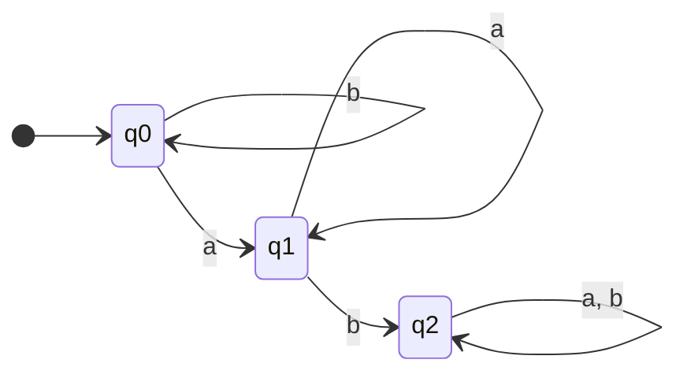
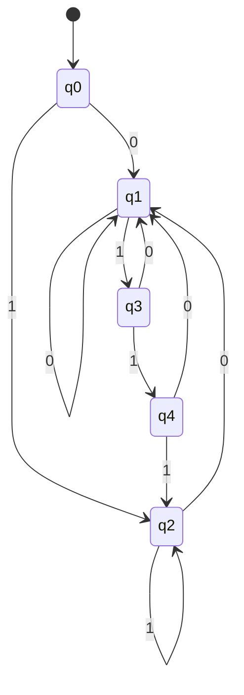
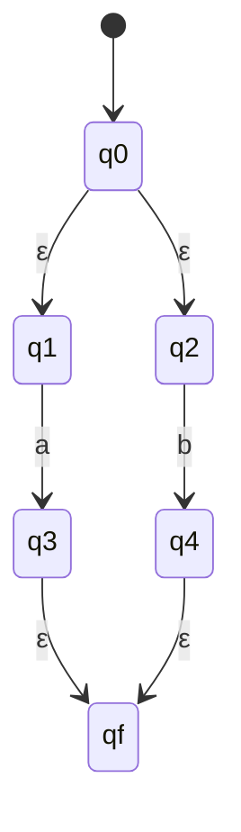
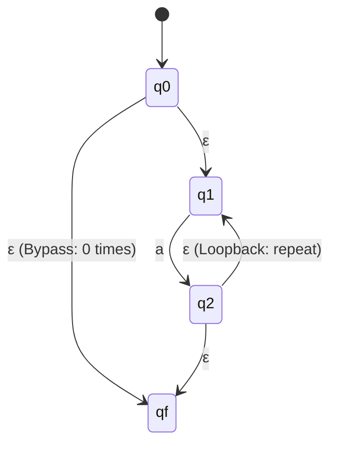
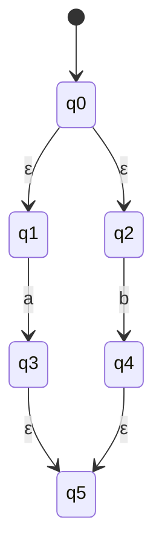
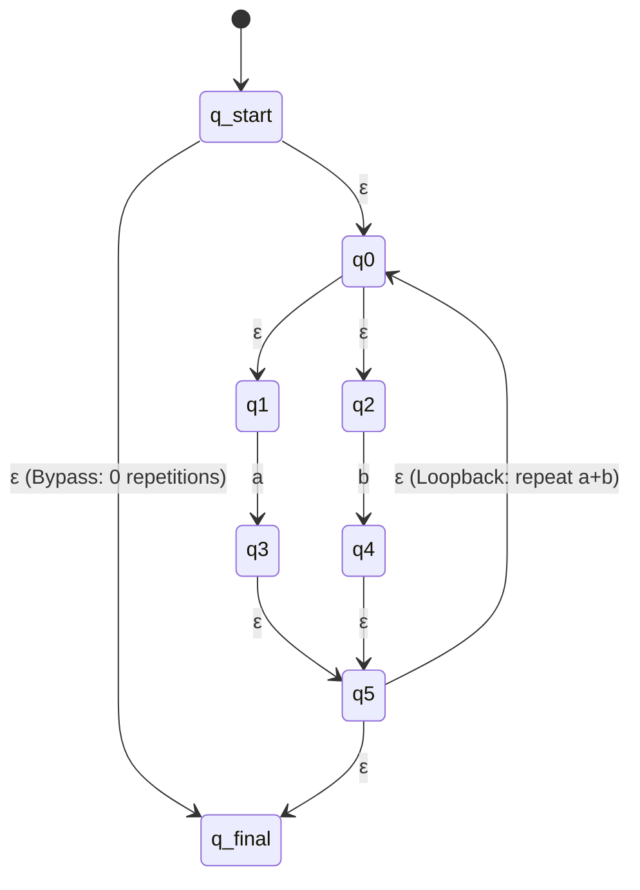
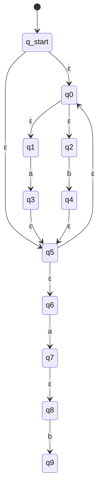
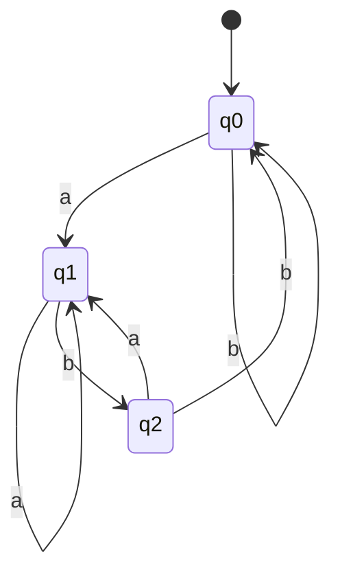

# 🏆 TOC CAT-1 Master Exam Blueprint & Solved Questions

> **Directly transcribed and solved from your handwritten exam syllabus paper!**  
> Total Marks breakdown: 5 Questions $\times$ 10 Marks = 50 Marks.

---

## 📋 The 5 Exam Question Types At A Glance

| Q# | Topic | Marks | Format / Sub-parts |
|:---:|---|:---:|---|
| **Q1** | **Construction of DFA for a given Regular Language** | **10M** | Full 5 steps + Explicitly define the 5-Tuple $(Q, \Sigma, \delta, q_0, F)$ |
| **Q2** | **Minimization of FA (Partition / Equivalence Method)** | **10M** | $P_0, P_1, P_2, \dots$ equivalence sets partitioning |
| **Q3** | **RE to FA Conversion** | **10M** | RE $\rightarrow \epsilon$-NFA (Thompson's Rules) OR RE $\rightarrow$ DFA |
| **Q4a** | **CFL $\rightarrow$ CFG Construction** | **5M** | Design grammar rules for a given context-free language |
| **Q4b** | **Simplification of CFG** | **5M** | Remove Useless Symbols, $\epsilon$-productions, Unit productions |
| **Q5** | **CFG Derivations & Ambiguity Proof** | **10M** | (i) LMD (2M), (ii) RMD (2M), (iii) Derivation Tree (2M) + Prove Ambiguity (4M: alternative LMD & Tree) |

---

## 1️⃣ Question 1 (10 Marks): DFA Construction with 5 Steps & 5-Tuple

### 🎯 Typical Exam Question:
> **"Construct a DFA that accepts all strings over $\Sigma = \{a, b\}$ containing the substring $ab$. Define all 5 steps and specify the 5-tuple."**

### ✍️ Complete 10-Mark Answer Solution:

#### Step 1: Understand the Language & Identify Smallest String
- Language $L = \{ab, aab, bab, aba, abb, aabab, \dots\}$
- **Smallest string accepted:** $w = "ab"$ (Length 2).

#### Step 2: Determine the States
- Since the shortest string is of length 2, the minimal DFA needs at least $2 + 1 = 3$ states + 1 dead state (if needed, but not needed here).
- $q_0$: Initial state (No matching prefix seen).
- $q_1$: Matched prefix $'a'$.
- $q_2$: Matched substring $'ab'$ (Accepting State).

#### Step 3: Draw the Transition Diagram (FSM)

#### Step 4: Define the Transition Table ($\delta$)

| State | Input $a$ | Input $b$ |
|:---:|:---:|:---:|
| $\rightarrow q_0$ | $q_1$ | $q_0$ |
| $q_1$ | $q_1$ | $q_2^*$ |
| $*q_2$ | $q_2$ | $q_2$ |

#### Step 5: Explicitly Define the 5-Tuple $M = (Q, \Sigma, \delta, q_0, F)$
1. **$Q = \{q_0, q_1, q_2\}$** (Set of all states)
2. **$\Sigma = \{a, b\}$** (Input alphabet)
3. **$\delta$** = Transition function as shown in the transition table above.
4. **$q_0 = q_0$** (Initial/Start state)
5. **$F = \{q_2\}$** (Set of final/accepting states)

---

## 2️⃣ Question 2 (10 Marks): DFA Minimization using PARTITION METHOD

> 💡 **Partition Method (Equivalence Class Method):**  
> We group states into 0-equivalence ($P_0$), 1-equivalence ($P_1$), 2-equivalence ($P_2$), etc., until $P_k = P_{k+1}$.

### 🎯 Typical Exam Question:
> **"Minimize the following DFA using the Partition Method."**

*(Final State: $F = \{q_4\}$)*

### ✍️ Step-by-Step Solution:

#### Step 1: Initial Partition $P_0$ (0-Equivalence)
Divide states into non-final ($Q \setminus F$) and final ($F$) groups:
$$P_0 = \{ \{q_0, q_1, q_2, q_3\}, \{q_4\} \}$$
Let $G_1 = \{q_0, q_1, q_2, q_3\}$ and $G_2 = \{q_4\}$.

#### Step 2: 1-Equivalence Partition $P_1$
Check transitions of states in $G_1 = \{q_0, q_1, q_2, q_3\}$ for inputs $0$ and $1$:

| State | On 0 $\to$ Group | On 1 $\to$ Group |
|:---:|:---:|:---:|
| $q_0$ | $q_1 \in G_1$ | $q_2 \in G_1$ |
| $q_1$ | $q_1 \in G_1$ | $q_3 \in G_1$ |
| $q_2$ | $q_1 \in G_1$ | $q_2 \in G_1$ |
| $q_3$ | $q_1 \in G_1$ | $q_4 \in G_2$ ⚠️ |

Notice that $q_3$ goes to $G_2$ on input 1, while $q_0, q_1, q_2$ go to $G_1$. Thus, $q_3$ splits off!
$$P_1 = \{ \{q_0, q_1, q_2\}, \{q_3\}, \{q_4\} \}$$

#### Step 3: 2-Equivalence Partition $P_2$
Check remaining group $\{q_0, q_1, q_2\}$:

| State | On 0 $\to$ Group | On 1 $\to$ Group |
|:---:|:---:|:---:|
| $q_0$ | $q_1 \in \{q_0, q_1, q_2\}$ | $q_2 \in \{q_0, q_1, q_2\}$ |
| $q_1$ | $q_1 \in \{q_0, q_1, q_2\}$ | $q_3 \in \{q_3\}$ ⚠️ |
| $q_2$ | $q_1 \in \{q_0, q_1, q_2\}$ | $q_2 \in \{q_0, q_1, q_2\}$ |

$q_1$ goes to $\{q_3\}$ on input 1, whereas $q_0$ and $q_2$ go to $\{q_0, q_1, q_2\}$. So $q_1$ splits off!
$$P_2 = \{ \{q_0, q_2\}, \{q_1\}, \{q_3\}, \{q_4\} \}$$

#### Step 4: 3-Equivalence Partition $P_3$
Check group $\{q_0, q_2\}$:
- $q_0$: on $0 \to q_1$, on $1 \to q_2$
- $q_2$: on $0 \to q_1$, on $1 \to q_2$
Both behave identically on all inputs! They do NOT split.
$$P_3 = \{ \{q_0, q_2\}, \{q_1\}, \{q_3\}, \{q_4\} \}$$

Since $P_3 = P_2$, the partitioning stops!

#### Final Minimized States:
Merge $q_0$ and $q_2$ into a single state $[q_0, q_2]$.
- Minimized States: $\{[q_0, q_2], q_1, q_3, q_4\}$.

---

## 3️⃣ Question 3 (10 Marks): RE to FA Conversion (Thompson's Construction)

> **TL;DR:** Converting a Regular Expression (RE) to an Automaton (FA / $\epsilon$-NFA) is like building with **LEGO bricks**. There are 5 basic building rules (Thompson's Construction Rules). You build small pieces for individual letters, then glue them together!

---

### 🧩 The 5 Basic LEGO Building Rules

#### Rule 1: Single Symbol $a$
To match a single character $a$:

---

#### Rule 2: Concatenation ($ab$) — "Do $a$, then do $b$"
Chain them together sequentially:

*(In simplified diagrams, you can directly draw $q_0 \xrightarrow{a} q_1 \xrightarrow{b} q_2$)*

---

#### Rule 3: Union / Choice ($a + b$ or $a \mid b$) — "Either $a$ OR $b$"
Create a new start state $q_0$ that splits into two branches using $\epsilon$, and merge them into a single final state $q_f$ using $\epsilon$:

---

#### Rule 4: Kleene Star ($a^*$) — "Zero or more repetitions of $a$"
Add 2 new states:
1. **Loopback $\epsilon$:** Allows repeating $a$ multiple times.
2. **Bypass $\epsilon$:** Allows skipping $a$ completely (for 0 repetitions / $\epsilon$).

---

#### Rule 5: Positive Closure ($a^+$) — "One or more repetitions of $a$"
Same as Kleene Star, but **WITHOUT** the bypass path (you MUST read at least one $a$).
$$a^+ = a a^*$$

---

### ✍️ Worked Exam Examples (Step-by-Step)

---

### Example 1: Convert $RE = (a + b)$ to $\epsilon$-NFA

1. Draw component for $a$: $q_1 \xrightarrow{a} q_3$
2. Draw component for $b$: $q_2 \xrightarrow{b} q_4$
3. Add start state $q_0$ with $\epsilon$ arrows to $q_1, q_2$.
4. Add final state $q_5$ with $\epsilon$ arrows from $q_3, q_4$.

---

### Example 2: Convert $RE = (a + b)^*$ to $\epsilon$-NFA

We take the machine for $(a + b)$ from Example 1, wrap a new start state $q_{start}$ and new final state $q_{final}$ around it, and add:
- A **bypass $\epsilon$** from $q_{start} \to q_{final}$ (to accept $\epsilon$).
- A **loopback $\epsilon$** from $q_5 \to q_0$ (to repeat $(a+b)$ as many times as we want).

---

### Example 3 (Full 10-Mark Exam Question): Convert $RE = (a + b)^* ab$ to $\epsilon$-NFA

**Step-by-step Breakdown:**
1. **Part 1:** Build $(a+b)^*$ (from Example 2 above).
2. **Part 2:** Build $a$: $q_6 \xrightarrow{a} q_7$.
3. **Part 3:** Build $b$: $q_8 \xrightarrow{b} q_9$.
4. **Combine:** Connect Part 1 $\xrightarrow{\epsilon}$ Part 2 $\xrightarrow{\epsilon}$ Part 3.

*(State $q_9$ is the final accepting state!)*

---

### 💡 Direct RE $\rightarrow$ DFA / NFA Shortcut (If asked without $\epsilon$)

If the exam allows converting directly to a standard DFA without $\epsilon$-transitions:

For $RE = (a+b)^* ab$:
- Smallest string: $ab$
- States:
  - $q_0$ (Start): Any prefix
  - $q_1$: Seen $'a'$
  - $q_2$ (Final): Seen $'ab'$

## 4️⃣ Question 4 (10 Marks = 5M + 5M): CFL $\rightarrow$ CFG & Simplification

---

### Part (a) [5 Marks]: CFL $\rightarrow$ CFG Construction

> **Rule of thumb:** Identify the pattern/symmetry in the language and build production rules recursively around the start symbol $S$.

#### Worked Example 1: $L = \{a^n b^n \mid n \ge 1\}$
- Smallest string ($n=1$): $ab$
- Recursive pattern: For every $a$ added on the left, add a $b$ on the right $\implies aSb$.
- **Grammar Rules:**
  $$S \rightarrow aSb \mid ab$$

#### Worked Example 2: $L = \{a^n b^m \mid n \ge 0, m \ge 0\}$
- Language means any number of $a$'s followed by any number of $b$'s.
- Split into two variables: $A$ (generates $a^*$) and $B$ (generates $b^*$).
- **Grammar Rules:**
  $$S \rightarrow AB$$
  $$A \rightarrow aA \mid \epsilon$$
  $$B \rightarrow bB \mid \epsilon$$

---

### Part (b) [5 Marks]: Simplification of CFG (The 3 Mandatory Steps)

> **IMPORTANT:** You MUST execute these 3 steps **in exact order**:
> 1. **Step 1:** Eliminate $\epsilon$-productions ($A \rightarrow \epsilon$)
> 2. **Step 2:** Eliminate Unit productions ($A \rightarrow B$)
> 3. **Step 3:** Eliminate Useless symbols (Non-generating & Unreachable symbols)

---

### ✍️ Full Worked Exam Example for Part (b)

> **Question:** Simplify the following Context-Free Grammar $G$:
> $$S \rightarrow AB \mid a$$
> $$A \rightarrow b \mid \epsilon$$
> $$B \rightarrow C \mid d$$
> $$C \rightarrow cC$$
> $$D \rightarrow aD$$

---

#### 📌 Step 1: Eliminate $\epsilon$-productions ($A \rightarrow \epsilon$)

1. Identify nullable variables (variables that derive $\epsilon$ directly or indirectly):
   - Here, **$A$ is nullable** because $A \rightarrow \epsilon$.
2. For every rule containing $A$, add a new rule with $A$ replaced by $\epsilon$:
   - $S \rightarrow AB \implies$ add $S \rightarrow B$ (by removing $A$)
   - $A \rightarrow b \mid \epsilon \implies$ drop $\epsilon$, keeping $A \rightarrow b$

**Grammar after Step 1:**
$$S \rightarrow AB \mid B \mid a$$
$$A \rightarrow b$$
$$B \rightarrow C \mid d$$
$$C \rightarrow cC$$
$$D \rightarrow aD$$

---

#### 📌 Step 2: Eliminate Unit Productions ($A \rightarrow B$)

A **unit production** is a rule where a single variable produces another single variable (e.g. $S \rightarrow B$ or $B \rightarrow C$).

1. Identify unit pairs:
   - $S \rightarrow B$: Replace $B$ with $B$'s non-unit bodies ($C \mid d$) $\implies S \rightarrow AB \mid C \mid d \mid a$
   - $B \rightarrow C$: Replace $C$ with $C$'s non-unit bodies ($cC$) $\implies B \rightarrow cC \mid d$
   - Update $S \rightarrow C$: Replace $C$ with $cC \implies S \rightarrow AB \mid cC \mid d \mid a$

**Grammar after Step 2:**
$$S \rightarrow AB \mid cC \mid d \mid a$$
$$A \rightarrow b$$
$$B \rightarrow cC \mid d$$
$$C \rightarrow cC$$
$$D \rightarrow aD$$

---

#### 📌 Step 3: Eliminate Useless Symbols

A symbol is **useless** if it is either **Non-Generating** (cannot derive terminal strings) or **Unreachable** (cannot be reached from Start symbol $S$).

##### Sub-step 3.1: Remove Non-Generating Symbols
- Check $C \rightarrow cC$: $C$ loops infinitely and NEVER produces a purely terminal string. So $C$ is **non-generating**!
- Check $D \rightarrow aD$: $D$ loops infinitely and NEVER produces a terminal string. So $D$ is **non-generating**!
- **Action:** Delete $C$ and $D$, and remove any production rule containing $C$ or $D$.

**Grammar after removing Non-Generating symbols:**
$$S \rightarrow AB \mid d \mid a$$
$$A \rightarrow b$$
$$B \rightarrow d$$

##### Sub-step 3.2: Remove Unreachable Symbols
- Start at $S$: $S \rightarrow AB \mid d \mid a$. From $S$, we can reach $A$ and $B$.
- From $A$: $A \rightarrow b$ (reaches terminal $b$).
- From $B$: $B \rightarrow d$ (reaches terminal $d$).
- All remaining symbols ($S, A, B$) are reachable!

---

### 🎉 Final Simplified Grammar Answer [Full 5 Marks]:
$$S \rightarrow AB \mid d \mid a$$
$$A \rightarrow b$$
$$B \rightarrow d$$

## 5️⃣ Question 5 (10 Marks): CFG Derivations & Ambiguity Proof

> 📌 **Exam Format:** Given a Grammar $G$ and a target string $w$.
> - Derive $w$ using **Leftmost Derivation (LMD)** [2M]
> - Derive $w$ using **Rightmost Derivation (RMD)** [2M]
> - Draw the **Derivation Tree / Parse Tree** [2-3M]
> - Prove that $G$ is **Ambiguous** [4M] by showing **two distinct LMDs** (or two distinct Parse Trees) for the same string!

### 🎯 Solved Example:
Given Grammar $G$:
$$E \rightarrow E + E \mid E * E \mid id$$
Target String $w = id + id * id$

#### (i) Leftmost Derivation (LMD) [2M]
Always replace the leftmost non-terminal variable first:
1. $E \implies \mathbf{E} + E$
2. $\implies id + \mathbf{E}$
3. $\implies id + \mathbf{E} * E$
4. $\implies id + id * \mathbf{E}$
5. $\implies id + id * id$ ✅

#### (ii) Rightmost Derivation (RMD) [2M]
Always replace the rightmost non-terminal variable first:
1. $E \implies E + \mathbf{E}$
2. $\implies E + E * \mathbf{E}$
3. $\implies E + \mathbf{E} * id$
4. $\implies E + id * id$
5. $\implies id + id * id$ ✅

#### (iii) Derivation Tree (Parse Tree) Characteristics [3M]
1. **Root node:** Start symbol ($E$).
2. **Internal nodes:** Non-terminals ($E$).
3. **Leaf nodes (from left to right):** Yield of the tree ($id + id * id$).

#### (iv) Proof of Ambiguity [4M]
A CFG is **Ambiguous** if there exists a string $w$ with **two or more different LMDs** (or Parse Trees).

**Second Distinct LMD for $w = id + id * id$:**
1. $E \implies \mathbf{E} * E$ *(Start with $*$ instead of $+$)*
2. $\implies \mathbf{E} + E * E$
3. $\implies id + \mathbf{E} * E$
4. $\implies id + id * \mathbf{E}$
5. $\implies id + id * id$ ✅

**Conclusion:** Since $w = id + id * id$ has **two different Leftmost Derivations** (giving different parse trees with different operator precedence), the grammar $G$ is **AMBIGUOUS**! ∎

---

## 💡 Summary of Key Properties to Remember for Exam:
1. **LMD vs RMD:** Same parse tree for unambiguous grammars; different trees if grammar is ambiguous.
2. **Equivalence of LMD & RMD:** Replacing non-terminals in different orders yields the exact same final string.
3. **CFG Left-Hand Side Rule:** $A \rightarrow \alpha$ where $A$ MUST be a single variable.
