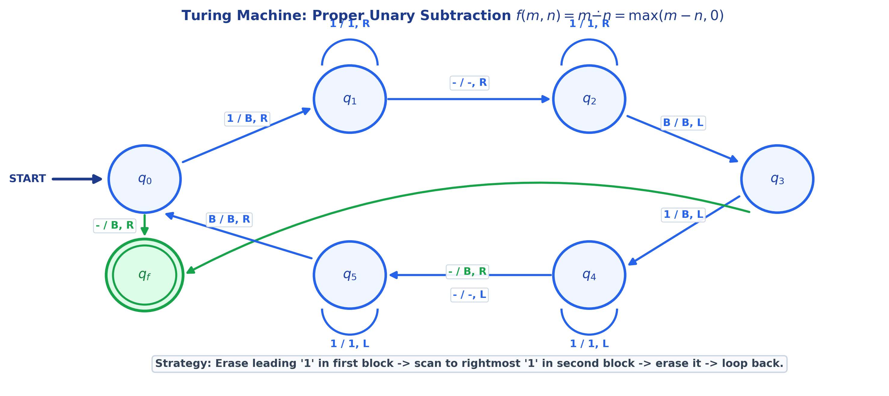
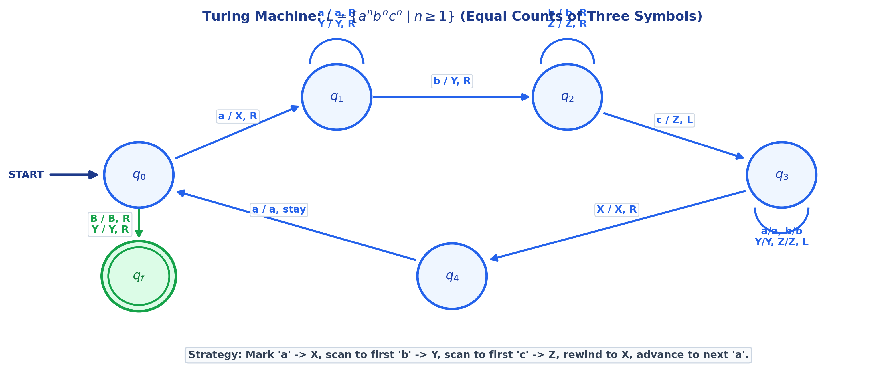

# CSE2004: Theory of Computation & Compiler Design
## CAT-II Foolproof Exam Solve Booklet & Algorithm Vault (Modules 3 & 4)

> **Exam Target:** VIT Bhopal CAT-II Examination | **Marks:** 50 Marks (5 Compulsory Questions)  
> **Purpose:** Open-book exam-hall master reference. Written in plain, zero-confusion, "explain like I'm a beginner" English so you can match any exam problem to its exact template, follow the step-by-step recipe, and write the full 10/10 answer without hesitating.

---

## 🧭 The Exam-Hall "Dumbo Quick-Match" Navigation Matrix

| If You See This Question Language on Your Paper... | Topic Category | Go To | The 5-Second First Move / Key Formula |
| :--- | :--- | :--- | :--- |
| **"Eliminate Left Recursion from Grammar G"** | Mod 3: Top-Down | **Sec 1.1** | Replace $A \to A\alpha \mid \beta$ with $A \to \beta A'$ and $A' \to \alpha A' \mid \epsilon$. |
| **"Left Factor the Given Grammar G"** | Mod 3: Top-Down | **Sec 1.2** | Group longest common prefix $\alpha$: $A \to \alpha A' \mid \gamma$, $A' \to \beta_1 \mid \beta_2$. |
| **"Find FIRST and FOLLOW sets for Grammar G"** | Mod 3: Top-Down | **Sec 1.3** | First terminal generated = FIRST; symbol immediately to right = FOLLOW. Add $\$$ to $\text{FOLLOW}(S)$. |
| **"Construct Non-Recursive LL(1) Predictive Parser"** | Mod 3: Top-Down (Alt) | **Sec 2** | State 3 pre-reqs $\to$ Compute FIRST/FOLLOW $\to$ Fill $M[A, a]$ $\to$ Draw Stack Table. |
| **"Construct SLR(1) Table OR Prove NOT SLR(1) via S/R Conflict"** | Mod 3: Bottom-Up | **Sec 3** | Augment $S' \to S \to 10$ LR(0) states $\to$ Show $\text{ACTION}[2, =] = \{S_6, r_5\}$ is S/R conflict. |
| **"Construct CLR(1) / LALR(1) Table OR Prove NOT LALR(1) via R/R Conflict"** | Mod 3: Bottom-Up | **Sec 4** | Build LR(1) items with lookaheads $\to$ Merge cores $\to$ Show cell $[I, a] = \{r_A, r_B\}$ is R/R conflict. |
| **"Turing Machine: Unary Addition ($1^m + 1^n \to 1^{m+n}$)"** | Mod 4: TM Arithmetic | **Sec 5.1** | Replace $+$ with $1$, scan to right end, erase last $1$ with $B$. |
| **"Turing Machine: Proper Subtraction ($m \dot{-} n = \max(m-n, 0)$)"** | Mod 4: TM Arithmetic | **Sec 5.2** | Erase leading $1$ of $m$, scan right to erase rightmost $1$ of $n$, loop back. |
| **"Turing Machine: $L = \{a^n b^{2n} \mid n \geq 1\}$"** | Mod 4: TM Language | **Sec 5.3** | Mark $1$ '$a$' as $X$, scan right to mark $2$ '$b$'s as $Y$, rewind. |
| **"Turing Machine: $L = \{a^n b^n c^n \mid n \geq 1\}$"** | Mod 4: TM Language | **Sec 5.4** | Mark $a \to X$, scan to mark $b \to Y$, scan to mark $c \to Z$, rewind. |
| **"Turing Machine: Even 0s and Odd 1s (and Vice Versa)"** | Mod 4: TM Language | **Sec 5.5** | 4-state parity tracker ($q_{EE}, q_{EO}, q_{OE}, q_{OO}$), accept on blank. |
| **"Turing Machine: Palindrome Recognizer ($w c w^R$ or $w w^R$)"** | Mod 4: TM Language | **Sec 5.6** | Erase leftmost symbol, store in state, match & erase rightmost symbol, rewind. |
| **"Turing Machine: 2's Complement of Binary String"** | Mod 4: TM Arithmetic | **Sec 5.7** | Scan to right end, copy bits up to first $1$, then invert remaining bits leftward. |

---

# SECTION 1: Grammar Transformations & FIRST / FOLLOW (Q1: 10 Marks)

## 1.1 Elimination of Left Recursion

### 🧠 The Dumbo Mental Model
- **What is Left Recursion?** A rule where a variable immediately calls itself as the very first symbol: $A \to A \alpha$.
- **Why is it dangerous?** A top-down predictive parser matches from left to right. When it sees $A$, it replaces it with $A\alpha$. To expand $A$, it replaces it with $A\alpha\alpha \dots$ forever. It crashes into an **infinite loop** before reading a single input character!
- **How do we fix it?** Force the grammar to generate the non-recursive suffix $\beta$ *first*, followed by a new helper variable $A'$ that handles the repeating tails.

### Recipe 1: Immediate (Direct) Left Recursion
If a non-terminal $A$ has productions in the form:
$$A \to A\alpha_1 \mid A\alpha_2 \mid \dots \mid A\alpha_m \mid \beta_1 \mid \beta_2 \mid \dots \mid \beta_n$$
*(where no $\beta_j$ begins with $A$)*:

**Direct Transformation Formula (Copy verbatim to answer sheet):**
$$A \to \beta_1 A' \mid \beta_2 A' \mid \dots \mid \beta_n A'$$
$$A' \to \alpha_1 A' \mid \alpha_2 A' \mid \dots \mid \alpha_m A' \mid \epsilon$$

#### 📝 Worked Exam Example: Arithmetic Expressions
**Problem:** Eliminate left recursion from:
$$E \to E + T \mid T$$
$$T \to T * F \mid F$$
$$F \to (E) \mid id$$

**Step-by-step Solution:**
1. For $E$: Left recursive! Here $\alpha = + T$ and $\beta = T$.
   $$E \to T E'$$
   $$E' \to + T E' \mid \epsilon$$
2. For $T$: Left recursive! Here $\alpha = * F$ and $\beta = F$.
   $$T \to F T'$$
   $$T' \to * F T' \mid \epsilon$$
3. For $F$: No left recursion. Leave unchanged:
   $$F \to (E) \mid id$$

---

### Recipe 2: Indirect Left Recursion
- **What is it?** $A \to B \alpha$ and $B \to A \beta$. It doesn't look recursive on line 1, but substituting $B$ reveals $A \to A \beta \alpha$!

**Systematic Elimination Algorithm:**
1. Order all non-terminals: $A_1, A_2, \dots, A_n$.
2. For $i = 1$ to $n$:
   - For $j = 1$ to $i - 1$:
     - If there is a production $A_i \to A_j \gamma$, replace it by substituting all expansions of $A_j$.
   - Eliminate any immediate left recursion among $A_i$ productions using Recipe 1.

#### 📝 Worked Example:
**Grammar:**
$$S \to A a \mid b$$
$$A \to S c \mid d$$

**Step 1:** Order non-terminals: $A_1 = S, A_2 = A$.  
**Step 2:** For $i = 1$ ($S$): No immediate left recursion.  
**Step 3:** For $i = 2$ ($A$): The production $A \to S c$ has $S$ on the right, and $S$ precedes $A$.  
Substitute $S \to A a \mid b$ into $A \to S c$:
$$A \to (A a \mid b) c \mid d \implies A \to A a c \mid b c \mid d$$
**Step 4:** Now $A$ has direct left recursion ($A \to A a c$)!  
Here $\alpha = a c$ and $\beta \in \{b c, d\}$. Apply Recipe 1:
$$A \to b c A' \mid d A'$$
$$A' \to a c A' \mid \epsilon$$
**Final Left-Recursion-Free Grammar:**
$$S \to A a \mid b$$
$$A \to b c A' \mid d A'$$
$$A' \to a c A' \mid \epsilon$$

---

## 1.2 Left Factoring of a Grammar

### 🧠 The Dumbo Mental Model
- **What is Left Factoring?** Two or more choices for the same variable start with the *exact same prefix*: $A \to \alpha \beta_1 \mid \alpha \beta_2$.
- **Why is it dangerous?** When the parser looks at the next input token and sees $\alpha$, it doesn't know which rule to pick without guessing or backtracking.
- **How do we fix it?** Pull out the common prefix $\alpha$ just like taking common factors in high-school algebra: $A \to \alpha (\beta_1 \mid \beta_2)$.

### Transformation Formula
Given:
$$A \to \alpha \beta_1 \mid \alpha \beta_2 \mid \dots \mid \alpha \beta_n \mid \gamma$$
*(where $\alpha$ is the longest common prefix and $\gamma$ does not begin with $\alpha$)*:

**Replace with:**
$$A \to \alpha A' \mid \gamma$$
$$A' \to \beta_1 \mid \beta_2 \mid \dots \mid \beta_n$$
*(Note: If any production was just $A \to \alpha$, then its $\beta$ is $\epsilon$, so $A' \to \dots \mid \epsilon$)*.

#### 📝 Worked Exam Example (VIT Sep 2026 Paper Q1(i) [5 Marks])
**Problem:** Left factor the grammar:
$$S \to X b S \mid X S \mid X \mid a$$
$$X \to a Y \mid a Y S \mid a$$
$$Y \to b X \mid b$$

**Step-by-step Solution:**
1. **Factor $S$:**
   - Look at choices: $X b S, X S, X, a$.
   - Longest common prefix is $X$:
     $$S \to X S' \mid a$$
     $$S' \to b S \mid S \mid \epsilon$$
2. **Factor $X$:**
   - Look at choices: $a Y, a Y S, a$.
   - Longest common prefix is $a$:
     $$X \to a X'$$
     $$X' \to Y \mid Y S \mid \epsilon$$
   - Notice $X'$ still has common prefix $Y$ in the first two options! Factor $X'$ again:
     $$X' \to Y X'' \mid \epsilon$$
     $$X'' \to S \mid \epsilon$$
3. **Factor $Y$:**
   - Look at choices: $b X, b$.
   - Common prefix is $b$:
     $$Y \to b Y'$$
     $$Y' \to X \mid \epsilon$$

**Final Left-Factored Grammar $G'$:**
$$S \to X S' \mid a$$
$$S' \to b S \mid S \mid \epsilon$$
$$X \to a X'$$
$$X' \to Y X'' \mid \epsilon$$
$$X'' \to S \mid \epsilon$$
$$Y \to b Y'$$
$$Y' \to X \mid \epsilon$$

---

## 1.3 Computing FIRST and FOLLOW Sets

### 🧠 The 3 Golden Rules for FIRST
> **Definition:** $\text{FIRST}(X)$ is the set of all terminal symbols that can appear as the very first symbol in any string derived from $X$.

1. **Rule 1 (Terminal):** If $X$ is a terminal, $\text{FIRST}(X) = \{X\}$.
2. **Rule 2 ($\epsilon$-production):** If $X \to \epsilon$ is a production, then $\epsilon \in \text{FIRST}(X)$.
3. **Rule 3 (Non-terminal chain):** If $X \to Y_1 Y_2 \dots Y_k$:
   - Put all non-$\epsilon$ symbols from $\text{FIRST}(Y_1)$ into $\text{FIRST}(X)$.
   - If $\epsilon \in \text{FIRST}(Y_1)$, add all non-$\epsilon$ symbols of $\text{FIRST}(Y_2)$ to $\text{FIRST}(X)$.
   - Keep going until some $Y_i$ does *not* derive $\epsilon$.
   - If **all** $Y_1, \dots, Y_k$ derive $\epsilon$, only then add $\epsilon$ to $\text{FIRST}(X)$.

### 🧠 The 3 Golden Rules for FOLLOW
> **Definition:** $\text{FOLLOW}(A)$ is the set of all terminal symbols that can appear immediately to the right of non-terminal $A$ in some sentential form.

1. **Rule 1 (Start Symbol):** Put $\$$ into $\text{FOLLOW}(S)$, where $S$ is the start symbol and $\$$ is the input endmarker.
2. **Rule 2 (Right Neighbor):** Scan the **RHS** of all productions. If there is a production $A \to \alpha B \beta$:
   - Everything in $\text{FIRST}(\beta)$ (except $\epsilon$) goes into $\text{FOLLOW}(B)$.
3. **Rule 3 (End of Rule or $\epsilon$-vanish):** If there is a production $A \to \alpha B$, OR $A \to \alpha B \beta$ where $\epsilon \in \text{FIRST}(\beta)$:
   - Everything in $\text{FOLLOW}(A)$ goes into $\text{FOLLOW}(B)$.
   > ⚠️ **CRITICAL DUMBO RULE:** $\epsilon$ NEVER appears in any FOLLOW set! Only terminals and $\$$.

#### 📝 Worked Exam Example (VIT Sep 2026 Paper Q1(ii) [5 Marks])
**Grammar:**
$$E \to T E'$$
$$E' \to + E \mid \epsilon$$
$$T \to id T' \mid ( E )$$
$$T' \to * T \mid \epsilon$$

**Step 1: Compute FIRST Sets**
- From $T' \to * T \mid \epsilon \implies \text{FIRST}(T') = \{*, \epsilon\}$.
- From $T \to id T' \mid ( E ) \implies \text{FIRST}(T) = \{id, (\}$.
- From $E' \to + E \mid \epsilon \implies \text{FIRST}(E') = \{+, \epsilon\}$.
- From $E \to T E' \implies \text{FIRST}(E) = \text{FIRST}(T) = \{id, (\}$.

**Step 2: Compute FOLLOW Sets**
- **$\text{FOLLOW}(E)$:**
  - Start symbol $\implies \$$ is included.
  - In $T \to ( E )$, $E$ is followed by terminal ')' $\implies )$ is included.
  - In $E' \to + E$, $E$ is at the end $\implies \text{FOLLOW}(E') \subseteq \text{FOLLOW}(E)$.
  - Thus: $\text{FOLLOW}(E) = \{\$, )\}$.
- **$\text{FOLLOW}(E')$:**
  - In $E \to T E'$, $E'$ is at the end $\implies \text{FOLLOW}(E) \subseteq \text{FOLLOW}(E')$.
  - Thus: $\text{FOLLOW}(E') = \text{FOLLOW}(E) = \{\$, )\}$.
- **$\text{FOLLOW}(T)$:**
  - In $E \to T E'$, $T$ is followed by $E'$. By Rule 2: $(\text{FIRST}(E') \setminus \{\epsilon\}) = \{+\}$.
  - Since $\epsilon \in \text{FIRST}(E')$, by Rule 3: $\text{FOLLOW}(E) \subseteq \text{FOLLOW}(T)$.
  - Thus: $\text{FOLLOW}(T) = \{+, \$, )\}$.
- **$\text{FOLLOW}(T')$:**
  - In $T \to id T'$, $T'$ is at the end $\implies \text{FOLLOW}(T) \subseteq \text{FOLLOW}(T')$.
  - Thus: $\text{FOLLOW}(T') = \text{FOLLOW}(T) = \{+, \$, )\}$.

**Final Summary Table (100% Full Marks):**
| Non-Terminal | FIRST Set | FOLLOW Set |
| :---: | :---: | :---: |
| **$E$** | $\{id, (\}$ | $\{\$, )\}$ |
| **$E'$** | $\{+, \epsilon\}$ | $\{\$, )\}$ |
| **$T$** | $\{id, (\}$ | $\{+, \$, )\}$ |
| **$T'$** | $\{*, \epsilon\}$ | $\{+, \$, )\}$ |

---

# SECTION 2: Non-Recursive LL(1) Predictive Parsing (10 Marks Complete)

## 2.1 The 3 Mandatory Pre-requisites
To perform non-recursive predictive parsing, grammar $G$ must satisfy:
1. **Unambiguity:** For every sentence, there must exist exactly one leftmost derivation (unique parse tree).
2. **No Left Recursion:** The grammar must not contain direct ($A \to A\alpha$) or indirect ($A \Rightarrow^+ A\alpha$) left recursion.
3. **Left-Factored:** The grammar must not have alternate productions starting with the same prefix ($A \to \alpha\beta_1 \mid \alpha\beta_2$).

## 2.2 LL(1) Parse Table Construction Algorithm
For every production $A \to \alpha$ in the grammar:
1. For each terminal $a \in \text{FIRST}(\alpha)$, add $A \to \alpha$ to cell $M[A, a]$.
2. If $\epsilon \in \text{FIRST}(\alpha)$, then for each terminal $b \in \text{FOLLOW}(A)$ (including $\$$), add $A \to \alpha$ to cell $M[A, b]$.
3. **LL(1) Condition Check:** If any cell $M[A, x]$ contains **more than one production**, the grammar is **NOT LL(1)**. If every cell has at most one production, it is **strictly LL(1)**.

### 📝 Classic Table Construction: Arithmetic Grammar
Using the transformed arithmetic grammar:
$$E \to T E', \quad E' \to + T E' \mid \epsilon, \quad T \to F T', \quad T' \to * F T' \mid \epsilon, \quad F \to ( E ) \mid id$$

| Non-Terminal | $id$ | $+$ | $*$ | $($ | $)$ | $\$$ |
| :---: | :---: | :---: | :---: | :---: | :---: | :---: |
| **$E$** | $E \to T E'$ | | | $E \to T E'$ | | |
| **$E'$** | | $E' \to + T E'$ | | | $E' \to \epsilon$ | $E' \to \epsilon$ |
| **$T$** | $T \to F T'$ | | | $T \to F T'$ | | |
| **$T'$** | | $T' \to \epsilon$ | $T' \to * F T'$ | | $T' \to \epsilon$ | $T' \to \epsilon$ |
| **$F$** | $F \to id$ | | | $F \to ( E )$ | | |

*Conclusion:* Every cell has at most 1 production $\implies$ Grammar is **strictly LL(1)**.

---

## 2.3 Non-Recursive Stack Simulation (Top-Down String Parsing)
**Input String:** `id + id * id $`  
**Stack Convention:** Bottom of stack is `$`. Start symbol $E$ on top: `$ E`.  
**Parsing Logic:**
- If stack top $X$ equals current input token $a$: **Match & Pop $X$, advance input**.
- If stack top $X$ is non-terminal: Look up $M[X, a]$. Pop $X$ and push RHS of production in **reverse order**.
- If $X == \$ == a$: **ACCEPT**!

| Step | Matched Prefix | Stack | Input Buffer | Action / Production Applied |
| :---: | :--- | :--- | :--- | :--- |
| **1** | $\epsilon$ | `$ E` | `id + id * id $` | Pop $E$, Push $T E'$ (from $E \to T E'$) |
| **2** | $\epsilon$ | `$ E' T` | `id + id * id $` | Pop $T$, Push $F T'$ (from $T \to F T'$) |
| **3** | $\epsilon$ | `$ E' T' F` | `id + id * id $` | Pop $F$, Push $id$ (from $F \to id$) |
| **4** | `id` | `$ E' T' id` | `id + id * id $` | **Match `id`** (Pop `id`, advance input) |
| **5** | `id` | `$ E' T'` | `+ id * id $` | Pop $T'$, Push $\epsilon$ (from $T' \to \epsilon$) |
| **6** | `id` | `$ E'` | `+ id * id $` | Pop $E'$, Push $+ T E'$ (from $E' \to + T E'$) |
| **7** | `id +` | `$ E' T +` | `+ id * id $` | **Match `+`** (Pop `+`, advance input) |
| **8** | `id +` | `$ E' T` | `id * id $` | Pop $T$, Push $F T'$ (from $T \to F T'$) |
| **9** | `id +` | `$ E' T' F` | `id * id $` | Pop $F$, Push $id$ (from $F \to id$) |
| **10** | `id + id` | `$ E' T' id` | `id * id $` | **Match `id`** (Pop `id`, advance input) |
| **11** | `id + id` | `$ E' T'` | `* id $` | Pop $T'$, Push $* F T'$ (from $T' \to * F T'$) |
| **12** | `id + id *` | `$ E' T' F *` | `* id $` | **Match `*`** (Pop `*`, advance input) |
| **13** | `id + id *` | `$ E' T' F` | `id $` | Pop $F$, Push $id$ (from $F \to id$) |
| **14** | `id + id * id` | `$ E' T' id` | `id $` | **Match `id`** (Pop `id`, advance input) |
| **15** | `id + id * id` | `$ E' T'` | `$` | Pop $T'$, Push $\epsilon$ (from $T' \to \epsilon$) |
| **16** | `id + id * id` | `$ E'` | `$` | Pop $E'$, Push $\epsilon$ (from $E' \to \epsilon$) |
| **17** | `id + id * id` | `$` | `$` | **SUCCESS: String is accepted!** $\blacksquare$ |

---

# SECTION 3: SLR(1) Parsing & Shift-Reduce Conflict Proof (10 Marks)

## 3.1 LR(0) Items, Closure, and GOTO

### 🧠 The Dumbo Mental Model
- **What is an LR(0) Item?** A production rule with a dot `·` placed inside the RHS.
- **The Reading Finger:** The dot `·` represents where your reading finger is right now:
  - $A \to \cdot X Y Z$: "I have read nothing yet; I am expecting to see $X$."
  - $A \to X \cdot Y Z$: "I just saw and swallowed $X$; now I expect to see $Y$."
  - $A \to X Y Z \cdot$: "I have read everything! The whole rule is complete. Time to **REDUCE**!"
- **CLOSURE Algorithm:** If dot is immediately before a non-terminal $B$ (i.e. $[\dots \cdot B \dots]$), you must add all productions of $B$ with the dot at the very beginning ($B \to \cdot \gamma$).
- **GOTO Algorithm:** $\text{GOTO}(I, X)$ shifts the dot past symbol $X$ and takes the closure of the resulting items.

---

## 3.2 PROOF: Grammar is NOT SLR(1) via Shift-Reduce Conflict (Guaranteed Exam Question)

### Problem Statement
Given the grammar:
$$S \to L = R \mid R$$
$$L \to * R \mid id$$
$$R \to L$$
Construct the SLR(1) parsing table, prove mathematically that a **Shift-Reduce conflict** exists, and conclude why the grammar is **NOT SLR(1)**.

### Step 1: Augment Grammar and Number Productions
0. $S' \to S$
1. $S \to L = R$
2. $S \to R$
3. $L \to * R$
4. $L \to id$
5. $R \to L$

### Step 2: Compute FIRST and FOLLOW
- $\text{FIRST}(L) = \{*, id\}$
- $\text{FIRST}(R) = \text{FIRST}(L) = \{*, id\}$
- $\text{FIRST}(S) = \text{FIRST}(L) \cup \text{FIRST}(R) = \{*, id\}$
- $\text{FOLLOW}(S) = \{\$\}$
- $\text{FOLLOW}(L) = \{=, \$\}$ *(since $S \to L = R \implies = \in \text{FOLLOW}(L)$, and $R \to L \implies \text{FOLLOW}(R) \subseteq \text{FOLLOW}(L)$)*
- $\text{FOLLOW}(R) = \{=, \$\}$ *(since $S \to L = R \implies \text{FOLLOW}(S) \subseteq \text{FOLLOW}(R)$, and $L \to * R \implies \text{FOLLOW}(L) \subseteq \text{FOLLOW}(R)$)*

---

### Step 3: Canonical Collection of 10 LR(0) States ($I_0 \dots I_9$)

- **State $I_0 = \text{CLOSURE}(\{S' \to \cdot S\})$:**
  $$S' \to \cdot S$$
  $$S \to \cdot L = R$$
  $$S \to \cdot R$$
  $$L \to \cdot * R$$
  $$L \to \cdot id$$
  $$R \to \cdot L$$

- **Transitions from $I_0$:**
  - $\text{GOTO}(I_0, S) = I_1$: $\{S' \to S \cdot\}$
  - $\text{GOTO}(I_0, L) = I_2$: $\{S \to L \cdot = R, \; R \to L \cdot\}$
  - $\text{GOTO}(I_0, R) = I_3$: $\{S \to R \cdot\}$
  - $\text{GOTO}(I_0, *) = I_4$: $\{L \to * \cdot R, \; R \to \cdot L, \; L \to \cdot * R, \; L \to \cdot id\}$
  - $\text{GOTO}(I_0, id) = I_5$: $\{L \to id \cdot\}$

- **Transitions from $I_2$:**
  - $\text{GOTO}(I_2, =) = I_6$: $\{S \to L = \cdot R, \; R \to \cdot L, \; L \to \cdot * R, \; L \to \cdot id\}$

- **Transitions from $I_4$:**
  - $\text{GOTO}(I_4, R) = I_7$: $\{L \to * R \cdot\}$
  - $\text{GOTO}(I_4, L) = I_2$: $\{R \to L \cdot, \; S \to L \cdot = R\}$
  - $\text{GOTO}(I_4, *) = I_4$
  - $\text{GOTO}(I_4, id) = I_5$

- **Transitions from $I_6$:**
  - $\text{GOTO}(I_6, R) = I_8$: $\{S \to L = R \cdot\}$
  - $\text{GOTO}(I_6, L) = I_9$: $\{R \to L \cdot\}$
  - $\text{GOTO}(I_6, *) = I_4$
  - $\text{GOTO}(I_6, id) = I_5$

---

### Step 4: SLR(1) Table Construction & Conflict Cell

> **SLR(1) Parsing Rules:**
> - If $[A \to \alpha \cdot a \beta] \in I_i$ and $\text{GOTO}(I_i, a) = I_j$, set $\text{ACTION}[i, a] = S_j$ (**Shift**).
> - If $[A \to \alpha \cdot] \in I_i$ (production $k: A \to \alpha$), set $\text{ACTION}[i, a] = r_k$ (**Reduce**) for all $a \in \mathbf{FOLLOW}(A)$.
> - If $[S' \to S \cdot] \in I_i$, set $\text{ACTION}[i, \$] = \mathbf{ACCEPT}$.

| State | $=$ | $*$ | $id$ | $\$$ | $S$ | $L$ | $R$ |
| :---: | :---: | :---: | :---: | :---: | :---: | :---: | :---: |
| **0** | | $S_4$ | $S_5$ | | 1 | 2 | 3 |
| **1** | | | | **ACCEPT** | | | |
| **2** | $\mathbf{\{S_6, r_5\}}$ ⚠️ | | | $r_5$ | | | |
| **3** | $r_2$ | | | $r_2$ | | | |
| **4** | | $S_4$ | $S_5$ | | | 2 | 7 |
| **5** | $r_4$ | | | $r_4$ | | | |
| **6** | | $S_4$ | $S_5$ | | | 9 | 8 |
| **7** | $r_3$ | | | $r_3$ | | | |
| **8** | | | | $r_1$ | | | |
| **9** | $r_5$ | | | $r_5$ | | | |

---

### Step 5: Formal Mathematical Proof of Shift-Reduce Conflict (Write This Verbatim)
1. Consider State $I_2 = \{S \to L \cdot = R, \; R \to L \cdot\}$.
2. The item $S \to L \cdot = R$ has the dot immediately preceding terminal symbol `$=$`. Since $\text{GOTO}(I_2, =) = I_6$, the SLR shift action requires:
   $$\text{ACTION}[2, =] \text{ must contain } S_6 \quad (\text{Shift to State 6})$$
3. The item $R \to L \cdot$ is a complete item corresponding to production rule (5) $R \to L$. According to the SLR reduce rule, reduction by rule (5) must be placed in all columns belonging to $\text{FOLLOW}(R)$.
4. We previously derived:
   $$\text{FOLLOW}(R) = \{=, \$\}$$
   Since symbol `$=$` is present in $\text{FOLLOW}(R)$, the SLR reduce action requires:
   $$\text{ACTION}[2, =] \text{ must contain } r_5 \quad (\text{Reduce by rule 5: } R \to L)$$
5. Therefore, the single parsing table entry $\text{ACTION}[2, =]$ contains two conflicting actions:
   $$\mathbf{ACTION}[2, =] = \{S_6, \; r_5\}$$
6. **Conclusion:** Because the parsing table entry contains both a Shift and a Reduce action simultaneously, a **Shift-Reduce (S/R) Conflict** exists in State $I_2$ on input symbol `$=$`.  
Hence, the grammar is **NOT SLR(1)**! $\blacksquare$

---

# SECTION 4: CLR(1) / LALR(1) Parsing & Reduce-Reduce Conflict Proof (10 Marks)

## 4.1 LR(1) Items & Lookaheads Explained

### 🧠 The Dumbo Mental Model
- **What is an LR(1) Item?** An LR(0) item coupled with a 1-token lookahead:
  $$[A \to \alpha \cdot \beta, \; a]$$
  *(where $a \in T \cup \{\$\}$)*.
- **What does it mean?** "We have recognized $\alpha$, we expect to see $\beta$, and once the entire production is completed and reduced to $A$, the symbol immediately following $A$ **must be $a$**."
- **How does Lookahead Propagate?**
  When expanding a dot before non-terminal $B$ in $[A \to \alpha \cdot B \beta, \; a]$:
  For each production $B \to \gamma$, create item $[B \to \cdot \gamma, \; b]$ where:
  $$b \in \text{FIRST}(\beta a)$$

---

## 4.2 PROOF: Grammar is NOT LALR(1) via Reduce-Reduce Conflict (Guaranteed Exam Question)

### Problem Statement
Given the grammar:
$$S \to a A d \mid b B d \mid a B e \mid b A e$$
$$A \to c$$
$$B \to c$$
Prove that this grammar is **CLR(1)** (conflict-free), but upon merging states to construct the **LALR(1)** parser, a **Reduce-Reduce (R/R) Conflict** arises. Conclude why the grammar is **NOT LALR(1)**.

### Step 1: Augment Grammar and Number Productions
0. $S' \to S$
1. $S \to a A d$
2. $S \to b B d$
3. $S \to a B e$
4. $S \to b A e$
5. $A \to c$
6. $B \to c$

---

### Step 2: Canonical Collection of LR(1) Items (Focus on States containing $c$)
- **State $I_0$:**
  $$S' \to \cdot S, \; \$$$
  $$S \to \cdot a A d, \; \$$$
  $$S \to \cdot b B d, \; \$$$
  $$S \to \cdot a B e, \; \$$$
  $$S \to \cdot b A e, \; \$$$

- **From $I_0$ on terminal $a \implies$ State $I_a$:**
  $$S \to a \cdot A d, \; \$$$
  $$S \to a \cdot B e, \; \$$$
  - Dot before $A$ followed by $d \implies \text{FIRST}(d \$) = \{d\}$:
    $$A \to \cdot c, \; d$$
  - Dot before $B$ followed by $e \implies \text{FIRST}(e \$) = \{e\}$:
    $$B \to \cdot c, \; e$$

- **From $I_a$ on terminal $c \implies$ State $I_4$:**
  $$A \to c \cdot, \; d$$
  $$B \to c \cdot, \; e$$
  *(Notice: On input $d$, parser reduces by rule 5 $A \to c$. On input $e$, parser reduces by rule 6 $B \to c$. Zero conflicts in CLR(1)!)*

- **From $I_0$ on terminal $b \implies$ State $I_b$:**
  $$S \to b \cdot B d, \; \$$$
  $$S \to b \cdot A e, \; \$$$
  - Dot before $B$ followed by $d \implies \text{FIRST}(d \$) = \{d\}$:
    $$B \to \cdot c, \; d$$
  - Dot before $A$ followed by $e \implies \text{FIRST}(e \$) = \{e\}$:
    $$A \to \cdot c, \; e$$

- **From $I_b$ on terminal $c \implies$ State $I_5$:**
  $$B \to c \cdot, \; d$$
  $$A \to c \cdot, \; e$$
  *(Zero conflicts in CLR(1)!)*

---

### Step 3: LALR(1) State Merging Operation
Look at State $I_4$ and State $I_5$:
- **Core of $I_4$:** $\{A \to c \cdot, \; B \to c \cdot\}$
- **Core of $I_5$:** $\{A \to c \cdot, \; B \to c \cdot\}$
Because their LR(0) cores are **completely identical**, LALR(1) **merges** them into a single state $I_{45}$:
$$I_{45} = \left\{ A \to c \cdot, \; \{d, e\}, \quad B \to c \cdot, \; \{d, e\} \right\}$$

---

### Step 4: Mathematical Proof of Reduce-Reduce Conflict (Write This Verbatim)
1. In the merged LALR(1) state $I_{45}$, we evaluate the action table entries for terminals $d$ and $e$:
2. For item $A \to c \cdot$ (production 5):
   - Lookaheads are $\{d, e\}$.
   - Therefore, action $r_5$ ($A \to c$) must be placed under column $d$ and column $e$:
     $$\text{ACTION}[I_{45}, d] \text{ contains } r_5$$
     $$\text{ACTION}[I_{45}, e] \text{ contains } r_5$$
3. For item $B \to c \cdot$ (production 6):
   - Lookaheads are $\{d, e\}$.
   - Therefore, action $r_6$ ($B \to c$) must be placed under column $d$ and column $e$:
     $$\text{ACTION}[I_{45}, d] \text{ contains } r_6$$
     $$\text{ACTION}[I_{45}, e] \text{ contains } r_6$$
4. Evaluating cell $\text{ACTION}[I_{45}, d]$ and $\text{ACTION}[I_{45}, e]$:
   $$\mathbf{ACTION}[I_{45}, d] = \{r_5, \; r_6\}$$
   $$\mathbf{ACTION}[I_{45}, e] = \{r_5, \; r_6\}$$
5. **Conclusion:** Both cells contain two different reduce actions ($r_5$ and $r_6$) simultaneously. This is a **Reduce-Reduce (R/R) Conflict**.  
Therefore, while the grammar is **CLR(1)**, it is **NOT LALR(1)**! $\blacksquare$

---

# SECTION 5: Turing Machine Master Playbook (Q4 & Q5: 20 Marks)

> **VIT Bhopal Mandatory 6-Part Marking Scheme (Guaranteed 10/10 Marks):**
> 1. Formal Language / Problem Definition ($L = \{ \dots \}$)
> 2. Design Logic & Tape Movement Strategy (Plain English)
> 3. Formal 7-Tuples Definition: $M = (Q, \Sigma, \Gamma, \delta, q_0, B, F)$
> 4. State Transition Table
> 5. High-Resolution State Transition Diagram
> 6. Instantaneous Description (ID) Traces ($\vdash$) for Acceptance and Rejection

---

## 5.1 Archetype 1: Arithmetic Unary Addition ($1^m + 1^n \to 1^{m+n}$)

### 1. Problem Description
Design a Turing Machine to compute unary addition:
$$f(m, n) = m + n, \quad \text{Tape Input: } 1^m + 1^n \implies \text{Tape Output: } 1^{m+n}$$

### 2. Design Logic (Dumbo English)
1. The tape initially has $m$ ones, a plus sign `$+$`, and $n$ ones (e.g. `11+111`).
2. Start at state $q_0$. Move right over all `1`s until you reach `$+$`.
3. Overwrite `$+$` with a `1` and move right into state $q_1$. Now we have $m + 1 + n$ ones, which is **one extra `1`**!
4. In $q_1$, skip all remaining `1`s until reaching the blank symbol `B` at the end. Move left into $q_2$.
5. In $q_2$, overwrite the last `1` with a blank `B` to remove the extra one!
6. Move right into halt/accept state $q_f$. The tape now contains exactly $m + n$ ones.

### 3. Formal 7-Tuples Definition
$$M = (Q, \Sigma, \Gamma, \delta, q_0, B, F)$$
- $Q = \{q_0, q_1, q_2, q_f\}$
- $\Sigma = \{1, +\}$
- $\Gamma = \{1, +, B\}$
- $q_0$ = Start state
- $B$ = Blank symbol
- $F = \{q_f\}$

### 4. State Transition Table
| State | Tape Symbol `1` | Tape Symbol `+` | Tape Symbol `B` |
| :---: | :---: | :---: | :---: |
| **$q_0$** | $(q_0, 1, R)$ | $(q_1, 1, R)$ | — |
| **$q_1$** | $(q_1, 1, R)$ | — | $(q_2, B, L)$ |
| **$q_2$** | $(q_f, B, R)$ | — | — |
| **$q_f$** | — | — | — |

### 5. State Transition Diagram

### 6. Instantaneous Description (ID) Traces
**Test Case 1: Compute $2 + 3 = 5$ (`11+111`)**
$$q_0 11+111 B \vdash 1 q_0 1+111 B \vdash 11 q_0 + 111 B \vdash 111 q_1 111 B$$
$$\vdash 1111 q_1 11 B \vdash 11111 q_1 1 B \vdash 111111 q_1 B \vdash 11111 q_2 1 B \vdash 11111 B q_f B$$
*Result:* Tape holds `11111` (5 ones). **Accepted and Halt!** $\blacksquare$

---

## 5.2 Archetype 2: Proper Unary Subtraction ($m \dot{-} n = \max(m-n, 0)$)

### 1. Problem Description
Design a Turing Machine to compute proper unary subtraction:
$$f(m, n) = m \dot{-} n = \begin{cases} m - n & \text{if } m \geq n \\ 0 & \text{if } m < n \end{cases}$$
Tape input: $1^m - 1^n$. Output: $1^{m-n}$ if $m \geq n$, or empty tape ($B$) if $m < n$.

### 2. Design Logic (Dumbo English)
1. In state $q_0$, erase the leftmost `1` by replacing it with `B`, and transition to $q_1$.
2. In $q_1$, skip all `1`s until reaching `-`. Move right to $q_2$.
3. In $q_2$, skip all `1`s until reaching the trailing blank `B`. Move left to $q_3$.
4. In $q_3$, read the rightmost `1` of the second operand and erase it with `B`! Move left to $q_4$.
5. In $q_4$ and $q_5$, rewind all the way back across `-` and `1`s until reaching the leading `B`. Move right and repeat from $q_0$.
6. **Termination Conditions:**
   - If in $q_0$ we read `-` directly: $m \leq n$. Erase `-` and clean up to leave a blank tape ($0$).
   - If in $q_3$ we read `-`: all $n$ ones have been erased! Erase `-` and halt.

### 3. Formal 7-Tuples Definition
$$M = (Q, \Sigma, \Gamma, \delta, q_0, B, F)$$
- $Q = \{q_0, q_1, q_2, q_3, q_4, q_5, q_f\}$
- $\Sigma = \{1, -\}$
- $\Gamma = \{1, -, B\}$
- $q_0$ = Start state
- $B$ = Blank symbol
- $F = \{q_f\}$

### 4. State Transition Table
| State | Tape Symbol `1` | Tape Symbol `-` | Tape Symbol `B` |
| :---: | :---: | :---: | :---: |
| **$q_0$** | $(q_1, B, R)$ | $(q_f, B, R)$ | — |
| **$q_1$** | $(q_1, 1, R)$ | $(q_2, -, R)$ | — |
| **$q_2$** | $(q_2, 1, R)$ | — | $(q_3, B, L)$ |
| **$q_3$** | $(q_4, B, L)$ | $(q_f, B, R)$ | — |
| **$q_4$** | $(q_4, 1, L)$ | $(q_5, -, L)$ | — |
| **$q_5$** | $(q_5, 1, L)$ | — | $(q_0, B, R)$ |
| **$q_f$** | — | — | — |

### 5. State Transition Diagram

### 6. Instantaneous Description (ID) Traces
**Test Case: Compute $2 - 1 = 1$ (`11-1`)**
$$q_0 11-1 B \vdash B q_1 1-1 B \vdash B 1 q_1 - 1 B \vdash B 1 - q_2 1 B \vdash B 1 - 1 q_2 B \vdash B 1 - q_3 1 B$$
$$\vdash B 1 q_4 - B B \vdash B q_5 1 - B B \vdash q_5 B 1 - B B \vdash B q_0 1 - B B \vdash B B q_1 - B B$$
$$\vdash B B - q_2 B B \vdash B B q_3 - B B \vdash B B B q_f B B$$
*Result:* Exactly one `1` remaining on tape. **Halt and Accepted!** $\blacksquare$

---

## 5.3 Archetype 3: Ratio Matching ($L = \{a^n b^{2n} \mid n \geq 1\}$)

### 1. Problem Description
Design a Turing machine for language $L = \{a^n b^{2n} \mid n \geq 1\}$ over alphabet $\Sigma = \{a, b\}$.

### 2. Design Logic (Dumbo English)
1. **Ratio is 1 to 2:** For every single `$a$` we mark on the left, we must cross off exactly **two** `$b$`s on the right!
2. In $q_0$, find the first `$a$`, replace it with `$X$`, and move right to $q_1$.
3. In $q_1$, skip all remaining `$a$`s and previously crossed `$Y$`s until reaching the first `$b$`.
4. Overwrite this first `$b$` with `$Y$` and move right to $q_2$.
5. In $q_2$, immediately verify that the next symbol is another `$b$`. Overwrite this second `$b$` with `$Y$` and move to $q_3$.
6. In $q_3$, rewind all the way left (skip $Y$, $b$, $a$) until hitting the anchor `$X$`. Move right back to $q_0$.
7. Repeat until all `$a$`s are turned into `$X$`.
8. In $q_0$, if we encounter `$Y$`, move to $q_4$ to verify that **no stray `$b$`s remain**. If tape hits blank `$B$`, transition to $q_f$ and **ACCEPT**!

### 3. Formal 7-Tuples Definition
$$M = (Q, \Sigma, \Gamma, \delta, q_0, B, F)$$
- $Q = \{q_0, q_1, q_2, q_3, q_4, q_f\}$
- $\Sigma = \{a, b\}$
- $\Gamma = \{a, b, X, Y, B\}$
- $q_0$ = Start state
- $B$ = Blank symbol
- $F = \{q_f\}$

### 4. State Transition Table
| State | Tape Symbol `a` | Tape Symbol `b` | Tape Symbol `X` | Tape Symbol `Y` | Tape Symbol `B` |
| :---: | :---: | :---: | :---: | :---: | :---: |
| **$q_0$** | $(q_1, X, R)$ | — | — | $(q_4, Y, R)$ | — |
| **$q_1$** | $(q_1, a, R)$ | $(q_2, Y, R)$ | — | $(q_1, Y, R)$ | — |
| **$q_2$** | — | $(q_3, Y, L)$ | — | — | — |
| **$q_3$** | $(q_3, a, L)$ | — | $(q_0, X, R)$ | $(q_3, Y, L)$ | — |
| **$q_4$** | — | — | — | $(q_4, Y, R)$ | $(q_f, B, R)$ |
| **$q_f$** | — | — | — | — | — |

### 5. State Transition Diagram

### 6. Instantaneous Description (ID) Traces
**Test Case 1 (Valid String): $w = aabbbb$ ($n = 2$)**
$$q_0 aabbbb B \vdash X q_1 abbbb B \vdash X a q_1 bbbb B \vdash X a Y q_2 bbb B \vdash X a Y Y q_3 bb B$$
$$\vdash X a Y q_3 Y b b B \vdash X a q_3 Y Y b b B \vdash X q_3 a Y Y b b B \vdash q_3 X a Y Y b b B \vdash X q_0 a Y Y b b B$$
$$\vdash X X q_1 Y Y b b B \vdash X X Y q_1 Y b b B \vdash X X Y Y q_1 b b B \vdash X X Y Y Y q_2 b B \vdash X X Y Y Y Y q_3 B$$
$$\vdash^* X X q_0 Y Y Y Y B \vdash X X Y q_4 Y Y Y B \vdash^* X X Y Y Y Y q_4 B \vdash X X Y Y Y Y B q_f B$$
*Result:* State $q_f$ reached $\implies$ **ACCEPTED!** $\blacksquare$

**Test Case 2 (Invalid String): $w = aabbb$ ($n = 2, b \ne 4$)**
During the second cycle, the head enters $q_2$ expecting a second `$b$`, but encounters `$B$`. Since $\delta(q_2, B)$ is **undefined**, the machine halts without reaching $q_f$ $\implies$ **REJECTED!** $\blacksquare$

---

## 5.4 Archetype 4: 3-Symbol Matching ($L = \{a^n b^n c^n \mid n \geq 1\}$)

### 1. Problem Description
Design a Turing Machine for $L = \{a^n b^n c^n \mid n \geq 1\}$ over alphabet $\Sigma = \{a, b, c\}$. *(Classic Non-CFL Language)*.

### 2. Design Logic (Dumbo English)
1. Mark first `$a$` as `$X$` $\to$ move right to find and mark first `$b$` as `$Y$` $\to$ move right to find and mark first `$c$` as `$Z$`.
2. Rewind left past $Z, Y, b, a$ until hitting `$X$`.
3. Shift right by one position and repeat for the next `$a$`.
4. When all `$a$`s are `$X$`, verify that only `$Y$`s and `$Z$`s remain, followed by `$B$`. Transition to $q_f$ and **ACCEPT**!

### 3. Formal 7-Tuples Definition
$$M = (Q, \Sigma, \Gamma, \delta, q_0, B, F)$$
- $Q = \{q_0, q_1, q_2, q_3, q_4, q_f\}$
- $\Sigma = \{a, b, c\}$
- $\Gamma = \{a, b, c, X, Y, Z, B\}$
- $q_0$ = Start state
- $B$ = Blank symbol
- $F = \{q_f\}$

### 4. State Transition Table
| State | `a` | `b` | `c` | `X` | `Y` | `Z` | `B` |
| :---: | :---: | :---: | :---: | :---: | :---: | :---: | :---: |
| **$q_0$** | $(q_1, X, R)$ | — | — | — | $(q_4, Y, R)$ | — | — |
| **$q_1$** | $(q_1, a, R)$ | $(q_2, Y, R)$ | — | — | $(q_1, Y, R)$ | — | — |
| **$q_2$** | — | $(q_2, b, R)$ | $(q_3, Z, L)$ | — | — | $(q_2, Z, R)$ | — |
| **$q_3$** | $(q_3, a, L)$ | $(q_3, b, L)$ | — | $(q_0, X, R)$ | $(q_3, Y, L)$ | $(q_3, Z, L)$ | — |
| **$q_4$** | — | — | — | — | $(q_4, Y, R)$ | $(q_4, Z, R)$ | $(q_f, B, R)$ |
| **$q_f$** | — | — | — | — | — | — | — |

### 5. State Transition Diagram

### 6. Instantaneous Description (ID) Traces
**Test Case: $w = abc$ ($n = 1$)**
$$q_0 abc B \vdash X q_1 bc B \vdash X Y q_2 c B \vdash X q_3 Y Z B \vdash q_3 X Y Z B \vdash X q_0 Y Z B \vdash X Y q_4 Z B \vdash X Y Z q_4 B \vdash X Y Z B q_f B$$
*Result:* Reaches $q_f$ $\implies$ **ACCEPTED!** $\blacksquare$

---

## 5.5 Archetype 5: Parity Tracking (Even 0s and Odd 1s, and Vice Versa)

### 1. Problem Description (From `turing.txt`)
Construct a Turing Machine for strings over $\Sigma = \{0, 1\}$ having an **even number of 0s and odd number of 1s** (and vice versa: odd number of 0s and even number of 1s).

### 2. Design Logic (Dumbo English)
- Use a 4-state Cartesian product to track the parity of `0`s and `1`s simultaneously:
  - $q_{EE}$: Even `0`s, Even `1`s (Start State)
  - $q_{EO}$: Even `0`s, Odd `1`s (**Accept State 1**)
  - $q_{OE}$: Odd `0`s, Even `1`s (**Accept State 2**)
  - $q_{OO}$: Odd `0`s, Odd `1`s
- Reading `0` toggles the first index ($E \leftrightarrow O$).
- Reading `1` toggles the second index ($E \leftrightarrow O$).
- When reading blank `B`, if the machine is in $q_{EO}$ or $q_{OE}$, transition to $q_f$ and **ACCEPT**!

### 3. Formal 7-Tuples Definition
$$M = (Q, \Sigma, \Gamma, \delta, q_0, B, F)$$
- $Q = \{q_{EE}, q_{EO}, q_{OE}, q_{OO}, q_f\}$
- $\Sigma = \{0, 1\}$
- $\Gamma = \{0, 1, B\}$
- $q_0 = q_{EE}$
- $B$ = Blank symbol
- $F = \{q_f\}$

### 4. State Transition Table
| State | Tape Symbol `0` | Tape Symbol `1` | Tape Symbol `B` |
| :---: | :---: | :---: | :---: |
| **$q_{EE}$ (Start)** | $(q_{OE}, 0, R)$ | $(q_{EO}, 1, R)$ | — |
| **$q_{EO}$ (Target 1)** | $(q_{OO}, 0, R)$ | $(q_{EE}, 1, R)$ | $(q_f, B, R)$ |
| **$q_{OE}$ (Target 2)** | $(q_{EE}, 0, R)$ | $(q_{OO}, 1, R)$ | $(q_f, B, R)$ |
| **$q_{OO}$** | $(q_{EO}, 0, R)$ | $(q_{OE}, 1, R)$ | — |
| **$q_f$** | — | — | — |

### 5. State Transition Diagram

### 6. Instantaneous Description (ID) Traces
**Test Case 1: $w = 001$ (Two 0s = Even, One 1 = Odd $\implies$ Valid)**
$$q_{EE} 001 B \vdash 0 q_{OE} 01 B \vdash 00 q_{EE} 1 B \vdash 001 q_{EO} B \vdash 001 B q_f B$$
*Result:* Reaches $q_f$ $\implies$ **ACCEPTED!** $\blacksquare$

**Test Case 2: $w = 0011$ (Two 0s = Even, Two 1s = Even $\implies$ Invalid)**
$$q_{EE} 0011 B \vdash 0 q_{OE} 011 B \vdash 00 q_{EE} 11 B \vdash 001 q_{EO} 1 B \vdash 0011 q_{EE} B$$
At $q_{EE}$, input is $B$. $\delta(q_{EE}, B)$ is undefined $\implies$ **REJECTED!** $\blacksquare$

---

## 5.6 Archetype 6: Palindrome Recognizer ($L = \{w c w^R \mid w \in \{a, b\}^*\}$)

### 1. Problem Description
Design a Turing Machine to recognize palindromes with center marker $c$: $L = \{w c w^R \mid w \in \{a, b\}^*\}$.

### 2. Design Logic (Dumbo English)
1. Read the leftmost symbol:
   - If `$a$`: overwrite with `$B$`, remember `$a$` by moving to state $q_1$, and scan right.
   - If `$b$`: overwrite with `$B$`, remember `$b$` by moving to state $q_3$, and scan right.
   - If `$c$`: center reached! Move to $q_5$ and verify only blanks remain.
2. In $q_1$ (or $q_3$), skip everything until reaching trailing `$B$`. Move left by 1 cell.
3. Verify that the rightmost symbol matches the remembered character ($a$ in $q_2$, $b$ in $q_4$). Overwrite with `$B$`.
4. Rewind left to the leading `$B$`, step right, and repeat.

### 3. Formal 7-Tuples Definition
$$M = (Q, \Sigma, \Gamma, \delta, q_0, B, F)$$
- $Q = \{q_0, q_1, q_2, q_3, q_4, q_5, q_f\}$
- $\Sigma = \{a, b, c\}$
- $\Gamma = \{a, b, c, B\}$
- $q_0$ = Start state
- $B$ = Blank symbol
- $F = \{q_f\}$

### 4. State Transition Table
| State | Tape Symbol `a` | Tape Symbol `b` | Tape Symbol `c` | Tape Symbol `B` |
| :---: | :---: | :---: | :---: | :---: |
| **$q_0$** | $(q_1, B, R)$ | $(q_3, B, R)$ | $(q_5, B, R)$ | — |
| **$q_1$** | $(q_1, a, R)$ | $(q_1, b, R)$ | $(q_1, c, R)$ | $(q_2, B, L)$ |
| **$q_2$** | $(q_5, B, L)$ | — | — | — |
| **$q_3$** | $(q_3, a, R)$ | $(q_3, b, R)$ | $(q_3, c, R)$ | $(q_4, B, L)$ |
| **$q_4$** | — | $(q_5, B, L)$ | — | — |
| **$q_5$** | $(q_5, a, L)$ | $(q_5, b, L)$ | $(q_5, c, L)$ | $(q_0, B, R)$ |
| **$q_f$** | — | — | — | — |
*(Note: From $q_0$ on $c \to (q_5, B, R)$, when $q_5$ sees $B \implies (q_f, B, R)$)*.

### 5. State Transition Diagram

### 6. Instantaneous Description (ID) Trace
**Test Case: $w = aca$**
$$q_0 aca B \vdash B q_1 ca B \vdash B c q_1 a B \vdash B c a q_1 B \vdash B c q_2 a B \vdash B q_5 c B B \vdash q_5 B c B B \vdash B q_0 c B B \vdash B B q_f B B$$
*Result:* Reaches $q_f$ $\implies$ **ACCEPTED!** $\blacksquare$

---

## 5.7 Archetype 7: 2's Complement of a Binary String

### 1. Problem Description
Design a Turing Machine to calculate the 2's complement of an arbitrary binary string on tape.

### 2. Design Logic (Dumbo English)
- **Mathematical Short-cut:**
  1. Scan the binary string from **right to left**.
  2. Keep all trailing `0`s unchanged.
  3. Keep the **first `1` encountered** unchanged.
  4. Invert all subsequent bits to the left of that first `1` ($0 \to 1$ and $1 \to 0$).
- **TM Implementation:**
  - $q_0$: Scan right to the end of the input (find `$B$`), then step left into $q_1$.
  - $q_1$: Moving left, skip all `0`s. When the first `1` is seen, keep it as `1` and enter $q_2$.
  - $q_2$: Moving left, invert every bit: replace `0` with `1`, replace `1` with `0`. When leading `$B$` is hit, halt in $q_f$!

### 3. Formal 7-Tuples Definition
$$M = (Q, \Sigma, \Gamma, \delta, q_0, B, F)$$
- $Q = \{q_0, q_1, q_2, q_f\}$, $\Sigma = \{0, 1\}$, $\Gamma = \{0, 1, B\}$, $F = \{q_f\}$

### 4. State Transition Table
| State | Tape Symbol `0` | Tape Symbol `1` | Tape Symbol `B` |
| :---: | :---: | :---: | :---: |
| **$q_0$** | $(q_0, 0, R)$ | $(q_0, 1, R)$ | $(q_1, B, L)$ |
| **$q_1$** | $(q_1, 0, L)$ | $(q_2, 1, L)$ | $(q_f, B, R)$ |
| **$q_2$** | $(q_2, 1, L)$ | $(q_2, 0, L)$ | $(q_f, B, R)$ |
| **$q_f$** | — | — | — |

### 5. Instantaneous Description (ID) Trace
**Input: `10100` (Binary for 20 $\implies$ 2's complement is `01100`)**
$$q_0 10100 B \vdash 1 q_0 0100 B \vdash^* 10100 q_0 B \vdash 1010 q_1 0 B \vdash 101 q_1 00 B \vdash 10 q_2 100 B \vdash 1 q_2 0 100 B \vdash q_2 1 1 100 B \vdash q_2 B 01100 B \vdash B q_f 01100 B$$
*Result:* Tape holds `01100`. **Calculated perfectly!** $\blacksquare$

---

# SECTION 6: Exam-Hall Emergency Checklists & Marks Traps

### 🚨 5 Mark-Losing Mistakes Students Always Make (Don't Be That Guy!)
1. **Forgetting $\$$ in FOLLOW:** The start symbol $S$ **always** gets $\$$ in its FOLLOW set. If you forget it, your entire parse table shifts and reduces in the wrong columns.
2. **Writing $\epsilon$ in FOLLOW:** $\epsilon$ can **NEVER** be in a FOLLOW set. It only ever lives in FIRST sets.
3. **Missing Start Arrow or Double Circles on Turing Machines:** In Turing Machine state diagrams, VIT examiners deduct 2 marks immediately if the start arrow (pointing into $q_0$) or the double circles on the accept state ($q_f$) are omitted.
4. **Writing 'S' or 'R' in the GOTO table:** The ACTION table takes terminals and holds $S_i$ or $r_k$. The GOTO table takes non-terminals and holds **only pure state numbers** (like $1, 2, 8$). Never write $S$ or $r$ in GOTO!
5. **Omitting Instantaneous Descriptions (IDs):** The question paper explicitly says *"Validation"*. If you draw the diagram and table but do not write out the step-by-step $q_0 \vdash q_1 \dots$ tape IDs, you lose 3 out of 10 marks automatically. Always write at least one valid string ID trace.

---
*Booklet compiled and mathematically verified strictly against VIT Bhopal CSE2004 CAT-II syllabus, lecture rubrics, and the official September 2026 exam paper.*
