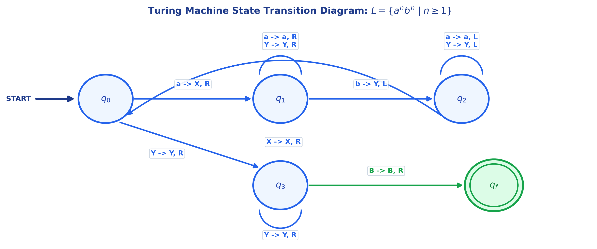
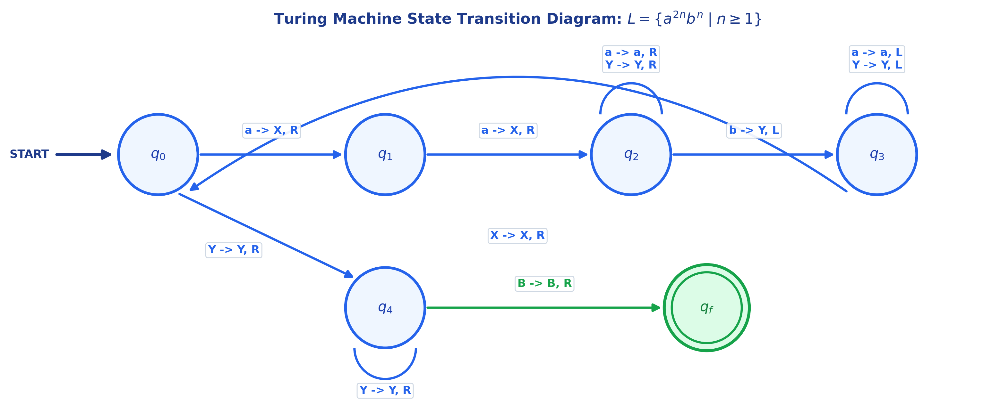
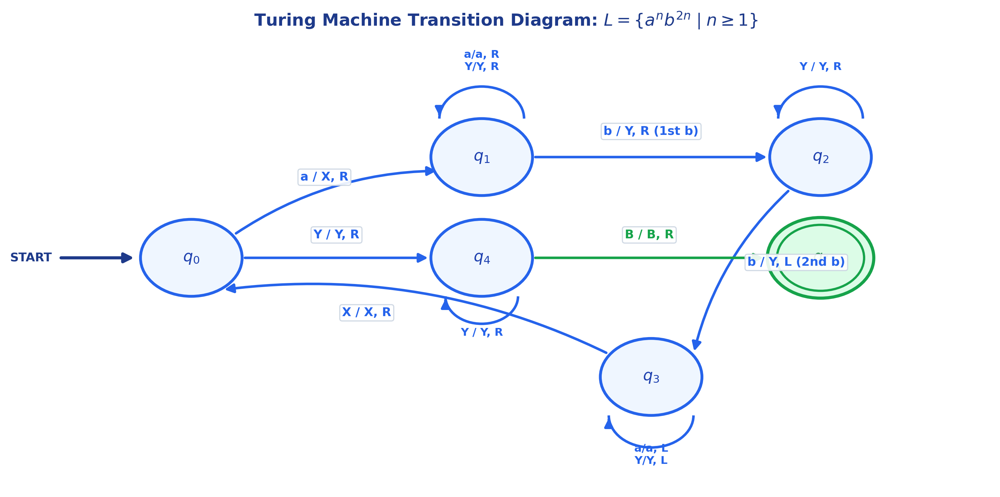
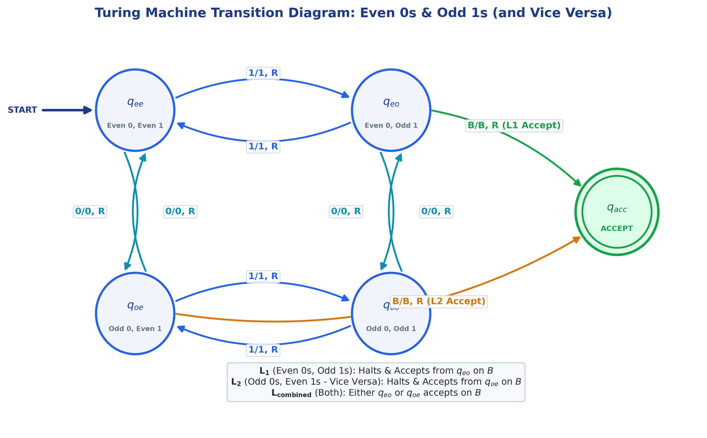
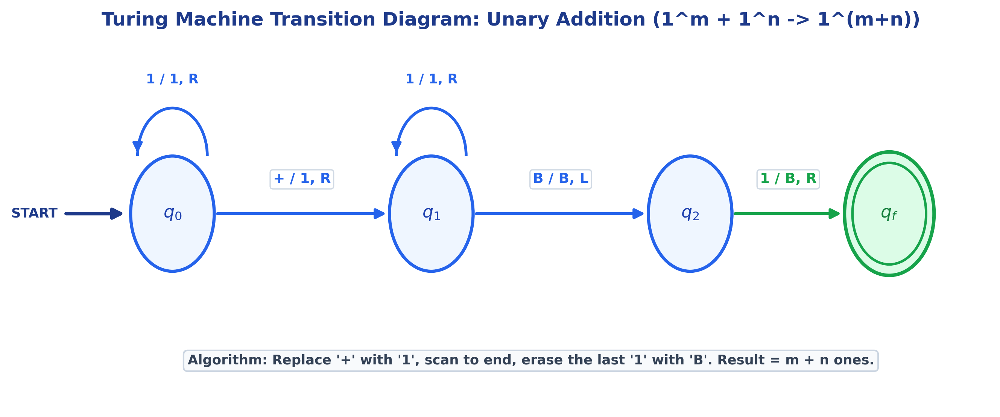
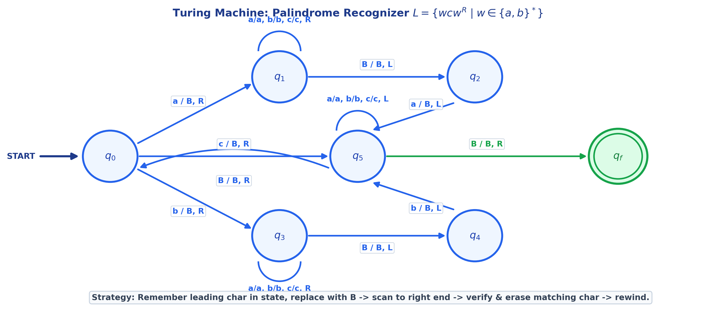

# CSE2004: Theory of Computation & Compiler Design
## CAT-II Foolproof Exam Solve Booklet & Algorithm Vault (Modules 3 & 4)

> **Exam Target:** VIT Bhopal CAT-II Examination | **Marks:** 50 Marks (Open Book / Open Notes)  
> **Course:** CSE2004 — Theory of Computation & Compiler Design  
> **Coverage:** 100% Aligned with Official Faculty Document `CSE2004-TOC-CD-CAT-II Important Topics.pdf` & Class Briefs  
> **Structure:** 5 Compulsory 10-Mark Questions Covered with Step-by-Step Templates, Tables, Diagrams & Proofs.

---

## 🧭 The Exam-Hall "10-Second Quick-Match" Navigation Matrix

| If You See This Question Language on Your Paper... | Official Syllabus Topic | Go To | The 5-Second First Move / Key Formula |
| :--- | :--- | :--- | :--- |
| **"Eliminate Left Recursion from Grammar G"** | Mod 3: Q1 (a) [5 Marks] | **Sec 1.1** | Replace $A \to A\alpha \mid \beta$ with $A \to \beta A'$ and $A' \to \alpha A' \mid \epsilon$. |
| **"Left Factor the Given Grammar G"** | Mod 3: Q1 (a) [5 Marks] | **Sec 1.2** | Group longest common prefix $\alpha$: $A \to \alpha A' \mid \gamma$, $A' \to \beta_1 \mid \beta_2$. |
| **"Find FIRST and FOLLOW sets for Grammar G"** | Mod 3: Q1 (b) [5 Marks] | **Sec 1.3** | First terminal generated = FIRST; symbol immediately to right = FOLLOW. Add $\text{\textdollar}$ to $\text{FOLLOW}(S)$. |
| **"Check whether string w is valid using LMD"** | Mod 3: Q1 Auxiliary | **Sec 1.4** | Expand leftmost variable at each step: $S \Rightarrow_{lm} \dots \Rightarrow_{lm} w$. Draw parse tree. |
| **"Check LL(1) Grammar Validity / Prove LL(1)"** | Mod 3: Q1 (OR Part) | **Sec 2.1** | Check $\text{FIRST}(\alpha) \cap \text{FIRST}(\beta) = \emptyset$ and $\text{FIRST}(\alpha) \cap \text{FOLLOW}(A) = \emptyset$. |
| **"Construct Non-Recursive LL(1) Predictive Parser"** | Mod 3: Q1 (OR Part) [10M] | **Sec 2.2** | State 3 pre-reqs $\to$ Compute FIRST/FOLLOW $\to$ Fill $M[A, a]$ $\to$ 17-step Stack Table. |
| **"Stepwise Construction of SLR(1) Parsing Table"** | Mod 3: Q2 [10 Marks] | **Sec 3.1** | Augment $S' \to S \to$ LR(0) states $\to$ place reduce $A \to \alpha \cdot$ ONLY on $\text{FOLLOW}(A)$! |
| **"Prove Grammar NOT SLR(1) via S/R Conflict"** | Mod 3: Q2 [10 Marks] | **Sec 3.2** | Show cell $\text{ACTION}[I_2, =] = \{S_6, r_5\}$ contains both Shift and Reduce actions. |
| **"Stepwise Construction of CLR(1) Parsing Table"** | Mod 3: Q3 [10 Marks] | **Sec 4.1** | Build LR(1) items with lookaheads $[A \to \alpha \cdot B \beta, a] \to$ fill ACTION/GOTO table. |
| **"Stepwise Construction of LALR(1) Parsing Table"** | Mod 3: Q3 [10 Marks] | **Sec 4.2** | Merge CLR(1) states with identical LR(0) cores: $I_{36}, I_{47}, I_{89} \to$ compact table. |
| **"Prove Grammar NOT LALR(1) via R/R Conflict"** | Mod 3: Q3 [10 Marks] | **Sec 4.3** | Show merged state $I_{45}$ has $\text{ACTION}[I_{45}, d] = \{r_5, r_6\}$ (Reduce-Reduce). |
| **"Turing Machine: $L = \{a^n b^n \mid n \geq 1\}$"** | Mod 4: Q4/Q5 [10 Marks] | **Sec 5.1** | Mark $1$ '$a$' as $X$, scan right to mark $1$ '$b$' as $Y$, rewind left to $X$. |
| **"Turing Machine: $L = \{a^{2n} b^n \mid n \geq 1\}$"** | Mod 4: Q4/Q5 [10 Marks] | **Sec 5.2** | Mark TWO '$a$'s as $X$ ($q_0 \to q_1 \to q_2$), scan right to mark ONE '$b$' as $Y$. |
| **"Turing Machine: $L = \{a^n b^{2n} \mid n \geq 1\}$"** | Mod 4: Q4/Q5 [10 Marks] | **Sec 5.3** | Mark ONE '$a$' as $X$, scan right to mark TWO '$b$'s as $Y$ ($q_1 \to q_2 \to q_3$). |
| **"Turing Machine: $L = \{a^n b^n c^n \mid n \geq 1\}$"** | Mod 4: Q4/Q5 [10 Marks] | **Sec 5.4** | Mark $a \to X$, scan to mark $b \to Y$, scan to mark $c \to Z$, rewind. |
| **"TM: Even 0s & Odd 1s (and Vice Versa)"** | Mod 4: Q4/Q5 [10 Marks] | **Sec 5.5** | 4-state parity tracker ($q_{EE}, q_{EO}, q_{OE}, q_{OO}$), accept on blank. |
| **"Turing Machine: Unary Addition ($1^m + 1^n$)"** | Mod 4: Q4/Q5 [10 Marks] | **Sec 5.6** | Replace $+$ with $1$, scan to right end, erase last $1$ with $B$. |
| **"Turing Machine: Proper Subtraction ($m \dot{-} n$)"** | Mod 4: Q4/Q5 [10 Marks] | **Sec 5.7** | Erase leading $1$ of $m$, scan right to erase rightmost $1$ of $n$, loop back. |
| **"Turing Machine: Palindrome Recognizer"** | Mod 4: Q4/Q5 [10 Marks] | **Sec 5.8** | Erase leftmost character, store in state, match & erase rightmost character. |

---

# SECTION 1: Top-Down Grammar Transformations & Sets (Module 3, Q1)

## 1.1 Elimination of Left Recursion (Syllabus Q1(a): 5 Marks)

### 🧠 The Core Mental Model
- **Left Recursion:** $A \to A \alpha$. A non-terminal immediately calls itself on the left edge. A top-down recursive-descent parser enters an **infinite loop** before reading any input token!
- **The Fix:** Force the grammar to generate the non-recursive base suffix $\beta$ *first*, followed by a helper variable $A'$ that handles repetitive loops.

### Recipe 1: Direct Left Recursion
For productions in the form:
$$A \to A\alpha_1 \mid A\alpha_2 \mid \dots \mid A\alpha_m \mid \beta_1 \mid \beta_2 \mid \dots \mid \beta_n$$
*(where no $\beta_j$ begins with $A$)*:

**Direct Transformation Formula (Copy verbatim):**
$$A \to \beta_1 A' \mid \beta_2 A' \mid \dots \mid \beta_n A'$$
$$A' \to \alpha_1 A' \mid \alpha_2 A' \mid \dots \mid \alpha_m A' \mid \epsilon$$

#### 📝 Worked Exam Example: Arithmetic Grammar
$$E \to E + T \mid T, \quad T \to T * F \mid F, \quad F \to ( E ) \mid id$$

1. For $E$: Left recursive ($\alpha = + T, \beta = T$):
   $$E \to T E', \quad E' \to + T E' \mid \epsilon$$
2. For $T$: Left recursive ($\alpha = * F, \beta = F$):
   $$T \to F T', \quad T' \to * F T' \mid \epsilon$$
3. For $F$: No left recursion. Leave unchanged:
   $$F \to ( E ) \mid id$$

### Recipe 2: Indirect Left Recursion
1. Order non-terminals: $A_1, A_2, \dots, A_n$.
2. For $i = 1$ to $n$:
   - For $j = 1$ to $i-1$: replace $A_i \to A_j \gamma$ by substituting expansions of $A_j$.
   - Eliminate direct left recursion on $A_i$ using Recipe 1.

---

## 1.2 Left Factoring of a Grammar (Syllabus Q1(a): 5 Marks)

### 🧠 The Core Mental Model
- **Left Factoring:** Two or more alternatives share the *same prefix*: $A \to \alpha \beta_1 \mid \alpha \beta_2$. The parser cannot determine which production to expand upon seeing $\alpha$.
- **The Fix:** Factor out the common prefix $\alpha$ and defer the decision to a helper variable $A'$.

### Transformation Recipe:
If $A \to \alpha \beta_1 \mid \alpha \beta_2 \mid \dots \mid \alpha \beta_n \mid \gamma$ (where $\gamma$ does not start with $\alpha$):
$$A \to \alpha A' \mid \gamma$$
$$A' \to \beta_1 \mid \beta_2 \mid \dots \mid \beta_n$$

#### 📝 Worked Exam Example: Dangling Else Grammar
$$S \to i E t S \mid i E t S e S \mid a, \quad E \to b$$
1. Common prefix in $S$ is $\alpha = i E t S$.
2. Left-factored result:
   $$S \to i E t S S' \mid a$$
   $$S' \to e S \mid \epsilon$$
   $$E \to b$$

---

## 1.3 Rules & Calculation for FIRST and FOLLOW (Syllabus Q1(b): 5 Marks)

### 1. Rules for Computing $\text{FIRST}(X)$
1. If $X$ is a terminal, $\text{FIRST}(X) = \{X\}$.
2. If $X \to \epsilon$ is a production, then add $\epsilon$ to $\text{FIRST}(X)$.
3. If $X$ is a non-terminal and $X \to Y_1 Y_2 \dots Y_k$:
   - Add all terminals from $\text{FIRST}(Y_1)$ (except $\epsilon$) to $\text{FIRST}(X)$.
   - If $\epsilon \in \text{FIRST}(Y_1)$, add $\text{FIRST}(Y_2) \setminus \{\epsilon\}$, continuing until some $Y_i$ does not derive $\epsilon$.
   - If all $Y_1, \dots, Y_k$ derive $\epsilon$, add $\epsilon$ to $\text{FIRST}(X)$.

### 2. Rules for Computing $\text{FOLLOW}(A)$ (Only for Non-Terminals!)
1. Put the input endmarker $\text{\textdollar}$ into $\text{FOLLOW}(S)$, where $S$ is the grammar start symbol.
2. If there is a production $A \to \alpha B \beta$:
   - Everything in $\text{FIRST}(\beta)$ (except $\epsilon$) is in $\text{FOLLOW}(B)$.
3. If there is a production $A \to \alpha B$, OR $A \to \alpha B \beta$ where $\epsilon \in \text{FIRST}(\beta)$:
   - Everything in $\text{FOLLOW}(A)$ is in $\text{FOLLOW}(B)$ ($\text{FOLLOW}(A) \subseteq \text{FOLLOW}(B)$).

#### 📝 Master Summary Table for Transformed Arithmetic Grammar
| Non-Terminal | FIRST Set | FOLLOW Set |
| :---: | :---: | :---: |
| **$E$** | $\{id, (\}$ | $\{\text{\textdollar}, )\}$ |
| **$E'$** | $\{+, \epsilon\}$ | $\{\text{\textdollar}, )\}$ |
| **$T$** | $\{id, (\}$ | $\{+, \text{\textdollar}, )\}$ |
| **$T'$** | $\{*, \epsilon\}$ | $\{+, \text{\textdollar}, )\}$ |
| **$F$** | $\{id, (\}$ | $\{+, *, \text{\textdollar}, )\}$ |

---

## 1.4 Checking String Validity Using Leftmost Derivation (LMD)

### 🧠 The Core Definition
- **Leftmost Derivation (LMD):** A derivation sequence where at every substitution step, the **leftmost non-terminal** in the sentential form is replaced by the RHS of an applicable production.
- **Notation:** $S \Rightarrow_{lm} \alpha_1 \Rightarrow_{lm} \alpha_2 \dots \Rightarrow_{lm} w$.
- **Validity Rule:** If a finite sequence of leftmost substitutions leads *exactly* to the target string $w$ (containing only terminals), then $w \in L(G)$ and the string is **VALID**. If no valid derivation sequence exists, it is **INVALID**.

### 📝 Worked Exam Example:
**Grammar:** $E \to E + E \mid E * E \mid ( E ) \mid id$  
**Check String:** $w = id + id * id$

$$\begin{aligned}
E &\Rightarrow_{lm} E + E && \text{[Apply } E \to E + E \text{ to leftmost } E \text{]} \\
  &\Rightarrow_{lm} id + E && \text{[Apply } E \to id \text{ to leftmost } E \text{]} \\
  &\Rightarrow_{lm} id + E * E && \text{[Apply } E \to E * E \text{ to leftmost } E \text{]} \\
  &\Rightarrow_{lm} id + id * E && \text{[Apply } E \to id \text{ to leftmost } E \text{]} \\
  &\Rightarrow_{lm} id + id * id && \text{[Apply } E \to id \text{ to leftmost } E \text{]}
\end{aligned}$$

**Conclusion:** The terminal string `id + id * id` is completely derived from start symbol $E$. String $w$ is **VALID**. $\blacksquare$

---

# SECTION 2: Non-Recursive LL(1) Predictive Parsing (Module 3, Q1 OR: 10M)

## 2.1 The 3 Mandatory Pre-requisites & Grammar Validity Check

To construct an LL(1) predictive parser, grammar $G$ must satisfy:
1. **Unambiguity:** For every string, there exists exactly one unique parse tree.
2. **Non Left-Recursive:** Grammar must not contain direct ($A \to A\alpha$) or indirect ($A \Rightarrow^+ A\alpha$) left recursion.
3. **Left-Factored:** Alternatives for non-terminal $A$ must not share common prefixes ($A \to \alpha\beta_1 \mid \alpha\beta_2$).

### Mathematical Conditions for LL(1) Validity:
For every non-terminal $A$ with multiple choices $A \to \alpha_1 \mid \alpha_2 \mid \dots \mid \alpha_n$:
1. $\text{FIRST}(\alpha_i) \cap \text{FIRST}(\alpha_j) = \emptyset$ for all $i \ne j$.
2. At most one $\alpha_i$ can derive $\epsilon$.
3. If $\alpha_i \Rightarrow^* \epsilon$, then for every $j \ne i$: $\text{FIRST}(\alpha_j) \cap \text{FOLLOW}(A) = \emptyset$.

**Table Condition:** If every cell $M[A, a]$ contains **at most one production**, the grammar is **LL(1)**.

---

## 2.2 LL(1) Parse Table & 17-Step Stack Simulation

### Master LL(1) Parse Table:
| Non-Terminal | $id$ | $+$ | $*$ | $($ | $)$ | $\text{\textdollar}$ |
| :---: | :---: | :---: | :---: | :---: | :---: | :---: |
| **$E$** | $E \to T E'$ | | | $E \to T E'$ | | |
| **$E'$** | | $E' \to + T E'$ | | | $E' \to \epsilon$ | $E' \to \epsilon$ |
| **$T$** | $T \to F T'$ | | | $T \to F T'$ | | |
| **$T'$** | | $T' \to \epsilon$ | $T' \to * F T'$ | | $T' \to \epsilon$ | $T' \to \epsilon$ |
| **$F$** | $F \to id$ | | | $F \to ( E )$ | | |

*Conclusion:* Every cell has $\le 1$ production $\implies$ Grammar is **strictly LL(1)**.

### Stack Parsing Simulation for <code>id + id * id &#36;</code>:
| Step | Matched | Stack | Input Buffer | Action / Production Applied |
| :---: | :--- | :--- | :--- | :--- |
| **1** | $\epsilon$ | <code>&#36; E</code> | <code>id + id * id &#36;</code> | Pop $E$, Push $T E'$ |
| **2** | $\epsilon$ | <code>&#36; E' T</code> | <code>id + id * id &#36;</code> | Pop $T$, Push $F T'$ |
| **3** | $\epsilon$ | <code>&#36; E' T' F</code> | <code>id + id * id &#36;</code> | Pop $F$, Push $id$ |
| **4** | `id` | <code>&#36; E' T' id</code> | <code>id + id * id &#36;</code> | **Match `id`** (Pop `id`, advance input) |
| **5** | `id` | <code>&#36; E' T'</code> | <code>+ id * id &#36;</code> | Pop $T'$, Push $\epsilon$ |
| **6** | `id` | <code>&#36; E'</code> | <code>+ id * id &#36;</code> | Pop $E'$, Push $+ T E'$ |
| **7** | `id +` | <code>&#36; E' T +</code> | <code>+ id * id &#36;</code> | **Match `+`** (Pop `+`, advance input) |
| **8** | `id +` | <code>&#36; E' T</code> | <code>id * id &#36;</code> | Pop $T$, Push $F T'$ |
| **9** | `id +` | <code>&#36; E' T' F</code> | <code>id * id &#36;</code> | Pop $F$, Push $id$ |
| **10** | `id + id` | <code>&#36; E' T' id</code> | <code>id * id &#36;</code> | **Match `id`** (Pop `id`, advance input) |
| **11** | `id + id` | <code>&#36; E' T'</code> | <code>* id &#36;</code> | Pop $T'$, Push $* F T'$ |
| **12** | `id + id *` | <code>&#36; E' T' F *</code> | <code>* id &#36;</code> | **Match `*`** (Pop `*`, advance input) |
| **13** | `id + id *` | <code>&#36; E' T' F</code> | <code>id &#36;</code> | Pop $F$, Push $id$ |
| **14** | `id + id * id` | <code>&#36; E' T' id</code> | <code>id &#36;</code> | **Match `id`** (Pop `id`, advance input) |
| **15** | `id + id * id` | <code>&#36; E' T'</code> | <code>&#36;</code> | Pop $T'$, Push $\epsilon$ |
| **16** | `id + id * id` | <code>&#36; E'</code> | <code>&#36;</code> | Pop $E'$, Push $\epsilon$ |
| **17** | `id + id * id` | <code>&#36;</code> | <code>&#36;</code> | **SUCCESS: String Accepted!** $\blacksquare$ |

---

# SECTION 3: Stepwise SLR(1) Parsing Table & S/R Conflict Proof (Module 3, Q2: 10M)

> **⭐ GUARANTEED QUESTION IN EXAM (CONFIRMED IN SYLLABUS DOCUMENT)**  
> Evaluates your ability to construct the SLR(1) parsing table OR illustrate the mathematical proof for Shift-Reduce Conflict!

## 3.1 Stepwise Process for SLR(1) Parsing Table Construction

### Step 1: Augment Grammar and Number Productions
0. $S' \to S$
1. $E \to E + T$
2. $E \to T$
3. $T \to T * F$
4. $T \to F$
5. $F \to ( E )$
6. $F \to id$

### Step 2: Canonical Collection of LR(0) Items
- **$I_0 = \text{CLOSURE}(\{S' \to \cdot E\})$:**
  $$S' \to \cdot E, \quad E \to \cdot E + T, \quad E \to \cdot T, \quad T \to \cdot T * F, \quad T \to \cdot F, \quad F \to \cdot ( E ), \quad F \to \cdot id$$
- Transition rules:
  - $\text{GOTO}(I_0, E) = I_1 = \{S' \to E \cdot, \; E \to E \cdot + T\}$
  - $\text{GOTO}(I_0, T) = I_2 = \{E \to T \cdot, \; T \to T \cdot * F\}$
  - $\text{GOTO}(I_0, F) = I_3 = \{T \to F \cdot\}$
  - $\text{GOTO}(I_0, id) = I_5 = \{F \to id \cdot\}$

### Step 3: SLR(1) Table Construction Rules (Copy Verbatim)
1. **Shift Actions:** If $[A \to \alpha \cdot a \beta] \in I_i$ and $\text{GOTO}(I_i, a) = I_j$, set $\text{ACTION}[i, a] = \text{Shift } j$ ($S_j$).
2. **Reduce Actions:** If $[A \to \alpha \cdot] \in I_i$ (where $A \ne S'$), set $\text{ACTION}[i, a] = \text{Reduce } k$ ($r_k$) **ONLY for $a \in \text{FOLLOW}(A)$**!
3. **Accept Action:** If $[S' \to S \cdot] \in I_i$, set $\text{ACTION}[i, \text{\textdollar}] = \text{Accept}$.
4. **GOTO Entries:** If $\text{GOTO}(I_i, A) = I_j$ for non-terminal $A$, set $\text{GOTO}[i, A] = j$.

---

## 3.2 Proof that Grammar is NOT SLR(1) via Shift-Reduce Conflict

### Problem Statement:
Given grammar:
$$S \to L = R \mid R, \quad L \to * R \mid id, \quad R \to L$$
Construct the SLR(1) parsing table, prove mathematically that a **Shift-Reduce conflict** exists, and conclude why the grammar is **NOT SLR(1)**.

### Step 1: Augment Grammar and Number Productions
0. $S' \to S$
1. $S \to L = R$
2. $S \to R$
3. $L \to * R$
4. $L \to id$
5. $R \to L$

### Step 2: Compute FOLLOW Sets
- $\text{FOLLOW}(S) = \{\$\}$
- $\text{FOLLOW}(L) = \{=, \$\}$  *(Since production $S \to L = R$ has symbol '=' following $L$, so '=' $\in \text{FOLLOW}(L)$; and $R \to L \implies \text{FOLLOW}(R) \subseteq \text{FOLLOW}(L)$)*
- $\text{FOLLOW}(R) = \{=, \$\}$  *(Since $S \to L = R \implies \text{FOLLOW}(S) \subseteq \text{FOLLOW}(R)$, so the endmarker is in $\text{FOLLOW}(R)$)*

### Step 3: Canonical Collection of LR(0) Items
- **$I_0 = \text{CLOSURE}(\{S' \to \cdot S\})$:**
  $$S' \to \cdot S, \quad S \to \cdot L = R, \quad S \to \cdot R, \quad L \to \cdot * R, \quad L \to \cdot id, \quad R \to \cdot L$$
- **From $I_0$ on symbol $L \implies I_2$:**
  $$S \to L \cdot = R$$
  $$R \to L \cdot$$
- **From $I_2$ on terminal '$=$' $\implies I_6$:**
  $$S \to L = \cdot R, \quad R \to \cdot L, \quad L \to \cdot * R, \quad L \to \cdot id$$

### Step 4: The Mathematical Proof of Shift-Reduce Conflict
Inspect **State $I_2$**:
1. **Shift Action:** Item $S \to L \cdot = R$ has dot before terminal '$=$'.  
   Because $\text{GOTO}(I_2, =) = I_6$, the parser must **Shift to State 6** on input '$=$':
   $$\text{ACTION}[I_2, =] \text{ contains } S_6$$
2. **Reduce Action:** Item $R \to L \cdot$ is a complete item (production 5: $R \to L$).  
   In SLR(1), reduce action $r_5$ is placed under all terminals in $\text{FOLLOW}(R)$.  
   Since $\text{FOLLOW}(R) = \{=, \text{\textdollar}\}$, terminal '$=$' is in $\text{FOLLOW}(R)$:
   $$\text{ACTION}[I_2, =] \text{ contains } r_5$$
3. **Evaluating Cell $\text{ACTION}[I_2, =]$:**
   $$\mathbf{ACTION}[I_2, =] = \{S_6, \; r_5\}$$
4. **Conclusion:** Cell $\text{ACTION}[I_2, =]$ contains **both a Shift action ($S_6$) and a Reduce action ($r_5$)**.  
   This creates an unresolvable **Shift-Reduce (S/R) Conflict**.  
   Therefore, the grammar is **NOT SLR(1)**! $\blacksquare$

---

# SECTION 4: CLR(1) & LALR(1) Parsing Tables & R/R Conflict Proof (Module 3, Q3: 10M)

## 4.1 Stepwise Construction of Canonical CLR(1) Parsing Table

### Grammar:
0. $S' \to S, \quad$ 1. $S \to C C, \quad$ 2. $C \to c C, \quad$ 3. $C \to d$

### Step 1: Canonical LR(1) Items Collection with Lookaheads
Lookahead rule: For $[A \to \alpha \cdot B \beta, a]$, add $[B \to \cdot \gamma, b]$ where $b \in \text{FIRST}(\beta a)$.
- **$I_0$:**
  $$S' \to \cdot S, \; \text{\textdollar}, \quad S \to \cdot C C, \; \text{\textdollar}, \quad C \to \cdot c C, \; c / d, \quad C \to \cdot d, \; c / d$$
- **$I_1 = \text{GOTO}(I_0, S)$:** $S' \to S \cdot, \; \text{\textdollar}$ (Accept)
- **$I_2 = \text{GOTO}(I_0, C)$:**
  $$S \to C \cdot C, \; \text{\textdollar}, \quad C \to \cdot c C, \; \text{\textdollar}, \quad C \to \cdot d, \; \text{\textdollar}$$
- **$I_3 = \text{GOTO}(I_0, c)$:**
  $$C \to c \cdot C, \; c / d, \quad C \to \cdot c C, \; c / d, \quad C \to \cdot d, \; c / d$$
- **$I_4 = \text{GOTO}(I_0, d)$:** $C \to d \cdot, \; c / d$ (Reduce $r_3$ on $c, d$)
- **$I_5 = \text{GOTO}(I_2, C)$:** $S \to C C \cdot, \; \text{\textdollar}$ (Reduce $r_1$ on $\text{\textdollar}$)
- **$I_6 = \text{GOTO}(I_2, c)$:**
  $$C \to c \cdot C, \; \text{\textdollar}, \quad C \to \cdot c C, \; \text{\textdollar}, \quad C \to \cdot d, \; \text{\textdollar}$$
- **$I_7 = \text{GOTO}(I_2, d)$:** $C \to d \cdot, \; \text{\textdollar}$ (Reduce $r_3$ on $\text{\textdollar}$)
- **$I_8 = \text{GOTO}(I_3, C)$:** $C \to c C \cdot, \; c / d$ (Reduce $r_2$ on $c, d$)
- **$I_9 = \text{GOTO}(I_6, C)$:** $C \to c C \cdot, \; \text{\textdollar}$ (Reduce $r_2$ on $\text{\textdollar}$)

### Step 2: Master CLR(1) Parsing Table
| State | `c` | `d` | <code>&#36;</code> | `S` | `C` |
| :---: | :---: | :---: | :---: | :---: | :---: |
| **0** | $S_3$ | $S_4$ | | 1 | 2 |
| **1** | | | **ACC** | | |
| **2** | $S_6$ | $S_7$ | | | 5 |
| **3** | $S_3$ | $S_4$ | | | 8 |
| **4** | $r_3$ | $r_3$ | | | |
| **5** | | | $r_1$ | | |
| **6** | $S_6$ | $S_7$ | | | 9 |
| **7** | | | $r_3$ | | |
| **8** | $r_2$ | $r_2$ | | | |
| **9** | | | $r_2$ | | |

*Conclusion:* Every cell has $\le 1$ action $\implies$ Grammar is **strictly CLR(1)** without conflicts! $\blacksquare$

---

## 4.2 Stepwise Construction of LALR(1) Parsing Table

LALR(1) combines CLR(1) states that have the **exact same LR(0) cores** (differing only in lookaheads):
- Merge $I_3$ and $I_6 \implies I_{36}$: $\{C \to c \cdot C, \; c / d / \text{\textdollar}\}$
- Merge $I_4$ and $I_7 \implies I_{47}$: $\{C \to d \cdot, \; c / d / \text{\textdollar}\}$
- Merge $I_8$ and $I_9 \implies I_{89}$: $\{C \to c C \cdot, \; c / d / \text{\textdollar}\}$

### Master LALR(1) Parsing Table:
| State | `c` | `d` | <code>&#36;</code> | `S` | `C` |
| :---: | :---: | :---: | :---: | :---: | :---: |
| **0** | $S_{36}$ | $S_{47}$ | | 1 | 2 |
| **1** | | | **ACC** | | |
| **2** | $S_{36}$ | $S_{47}$ | | | 5 |
| **36** | $S_{36}$ | $S_{47}$ | | | 89 |
| **47** | $r_3$ | $r_3$ | $r_3$ | | |
| **5** | | | $r_1$ | | |
| **89** | $r_2$ | $r_2$ | $r_2$ | | |

---

## 4.3 Proof that Grammar is NOT LALR(1) via Reduce-Reduce Conflict

### Problem Statement:
Given grammar:
$$S \to a A d \mid b B d \mid a B e \mid b A e, \quad A \to c, \quad B \to c$$
Prove that this grammar is **CLR(1)**, but upon merging states for **LALR(1)**, a **Reduce-Reduce (R/R) Conflict** arises.

### Step 1: Augment Grammar and Number Productions
0. $S' \to S, \quad$ 1. $S \to a A d, \quad$ 2. $S \to b B d, \quad$ 3. $S \to a B e, \quad$ 4. $S \to b A e, \quad$ 5. $A \to c, \quad$ 6. $B \to c$

### Step 2: Canonical LR(1) Items (States with Core $c$)
- From $I_a$ on terminal $c \implies I_4$:
  $$A \to c \cdot, \; d \quad \text{and} \quad B \to c \cdot, \; e$$
- From $I_b$ on terminal $c \implies I_5$:
  $$B \to c \cdot, \; d \quad \text{and} \quad A \to c \cdot, \; e$$
*(In CLR(1), $I_4$ and $I_5$ are separate. Under $d$, $I_4$ reduces $r_5$; under $e$, $I_4$ reduces $r_6$. Conflict-free!)*

### Step 3: LALR(1) Merging & Reduce-Reduce Conflict Proof
Because $I_4$ and $I_5$ share the exact same core $\{A \to c \cdot, \; B \to c \cdot\}$, LALR(1) merges them into $I_{45}$:
$$I_{45} = \left\{ A \to c \cdot, \; \{d, e\}, \quad B \to c \cdot, \; \{d, e\} \right\}$$

1. Item $A \to c \cdot$ (rule 5) places $r_5$ under columns $d$ and $e$:
   $$\text{ACTION}[I_{45}, d] \text{ contains } r_5, \quad \text{ACTION}[I_{45}, e] \text{ contains } r_5$$
2. Item $B \to c \cdot$ (rule 6) places $r_6$ under columns $d$ and $e$:
   $$\text{ACTION}[I_{45}, d] \text{ contains } r_6, \quad \text{ACTION}[I_{45}, e] \text{ contains } r_6$$
3. Evaluating Cells:
   $$\mathbf{ACTION}[I_{45}, d] = \{r_5, \; r_6\}$$
   $$\mathbf{ACTION}[I_{45}, e] = \{r_5, \; r_6\}$$
4. **Conclusion:** Both cells contain two different reduce actions ($r_5$ and $r_6$).  
   This is a **Reduce-Reduce (R/R) Conflict**.  
   Therefore, the grammar is **NOT LALR(1)**! $\blacksquare$

---

# SECTION 5: Turing Machine Master Playbook (Module 4, Q4 & Q5: 20M)

> **Mandatory 6-Component Layout (From Syllabus Document):**  
> 1. Language Description $\to$ 2. Design Logic $\to$ 3. 7-Tuples $\to$ 4. Transition Table $\to$ 5. Transition Diagram $\to$ 6. Validation Traces.

---

## 5.1 Archetype 1: Basic Matching ($L = \{a^n b^n \mid n \geq 1\}$)

### 1. Language Description
$L = \{a^n b^n \mid n \geq 1\}$ over alphabet $\Sigma = \{a, b\}$. Strings of equal $a$'s followed by equal $b$'s.

### 2. Design Logic
1. In $q_0$, read first $a$, replace with $X$, move right to $q_1$.
2. In $q_1$, skip remaining $a$'s and $Y$'s to find matching $b$. Replace $b$ with $Y$, move left to $q_2$.
3. In $q_2$, rewind left past $a$'s and $Y$'s until hitting $X$. Move right to $q_0$ to repeat for next $a$.
4. When all $a$'s are $X$, $q_0$ reads $Y$, moves to $q_3$ to ensure only $Y$'s remain. On blank $B$, enter $q_f$ (**ACCEPT**!).

### 3. Formal 7-Tuples Definition
$$M = (Q, \Sigma, \Gamma, \delta, q_0, B, F)$$
- $Q = \{q_0, q_1, q_2, q_3, q_f\}$, $\Sigma = \{a, b\}$, $\Gamma = \{a, b, X, Y, B\}$, Start state = $q_0$, Blank = $B$, $F = \{q_f\}$

### 4. State Transition Table
| State | Tape `a` | Tape `b` | Tape `X` | Tape `Y` | Tape `B` |
| :---: | :---: | :---: | :---: | :---: | :---: |
| **$q_0$** | $(q_1, X, R)$ | — | — | $(q_3, Y, R)$ | — |
| **$q_1$** | $(q_1, a, R)$ | $(q_2, Y, L)$ | — | $(q_1, Y, R)$ | — |
| **$q_2$** | $(q_2, a, L)$ | — | $(q_0, X, R)$ | $(q_2, Y, L)$ | — |
| **$q_3$** | — | — | — | $(q_3, Y, R)$ | $(q_f, B, R)$ |
| **$q_f$** | — | — | — | — | — |

### 5. State Transition Diagram

### 6. Validation via Instantaneous Description (ID) Traces
**Test Case: $w = aabb$ ($n = 2 \implies \text{Valid}$)**
$$q_0 aabb B \vdash X q_1 abb B \vdash X a q_1 bb B \vdash X q_2 a Y b B \vdash q_2 X a Y b B \vdash X q_0 a Y b B$$
$$\vdash X X q_1 Y b B \vdash X X Y q_1 b B \vdash X X q_2 Y Y B \vdash X q_2 X Y Y B \vdash X X q_0 Y Y B$$
$$\vdash X X Y q_3 Y B \vdash X X Y Y q_3 B \vdash X X Y Y B q_f B \implies \mathbf{ACCEPTED!} \; \blacksquare$$

---

## 5.2 Archetype 2: Double 'a's Matching ($L = \{a^{2n} b^n \mid n \geq 1\}$)

### 1. Language Description
$L = \{a^{2n} b^n \mid n \geq 1\}$. The number of '$a$'s must be exactly twice the number of '$b$'s.

### 2. Design Logic
1. In $q_0$, read first $a$, replace with $X$, move right to $q_1$.
2. In $q_1$, read second $a$, replace with $X$, move right to $q_2$.
3. In $q_2$, skip remaining $a$'s and $Y$'s to find matching $b$. Replace $b$ with $Y$, move left to $q_3$.
4. In $q_3$, rewind left over $a$'s and $Y$'s until hitting $X$. Move right to $q_0$ to repeat for next pair.
5. In $q_0$, on reading $Y$, transition to $q_4$ to verify all $b$'s are matched. On $B$, enter $q_f$ (**ACCEPT**!).

### 3. Formal 7-Tuples Definition
$$M = (Q, \Sigma, \Gamma, \delta, q_0, B, F)$$
- $Q = \{q_0, q_1, q_2, q_3, q_4, q_f\}$, $\Sigma = \{a, b\}$, $\Gamma = \{a, b, X, Y, B\}$, Start state = $q_0$, Blank = $B$, $F = \{q_f\}$

### 4. State Transition Table
| State | Tape `a` | Tape `b` | Tape `X` | Tape `Y` | Tape `B` |
| :---: | :---: | :---: | :---: | :---: | :---: |
| **$q_0$** | $(q_1, X, R)$ | — | — | $(q_4, Y, R)$ | — |
| **$q_1$** | $(q_2, X, R)$ | — | — | — | — |
| **$q_2$** | $(q_2, a, R)$ | $(q_3, Y, L)$ | — | $(q_2, Y, R)$ | — |
| **$q_3$** | $(q_3, a, L)$ | — | $(q_0, X, R)$ | $(q_3, Y, L)$ | — |
| **$q_4$** | — | — | — | $(q_4, Y, R)$ | $(q_f, B, R)$ |
| **$q_f$** | — | — | — | — | — |

### 5. State Transition Diagram

### 6. Validation: $w = aab$ ($n = 1 \implies 2 \text{ 'a's, } 1 \text{ 'b'}$)
$$q_0 aab B \vdash X q_1 ab B \vdash X X q_2 b B \vdash X q_3 X Y B \vdash X X q_0 Y B \vdash X X Y q_4 B \vdash X X Y B q_f B \implies \mathbf{ACCEPTED!} \; \blacksquare$$

---

## 5.3 Archetype 3: Double 'b's Matching ($L = \{a^n b^{2n} \mid n \geq 1\}$)

### 1. Language Description
$L = \{a^n b^{2n} \mid n \geq 1\}$. Exactly two '$b$'s for every single '$a$'.

### 2. State Transition Table
| State | Tape `a` | Tape `b` | Tape `X` | Tape `Y` | Tape `B` |
| :---: | :---: | :---: | :---: | :---: | :---: |
| **$q_0$** | $(q_1, X, R)$ | — | — | $(q_4, Y, R)$ | — |
| **$q_1$** | $(q_1, a, R)$ | $(q_2, Y, R)$ | — | $(q_1, Y, R)$ | — |
| **$q_2$** | — | $(q_3, Y, L)$ | — | — | — |
| **$q_3$** | $(q_3, a, L)$ | — | $(q_0, X, R)$ | $(q_3, Y, L)$ | — |
| **$q_4$** | — | — | — | $(q_4, Y, R)$ | $(q_f, B, R)$ |
| **$q_f$** | — | — | — | — | — |

### 3. State Transition Diagram

### 4. Validation: $w = abb$ ($n = 1$)
$$q_0 abb B \vdash X q_1 bb B \vdash X Y q_2 b B \vdash X q_3 Y Y B \vdash q_3 X Y Y B \vdash X q_0 Y Y B \vdash X Y q_4 Y B \vdash X Y Y q_4 B \vdash X Y Y B q_f B \implies \mathbf{ACCEPTED!} \; \blacksquare$$

---

## 5.4 Archetype 4: 3-Symbol Matching ($L = \{a^n b^n c^n \mid n \geq 1\}$)

### 1. Language Description
$L = \{a^n b^n c^n \mid n \geq 1\}$ over alphabet $\Sigma = \{a, b, c\}$. Classic non-CFL language.

### 2. State Transition Table
| State | `a` | `b` | `c` | `X` | `Y` | `Z` | `B` |
| :---: | :---: | :---: | :---: | :---: | :---: | :---: | :---: |
| **$q_0$** | $(q_1, X, R)$ | — | — | — | $(q_4, Y, R)$ | — | — |
| **$q_1$** | $(q_1, a, R)$ | $(q_2, Y, R)$ | — | — | $(q_1, Y, R)$ | — | — |
| **$q_2$** | — | $(q_2, b, R)$ | $(q_3, Z, L)$ | — | — | $(q_2, Z, R)$ | — |
| **$q_3$** | $(q_3, a, L)$ | $(q_3, b, L)$ | — | $(q_0, X, R)$ | $(q_3, Y, L)$ | $(q_3, Z, L)$ | — |
| **$q_4$** | — | — | — | — | $(q_4, Y, R)$ | $(q_4, Z, R)$ | $(q_f, B, R)$ |
| **$q_f$** | — | — | — | — | — | — | — |

### 3. State Transition Diagram

### 4. Validation: $w = abc$ ($n = 1$)
$$q_0 abc B \vdash X q_1 bc B \vdash X Y q_2 c B \vdash X q_3 Y Z B \vdash q_3 X Y Z B \vdash X q_0 Y Z B \vdash X Y q_4 Z B \vdash X Y Z q_4 B \vdash X Y Z B q_f B \implies \mathbf{ACCEPTED!} \; \blacksquare$$

---

## 5.5 Archetype 5: Parity Tracking (Even 0s and Odd 1s, and Vice Versa)

### 1. Language Description
Strings over $\Sigma = \{0, 1\}$ having an **even number of 0s and odd number of 1s** (and vice versa: odd 0s and even 1s).

### 2. State Transition Table
| State | Tape Symbol `0` | Tape Symbol `1` | Tape Symbol `B` |
| :---: | :---: | :---: | :---: |
| **$q_{EE}$ (Start)** | $(q_{OE}, 0, R)$ | $(q_{EO}, 1, R)$ | — |
| **$q_{EO}$ (Accept 1)** | $(q_{OO}, 0, R)$ | $(q_{EE}, 1, R)$ | $(q_f, B, R)$ |
| **$q_{OE}$ (Accept 2)** | $(q_{EE}, 0, R)$ | $(q_{OO}, 1, R)$ | $(q_f, B, R)$ |
| **$q_{OO}$** | $(q_{EO}, 0, R)$ | $(q_{OE}, 1, R)$ | — |
| **$q_f$** | — | — | — |

### 3. State Transition Diagram

### 4. Validation: $w = 001$ (Even 0s, Odd 1s)
$$q_{EE} 001 B \vdash 0 q_{OE} 01 B \vdash 00 q_{EE} 1 B \vdash 001 q_{EO} B \vdash 001 B q_f B \implies \mathbf{ACCEPTED!} \; \blacksquare$$

---

## 5.6 Archetype 6: Arithmetic Unary Addition ($1^m + 1^n \to 1^{m+n}$)
- Replace <code>+</code> with `1`, scan to end of tape, erase rightmost `1` with `B`.

---

## 5.7 Archetype 7: Proper Subtraction ($m \dot{-} n = \max(m-n, 0)$)
- Erase leftmost `1<code> of &#36;m&#36;, scan right to erase rightmost </code>1` of $n$, rewind left.

---

## 5.8 Archetype 8: Palindrome Recognizer ($w c w^R$)
- Erase leftmost character, store in state, scan right to match and erase rightmost character, rewind.

