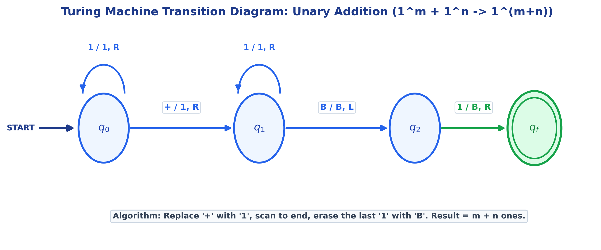
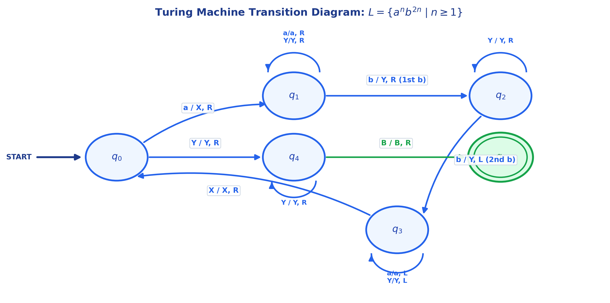

# 🏛️ VIT Bhopal University — CAT-II Examination (September 2026)
## CSE2004: Theory of Computation & Compiler Design — Master Solutions
> **Course Code**: CSE2004 | **Exam**: Continuous Assessment Test (CAT) - II  
> **Session / Slot**: 22-09-2026 / S-3 (Slot C14+E11+E12) | **Duration**: 1½ Hours (90 Minutes)  
> **Max. Marks**: 50 | **Coverage**: Module 3 (Syntax Analysis & Parsing) & Module 4 (Turing Machines)  
> **Format**: 100% Complete, Full-Marks Copy-Paste Step-by-Step Model Answers

---

## Quick Question & Topic Index

| Question No. | Syllabus Topic | Key Concept Tested | Marks |
| :---: | :--- | :--- | :---: |
| **Q1 (i)** | **Module 3: Grammar Transformations** | Elimination of Common Prefixes via Left Factoring ($S, X, Y$) | **5** |
| **Q1 (ii)** | **Module 3: Top-Down Parsing** | FIRST and FOLLOW Sets Calculation for Expression Grammar with $\epsilon$ | **5** |
| **Q2** | **Module 3: Bottom-Up LR Parsing** | LR(0) Items, SLR(1) Parsing Table Construction & Shift-Reduce Conflict Proof | **10** |
| **Q3** | **Module 4: Turing Machines** | Unary Addition Function ($1^m + 1^n \to 1^{m+n}$), 7-Tuples, Table, Diagram & Validations ($11+111$, $111+1111$) | **10** |
| **Q4** | **Module 4: Turing Machines** | Language Recognizer for $L = \{a^n b^{2n} \mid n \ge 1\}$, Table, Diagram & Moves for $aabbbb$ and $aabbb$ | **10** |
| **Q5** | **Module 3: Bottom-Up LR Parsing** | Canonical LR(1) Items Collection, CLR(1) Parsing Table & Conflict-Free Proof | **10** |
| **Total** | | **All 5 Compulsory Exam Questions Solved Completely** | **50** |

---

# QUESTION 1 (5 + 5 = 10 Marks)

## Part (i) [5 Marks]: Left Factoring of Grammar $G$

### Problem Statement:
Find the left factored grammar $G'$ equivalent to the following grammar $G$:
$$S \to XbS \mid XS \mid X \mid a$$
$$X \to aY \mid aYS \mid a$$
$$Y \to bX \mid b$$

---

### Step-by-Step Model Solution:

#### 1. Theory & Definition of Left Factoring:
Left factoring is a grammar transformation used in predictive top-down parsing (such as LL(1)) to remove ambiguity arising when two or more production alternatives share a common prefix.
If a non-terminal has productions of the form:
$$A \to \alpha \beta_1 \mid \alpha \beta_2 \mid \dots \mid \alpha \beta_n \mid \gamma$$
where $\alpha$ is a non-empty common prefix, the left-factored rules are:
$$A \to \alpha A' \mid \gamma$$
$$A' \to \beta_1 \mid \beta_2 \mid \dots \mid \beta_n$$

---

#### 2. Left Factoring Non-Terminal $Y$:
Given productions:
$$Y \to bX \mid b$$
* **Common Prefix**: Both alternatives begin with terminal $b$ ($\alpha = b$).
* Here $\beta_1 = X$ and $\beta_2 = \epsilon$.
* Factoring out $b$ by introducing new non-terminal $Y'$:
  $$\mathbf{Y \to b Y'}$$
  $$\mathbf{Y' \to X \mid \epsilon}$$

---

#### 3. Left Factoring Non-Terminal $X$:
Given productions:
$$X \to aY \mid aYS \mid a$$
* **Common Prefix**: All three alternatives share the prefix $a$ ($\alpha = a$).
* Factoring out $a$ by introducing new non-terminal $X'$:
  $$X \to a X'$$
  $$X' \to Y \mid YS \mid \epsilon$$
* Now inspect $X'$: The first two alternatives $Y$ and $YS$ share the common prefix $Y$!
* Factoring out $Y$ from $X'$ by introducing $X''$:
  $$\mathbf{X' \to Y X'' \mid \epsilon}$$
  $$\mathbf{X'' \to S \mid \epsilon}$$

---

#### 4. Left Factoring Non-Terminal $S$:
Given productions:
$$S \to XbS \mid XS \mid X \mid a$$
* **Common Prefix**: The first three alternatives share the common non-terminal prefix $X$ ($\alpha = X$).
* Factoring out $X$ by introducing new non-terminal $S'$:
  $$\mathbf{S \to X S' \mid a}$$
  $$\mathbf{S' \to bS \mid S \mid \epsilon}$$
* Inspect $S'$: The alternatives are $bS$, $S$, and $\epsilon$.
  * $bS$ begins with terminal $b$.
  * $S$ begins with $X$ or $a$.
  * There are no shared prefixes among $bS$, $S$, and $\epsilon$.
  * Thus, $S'$ is fully left-factored.

---

#### 5. Final Left Factored Grammar $G'$:
$$\mathbf{S \to X S' \mid a}$$
$$\mathbf{S' \to bS \mid S \mid \epsilon}$$
$$\mathbf{X \to a X'}$$
$$\mathbf{X' \to Y X'' \mid \epsilon}$$
$$\mathbf{X'' \to S \mid \epsilon}$$
$$\mathbf{Y \to b Y'}$$
$$\mathbf{Y' \to X \mid \epsilon} \quad \blacksquare$$

---

## Part (ii) [5 Marks]: Compute FIRST and FOLLOW Sets

### Problem Statement:
Compute FIRST and FOLLOW sets for the following grammar:
$$E \to TE'$$
$$E' \to +E \mid \epsilon$$
$$T \to id T' \mid (E)$$
$$T' \to *T \mid \epsilon$$

---

### Step-by-Step Model Solution:

#### 1. Rules for FIRST and FOLLOW Sets:
* **$\text{FIRST}(X)$ Rules**:
  1. If $X$ is a terminal, $\text{FIRST}(X) = \{X\}$.
  2. If $X \to \epsilon$, add $\epsilon$ to $\text{FIRST}(X)$.
  3. If $X \to Y_1 Y_2 \dots Y_k$, add $(\text{FIRST}(Y_1) \setminus \{\epsilon\})$. If $\epsilon \in \text{FIRST}(Y_1)$, add $(\text{FIRST}(Y_2) \setminus \{\epsilon\})$, and so on.
* **$\text{FOLLOW}(A)$ Rules**:
  1. Put $\$$ in $\text{FOLLOW}(S)$, where $S$ is the start symbol.
  2. If $A \to \alpha B \beta$, add $(\text{FIRST}(\beta) \setminus \{\epsilon\})$ to $\text{FOLLOW}(B)$.
  3. If $A \to \alpha B$ OR $A \to \alpha B \beta$ where $\epsilon \in \text{FIRST}(\beta)$, add all of $\text{FOLLOW}(A)$ to $\text{FOLLOW}(B)$.

---

#### 2. Computation of FIRST Sets:
1. **$\text{FIRST}(T')$**:
   * Production: $T' \to *T \mid \epsilon$
   * $*$ is terminal $\implies * \in \text{FIRST}(T')$.
   * $\epsilon$ is present $\implies \epsilon \in \text{FIRST}(T')$.
   $$\mathbf{\text{FIRST}(T') = \{*, \epsilon\}}$$

2. **$\text{FIRST}(T)$**:
   * Production: $T \to id T' \mid (E)$
   * $id T'$ starts with terminal $id \implies id \in \text{FIRST}(T)$.
   * $(E)$ starts with terminal $($ $\implies ( \in \text{FIRST}(T)$.
   $$\mathbf{\text{FIRST}(T) = \{id, (\}}$$

3. **$\text{FIRST}(E')$**:
   * Production: $E' \to +E \mid \epsilon$
   * $+E$ starts with terminal $+$ $\implies + \in \text{FIRST}(E')$.
   * $\epsilon$ is present $\implies \epsilon \in \text{FIRST}(E')$.
   $$\mathbf{\text{FIRST}(E') = \{+, \epsilon\}}$$

4. **$\text{FIRST}(E)$**:
   * Production: $E \to TE'$
   * $\text{FIRST}(E) = \text{FIRST}(T)$ (since $\epsilon \notin \text{FIRST}(T)$).
   $$\mathbf{\text{FIRST}(E) = \{id, (\}}$$

---

#### 3. Computation of FOLLOW Sets:
1. **$\text{FOLLOW}(E)$**:
   * $E$ is start symbol $\implies \$ \in \text{FOLLOW}(E)$.
   * From $T \to (E)$: terminal $)$ immediately follows $E \implies ) \in \text{FOLLOW}(E)$.
   * From $E' \to +E$: $E$ is at the very end of $E' \implies \text{FOLLOW}(E') \subseteq \text{FOLLOW}(E)$.
   $$\mathbf{\text{FOLLOW}(E) = \{), \$\}}$$

2. **$\text{FOLLOW}(E')$**:
   * From $E \to TE'$: $E'$ is at the very end of $E \implies \text{FOLLOW}(E) \subseteq \text{FOLLOW}(E')$.
   * Since $\text{FOLLOW}(E) = \{), \$\}$:
   $$\mathbf{\text{FOLLOW}(E') = \{), \$\}}$$

3. **$\text{FOLLOW}(T)$**:
   * From $E \to TE'$: $T$ is followed by $E'$.
     * Add $(\text{FIRST}(E') \setminus \{\epsilon\}) = \{+\}$ to $\text{FOLLOW}(T)$.
     * Since $\epsilon \in \text{FIRST}(E')$, add all of $\text{FOLLOW}(E) = \{), \$\}$ to $\text{FOLLOW}(T)$.
   * From $T' \to *T$: $T$ is at the end of $T' \implies \text{FOLLOW}(T') \subseteq \text{FOLLOW}(T)$.
   $$\mathbf{\text{FOLLOW}(T) = \{+, ), \$\}}$$

4. **$\text{FOLLOW}(T')$**:
   * From $T \to id T'$: $T'$ is at the very end of $T \implies \text{FOLLOW}(T) \subseteq \text{FOLLOW}(T')$.
   $$\mathbf{\text{FOLLOW}(T') = \{+, ), \$\}}$$

---

#### 4. Summary Table of FIRST & FOLLOW:

| Non-Terminal | $\text{FIRST}$ Set | $\text{FOLLOW}$ Set |
| :---: | :---: | :---: |
| **$E$** | $\mathbf{\{id, (\}}$ | $\mathbf{\{), \$\}}$ |
| **$E'$** | $\mathbf{\{+, \epsilon\}}$ | $\mathbf{\{), \$\}}$ |
| **$T$** | $\mathbf{\{id, (\}}$ | $\mathbf{\{+, ), \$\}}$ |
| **$T'$** | $\mathbf{\{*, \epsilon\}}$ | $\mathbf{\{+, ), \$\}}$ |

$$\mathbf{\blacksquare}$$

---

# QUESTION 2 (10 Marks)

### Problem Statement:
Construct the SLR(1) parsing table for the following grammar:
$$S \to L = R \mid R$$
$$L \to *R \mid id$$
$$R \to L$$

---

### Step-by-Step Model Solution:

#### 1. Numbered Augmented Grammar:
Introduce augmented start symbol $S'$ and production $S' \to S$:
* **(0)** $S' \to S$
* **(1)** $S \to L = R$
* **(2)** $S \to R$
* **(3)** $L \to *R$
* **(4)** $L \to id$
* **(5)** $R \to L$

Terminals: $\{=, *, id, \$\}$ | Non-terminals: $\{S, L, R\}$

---

#### 2. Computation of FOLLOW Sets:
* $\text{FOLLOW}(S) = \{\$\}$
* $\text{FOLLOW}(L)$:
  * From $S \to L = R$: $=$ follows $L \implies = \in \text{FOLLOW}(L)$.
  * From $R \to L$: $\text{FOLLOW}(R) \subseteq \text{FOLLOW}(L)$.
  * From $S \to R$: $\text{FOLLOW}(S) \subseteq \text{FOLLOW}(R) \implies \$ \in \text{FOLLOW}(R) \implies \$ \in \text{FOLLOW}(L)$.
  * Thus: $\mathbf{\text{FOLLOW}(L) = \{=, \$\}}$
* $\text{FOLLOW}(R)$:
  * From $S \to L = R$: $\text{FOLLOW}(S) \subseteq \text{FOLLOW}(R) \implies \$ \in \text{FOLLOW}(R)$.
  * From $L \to *R$: $\text{FOLLOW}(L) \subseteq \text{FOLLOW}(R) \implies \{=, \$\} \subseteq \text{FOLLOW}(R)$.
  * Thus: $\mathbf{\text{FOLLOW}(R) = \{=, \$\}}$

---

#### 3. Canonical Collection of LR(0) Items:

* **State $I_0 = \text{CLOSURE}(\{S' \to \cdot S\})$**:
  $$S' \to \cdot S$$
  $$S \to \cdot L = R$$
  $$S \to \cdot R$$
  $$L \to \cdot *R$$
  $$L \to \cdot id$$
  $$R \to \cdot L$$

* **Transitions from $I_0$**:
  * $\text{GOTO}(I_0, S) = \mathbf{I_1}$: $\{S' \to S \cdot\}$
  * $\text{GOTO}(I_0, L) = \mathbf{I_2}$:
    $$S \to L \cdot = R$$
    $$R \to L \cdot$$
    *(Notice: $I_2$ contains a shift item on $=$ and a reduce item for rule 5!)*
  * $\text{GOTO}(I_0, R) = \mathbf{I_3}$: $\{S \to R \cdot\}$
  * $\text{GOTO}(I_0, *) = \mathbf{I_4}$:
    $$L \to * \cdot R$$
    $$R \to \cdot L$$
    $$L \to \cdot *R$$
    $$L \to \cdot id$$
  * $\text{GOTO}(I_0, id) = \mathbf{I_5}$: $\{L \to id \cdot\}$

* **Transitions from other states**:
  * From $I_2$ on terminal $=$: $\text{GOTO}(I_2, =) = \mathbf{I_6}$:
    $$S \to L = \cdot R$$
    $$R \to \cdot L$$
    $$L \to \cdot *R$$
    $$L \to \cdot id$$
  * From $I_4$:
    * $\text{GOTO}(I_4, R) = \mathbf{I_7}$: $\{L \to *R \cdot\}$
    * $\text{GOTO}(I_4, L) = \mathbf{I_8}$: $\{R \to L \cdot\}$
    * $\text{GOTO}(I_4, *) = I_4$
    * $\text{GOTO}(I_4, id) = I_5$
  * From $I_6$:
    * $\text{GOTO}(I_6, R) = \mathbf{I_9}$: $\{S \to L = R \cdot\}$
    * $\text{GOTO}(I_6, L) = I_8$
    * $\text{GOTO}(I_6, *) = I_4$
    * $\text{GOTO}(I_6, id) = I_5$

---

#### 4. SLR(1) Parsing Table:

* **Rules for filling table**:
  1. If $[A \to \alpha \cdot a \beta] \in I_i$ and $\text{GOTO}(I_i, a) = I_j$, write $S_j$ in $\text{ACTION}[i, a]$.
  2. If $[A \to \alpha \cdot] \in I_i$ (rule $k$), write $r_k$ in $\text{ACTION}[i, a]$ for all $a \in \text{FOLLOW}(A)$.
  3. If $[S' \to S \cdot] \in I_i$, write $\text{ACCEPT}$ in $\text{ACTION}[i, \$]$.
  4. If $\text{GOTO}(I_i, A) = I_j$, write $j$ in $\text{GOTO}[i, A]$.

| State | $\mathbf{=}$ | $\mathbf{*}$ | $\mathbf{id}$ | $\mathbf{\$}$ | $\mathbf{S}$ | $\mathbf{L}$ | $\mathbf{R}$ |
| :---: | :---: | :---: | :---: | :---: | :---: | :---: | :---: |
| **0** | | $S_4$ | $S_5$ | | $1$ | $2$ | $3$ |
| **1** | | | | $\mathbf{ACCEPT}$ | | | |
| **2** | $\mathbf{S_6 \; / \; r_5}$ ⚠️ | | | $r_5$ | | | |
| **3** | | | | $r_2$ | | | |
| **4** | | $S_4$ | $S_5$ | | | $8$ | $7$ |
| **5** | $r_4$ | | | $r_4$ | | | |
| **6** | | $S_4$ | $S_5$ | | | $8$ | $9$ |
| **7** | $r_3$ | | | $r_3$ | | | |
| **8** | $r_5$ | | | $r_5$ | | | |
| **9** | | | | $r_1$ | | | |

---

#### 5. Shift-Reduce Conflict Analysis:
* Look at state **$I_2$**:
  * Item $S \to L \cdot = R$ instructs the parser to **Shift on terminal $=$** to state 6 ($S_6$).
  * Item $R \to L \cdot$ is a complete item for rule (5) $R \to L$. Under SLR(1) rules, we must place **Reduce $r_5$ on all symbols in $\text{FOLLOW}(R)$**.
  * Since $\text{FOLLOW}(R) = \{=, \$\}$, symbol $=$ receives reduce $r_5$.
* Therefore, cell **$\text{ACTION}[2, =] = \{S_6, r_5\}$**.
* **Conclusion**:
  $$\mathbf{\text{Since cell } \text{ACTION}[2, =] \text{ contains multiple actions (Shift } S_6 \text{ and Reduce } r_5\text{),}}$$
  $$\mathbf{\text{there is a SHIFT-REDUCE CONFLICT. Hence, the grammar is NOT SLR(1). } \blacksquare}$$

---

# QUESTION 3 (10 Marks)

### Problem Statement:
Construct TM for the addition function for the unary number system. The unary number is made up of only one character, e.g. the number 5 can be written in unary number system as 11111. In this TM, you are asked to perform the addition of two unary numbers.
Perform the following:
**i.** Build the transition diagram and transition table for Turing machine.
**ii.** Illustrate the moves to perform the addition of following inputs of unary numbers:
**(1)** $11 + 111$
**(2)** $111 + 1111$

---

### Step-by-Step Model Solution:

#### 1. Language & Problem Description:
In the unary number system:
* Number $m$ is represented by $1^m$ ($m$ consecutive ones).
* Number $n$ is represented by $1^n$ ($n$ consecutive ones).
* The input on the tape is separated by the addition symbol `+`:
  $$\text{Initial Tape}: B \; \mathbf{1^m + 1^n} \; B$$
* We want the Turing Machine to halt leaving only the sum $(m + n)$ on the tape:
  $$\text{Final Tape}: B \; \mathbf{1^{m+n}} \; B$$

---

#### 2. Design Logic & Working Principle:
1. **Step 1 (Scan first number)**: Start at the first `1` in state $q_0$. Move Right ($R$) skipping all `1`s until the symbol `+` is encountered.
2. **Step 2 (Convert `+` to `1`)**: Overwrite `+` with `1`, and transition to state $q_1$, moving Right ($R$).  
   *(Notice: By turning `+` into `1`, the tape now contains $(m + 1 + n) = m + n + 1$ ones — exactly one extra `1`!)*
3. **Step 3 (Find the end of the second number)**: In state $q_1$, move Right ($R$) skipping all remaining `1`s until the first Blank $B$ is reached.
4. **Step 4 (Erase the extra `1`)**: On reading $B$, move Left ($L$) to state $q_2$. The head is now parked directly over the last `1`. Overwrite this last `1` with $B$, and transition to the final state $q_f$ moving Right ($R$).
5. **Step 5 (Halt & Accept)**: The machine enters halting state $q_f$ with exactly $m + n$ ones on the tape!

---

#### 3. Formal 7-Tuple Definition:
$$M = (Q, \Sigma, \Gamma, \delta, q_0, B, \{q_f\})$$
* $Q = \{q_0, q_1, q_2, q_f\}$
* $\Sigma = \{1, +\}$
* $\Gamma = \{1, +, B\}$
* Start State: $q_0$
* Blank Symbol: $B$
* Final State: $F = \{q_f\}$

---

#### 4. Transition Table:

| Present State | Tape Symbol $\mathbf{1}$ | Tape Symbol $\mathbf{+}$ | Tape Symbol $\mathbf{B}$ | Description |
| :---: | :---: | :---: | :---: | :--- |
| $\to \mathbf{q_0}$ | $(q_0, 1, R)$ | $\mathbf{(q_1, 1, R)}$ | — | Scan past first unary number; replace `+` with `1` |
| $\mathbf{q_1}$ | $(q_1, 1, R)$ | — | $\mathbf{(q_2, B, L)}$ | Scan past second unary number; find end-of-tape $B$ |
| $\mathbf{q_2}$ | $\mathbf{(q_f, B, R)}$ | — | — | Erase the last `1` with $B$ to compensate for the converted `+` |
| $\mathbf{q_f^*}$ | — | — | — | **HALT & ACCEPT (Sum is on tape)** |

---

#### 5. Transition Diagram:

---

#### 6. Moves Illustration via Instantaneous Descriptions (IDs):

##### (1) Addition of $11 + 111$ ($2 + 3 = 5$):
* Input on tape: $11 + 111$
* **Step-by-Step ID Trace**:
  1. $q_0 1 1 + 1 1 1 B$
  2. $\vdash 1 q_0 1 + 1 1 1 B$
  3. $\vdash 1 1 q_0 + 1 1 1 B$
  4. $\vdash 1 1 1 q_1 1 1 1 B$  *(Replace `+` with `1`, move $R$)*
  5. $\vdash 1 1 1 1 q_1 1 1 B$
  6. $\vdash 1 1 1 1 1 q_1 1 B$
  7. $\vdash 1 1 1 1 1 1 q_1 B$  *(End of string reached)*
  8. $\vdash 1 1 1 1 1 q_2 1 B$  *(Move $L$ onto last `1`)*
  9. $\vdash 1 1 1 1 1 B q_f B$  *(Replace last `1` with $B$, move $R$, HALT!)*
* **Final Tape**: $\mathbf{1 1 1 1 1}$ (Five ones $\implies 5$).  
  $$\mathbf{2 + 3 = 5 \quad \checkmark}$$

---

##### (2) Addition of $111 + 1111$ ($3 + 4 = 7$):
* Input on tape: $111 + 1111$
* **Step-by-Step ID Trace**:
  1. $q_0 1 1 1 + 1 1 1 1 B$
  2. $\vdash 1 q_0 1 1 + 1 1 1 1 B$
  3. $\vdash 1 1 q_0 1 + 1 1 1 1 B$
  4. $\vdash 1 1 1 q_0 + 1 1 1 1 B$
  5. $\vdash 1 1 1 1 q_1 1 1 1 1 B$  *(Replace `+` with `1`, move $R$)*
  6. $\vdash 1 1 1 1 1 q_1 1 1 1 B$
  7. $\vdash 1 1 1 1 1 1 q_1 1 1 B$
  8. $\vdash 1 1 1 1 1 1 1 q_1 1 B$
  9. $\vdash 1 1 1 1 1 1 1 1 q_1 B$  *(End of string reached)*
  10. $\vdash 1 1 1 1 1 1 1 q_2 1 B$  *(Move $L$ onto last `1`)*
  11. $\vdash 1 1 1 1 1 1 1 B q_f B$  *(Replace last `1` with $B$, move $R$, HALT!)*
* **Final Tape**: $\mathbf{1 1 1 1 1 1 1}$ (Seven ones $\implies 7$).  
  $$\mathbf{3 + 4 = 7 \quad \checkmark \quad \blacksquare}$$

---

# QUESTION 4 (10 Marks)

### Problem Statement:
Design a Turing machine to accept the language:
$$L = \{a^n b^{2n} \mid n \ge 1\}$$
Perform the following:
**i.** Build the transition diagram and transition table for Turing machine.
**ii.** Illustrate the moves to verify the acceptance of the strings:
**(1)** $aabbbb$
**(2)** $aabbb$

---

### Step-by-Step Model Solution:

#### 1. Language Description & Ratio Matching:
* The language requires every string to consist of $n$ occurrences of $a$ followed by exactly $2n$ occurrences of $b$ ($n \ge 1$).
* Ratio: For **every single $a$**, there must be **exactly two $b$'s**.
* Tape Alphabet Symbols:
  * $X$ marks an already processed $a$.
  * $Y$ marks an already processed $b$.
  * $B$ is the blank symbol.

---

#### 2. Design Logic & Algorithmic Cycle:
1. **In state $q_0$**: Read the first unmarked $a$. Replace it with $X$, move Right $\to q_1$.
2. **In state $q_1$**: Scan right skipping all remaining $a$'s and already matched $Y$'s until the first unmarked $b$ is found.
   * Replace this first $b$ with $Y$, move Right $\to q_2$ (1st $b$ matched!).
3. **In state $q_2$**: Skip any intermediate $Y$'s to find the immediate next unmarked $b$.
   * Replace this second $b$ with $Y$, move Left $\to q_3$ (2nd $b$ matched!).
4. **In state $q_3$ (Rewind)**: Scan left across $Y$'s and $a$'s until the most recently placed $X$ is reached. Move Right $\to q_0$.
5. **Cycle Repeat**: In state $q_0$, find the next $a$ and repeat steps 1–4.
6. **Acceptance Phase ($q_4$)**:
   * If in state $q_0$, instead of $a$, we encounter $Y$, it means all $a$'s have been matched!
   * Move Right into state $q_4$.
   * In state $q_4$, scan right across all $Y$'s. If we hit the blank $B$ with no leftover $b$'s, transition to $q_f$ (**HALT & ACCEPT**).
   * If any unmatched $a$ or $b$ remains, the machine halts in non-final state (**REJECT**).

---

#### 3. Formal 7-Tuple Definition:
$$M = (Q, \Sigma, \Gamma, \delta, q_0, B, \{q_f\})$$
* $Q = \{q_0, q_1, q_2, q_3, q_4, q_f\}$
* $\Sigma = \{a, b\}$
* $\Gamma = \{a, b, X, Y, B\}$
* Start State: $q_0$
* Blank Symbol: $B$
* Final State: $F = \{q_f\}$

---

#### 4. Transition Table:

| Present State | Symbol $\mathbf{a}$ | Symbol $\mathbf{b}$ | Symbol $\mathbf{X}$ | Symbol $\mathbf{Y}$ | Blank $\mathbf{B}$ |
| :---: | :---: | :---: | :---: | :---: | :---: |
| $\to \mathbf{q_0}$ | $(q_1, X, R)$ | — | — | $(q_4, Y, R)$ | — |
| $\mathbf{q_1}$ | $(q_1, a, R)$ | $\mathbf{(q_2, Y, R)}$ | — | $(q_1, Y, R)$ | — |
| $\mathbf{q_2}$ | — | $\mathbf{(q_3, Y, L)}$ | — | $(q_2, Y, R)$ | — |
| $\mathbf{q_3}$ | $(q_3, a, L)$ | — | $\mathbf{(q_0, X, R)}$ | $(q_3, Y, L)$ | — |
| $\mathbf{q_4}$ | — | — | — | $(q_4, Y, R)$ | $\mathbf{(q_f, B, R)}$ |
| $\mathbf{q_f^*}$ | — | — | — | — | — |

---

#### 5. Transition Diagram:

---

#### 6. Moves Illustration via Instantaneous Descriptions (IDs):

##### (1) Valid String $aabbbb$ ($n = 2$, two $a$'s and four $b$'s):
* **ID Step-by-Step Trace**:
  1. $q_0 a a b b b b B$
  2. $\vdash X q_1 a b b b b B$
  3. $\vdash X a q_1 b b b b B$
  4. $\vdash X a Y q_2 b b b B$  *(1st $b$ marked as $Y$)*
  5. $\vdash X a q_3 Y Y b b B$  *(2nd $b$ marked as $Y$, rewind left)*
  6. $\vdash X q_3 a Y Y b b B$
  7. $\vdash q_3 X a Y Y b b B$
  8. $\vdash X q_0 a Y Y b b B$  *(Rewound to next $a$)*
  9. $\vdash X X q_1 Y Y b b B$  *(2nd $a$ marked as $X$)*
  10. $\vdash X X Y q_1 Y b b B$
  11. $\vdash X X Y Y q_1 b b B$
  12. $\vdash X X Y Y Y q_2 b B$  *(3rd $b$ marked as $Y$)*
  13. $\vdash X X Y Y q_3 Y Y B$  *(4th $b$ marked as $Y$, rewind left)*
  14. $\vdash X X Y q_3 Y Y Y B$
  15. $\vdash X X q_3 Y Y Y Y B$
  16. $\vdash X q_3 X Y Y Y Y B$
  17. $\vdash X X q_0 Y Y Y Y B$  *(All $a$'s done, see $Y$)*
  18. $\vdash X X Y q_4 Y Y Y B$  *(Enter verification state $q_4$)*
  19. $\vdash X X Y Y q_4 Y Y B$
  20. $\vdash X X Y Y Y q_4 Y B$
  21. $\vdash X X Y Y Y Y q_4 B$
  22. $\vdash X X Y Y Y Y B q_f$  *(Reached $B \implies$ **HALT & ACCEPT!**)*

$$\mathbf{\text{RESULT: String } aabbbb \text{ is ACCEPTED! } \checkmark}$$

---

##### (2) Invalid String $aabbb$ ($n = 2$, two $a$'s and only three $b$'s):
* **ID Step-by-Step Trace**:
  1. $q_0 a a b b b B$
  2. $\vdash X q_1 a b b b B$
  3. $\vdash X a q_1 b b b B$
  4. $\vdash X a Y q_2 b b B$  *(1st $b$ marked)*
  5. $\vdash X a q_3 Y Y b B$  *(2nd $b$ marked, rewind)*
  6. $\vdash X q_3 a Y Y b B \vdash q_3 X a Y Y b B \vdash X q_0 a Y Y b B$
  7. $\vdash X X q_1 Y Y b B$  *(2nd $a$ marked)*
  8. $\vdash X X Y q_1 Y b B \vdash X X Y Y q_1 b B$
  9. $\vdash X X Y Y Y q_2 B$  *(3rd $b$ marked as $Y$, looking for 4th $b$)*
  10. In state $q_2$, the head reads **Blank $B$**!
  11. From the transition table, $\delta(q_2, B)$ is **UNDEFINED** (no transition).
  12. The machine halts in non-final state $q_2$.

$$\mathbf{\text{RESULT: String } aabbb \text{ is REJECTED! } \checkmark \quad \blacksquare}$$

---

# QUESTION 5 (10 Marks)

### Problem Statement:
Consider the following grammar:
$$S \to aAd$$
$$S \to bBc$$
$$A \to xA \mid x$$
$$B \to yB \mid y$$
Using the CLR(1) parsing technique, determine whether this grammar can be parsed without conflicts?

---

### Step-by-Step Model Solution:

#### 1. Theory & Augmented Grammar:
In Canonical LR(1) parsing, an item is an LR(0) item augmented with a lookahead terminal:
$$[A \to \alpha \cdot \beta, \; a]$$
where $a$ is a lookahead terminal ($\in \Sigma \cup \{\$\}$).

Numbered productions:
* **(0)** $S' \to S, \; \$$
* **(1)** $S \to aAd, \; \$$
* **(2)** $S \to bBc, \; \$$
* **(3)** $A \to xA, \; d$
* **(4)** $A \to x, \; d$
* **(5)** $B \to yB, \; c$
* **(6)** $B \to y, \; c$

---

#### 2. Canonical Collection of LR(1) Sets of Items:

* **State $I_0 = \text{CLOSURE}(\{[S' \to \cdot S, \$]\})$**:
  $$[S' \to \cdot S, \$]$$
  $$[S \to \cdot aAd, \$]$$
  $$[S \to \cdot bBc, \$]$$

* **Transitions from $I_0$**:
  * $\text{GOTO}(I_0, S) = \mathbf{I_1}$: $\{[S' \to S \cdot, \$]\}$
  * $\text{GOTO}(I_0, a) = \mathbf{I_2}$:
    $$[S \to a \cdot Ad, \$]$$
    *Lookahead for $A$ is $\text{FIRST}(d \$) = \{d\}$:*
    $$[A \to \cdot xA, d]$$
    $$[A \to \cdot x, d]$$
  * $\text{GOTO}(I_0, b) = \mathbf{I_3}$:
    $$[S \to b \cdot Bc, \$]$$
    *Lookahead for $B$ is $\text{FIRST}(c \$) = \{c\}$:*
    $$[B \to \cdot yB, c]$$
    $$[B \to \cdot y, c]$$

* **Transitions from $I_2$**:
  * $\text{GOTO}(I_2, A) = \mathbf{I_4}$: $\{[S \to aA \cdot d, \$]\}$
  * $\text{GOTO}(I_2, x) = \mathbf{I_5}$:
    $$[A \to x \cdot A, d]$$
    $$[A \to x \cdot, d]$$
    *Expanding $A$ with lookahead $d$:*
    $$[A \to \cdot xA, d]$$
    $$[A \to \cdot x, d]$$

* **Transitions from $I_3$**:
  * $\text{GOTO}(I_3, B) = \mathbf{I_6}$: $\{[S \to bB \cdot c, \$]\}$
  * $\text{GOTO}(I_3, y) = \mathbf{I_7}$:
    $$[B \to y \cdot B, c]$$
    $$[B \to y \cdot, c]$$
    *Expanding $B$ with lookahead $c$:*
    $$[B \to \cdot yB, c]$$
    $$[B \to \cdot y, c]$$

* **Transitions from $I_4$**:
  * $\text{GOTO}(I_4, d) = \mathbf{I_8}$: $\{[S \to aAd \cdot, \$]\}$

* **Transitions from $I_5$**:
  * $\text{GOTO}(I_5, A) = \mathbf{I_9}$: $\{[A \to xA \cdot, d]\}$
  * $\text{GOTO}(I_5, x) = I_5$ *(Self-loop on $x$)*

* **Transitions from $I_6$**:
  * $\text{GOTO}(I_6, c) = \mathbf{I_{10}}$: $\{[S \to bBc \cdot, \$]\}$

* **Transitions from $I_7$**:
  * $\text{GOTO}(I_7, B) = \mathbf{I_{11}}$: $\{[B \to yB \cdot, c]\}$
  * $\text{GOTO}(I_7, y) = I_7$ *(Self-loop on $y$)*

Total: **12 canonical LR(1) states** ($I_0$ through $I_{11}$).

---

#### 3. Conflict Analysis in Key States:

* **Analysis of State $I_5$**:
  * Contains shift item: $[A \to x \cdot A, d] \implies$ **Shift on terminal $x$** to state 5 ($S_5$).
  * Contains reduce item: $[A \to x \cdot, d] \implies$ **Reduce by rule 4 ($r_4$) ONLY on lookahead terminal $d$**.
  * Lookahead set for reduce is $\{d\}$. Shift set is $\{x\}$.
  * Since $\{x\} \cap \{d\} = \emptyset$, **THERE IS NO SHIFT-REDUCE CONFLICT**!

* **Analysis of State $I_7$**:
  * Contains shift item: $[B \to y \cdot B, c] \implies$ **Shift on terminal $y$** to state 7 ($S_7$).
  * Contains reduce item: $[B \to y \cdot, c] \implies$ **Reduce by rule 6 ($r_6$) ONLY on lookahead terminal $c$**.
  * Lookahead set for reduce is $\{c\}$. Shift set is $\{y\}$.
  * Since $\{y\} \cap \{c\} = \emptyset$, **THERE IS NO SHIFT-REDUCE CONFLICT**!

* In all other states ($I_8, I_9, I_{10}, I_{11}$), there is only a single reduce item and no shift items $\implies$ **No conflicts exist**.

---

#### 4. Complete CLR(1) Parsing Table:

| State | $\mathbf{a}$ | $\mathbf{b}$ | $\mathbf{c}$ | $\mathbf{d}$ | $\mathbf{x}$ | $\mathbf{y}$ | $\mathbf{\$}$ | $\mathbf{S}$ | $\mathbf{A}$ | $\mathbf{B}$ |
| :---: | :---: | :---: | :---: | :---: | :---: | :---: | :---: | :---: | :---: | :---: |
| **0** | $S_2$ | $S_3$ | | | | | | $1$ | | |
| **1** | | | | | | | $\mathbf{ACCEPT}$ | | | |
| **2** | | | | | $S_5$ | | | | $4$ | |
| **3** | | | | | | $S_7$ | | | | $6$ |
| **4** | | | | $S_8$ | | | | | | |
| **5** | | | | $\mathbf{r_4}$ | $\mathbf{S_5}$ | | | | $9$ | |
| **6** | | | $S_{10}$ | | | | | | | |
| **7** | | | $\mathbf{r_6}$ | | | $\mathbf{S_7}$ | | | | $11$ |
| **8** | | | | | | | $r_1$ | | | |
| **9** | | | | $r_3$ | | | | | | |
| **10** | | | | | | | $r_2$ | | | |
| **11** | | | $r_5$ | | | | | | | |

---

#### 5. Final Conclusion:
1. Every cell in the CLR(1) parsing table contains **at most one action**.
2. There are **no Shift-Reduce (S/R) conflicts** and **no Reduce-Reduce (R/R) conflicts** anywhere in the table.
3. **Formal Answer**:
   $$\mathbf{\text{YES, this grammar CAN be parsed without conflicts using the CLR(1) parsing technique.}}$$
   $$\mathbf{\text{Therefore, the grammar is a valid CLR(1) grammar. } \blacksquare}$$
