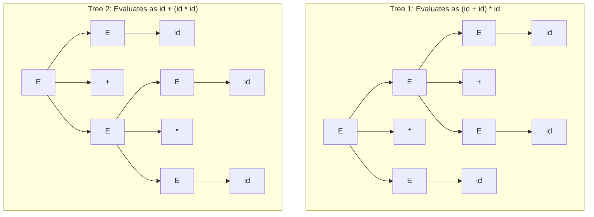
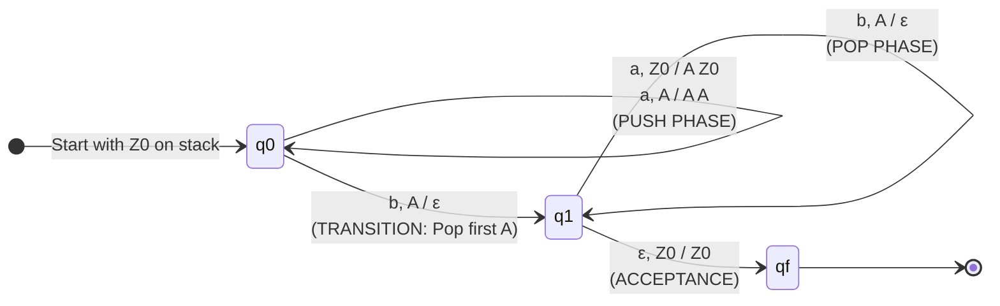
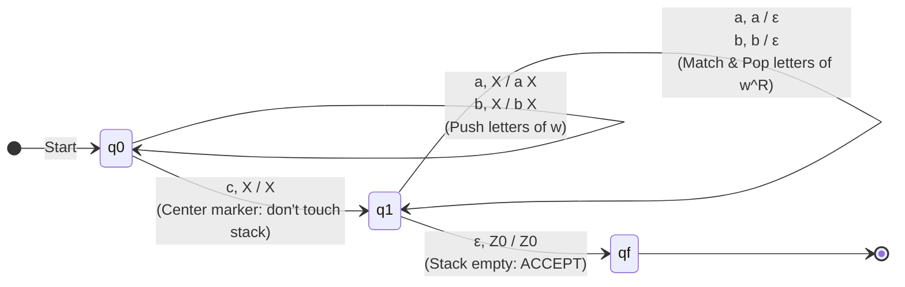

# ⚡ CAT-2 HOTS Master Crib — Module 2: CFG, CNF, GNF & Pushdown Automata
**Course**: CSE2004 — Theory of Computation & Compiler Design  
**Level**: Self-Contained & Fully Visual (From Bedrock Basics to Class Notes & HOTS)  
**Exam Mode**: Open Book / Handwritten Notes Allowed | **Target Score**: 45+ / 50

---

## 🧱 TIER 0: The "Explain Like I'm 5" Bedrock Basics
*(Read this first if you think TOC makes zero sense)*

### 1. What is Ambiguity? (Visual Parse Trees)
A grammar is ambiguous if the SAME string has **TWO DIFFERENT PARSE TREES**:

#### String: $id + id * id$

> Because both trees generate the identical string $id + id * id$ with different structures $\implies$ **AMBIGUOUS ✅**.

---

### 2. What is a Pushdown Automaton (PDA)? (State Diagram)
A DFA with an infinite **Pringles Can (Stack)**:

#### State Diagram for $L = \{a^n b^n \mid n \ge 1\}$:

#### State Diagram for Palindrome with Center Marker $L = \{w c w^R\}$:

---

## 🧭 TIER 1: The Problem Symptom & Keyword Decoder

| If Question Shows / Asks... | It Means This Exact Topic | What You Do (In 5 Seconds) |
| :--- | :--- | :--- |
| Grammar with rules, "Compute FIRST and FOLLOW" | **First & Follow Calculation** | First = all initial letters generated. Follow = immediate right neighbor in all RHS + $\$$ to start symbol! |
| "Show the grammar is ambiguous" | **Ambiguity Proof** | Draw Tree 1 and Tree 2 side-by-side! |
| "Convert grammar to CNF" | **4-Step CNF Algorithm** | 1. Remove $\epsilon$-rules $\to$ 2. Remove Unit rules $\to$ 3. Remove Useless symbols $\to$ 4. Binary variables/single terminals. |

---

## 📝 TIER 4: Solved Classroom Archetypes (From Class Notes)

### Classroom Problem 1: The Infamous `<how?>` FIRST & FOLLOW Problem
*(From Class Notes Page 3)*  
$$S \to A B C D \mid a, \quad A \to A b \mid B c \mid \epsilon, \quad B \to d B \mid \epsilon, \quad C \to c \mid \epsilon, \quad D \to g \mid h$$
* $\mathbf{\text{FIRST}(D) = \{g, h\}}$
* $\mathbf{\text{FIRST}(C) = \{c, \epsilon\}}$
* $\mathbf{\text{FIRST}(B) = \{d, \epsilon\}}$
* $\mathbf{\text{FIRST}(A) = \{c, d, \epsilon\}}$
* $\mathbf{\text{FIRST}(S) = \{a, c, d, g, h\}}$
