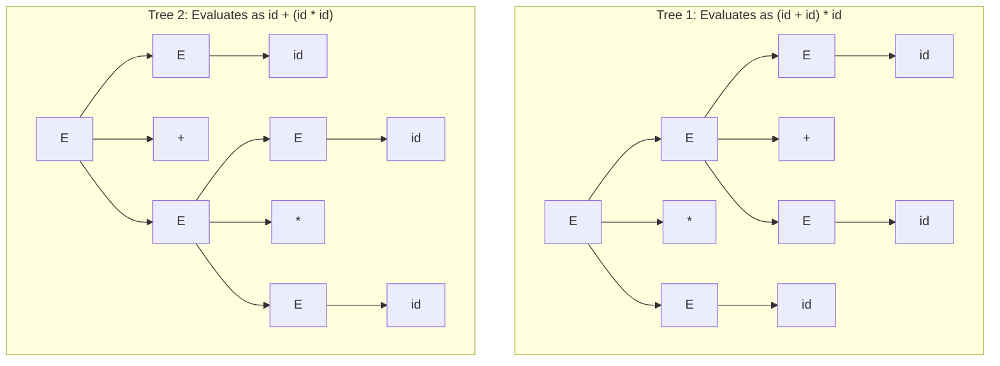
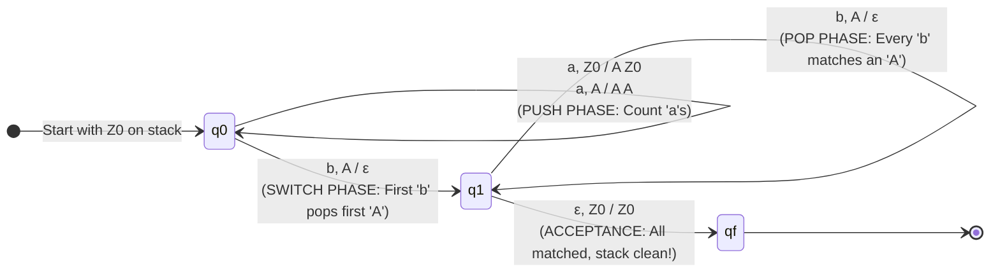
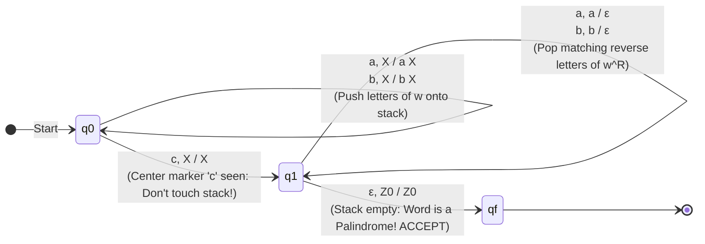
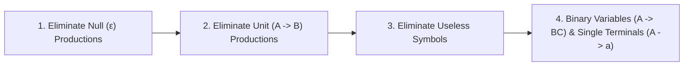

# ⚡ CAT-2 HOTS Master Crib — Module 2: CFG, Ambiguity, CNF & Pushdown Automata
**Course**: CSE2004 — Theory of Computation & Compiler Design  
**Level**: Self-Contained & Fully Visual (Zero-Assumption Bedrock Basics to HOTS)  
**Exam Mode**: Open Book / Handwritten Notes Allowed | **Target Score**: 45+ / 50

---

## 🧱 TIER 0: The "Explain Like I'm 5" Bedrock Basics
*(Read this first if TOC notation looks like an alien language)*

### 1. What on Earth is a Context-Free Grammar (CFG)?
A grammar is simply a set of **replacement recipes** used by a compiler to generate legal code:
* **Non-Terminals (Variables)**: Capital letters like $S, A, B, E, T$. These are **temporary placeholders** that MUST be replaced.
* **Terminals**: Lowercase letters or symbols like $a, b, +, *, id, (, )$. These are the **final output words**. They can never be replaced!
* **Start Symbol ($S$)**: The recipe you always start with.
* **Production Rules ($A \to \alpha$)**: Tells you: *"Whenever you see $A$, you can replace it with $\alpha$"*.

#### Derivation (Expanding from Start to Finish):
* **Leftmost Derivation (LMD)**: At every single step, you **always replace the leftmost capital letter first**.
* **Rightmost Derivation (RMD)**: At every single step, you **always replace the rightmost capital letter first**.

---

### 2. What is "Ambiguity" and Why Does It Break Compilers?
A grammar is **ambiguous** if you can generate the **EXACT SAME string** with **TWO DIFFERENT PARSE TREES** (or two different Leftmost Derivations).

#### Why is this dangerous?
Consider the expression $id + id * id$ (e.g. $2 + 3 \times 4$):
* If the compiler builds **Tree 1**: It calculates $(2 + 3) \times 4 = \mathbf{20}$ (WRONG! Ignored multiplication precedence).
* If the compiler builds **Tree 2**: It calculates $2 + (3 \times 4) = \mathbf{14}$ (CORRECT!).
* A programming language compiler **cannot guess** — ambiguity is a fatal bug!

#### Visual Proof of Ambiguity for String $id + id * id$:


---

### 3. Why Does "Left Recursion" Cause an Infinite Loop Crash?
* A rule has **Immediate Left Recursion** if the variable calls itself as the **very first symbol**:
  $$A \to A \alpha \mid \beta$$
* When a top-down compiler sees $A$, it tries to replace it with $A\alpha$. Then it sees $A$ again and replaces it with $A\alpha\alpha$. Then $A\alpha\alpha\alpha$...
* **It enters an infinite loop and crashes with a Stack Overflow!**

#### The Magic Algebraic Fix (Learn This Formula!):
To stop the infinite loop, we flip the order by introducing a helper variable $A'$:
$$\mathbf{A \to \beta A'}$$
$$\mathbf{A' \to \alpha A' \mid \epsilon}$$
*(Intuition: Instead of putting $\alpha$ before the end, we put $\beta$ first, and repeat $\alpha$ at the end until we stop with $\epsilon$!)*

---

### 4. What is "Left Factoring" (Eliminating Common Prefixes)?
* If a non-terminal has two options starting with the **exact same letters**:
  $$A \to \alpha \beta_1 \mid \alpha \beta_2$$
* When the compiler sees the input starting with $\alpha$, it has **no idea** whether to pick rule 1 or rule 2!
* **The Fix**: Factor out the common prefix $\alpha$ and postpone the decision to a helper variable $A'$:
  $$\mathbf{A \to \alpha A'}$$
  $$\mathbf{A' \to \beta_1 \mid \beta_2}$$

---

### 5. What is Chomsky Normal Form (CNF)?
In CNF, **every single production rule must be in one of two ultra-strict formats**:
1. **$A \to B C$** (Exactly **TWO** Non-Terminals / capital letters)
2. **$A \to a$** (Exactly **ONE** Terminal / lowercase letter)
*(No $\epsilon$-rules, no single variables like $A \to B$, and no mixed rules like $A \to aB$ are allowed!)*

#### The 4-Step Pipeline to Convert Any Grammar to CNF:
1. **Step 1 (Eliminate $\epsilon$-productions)**: If $A \to \epsilon$, find every rule where $A$ appears and write versions with $A$ present and $A$ deleted.
2. **Step 2 (Eliminate Unit productions)**: If $A \to B$ (one variable to one variable), replace $A \to B$ with all the rules that $B$ can produce!
3. **Step 3 (Eliminate Useless symbols)**: Throw away any symbol that never generates terminals, or can never be reached from the start symbol $S$.
4. **Step 4 (Format into CNF)**:
   - For terminals in long rules (e.g. $A \to a B$), create dummy variables: $T_a \to a$, so $A \to T_a B$.
   - For long rules with $\ge 3$ variables (e.g. $A \to B C D$), split them into pairs: $A \to B D_1$ and $D_1 \to C D$.

---

### 6. What is a Pushdown Automaton (PDA)?
A Pushdown Automaton is just a **Finite Automaton (DFA) equipped with an infinite vertical stack (LIFO)**.
* Standard DFAs have no memory — they can't count!
* A PDA can recognize languages like $L = \{a^n b^n\}$ because it **pushes each 'a' onto the stack**, and then **pops an 'a' for every 'b' it sees**!

#### Demystifying the Weird PDA Transition Notation:
In exams, you will see transitions written like:
$$\delta(q_0, a, Z_0) = (q_0, A Z_0)$$
Here is the plain English translation:
* **$q_0$**: Current state.
* **$a$**: Current input letter being read.
* **$Z_0$**: The symbol currently sitting on **top of the stack**.
* **$A Z_0$**: What to replace the top of the stack with.
  * Here, $Z_0$ was replaced by $A Z_0$, which means: **We pushed 'A' on top of $Z_0$!**
  * If the right side says **$\epsilon$**, it means: **POP the top symbol off the stack!**
  * If the right side says **$Z_0$**, it means: **Leave the stack unchanged!**

#### Visual Stack Life-Cycle for $a^3 b^3$ ($aaabbb$):
```
1. Start:      2. Read 'a':   3. Read 'a':   4. Read 'a':   5. Read 'b':   6. Read 'b':   7. Read 'b':   8. End:
|     |        |     |        |     |        |  A  |        |     |        |     |        |     |        |     |
|     |        |     |        |  A  |        |  A  |        |  A  |        |     |        |     |        |     |
|     |   -->  |  A  |   -->  |  A  |   -->  |  A  |   -->  |  A  |   -->  |  A  |   -->  |     |   -->  |     |
| Z_0 |        | Z_0 |        | Z_0 |        | Z_0 |        | Z_0 |        | Z_0 |        | Z_0 |        | Z_0 |
+-----+        +-----+        +-----+        +-----+        +-----+        +-----+        +-----+        +-----+
(Empty)        (Push A)       (Push A)       (Push A)       (Pop A)        (Pop A)        (Pop A)       (ACCEPT!)
```

#### State Diagram for $L = \{a^n b^n \mid n \ge 1\}$:


#### State Diagram for Palindrome with Center Marker $L = \{w c w^R \mid w \in \{a, b\}^*\}$:


---

## 🧭 TIER 1: The Problem Symptom & Keyword Decoder

| If Question Shows / Asks... | It Means This Exact Topic | What You Do (In 5 Seconds) |
| :--- | :--- | :--- |
| "Show that grammar $G$ is ambiguous" | **Ambiguity Proof** | Pick a small string (like $id+id*id$ or $a+a*a$). Draw **Tree 1** (left-heavy) and **Tree 2** (right-heavy). |
| $A \to A \alpha \mid \beta$, "Eliminate left recursion" | **Left Recursion Removal** | Write $A \to \beta A'$ and $A' \to \alpha A' \mid \epsilon$. If multiple $\beta$, write $A \to \beta_1 A' \mid \beta_2 A'$. |
| $A \to \alpha \beta_1 \mid \alpha \beta_2$, "Left factor" | **Left Factoring** | Pull common prefix to the front: $A \to \alpha A'$ and $A' \to \beta_1 \mid \beta_2$. |
| "Convert the grammar to Chomsky Normal Form (CNF)" | **CNF 4-Step Pipeline** | 1. Remove $\epsilon$-rules $\to$ 2. Remove Unit rules ($A \to B$) $\to$ 3. Eliminate useless symbols $\to$ 4. Restrict to $A \to BC$ and $A \to a$. |
| "Design a PDA for $a^n b^n$ / $w c w^R$" | **PDA State & Transition Design** | Define 7-tuple. $q_0$ pushes symbols. On middle marker / first $b$, transition to $q_1$ which pops. On $\epsilon, Z_0$, go to $q_f$. |
| "Show language $L = \{a^n b^n c^n\}$ is NOT context-free" | **Pumping Lemma for CFL** | Assume CFL. Choose string $s = a^p b^p c^p$. Split $s = u v w x y$ with $|v x| \ge 1, |v w x| \le p$. Pump $i=2$. Show number of $a, b, c$ becomes unequal $\implies$ Contradiction! |

---

## 🛠️ TIER 2: Deterministic Algorithmic Recipes

### Recipe 2.1: The 4-Step Chomsky Normal Form (CNF) Algorithm
Given any Context-Free Grammar $G$:



1. **Step 1 (Eliminate $\epsilon$-productions)**:
   - Identify all **nullable variables** (variables where $A \Rightarrow^* \epsilon$).
   - For every production containing a nullable variable, add new productions where that variable is omitted.
   - Example: If $A$ is nullable and rule is $S \to a A b$, add $S \to a b$. Delete $A \to \epsilon$.
2. **Step 2 (Eliminate Unit Productions)**:
   - A unit production has the form $A \to B$ where both $A$ and $B$ are single variables.
   - Find all unit derivations: if $A \to B$ and $B \to \alpha$, replace $A \to B$ with $A \to \alpha$.
3. **Step 3 (Eliminate Useless Symbols)**:
   - **Non-generating symbols**: Eliminate variables that never produce a string of terminals.
   - **Unreachable symbols**: Eliminate variables that can never be reached starting from $S$.
4. **Step 4 (Format Restrictions)**:
   - For all productions of length $\ge 2$ containing terminals: introduce $T_a \to a$ for each terminal $a$.
   - For all productions of length $> 2$ variables: introduce cascade variables $C_1, C_2$ to break them into binary pairs ($A \to B C_1, \; C_1 \to C D$).

---

## 📝 TIER 4: Solved Classroom & Exam Archetypes

### Classroom Problem 1: Elimination of Left Recursion
*(From Class Notes Page 1)*  
**Question**: Eliminate left recursion from the grammar:
$$S \to S b A \mid S a b \mid a \mid b \mid c$$

#### Step-by-Step Solution:
1. **Identify the Parts**:
   - The recursive rules start with $S$: $S \to S b A$ and $S \to S a b$.
   - The recursive tails are: $\alpha_1 = b A$, $\quad \alpha_2 = a b$.
   - The non-recursive alternatives (which do NOT start with $S$) are:
     $$\beta_1 = a, \quad \beta_2 = b, \quad \beta_3 = c$$
2. **Apply the Transformation Formula**:
   $$S \to \beta_1 S' \mid \beta_2 S' \mid \beta_3 S'$$
   $$S' \to \alpha_1 S' \mid \alpha_2 S' \mid \epsilon$$
3. **Write the Final Transformed Grammar**:
   $$\mathbf{S \to a S' \mid b S' \mid c S'}$$
   $$\mathbf{S' \to b A S' \mid a b S' \mid \epsilon}$$
*(Done! Left recursion completely eliminated in 30 seconds.)*

---

### Classroom Problem 2: Complete CNF Conversion Walkthrough
**Question**: Convert the following grammar to Chomsky Normal Form (CNF):
$$S \to A B a \mid A, \quad A \to a A \mid \epsilon, \quad B \to b$$

#### Step-by-Step Solution:
1. **Step 1: Eliminate $\epsilon$-productions**:
   - Here, $A \to \epsilon$, so $A$ is nullable.
   - Replace occurrences of $A$ in all rules:
     - In $S \to A B a$: omitting $A$ gives $S \to B a$. So $S \to A B a \mid B a$.
     - In $S \to A$: omitting $A$ gives $S \to \epsilon$.
     - In $A \to a A$: omitting $A$ gives $A \to a$. So $A \to a A \mid a$.
   - Delete $A \to \epsilon$.
   - Current grammar:
     $$S \to A B a \mid B a \mid A \mid \epsilon, \quad A \to a A \mid a, \quad B \to b$$
   - Eliminate $S \to \epsilon$ by introducing new start symbol $S_0 \to S \mid \epsilon$.
2. **Step 2: Eliminate Unit Productions**:
   - We have unit production $S \to A$.
   - Since $A \to a A \mid a$, replace $S \to A$ with $S \to a A \mid a$.
   - Current grammar:
     $$S \to A B a \mid B a \mid a A \mid a, \quad A \to a A \mid a, \quad B \to b$$
3. **Step 3: Eliminate Useless Symbols**:
   - All symbols $\{S, A, B\}$ generate terminals and are reachable from $S$. (None useless).
4. **Step 4: Convert to CNF Form ($A \to B C$ or $A \to a$)**:
   - Introduce terminal replacements:
     $$T_a \to a, \quad T_b \to b$$
   - Replace terminals in mixed rules:
     - $S \to B a \implies S \to B T_a$ (Binary variables ✅)
     - $S \to a A \implies S \to T_a A$ (Binary variables ✅)
     - $A \to a A \implies A \to T_a A$ (Binary variables ✅)
     - $S \to A B a \implies S \to A B T_a$ (Length 3! Must break into pairs).
       - Create helper variable $X_1 \to B T_a$.
       - Then $S \to A X_1$.
5. **Final CNF Grammar**:
   $$\mathbf{S \to A X_1 \mid B T_a \mid T_a A \mid a}$$
   $$\mathbf{X_1 \to B T_a}$$
   $$\mathbf{A \to T_a A \mid a}$$
   $$\mathbf{B \to b}$$
   $$\mathbf{T_a \to a}$$
*(Every single rule is now either two capitals or one lowercase! Fully compliant with CNF ✅.)*

---

### Classroom Problem 3: Formal Ambiguity Proof for Arithmetic Grammar
**Question**: Prove that the grammar $E \to E + E \mid E * E \mid id$ is ambiguous for string $id + id * id$.

#### Proof:
To prove ambiguity, we must construct **two distinct Leftmost Derivations (LMD)** for the identical string $w = id + id * id$:

* **Leftmost Derivation 1 (Add First, Multiply Second)**:
  $$E \implies \mathbf{E} * E \implies \mathbf{E} + E * E \implies id + \mathbf{E} * E \implies id + id * \mathbf{E} \implies id + id * id$$
* **Leftmost Derivation 2 (Multiply First, Add Second)**:
  $$E \implies \mathbf{E} + E \implies id + \mathbf{E} \implies id + \mathbf{E} * E \implies id + id * \mathbf{E} \implies id + id * id$$

Since there exist two distinct leftmost derivations (and two distinct parse trees as drawn in Tier 0), the grammar is **AMBIGUOUS**.
