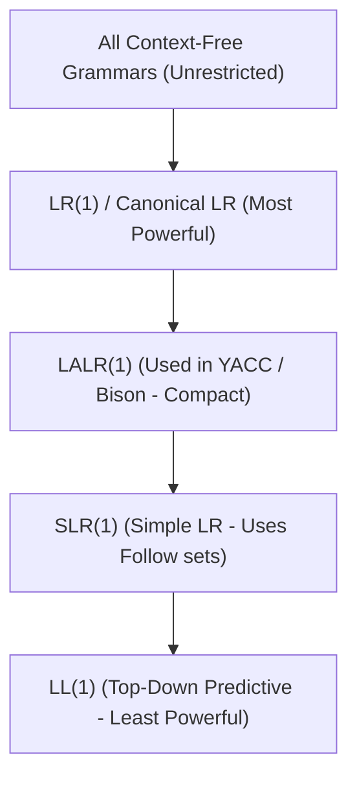
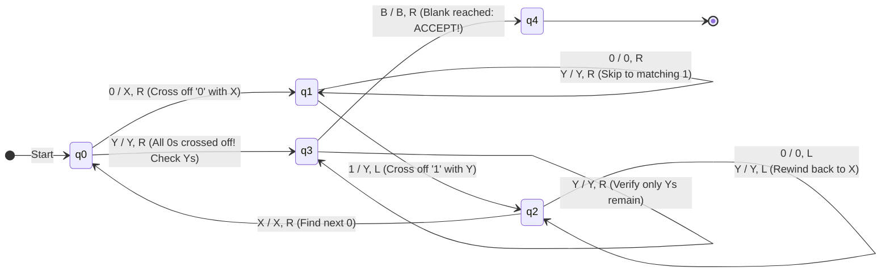
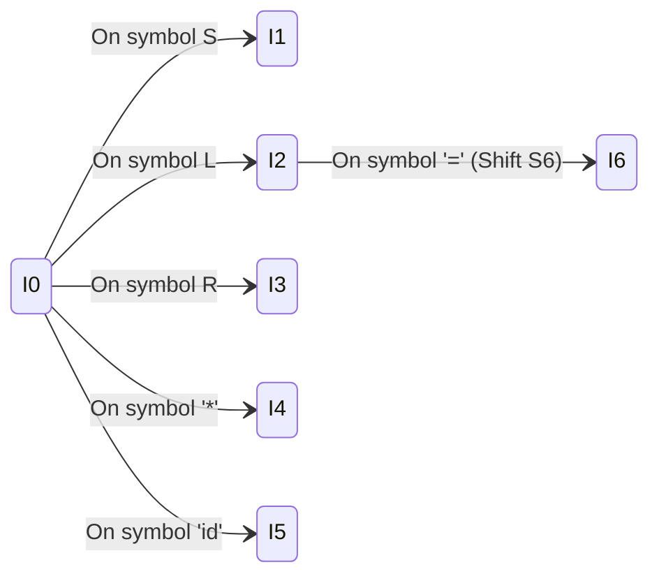

# ⚡ CAT-2 HOTS Master Crib — Module 3 & 4: Parsing & Turing Machines
**Course**: CSE2004 — Theory of Computation & Compiler Design  
**Level**: Self-Contained & Fully Visual (From Bedrock Basics to Class Notes & HOTS)  
**Exam Mode**: Open Book / Handwritten Notes Allowed | **Target Score**: 45+ / 50

---

## 🧱 TIER 0: The "Explain Like I'm 5" Bedrock Basics
*(Read this first if parsing tables look like alien hieroglyphics)*

### 1. The Parser Hierarchy (Who is Stronger?)

> Every LL(1) grammar is SLR(1); every SLR(1) is LALR(1); every LALR(1) is LR(1). If a grammar has conflicts in SLR(1), it might still be parsed by LR(1)!

---

### 2. Turing Machine State Transition Diagram ($L = \{0^n 1^n\}$)

---

### 3. SLR(1) Canonical Items State Transitions ($S \to L = R \mid R$)

> **The S/R Conflict in State $I_2$**:
> * State $I_2$ contains:
>   * $[S \to L \cdot = R] \implies$ Wants to **Shift on $=$** ($S_6$).
>   * $[R \to L \cdot] \implies$ Complete rule! Wants to **Reduce rule 5** on $\text{FOLLOW}(R)$ (which includes $=$!).
> * Both Shift and Reduce are forced into column $=$ in state $I_2 \implies$ **CONFLICT ❌!**

---

## 🧭 TIER 1: The Problem Symptom & Keyword Decoder

| If Question Shows / Asks... | It Means This Exact Topic | What You Do (In 5 Seconds) |
| :--- | :--- | :--- |
| "Dangling-Else Grammar", "Is it LL(1)?" | **LL(1) Ambiguity Case Study** | Left factor grammar $\to$ show cell $M[S', e]$ contains BOTH $S' \to e S$ AND $S' \to \epsilon$. |
| Grammar $S \to L = R \mid R$, "Is it SLR(1)?" | **SLR(1) S/R Conflict** | Build canonical items. In state $I_2$, on symbol $=$, there is both Shift $S_6$ and Reduce $r_3$. |
| "Trace parsing of string $id + id * id$" | **Stack Simulation Trace** | 3 columns: `Stack ($E)`, `Input (id+id*id$)`, `Action (Rule / Pop / Shift)`. |

---

## 📝 TIER 4: Solved Classroom Archetypes (From Class Notes)

### Classroom Problem 1: Predictive Parser Stack Simulation Trace Table
*(From Class Notes Module 3 Page 8)*  
**Input String**: $id + id * id \$$  
**Grammar**: $E \to T E'$, $E' \to + T E' \mid \epsilon$, $T \to F T'$, $T' \to * F T' \mid \epsilon$, $F \to id$

$$\begin{array}{|l|r|l|} \hline \textbf{Matched} & \textbf{Stack} & \textbf{Input} & \textbf{Action} \\ \hline & \$ E & id + id * id \$ & \text{Predict } E \to T E' \\ & \$ E' T & id + id * id \$ & \text{Predict } T \to F T' \\ & \$ E' T' F & id + id * id \$ & \text{Predict } F \to id \\ & \$ E' T' id & id + id * id \$ & \text{Match } id \\ id & \$ E' T' & + id * id \$ & \text{Predict } T' \to \epsilon \\ id & \$ E' & + id * id \$ & \text{Predict } E' \to + T E' \\ id + & \$ E' T & id * id \$ & \text{Match } + \\ id + & \$ E' T' F & id * id \$ & \text{Predict } F \to id \\ id + id & \$ E' T' & * id \$ & \text{Match } id \\ id + id * & \$ E' T' F & id \$ & \text{Predict } T' \to * F T' \\ id + id * id & \$ E' T' & \$ & \text{Match } id \\ id + id * id & \$ E' & \$ & \text{Predict } T' \to \epsilon \\ id + id * id & \$ & \$ & \text{Predict } E' \to \epsilon \\ \textbf{id + id * id} & \mathbf{\$} & \mathbf{\$} & \textbf{ACCEPT! ✅} \\ \hline \end{array}$$
