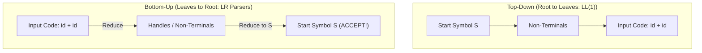

# ⚡ CAT-2 HOTS Master Crib — Module 3 & 4: Parsing & Turing Machines
**Course**: CSE2004 — Theory of Computation & Compiler Design  
**Level**: Self-Contained & Fully Visual (Zero-Assumption Bedrock Basics to HOTS)  
**Exam Mode**: Open Book / Handwritten Notes Allowed | **Target Score**: 45+ / 50

---

## 🧱 TIER 0: The "Explain Like I'm 5" Bedrock Basics
*(Read this first if parsing tables look like intimidating matrices)*

### 1. What is Parsing (Top-Down vs. Bottom-Up)?
A compiler reads code left-to-right. A **parser** checks whether your code follows the grammar rules:
* **Top-Down Parsing (e.g. LL(1))**:
  * Starts at the start symbol **$S$ (Root of tree)**.
  * Tries to predict which branches to expand downwards until it matches your code words.
* **Bottom-Up Parsing (e.g. LR parsers: SLR, LALR, CLR)**:
  * Starts at your code words **at the bottom (Leaves of tree)**.
  * Pairs words together and **reduces** them upwards step-by-step until it reaches $S$!



#### The Power Hierarchy of Parsers:
$$\mathbf{LL(1) < SLR(1) < LALR(1) < CLR(1)}$$
* $LL(1)$ is the weakest (cannot handle left recursion).
* $CLR(1)$ is the most powerful (can parse virtually all practical programming languages).
* $LALR(1)$ is what real-world compilers like **YACC and Bison** use (same power as CLR, but 10x smaller table size!).

---

### 2. FIRST and FOLLOW: The Intuitive Mental Model
Before building a top-down parsing table, you **must** compute two sets:

#### A. What is $\text{FIRST}(X)$?
* If you start with variable $X$ and expand it, **what are all the possible first letters that can appear?**
* **Rules**:
  1. If $X$ is a terminal (e.g. $a$), $\text{FIRST}(a) = \{a\}$.
  2. If $X \to \epsilon$, add $\epsilon$ to $\text{FIRST}(X)$.
  3. If $X \to Y_1 Y_2 \dots Y_k$:
     - Add everything in $\text{FIRST}(Y_1)$ (except $\epsilon$) to $\text{FIRST}(X)$.
     - If $Y_1$ can disappear into $\epsilon$, then look at $Y_2$ and add $\text{FIRST}(Y_2)$.
     - Continue down the chain. If **all** $Y_1 \dots Y_k$ can become $\epsilon$, add $\epsilon$ to $\text{FIRST}(X)$!

#### B. What is $\text{FOLLOW}(A)$?
* Look at the **ENTIRE grammar** wherever $A$ appears on the **RIGHT-HAND SIDE**.
* Ask yourself: **Who is allowed to sit immediately to the right of $A$?**
* **The 3 Golden Rules of FOLLOW (Memorize These!)**:
  1. **Rule 1**: Always put the end-marker **$\$$** in $\text{FOLLOW}(S)$ (where $S$ is the Start symbol).
  2. **Rule 2 (Direct Neighbor)**: If you see a production $A \to \alpha B \beta$:
     - Everything in $\text{FIRST}(\beta)$ (except $\epsilon$) goes into $\text{FOLLOW}(B)$!
  3. **Rule 3 (Tail / Nullable Neighbor)**: If you see $A \to \alpha B$, OR $A \to \alpha B \beta$ where $\beta \Rightarrow^* \epsilon$:
     - Since there is nobody left after $B$, whatever can follow $A$ can also follow $B$!
     - **Everything in $\text{FOLLOW}(A)$ is copied into $\text{FOLLOW}(B)$!**

> ⚠️ **CRITICAL WARNING**: $\epsilon$ can **NEVER** be in a FOLLOW set! FOLLOW sets contain only terminals and $\$$.

---

### 3. What is an LL(1) Parse Table?
* A 2D table where:
  * **Rows** = Non-Terminals ($E, T, F$).
  * **Columns** = Terminals ($id, +, *, \$$).
* **How to fill table cell $M[A, a]$**:
  * For each rule $A \to \alpha$:
    1. For every terminal $a \in \text{FIRST}(\alpha)$, put $\mathbf{A \to \alpha}$ into cell $M[A, a]$.
    2. If $\epsilon \in \text{FIRST}(\alpha)$, put $\mathbf{A \to \alpha}$ into cell $M[A, b]$ for every terminal $b \in \text{FOLLOW}(A)$!
* **The LL(1) Conflict Rule**:
  * A grammar is **LL(1)** $\iff$ **EVERY cell in the table has AT MOST ONE rule**!
  * If ANY cell has 2 or more rules $\implies$ **NOT LL(1)** (Conflict!).

---

### 4. Bottom-Up LR Parsing & The Famous "Dot" ($\cdot$)
In LR parsing, an **LR(0) Item** is just a production rule with a **dot ($\cdot$)** placed inside it:
* $A \to \cdot X Y Z$: The dot is at the start $\implies$ *"We haven't seen anything yet; we are waiting for $X$"*.
* $A \to X \cdot Y Z$: The dot moved past $X \implies$ *"We have already matched $X$; right now we are expecting $Y$"*.
* $A \to X Y Z \cdot$: The dot is at the very end $\implies$ **COMPLETED RULE!**
  * We have seen the entire right-hand side. Time to perform a **REDUCE** operation!

#### The Two Deadly LR Conflicts:
1. **Shift / Reduce (S/R) Conflict**:
   * A state contains both a Shift item ($A \to \alpha \cdot a \beta$) and a Reduce item ($B \to \gamma \cdot$).
   * When the compiler sees terminal $a$, it doesn't know whether to **Shift** to read $a$, or **Reduce** using rule $B \to \gamma$!
2. **Reduce / Reduce (R/R) Conflict**:
   * A state contains two complete rules ($A \to \alpha \cdot$ and $B \to \beta \cdot$).
   * The compiler doesn't know which variable to reduce to!

---

### 5. What is a Turing Machine (TM)?
A Turing Machine is the **ultimate theoretical computer**.
* It has an **infinite tape** divided into squares.
* A **Read/Write Head** can:
  1. Read the symbol in the current square.
  2. Overwrite it with a new symbol.
  3. Move the head **Left ($L$)** or **Right ($R$)**.
  4. Transition to a new internal state.

#### Transition Format:
$$\delta(q_0, 0) = (q_1, X, R)$$
* Translation: *"If in state $q_0$ you read '0': change state to $q_1$, overwrite '0' with 'X', and move head Right ($R$)"*.

#### Visual Tape Walk for $L = \{0^n 1^n\}$ on string $0011$:
```
Initial:  [ 0 | 0 | 1 | 1 | B ]   (Head at first 0, state q0)
Step 1:   [ X | 0 | 1 | 1 | B ]   (Replace 0 with X, move R to find matching 1)
Step 2:   [ X | 0 | Y | 1 | B ]   (Replace first 1 with Y, move L to find next 0)
Step 3:   [ X | X | Y | 1 | B ]   (Replace second 0 with X, move R)
Step 4:   [ X | X | Y | Y | B ]   (Replace second 1 with Y)
Step 5:   [ X | X | Y | Y | B ]   (Reach Blank 'B' with all matched: ACCEPT! 🎉)
```

---

## 🧭 TIER 1: The Problem Symptom & Keyword Decoder

| If Question Shows / Asks... | It Means This Exact Topic | What You Do (In 5 Seconds) |
| :--- | :--- | :--- |
| Grammar rules, "Compute FIRST and FOLLOW" | **First & Follow Sets** | FIRST: First letters generated. FOLLOW: Immediate right neighbors on RHS + $\$$ to start symbol! |
| "Construct LL(1) parsing table", "Is grammar LL(1)?" | **LL(1) Table Construction** | Calculate FIRST & FOLLOW $\to$ populate $M[A, a]$ using FIRST, and on $\epsilon$ use FOLLOW. Check for multiple entries per cell. |
| Dangling-Else grammar ($S \to i E t S S' \dots$) | **LL(1) Conflict Case Study** | Left-factor grammar $\to$ show cell $M[S', e]$ contains **BOTH** $S' \to e S$ AND $S' \to \epsilon$. Conclude: **NOT LL(1)**. |
| "Trace parsing of string using stack" | **Predictive Stack Simulation** | Make table: `Matched | Stack ($S) | Input (w$) | Action`. Push RHS in reverse order. Match terminals! |
| Grammar $S \to L = R \mid R$, "Is it SLR(1)?" | **SLR(1) S/R Conflict Proof** | Build $I_0, I_1, I_2$. In state $I_2$, on symbol $=$, there is both Shift $S_6$ and Reduce $r_3$. Conclude: **NOT SLR(1)**. |
| "Design a Turing Machine for $0^n 1^n$" | **TM 7-Tuple & State Diagram** | Loop: Cross 0 with X, scan right, cross 1 with Y, rewind left to next 0. When no 0s left, verify only Ys remain $\to$ Halt & Accept. |

---

## 🛠️ TIER 2: Deterministic Algorithmic Recipes

### Recipe 3.1: The Foolproof FIRST and FOLLOW Calculation Template
Given a grammar with non-terminals $A, B, C \dots$ and start symbol $S$:

1. **Calculate FIRST for all non-terminals (Bottom-Up)**:
   - Start with variables that produce single terminals or $\epsilon$.
   - For rule $X \to Y_1 Y_2 \dots Y_k$:
     $$\text{FIRST}(X) = (\text{FIRST}(Y_1) \setminus \{\epsilon\})$$
     If $\epsilon \in \text{FIRST}(Y_1)$, union with $(\text{FIRST}(Y_2) \setminus \{\epsilon\})$, and so on.
2. **Calculate FOLLOW for all non-terminals**:
   - Initialize: $\text{FOLLOW}(S) = \{\$\}$.
   - Scan all rules where variable $B$ appears on the RHS:
     - Form $A \to \alpha B \beta$: Add $(\text{FIRST}(\beta) \setminus \{\epsilon\})$ to $\text{FOLLOW}(B)$.
     - If $\beta$ is missing ($A \to \alpha B$) OR $\beta \Rightarrow^* \epsilon$: Add all of $\text{FOLLOW}(A)$ to $\text{FOLLOW}(B)$!
   - Repeat until no FOLLOW set changes size.

---

### Recipe 3.2: SLR(1) Parsing Table Construction Algorithm
1. **Augment Grammar**: Add $S' \to S$.
2. **Compute Canonical Collection of LR(0) Items**:
   - $\text{CLOSURE}(I)$: If $A \to \alpha \cdot B \beta \in I$, add $B \to \cdot \gamma$ for all productions of $B$.
   - $\text{GOTO}(I, X)$: Move the dot past $X$ ($A \to \alpha X \cdot \beta$) and take Closure.
3. **Fill Parsing Table**:
   - **Shift ($S_j$)**: If $[A \to \alpha \cdot a \beta] \in I_i$ and $\text{GOTO}(I_i, a) = I_j$, set $\text{ACTION}[i, a] = S_j$.
   - **Reduce ($r_k$)**: If $[A \to \gamma \cdot] \in I_i$ (where rule $k$ is $A \to \gamma$), set $\text{ACTION}[i, a] = r_k$ for all $\mathbf{a \in \text{FOLLOW}(A)}$!
   - **Accept**: If $[S' \to S \cdot] \in I_i$, set $\text{ACTION}[i, \$] = \text{ACCEPT}$.
   - **Goto**: If $\text{GOTO}(I_i, A) = I_j$, set $\text{GOTO}[i, A] = j$.

---

## 📝 TIER 4: Solved Classroom & Exam Archetypes

### Classroom Problem 1: The Infamous `<how?>` FIRST & FOLLOW Problem
*(From Class Notes Page 3)*  
**Grammar**:
$$S \to A B C D \mid a$$
$$A \to A b \mid B c \mid \epsilon$$
$$B \to d B \mid \epsilon$$
$$C \to c \mid \epsilon$$
$$D \to g \mid h$$

#### Step 1: Eliminate Left Recursion from $A$
* $A \to A b$ is directly left-recursive!
  - Here $\alpha = b$, and $\beta \in \{B c, \epsilon\}$.
  - Transformed rules for $A$:
    $$A \to B c A' \mid A'$$
    $$A' \to b A' \mid \epsilon$$

#### Step 2: Calculate FIRST Sets
* $\text{FIRST}(D) = \mathbf{\{g, h\}}$
* $\text{FIRST}(C) = \mathbf{\{c, \epsilon\}}$
* $\text{FIRST}(B) = \mathbf{\{d, \epsilon\}}$
* $\text{FIRST}(A')$: From $A' \to b A' \mid \epsilon \implies \mathbf{\{b, \epsilon\}}$
* $\text{FIRST}(A)$:
  - From $A \to B c A'$: $\text{FIRST}(B)$ has $d$. Since $\epsilon \in \text{FIRST}(B)$, next symbol is $c$. So $\{c, d\}$.
  - From $A \to A'$: adds $\text{FIRST}(A') = \{b, \epsilon\}$.
  - Thus: $\text{FIRST}(A) = \mathbf{\{b, c, d, \epsilon\}}$.
* $\text{FIRST}(S)$:
  - Rule $S \to a$ gives $a$.
  - Rule $S \to A B C D$:
    - $\text{FIRST}(A)$ has $\{b, c, d\}$. Since $\epsilon \in \text{FIRST}(A)$, look at $B$.
    - $\text{FIRST}(B)$ has $d$. Since $\epsilon \in \text{FIRST}(B)$, look at $C$.
    - $\text{FIRST}(C)$ has $c$. Since $\epsilon \in \text{FIRST}(C)$, look at $D$.
    - $\text{FIRST}(D)$ has $\{g, h\}$ (no $\epsilon$ in $D$!).
  - Union: $\text{FIRST}(S) = \mathbf{\{a, b, c, d, g, h\}}$.

#### Step 3: Calculate FOLLOW Sets (The Part That Confused Everyone)
1. **$\text{FOLLOW}(S) = \{\$\}$** (Rule 1: Start symbol).
2. **$\text{FOLLOW}(D)$**:
   - In rule $S \to A B C D$, $D$ is at the very end!
   - By Rule 3: $\text{FOLLOW}(D) = \text{FOLLOW}(S) = \mathbf{\{\$\}}$.
3. **$\text{FOLLOW}(C)$**:
   - In rule $S \to A B C D$, the neighbor after $C$ is $D$.
   - By Rule 2: $\text{FOLLOW}(C) = \text{FIRST}(D) = \mathbf{\{g, h\}}$.
4. **$\text{FOLLOW}(B)$**:
   - In rule $S \to A B C D$, neighbor is $C D$.
     - $\text{FIRST}(C) = \{c, \epsilon\}$. Adds $c$.
     - Since $\epsilon \in \text{FIRST}(C)$, it flows through to $D$! Adds $\text{FIRST}(D) = \{g, h\}$.
   - In rule $A \to B c A'$, neighbor is $c$. Adds $c$.
   - In rule $B \to d B$, $B$ is at end, adds $\text{FOLLOW}(B)$ (no new symbol).
   - Thus: $\text{FOLLOW}(B) = \mathbf{\{c, g, h\}}$.
5. **$\text{FOLLOW}(A)$**:
   - In rule $S \to A B C D$, neighbor is $B C D$.
     - $\text{FIRST}(B) = \{d, \epsilon\}$. Adds $d$.
     - Since $\epsilon \in \text{FIRST}(B)$, neighbor is $C$. Adds $c$.
     - Since $\epsilon \in \text{FIRST}(C)$, neighbor is $D$. Adds $\{g, h\}$.
   - Thus: $\text{FOLLOW}(A) = \mathbf{\{c, d, g, h\}}$.

---

### Classroom Problem 2: Dangling-Else Grammar & Non-LL(1) Proof
*(From Class Notes Module 3 Page 6)*  
**Grammar**:
$$S \to i E t S \mid i E t S e S \mid a, \quad E \to b$$

#### Step 1: Left Factor the Grammar
Common prefix is $i E t S$:
$$S \to i E t S S' \mid a$$
$$S' \to e S \mid \epsilon$$
$$E \to b$$

#### Step 2: Compute FIRST and FOLLOW
* $\text{FIRST}(S) = \{i, a\}$
* $\text{FIRST}(S') = \{e, \epsilon\}$
* $\text{FOLLOW}(S) = \{\$, e\}$ (Because in $S \to i E t S S'$, $S$ is followed by $S'$. $\text{FIRST}(S') = \{e, \epsilon\}$, and on $\epsilon$, $\text{FOLLOW}(S)$ inherits $\text{FOLLOW}(S)$).
* $\text{FOLLOW}(S') = \text{FOLLOW}(S) = \{\$, e\}$.

#### Step 3: Construct LL(1) Table Row for $S'$
1. For rule $S' \to e S$: $\text{FIRST}(e S) = \{e\} \implies$ Put in cell $\mathbf{M[S', e]}$.
2. For rule $S' \to \epsilon$: Since it produces $\epsilon$, put rule in $M[S', b]$ for all $b \in \text{FOLLOW}(S')$.
   - Since $e \in \text{FOLLOW}(S')$, we **ALSO put $S' \to \epsilon$ into cell $\mathbf{M[S', e]}$**!

#### Step 4: The Conflict Proof
Cell $M[S', e]$ contains **TWO PRODUCTIONS**:
$$M[S', e] = \{S' \to e S, \quad S' \to \epsilon\}$$
* When seeing 'else' ($e$), the compiler cannot decide whether to match it to the inner 'if' or outer 'if'!
* **Conclusion**: **The Dangling-Else grammar is NOT LL(1) ❌**.

---

### Classroom Problem 3: SLR(1) Assignment Grammar & Shift/Reduce Conflict
*(From Class Notes Module 3 Page 12)*  
**Grammar**:
1. $S \to L = R$
2. $S \to R$
3. $L \to * R$
4. $L \to id$
5. $R \to L$

#### Canonical Collection of LR(0) Items:
* **State $I_0$**:
  $$S' \to \cdot S$$
  $$S \to \cdot L = R, \quad S \to \cdot R$$
  $$L \to \cdot * R, \quad L \to \cdot id$$
  $$R \to \cdot L$$
* **Transition on $L$ from $I_0$ to State $I_2$**:
  $$\text{GOTO}(I_0, L) = \mathbf{I_2}:$$
  $$\mathbf{S \to L \cdot = R}$$
  $$\mathbf{R \to L \cdot}$$

#### The S/R Conflict in State $I_2$:
* Look at the two items in $I_2$:
  1. $[S \to L \cdot = R]$: The dot is before terminal '$=$'. This demands a **SHIFT** on '$=$' ($\mathbf{S_6}$).
  2. $[R \to L \cdot]$: The dot is at the end. This is a **REDUCE** item ($R \to L$, rule 5).
     - In SLR(1), reduce rule 5 is placed in all columns of $\text{FOLLOW}(R)$.
     - What is $\text{FOLLOW}(R)$?
       - In $S \to L = R$, $R$ is at the end $\implies \$ \in \text{FOLLOW}(R)$.
       - In $S \to L = R$, $L$ is followed by '$=$'. And since $R \to L$, whatever follows $L$ can follow $R$!
       - Therefore, $\mathbf{= \in \text{FOLLOW}(R)}$!
* In cell $\text{ACTION}[I_2, =]$, the parser is commanded to:
  $$\text{ACTION}[I_2, =] = \{\mathbf{S_6 \text{ (Shift)}}, \quad \mathbf{r_5 \text{ (Reduce)}}\}$$
* **Conclusion**: Because cell $[I_2, =]$ contains both Shift and Reduce, the grammar has a **Shift-Reduce Conflict $\implies$ NOT SLR(1) ❌**!

---

### Classroom Problem 4: 14-Step Non-Recursive Predictive Parser Stack Simulation Trace
**Grammar**: $E \to T E'$, $E' \to + T E' \mid \epsilon$, $T \to F T'$, $T' \to * F T' \mid \epsilon$, $F \to id$  
**Input**: $id + id * id \$$

$$\begin{array}{|c|l|r|l|}
\hline
\textbf{Step} & \textbf{Matched} & \textbf{Stack} & \textbf{Input} & \textbf{Action / Production Used} \\ \hline
1 & & \$ E & id + id * id \$ & \text{Predict } E \to T E' \\
2 & & \$ E' T & id + id * id \$ & \text{Predict } T \to F T' \\
3 & & \$ E' T' F & id + id * id \$ & \text{Predict } F \to id \\
4 & & \$ E' T' id & id + id * id \$ & \text{Match } id \text{ (Pop stack \& consume input)} \\
5 & id & \$ E' T' & + id * id \$ & \text{Predict } T' \to \epsilon \\
6 & id & \$ E' & + id * id \$ & \text{Predict } E' \to + T E' \\
7 & id & \$ E' T + & + id * id \$ & \text{Match } + \text{ (Pop stack \& consume input)} \\
8 & id + & \$ E' T & id * id \$ & \text{Predict } T \to F T' \\
9 & id + & \$ E' T' F & id * id \$ & \text{Predict } F \to id \\
10 & id + & \$ E' T' id & id * id \$ & \text{Match } id \text{ (Pop stack \& consume input)} \\
11 & id + id & \$ E' T' & * id \$ & \text{Predict } T' \to * F T' \\
12 & id + id & \$ E' T' F * & * id \$ & \text{Match } * \text{ (Pop stack \& consume input)} \\
13 & id + id * & \$ E' T' F & id \$ & \text{Predict } F \to id \\
14 & id + id * & \$ E' T' id & id \$ & \text{Match } id \text{ (Pop stack \& consume input)} \\
15 & id + id * id & \$ E' T' & \$ & \text{Predict } T' \to \epsilon \\
16 & id + id * id & \$ E' & \$ & \text{Predict } E' \to \epsilon \\
17 & \mathbf{id + id * id} & \mathbf{\$} & \mathbf{\$} & \textbf{ACCEPT! Both stack and input empty 🎉} \\ \hline
\end{array}$$
