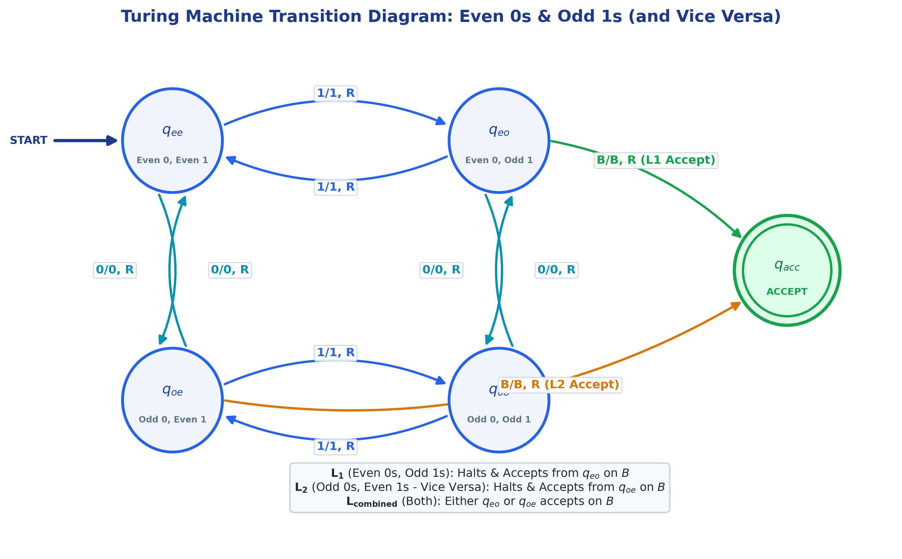

# ⚡ Turing Machine Construction: Even Number of 0s & Odd Number of 1s (and Vice Versa)
**Course**: CSE2004 — Theory of Computation & Compiler Design  
**Module**: Module 4 — Turing Machines & Computability  
**Exam Relevance**: VIT Bhopal CAT-II / FAT 10-Mark Compulsory Question  
**Evaluation Rubric**: Language Description (1M) + Design Logic (2M) + 7-Tuples (1M) + Transition Table (2M) + Transition Diagram (2M) + ID Validations (2M) = **10 Marks**

---

## 1. Problem Statements & Formal Language Descriptions

The problem asks to construct a Turing Machine for:
1. **Language $L_1$**: Strings containing an **even number of 0s** and an **odd number of 1s**.
2. **Language $L_2$ ("and vice versa")**: Strings containing an **odd number of 0s** and an **even number of 1s**.
3. **Combined Language $L = L_1 \cup L_2$**: Strings where the parities of 0s and 1s are opposite (one is even, the other is odd).

### Formal Definitions:
$$\Sigma = \{0, 1\}, \quad \Gamma = \{0, 1, B\}$$

* **Language $L_1$ (Even 0s, Odd 1s)**:
  $$L_1 = \big\{ w \in \{0, 1\}^* \;\big|\; N_0(w) \equiv 0 \pmod 2 \;\text{ and }\; N_1(w) \equiv 1 \pmod 2 \big\}$$
  * **Accepted Strings in $L_1$**:
    * $1$ ($0$ zeros, $1$ one)
    * $001$ ($2$ zeros, $1$ one)
    * $100, 010$ ($2$ zeros, $1$ one)
    * $111$ ($0$ zeros, $3$ ones)
    * $01011$ ($2$ zeros, $3$ ones)
    * $00001$ ($4$ zeros, $1$ one)
  * **Rejected Strings ($\notin L_1$)**:
    * $\epsilon$ ($0$ zeros, $0$ ones $\implies$ both even)
    * $0$ ($1$ zero, $0$ ones $\implies$ odd 0s, even 1s)
    * $00$ ($2$ zeros, $0$ ones $\implies$ even 0s, even 1s)
    * $11$ ($0$ zeros, $2$ ones $\implies$ even 0s, even 1s)
    * $0011$ ($2$ zeros, $2$ ones $\implies$ both even)
    * $01$ ($1$ zero, $1$ one $\implies$ both odd)

* **Language $L_2$ (Vice Versa: Odd 0s, Even 1s)**:
  $$L_2 = \big\{ w \in \{0, 1\}^* \;\big|\; N_0(w) \equiv 1 \pmod 2 \;\text{ and }\; N_1(w) \equiv 0 \pmod 2 \big\}$$
  * **Accepted Strings in $L_2$**: $0, 011, 101, 110, 000, 00011, 01111$.
  * **Rejected Strings ($\notin L_2$)**: $\epsilon, 1, 00, 11, 001, 01$.

---

## 2. Design Logic & Parity Tracking Principle

A Turing Machine reading a string from left to right can track the parity of $0$s and $1$s modulo 2 using its finite control states:
* There are $2 \times 2 = 4$ possible parity combinations $(N_0 \pmod 2, N_1 \pmod 2)$:
  1. **$q_{ee}$ (or $q_0$)**: Even 0s, Even 1s $\implies$ **Initial State** (initially $0$ zeros and $0$ ones, both even).
  2. **$q_{eo}$ (or $q_1$)**: Even 0s, Odd 1s $\implies$ **Target Accepting State for $L_1$**.
  3. **$q_{oe}$ (or $q_2$)**: Odd 0s, Even 1s $\implies$ **Target Accepting State for $L_2$ (Vice Versa)**.
  4. **$q_{oo}$ (or $q_3$)**: Odd 0s, Odd 1s.
  5. **$q_{\text{accept}}$ (or $q_{\text{acc}}$)**: Final halting state.

### Head Movement & Symbol Overwrite Rule:
* The read/write head moves **Right ($R$)** across the tape, reading each input symbol without destroying it (rewriting $0 \to 0$ and $1 \to 1$).
* **On reading $0$**: Toggle the 0-parity:
  * From $q_{ee} \to q_{oe}$
  * From $q_{eo} \to q_{oo}$
  * From $q_{oe} \to q_{ee}$
  * From $q_{oo} \to q_{eo}$
* **On reading $1$**: Toggle the 1-parity:
  * From $q_{ee} \to q_{eo}$
  * From $q_{eo} \to q_{ee}$
  * From $q_{oe} \to q_{oo}$
  * From $q_{oo} \to q_{oe}$
* **On reading Blank ($B$)**:
  * The end of the input string has been reached!
  * **For $L_1$**: If the machine is in $q_{eo}$, transition to $q_{\text{accept}}$, write $B$, move $R$ (Halt & Accept).
  * **For $L_2$**: If the machine is in $q_{oe}$, transition to $q_{\text{accept}}$, write $B$, move $R$ (Halt & Accept).
  * **For Combined**: Both $q_{eo}$ and $q_{oe}$ transition to $q_{\text{accept}}$ on $B$.
  * If the machine is in any other state when $B$ is reached, no transition is defined (or transitions to a rejecting trap state), causing the machine to **HALT & REJECT**.

---

## 3. Formal 7-Tuple Definition of the Turing Machine

A Deterministic Turing Machine is formally defined as a 7-tuple:
$$M = (Q, \Sigma, \Gamma, \delta, q_{ee}, B, F)$$

Where:
1. **$Q$** = Finite set of internal states:
   $$Q = \{q_{ee}, q_{eo}, q_{oe}, q_{oo}, q_{\text{accept}}\}$$
2. **$\Sigma$** = Input alphabet:
   $$\Sigma = \{0, 1\}$$
3. **$\Gamma$** = Tape alphabet:
   $$\Gamma = \{0, 1, B\}$$
4. **$q_{ee}$** = Initial start state $\in Q$.
5. **$B$** = Blank symbol ($\in \Gamma \setminus \Sigma$).
6. **$F$** = Set of final accepting states:
   * **For $L_1$ (Even 0s, Odd 1s)**: $F = \{q_{\text{accept}}\}$ (reached via $q_{eo}$).
   * **For $L_2$ (Odd 0s, Even 1s)**: $F = \{q_{\text{accept}}\}$ (reached via $q_{oe}$).
   * **For Combined ($L_1 \cup L_2$)**: $F = \{q_{\text{accept}}\}$ (reached via either $q_{eo}$ or $q_{oe}$).
7. **$\delta$** = Transition function:
   $$\delta: Q \times \Gamma \to Q \times \Gamma \times \{L, R\}$$

---

## 4. Transition Tables

### Case A: Transition Table for $L_1$ (Even 0s and Odd 1s)

| Present State | Tape Symbol $\mathbf{0}$ | Tape Symbol $\mathbf{1}$ | Tape Symbol $\mathbf{B}$ (End of String) | State Parity Meaning |
| :---: | :---: | :---: | :---: | :--- |
| $\to \mathbf{q_{ee}}$ | $(q_{oe}, 0, R)$ | $(q_{eo}, 1, R)$ | — *(Reject)* | Even 0s, Even 1s [Start] |
| $\mathbf{q_{eo}}$ | $(q_{oo}, 0, R)$ | $(q_{ee}, 1, R)$ | $\mathbf{(q_{\text{accept}}, B, R)}$ | **Even 0s, Odd 1s [ACCEPT CONDITION]** |
| $\mathbf{q_{oe}}$ | $(q_{ee}, 0, R)$ | $(q_{oo}, 1, R)$ | — *(Reject)* | Odd 0s, Even 1s |
| $\mathbf{q_{oo}}$ | $(q_{eo}, 0, R)$ | $(q_{oe}, 1, R)$ | — *(Reject)* | Odd 0s, Odd 1s |
| $\mathbf{q_{\text{accept}}^*}$ | — | — | — | **Halt & Accept State** |

---

### Case B: Transition Table for $L_2$ (Vice Versa: Odd 0s and Even 1s)

| Present State | Tape Symbol $\mathbf{0}$ | Tape Symbol $\mathbf{1}$ | Tape Symbol $\mathbf{B}$ (End of String) | State Parity Meaning |
| :---: | :---: | :---: | :---: | :--- |
| $\to \mathbf{q_{ee}}$ | $(q_{oe}, 0, R)$ | $(q_{eo}, 1, R)$ | — *(Reject)* | Even 0s, Even 1s [Start] |
| $\mathbf{q_{eo}}$ | $(q_{oo}, 0, R)$ | $(q_{ee}, 1, R)$ | — *(Reject)* | Even 0s, Odd 1s |
| $\mathbf{q_{oe}}$ | $(q_{ee}, 0, R)$ | $(q_{oo}, 1, R)$ | $\mathbf{(q_{\text{accept}}, B, R)}$ | **Odd 0s, Even 1s [ACCEPT CONDITION]** |
| $\mathbf{q_{oo}}$ | $(q_{eo}, 0, R)$ | $(q_{oe}, 1, R)$ | — *(Reject)* | Odd 0s, Odd 1s |
| $\mathbf{q_{\text{accept}}^*}$ | — | — | — | **Halt & Accept State** |

---

### Case C: Unified Transition Table for Combined Language $L_1 \cup L_2$
*(Accepts whenever parities are opposite: either Even 0s & Odd 1s OR Odd 0s & Even 1s)*

| Present State | Tape Symbol $\mathbf{0}$ | Tape Symbol $\mathbf{1}$ | Tape Symbol $\mathbf{B}$ (End of String) |
| :---: | :---: | :---: | :---: |
| $\to \mathbf{q_{ee}}$ | $(q_{oe}, 0, R)$ | $(q_{eo}, 1, R)$ | — *(Reject)* |
| $\mathbf{q_{eo}}$ | $(q_{oo}, 0, R)$ | $(q_{ee}, 1, R)$ | $\mathbf{(q_{\text{accept}}, B, R)}$ *(L1 Accept)* |
| $\mathbf{q_{oe}}$ | $(q_{ee}, 0, R)$ | $(q_{oo}, 1, R)$ | $\mathbf{(q_{\text{accept}}, B, R)}$ *(L2 Accept)* |
| $\mathbf{q_{oo}}$ | $(q_{eo}, 0, R)$ | $(q_{oe}, 1, R)$ | — *(Reject)* |
| $\mathbf{q_{\text{accept}}^*}$ | — | — | — |

---

## 5. Transition Diagram

The state diagram below illustrates all 4 parity states, bidirectional symbol transitions, and the accepting blank transition into $q_{\text{accept}}$:

### State Diagram Reading Guide:
* **Horizontal Arrows**: Toggle 1-parity upon reading $1/1, R$.
  * $q_{ee} \underset{1/1, R}{\overset{1/1, R}{\rightleftharpoons}} q_{eo}$
  * $q_{oe} \underset{1/1, R}{\overset{1/1, R}{\rightleftharpoons}} q_{oo}$
* **Vertical Arrows**: Toggle 0-parity upon reading $0/0, R$.
  * $q_{ee} \underset{0/0, R}{\overset{0/0, R}{\rightleftharpoons}} q_{oe}$
  * $q_{eo} \underset{0/0, R}{\overset{0/0, R}{\rightleftharpoons}} q_{oo}$
* **Accepting Transitions**:
  * On encountering the end-of-string blank $B/B, R$:
    * From $q_{eo} \to q_{\text{accept}}$: Accepts $L_1$ (Even 0s, Odd 1s).
    * From $q_{oe} \to q_{\text{accept}}$: Accepts $L_2$ (Odd 0s, Even 1s).

---

## 6. Validation via Instantaneous Descriptions (IDs)

An Instantaneous Description (ID) represents the current configuration of the Turing machine in the format $\alpha q \beta$, where $\alpha \beta$ is the tape content, $q$ is the current state, and the head is scanning the first symbol of $\beta$.

---

### Test Case 1: Positive String for $L_1$ — Input $w = 001$
* **String Properties**: $N_0 = 2$ (Even), $N_1 = 1$ (Odd) $\implies w \in L_1$.
* **Step-by-Step ID Trace**:
  1. $q_{ee} 0 0 1 B$  
     *(Read $0$ in state $q_{ee} \to$ write $0$, move $R$, state becomes $q_{oe}$)*
  2. $\vdash 0 q_{oe} 0 1 B$  
     *(Read $0$ in state $q_{oe} \to$ write $0$, move $R$, state becomes $q_{ee}$)*
  3. $\vdash 0 0 q_{ee} 1 B$  
     *(Read $1$ in state $q_{ee} \to$ write $1$, move $R$, state becomes $q_{eo}$)*
  4. $\vdash 0 0 1 q_{eo} B$  
     *(Read $B$ in state $q_{eo} \to$ write $B$, move $R$, state becomes $q_{\text{accept}}$)*
  5. $\vdash 0 0 1 B q_{\text{accept}}$  
     *(Machine entered state $q_{\text{accept}} \in F$)*

$$\mathbf{\text{RESULT: String } 001 \text{ is ACCEPTED! } \checkmark}$$

---

### Test Case 2: Positive String for $L_1$ — Input $w = 01011$
* **String Properties**: $N_0 = 2$ (Even), $N_1 = 3$ (Odd) $\implies w \in L_1$.
* **Step-by-Step ID Trace**:
  1. $q_{ee} 0 1 0 1 1 B$
  2. $\vdash 0 q_{oe} 1 0 1 1 B$
  3. $\vdash 0 1 q_{oo} 0 1 1 B$
  4. $\vdash 0 1 0 q_{eo} 1 1 B$
  5. $\vdash 0 1 0 1 q_{ee} 1 B$
  6. $\vdash 0 1 0 1 1 q_{eo} B$
  7. $\vdash 0 1 0 1 1 B q_{\text{accept}}$

$$\mathbf{\text{RESULT: String } 01011 \text{ is ACCEPTED! } \checkmark}$$

---

### Test Case 3: Positive String for $L_2$ (Vice Versa) — Input $w = 011$
* **String Properties**: $N_0 = 1$ (Odd), $N_1 = 2$ (Even) $\implies w \in L_2$.
* **Step-by-Step ID Trace**:
  1. $q_{ee} 0 1 1 B$
  2. $\vdash 0 q_{oe} 1 1 B$
  3. $\vdash 0 1 q_{oo} 1 B$
  4. $\vdash 0 1 1 q_{oe} B$
  5. $\vdash 0 1 1 B q_{\text{accept}}$  *(via $L_2$ transition $\delta(q_{oe}, B) = (q_{\text{accept}}, B, R)$)*

$$\mathbf{\text{RESULT: String } 011 \text{ is ACCEPTED! } \checkmark}$$

---

### Test Case 4: Negative String — Input $w = 0011$
* **String Properties**: $N_0 = 2$ (Even), $N_1 = 2$ (Even) $\implies w \notin L_1$ and $w \notin L_2$.
* **Step-by-Step ID Trace**:
  1. $q_{ee} 0 0 1 1 B$
  2. $\vdash 0 q_{oe} 0 1 1 B$
  3. $\vdash 0 0 q_{ee} 1 1 B$
  4. $\vdash 0 0 1 q_{eo} 1 B$
  5. $\vdash 0 0 1 1 q_{ee} B$
  6. In state $q_{ee}$, on reading $B$, there is **NO transition** defined to $q_{\text{accept}}$.
  7. The machine halts in non-final state $q_{ee}$.

$$\mathbf{\text{RESULT: String } 0011 \text{ is REJECTED! } \checkmark}$$

---

### Test Case 5: Empty String $w = \epsilon$
* **Tape**: $q_{ee} B$
* In state $q_{ee}$, reading $B$ has no accepting transition.
* Machine halts in non-final state $q_{ee}$.

$$\mathbf{\text{RESULT: Empty string } \epsilon \text{ is REJECTED! } \checkmark}$$

---

## 7. Direct Copy-Paste Exam Summary Box

> ### 📝 Model Exam Answer Summary (10/10 Score Blueprint):
> 1. **Language**: $L_1 = \{w \mid N_0(w) \equiv 0 \pmod 2, N_1(w) \equiv 1 \pmod 2\}$.
> 2. **States**: $Q = \{q_{ee}, q_{eo}, q_{oe}, q_{oo}, q_{\text{accept}}\}$.
> 3. **Input / Tape**: $\Sigma = \{0, 1\}, \; \Gamma = \{0, 1, B\}$.
> 4. **Transitions Rule**:
>    * Reading $0$: Toggle between Even/Odd 0s ($q_{ee} \leftrightarrow q_{oe}$ and $q_{eo} \leftrightarrow q_{oo}$).
>    * Reading $1$: Toggle between Even/Odd 1s ($q_{ee} \leftrightarrow q_{eo}$ and $q_{oe} \leftrightarrow q_{oo}$).
>    * Reading $B$:
>      * For **Even 0s, Odd 1s**: $\delta(q_{eo}, B) = (q_{\text{accept}}, B, R)$.
>      * For **Odd 0s, Even 1s (Vice Versa)**: $\delta(q_{oe}, B) = (q_{\text{accept}}, B, R)$.
> 5. **Validation**: $q_{ee} 001 B \vdash 0 q_{oe} 01 B \vdash 00 q_{ee} 1 B \vdash 001 q_{eo} B \vdash 001 B q_{\text{accept}}$ (Accepted $\checkmark$).
